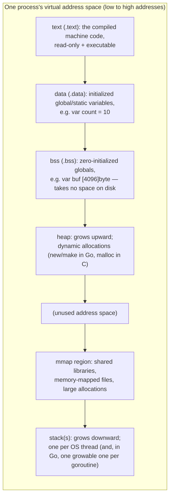
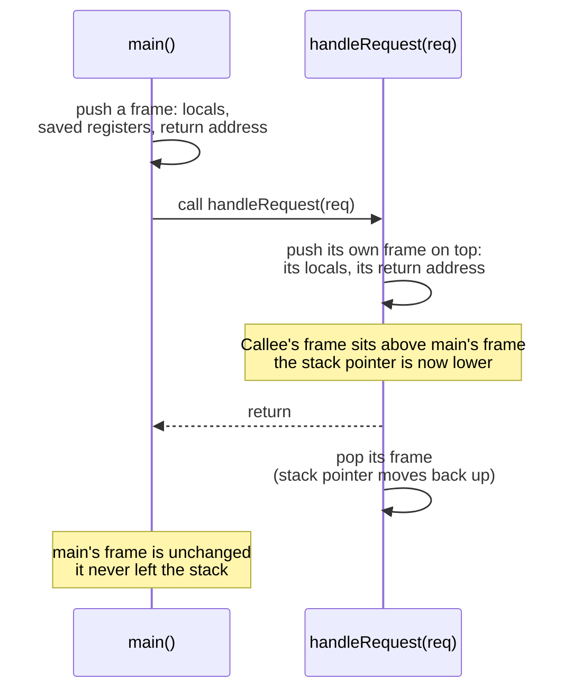
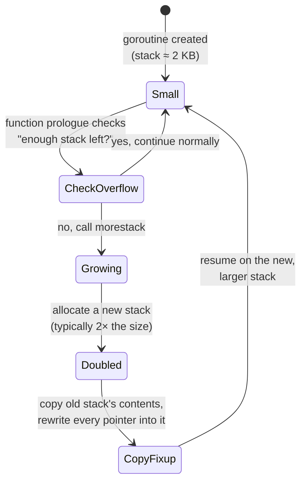

# Process Memory Layout - Stack vs Heap

> [!summary] TL;DR
> A running process's virtual address space is divided into regions with different jobs: code (**text**), initialized globals (**data**), zeroed globals (**bss**), a growable **heap** for dynamic allocations, memory-mapped regions (**mmap**), and a **stack** per thread for function calls. The stack is cheap and automatic; the heap is flexible but needs a manager (an allocator, and in Go a garbage collector) to reclaim it.

> [!abstract] Core idea
> - The stack is a LIFO region: entering a function pushes a frame, returning pops it — allocation and deallocation are both just moving one pointer.
> - The heap has no inherent order: anything can be freed at any time, in any order, which is exactly why it needs a real allocator (and, in Go, a garbage collector) instead of a single pointer.
> - A value's lifetime, not its type, decides where it lives: if a function could return a pointer to it, it can't safely live on that function's stack frame.
> - The Go compiler decides stack vs heap at compile time via **escape analysis**; `go build -gcflags=-m` shows you its reasoning.
> - Go goroutine stacks start small (about 2 KB) and grow by copying to a bigger stack, unlike a fixed-size OS thread stack that simply overflows when exhausted.

## 1. Why it exists

Every function call needs somewhere to put its local variables and to remember where to return to when it finishes. Calls nest — `main` calls `handleRequest`, which calls `parseBody`, which calls `readAll` — and they unnest in exactly the reverse order they were entered. That "last in, first out" pattern is precisely what a stack is for, and using one real, hardware-supported region of memory for it (rather than, say, allocating fresh memory for every function's locals) makes function calls cheap: entering a function just means moving a stack pointer down by the frame's size, and returning moves it back up. No searching for free space, no bookkeeping about which chunks are in use.

But not everything a program creates has that nested lifetime. A value a function builds and returns a pointer to — a new struct handed back to the caller, a buffer stashed in a long-lived cache — must outlive the function that created it, sometimes indefinitely, and in no particular nesting order relative to other allocations. That's the **heap**: a region with no inherent structure, managed by an allocator that can hand out and reclaim chunks in any order, exactly because their lifetimes don't follow a stack's nesting discipline.

## 2. Mental model

The stack is a stack of trays in a cafeteria: you can only add a tray to the top or take the top tray off. Fast, no decisions to make about where a new tray goes. The heap is a warehouse with a forklift (the allocator): you can request a crate of any size, put it anywhere there's room, and later remove any crate regardless of when it arrived — but someone has to keep track of what's free and what's occupied, and in Go, someone (the garbage collector) has to notice when a crate is no longer referenced by anyone and can be removed.

Whether a value becomes a tray or a crate isn't a property of the value's *type* — an `int` and a `*Counter` can each go either way. It's a property of whether its lifetime can be proven to end when the function that created it returns. If the compiler can prove that, it's a tray (stack). If a pointer to it might be used after the function returns — a function returns `&x`, or stores `x`'s address somewhere that outlives the call — it has to be a crate (heap), because the tray it would have sat on is about to be reused by the next function call.

## 3. How it works

### The address space, region by region



This is a logical layout, not a promise about exact addresses — ASLR (see [[Virtual Memory, Paging and the TLB]]) randomizes where the heap, stack, and shared libraries actually start each run, specifically so an attacker can't hardcode addresses. The **text**, **data**, and **bss** sizes are fixed at link time (`size` on Linux reports them directly from the binary); the **heap** and **stack(s)** grow and shrink as the program runs.

### Stack frames and the call stack



Each frame typically holds: the function's local variables that fit the "stack" rule above, saved copies of registers the function will overwrite, and the return address (where to resume the caller). Entering a function is one instruction adjusting the stack pointer by the frame's size (computed once, at compile time, from the function's locals); returning is the reverse. This is why stack allocation is close to free compared to a heap allocation, which has to consult an allocator's data structures to find and reserve free space.

### Go goroutine stacks: small and growable

A traditional OS thread stack (see [[Processes, Threads and Context Switching]]) is reserved at a large fixed size (1-8 MB is typical on Linux via `pthread_create`'s defaults) because the kernel has no cheap way to grow it later: the stack must be one contiguous region, and whatever's above it in the address space might already be in use. Reserving 8 MB per thread for a program with thousands of threads is expensive, even though only a few KB of it may ever be touched (it's typically backed by physical pages lazily, via the same demand paging covered in [[Virtual Memory, Paging and the TLB]] — but the *virtual* reservation and the kernel bookkeeping around it still aren't free at large scale).

Go sidesteps this: each goroutine starts with a tiny stack (2 KB as of recent Go releases) and the compiler inserts a cheap check ("stack guard" check) at the start of functions that might need more space than is left. If a goroutine's stack would overflow, the runtime doesn't fail — it allocates a new, larger stack (typically double), copies the old stack's contents over, and **fixes up every pointer that pointed into the old stack** so they point into the new one. This copy-and-grow approach is only possible because the Go runtime, unlike the OS, knows exactly which values on the stack are pointers (from compiler-generated metadata) and can safely rewrite them.



## 4. Worked example

### Whiteboard version

The one decision the compiler is really making, reduced to its essence: does this value's address ever leave the function?

```go
func stackCandidate() int {
    x := 42       // address never taken, never returned: can live on the stack
    return x
}

func heapCandidate() *int {
    x := 42       // address IS returned: must outlive this frame
    return &x     // the compiler must allocate x on the heap instead
}
```

Below is a real, minimal pair of functions and the compiler's own, captured reasoning about them.

```go
// Package escape holds two functions used only to demonstrate the compiler's
// escape analysis decisions via `go build -gcflags=-m`. Their behaviour is
// trivial on purpose; what matters is where each value is allocated.
package escape

// Counter is a small struct big enough to see in compiler diagnostics but
// small enough to keep the demo readable.
type Counter struct {
	n int
}

// SumOnStack adds a and b using a local variable that never leaves this
// function: the compiler can prove it, and keeps it on the stack.
func SumOnStack(a, b int) int {
	sum := a + b // local; its address is never taken or returned
	return sum
}

// NewCounterOnHeap returns a pointer to a freshly created Counter. Because
// the pointer outlives the function call, the compiler cannot place it on
// this frame's stack: it must "escape" to the heap.
func NewCounterOnHeap(start int) *Counter {
	c := &Counter{n: start} // escapes: its address is returned
	return c
}
```

**Measured** (`go build -gcflags=-m ./escape/`, Go 1.24.4, darwin/arm64, run in the scratch module for this note, 2026-11-06):

```text
# scratch/escape
escape/demo.go:14:6: can inline SumOnStack
escape/demo.go:22:6: can inline NewCounterOnHeap
escape/demo.go:23:7: &Counter{...} escapes to heap
```

Exactly as predicted: `SumOnStack`'s local never gets an "escapes" line (it stays on the stack — in fact the whole tiny function is also small enough to be inlined into its caller, removing the frame entirely), while `&Counter{...}` inside `NewCounterOnHeap` is explicitly flagged as escaping to the heap, because its address is returned to the caller.

> [!tip] Reading `-gcflags=-m` yourself
> Run `go build -gcflags=-m ./...` (add a second `-m` for more detail) on any package. Lines mentioning "escapes to heap" name a heap allocation the compiler could not avoid; "does not escape" (shown with `-m -m`, or implied by its absence here) means it stayed on the stack. This is the single fastest way to find an unexpected allocation in a hot path.

### A call stack you can push and pop

The LIFO mechanism itself, modelled directly and tested — not a demonstration of escape analysis, but of what "the stack" actually is underneath it:

```go
// Package memlayout models a call stack explicitly, as a backing array plus
// a stack pointer, to make the mechanism that the hardware stack pointer and
// Go's goroutine stacks both use concrete and testable: a LIFO region of
// fixed-size frames, growth by moving one pointer, and overflow when the
// region runs out.
package memlayout

import "fmt"

// Frame is a stand-in for one function activation record: its locals and
// its return address, the two things a real stack frame holds.
type Frame struct {
	FuncName      string
	Locals        [4]int64 // fixed-size "locals", like a real frame's fixed layout
	ReturnAddress int
}

// ErrStackOverflow mirrors a real thread hitting the end of its guard page.
var ErrStackOverflow = fmt.Errorf("stack overflow: exceeded capacity")

// CallStack is a fixed-capacity LIFO region, like one goroutine's or one OS
// thread's stack before any growth. Push/Pop only ever move one index:
// exactly why stack allocation is cheap compared to a heap allocator call.
type CallStack struct {
	frames []Frame
	sp     int // stack pointer: index of the next free slot
}

// NewCallStack preallocates capacity frames, the way the OS reserves address
// space for a thread stack up front (committing pages lazily on first touch).
func NewCallStack(capacity int) *CallStack {
	return &CallStack{frames: make([]Frame, capacity)}
}

// Push enters a new function call: write its frame, advance sp by one.
func (s *CallStack) Push(f Frame) error {
	if s.sp >= len(s.frames) {
		return ErrStackOverflow
	}
	s.frames[s.sp] = f
	s.sp++
	return nil
}

// Pop returns from a function call: step sp back by one. Memory is not
// zeroed or freed individually, exactly like a real stack: it is reclaimed
// in bulk just by moving the pointer.
func (s *CallStack) Pop() (Frame, bool) {
	if s.sp == 0 {
		return Frame{}, false
	}
	s.sp--
	return s.frames[s.sp], true
}

// Depth reports how many frames are currently live (the call depth).
func (s *CallStack) Depth() int { return s.sp }
```

```go
func TestPushPopIsLIFO(t *testing.T) {
	s := NewCallStack(4)
	s.Push(Frame{FuncName: "main"})
	s.Push(Frame{FuncName: "handleRequest"})
	s.Push(Frame{FuncName: "readBody"})

	if s.Depth() != 3 {
		t.Fatalf("depth = %d, want 3", s.Depth())
	}
	top, ok := s.Pop()
	if !ok || top.FuncName != "readBody" {
		t.Fatalf("Pop() = %+v, %v; want readBody, true", top, ok)
	}
}

func TestOverflowIsReportedNotPanicked(t *testing.T) {
	s := NewCallStack(2)
	s.Push(Frame{FuncName: "a"})
	s.Push(Frame{FuncName: "b"})
	if err := s.Push(Frame{FuncName: "c"}); err != ErrStackOverflow {
		t.Fatalf("Push c: got %v, want ErrStackOverflow", err)
	}
}
```

`go vet ./escape/... ./memlayout/...` is clean; `go test -race ./memlayout/...` passes `TestPushPopIsLIFO`, `TestOverflowIsReportedNotPanicked`, and `TestPopOnEmptyStackIsFalseNotPanic`.

## 5. Variants and comparison

| Region | Grows how | Lifetime | Allocation cost | Reclaimed by |
| ------ | ---------- | -------- | ---------------- | ------------- |
| Stack | Pointer bump on call; shrinks on return | Bound to the function call (or, in Go, to the goroutine) | Near-free: move a pointer | Automatic, on return — no manager needed |
| Heap | Allocator finds/extends free space | Until nothing references it | An allocator call (`malloc`-class bookkeeping); in Go also tracked by the GC | `free`/manual (C); garbage collector (Go, Java); see [[Runtime - Memory Allocator and Garbage Collector]] |
| `mmap` region | Explicit `mmap`/`munmap` (or Go's large-allocation path, which also uses `mmap` under the hood) | Until explicitly unmapped | A syscall (see [[System Calls and User vs Kernel Mode]]); pages then fault in lazily | Explicit `munmap`, or process exit |
| `data`/`bss` (globals) | Fixed size, set at link time | Whole process lifetime | None at runtime — space exists from process start | Process exit |

## 6. Trade-offs and when not to use

- Stack allocation is nearly free but inflexible: a value's size must be known (or boundable) at compile time for a given frame, and its lifetime must not outlive the call. Neither constraint can be relaxed without moving the value to the heap.
- Heap allocation is flexible but not free: in Go, every heap allocation is a candidate for the garbage collector to track and eventually scan, so unnecessary escapes (e.g., returning `*int` where returning `int` would do) add both allocator and GC pressure in a hot path — exactly what `-gcflags=-m` helps you find and what [[Pointers, Values and Escape Analysis]] covers in full.
- Go's growable goroutine stacks remove the "reserve 8 MB per thread" cost, but stack growth itself (copy + pointer fixup) is not instant; a function with an unusually deep, tight recursive loop can pay repeated stack-growth costs if each growth step is quickly outgrown again. This is rarely a practical problem, but it's why extremely deep recursion in a hot path is worth profiling rather than assuming is free.
- `mmap`-backed large allocations (Go's runtime uses this path for big objects) skip the heap's usual small-object bookkeeping, at the cost of needing a real syscall and page-fault-driven backing, which only pays off for allocations large enough that overhead is a rounding error.

## 7. In production

- **Real systems:** Go's own runtime documents the 2 KB initial goroutine stack and its doubling growth policy; JVM threads famously default to large fixed stacks (`-Xss`) for exactly the reason Go avoids — without growable stacks, you must either over-provision per thread or risk `StackOverflowError`; C programs commonly crash with a segmentation fault on deep uncontrolled recursion because their OS thread stack is fixed-size and unmoving.
- **Failure modes → fixes:**
  - Unexpectedly high allocation/GC pressure in a Go hot path → run `go build -gcflags=-m` on the package, or `go tool pprof` with an allocation profile, to find avoidable escapes (e.g., a small struct returned by pointer when returning by value would do, or a value captured by a closure that's stored somewhere long-lived).
  - A Go goroutine recursing very deeply (e.g., parsing a deeply nested structure) hits the runtime's maximum stack size and the whole program crashes with `fatal error: stack overflow` — unlike a normal stack-growth event, this one is not recoverable; convert unbounded recursion to an explicit loop with your own bounded stack ([[Stacks, Queues and Deques]]) if input depth isn't trusted.
  - A C/C++ or cgo-adjacent component segfaults under deep recursion → its OS thread stack is fixed-size; check `ulimit -s` (Linux) and consider increasing it or bounding recursion depth, since there's no "morestack" there.
- **What to monitor:** Go's allocation profile (`pprof`'s `alloc_objects`/`alloc_space`) for unexpected heap growth; `GODEBUG=gctrace=1` output for GC frequency and pause time; for native code, `ulimit -s` and any crash reports mentioning stack exhaustion.

## 8. Deep dive

- **Escape analysis, mechanically.** The compiler keeps a value on the stack only if it can prove the address never outlives the call; the full rules and how to read `-gcflags=-m` output live in [[Pointers, Values and Escape Analysis]].
- **Stack growth's pointer-fixup problem, and why only Go's runtime can do it.** Moving a C thread's stack mid-flight is not generally safe: any raw pointer another part of the program holds into the old stack (a pointer to a local variable passed to another thread, for instance) would become invalid, and C's type system can't find and fix all of them. Go's compiler emits per-function metadata describing exactly which stack slots hold pointers at every point a stack check could trigger growth, so the runtime's `copystack` can find and rewrite every live pointer into the old stack as part of the copy — a capability that depends on the compiler and runtime co-designing this format, not something retrofittable onto an arbitrary ABI.
- **bss costs nothing on disk, something at runtime.** A 64 MB zero-initialized global array costs essentially nothing in the compiled binary's file size (bss is just a "reserve this many zeroed bytes" directive), but still costs real virtual address space and, once touched, real physical pages — the same demand-paging mechanism from [[Virtual Memory, Paging and the TLB]] applies to bss pages exactly as it does to heap pages.
- **Why the heap needs a manager and the stack doesn't.** The stack's nesting guarantee (whatever was pushed most recently is freed first) means "where is the next free byte" is always answered by one pointer. The heap has no such guarantee — a value allocated first might outlive one allocated after it, and vice versa — so free and in-use regions end up interleaved over time (fragmentation), and finding a free block of the right size, or coalescing adjacent free blocks, needs real data structures (free lists, size classes, Go's own span-based allocator) and, in a garbage-collected language, a separate process (the GC) to even determine what's still in use. See [[Runtime - Memory Allocator and Garbage Collector]] for that machinery in full.

## 9. Interview questions

> [!question]- What actually decides whether a value goes on the stack or the heap?
> Not its type, and not whether you wrote `new`/`&` — its *provable lifetime*. If the compiler can prove a value's address never outlives the function call that created it, it stays on the stack. If a pointer to it might be used after the function returns (returned, stored in a long-lived structure, sent on a channel, captured by an escaping closure), it must go on the heap, because the stack frame it would have occupied is about to be reused.

> [!question]- Why is stack allocation so much cheaper than heap allocation?
> Because the stack's structure (strictly LIFO — nested calls unwind in reverse order) means "allocate" and "free" are both just moving one pointer, with no search for free space and nothing to track afterward. The heap has no such ordering guarantee, so an allocator needs real bookkeeping (free lists, size classes) to find space and, eventually, to reclaim it — in Go's case, with help from the garbage collector.

> [!question]- Trap: does returning a pointer from a Go function always cause a heap allocation?
> Not always — the compiler can sometimes prove a returned pointer's target doesn't actually escape further (for instance, if it's immediately dereferenced and discarded by an inlined caller), in which case it may still stay stack-allocated after inlining. But as a rule of thumb it very often does escape, and the only way to know for a specific function is to check `go build -gcflags=-m`'s actual output rather than assume from the syntax alone.

> [!question]- How does a goroutine's stack grow without the goroutine itself breaking?
> The compiler inserts a cheap "do I have enough stack space left?" check near the start of functions. If not, the runtime allocates a new, larger stack (typically double the old size), copies the old stack's contents into it, and rewrites every pointer that referenced an address on the old stack so it now points into the new one — using compiler-generated metadata that identifies exactly which stack slots are pointers. The goroutine then resumes as if nothing happened.

> [!question]- Why don't OS threads get this same growable-stack treatment?
> Because the kernel and a general-purpose ABI have no reliable way to find and rewrite every pointer into a thread's stack — unlike Go, which controls both the compiler and the runtime and can therefore track exactly which stack slots hold pointers. So OS thread stacks are reserved at a large fixed size up front instead, trading some wasted virtual address space (and kernel bookkeeping overhead at scale) for not needing that pointer-safe relocation machinery at all.

> [!question]- A Go function returns a `*Counter` built from a struct literal in its body. Will that struct be on the stack or the heap, and how would you check?
> Almost certainly the heap, because its address is returned and therefore must outlive the function's own frame — the compiler cannot place something behind a returned pointer on a frame that's about to be popped. Confirm it with `go build -gcflags=-m`: it will print a line like `&Counter{...} escapes to heap` at the exact source location of the allocation.

> [!question]- What's actually stored in `bss`, and why does it matter for a large Go program?
> Zero-initialized package-level variables: Go arrays or slices backed by package-level zero values, for instance. `bss` costs nothing in the compiled binary on disk — it's a directive, not stored bytes — but it still reserves real virtual address space, and once the program actually touches those bytes, real physical pages get mapped in via ordinary demand paging, exactly like heap memory would.

## 10. Cheat sheet

- Layout, low to high: text (code) → data (initialized globals) → bss (zeroed globals) → heap (grows up) → … → mmap region → stack(s) (grows down).
- Stack = LIFO, pointer-bump allocation, reclaimed automatically on return. Heap = unordered, needs a real allocator (and in Go, a GC) to track and reclaim.
- A value escapes to the heap when its address could outlive its creating function's frame — check reasoning directly with `go build -gcflags=-m`.
- Go goroutine stacks start ~2 KB and grow by copy-and-pointer-fixup; OS thread stacks are large and fixed because that relocation trick needs compiler/runtime cooperation an OS ABI doesn't have.
- `bss` costs nothing on disk but still costs virtual (and eventually physical) memory once touched.
- Avoidable heap escapes in a hot path (e.g. pointer-returning small structs) add both allocation and GC-scanning cost; `-gcflags=-m` and an allocation profile both find them.
- Unbounded deep recursion in Go can still exhaust the runtime's maximum stack and crash — "growable" is not "unlimited".

## Links

- **Before this:** [[Virtual Memory, Paging and the TLB]], [[Processes, Threads and Context Switching]]
- **Next:** [[Pointers, Values and Escape Analysis]], [[Runtime - Memory Allocator and Garbage Collector]]
- **Compare with:** [[Runtime - Goroutine Scheduler (GMP)]] (how goroutines using these stacks get scheduled onto OS threads)
