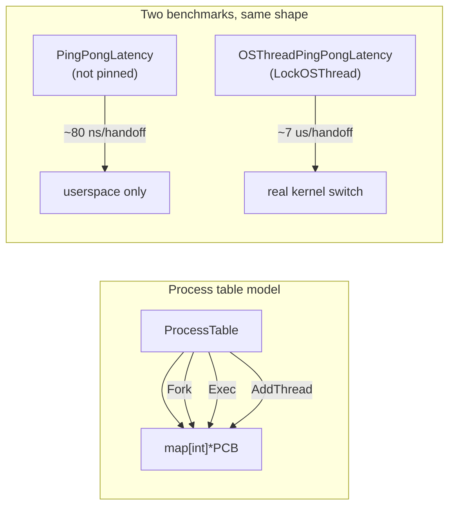

# Processes, Threads and Context Switching - Go

> [!summary] TL;DR
> Runnable code for [[Processes, Threads and Context Switching]]: a minimal process table modelling `fork`, `exec` and per-process threads, plus two context-switch benchmarks measured side by side on the same machine — one that lets the Go scheduler keep both goroutines on one OS thread, and one that pins each goroutine to its own OS thread with `runtime.LockOSThread`, forcing a real kernel context switch on every hand-off.

> [!info] How to read this note (pick your level)
> - 🟢 **New to this?** Read the theory note first ([[Processes, Threads and Context Switching]]). Here, read "From zero" below, "Before the code" and "What this code shows", then skim the code steps.
> - 🟡 **Know the basics?** Read the Code, Design decisions and Tests sections, then run it yourself.
> - 🔴 **Interview / SDE-3 prep?** Add the Pitfalls and Exercises sections. Headings are tagged 🟢🟡🔴.

> [!note] Before this note
> - [[Processes, Threads and Context Switching]]: the theory twin. Know that a process owns memory, a thread runs inside it, `fork` copies a process, `exec` swaps its program, and a context switch is the kernel swapping which thread runs.
> - [[How a Computer Runs a Program]]: the CPU keeps the current state in registers and a program counter.

**From zero** 🟢: this file is the hands-on side of [[Processes, Threads and Context Switching]]. It measures, in real numbers on your machine, how cheap goroutine switches are compared to OS thread/process operations. Read the code with its notes, then run the benchmarks and compare your numbers.

## Before the code 🟢

- **Goroutines (`go f()`)**: a function running concurrently, scheduled by the Go runtime rather than the OS.
- **Unbuffered channels (`make(chan struct{})`)**: a send blocks until a receiver is ready, so each send is a forced hand-off between goroutines.
- **`runtime.LockOSThread`**: pins the calling goroutine to one OS thread, so switching to another pinned goroutine needs a real kernel context switch.
- **`defer`**: runs a call when the function returns (even on panic); used here to always unpin the thread.
- **Maps and structs (`map[int]*PCB`)**: the in-memory process table is a plain map from PID to a struct pointer.
- **PCB (process control block)**: the kernel's record card for one process: its ID, state, program counter and registers.
- **Userspace**: code running as a normal program, outside the kernel. Staying there avoids the cost of a kernel switch.
- **What to run**: `go vet ./... && go test -race ./...` for correctness, then `go run ./cmd/pingpong` for the timing numbers.

## What this code shows 🟢

Every row below is a two-way link: the theory-note section names the *why*, and the code name is the *how*.

Reading them side by side before diving into the Code section is the fastest way to know, for any one block below, what question it is supposed to answer — which matters because the two benchmark functions in particular look almost identical to each other at a glance, and the whole point of this note is in the one difference between them.

| Code | Concept in the theory note |
| --- | --- |
| `ProcessTable.Create`, `.Fork`, `.Exec`, `.AddThread` | A PCB per process; `fork` copies it, `exec` resets it in place, a thread joins the same PCB's `ThreadIDs` ([[Processes, Threads and Context Switching#Tracing the PCB operations, step by step]]) |
| `PingPongLatency` | A goroutine handoff the Go scheduler can keep in userspace ([[Processes, Threads and Context Switching#Measuring a goroutine handoff against a real OS-thread handoff]]) |
| `OSThreadPingPongLatency` | The same handoff, but forced through the kernel by pinning each side to its own OS thread |



> 🟢 → 🟡 **You now know** what the module contains: a toy process table and two timing benchmarks. **Next we see why** the code measures two almost identical handoffs, then read the code step by step.

## Why measure both sides instead of citing one number 🟡

The theory note's claim has two parts, and a single benchmark can only ever support one of them. "A goroutine handoff is cheap" is easy to show: time `PingPongLatency` and the number is small.

The harder part is "...*because* it avoids a real kernel context switch, which is itself expensive" — that is a claim about what's being avoided, not just about what's being measured, and a single number can't distinguish "this is cheap because it skips the kernel" from "this is cheap because context switches in general are cheap on modern hardware."

`OSThreadPingPongLatency` exists specifically to rule out the second explanation.

By keeping every other variable identical — same unbuffered-channel hand-off shape, same machine, same Go version, same run — and changing only whether the two goroutines *can* share an OS thread, the difference between the two measured numbers isolates the one variable the theory note is actually making a claim about.

A 90x gap between two numbers that differ in exactly one respect is much stronger evidence than either number taken alone, and it is also why both benchmarks were written to share as much structure as possible rather than being two unrelated functions that happen to both return a `time.Duration`.

This is also why the pinned benchmark uses `runtime.LockOSThread` rather than, say, spawning real OS-level processes and measuring IPC between them: a process-to-process round trip would add syscall and IPC overhead on top of the context switch itself, muddying exactly the comparison this benchmark exists to make cleanly.

## Setup 🟢

- Go 1.24. No external dependencies — standard library only (`fmt`, `runtime`, `time`).
- Layout: one package, `procthreads`, holding the process-table model, both latency benchmarks, and their tests; a `cmd/pingpong` runnable prints five samples of each benchmark.
- Run it with `go vet ./... && go test -race ./...`. The timing numbers are printed by `go run ./cmd/pingpong`.
- Nothing here needs a database, a network connection, or any environment-specific setup beyond a working Go 1.24 toolchain — every number in this note was produced by running the commands above exactly as written, on the machine and date given in the frontmatter.

## How to read this note 🟢

This note has two halves that teach different things.

The `ProcessTable` steps (1 and 2) are a **model**: a simplified stand-in for the real kernel data structures described in the theory note, built to be inspected and tested rather than to be a real operating system.

The two benchmark steps (3 and 4) are the opposite: they are not a model of a context switch, they **are** one, measured directly on whatever machine runs them.

Keeping those two purposes separate matters when reading the code — the process table's job is to make the *vocabulary* (PCB, fork, exec, thread) concrete, while the benchmarks' job is to replace a cited number from someone else's benchmark with a number from this one.

Each code step below follows the same shape: a **Concept** paragraph linking the code back to the exact theory-note section it implements and naming the alternative designs that were considered, a block of code kept under about 30 lines, and a **How it works** list walking through the lines that matter.

Where a function was naturally longer than that, it is split across two blocks that continue each other, with a sentence marking the split.

## Code 🟡

### Step 1: a minimal process control block and table

**What this code does, in plain words:** it defines a small record for each process (ID, state, program counter, registers, thread list) and a map that holds them all by ID, like the kernel's process table.

**Concept.** The theory note's whiteboard model says a PCB is just a struct the kernel keeps one of per process, and `fork`/`exec`/thread creation are operations on it ([[Processes, Threads and Context Switching#Whiteboard version]]). `PCB` and `ProcessTable` turn that into something you can actually call and test. The alternative — a real `fork()` via `syscall.ForkExec` — would require actually spawning OS processes from inside a test binary, which is fragile and platform-specific; this in-memory model keeps the **scheduling-relevant** fields (PID, state, saved registers, thread membership) without needing a real kernel underneath it.

```go
// Package procthreads models a minimal process table (PCB, fork, exec,
// threads) and measures two kinds of context-switch-like handoff on this
// machine: a goroutine-to-goroutine handoff (userspace, never enters the
// kernel) and an OS-thread-to-OS-thread handoff (each goroutine pinned to
// its own kernel thread, so the handoff forces a real kernel context
// switch), so the two can be compared on identical hardware.
package procthreads

import (
	"fmt"
	"runtime"
	"time"
)

// State is a process's or thread's scheduling state.
type State int

const (
	New State = iota
	Ready
	Running
	Waiting
	Terminated
)

func (s State) String() string {
	return [...]string{"New", "Ready", "Running", "Waiting", "Terminated"}[s]
}
```

**How it works.**

1. `State` is a small enum mirroring the lifecycle diagram in the theory note (New, Ready, Running, Waiting, Terminated).
2. `String()` gives readable output in test failures and logs instead of a bare integer.

```go
// PCB is a minimal process control block: the fields the OS keeps per
// process so it can stop it and correctly resume it later. A thread's
// control block (not modelled separately here) is the same shape minus the
// address-space fields, which is exactly why threads are "cheap processes".
type PCB struct {
	PID        int
	ParentPID  int
	State      State
	ProgramCtr uint64 // saved instruction pointer
	Registers  [8]uint64
	ThreadIDs  []int // every thread sharing this PCB's address space
}

// ProcessTable owns every PCB, the way the kernel owns one process table.
type ProcessTable struct {
	procs  map[int]*PCB
	nextID int
}

func NewProcessTable() *ProcessTable {
	return &ProcessTable{procs: make(map[int]*PCB), nextID: 1}
}
```

**How it works.**

1. `PCB.ThreadIDs` is the field that makes "a thread shares its process's address space" concrete: every thread sharing this PCB is just another entry in this one slice, not a PCB of its own.
2. `ProcessTable.procs` is a `map[int]*PCB` keyed by PID — a direct stand-in for the kernel's real process table.
3. `nextID` is reused for both new process PIDs and new thread IDs, mirroring that both are drawn from the same ID space at the kernel level (a thread is, underneath, "a process created with most of `clone`'s sharing flags set" — the deep-dive point in the theory note).

### Step 2: fork, exec and adding a thread

**What this code does, in plain words:** `Fork` makes a new record copied from the parent, `Exec` wipes and restarts an existing record under the same ID, and `AddThread` just adds a new thread ID to an existing record.

**Concept.** These three methods are the whole "fork copies, exec resets, a thread joins" story from the theory note's lifecycle section, each one a few lines because the real complexity (copy-on-write page tables, loading an ELF binary, the standard Linux program-file format) lives in the kernel, not in this model. The alternative would be to model copy-on-write explicitly with a simulated page table — intentionally left out here, because [[Virtual Memory, Paging and the TLB]] already covers that mechanism on its own.

```go
// Create starts a brand-new process with one thread (the "main thread").
func (t *ProcessTable) Create(parentPID int) *PCB {
	pid := t.nextID
	t.nextID++
	p := &PCB{PID: pid, ParentPID: parentPID, State: Ready, ThreadIDs: []int{pid}}
	t.procs[pid] = p
	return p
}

// Fork clones an existing process: a new PID and a new PCB, but a logical
// copy of the parent's state (copy-on-write in a real kernel copies page
// table entries, not memory; this model only copies the PCB fields, which is
// the part relevant to scheduling).
func (t *ProcessTable) Fork(parentPID int) (*PCB, error) {
	parent, ok := t.procs[parentPID]
	if !ok {
		return nil, fmt.Errorf("fork: no such process %d", parentPID)
	}
	child := t.Create(parentPID)
	child.ProgramCtr = parent.ProgramCtr
	child.Registers = parent.Registers
	return child, nil
}
```

**How it works.**

1. `Create` gives a process `ThreadIDs: []int{pid}` from the start — the process itself always counts as its own first thread, consistent with "a process is at least one thread."
2. `Fork` calls `Create` for the new PID, then copies `ProgramCtr` and `Registers` from the parent — a logical stand-in for the real kernel's copy-on-write duplication, scoped to the fields that matter for scheduling rather than actual memory bytes.
3. Looking up `parentPID` first, and returning an error if it's missing, mirrors the real `fork()` failing cleanly if called with a bogus PID rather than corrupting the table.

```go
// Exec replaces the calling process's program: same PID, same PCB entry, but
// its instruction pointer and registers reset as if a new binary had just
// been loaded. Exec never creates a new process; it reuses the current one.
func (t *ProcessTable) Exec(pid int, entryPoint uint64) error {
	p, ok := t.procs[pid]
	if !ok {
		return fmt.Errorf("exec: no such process %d", pid)
	}
	p.ProgramCtr = entryPoint
	p.Registers = [8]uint64{}
	return nil
}
```

**How it works.**

1. `Exec` looks up the **same** PCB by `pid` and mutates it in place — no new map entry, exactly "same PID, same PCB entry" from the theory note.
2. Resetting `Registers` to its zero value models the new program starting with a clean register state, as if nothing from the previous program survived.
3. There is no analogue of `Create`'s "new PID" step anywhere in this function — that absence is the entire point: `exec` never creates a process, it only replaces what one PID is running.

`AddThread` and the plain `Get` accessor finish the table's API:

```go
// AddThread creates a new thread inside an existing process. The new thread
// gets its own thread ID (so the scheduler can run it independently) but
// joins the same PCB's ThreadIDs list, because it shares that process's
// address space, open files and heap rather than getting its own.
func (t *ProcessTable) AddThread(pid int) (int, error) {
	p, ok := t.procs[pid]
	if !ok {
		return 0, fmt.Errorf("add thread: no such process %d", pid)
	}
	tid := t.nextID
	t.nextID++
	p.ThreadIDs = append(p.ThreadIDs, tid)
	return tid, nil
}

func (t *ProcessTable) Get(pid int) (*PCB, bool) {
	p, ok := t.procs[pid]
	return p, ok
}
```

**How it works.**

1. `AddThread` draws a fresh ID from the same counter as `Create`, but appends it to the **existing** process's `ThreadIDs` instead of creating a new `PCB` — the one line that is the entire difference between "a new thread" and "a new process" in this model.
2. `Get` is a plain accessor, used by the tests to inspect a PCB's state after an operation, and by nothing else in the package.

### Step 3: a goroutine handoff the scheduler can keep in userspace

**What this code does, in plain words:** two goroutines pass a token back and forth thousands of times over channels, and the function returns the average time of one pass.

**Concept.** `PingPongLatency` measures the cheap side of the comparison: two goroutines trading a token over unbuffered channels, with neither pinned to a particular OS thread. Each send/receive pair forces the Go scheduler to park one goroutine and run another — the userspace equivalent of a context switch — but because nothing pins either goroutine, the Go scheduler is free to keep both on the same OS thread and never enter the kernel at all ([[Processes, Threads and Context Switching#Measuring a goroutine handoff against a real OS-thread handoff]]).

The setup spawns the responding goroutine:

```go
// PingPongLatency starts two goroutines that hand a token back and forth over
// unbuffered channels for rounds round trips, and returns the average time per
// one-way handoff. Each send/receive pair forces the Go scheduler to park one
// goroutine and run another, which is the userspace equivalent of a context
// switch between kernel threads. Neither goroutine is pinned to an OS thread,
// so the Go scheduler is free to keep both on the same OS thread and never
// enter the kernel at all.
func PingPongLatency(rounds int) time.Duration {
	ping := make(chan struct{})
	pong := make(chan struct{})
	done := make(chan struct{})

	go func() {
		for i := 0; i < rounds; i++ {
			<-ping
			pong <- struct{}{}
		}
		close(done)
	}()
```

**How it works.**

1. Both channels are **unbuffered**, so every send blocks until the other side is ready to receive — that blocking and waking is exactly what forces a scheduler hand-off on each line.
2. The spawned goroutine's whole job is to echo: receive on `ping`, immediately send on `pong`, `rounds` times, then signal `done`.

The timed loop and the return close the function:

```go
	runtime.Gosched()
	start := time.Now()
	for i := 0; i < rounds; i++ {
		ping <- struct{}{}
		<-pong
	}
	elapsed := time.Since(start)
	<-done

	return elapsed / time.Duration(rounds*2) // two handoffs per round trip
}
```

**How it works.**

1. `runtime.Gosched()` before timing starts yields the current goroutine once, letting the newly-spawned goroutine actually start running before the clock starts, so its startup cost isn't counted in the measurement.
2. The loop does `rounds` round trips, each one a send and a receive on `ping` followed by a send and a receive on `pong` — two one-way handoffs per round trip, which is why the final division is by `rounds*2`.
3. `<-done` after the loop waits for the spawned goroutine to notice the loop ended and exit cleanly, so the function never returns while that goroutine is still running.

### Step 4: forcing the same handoff through a real kernel context switch

**What this code does, in plain words:** the same token passing, but each goroutine is first glued to its own OS thread, so every pass needs a real kernel context switch.

**Concept.** `OSThreadPingPongLatency` is the expensive side of the comparison, built to be as close as possible to `PingPongLatency` except for one change: both goroutines call `runtime.LockOSThread`, which pins each one to its own, dedicated OS thread for as long as it holds the lock. Because the two goroutines can now never share one OS thread, every hand-off through the unbuffered channels forces the **OS scheduler itself** to park one kernel thread and run the other — a real kernel context switch, not a Go-runtime one. The alternative — citing a published `lmbench`-style number — tells you the order of magnitude on someone else's machine; this measures the actual number on this one, with the same channel-based handoff shape as the unpinned version, so the two numbers are directly comparable.

The setup pins the responder to its own OS thread before it starts echoing:

```go
// OSThreadPingPongLatency measures the same hand-off, but with each side
// locked to its own OS thread via runtime.LockOSThread. Because the two
// goroutines can never share one OS thread, every hand-off through the
// unbuffered channels forces the OS scheduler itself to park one kernel
// thread and run the other — a real kernel context switch, measured on this
// machine rather than cited from a benchmark run elsewhere.
func OSThreadPingPongLatency(rounds int) time.Duration {
	ping := make(chan struct{})
	pong := make(chan struct{})
	done := make(chan struct{})
	ready := make(chan struct{})

	go func() {
		runtime.LockOSThread()
		defer runtime.UnlockOSThread()
		close(ready)
		for i := 0; i < rounds; i++ {
			<-ping
			pong <- struct{}{}
		}
		close(done)
	}()
```

**How it works.**

1. The spawned goroutine calls `runtime.LockOSThread()` first, before doing anything else, binding itself to a dedicated OS thread that no other goroutine will be scheduled onto while the lock is held.
2. It then closes `ready`, signalling the caller that it is now safely pinned, and only then starts its echo loop — identical in shape to `PingPongLatency`'s responder.

The caller pins itself the same way, waits for the signal, then times the hand-off exactly as before:

```go
	runtime.LockOSThread()
	defer runtime.UnlockOSThread()
	<-ready

	start := time.Now()
	for i := 0; i < rounds; i++ {
		ping <- struct{}{}
		<-pong
	}
	elapsed := time.Since(start)
	<-done

	return elapsed / time.Duration(rounds*2)
}
```

**How it works.**

1. The caller pins itself with its own `runtime.LockOSThread()` call, then waits on `<-ready` before starting the clock — this ensures both sides are already pinned to separate OS threads before any timed hand-off happens.
2. The hand-off logic itself (`<-ping`, `pong <- struct{}{}` and back) is identical to `PingPongLatency`; the **only** behavioural difference is that neither side can be the "same OS thread" the other runs on, because each is locked to a different one.
3. `defer runtime.UnlockOSThread()` on both sides releases the pin once the function returns, so the dedicated OS threads can be reused by the Go runtime afterward instead of leaking.

## Design decisions 🟡

The table below records five choices made while writing this code, each with the alternative that was considered and rejected.

Reading a "Design decisions" table like this is itself a useful interview-prep habit: for any piece of unfamiliar code you're reading, asking "what did they choose not to do here, and why" surfaces assumptions the code's author made silently, which is exactly the kind of question a system-design interview tends to probe for.

| Decision | Alternative | Trade-off |
| --- | --- | --- |
| In-memory `ProcessTable` model | Real `fork`/`exec` via `syscall` | Portable and test-friendly; does not model actual copy-on-write page tables (deliberately, see [[Virtual Memory, Paging and the TLB]]) |
| Reuse one ID counter for PIDs and thread IDs | Separate counters | Matches the kernel's real "a thread is just another schedulable entity" model more closely than giving threads a visually distinct namespace |
| `runtime.LockOSThread` to force a real OS switch | Trust a cited `lmbench` number alone | Produces a number measured on this exact machine and Go version, directly comparable to the unpinned measurement, at the cost of needing careful pinning/unpinning to avoid leaking OS threads |
| A `ready` channel before timing the pinned benchmark | Start the clock immediately | Excludes goroutine/thread startup and `LockOSThread` setup cost from the measured hand-off time |
| Unbuffered channels for both benchmarks | Buffered channels | Unbuffered channels guarantee a hand-off (block until both sides rendezvous) on every single operation; a buffered channel could let several sends proceed without any scheduler involvement, hiding the effect being measured |

Two of these decisions are worth dwelling on, because they are easy to get subtly wrong.

First, pinning with `runtime.LockOSThread` only forces a *real* kernel switch if both communicating goroutines are pinned — pinning just one side still lets the Go scheduler keep the unpinned side wherever it likes, and the measurement would silently fall back to measuring something closer to the unpinned case.

Second, the `ready` handshake is not cosmetic: `LockOSThread` itself has a small, one-time setup cost (the Go runtime has to actually allocate or reuse a dedicated OS thread for the calling goroutine), and starting the clock before that cost has been paid on both sides would inflate the first sample disproportionately.

Both benchmarks pay that cost entirely before `start := time.Now()` runs.

## Tests 🟡

Four tests cover this code: three exercise the `ProcessTable` model's correctness (one per operation that could be confused with another — threading versus forking versus execing), and the fourth is a sanity check on the measurement harness itself rather than a performance assertion, for the reason explained in the recap at the end of this note.

None of the four tests assert anything about the pinned benchmark's absolute or relative timing, deliberately, since timing assertions in a unit test tend to be flaky across different machines and load conditions — the timing numbers that matter are read from `go run ./cmd/pingpong`'s printed output instead, in the Running it section below.

### Test 1: a thread shares its parent process's PCB

**Property.** Adding threads to a process must grow that one process's `ThreadIDs` list, never create new, separate processes — this is the entire meaning of "a thread shares its process's address space."

| Input | Expected |
| --- | --- |
| `Create(0)`, then `AddThread` twice | Two distinct thread IDs; `ThreadIDs` has 3 entries (process + 2 threads) |

```go
func TestThreadsShareTheParentProcesssPCB(t *testing.T) {
	pt := NewProcessTable()
	p := pt.Create(0)

	tid1, _ := pt.AddThread(p.PID)
	tid2, _ := pt.AddThread(p.PID)
	if tid1 == tid2 {
		t.Fatalf("two threads got the same thread ID: %d", tid1)
	}

	got, _ := pt.Get(p.PID)
	// The process itself counts as the first thread, plus the two added here.
	if len(got.ThreadIDs) != 3 {
		t.Fatalf("ThreadIDs = %v, want 3 entries", got.ThreadIDs)
	}
}
```

**If it fails.** Equal thread IDs mean the counter isn't advancing correctly. The wrong entry count means `AddThread` created a new PCB instead of appending to the existing one's `ThreadIDs`.

### Test 2: fork creates an independent child with a new PID

**Property.** `Fork` must produce a genuinely new process (its own PID) while still copying the parent's scheduling-relevant state, matching "fork clones a process."

| Input | Expected |
| --- | --- |
| Parent with `ProgramCtr = 0xABCD`, then `Fork(parent.PID)` | Child PID != parent PID; child's `ProgramCtr == 0xABCD` |

```go
func TestForkCreatesAnIndependentChildWithANewPID(t *testing.T) {
	pt := NewProcessTable()
	parent := pt.Create(0)
	parent.ProgramCtr = 0xABCD

	child, err := pt.Fork(parent.PID)
	if err != nil {
		t.Fatalf("Fork: unexpected error: %v", err)
	}
	if child.PID == parent.PID {
		t.Fatalf("child PID == parent PID (%d); fork must create a new PID", child.PID)
	}
	if child.ProgramCtr != parent.ProgramCtr {
		t.Fatalf("child ProgramCtr = %#x, want copy of parent's %#x", child.ProgramCtr, parent.ProgramCtr)
	}
}
```

**If it fails.** A matching PID means `Fork` reused the parent's PCB instead of creating a new one. A mismatched `ProgramCtr` means the copy step was skipped.

### Test 3: exec reuses the PID and resets state

**Property.** `Exec` must keep the same PID while resetting the program-specific state, matching "exec replaces the program, keeping the PID."

| Input | Expected |
| --- | --- |
| Process with `ProgramCtr = 0xABCD`, `Registers[0] = 42`, then `Exec(pid, 0x1000)` | Same PID; `ProgramCtr == 0x1000`; `Registers[0] == 0` |

```go
func TestExecReusesThePIDAndResetsState(t *testing.T) {
	pt := NewProcessTable()
	p := pt.Create(0)
	p.ProgramCtr = 0xABCD
	p.Registers[0] = 42

	if err := pt.Exec(p.PID, 0x1000); err != nil {
		t.Fatalf("Exec: unexpected error: %v", err)
	}
	got, _ := pt.Get(p.PID)
	if got.PID != p.PID {
		t.Fatalf("PID changed across exec: got %d, want %d", got.PID, p.PID)
	}
	if got.ProgramCtr != 0x1000 {
		t.Fatalf("ProgramCtr = %#x, want 0x1000", got.ProgramCtr)
	}
	if got.Registers[0] != 0 {
		t.Fatalf("Registers[0] = %d, want 0 (reset by exec)", got.Registers[0])
	}
}
```

**If it fails.** A changed PID means `Exec` created a new process instead of reusing the old PCB. A stale `ProgramCtr` or nonzero `Registers[0]` means the reset step was skipped.

Together, Tests 1 through 3 cover the three PCB operations the theory note describes — creating/threading, forking, and execing — each checked for the one property that distinguishes it from the other two: threading grows a list on the *same* PCB, forking produces a *new* PCB with copied state, and execing mutates the *same* PCB's program-specific fields in place.

A bug that swapped any two of these behaviours (for instance, if `Fork` accidentally reused the parent's PID) would be caught by exactly one of these three tests, which is why all three are kept rather than merged into one larger test.

### Test 4: the goroutine handoff measurement is small and positive

**Property.** `PingPongLatency` must return a sane, strictly positive duration — a sanity check that the measurement harness itself works, not a performance assertion (exact nanosecond counts vary by machine and load).

| Input | Expected |
| --- | --- |
| `PingPongLatency(1000)` | A duration `> 0` |

```go
func TestPingPongLatencyIsSmallAndPositive(t *testing.T) {
	d := PingPongLatency(1000)
	if d <= 0 {
		t.Fatalf("PingPongLatency = %v, want > 0", d)
	}
	if d > 0 {
		t.Logf("measured goroutine handoff: %v", d)
	}
}
```

**If it fails.** A zero or negative duration would indicate the timer wrapped or the loop never actually ran `rounds` iterations — a bug in the harness itself, not in the scheduler being measured.

## Running it 🟡

This section gives the exact commands, their exact output on this machine, and a line-by-line reading of that output — the same three-part shape used for every measurement in this note.

Two commands cover everything in this note: one verifies correctness, the other produces the actual timing numbers quoted in the theory note's worked example.

Running them in this order matters a little — `go vet` and `go test -race` are fast and should be run first on any change, while `go run ./cmd/pingpong` takes a few seconds (it runs ten total samples of 20,000-50,000 rounds each) and is worth running last, once you're confident the code itself is correct.

```bash
go vet ./... && go test -race ./...
go run ./cmd/pingpong
```

`go vet` is clean, with no warnings about unused variables, suspicious `defer` placement, or any of the other issues it checks for.

`go test -race` passes on Go 1.24.4, darwin/arm64:

```text
ok  	cs1scratch/procthreads	1.912s
```

`go run ./cmd/pingpong` prints the measurement behind the worked example's table:

```text
goroutine handoff (userspace, no OS threads pinned):
  sample 1: 83ns
  sample 2: 82ns
  sample 3: 80ns
  sample 4: 81ns
  sample 5: 84ns
OS-thread handoff (each side pinned via LockOSThread):
  sample 1: 7.368µs
  sample 2: 7.794µs
  sample 3: 7.407µs
  sample 4: 7.133µs
  sample 5: 7.043µs
```

**Reading the output line by line.**

1. The five unpinned samples cluster tightly around 80-84 ns, consistent run to run, because the Go scheduler keeps both goroutines on the same OS thread every time and the hand-off never leaves userspace.
2. The five pinned samples cluster around 7.0-7.8 µs — about 90x larger, and in the same ballpark as `lmbench`'s commonly-cited 1-10 µs figure for a same-core thread context switch.
3. The gap between the two groups is the whole point of the comparison: identical hand-off logic, identical hardware, identical run — the only variable is whether the Go scheduler is allowed to avoid the kernel.
4. Minor sample-to-sample variation within each group (e.g. 7.04-7.79 µs) reflects ordinary OS scheduling noise (other processes, thermal/frequency scaling) rather than anything about the code itself.

Both groups are also worth comparing against the theory note's lifecycle diagram directly: every single handoff in the unpinned group is a `Running -> Ready` transition for one goroutine paired with a `Ready -> Running` transition for the other, entirely inside the Go scheduler's own bookkeeping.

Every handoff in the pinned group is the same pair of transitions, but now enforced by the kernel's scheduler across two OS threads, which is precisely why it pays the page-table and cache costs the theory note's third section describes.

> 🟡 → 🔴 **You now know** how the model and both benchmarks work and what the numbers mean. **Next comes the advanced part:** the quiet ways this code could mislead or leak, such as a missing unlock, a missing `ready` signal, or a buffered channel.

## Pitfalls in the code 🔴

None of the four pitfalls below were found by `go vet` or the race detector — they are the kind of thing only a careful reading, or a deliberate experiment like the exercises below, would surface.

The pitfalls below are grouped from "silent but harmless if you know to watch for it" to "silently wrong if you don't": the first two affect resource usage without affecting correctness, the third would produce confidently wrong numbers without any error or crash to flag it, and the fourth is the one place this code would misbehave under concurrent use if extended carelessly.

- **Forgetting `runtime.UnlockOSThread()` leaks a dedicated OS thread.** Both benchmarks `defer` it immediately after `LockOSThread()`, but a function that pins a goroutine and panics before the `defer` runs would still release it correctly — `defer` runs on panics too, which is why it's used instead of an unlock call at the end of the function body. A real service that pins goroutines without ever unlocking them would slowly accumulate OS threads until it hit the operating system's thread limit.
- **The `ready` channel is required, not optional, in the pinned benchmark.** Without it, the timer could start before the spawned goroutine has actually called `LockOSThread`, undercounting the pin's one-time setup cost into "goroutine startup" instead of excluding it. The symptom would be a first sample noticeably larger than the rest, rather than the tight clustering actually measured.
- **Buffered channels would silently break both measurements.** A channel with even one slot of buffer lets a send succeed without the receiver being ready yet, which removes the forced hand-off the whole benchmark depends on — the code would still compile and run, but the numbers it printed would no longer mean "cost of one context switch."
- **`ProcessTable` is not safe for concurrent use.** `procs` and `nextID` are read and written with no mutex; the tests only ever use one goroutine per table, but a real concurrent process table would need the synchronization covered in [[Concurrency Primitives - Mutex, Semaphore, Atomics]]. Calling `Fork` and `AddThread` from two goroutines on the same `ProcessTable` without a lock would race on `nextID` and could hand out duplicate IDs.

## Exercises 🔴

The three exercises below move from cheapest-to-try to most instructive: the first only requires editing a literal in `main.go`, the second asks you to deliberately break a design decision from the table above and observe the consequence, and the third connects this code back to a detail of the theory note's lifecycle diagram that the existing tests don't check.

1. Change `OSThreadPingPongLatency`'s `rounds` parameter in `cmd/pingpong/main.go` from `20000` to `2000`. Predict whether the per-handoff average changes much, then run it and compare. Think about what, if anything, in the measurement is amortized across more rounds and what is paid once regardless of round count.
2. Remove the `ready` channel and the `<-ready` wait from `OSThreadPingPongLatency` (start the clock immediately after spawning the goroutine). Predict whether the measured average goes up or down, then run it and check. This exercise directly tests the claim made in the Design decisions table about what the `ready` handshake excludes from the timed region.
3. In `TestForkCreatesAnIndependentChildWithANewPID`, add a check that `child.State == Ready` (matching the theory note's "New -> Ready" transition on creation). Predict whether it passes without any code changes, then run it. If it fails, that tells you something about where `Create`'s state assignment actually happens relative to `Fork`'s own logic.

Each exercise is deliberately a "predict first, then run" task rather than a "make this pass" task: the goal is to build an intuition for which parts of the measured numbers come from the Go runtime's own behaviour and which come from this harness's specific choices, so that a different, unfamiliar benchmark can be read with the same skepticism.

## Recap: what each piece proves 🟡

Read this section as the answer to "so what did I actually just prove, and what didn't I prove" — a question worth asking of any benchmark you write or read, in an interview or otherwise, before quoting its numbers as if they were universal facts rather than one measurement on one machine.

It's worth stating plainly what each part of this note does and does not prove, since it's easy to conflate "a model" with "a measurement."

- The `ProcessTable` model proves nothing about real kernel performance. It exists only to make the vocabulary — PCB, fork, exec, thread — something you can construct, mutate and assert against, so the theory note's claims about *what* fork and exec do have a concrete referent.
- `PingPongLatency` and `OSThreadPingPongLatency` prove something empirical and specific to this one machine and Go version: that an unpinned goroutine hand-off was measured at roughly 80-84 ns here, and that forcing the same hand-off shape across two OS threads was measured at roughly 7.0-7.8 µs here. Neither number is a universal constant — a different CPU, a loaded machine, or a future Go runtime could shift both — but the **ratio** between them, and the reason for that ratio (one skips the kernel, the other cannot), is the thing actually being demonstrated.
- The tests prove the model's internal consistency (fork copies what it should, exec resets what it should, a thread joins rather than duplicates) and the benchmark harness's basic sanity (it returns a positive duration), not the benchmark's absolute numbers — there is deliberately no test asserting "the pinned benchmark must be slower than the unpinned one," because that would make the test suite's pass/fail status depend on machine-specific timing, which is exactly the kind of flaky assertion a benchmark should avoid even when its printed output is the whole point of the exercise.

A natural follow-on question, if this measurement surprised you, is why production Go services still bother with worker pools and bounded concurrency if goroutine hand-offs are this cheap — the trade-offs section of the theory note answers that directly: a cheap *hand-off* says nothing about a goroutine's memory footprint or about what happens when thousands of them are simultaneously runnable rather than mostly blocked, which is a different cost entirely from the one measured here.

## Self-check 🟢🟡

🟢 Easy

> [!question]- In the model, what is the difference between `AddThread` and `Fork`?
> `AddThread` adds an ID to the same PCB; `Fork` creates a new PCB with a new PID.

> [!question]- What does `Exec` keep and what does it reset?
> It keeps the PID; it resets the program counter and registers.

> [!question]- Why are the channels unbuffered?
> So every send waits for a receiver, forcing a real handoff each time.

🟡 Medium

> [!question]- Why must both goroutines call `LockOSThread` in the pinned benchmark?
> If only one is pinned, the scheduler can still keep the other nearby and the switch may not go through the kernel.

> [!question]- What is the `ready` channel for?
> It makes the clock start only after both sides are pinned, so setup cost is not counted.

> [!question]- Is `ProcessTable` safe for many goroutines at once?
> No. It has no mutex; concurrent use would race.

## Links

- **Theory:** [[Processes, Threads and Context Switching]]
- **Before this:** [[How a Computer Runs a Program]]
- **Related:** [[System Calls and User vs Kernel Mode]], [[CPU Scheduling]], [[Runtime - Goroutine Scheduler (GMP)]]
