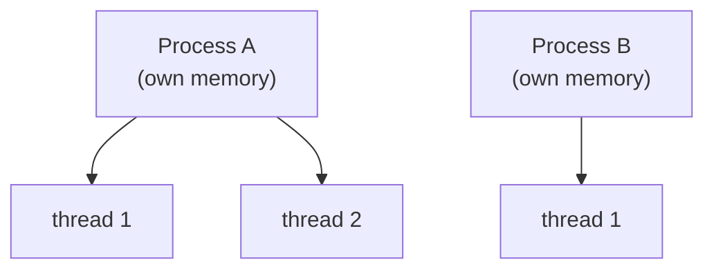
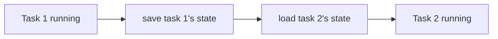
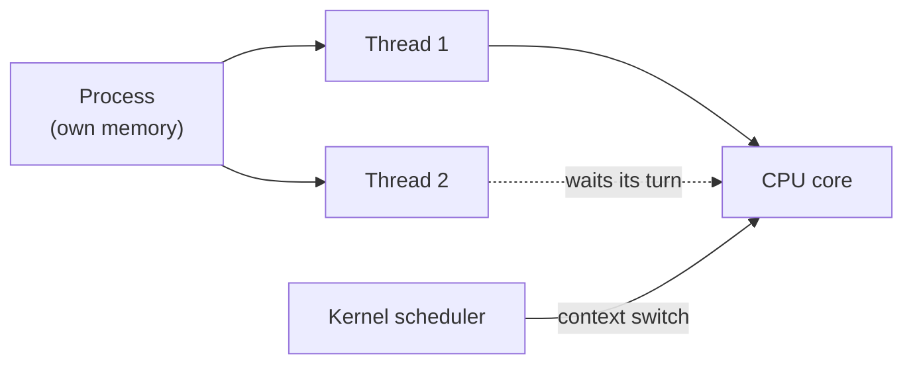
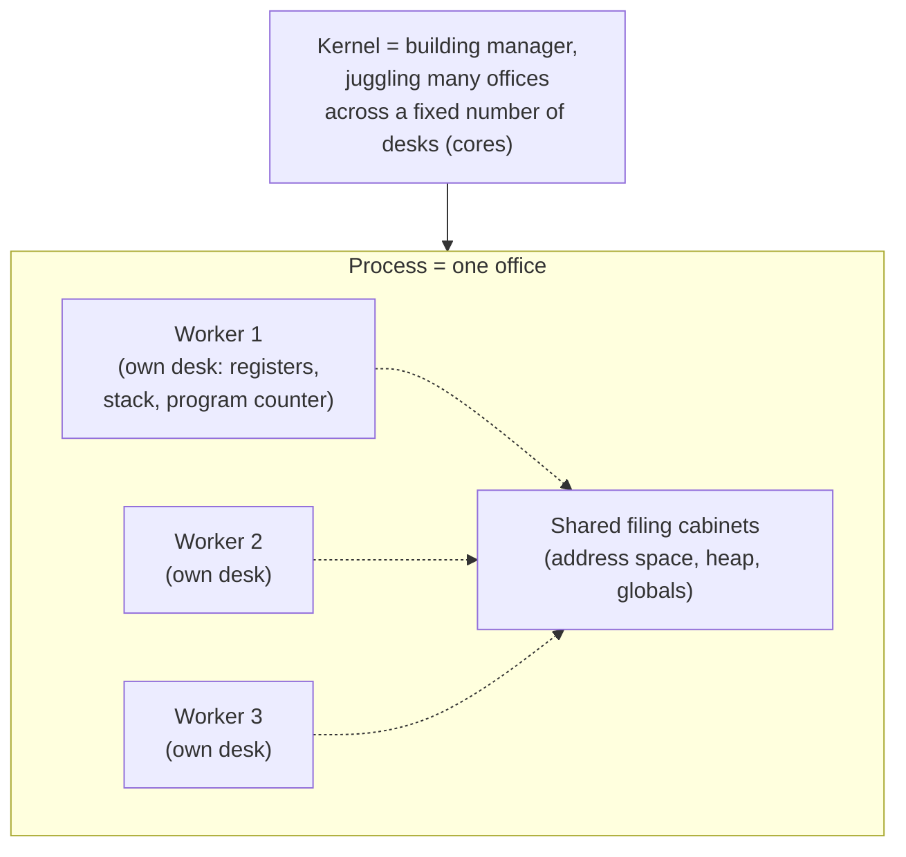
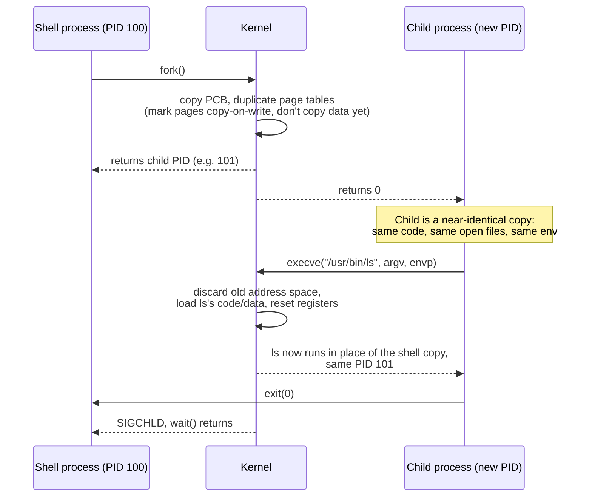
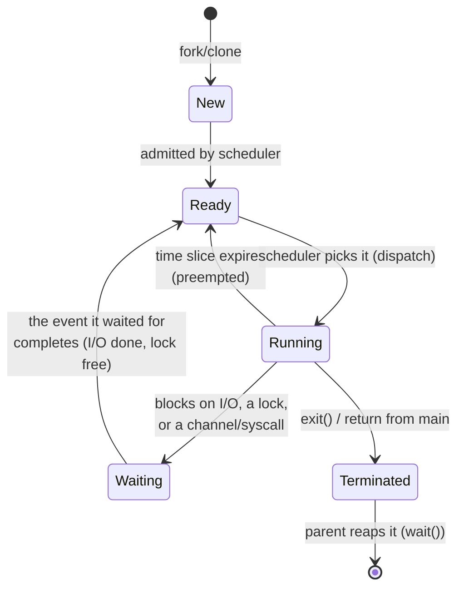
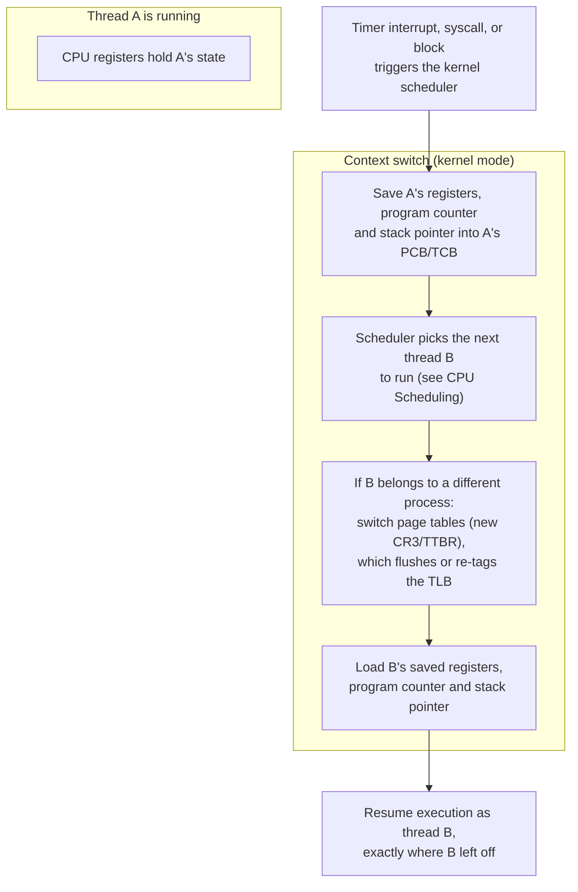
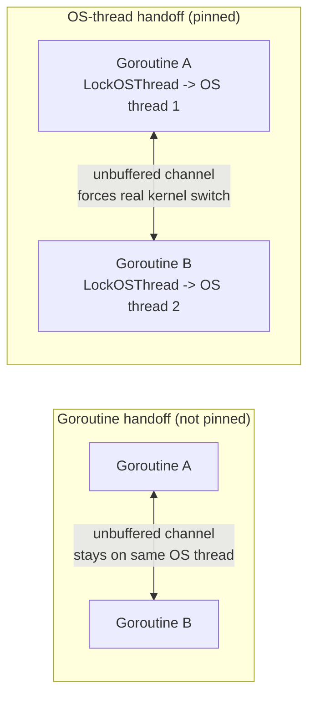

# Processes, Threads and Context Switching

> [!summary] TL;DR
> A **process** is a running program with its own private address space; a **thread** is a schedulable path of execution that runs inside a process and shares that process's memory with its sibling threads. A **context switch** is the kernel saving one thread's CPU state and loading another's so the CPU can run something else. Runnable Go version: [[Processes, Threads and Context Switching - Go]].

> [!abstract] Core idea
> - A process owns memory (an address space); a thread owns only a stack, registers and a program counter, and runs inside a process.
> - All threads of one process share the same heap, globals and open files, so passing data between them needs no copy, but it does need synchronization.
> - `fork` clones a process; `exec` replaces the program running in a process. They are separate steps on purpose.
> - A context switch costs real time, mostly from saving/restoring CPU state and from cold caches and TLB afterward, not from the save/restore instructions themselves.
> - Go goroutines are not OS threads: the Go runtime multiplexes many goroutines onto a handful of OS threads, so a goroutine "switch" is far cheaper than a thread switch — measured on this machine, about two orders of magnitude cheaper.

## Start here: the basics 🟢

> [!info] How to read this note (pick your level)
> - 🟢 **New to this?** Read "From zero" below, then sections 1, 2 and the cheat sheet (10). Stop there, that is a full first pass.
> - 🟡 **Know the basics?** Add section 3 (how it works), 4 (worked example), then 5 and 6.
> - 🔴 **Interview / SDE-3 prep?** Add 7, 8 and 9. Headings are tagged 🟢🟡🔴 so you always know where you are.

**From zero, in 60 seconds** 🟢

Your computer runs many programs at once, but each CPU core can only do one thing at a time. The OS fakes "at once" by switching between tasks very quickly.

A **process** is one running program with its own private memory — like a separate house. A **thread** is one worker inside that house; a house can have many workers sharing the same rooms.



Switching the CPU from one task to another is a **context switch**: save where task 1 was, load where task 2 was. It is not free — it costs time and warms-up loss.



The rest of this note is just three questions:
1. What exactly is in a process vs a thread, and why does sharing memory matter?
2. What happens during a context switch, and what does it really cost?
3. How do Go's goroutines fit in, and why are they so much cheaper?

**The problem in one story.**
Your laptop plays music while you type in an editor and a browser downloads a file.
It has maybe 8 CPU cores but hundreds of programs and tasks want to run.
The operating system keeps them all moving by giving each a turn, very fast.
Each "turn swap" has a cost, and knowing that cost is how you build fast servers.

**Words you need first**

| Word | Plain meaning | Tiny example |
| --- | --- | --- |
| Program | Code sitting on disk, not running | `/usr/bin/ls` |
| Process | A running program with its own private memory | Your Go server while it runs |
| Thread | One path of execution inside a process; shares its memory | One worker handling one request |
| CPU core | Hardware that runs one thread at a time | An 8-core laptop runs 8 at once |
| Kernel | The core of the OS that controls hardware and scheduling | Linux choosing who runs next |
| Registers / program counter | Tiny CPU slots holding the current values and "next instruction" | PC = address of next line to run |
| Context switch | Saving one thread's CPU state and loading another's | Pausing music to run the editor |
| Goroutine | Go's lightweight task, run by the Go runtime on OS threads | `go handle(conn)` |

**Picture it**



**Analogy.** A process is an office; threads are workers in it sharing the filing cabinets; the kernel is a manager moving workers on and off a few desks (cores).
Where it breaks: a real manager does not wipe the desk's warm memory each swap, but a switch leaves the CPU caches "cold" for the next thread.

**How the rest of this note builds up**

- First, why threads exist (section 1) and the office mental model (section 2).
- Then how it works: `fork` + `exec`, the lifecycle states, and what a context switch really does (section 3).
- Then a measured goroutine vs OS-thread handoff (section 4) and a comparison table (section 5).
- Finally the SDE-3 deep dive: trade-offs, production failure modes, 1:1 vs M:N threading, `clone()`, zombies (sections 6-8).

> [!tip] Remember
> A process owns memory, a thread is a turn on the CPU, and swapping turns costs mostly cold caches.

## 1. Why it exists 🟢

Say a web server needs to handle 10,000 concurrent connections. One option is one **process** per connection — a running program with its own private slice of memory.

Picture a process as a self-contained office: it has its own address space, its own open files, its own everything, and nothing it does can directly touch another process's memory.

That isolation is valuable, but on Linux it has a real setup cost: creating a process means the kernel builds a brand-new address space — new page tables, a new file descriptor table, a new signal table — all copied or freshly allocated from the parent.

Even a modest few hundred KB of fixed per-process kernel bookkeeping multiplies to hundreds of MB before any application memory is counted, and creating each one costs a syscall round trip plus kernel address-space setup. 10,000 such offices is impractical on a single host.

**Threads** exist to split "an independent flow of execution" from "an independent address space."

All 10,000 connections can be handled by threads inside **one** process: they share the open listening socket, the in-memory cache, and the database connection pool, without inter-process communication.

The OS still schedules each thread independently, so one slow connection does not block the others — but the heavier cost, the address space, is paid once per process, not once per connection.

Go pushes this further still: instead of one OS thread per connection, the Go runtime schedules many **goroutines** onto a small, fixed-ish pool of OS threads (see [[Runtime - Goroutine Scheduler (GMP)]]).

Section 4 measures the practical effect on this machine: a goroutine-to-goroutine handoff took around 80-160 nanoseconds, while forcing an equivalent handoff between two real OS threads (pinned with `runtime.LockOSThread`) took about 7 microseconds — roughly two orders of magnitude slower, measured side by side on identical hardware.

> [!tip] Remember
> Threads exist because the expensive part of a process (its address space) doesn't need to be duplicated for every independent flow of execution.

## 2. Mental model 🟢

**In plain words:** think of a **process** as an office: it has its own address (the address space), its own filing cabinets (open files), and its own phone line (signal handlers).

A **thread** is a worker inside that office.

Several workers can share the same filing cabinets and the same address — that is the whole point, it lets them collaborate without mailing documents to each other — but each worker still has their own desk, in-tray and current task (registers, stack, program counter).



The kernel is the building manager juggling many offices and many workers across a fixed number of desks (CPU cores).

A **context switch** is the manager walking over, writing down exactly what a worker was doing (their state), and bringing a different worker to that desk to continue their own task.

`fork` and `exec` map to "clone this office including everyone in it" and "throw out everything in this office and move a new business in, keeping the address."

They are separate operations because sometimes you want only one of them:

- `fork` alone gives you a second, independent copy of the current program (classic Unix daemons use this).
- `exec` alone (via `execve` without a prior `fork`) replaces the current process's program outright, keeping its PID — this is what a shell does for its very last command with `exec cmd`.

> [!warning] Common mistake
> Assuming "thread" means "cheap, independent program." A thread shares everything about its process except its own execution state. A bug in one thread's pointer arithmetic can silently corrupt another thread's data, because there is no office wall between them — only between separate processes.

## 3. How it works 🟡

### Process creation: fork + exec

**In plain words:** almost every process on a Unix-like system (Linux, macOS, the BSDs) is created by a two-step sequence, not by one "create process" call.



**Step by step:**
1. The shell calls `fork()`. The kernel does **not** copy the parent's memory yet; instead it marks both the parent's and the new child's page tables **copy-on-write**, both pointing at the same physical pages, set read-only.
2. `fork()` returns twice: once in the parent, with the child's new PID; once in the child, with `0`.
3. The child, a near-identical copy of the shell (same code, same open files, same environment), calls `execve("/usr/bin/ls", ...)`.
4. The kernel discards the child's old address space entirely and loads `ls`'s code and data in its place, resetting registers to `ls`'s entry point — but keeping the same PID.
5. When `ls` exits, the kernel sends `SIGCHLD` to the shell, and the shell's `wait()` call returns with the exit status.

**Why it matters:** `fork` is fast even for a process with gigabytes of mapped memory, because nothing is actually duplicated at `fork` time — only when either process later **writes** to a shared page does the kernel fault in, copy that one page, and let the write proceed (see [[Virtual Memory, Paging and the TLB]] for the page-table and fault mechanics).

`vfork` and the modern `posix_spawn`/`clone(CLONE_VM | CLONE_VFORK)` skip even the copy-on-write page-table setup when the child is about to `exec` anyway, trading parent/child isolation during the gap for speed.

> [!tip] Remember
> `fork` copies bookkeeping, not memory. Memory is only actually duplicated, one page at a time, the moment either side writes to it.

### Process and thread lifecycle

**In plain words:** a process (and each of its threads individually) moves through the same handful of scheduling states, no matter which one it is.



**Example:** a thread reading from a socket with no data yet available moves `Running -> Waiting`. The moment a packet arrives, the kernel wakes it: `Waiting -> Ready`. It sits in `Ready` until the scheduler has a free core for it, then `Ready -> Running`.

**Why it matters:** only one state transition actually moves a CPU core from one thread to another: **Running -> not-Running** for the old thread, paired with **some Ready thread -> Running** for the new one. That pair, taken together, is the **context switch** — the subject of the next section.

### What a context switch actually does

**In plain words:** "saving and loading CPU state" is the easy half of a context switch to picture. The expensive half is invisible in the diagram and only shows up once the new thread starts actually running.



Two costs stack up here, and only one of them is "the switch" in the narrow sense:

1. **Direct cost:** saving/restoring maybe 30-40 registers. On modern hardware this is a handful of store/load instructions — genuinely cheap, on the order of tens of nanoseconds.
2. **Indirect cost:** thread B's working set is not in the CPU's L1/L2 caches or TLB (see [[Memory Hierarchy and CPU Caches]] and [[Virtual Memory, Paging and the TLB]]) — thread A's was. The first several memory accesses B makes are cache misses and possibly TLB misses, each costing tens to a few hundred nanoseconds.

> [!warning] Common mistake
> Assuming "a context switch is expensive because saving registers is slow." The register save/restore itself is cheap. The real cost is the *aftermath*: cold caches and TLB entries for the newly-running thread, which is also why switching between two threads of the **same** process (no page-table change, so no mandatory TLB flush) is cheaper than switching between threads of different processes.

A switch can be **voluntary** (the running thread calls a blocking syscall, waits on a lock, or reads from an empty channel) or **involuntary/preemptive** (the scheduler's timer interrupt fires and takes the CPU away because the time slice ran out, or a higher-priority thread became ready).

[[CPU Scheduling]] covers how the next thread to run is chosen.

> [!tip] Remember
> Direct switch cost (registers) is tens of nanoseconds. Indirect cost (cold caches/TLB) is what actually puts real thread switches in the microsecond range.

## 4. Worked example 🟡

### Whiteboard version

The part worth holding in your head: a process control block (PCB) is just a struct the kernel keeps one of per process (and conceptually, per thread), and `fork`/`exec`/thread creation are operations on that struct:

```go
type PCB struct {
    PID        int
    State      string // Ready, Running, Waiting, ...
    ProgramCtr uint64 // where to resume
    Registers  [8]uint64
}
```

`fork` copies one of these (plus the address space, copy-on-write).

`exec` keeps the same PCB entry but resets `ProgramCtr` and `Registers` to the new program's entry point.

A new thread gets its own small slice of that state (its own registers, program counter, stack) but is recorded as belonging to the same process, which is exactly "shares the address space."

### Tracing the PCB operations, step by step

1. `Create(0)` makes a new process: a fresh PID, `State = Ready`, and a `ThreadIDs` list that starts with just that PID (the process counts as its own first thread).
2. `AddThread(pid)` gives that process a second thread: a new thread ID, appended to the same `ThreadIDs` list — the thread shares the process's single `PCB` entry rather than getting one of its own.
3. `Fork(parentPID)` creates a whole new process: a new PID, a new PCB, but with `ProgramCtr` and `Registers` copied from the parent — a logical stand-in for the real kernel's copy-on-write page-table duplication.
4. `Exec(pid, entryPoint)` keeps the same PID and the same PCB entry, but resets `ProgramCtr` to the new program's start address and zeroes the registers — exactly the "same office, new business moved in" picture from the mental model.

### Measuring a goroutine handoff against a real OS-thread handoff

**In plain words:** the theory above claims a goroutine switch "usually never enters the kernel" and is therefore far cheaper than a real OS thread switch.

Rather than only citing a general benchmark, here is a controlled, side-by-side measurement on this machine: two goroutines passing a token back and forth, once with the Go scheduler free to keep both on one OS thread, and once with each goroutine pinned to its **own** OS thread (`runtime.LockOSThread`), which forces every hand-off through the kernel.



**Example (measured, `go run`, Go 1.24, darwin/arm64, this machine, 2026-11-09), five back-to-back samples each:**

| Sample | Goroutine handoff (unpinned) | OS-thread handoff (pinned) |
| ------ | ------------------------------ | ---------------------------- |
| 1 | 83 ns | 7.37 µs |
| 2 | 82 ns | 7.79 µs |
| 3 | 80 ns | 7.41 µs |
| 4 | 81 ns | 7.13 µs |
| 5 | 84 ns | 7.04 µs |

**Why it matters:** the pinned measurement is a real, local, apples-to-apples number for "a kernel context switch on this exact machine," not just a cited literature figure — and it lands squarely inside the commonly-cited **1-10 microsecond** range for same-core thread switches (e.g. `lmbench`'s `lat_ctx` benchmark).

It is roughly **90x** slower than the unpinned goroutine handoff measured on the same hardware, in the same run.

The difference is entirely explained by section 3:

- The pinned version cannot avoid a real kernel trap and (because each goroutine owns its own OS thread) pays the full indirect cost of cold caches and TLB entries on every single hand-off.
- The unpinned version typically never leaves userspace at all.

> [!warning] Common mistake
> Assuming "goroutines are OS threads under a different name." A goroutine's cheap handoff specifically depends on the Go scheduler being free to keep both ends on the same OS thread. Pin each one to a different OS thread (as this measurement deliberately does) and the handoff cost jumps by roughly two orders of magnitude, because now it *is* a real OS thread switch.

Runnable Go version, including the process-table model, both the unpinned and pinned hand-off benchmarks, and their tests: [[Processes, Threads and Context Switching - Go]].

## 5. Variants and comparison 🟡

| Unit | Owns an address space? | Created by | Typical creation cost | Switch cost (same core) |
| ---- | ----------------------- | ---------- | ---------------------- | ------------------------ |
| Process | Yes, its own | `fork`/`clone`, `posix_spawn` | Syscall + new page tables; copy-on-write keeps data copying lazy | Microseconds: page table switch forces a TLB flush/retag |
| OS thread | No, shares its process's | `pthread_create` / `clone(CLONE_VM\|CLONE_THREAD)` | A syscall, smaller than a process: no new address space | Microseconds, but cheaper than a cross-process switch (no page table change). Measured on this machine (threads pinned via `LockOSThread`): ~7-7.8 µs |
| Goroutine | No, shares its process's (and its OS thread's) | `go f()` | No syscall at all; the Go runtime allocates an ~2 KB stack in userspace, growable | Measured on this machine: ~80-84 ns; never touches the kernel unless the goroutine itself makes a blocking syscall |

## 6. Trade-offs and when not to use 🟡

- Threads buy cheap communication (shared memory) at the cost of needing synchronization (see [[Concurrency Primitives - Mutex, Semaphore, Atomics]]): a data race in shared memory is a correctness bug; a crash in one thread can corrupt memory for the whole process.
- A process crash only takes down that process; a misbehaving goroutine or thread (e.g. an unrecovered panic, or corrupting shared memory through an unsafe pointer) can take the whole process with it. Favour separate processes when isolation matters more than shared-memory speed (a plugin that might crash, a sandboxed job).
- Spawning one OS thread per unit of work still costs a fixed-size stack (commonly 1-8 MB reserved per `pthread_create` call on Linux, though only the touched pages are committed) and a kernel scheduling entity; spawning millions of OS threads will exhaust memory or hit the OS's thread-count limits long before spawning millions of goroutines would (Go starts goroutine stacks at about 2 KB, growable — see [[Process Memory Layout - Stack vs Heap]]).
- Goroutines are not free: a CPU-bound goroutine still occupies an OS thread while it runs, and goroutines that block on a syscall make the Go runtime spin up another OS thread to keep `GOMAXPROCS` logical processors busy (see [[Runtime - Goroutine Scheduler (GMP)]]). Thousands of goroutines blocked on CPU-bound work, not I/O, do not scale better than thousands of OS threads.

## 7. In production 🔴

- **Real systems:** Nginx and PostgreSQL (still process-per-connection as of PostgreSQL 17, hence the usual advice to front it with a pooler like PgBouncer) use one process per connection/worker for strong isolation; Redis and Node.js run single-threaded event loops per process to avoid locking entirely; Go backend services commonly run one process per container with goroutines handling each request, the pattern this note sets up [[Runtime - Goroutine Scheduler (GMP)]] to explain.
- **Failure modes -> fixes:**
  - "Thread/goroutine explosion" (unbounded `go f()` per request under load) exhausts memory or scheduler latency -> bound concurrency with a worker pool or a semaphore-like primitive (`golang.org/x/sync/semaphore`, or a buffered channel used as a counting semaphore).
  - High context-switch rate shows up as elevated `%system` CPU time and poor cache locality even though "the CPUs aren't at 100%" -> reduce the number of runnable threads/goroutines competing for cores, or pin latency-critical work.
  - A process fork in a multi-threaded program only clones the calling thread; locks held by other threads at fork time can deadlock the child -> avoid `fork` in multi-threaded programs except immediately followed by `exec` (the common and safe pattern).
- **What to monitor:** `vmstat`'s `cs` (context switches/sec) and `r` (runnable queue length) columns; `/proc/<pid>/status`'s `voluntary_ctxt_switches` / `nonvoluntary_ctxt_switches`; Go's `runtime.NumGoroutine()` and the scheduler latency exposed via `runtime/trace`.

## 8. Deep dive 🔴

- **1:1 vs M:N threading.** Linux and macOS use a **1:1** model: every userspace thread (`pthread`) maps to exactly one kernel scheduling entity, so the kernel scheduler sees and switches between them directly. Go uses an **M:N** model (M goroutines multiplexed onto N OS threads, managed by **P**rocessors that hold the run queues — the "GMP" model) so that creating a goroutine, and switching between goroutines that aren't blocked in the kernel, never crosses into kernel mode at all. Full mechanics: [[Runtime - Goroutine Scheduler (GMP)]].
- **What "shares the address space" buys and costs.** Threads of one process see the same virtual-to-physical mappings (see [[Virtual Memory, Paging and the TLB]]), so passing a pointer between threads is free — no serialization, no copy — but also means one thread's stray write through a bad pointer can corrupt another thread's data. Processes get the opposite trade: passing data needs IPC (pipes, sockets, shared memory segments explicitly mapped) but a crash is contained.
- **The clone() syscall.** On Linux, `fork()`, `pthread_create()`, and `vfork()` are all built from one general syscall, `clone()`, parameterized by flags like `CLONE_VM` (share memory), `CLONE_FS`, `CLONE_FILES`, `CLONE_SIGHAND`. A "thread" is, at the kernel level, just a process created with most of these flags set; `task_struct` (Linux's PCB-equivalent) does not have a separate "thread struct" — this is why Linux documentation sometimes calls threads "lightweight processes."
- **Zombies and orphans.** A terminated process stays as a "zombie" entry in the process table (state `Terminated` above) holding its exit code until its parent calls `wait()`/`waitpid()` to reap it; an unreaped zombie wastes a PID slot. An **orphan** (parent exited first) is re-parented to `init`/PID 1 (or a subreaper), which reaps it automatically.

## 9. Interview questions 🔴

> [!question]- What's the real difference between a process and a thread?
> An address space. A process has its own; a thread runs inside a process and shares that process's address space, open files, and other process-wide resources with every other thread in it. Each thread still has its own stack, registers, and program counter, because that's what lets it be scheduled independently.

> [!question]- Why are `fork` and `exec` separate syscalls instead of one "spawn"?
> Because sometimes you want only one of them. `fork` alone gives a true second copy of the running program (useful for daemonizing, or for a server forking a worker that keeps the parent's loaded state). `exec` alone replaces a shell's own program image (`exec someprogram`) without creating a new process. Keeping them separate also lets the child do setup — redirecting file descriptors, dropping privileges, closing inherited handles — in the gap between `fork` and `exec`, which Windows's combined `CreateProcess` cannot do as cleanly.

> [!question]- Trap: does `fork()` copy the parent's entire memory immediately?
> No. The kernel marks the parent's and the new child's page tables copy-on-write and both still point at the same physical pages. A page is only actually duplicated when either process writes to it, which triggers a page fault that the kernel handles by copying just that one page. This is why `fork`ing a process with gigabytes of memory is fast.

> [!question]- Why does a context switch cost more than "save and restore some registers"?
> Saving and restoring registers is genuinely cheap — tens of nanoseconds. The expensive part is indirect: the new thread's data isn't in the CPU's caches or TLB, because the thread that was just running pushed its own working set in instead. The first several memory accesses after a switch are slow cache/TLB misses. Switching across processes adds a page table change, which is more expensive still (forces a TLB flush or re-tag).

> [!question]- Why is a goroutine switch so much cheaper than a thread switch?
> It usually never enters the kernel. The Go runtime's own scheduler parks one goroutine and resumes another on the same OS thread entirely in userspace: no syscall, no kernel-mode page table change, often not even a full register save because the Go compiler already knows which registers are live. Measured side by side on the same machine, an unpinned goroutine handoff (~80 ns) was about 90x cheaper than forcing the same hand-off across two pinned OS threads (~7.4 µs) — and that pinned number is itself the real cost being avoided.

> [!question]- When would you choose multiple processes over multiple threads for concurrency?
> When you want crash isolation (one worker dying shouldn't take the rest down), when you need to run untrusted or unstable code, or when you want OS-level resource limits (cgroups, `ulimit`) applied per unit of work. Nginx's worker-process model and most browsers' per-tab/per-site process isolation are both choosing this trade-off.

> [!question]- A service spawns a new goroutine per incoming request with no limit. Under load, what breaks first, and why?
> Likely memory, not CPU: each blocked goroutine still holds its stack (starting around 2 KB but growing) and whatever it's retaining (buffers, DB rows). Thousands of goroutines all blocked waiting on the same overloaded downstream service accumulate memory and scheduler bookkeeping without doing useful work. The fix is bounding concurrency (a worker pool or semaphore) rather than relying on goroutines being "cheap" without limit.

## 10. Cheat sheet 🟢

- Process = address space + at least one thread. Thread = schedulable unit sharing its process's address space.
- `fork` clones a process (copy-on-write, so it's fast); `exec` replaces the program in the current process, keeping its PID. Most process creation is `fork` + `exec`.
- Lifecycle: New -> Ready -> Running -> (Waiting <-> Ready) -> Terminated. A thread's own Running <-> Ready/Waiting transitions are what a context switch is.
- Context switch direct cost (register save/restore) is cheap; the real cost is cold caches/TLB afterward, worse still if the page table also changes (cross-process switch).
- Measured on this machine, same hardware, same run: goroutine handoff ~= 80-84 ns; a real OS-thread handoff forced via `LockOSThread` ~= 7.0-7.8 µs (about 90x slower), consistent with `lmbench`'s cited 1-10 µs range for thread context switches.
- Go uses M:N scheduling (many goroutines over few OS threads); Linux/macOS threads are 1:1 with the kernel scheduler.
- A multi-threaded program that `fork`s without an immediate `exec` risks deadlocking the child on locks held by other (non-cloned) threads.

## Links

- **Before this:** [[How a Computer Runs a Program]]
- **Next:** [[System Calls and User vs Kernel Mode]], [[CPU Scheduling]], [[Process Memory Layout - Stack vs Heap]]
- **Compare with:** [[Runtime - Goroutine Scheduler (GMP)]] (how Go schedules goroutines onto OS threads), [[Concurrency Primitives - Mutex, Semaphore, Atomics]] (coordinating threads that share memory)
- **Runnable code:** [[Processes, Threads and Context Switching - Go]]

### Watch on YouTube

- [Process vs Threads Explained / PCB, Context Switching, Pthreads & Thread Types](https://www.youtube.com/watch?v=wsNpZ4YMen8) · StudyPalz · covers process/thread distinction and context-switch cost together
