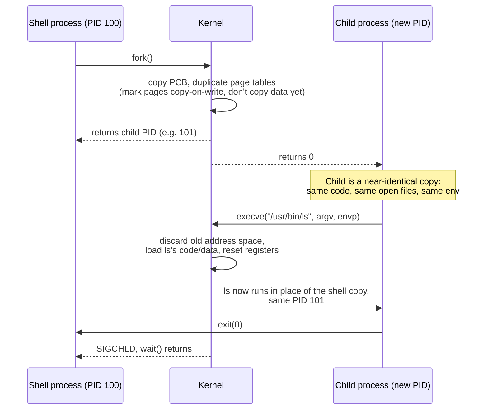
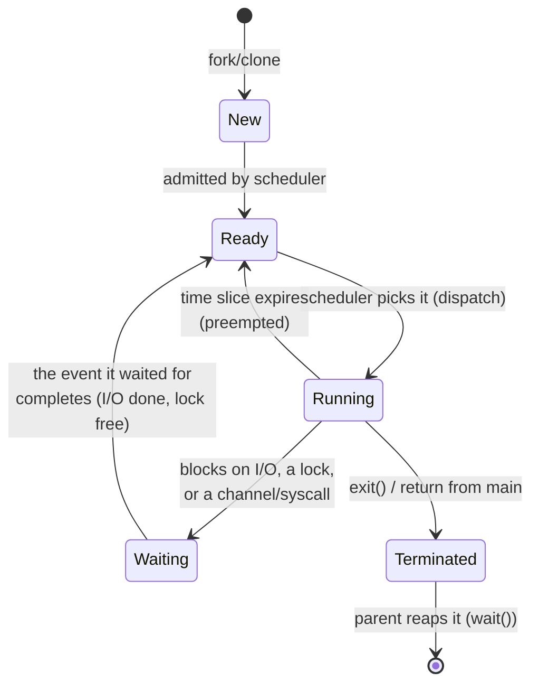
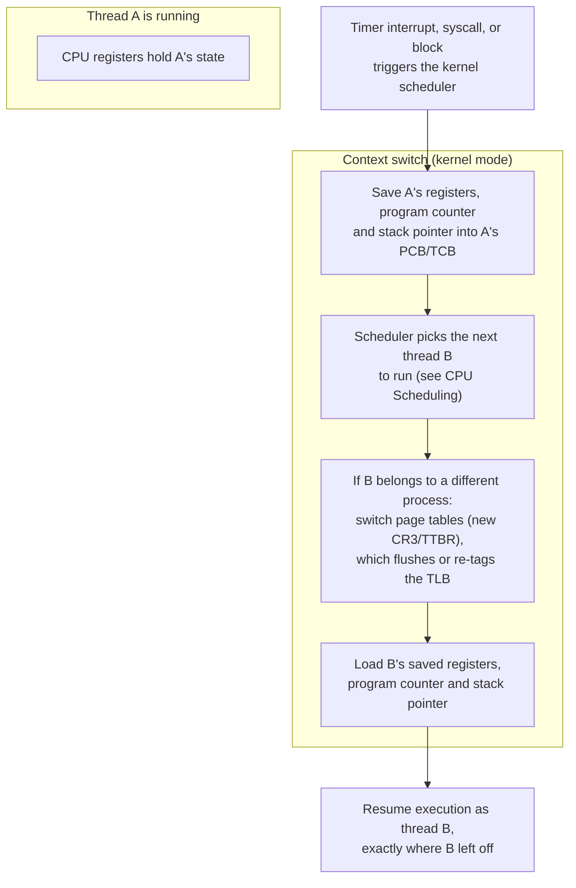

# Processes, Threads and Context Switching

> [!summary] TL;DR
> A **process** is a running program with its own private address space; a **thread** is a schedulable path of execution that runs inside a process and shares that process's memory with its sibling threads. A **context switch** is the kernel saving one thread's CPU state and loading another's so the CPU can run something else.

> [!abstract] Core idea
> - A process owns memory (an address space); a thread owns only a stack, registers and a program counter, and runs inside a process.
> - All threads of one process share the same heap, globals and open files, so passing data between them needs no copy, but it does need synchronization.
> - `fork` clones a process; `exec` replaces the program running in a process. They are separate steps on purpose.
> - A context switch costs real time, mostly from saving/restoring CPU state and from cold caches and TLB afterward, not from the save/restore instructions themselves.
> - Go goroutines are not OS threads: the Go runtime multiplexes many goroutines onto a handful of OS threads, so a goroutine "switch" is far cheaper than a thread switch.

## 1. Why it exists

Say a web server needs to handle 10,000 concurrent connections. One option is one OS process per connection. On Linux, creating a process means the kernel builds a new address space: new page tables, a new file descriptor table, a new signal table — all copied or newly allocated from the parent. That setup, plus the memory each process then holds on its own, makes 10,000 processes impractical on a single host: even a modest few hundred KB of fixed per-process kernel bookkeeping multiplies to hundreds of MB before any application memory is counted, and creating each one costs a syscall round trip plus kernel address-space setup.

Threads exist to split "an independent flow of execution" from "an independent address space". All connections can be handled by threads inside **one** process: they share the open listening socket, the in-memory cache, and the database connection pool, without inter-process communication. The OS still schedules each thread independently, so one slow connection does not block the others, but the heavier cost — the address space — is paid once per process, not once per connection.

Go pushes this further: instead of one OS thread per connection, the Go runtime schedules many goroutines onto a small, fixed-ish pool of OS threads (see [[Runtime - Goroutine Scheduler (GMP)]]). Section 4 measures the practical effect: handing off between two goroutines on this machine (Go 1.24, darwin/arm64) took on the order of 90-160 nanoseconds, roughly two to three orders of magnitude cheaper than published thread-to-thread context switch figures.

## 2. Mental model

Think of a **process** as an office: it has its own address (the address space), its own filing cabinets (open files), and its own phone line (signal handlers). A **thread** is a worker inside that office. Several workers can share the same filing cabinets and the same address — that is the whole point, it lets them collaborate without mailing documents to each other — but each worker still has their own desk, in-tray and current task (registers, stack, program counter).

The kernel is the building manager juggling many offices and many workers across a fixed number of desks (CPU cores). A **context switch** is the manager walking over, writing down exactly what a worker was doing (their state), and bringing a different worker to that desk to continue their own task.

`fork` and `exec` map to "clone this office including everyone in it" and "throw out everything in this office and move a new business in, keeping the address". They are separate operations because sometimes you want only one of them: `fork` alone gives you a second, independent copy of the current program (classic Unix daemons use this); `exec` alone (via `execve` without a prior `fork`) replaces the current process's program outright, keeping its PID — this is what a shell does for its very last command with `exec cmd`.

## 3. How it works

### Process creation: fork + exec

Almost every process on a Unix-like system (Linux, macOS, the BSDs) is created by this two-step sequence, not by one "create process" call:



`fork` does not copy the parent's RAM up front. The kernel marks the parent's and child's page tables **copy-on-write**: both point at the same physical pages, set read-only, and only when either process writes does the kernel fault in, copy that one page, and let the write proceed. This is why `fork` is fast even for a process with gigabytes of mapped memory — see [[Virtual Memory, Paging and the TLB]] for how the page tables and the fault itself work. `vfork` and the modern `posix_spawn`/`clone(CLONE_VM | CLONE_VFORK)` skip even the copy-on-write page table setup when the child is about to `exec` anyway, trading parent/child isolation during the gap for speed.

### Process and thread lifecycle

A process (and each of its threads individually) moves through the same handful of scheduling states:



Only one state transition actually moves a CPU core from one thread to another: **Running → not-Running** for the old thread, paired with **some Ready thread → Running** for the new one. That pair is the context switch.

### What a context switch actually does



Two costs stack up here, and only one is "the switch" in the narrow sense:
1. **Direct cost**: saving/restoring maybe 30-40 registers. On modern hardware this is a handful of store/load instructions — genuinely cheap, on the order of tens of nanoseconds.
2. **Indirect cost**: thread B's working set is not in the CPU's L1/L2 caches or TLB (see [[Memory Hierarchy and CPU Caches]] and [[Virtual Memory, Paging and the TLB]]) — thread A's was. The first several memory accesses B makes are cache misses and possibly TLB misses, each costing tens to a few hundred nanoseconds. This indirect cost, not the register save/restore, is why real thread switches land in the microsecond range rather than the nanosecond range, and why switching between two threads of the **same** process (no page table change, so no mandatory TLB flush) is cheaper than switching between threads of different processes.

A switch can be **voluntary** (the running thread calls a blocking syscall, waits on a lock, or reads from an empty channel) or **involuntary/preemptive** (the scheduler's timer interrupt fires and takes the CPU away because the time slice ran out, or a higher-priority thread became ready). [[CPU Scheduling]] covers how the next thread to run is chosen.

## 4. Worked example

### Whiteboard version

The part worth holding in your head: a process control block (PCB) is just a struct the kernel keeps one of per process (and conceptually, per thread), and `fork`/`exec`/thread creation are operations on that struct:

```go
type PCB struct {
    PID        int
    State      string // Ready, Running, Waiting, ...
    ProgramCtr uint64 // where to resume
    Registers  [8]uint64
}
```

`fork` copies one of these (plus the address space, copy-on-write). `exec` keeps the same PCB entry but resets `ProgramCtr` and `Registers` to the new program's entry point. A new thread gets its own small slice of that state (its own registers, program counter, stack) but is recorded as belonging to the same process, which is exactly "shares the address space".

The full version below models that precisely and is tested. It also measures a goroutine hand-off, as a concrete (if approximate) number for "how cheap is a userspace context switch".

```go
package procthreads

import "fmt"

// State is a process's or thread's scheduling state.
type State int

const (
	New State = iota
	Ready
	Running
	Waiting
	Terminated
)

func (s State) String() string {
	return [...]string{"New", "Ready", "Running", "Waiting", "Terminated"}[s]
}

// PCB is a minimal process control block: the fields the OS keeps per
// process so it can stop it and correctly resume it later. A thread's
// control block (not modelled separately here) is the same shape minus the
// address-space fields, which is exactly why threads are "cheap processes".
type PCB struct {
	PID        int
	ParentPID  int
	State      State
	ProgramCtr uint64 // saved instruction pointer
	Registers  [8]uint64
	ThreadIDs  []int // every thread sharing this PCB's address space
}

// ProcessTable owns every PCB, the way the kernel owns one process table.
type ProcessTable struct {
	procs  map[int]*PCB
	nextID int
}

func NewProcessTable() *ProcessTable {
	return &ProcessTable{procs: make(map[int]*PCB), nextID: 1}
}

// Create starts a brand-new process with one thread (the "main thread").
func (t *ProcessTable) Create(parentPID int) *PCB {
	pid := t.nextID
	t.nextID++
	p := &PCB{PID: pid, ParentPID: parentPID, State: Ready, ThreadIDs: []int{pid}}
	t.procs[pid] = p
	return p
}

// Fork clones an existing process: a new PID and a new PCB, but a logical
// copy of the parent's state (copy-on-write in a real kernel copies page
// table entries, not memory; this model only copies the PCB fields, which is
// the part relevant to scheduling).
func (t *ProcessTable) Fork(parentPID int) (*PCB, error) {
	parent, ok := t.procs[parentPID]
	if !ok {
		return nil, fmt.Errorf("fork: no such process %d", parentPID)
	}
	child := t.Create(parentPID)
	child.ProgramCtr = parent.ProgramCtr
	child.Registers = parent.Registers
	return child, nil
}

// Exec replaces the calling process's program: same PID, same PCB entry, but
// its instruction pointer and registers reset as if a new binary had just
// been loaded. Exec never creates a new process; it reuses the current one.
func (t *ProcessTable) Exec(pid int, entryPoint uint64) error {
	p, ok := t.procs[pid]
	if !ok {
		return fmt.Errorf("exec: no such process %d", pid)
	}
	p.ProgramCtr = entryPoint
	p.Registers = [8]uint64{}
	return nil
}

// AddThread creates a new thread inside an existing process. The new thread
// gets its own thread ID (so the scheduler can run it independently) but
// joins the same PCB's ThreadIDs list, because it shares that process's
// address space, open files and heap rather than getting its own.
func (t *ProcessTable) AddThread(pid int) (int, error) {
	p, ok := t.procs[pid]
	if !ok {
		return 0, fmt.Errorf("add thread: no such process %d", pid)
	}
	tid := t.nextID
	t.nextID++
	p.ThreadIDs = append(p.ThreadIDs, tid)
	return tid, nil
}

func (t *ProcessTable) Get(pid int) (*PCB, bool) {
	p, ok := t.procs[pid]
	return p, ok
}
```

```go
func TestThreadsShareTheParentProcesssPCB(t *testing.T) {
	pt := NewProcessTable()
	p := pt.Create(0)

	tid1, _ := pt.AddThread(p.PID)
	tid2, _ := pt.AddThread(p.PID)
	if tid1 == tid2 {
		t.Fatalf("two threads got the same thread ID: %d", tid1)
	}

	got, _ := pt.Get(p.PID)
	// The process itself counts as the first thread, plus the two added here.
	if len(got.ThreadIDs) != 3 {
		t.Fatalf("ThreadIDs = %v, want 3 entries", got.ThreadIDs)
	}
}
```

The second file measures a goroutine hand-off directly, by making two goroutines pass a token back and forth over unbuffered channels:

```go
package procthreads

import (
	"runtime"
	"time"
)

// PingPongLatency starts two goroutines that hand a token back and forth over
// unbuffered channels for rounds round trips, and returns the average time per
// one-way handoff. Each send/receive pair forces the Go scheduler to park one
// goroutine and run another, which is the userspace equivalent of a context
// switch between kernel threads.
func PingPongLatency(rounds int) time.Duration {
	ping := make(chan struct{})
	pong := make(chan struct{})
	done := make(chan struct{})

	go func() {
		for i := 0; i < rounds; i++ {
			<-ping
			pong <- struct{}{}
		}
		close(done)
	}()

	runtime.Gosched()
	start := time.Now()
	for i := 0; i < rounds; i++ {
		ping <- struct{}{}
		<-pong
	}
	elapsed := time.Since(start)
	<-done

	return elapsed / time.Duration(rounds*2) // two handoffs per round trip
}
```

**Measured** (`go run`, 50,000 rounds per sample, Go 1.24, darwin/arm64, this machine, 2026-11-06), five back-to-back samples:

| Sample | Avg time per handoff |
| ------ | --------------------- |
| 1 | 160 ns |
| 2 | 111 ns |
| 3 | 98 ns |
| 4 | 98 ns |
| 5 | 90 ns |

Compare with the **documented, order-of-magnitude** cost of a real OS thread-to-thread context switch: commonly cited Linux benchmarks (e.g. `lmbench`'s `lat_ctx`) put same-core thread context switches at roughly **1-10 microseconds**, 10-100× slower than the goroutine handoff measured above, because a real switch can involve a kernel trap, a scheduler run, and — crucially — those cold caches and TLB entries discussed in section 3. A goroutine handoff that stays on the same OS thread skips the kernel entirely: it is the Go scheduler moving a pointer in userspace.

Full test file: `go test -race ./procthreads/...` — `TestPingPongLatencyIsSmallAndPositive`, `TestForkCreatesAnIndependentChildWithANewPID`, `TestExecReusesThePIDAndResetsState`, `TestThreadsShareTheParentProcesssPCB` all pass.

## 5. Variants and comparison

| Unit | Owns an address space? | Created by | Typical creation cost | Switch cost (same core) |
| ---- | ----------------------- | ---------- | ---------------------- | ------------------------ |
| Process | Yes, its own | `fork`/`clone`, `posix_spawn` | Syscall + new page tables; copy-on-write keeps data copying lazy | Microseconds: page table switch forces a TLB flush/retag |
| OS thread | No, shares its process's | `pthread_create` / `clone(CLONE_VM\|CLONE_THREAD)` | A syscall, smaller than a process: no new address space | Microseconds, but cheaper than a cross-process switch (no page table change) |
| Goroutine | No, shares its process's (and its OS thread's) | `go f()` | No syscall at all; the Go runtime allocates an ~2 KB stack in userspace, growable | Tens to low hundreds of nanoseconds (measured above); never touches the kernel unless the goroutine itself makes a blocking syscall |

## 6. Trade-offs and when not to use

- Threads buy cheap communication (shared memory) at the cost of needing synchronization (see [[Concurrency Primitives - Mutex, Semaphore, Atomics]]): a data race in shared memory is a correctness bug; a crash in one thread can corrupt memory for the whole process.
- A process crash only takes down that process; a misbehaving goroutine or thread (e.g. an unrecovered panic, or corrupting shared memory through an unsafe pointer) can take the whole process with it. Favour separate processes when isolation matters more than shared-memory speed (a plugin that might crash, a sandboxed job).
- Spawning one OS thread per unit of work still costs a fixed-size stack (commonly 1-8 MB reserved per `pthread_create` call on Linux, though only the touched pages are committed) and a kernel scheduling entity; spawning millions of OS threads will exhaust memory or hit the OS's thread-count limits long before spawning millions of goroutines would (Go starts goroutine stacks at about 2 KB, growable — see [[Process Memory Layout - Stack vs Heap]]).
- Goroutines are not free: a CPU-bound goroutine still occupies an OS thread while it runs, and goroutines that block on a syscall make the Go runtime spin up another OS thread to keep `GOMAXPROCS` logical processors busy (see [[Runtime - Goroutine Scheduler (GMP)]]). Thousands of goroutines blocked on CPU-bound work, not I/O, do not scale better than thousands of OS threads.

## 7. In production

- **Real systems:** Nginx and PostgreSQL (still process-per-connection as of PostgreSQL 17, hence the usual advice to front it with a pooler like PgBouncer) use one process per connection/worker for strong isolation; Redis and Node.js run single-threaded event loops per process to avoid locking entirely; Go backend services commonly run one process per container with goroutines handling each request, the pattern this note sets up [[Runtime - Goroutine Scheduler (GMP)]] to explain.
- **Failure modes → fixes:**
  - "Thread/goroutine explosion" (unbounded `go f()` per request under load) exhausts memory or scheduler latency → bound concurrency with a worker pool or a semaphore-like primitive (`golang.org/x/sync/semaphore`, or a buffered channel used as a counting semaphore).
  - High context-switch rate shows up as elevated `%system` CPU time and poor cache locality even though "the CPUs aren't at 100%" → reduce the number of runnable threads/goroutines competing for cores, or pin latency-critical work.
  - A process fork in a multi-threaded program only clones the calling thread; locks held by other threads at fork time can deadlock the child → avoid `fork` in multi-threaded programs except immediately followed by `exec` (the common and safe pattern).
- **What to monitor:** `vmstat`'s `cs` (context switches/sec) and `r` (runnable queue length) columns; `/proc/<pid>/status`'s `voluntary_ctxt_switches` / `nonvoluntary_ctxt_switches`; Go's `runtime.NumGoroutine()` and the scheduler latency exposed via `runtime/trace`.

## 8. Deep dive

- **1:1 vs M:N threading.** Linux and macOS use a **1:1** model: every userspace thread (`pthread`) maps to exactly one kernel scheduling entity, so the kernel scheduler sees and switches between them directly. Go uses an **M:N** model (M goroutines multiplexed onto N OS threads, managed by **P**rocessors that hold the run queues — the "GMP" model) so that creating a goroutine, and switching between goroutines that aren't blocked in the kernel, never crosses into kernel mode at all. Full mechanics: [[Runtime - Goroutine Scheduler (GMP)]].
- **What "shares the address space" buys and costs.** Threads of one process see the same virtual-to-physical mappings (see [[Virtual Memory, Paging and the TLB]]), so passing a pointer between threads is free — no serialization, no copy — but also means one thread's stray write through a bad pointer can corrupt another thread's data. Processes get the opposite trade: passing data needs IPC (pipes, sockets, shared memory segments explicitly mapped) but a crash is contained.
- **The clone() syscall.** On Linux, `fork()`, `pthread_create()`, and `vfork()` are all built from one general syscall, `clone()`, parameterized by flags like `CLONE_VM` (share memory), `CLONE_FS`, `CLONE_FILES`, `CLONE_SIGHAND`. A "thread" is, at the kernel level, just a process created with most of these flags set; `task_struct` (Linux's PCB-equivalent) does not have a separate "thread struct" — this is why Linux documentation sometimes calls threads "lightweight processes".
- **Zombies and orphans.** A terminated process stays as a "zombie" entry in the process table (state `Terminated` above) holding its exit code until its parent calls `wait()`/`waitpid()` to reap it; an unreaped zombie wastes a PID slot. An **orphan** (parent exited first) is re-parented to `init`/PID 1 (or a subreaper), which reaps it automatically.

## 9. Interview questions

> [!question]- What's the real difference between a process and a thread?
> An address space. A process has its own; a thread runs inside a process and shares that process's address space, open files, and other process-wide resources with every other thread in it. Each thread still has its own stack, registers, and program counter, because that's what lets it be scheduled independently.

> [!question]- Why are `fork` and `exec` separate syscalls instead of one "spawn"?
> Because sometimes you want only one of them. `fork` alone gives a true second copy of the running program (useful for daemonizing, or for a server forking a worker that keeps the parent's loaded state). `exec` alone replaces a shell's own program image (`exec someprogram`) without creating a new process. Keeping them separate also lets the child do setup — redirecting file descriptors, dropping privileges, closing inherited handles — in the gap between `fork` and `exec`, which Windows's combined `CreateProcess` cannot do as cleanly.

> [!question]- Trap: does `fork()` copy the parent's entire memory immediately?
> No. The kernel marks the parent's and the new child's page tables copy-on-write and both still point at the same physical pages. A page is only actually duplicated when either process writes to it, which triggers a page fault that the kernel handles by copying just that one page. This is why `fork`ing a process with gigabytes of memory is fast.

> [!question]- Why does a context switch cost more than "save and restore some registers"?
> Saving and restoring registers is genuinely cheap — tens of nanoseconds. The expensive part is indirect: the new thread's data isn't in the CPU's caches or TLB, because the thread that was just running pushed its own working set in instead. The first several memory accesses after a switch are slow cache/TLB misses. Switching across processes adds a page table change, which is more expensive still (forces a TLB flush or re-tag).

> [!question]- Why is a goroutine switch so much cheaper than a thread switch?
> It usually never enters the kernel. The Go runtime's own scheduler parks one goroutine and resumes another on the same OS thread entirely in userspace: no syscall, no kernel-mode page table change, often not even a full register save because the Go compiler already knows which registers are live. It's still not free — it's a scheduling decision plus a stack switch — but it skips the parts of a thread switch that dominate the cost.

> [!question]- When would you choose multiple processes over multiple threads for concurrency?
> When you want crash isolation (one worker dying shouldn't take the rest down), when you need to run untrusted or unstable code, or when you want OS-level resource limits (cgroups, `ulimit`) applied per unit of work. Nginx's worker-process model and most browsers' per-tab/per-site process isolation are both choosing this trade-off.

> [!question]- A service spawns a new goroutine per incoming request with no limit. Under load, what breaks first, and why?
> Likely memory, not CPU: each blocked goroutine still holds its stack (starting around 2 KB but growing) and whatever it's retaining (buffers, DB rows). Thousands of goroutines all blocked waiting on the same overloaded downstream service accumulate memory and scheduler bookkeeping without doing useful work. The fix is bounding concurrency (a worker pool or semaphore) rather than relying on goroutines being "cheap" without limit.

## 10. Cheat sheet

- Process = address space + at least one thread. Thread = schedulable unit sharing its process's address space.
- `fork` clones a process (copy-on-write, so it's fast); `exec` replaces the program in the current process, keeping its PID. Most process creation is `fork` + `exec`.
- Lifecycle: New → Ready → Running → (Waiting ↔ Ready) → Terminated. A thread's own Running ↔ Ready/Waiting transitions are what a context switch is.
- Context switch direct cost (register save/restore) is cheap; the real cost is cold caches/TLB afterward, worse still if the page table also changes (cross-process switch).
- Measured on this machine: goroutine handoff ≈ 90-160 ns; documented order-of-magnitude for a real thread switch ≈ 1-10 µs (`lmbench` `lat_ctx`-style benchmarks).
- Go uses M:N scheduling (many goroutines over few OS threads); Linux/macOS threads are 1:1 with the kernel scheduler.
- A multi-threaded program that `fork`s without an immediate `exec` risks deadlocking the child on locks held by other (non-cloned) threads.

## Links

- **Before this:** [[How a Computer Runs a Program]]
- **Next:** [[System Calls and User vs Kernel Mode]], [[CPU Scheduling]], [[Process Memory Layout - Stack vs Heap]]
- **Compare with:** [[Runtime - Goroutine Scheduler (GMP)]] (how Go schedules goroutines onto OS threads), [[Concurrency Primitives - Mutex, Semaphore, Atomics]] (coordinating threads that share memory)
