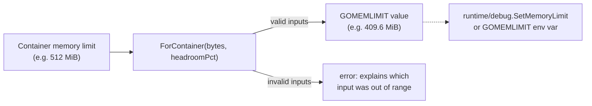

# RAM Technologies - SRAM, DRAM, DDR, GDDR, HBM - Go

> [!summary] TL;DR
> Runnable code for [[RAM Technologies - SRAM, DRAM, DDR, GDDR, HBM]]: a `GOMEMLIMIT` capacity-planning helper that turns a container's DRAM budget into a safe Go soft-memory-limit, with table-driven tests covering the normal cases and every invalid input.

## What this code shows

| Code | Concept in the theory note |
| --- | --- |
| `ForContainer` | Budgeting a Go process's memory usage against a real DRAM limit, instead of only tuning `GOGC` ([[RAM Technologies - SRAM, DRAM, DDR, GDDR, HBM#Tracing the capacity-planning decision, step by step]]) |
| `TestForContainer` (table-driven) | Both the normal headroom calculation and every input that must be rejected before it can produce a nonsensical limit |



## Setup

- Go 1.24. No external dependencies — standard library only (`fmt`).
- Layout: one package, `memlimit`, holding `ForContainer` and its table-driven test.
- Run it with `go vet ./... && go test -race ./...`.

## Code

### Step 1: computing a safe GOMEMLIMIT

**Concept.** The theory note's worked example argues that `GOGC` alone can't prevent an OOM kill in a memory-constrained container, because `GOGC` paces off live-heap growth with no absolute ceiling ([[RAM Technologies - SRAM, DRAM, DDR, GDDR, HBM#Tracing the capacity-planning decision, step by step]]). `ForContainer` is the smallest possible function that turns "this container has N bytes of DRAM" into "set `GOMEMLIMIT` to this many bytes, with headroom reserved for the Go runtime's own overhead and the OS." The alternative — hardcoding a fixed byte value per deployment — breaks the moment the container's memory request changes; computing it as a percentage of whatever limit the container actually has keeps the headroom proportional.

```go
// Package memlimit picks a conservative GOMEMLIMIT for a container, leaving
// headroom for the Go runtime's own overhead (goroutine stacks, non-heap
// runtime structures) and the OS, so the process GCs before the kernel's
// OOM killer acts.
package memlimit

import "fmt"

// ForContainer returns a GOMEMLIMIT value in bytes for a container with
// containerBytes of total memory, reserving headroomPct percent for
// non-Go-heap memory (runtime overhead, OS page cache, other processes).
// It returns an error if the inputs can't produce a sane, positive limit.
func ForContainer(containerBytes int64, headroomPct int) (int64, error) {
	if containerBytes <= 0 {
		return 0, fmt.Errorf("memlimit: containerBytes must be positive, got %d", containerBytes)
	}
	if headroomPct < 0 || headroomPct >= 100 {
		return 0, fmt.Errorf("memlimit: headroomPct must be in [0, 100), got %d", headroomPct)
	}
	usable := containerBytes * int64(100-headroomPct) / 100
	if usable <= 0 {
		return 0, fmt.Errorf("memlimit: computed limit %d is not positive", usable)
	}
	return usable, nil
}
```

**How it works.**

1. `containerBytes <= 0` is rejected first: a non-positive container size is nonsensical input, not something to silently clamp to zero.
2. `headroomPct` is checked against `[0, 100)` — 100% headroom would reserve the *entire* container for overhead, leaving nothing for Go's own heap, which is why `100` itself is excluded, not just negative values.
3. `usable := containerBytes * int64(100-headroomPct) / 100` computes the percentage kept for the Go heap. Multiplying before dividing (rather than dividing first) avoids losing precision to integer truncation on the intermediate result.
4. The final `usable <= 0` check catches any remaining pathological combination (in practice, this only matters for a `containerBytes` so small that integer division rounds it down to zero) before returning a limit the caller might otherwise pass straight to `debug.SetMemoryLimit` unchecked.

## Design decisions

| Decision | Alternative | Trade-off |
| --- | --- | --- |
| Percentage-based headroom (`headroomPct`) | A fixed byte reservation (e.g. always reserve 100 MiB) | Scales proportionally with container size; a fixed reservation would be too small for a large container and too large for a small one |
| Reject `headroomPct == 100` | Allow it and let `usable` come out as `0` | Fails fast with a clear error naming the actual problem, instead of silently producing a `GOMEMLIMIT` of zero, which `debug.SetMemoryLimit` would treat as "no limit, don't bother" |
| Multiply before dividing | Divide first, then multiply | Preserves precision: `containerBytes * (100-headroomPct) / 100` only loses the final division's remainder, while dividing first would compound rounding error |
| Return an error rather than panic | Panic on invalid input | Lets a caller (e.g. a config-loading path reading an operator-supplied headroom percentage) handle a bad value gracefully instead of crashing the process that would use this very function to avoid being killed |

## Tests

### Test: ForContainer across normal and invalid inputs

**Property.** Valid inputs must produce the exact expected byte count; every invalid input class (non-positive container size, headroom at or above 100%, negative headroom) must produce an error rather than a number, so that a caller can never accidentally pass a nonsensical `GOMEMLIMIT` downstream.

| Case | Input (bytes, headroom%) | Expected |
| --- | --- | --- |
| 512 MiB, 20% headroom | `512<<20, 20` | `(512<<20)*80/100`, no error |
| 1 GiB, 10% headroom | `1<<30, 10` | `(1<<30)*90/100`, no error |
| Zero container size | `0, 20` | error |
| Headroom at 100% | `1<<30, 100` | error |
| Negative headroom | `1<<30, -1` | error |

```go
package memlimit

import "testing"

func TestForContainer(t *testing.T) {
	cases := []struct {
		name           string
		containerBytes int64
		headroomPct    int
		want           int64
		wantErr        bool
	}{
		{"512MiB with 20pct headroom", 512 << 20, 20, (512 << 20) * 80 / 100, false},
		{"1GiB with 10pct headroom", 1 << 30, 10, (1 << 30) * 90 / 100, false},
		{"zero container size", 0, 20, 0, true},
		{"headroom at 100pct is invalid", 1 << 30, 100, 0, true},
		{"negative headroom is invalid", 1 << 30, -1, 0, true},
	}
```

**How it works.**

1. The table has one row per input class named in the property above, each with an explicit `want` and `wantErr` so the test itself documents the expected contract.
2. Naming each case (`name`) makes a failure's `t.Run` output point directly at which input class broke, without needing to read the loop body to figure out which row failed.

The loop body runs each case and checks both the error and the value:

```go
	for _, c := range cases {
		t.Run(c.name, func(t *testing.T) {
			got, err := ForContainer(c.containerBytes, c.headroomPct)
			if c.wantErr {
				if err == nil {
					t.Fatalf("ForContainer(%d, %d) = %d, nil; want an error", c.containerBytes, c.headroomPct, got)
				}
				return
			}
			if err != nil {
				t.Fatalf("ForContainer(%d, %d) returned error: %v", c.containerBytes, c.headroomPct, err)
			}
			if got != c.want {
				t.Fatalf("ForContainer(%d, %d) = %d, want %d", c.containerBytes, c.headroomPct, got, c.want)
			}
		})
	}
}
```

**How it works.**

1. `t.Run(c.name, ...)` runs each case as its own named subtest, so `go test -v` output and `go test -run` filtering both work per-case.
2. For a `wantErr` case, the test returns immediately after confirming an error was returned — it deliberately does not also check `got`, since the function's own contract only promises `0` on error, not a specific sentinel value to assert against.
3. For a non-error case, the test first asserts no error was returned, then compares the computed value against the expected one — in that order, so an unexpected error produces a clearer failure message than a value mismatch would.

**If it fails.** A `wantErr` case passing with `err == nil` means a validation check in `ForContainer` is missing or has a boundary off by one (e.g. accepting `headroomPct == 100`). A value mismatch on a valid case means the arithmetic itself changed — most likely the multiply/divide order, which would reintroduce the precision loss the design decisions table above explains.

## Running it

```bash
go vet ./... && go test -race ./...
```

`go vet` is clean, and `go test -race` passes on Go 1.24.4, darwin/arm64:

```text
ok  	cs1scratch/memlimit	1.224s
```

**Reading the output.** All five subtests (two valid cases, three invalid ones) pass under the race detector, which here mostly confirms there is nothing to race on: `ForContainer` is a pure function with no shared mutable state, so the race detector's clean pass is really a statement about the test harness rather than about the arithmetic itself.

## Pitfalls in the code

- **`headroomPct` is an `int`, not a `float64`.** Only whole-percent headroom values are supported; a caller wanting "12.5% headroom" would need to pre-convert that into an equivalent byte-based call instead, since this function has no fractional-percent path.
- **No upper bound on how small `usable` can be and still be "valid."** A `headroomPct` of 99 on a tiny `containerBytes` could return a technically positive but practically useless `GOMEMLIMIT` of a few bytes; the function trusts the caller to pass a sensible headroom for their container size rather than second-guessing what counts as "too small to be useful."
- **The function has no knowledge of `runtime.NumCPU()` or any other runtime fact.** It is a pure arithmetic helper; wiring its result into `debug.SetMemoryLimit` at process start-up is left to the caller, intentionally, so this function stays trivially testable without touching real runtime state.

## Exercises

1. Change the headroom check from `headroomPct >= 100` to `headroomPct > 100`, which would allow exactly `100`. Predict what `ForContainer` would return for `(1<<30, 100)` with that change, then run the existing test suite and see which case catches the regression.
2. Add a new table case for `headroomPct == 0` (no headroom at all). Predict whether it should be treated as valid or invalid, then write the case and run it.
3. Rewrite `usable`'s calculation to divide before multiplying (`containerBytes / 100 * int64(100-headroomPct)`) and run the existing tests against a container size that is not a multiple of 100. Predict which case, if any, starts failing.

## Links

- **Theory:** [[RAM Technologies - SRAM, DRAM, DDR, GDDR, HBM]]
- **Before this:** [[Memory Hierarchy and CPU Caches]]
- **Related:** [[How a Computer Runs a Program]], [[Storage Devices - HDD, SSD, NVMe]]
