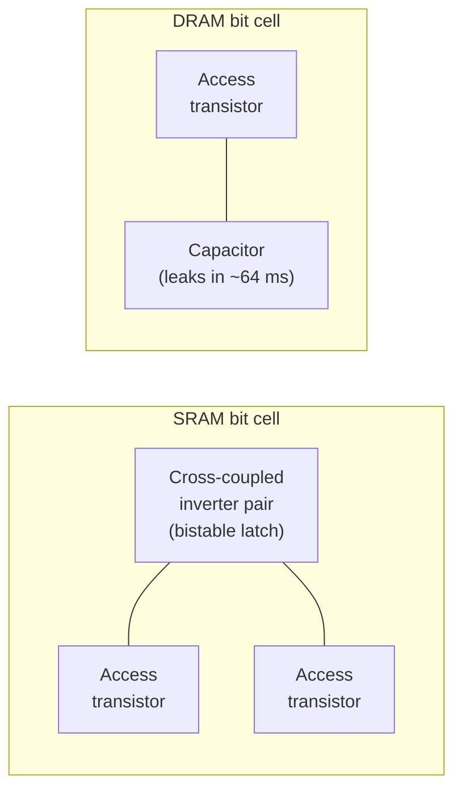
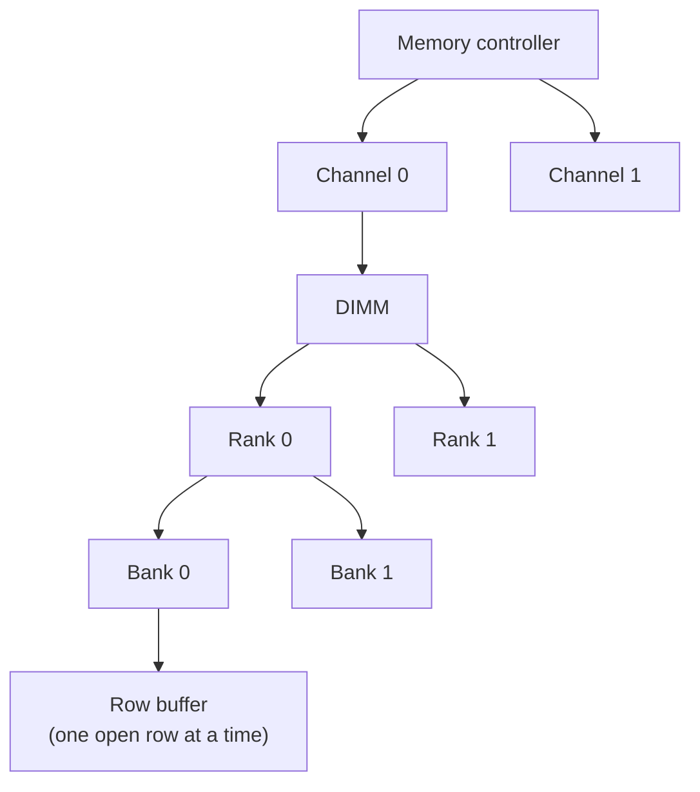
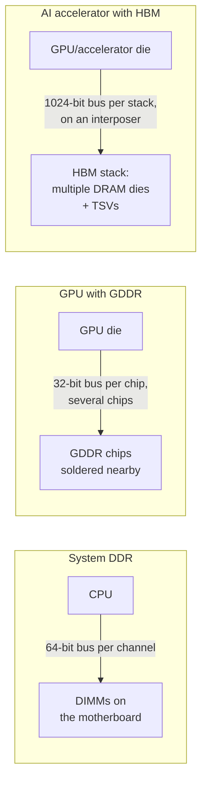

# RAM Technologies - SRAM, DRAM, DDR, GDDR, HBM

> [!summary] TL;DR
> RAM (Random Access Memory) means any address can be reached in roughly constant time, unlike a tape you must scan sequentially. RAM is also **volatile**: every cell depends on power to hold its value, so all of it — SRAM and DRAM alike — is lost the instant power is removed, which is exactly what [[ROM, Flash, Firmware and the Boot Process|ROM and flash]] are built to survive. The two building blocks are **SRAM** (fast, power-hungry, used for on-chip caches) and **DRAM** (denser and cheaper, used for main memory) — and DRAM itself comes in several interface flavors optimized for different jobs: **DDR** for general-purpose system memory, **GDDR** for GPU bandwidth, and **HBM** for the extreme bandwidth AI accelerators need.

> [!abstract] Core idea
> - "Random access" means any address costs about the same, unlike sequential media (tape, and to a lesser extent spinning disks).
> - SRAM: a 6-transistor cell that holds its value with no refreshing, fast but low-density and expensive — used for CPU caches and register files.
> - DRAM: a 1-transistor-1-capacitor cell that must be refreshed roughly every 64 ms as the capacitor leaks charge — denser and cheaper, used as main memory.
> - DDR, GDDR and HBM are all DRAM; they differ in the interface and packaging used to get data on and off the chip, trading latency for bandwidth differently for different workloads.

## 1. Why it exists

Picture a single cell of memory as a light switch: it needs to hold one bit (on/off) and let the rest of the system read or set that bit quickly. Build that switch from 6 transistors wired so it holds its state as long as power is applied (SRAM), and you get speed at the cost of area — 6 transistors per bit means fewer bits fit on a given chip, and area costs money. Build it from 1 transistor and 1 tiny capacitor instead (DRAM), and six times as many bits fit in the same area — but a capacitor leaks its charge within milliseconds, so the cell must be read and rewritten ("refreshed") continuously just to remember a value it isn't even being asked about.

That single trade-off — SRAM's speed and area cost vs. DRAM's density and refresh cost — explains why a CPU has a few tens of kilobytes of SRAM cache right next to each core and several gigabytes of DRAM a short trip away on the memory bus (see [[Memory Hierarchy and CPU Caches]] for the full pyramid), instead of either technology doing the whole job alone.

## 2. Mental model

SRAM is a notepad on your desk: instantly available, but you only have room for a few pages, and the paper is expensive. DRAM is a filing cabinet across the room: holds far more, costs far less per page, but every page is slowly fading and a librarian has to walk over and re-copy each one periodically before it disappears — which is work the system does in the background, invisibly, but which still takes bus time.

## 3. How it works

### The SRAM cell: 6 transistors, no refresh

An SRAM bit cell is two cross-coupled inverters (4 transistors) forming a bistable latch — it has exactly two stable states, and whichever one it's in, it stays in until deliberately flipped — plus 2 access transistors that connect the latch to the bit lines for reading or writing. Because the latch actively holds its state as long as power flows, no refresh is needed. The cost is area: 6 transistors per bit versus DRAM's 1, so a chip of a given size holds far fewer SRAM bits than DRAM bits — which is exactly why SRAM is used only where speed matters more than capacity: L1/L2/L3 caches, register files, and TLBs (see [[Virtual Memory, Paging and the TLB]]).

### The DRAM cell: 1 transistor, 1 capacitor, and the refresh problem

A DRAM bit cell is one access transistor gating one tiny capacitor. A charged capacitor is a 1; an uncharged one is a 0. Reading the cell drains the capacitor's charge into a sense amplifier (a destructive read — the row must be rewritten after every read), and the capacitor also leaks charge on its own within tens of milliseconds regardless of whether it's read. JEDEC's DDR5 standard, like its predecessors, specifies a typical refresh interval of about 64 ms per row: the memory controller must read and rewrite every row at least that often, which uses a slice of the available bus bandwidth even when nothing is actively being accessed.



### DRAM organization: channels, ranks, banks, rows

A memory controller talks to DRAM over one or more **channels**; each channel connects to one or more **DIMMs**, each DIMM has one or more **ranks** (independent sets of chips), and each rank is divided into **banks** that can be accessed somewhat independently. Within a bank, an address decomposes into a **row** and a **column**. Opening a row ("activating" it) copies its entire contents into a fast row buffer; subsequent accesses to the same row (a **row-buffer hit**) are fast, while an access to a different row in the same bank (a **row-buffer miss**) must close the old row and open the new one, which costs extra cycles. This is why sequential or blocked memory access patterns (which tend to stay within the same open row) run faster than scattered random access, even within DRAM itself, independent of the CPU-cache locality effects covered in [[Memory Hierarchy and CPU Caches]].



### From SDRAM to DDR1–5

Early DRAM was asynchronous (FPM, then EDO) — the memory controller and the DRAM chip ran on independent timings, which limited speed. **SDRAM** (Synchronous DRAM) added a shared clock so the controller and chip could pipeline requests. **DDR** (Double Data Rate) SDRAM then doubled throughput again by transferring data on both the rising and falling edge of that same clock, and each generation since has grown a **prefetch buffer** (the amount of data fetched internally per access and streamed out over several clock edges) to keep scaling bandwidth without requiring the clock itself to keep doubling:

| Generation | Typical data rate | Typical voltage | Notable change (documented, JEDEC) |
|---|---|---|---|
| SDRAM | up to ~166 MT/s | 3.3 V | First synchronous clock |
| DDR1 | up to ~400 MT/s | 2.5 V | Double data rate (both clock edges) |
| DDR3 | up to ~2133 MT/s | 1.5 V | 8n prefetch |
| DDR4 | up to ~3200 MT/s | 1.2 V | 8n prefetch, bank groups |
| DDR5 | 4800–8800+ MT/s | 1.1 V | 16n prefetch; **two independent 32-bit sub-channels per DIMM**; **on-die ECC** (corrects internal bit errors, separate from system-level ECC); on-DIMM power management (PMIC) |

DDR5's two sub-channels mean a single DDR5 DIMM behaves like two narrower, independent channels, improving the controller's ability to keep multiple requests in flight. **LPDDR** (Low-Power DDR) is a parallel line optimized for mobile and laptop power budgets rather than raw bandwidth, used in phones and most laptops rather than desktops/servers.

### ECC RAM

Error-Correcting Code RAM adds extra bits per word (commonly a 72-bit word storing 64 data bits plus 8 check bits) so the memory controller can detect and correct single-bit errors (and detect, without correcting, many double-bit errors) caused by cosmic rays or electrical noise flipping a capacitor's charge. Servers running long-lived, memory-heavy workloads (databases, caches holding gigabytes for weeks) use ECC because an uncorrected single-bit flip in multi-day-uptime DRAM is a real, documented failure mode at scale; most consumer desktops and laptops ship without it.

### GDDR and HBM: DRAM built for bandwidth

A GPU has thousands of parallel execution units all wanting data simultaneously — its bottleneck is total bandwidth, not the latency of any one access (a GPU hides latency by having enormous numbers of threads in flight; a CPU core instead needs each individual access to come back fast). **GDDR** (Graphics DDR, now at GDDR6/6X/7) answers this with a much wider bus per chip and chips soldered close to the GPU die, pushing a higher per-pin data rate (GDDR6X and 7 use multi-level signaling, PAM4/PAM3, to pack more bits per transfer) at the cost of higher latency than system DDR.

**HBM** (High Bandwidth Memory) goes further: instead of a handful of chips on a circuit board, HBM stacks multiple DRAM dies vertically and connects them with thousands of through-silicon vias (TSVs), giving each stack a 1024-bit-wide interface — far wider than GDDR's already-wide bus — at the cost of being physically bonded next to the compute die on an interposer rather than socketed. This is the memory technology behind AI accelerators like the Nvidia H100/H200, where total memory bandwidth, not raw compute, is frequently the limiting factor for serving large models, and VRAM/HBM capacity directly caps how large a model (or how big a batch) fits on one device.



## 4. Worked example

### Whiteboard version

A backend service's container is given a memory limit. Go's runtime needs to know that limit to decide how aggressively to run garbage collection — the function below is the kind of small, real decision a backend engineer makes using exactly the concepts above: DRAM is the physical resource; `GOMEMLIMIT` is how Go budgets against it.

### Capacity planning: fitting Go's heap inside a container's memory limit

Since Go 1.19, `runtime/debug.SetMemoryLimit` (and the equivalent `GOMEMLIMIT` environment variable) sets a soft cap on total Go-managed memory, prompting more frequent garbage collection as usage approaches the limit instead of waiting for the default pacer (driven by `GOGC`) alone — which matters directly for sizing a container: a pod given 512 MiB of DRAM but no `GOMEMLIMIT` can still be OOM-killed by the kernel even while `GOGC` thinks it has headroom, because `GOGC`'s target is based on live-heap growth, not on an absolute ceiling.

```go
// Package memlimit picks a conservative GOMEMLIMIT for a container, leaving
// headroom for the Go runtime's own overhead (goroutine stacks, non-heap
// runtime structures) and the OS, so the process GCs before the kernel's
// OOM killer acts.
package memlimit

import "fmt"

// ForContainer returns a GOMEMLIMIT value in bytes for a container with
// containerBytes of total memory, reserving headroomPct percent for
// non-Go-heap memory (runtime overhead, OS page cache, other processes).
// It returns an error if the inputs can't produce a sane, positive limit.
func ForContainer(containerBytes int64, headroomPct int) (int64, error) {
	if containerBytes <= 0 {
		return 0, fmt.Errorf("memlimit: containerBytes must be positive, got %d", containerBytes)
	}
	if headroomPct < 0 || headroomPct >= 100 {
		return 0, fmt.Errorf("memlimit: headroomPct must be in [0, 100), got %d", headroomPct)
	}
	usable := containerBytes * int64(100-headroomPct) / 100
	if usable <= 0 {
		return 0, fmt.Errorf("memlimit: computed limit %d is not positive", usable)
	}
	return usable, nil
}
```

```go
package memlimit

import "testing"

func TestForContainer(t *testing.T) {
	cases := []struct {
		name           string
		containerBytes int64
		headroomPct    int
		want           int64
		wantErr        bool
	}{
		{"512MiB with 20pct headroom", 512 << 20, 20, (512 << 20) * 80 / 100, false},
		{"1GiB with 10pct headroom", 1 << 30, 10, (1 << 30) * 90 / 100, false},
		{"zero container size", 0, 20, 0, true},
		{"headroom at 100pct is invalid", 1 << 30, 100, 0, true},
		{"negative headroom is invalid", 1 << 30, -1, 0, true},
	}
	for _, c := range cases {
		t.Run(c.name, func(t *testing.T) {
			got, err := ForContainer(c.containerBytes, c.headroomPct)
			if c.wantErr {
				if err == nil {
					t.Fatalf("ForContainer(%d, %d) = %d, nil; want an error", c.containerBytes, c.headroomPct, got)
				}
				return
			}
			if err != nil {
				t.Fatalf("ForContainer(%d, %d) returned error: %v", c.containerBytes, c.headroomPct, err)
			}
			if got != c.want {
				t.Fatalf("ForContainer(%d, %d) = %d, want %d", c.containerBytes, c.headroomPct, got, c.want)
			}
		})
	}
}
```

```text
$ go vet ./memlimit/...
$ go test -race ./memlimit/...
ok  	cs1scratch/memlimit	0.344s
```

For a 512 MiB pod, this reserves 20% (102.4 MiB) for runtime overhead and OS use, setting `GOMEMLIMIT=409.6MiB` — enough margin that the Go GC's soft limit triggers well before the kernel's hard OOM kill, while `GOGC` continues to control collection frequency below that ceiling.

## 5. Variants and comparison

| Technology | Cell / mechanism | Optimized for | Typical use |
|---|---|---|---|
| SRAM | 6T bistable latch, no refresh | Latency | CPU L1/L2/L3 cache, register files, TLB |
| DRAM (DDR5, 2025-era servers) | 1T1C, refreshed ~every 64 ms | Capacity and cost per GB, general-purpose bandwidth | System main memory |
| LPDDR | Same cell as DDR, lower-power interface | Power efficiency | Laptops, phones |
| GDDR6/6X/7 | Same cell family, wide per-chip bus, PAM4/PAM3 signaling | Raw bandwidth over latency | GPU video memory (VRAM) |
| HBM3 | 3D-stacked dies, TSVs, 1024-bit bus per stack | Maximum total bandwidth | AI accelerators (training/inference) |

## 6. Trade-offs and when not to use

- SRAM's speed costs area and money, so it's never used for gigabyte-scale main memory — only for the kilobytes-to-tens-of-megabytes that sit directly in the CPU's cache hierarchy.
- DRAM's refresh cycles are pure overhead: they use bus bandwidth and power for data nobody is reading right now, which is the price paid for 6× the density of SRAM per unit area.
- GDDR and HBM both sacrifice single-access latency for bandwidth; a workload dominated by latency-sensitive, low-parallelism memory access (most general-purpose CPU workloads) gains little or nothing from them, which is why servers run system DDR, not GDDR, for their CPUs.
- ECC RAM costs more and (on some platforms) is slightly slower due to the extra check-bit overhead; for a short-lived process or a non-critical workload, the probability of an uncorrected bit flip mattering in its lifetime is low enough that plain DDR is the common choice.

## 7. In production

- **Real systems:** cloud instance families advertise their DRAM technology and bandwidth explicitly (e.g. AWS/GCP/Azure memory-optimized instance types built on DDR5 platforms); Nvidia's H100/H200 and AMD's MI300 AI accelerators are specified by their HBM3/HBM3e capacity and bandwidth as a headline number, because it directly bounds model size and batch throughput; Redis and other in-memory stores are, at bottom, applications whose entire performance story depends on this chapter's DRAM latency and bandwidth numbers.
- **Failure modes → fixes:**
  - A Go service gets OOM-killed by the kernel despite `GOGC` looking healthy in metrics → set `GOMEMLIMIT` to a value with headroom below the container's hard limit (see the worked example).
  - Memory bandwidth, not CPU, caps throughput on a data-heavy workload (analytics, ML inference) → check whether the workload is bandwidth-bound (profile memory bandwidth utilization) before assuming more CPU cores will help; may need a different instance type or accelerator with more memory bandwidth.
  - Rare, hard-to-reproduce data corruption in a long-running server → check for ECC-capable hardware and whether ECC is actually enabled; non-ECC DRAM silently accepts the occasional bit flip.
- **What to monitor:** memory bandwidth utilization (not just capacity used) on bandwidth-sensitive workloads; ECC correctable-error counts (a rising rate signals failing DIMMs before they cause an uncorrectable error); container memory usage against both `GOGC`-driven heap size and `GOMEMLIMIT`.

## 8. Deep dive

- **Why "random access" is the defining property.** A magnetic tape must be read sequentially from wherever the read head currently sits — reaching byte 1,000,000 after byte 0 costs time proportional to the distance. RAM (SRAM or DRAM) is built so that, modulo row-buffer effects within DRAM banks, any address costs about the same as any other — the property the name describes, and the reason RAM can serve as a CPU's general-purpose working memory rather than only as a streaming buffer.
- **Rowhammer.** Repeatedly activating (hammering) one DRAM row at a very high rate can, due to electrical interference between physically adjacent rows, disturb a neighboring row's capacitors enough to flip bits in data the attacker never directly accessed — a real, documented hardware side-channel and security concern for both ECC and non-ECC DRAM (ECC mitigates single-bit instances but not all documented Rowhammer variants), and part of why DDR4/DDR5 controllers include target row refresh mitigations.
- **Why DDR5 needed two sub-channels.** As prefetch size grows each generation, a single wide, monolithic channel moves a bigger minimum chunk of data per access, which wastes bandwidth on small, scattered accesses; splitting each DIMM into two independent 32-bit sub-channels lets the controller serve two smaller requests in parallel instead of over-fetching one large one, improving effective bandwidth for mixed, less-than-perfectly-sequential real workloads.
- **GDDR and HBM latency, quantified relative to DDR.** Both trade higher per-access latency for bandwidth: GDDR's wider, faster-per-pin bus and HBM's enormous 1024-bit-per-stack interface both move far more bytes per second in aggregate than a CPU's DDR5 channel, but a single outstanding request to either typically takes longer to come back than a DDR5 request — acceptable for a GPU with thousands of threads able to hide that latency behind other work, and a poor fit for a CPU core executing a single serial instruction stream.
- **Where this connects back.** The density/speed/cost trade-off at the cell level (SRAM vs. DRAM) is the same trade-off that shapes the entire memory hierarchy in [[Memory Hierarchy and CPU Caches]]; the controller-and-bank mechanics here are also what the OS and hardware coordinate around for virtual memory and paging, covered in [[Virtual Memory, Paging and the TLB]].

## 9. Interview questions

> [!question]- What does "random access" actually mean, and what is it contrasted with?
> Any address can be read or written in about the same amount of time, regardless of which address was accessed previously — unlike sequential-access media (magnetic tape, and to a lesser degree spinning disks), where reaching a far-away address costs time proportional to the distance from the current position.

> [!question]- Why is SRAM used for CPU caches instead of just using faster DRAM everywhere?
> SRAM's 6-transistor cell needs no refresh and is inherently lower-latency, but costs roughly 6× the area per bit versus DRAM's 1-transistor-1-capacitor cell — so SRAM is reserved for the kilobytes-to-megabytes where speed matters most (caches, register files), while DRAM's density and lower cost per GB make it the only practical choice for gigabyte-scale main memory.

> [!question]- Why does DRAM need to be refreshed, and what does that cost?
> Each bit is stored as charge on a tiny capacitor, which leaks away within tens of milliseconds regardless of whether the system ever reads that address again. The memory controller must read and rewrite every row at least that often (JEDEC specifies roughly every 64 ms for DDR5) — bus bandwidth and power spent maintaining data, not serving requests.

> [!question]- Trap: is GDDR simply "faster DRAM," so could a CPU benefit from using it instead of DDR?
> No — GDDR trades higher per-access latency for much higher aggregate bandwidth, which suits a GPU's thousands of parallel, latency-tolerant threads but would slow down a CPU core's single serial instruction stream, where each individual memory access's latency directly stalls the next instruction. CPUs use DDR because CPU workloads are typically latency-sensitive, not bandwidth-saturating in the way GPU workloads are.

> [!question]- What problem does HBM solve that GDDR doesn't fully solve?
> Even more aggregate bandwidth than a wide GDDR bus can provide, by stacking multiple DRAM dies vertically and connecting them with thousands of through-silicon vias for a combined interface width (1024 bits per stack) far beyond what a planar PCB trace layout could route — the technology behind the memory bandwidth figures AI accelerators advertise, because total model/batch size that fits in memory, and the bandwidth to stream it, both directly limit inference and training throughput.

> [!question]- Why would a backend engineer set `GOMEMLIMIT` instead of only tuning `GOGC`?
> `GOGC` paces collection relative to live-heap growth, with no notion of an absolute ceiling, so a process can still be killed by the kernel's OOM killer in a memory-constrained container even while `GOGC`'s pacing looks fine. `GOMEMLIMIT` (Go 1.19+) gives the runtime an actual soft cap tied to the container's real memory limit, so GC runs more aggressively as usage approaches that cap instead of waiting to be killed.

## 10. Cheat sheet

- RAM = constant-time access to any address, unlike sequential media; it is volatile, so every bit is lost on power loss (ROM/flash is the non-volatile counterpart).
- SRAM: 6T latch, no refresh, fast, expensive, low density — used for caches and register files.
- DRAM: 1T1C, refreshed ~every 64 ms, cheaper and denser, slower — used as main memory.
- DDR doubles transfers per clock edge; each generation grows the prefetch buffer for more bandwidth (DDR5: two 32-bit sub-channels, on-die ECC, 4800–8800+ MT/s).
- ECC RAM adds check bits to detect/correct bit flips — standard in servers, usually skipped on consumer hardware.
- GDDR: wide bus, high bandwidth, higher latency than DDR — GPU VRAM.
- HBM: 3D-stacked dies with a 1024-bit-per-stack interface, the most bandwidth of all — AI accelerators.
- For Go services, pair `GOMEMLIMIT` (an absolute DRAM-aware ceiling) with `GOGC` (collection pacing below that ceiling).

## Links

- **Before this:** [[Memory Hierarchy and CPU Caches]]
- **Next:** [[ROM, Flash, Firmware and the Boot Process]], [[Storage Devices - HDD, SSD, NVMe]]
- **Compare with:** [[How a Computer Runs a Program]] (what DRAM holds once a process is loaded)
