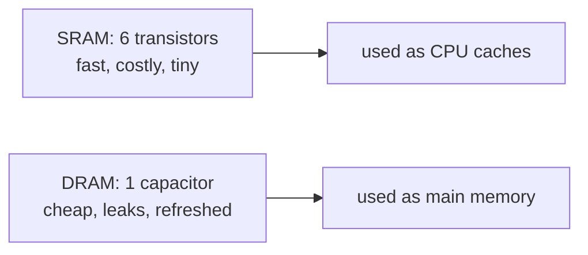
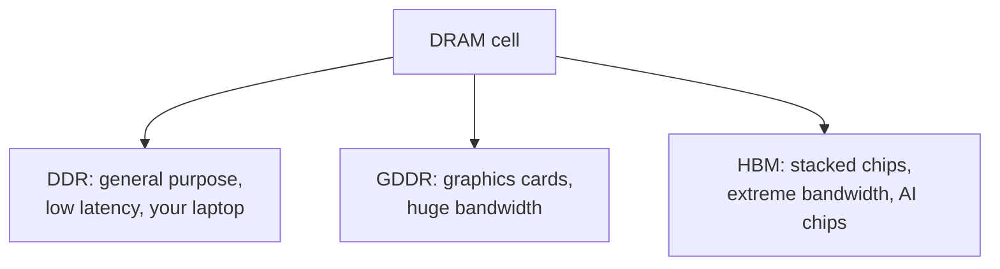
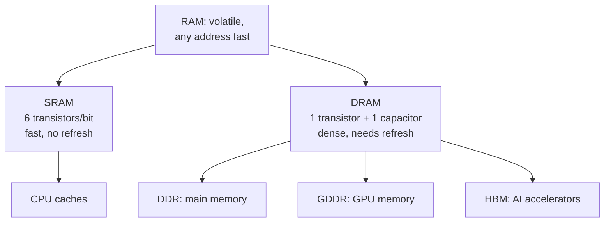
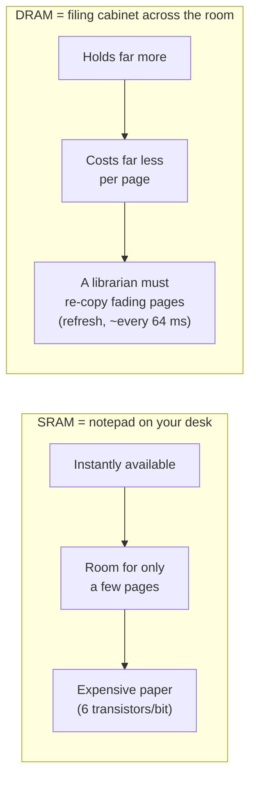
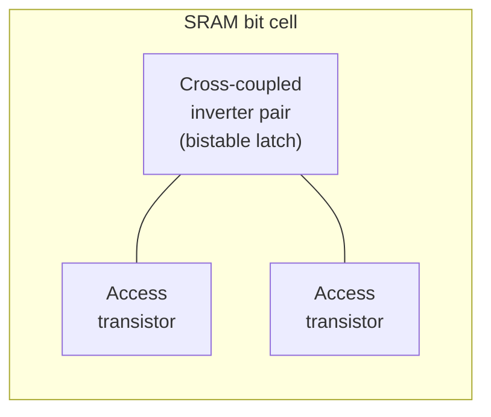
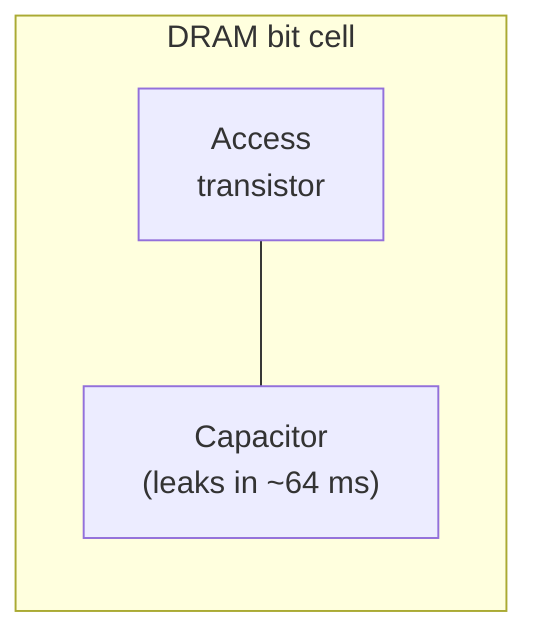
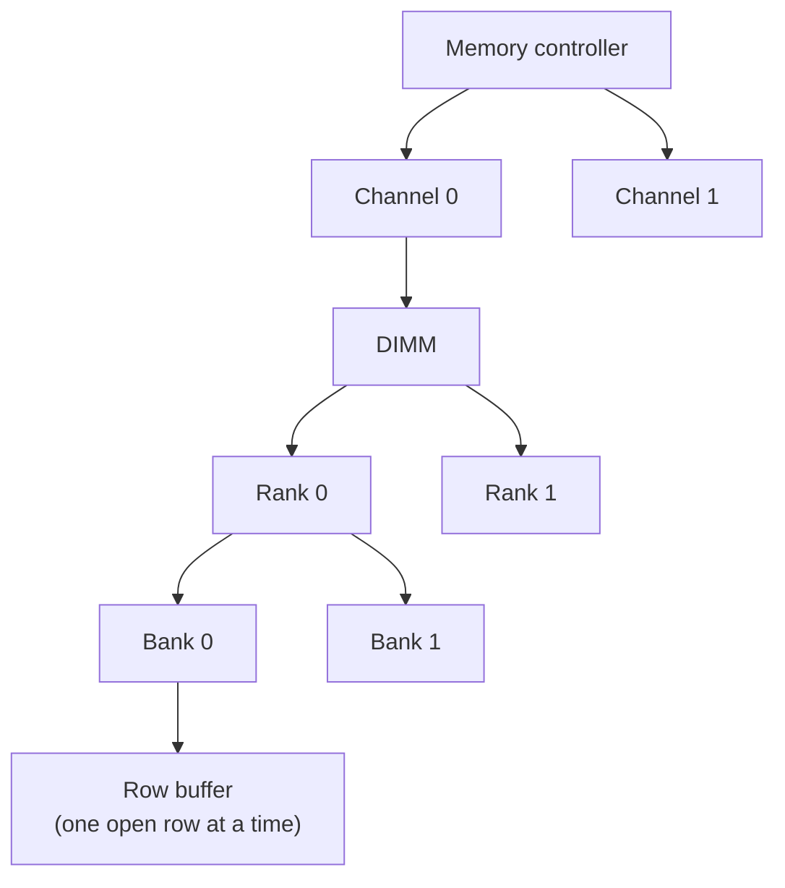
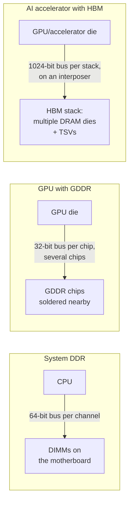

# RAM Technologies - SRAM, DRAM, DDR, GDDR, HBM

> [!summary] TL;DR
> RAM (Random Access Memory) means any address can be reached in roughly constant time, unlike a tape you must scan sequentially. RAM is also **volatile**: every cell depends on power to hold its value, so all of it — SRAM and DRAM alike — is lost the instant power is removed, which is exactly what [[ROM, Flash, Firmware and the Boot Process|ROM and flash]] are built to survive. The two building blocks are **SRAM** (fast, power-hungry, used for on-chip caches) and **DRAM** (denser and cheaper, used for main memory) — and DRAM itself comes in several interface flavors optimized for different jobs: **DDR** for general-purpose system memory, **GDDR** for GPU bandwidth, and **HBM** for the extreme bandwidth AI accelerators need. Runnable Go version: [[RAM Technologies - SRAM, DRAM, DDR, GDDR, HBM - Go]].

> [!abstract] Core idea
> - "Random access" means any address costs about the same, unlike sequential media (tape, and to a lesser extent spinning disks).
> - SRAM: a 6-transistor cell that holds its value with no refreshing, fast but low-density and expensive — used for CPU caches and register files.
> - DRAM: a 1-transistor-1-capacitor cell that must be refreshed roughly every 64 ms as the capacitor leaks charge — denser and cheaper, used as main memory.
> - DDR, GDDR and HBM are all DRAM; they differ in the interface and packaging used to get data on and off the chip, trading latency for bandwidth differently for different workloads.

## Start here: the basics 🟢

> [!info] How to read this note (pick your level)
> - 🟢 **New to this?** Read "From zero" below, then sections 1, 2 and the cheat sheet (10). Stop there, that is a full first pass.
> - 🟡 **Know the basics?** Add section 3 (how it works), 4 (worked example), then 5 and 6.
> - 🔴 **Interview / SDE-3 prep?** Add 7, 8 and 9. Headings are tagged 🟢🟡🔴 so you always know where you are.

> [!note] Before this note
> - [[Memory Hierarchy and CPU Caches]]: the CPU uses small fast caches near each core and big slower main memory further away. This note shows what those two kinds of memory are made of.

**From zero, in 60 seconds** 🟢

"RAM" is not one thing. There are two basic ways to build a memory cell, and everything else is packaging.

**SRAM** stores a bit with 6 transistors: fast, power-hungry, expensive — so it is used in tiny amounts, as the CPU's caches. **DRAM** stores a bit as charge in 1 tiny capacitor: slow-ish and it leaks, so it must be refreshed thousands of times a second — but it is cheap, so your 16 GB of "RAM" is DRAM.



DDR, GDDR and HBM are all just DRAM wired up differently for different jobs:



The rest of this note is just three questions:
1. How do the SRAM and DRAM cells actually work?
2. What do DDR, GDDR and HBM each optimize for?
3. Which numbers (latency vs bandwidth) matter for which workload?

**The problem in one story.**
Your laptop opens a big spreadsheet in a second, but loading it from disk took longer.
While you work, the spreadsheet lives in RAM: fast memory that loses everything when power goes.
The CPU also keeps a tiny, even faster copy of the cells you touch most.
Those two memories are built very differently, and graphics cards use yet another kind.

**Words you need first**

| Word | Plain meaning | Tiny example |
| --- | --- | --- |
| Bit | One 0-or-1 value | A light switch: on or off |
| Transistor | A tiny electronic switch on a chip | Billions sit on one CPU |
| Capacitor | A tiny bucket that holds electric charge | Full = 1, empty = 0 |
| Volatile | Forgets its data when power is cut | Unsaved work lost in a power cut |
| Cache | Small fast memory near the CPU core | L1 cache, tens of KB |
| Bandwidth | How many bytes per second can move | 50 GB/s from RAM |
| Latency | How long one request takes to come back | ~100 ns for one RAM read |
| Memory bus | The wires between CPU and memory chips | A 64-bit DDR channel |
| SRAM / DRAM | Static RAM (holds a bit with 6 transistors) / Dynamic RAM (holds a bit as charge in 1 capacitor) | CPU cache / your 16 GB of RAM |
| Refresh | Re-reading and re-writing DRAM cells before their charge leaks away | every row about every 64 ms |
| DIMM | The stick of memory chips you plug into a motherboard | one 16 GB DDR5 stick |
| MT/s | Mega-transfers per second: how many data moves happen each second | DDR5-6400 = 6,400 MT/s |
| ECC | Error-correcting code: extra bits that fix a flipped bit automatically | server RAM |
| JEDEC | The industry group that writes the official memory standards | publishes the DDR5 spec |

**Picture it**



**Analogy.** SRAM is a whiteboard by your desk: instant, but small. DRAM is a big wall of chalk notes that slowly fade, so someone keeps re-writing them.
Where it breaks: the re-writing (refresh) happens on a fixed timer in hardware, and it competes with your own reads for the same wires.

**How the rest of this note builds up**

- First, why two cell designs exist (section 1) and a notepad-vs-filing-cabinet model (section 2).
- Then the cells themselves, DRAM organization, DDR generations and ECC (section 3).
- Then GDDR and HBM for bandwidth, and a Go `GOMEMLIMIT` worked example (sections 3-4).
- Finally the SDE-3 deep dive: trade-offs, production failure modes, Rowhammer and DDR5 sub-channels (sections 5-8).

> [!tip] Remember
> SRAM is fast and small (caches); DRAM is dense and cheap but must be refreshed (main memory, GPU memory, HBM).

## 1. Why it exists 🟢

Picture a single cell of memory as a light switch. It needs to hold one bit — on or off — and let the rest of the system read or set that bit quickly.

There are two fundamentally different ways to build that switch, and the whole landscape of RAM technologies in this note grows out of the trade-off between them.

Build the switch from six transistors wired so it actively holds its own state as long as power is applied, and you get **SRAM**: fast, but expensive in area — six transistors per bit means fewer bits fit on a given chip, and chip area costs real money.

Build it instead from one transistor and one tiny capacitor, and you get **DRAM**: six times as many bits fit in the same area — but a capacitor leaks its charge within milliseconds, so the cell must be read and rewritten ("refreshed") continuously just to remember a value nobody is even asking about right now.

That single trade-off — SRAM's speed and area cost versus DRAM's density and refresh cost — explains why a CPU has a few tens of kilobytes of SRAM cache sitting right next to each core and several gigabytes of DRAM a short trip away on the memory bus (see [[Memory Hierarchy and CPU Caches]] for the full pyramid), instead of either technology doing the whole job alone.

> [!tip] Remember
> SRAM trades area and cost for speed and no refresh; DRAM trades refresh overhead for six times the density. Neither technology wins outright, which is why real systems use both, in different places.

### Real-life example 🟢

Your phone uses LPDDR, a low-power DRAM, so it can keep apps like WhatsApp and Instagram open in the background without draining the battery.
A PlayStation 5 or a gaming graphics card uses GDDR6, because drawing millions of pixels 60 times a second needs a huge flow of bytes.
The GPUs that run large AI chat models (such as Nvidia's H100) use HBM stacked right next to the chip, because moving model weights in and out is the bottleneck.
And inside every one of those chips, the CPU or GPU still keeps a few megabytes of SRAM as its fastest cache.

## 2. Mental model 🟢

**In plain words:** SRAM is a notepad on your desk — instantly available, but you only have room for a few pages, and the paper is expensive.

DRAM is a filing cabinet across the room — it holds far more and costs far less per page, but every page is slowly fading, and a librarian has to walk over and re-copy each one periodically before it disappears.

That re-copying happens invisibly, in the background, but it still takes real time on the shared "walkway" (the memory bus) that everything else also needs.



**Where the analogy breaks down:** a real notepad page never needs rewriting to keep its ink from fading, and a real librarian doesn't block every other errand while re-copying one page. DRAM's refresh really does compete with ordinary reads and writes for the same physical bus, which is the one place this picture understates the real cost.

> [!warning] Common mistake
> Thinking DRAM's refresh is something a program can avoid by "not touching" that memory. Every DRAM row must be refreshed on a schedule regardless of whether software is reading it — refresh is a property of the *hardware cell*, not of access patterns.

## Common beginner mistakes 🟢

- **Thinking "RAM" means one technology** → caches are SRAM, main memory is DRAM, GPUs use GDDR or HBM → name the type when you compare speeds.
- **Assuming GDDR would make a CPU faster** → GDDR gives more bandwidth but slower single reads, and CPUs wait on single reads → CPUs stay on DDR.
- **Believing memory you don't touch costs nothing** → every DRAM row is refreshed on a timer anyway → refresh is a hardware cost you cannot avoid in software.
- **Reading "DDR5-6400" as a clock speed** → it is 6,400 million transfers per second, from both clock edges plus a bigger prefetch → compare MT/s and latency separately.
- **Giving a Go container a memory limit but no `GOMEMLIMIT`** → the GC can let the heap grow until the kernel kills the process → set `GOMEMLIMIT` a little below the container limit.

## 3. How it works 🟡

> 🟢 → 🟡 **You now know** the two cell types (SRAM fast and small, DRAM dense and leaky) and that DDR, GDDR and HBM are all DRAM packaged differently. **Next we open the box:** how each cell holds a bit, how DRAM is organised into banks and rows, how DDR generations got faster, and how GDDR and HBM trade latency for bandwidth.

### The SRAM cell: 6 transistors, no refresh

**In plain words:** an SRAM bit cell is built from two cross-coupled inverters forming a **bistable latch** — a circuit with exactly two stable states, and whichever one it's in, it stays there until deliberately flipped — plus two access transistors that connect the latch to the bit lines for reading or writing.

**Step by step:**
1. Four transistors form two "inverters" (circuits that output the opposite of their input), each feeding the other.
2. If one side holds 1, it forces the other side to 0, which forces the first side to stay 1. The loop holds itself.
3. To read, the two remaining "access" transistors open and connect the loop to the bit lines (the wires that carry the value out).
4. To write, the bit lines push in the new value hard enough to flip the loop.
5. No refresh is needed: as long as power is on, the loop keeps its value.



**Example:** because the latch actively holds its state as long as power flows, no refresh is needed at all — it simply sits there, stable, until something deliberately writes a new value through the access transistors.

**Why it matters:** the cost is area — 6 transistors per bit versus DRAM's 1 — so a chip of a given size holds far fewer SRAM bits than DRAM bits, which is exactly why SRAM is reserved for places where speed matters more than capacity: L1/L2/L3 caches, register files, and TLBs (see [[Virtual Memory, Paging and the TLB]]).

### The DRAM cell: 1 transistor, 1 capacitor, and the refresh problem

**In plain words:** a DRAM bit cell is one access transistor gating one tiny capacitor. A charged capacitor reads as a 1; an uncharged one reads as a 0.



**Step by step, what happens on a read:**
1. The access transistor opens, connecting the capacitor to a sense amplifier (a circuit that detects a very small charge and turns it into a clear 0 or 1).
2. The sense amplifier drains the capacitor's tiny charge to decide whether it was a 1 or a 0 — this is a **destructive read**: the act of reading empties the capacitor.
3. The memory controller must immediately rewrite the row, restoring whatever value was just read, before it can be considered "still there."
4. Separately, and regardless of whether anyone reads it, each capacitor also leaks its charge on its own within tens of milliseconds — JEDEC's (the memory standards body's) DDR5 standard specifies a typical refresh interval of about **64 ms per row**, meaning the controller must proactively read and rewrite every row at least that often.

**Why it matters:** this refresh traffic uses a slice of the available memory-bus bandwidth even when the system is otherwise idle — it is pure overhead paid for DRAM's six-fold density advantage over SRAM.

> [!tip] Remember
> A DRAM read is destructive and must be followed by a rewrite; a DRAM cell also needs rewriting on a ~64 ms timer regardless of whether it's ever read. Both are the price of 1-transistor density.

### DRAM organization: channels, ranks, banks, rows

**In plain words:** a memory controller doesn't talk to "DRAM" as one undivided pool — it talks through a hierarchy of narrower and narrower subdivisions, each level adding a bit more independence or parallelism.

**Step by step:**
1. The CPU's memory controller asks for address X.
2. It picks the channel (a set of wires), then the DIMM and rank (a group of chips on the stick).
3. Inside the chips it picks a bank, then "opens" one row: the whole row is copied into a fast row buffer.
4. It reads the needed column from that buffer.
5. If the next request is in the same open row, it is fast (a row-buffer hit). If it is a different row in the same bank, the old row must close first (a miss).



**Example:**

- A channel connects to one or more DIMMs.
- Each DIMM has one or more ranks (independent sets of chips).
- Each rank is divided into banks that can be worked somewhat independently.
- Within a bank, an address decomposes into a **row** and a **column**.

Opening a row ("activating" it) copies its entire contents into a fast row buffer.

A later access to the *same* open row — a **row-buffer hit** — is fast; an access to a *different* row in the same bank — a **row-buffer miss** — must first close the old row and then open the new one, costing extra cycles.

**Why it matters:** this is why sequential or blocked memory access patterns, which tend to stay within the same open row, run measurably faster than scattered random access — even purely within DRAM itself, independent of the CPU-cache locality effects covered in [[Memory Hierarchy and CPU Caches]].

### From SDRAM to DDR1-5

**In plain words:** early DRAM was **asynchronous** (FPM, then EDO) — the memory controller and the DRAM chip ran on independent timings, which capped how fast requests could be pipelined.

**Step by step:**
1. Old DRAM ran on its own timing, so the controller had to wait and check each step.
2. SDRAM added a shared clock, so both sides could plan requests on the same beat.
3. DDR sent data on both the up and the down edge of each clock tick: twice as much per tick.
4. Each later generation also fetched more bits inside the chip per request (the prefetch), then streamed them out quickly.
5. DDR5 also split each stick into two independent halves (sub-channels), so two small requests can run at once.

**SDRAM** (Synchronous DRAM) fixed that by adding a shared clock, letting the controller and chip pipeline requests against the same tick.

**DDR** (Double Data Rate) then doubled throughput again by transferring data on both the rising *and* falling edge of that clock, and every generation since has grown a **prefetch buffer** (how much data is fetched internally per access, then streamed out over several clock edges) to keep scaling bandwidth without needing the clock itself to keep doubling.

| Generation | Typical data rate | Typical voltage | Notable change (documented, JEDEC) |
|---|---|---|---|
| SDRAM | up to ~166 MT/s | 3.3 V | First synchronous clock |
| DDR1 | up to ~400 MT/s | 2.5 V | Double data rate (both clock edges) |
| DDR3 | up to ~2133 MT/s | 1.5 V | 8n prefetch |
| DDR4 | up to ~3200 MT/s | 1.2 V | 8n prefetch, bank groups |
| DDR5 | 4800-8800+ MT/s | 1.1 V | 16n prefetch (16 bits fetched per data pin per access); **two independent 32-bit sub-channels per DIMM**; **on-die ECC** (corrects internal bit errors, separate from system-level ECC); on-DIMM power management (PMIC, a power-control chip on the stick itself) |

**Why it matters:** DDR5's two sub-channels mean a single DDR5 DIMM behaves like two narrower, independent channels, improving the controller's ability to keep multiple requests in flight simultaneously rather than over-fetching one large one.

**LPDDR** (Low-Power DDR) is a parallel line optimized for mobile and laptop power budgets rather than raw bandwidth, used in phones and most laptops rather than desktops or servers.

> [!warning] Common mistake
> Assuming each DDR generation is "just a faster clock." The headline number (MT/s) grows from both a faster clock *and* a larger internal prefetch buffer — DDR5's jump to two independent sub-channels is a structural change to how the controller addresses the DIMM, not merely a speed bump.

### ECC RAM

**In plain words:** Error-Correcting Code RAM adds extra bits per word — commonly a 72-bit word storing 64 data bits plus 8 check bits — so the memory controller can detect and correct single-bit errors (and detect, without correcting, many double-bit errors) caused by cosmic rays or electrical noise flipping a capacitor's charge.

**Step by step:**
1. The program writes 64 bits of data.
2. The memory controller computes 8 extra check bits from those 64 and stores all 72.
3. Later, the controller reads all 72 bits and recomputes the check bits.
4. If one bit flipped (say from a cosmic ray), the mismatch shows exactly which bit, and the controller flips it back.
5. If two bits flipped, it can usually detect it but not fix it, and it reports an error.

**Example:** a server running a database or cache that holds gigabytes of state for weeks at a time has a real, non-trivial chance of an uncorrected single-bit flip occurring somewhere in that memory over its uptime — a documented failure mode at scale.

A consumer laptop, by contrast, is rebooted often enough and holds state briefly enough that the same risk rarely matters in practice, which is why most consumer hardware ships without ECC.

**Why it matters:** servers running long-lived, memory-heavy workloads pay the extra cost (and the small latency overhead of the check-bit logic) specifically because an uncorrected bit flip in multi-day-uptime DRAM is a real risk, not a theoretical one.

### GDDR and HBM: DRAM built for bandwidth

**In plain words:** a GPU has thousands of parallel execution units all wanting data at once — its bottleneck is **total bandwidth**, not the latency of any single access, because a GPU hides latency by having enormous numbers of threads in flight (a CPU core, by contrast, needs each individual access to come back fast, since it usually has far less work to overlap with the wait).

**Step by step:**
1. A GPU has thousands of small workers, each waiting on data. What matters is total bytes per second.
2. GDDR uses a wide bus with chips soldered right around the GPU, and sends more bits per wire tick.
3. HBM stacks several DRAM chips on top of each other and links them with thousands of tiny vertical wires.
4. That stack sits right next to the GPU, connected by a 1,024-bit-wide path: far wider than a normal 64-bit DDR channel.
5. Each single read is a bit slower than DDR, but the GPU hides that by keeping thousands of reads in flight.

**GDDR** (Graphics DDR, now at GDDR6/6X/7) answers the GPU's need with a much wider bus per chip and chips soldered close to the GPU die.

It pushes a higher per-pin data rate (GDDR6X and 7 use multi-level signaling, PAM4/PAM3, meaning each wire uses 4 or 3 voltage levels instead of 2, to pack more bits per transfer) at the cost of higher latency than system DDR.

**HBM** (High Bandwidth Memory) goes further still. Instead of a handful of chips on a circuit board, HBM stacks multiple DRAM dies vertically and connects them with thousands of through-silicon vias (TSVs).

That gives each stack a **1024-bit-wide interface** — far wider than GDDR's already-wide bus — at the cost of being physically bonded next to the compute die on an interposer (a thin silicon base that wires the memory stack to the processor) rather than socketed.



**Why it matters:** this is the memory technology behind AI accelerators like the Nvidia H100/H200, where total memory bandwidth, not raw compute, is frequently the limiting factor for serving large models — and VRAM/HBM capacity directly caps how large a model (or how big a batch) fits on one device.

> [!tip] Remember
> GDDR and HBM both sacrifice single-access latency for aggregate bandwidth. That trade only pays off for workloads with enough parallelism to hide the latency — GPUs and AI accelerators, not general-purpose CPU workloads.

## 4. Worked example 🟡

### Whiteboard version

A backend service's container is given a memory limit. Go's runtime needs to know that limit to decide how aggressively to run garbage collection:

```go
func ForContainer(containerBytes int64, headroomPct int) (int64, error) {
    usable := containerBytes * int64(100-headroomPct) / 100
    return usable, nil // simplified: real version validates inputs
}
```

This is the kind of small, real decision a backend engineer makes using exactly the concepts above: DRAM is the physical resource being budgeted; `GOMEMLIMIT` is how Go's runtime is told about that budget.

### Tracing the capacity-planning decision, step by step

**In plain words:** since Go 1.19, `runtime/debug.SetMemoryLimit` (and the equivalent `GOMEMLIMIT` environment variable) sets a **soft cap** on total Go-managed memory, prompting more frequent garbage collection as usage approaches that cap, instead of waiting for the default pacer (driven by `GOGC`) alone to decide.

1. A pod is given 512 MiB of DRAM by the container orchestrator (the physical resource this whole note has been about).
2. Without `GOMEMLIMIT`, Go's GC paces itself purely off `GOGC`, which tracks *live-heap growth*, not any absolute ceiling — so the process can still be OOM-killed (out-of-memory: the kernel force-stops a process that went over its memory limit) by the kernel even while `GOGC`'s own metrics look perfectly healthy.
3. Setting `GOMEMLIMIT` with headroom (say, reserving 20% for runtime overhead, the OS page cache, and other processes) gives the runtime an actual number to GC against: `409.6 MiB` for a 512 MiB pod with 20% headroom.
4. As live Go-managed memory approaches that limit, the garbage collector runs more aggressively — on purpose, trading some CPU for staying under the hard container limit — well before the kernel's OOM killer would act.

**Example (measured, Go 1.24.4, darwin/arm64, run in the scratch module for this note, 2026-11-09):**

| Container size | Headroom | Computed `GOMEMLIMIT` |
| --- | --- | --- |
| 512 MiB | 20% | 409.6 MiB |
| 1 GiB | 10% | 0.9 GiB |

```text
$ go test -race ./memlimit/...
ok  	cs1scratch/memlimit	1.224s
```

**Why it matters:** `GOMEMLIMIT` and `GOGC` are not competing settings.

`GOMEMLIMIT` is the absolute, DRAM-aware ceiling, and `GOGC` continues to control collection frequency *below* that ceiling. Pairing them is the production-grade answer to "how much container memory should a Go service actually request."

Runnable Go version, including input validation, the full table-driven test suite, and the `go vet`/`go test -race` output: [[RAM Technologies - SRAM, DRAM, DDR, GDDR, HBM - Go]].

## 5. Variants and comparison 🟡

| Technology | Cell / mechanism | Optimized for | Typical use |
|---|---|---|---|
| SRAM | 6T bistable latch, no refresh | Latency | CPU L1/L2/L3 cache, register files, TLB |
| DRAM (DDR5, 2025-era servers) | 1T1C, refreshed ~every 64 ms | Capacity and cost per GB, general-purpose bandwidth | System main memory |
| LPDDR | Same cell as DDR, lower-power interface | Power efficiency | Laptops, phones |
| GDDR6/6X/7 | Same cell family, wide per-chip bus, PAM4/PAM3 signaling | Raw bandwidth over latency | GPU video memory (VRAM) |
| HBM3 | 3D-stacked dies, TSVs, 1024-bit bus per stack | Maximum total bandwidth | AI accelerators (training/inference) |

## 6. Trade-offs and when not to use 🟡

- SRAM's speed costs area and money, so it's never used for gigabyte-scale main memory — only for the kilobytes-to-tens-of-megabytes that sit directly in the CPU's cache hierarchy.
- DRAM's refresh cycles are pure overhead: they use bus bandwidth and power for data nobody is reading right now, which is the price paid for 6x the density of SRAM per unit area.
- GDDR and HBM both sacrifice single-access latency for bandwidth; a workload dominated by latency-sensitive, low-parallelism memory access (most general-purpose CPU workloads) gains little or nothing from them, which is why servers run system DDR, not GDDR, for their CPUs.
- ECC RAM costs more and (on some platforms) is slightly slower due to the extra check-bit overhead; for a short-lived process or a non-critical workload, the probability of an uncorrected bit flip mattering in its lifetime is low enough that plain DDR is the common choice.

> 🟡 → 🔴 **You now know** how SRAM and DRAM cells work, how DRAM is organised, what each DDR generation changed, what ECC does, and why GPUs use GDDR and HBM. **Next comes the advanced part:** how clouds and AI accelerators advertise memory, the memory failures you meet in production, Rowhammer, and why DDR5 split its channels.

## 7. In production 🔴

- **Real systems:**
  - Cloud instance families advertise their DRAM technology and bandwidth explicitly (e.g. AWS/GCP/Azure memory-optimized instance types built on DDR5 platforms).
  - Nvidia's H100/H200 and AMD's MI300 AI accelerators are specified by their HBM3/HBM3e capacity and bandwidth as a headline number, because it directly bounds model size and batch throughput.
  - Redis and other in-memory stores are, at bottom, applications whose entire performance story depends on this chapter's DRAM latency and bandwidth numbers.
- **Failure modes -> fixes:**
  - A Go service gets OOM-killed by the kernel despite `GOGC` looking healthy in metrics -> set `GOMEMLIMIT` to a value with headroom below the container's hard limit (see the worked example).
  - Memory bandwidth, not CPU, caps throughput on a data-heavy workload (analytics, ML inference) -> check whether the workload is bandwidth-bound (profile memory bandwidth utilization) before assuming more CPU cores will help; may need a different instance type or accelerator with more memory bandwidth.
  - Rare, hard-to-reproduce data corruption in a long-running server -> check for ECC-capable hardware and whether ECC is actually enabled; non-ECC DRAM silently accepts the occasional bit flip.
- **What to monitor:**
  - Memory bandwidth utilization (not just capacity used) on bandwidth-sensitive workloads.
  - ECC correctable-error counts (a rising rate signals failing DIMMs before they cause an uncorrectable error).
  - Container memory usage against both `GOGC`-driven heap size and `GOMEMLIMIT`.

## 8. Deep dive 🔴

- **Why "random access" is the defining property.** A magnetic tape must be read sequentially from wherever the read head currently sits — reaching byte 1,000,000 after byte 0 costs time proportional to the distance.
  RAM (SRAM or DRAM) is built so that, modulo row-buffer effects within DRAM banks, any address costs about the same as any other — the property the name describes, and the reason RAM can serve as a CPU's general-purpose working memory rather than only as a streaming buffer.
- **Rowhammer.** Repeatedly activating (hammering) one DRAM row at a very high rate can, due to electrical interference between physically adjacent rows, disturb a neighboring row's capacitors enough to flip bits in data the attacker never directly accessed.
  It is a real, documented hardware side-channel and security concern for both ECC and non-ECC DRAM (ECC mitigates single-bit instances but not all documented Rowhammer variants), and part of why DDR4/DDR5 controllers include target row refresh mitigations.
- **Why DDR5 needed two sub-channels.** As prefetch size grows each generation, a single wide, monolithic channel moves a bigger minimum chunk of data per access, which wastes bandwidth on small, scattered accesses.
  Splitting each DIMM into two independent 32-bit sub-channels lets the controller serve two smaller requests in parallel instead of over-fetching one large one, improving effective bandwidth for mixed, less-than-perfectly-sequential real workloads.
- **GDDR and HBM latency, quantified relative to DDR.** Both trade higher per-access latency for bandwidth: GDDR's wider, faster-per-pin bus and HBM's enormous 1024-bit-per-stack interface both move far more bytes per second in aggregate than a CPU's DDR5 channel.
  But a single outstanding request to either typically takes longer to come back than a DDR5 request — acceptable for a GPU with thousands of threads able to hide that latency behind other work, and a poor fit for a CPU core executing a single serial instruction stream.
- **Where this connects back.** The density/speed/cost trade-off at the cell level (SRAM vs. DRAM) is the same trade-off that shapes the entire memory hierarchy in [[Memory Hierarchy and CPU Caches]]; the controller-and-bank mechanics here are also what the OS and hardware coordinate around for virtual memory and paging, covered in [[Virtual Memory, Paging and the TLB]].

## 9. Interview questions 🔴

> [!question]- What does "random access" actually mean, and what is it contrasted with?
> Any address can be read or written in about the same amount of time, regardless of which address was accessed previously — unlike sequential-access media (magnetic tape, and to a lesser degree spinning disks), where reaching a far-away address costs time proportional to the distance from the current position.

> [!question]- Why is SRAM used for CPU caches instead of just using faster DRAM everywhere?
> SRAM's 6-transistor cell needs no refresh and is inherently lower-latency, but costs roughly 6x the area per bit versus DRAM's 1-transistor-1-capacitor cell — so SRAM is reserved for the kilobytes-to-megabytes where speed matters most (caches, register files), while DRAM's density and lower cost per GB make it the only practical choice for gigabyte-scale main memory.

> [!question]- Why does DRAM need to be refreshed, and what does that cost?
> Each bit is stored as charge on a tiny capacitor, which leaks away within tens of milliseconds regardless of whether the system ever reads that address again. The memory controller must read and rewrite every row at least that often (JEDEC specifies roughly every 64 ms for DDR5) — bus bandwidth and power spent maintaining data, not serving requests.

> [!question]- Trap: is GDDR simply "faster DRAM," so could a CPU benefit from using it instead of DDR?
> No — GDDR trades higher per-access latency for much higher aggregate bandwidth, which suits a GPU's thousands of parallel, latency-tolerant threads but would slow down a CPU core's single serial instruction stream, where each individual memory access's latency directly stalls the next instruction. CPUs use DDR because CPU workloads are typically latency-sensitive, not bandwidth-saturating in the way GPU workloads are.

> [!question]- What problem does HBM solve that GDDR doesn't fully solve?
> Even more aggregate bandwidth than a wide GDDR bus can provide, by stacking multiple DRAM dies vertically and connecting them with thousands of through-silicon vias for a combined interface width (1024 bits per stack) far beyond what a planar PCB trace layout could route — the technology behind the memory bandwidth figures AI accelerators advertise, because total model/batch size that fits in memory, and the bandwidth to stream it, both directly limit inference and training throughput.

> [!question]- Why would a backend engineer set `GOMEMLIMIT` instead of only tuning `GOGC`?
> `GOGC` paces collection relative to live-heap growth, with no notion of an absolute ceiling, so a process can still be killed by the kernel's OOM killer in a memory-constrained container even while `GOGC`'s pacing looks fine. `GOMEMLIMIT` (Go 1.19+) gives the runtime an actual soft cap tied to the container's real memory limit, so GC runs more aggressively as usage approaches that cap instead of waiting to be killed.

## 10. Cheat sheet 🟢

- RAM = constant-time access to any address, unlike sequential media; it is volatile, so every bit is lost on power loss (ROM/flash is the non-volatile counterpart).
- SRAM: 6T latch, no refresh, fast, expensive, low density — used for caches and register files.
- DRAM: 1T1C, refreshed ~every 64 ms, cheaper and denser, slower — used as main memory.
- DDR doubles transfers per clock edge; each generation grows the prefetch buffer for more bandwidth (DDR5: two 32-bit sub-channels, on-die ECC, 4800-8800+ MT/s).
- ECC RAM adds check bits to detect/correct bit flips — standard in servers, usually skipped on consumer hardware.
- GDDR: wide bus, high bandwidth, higher latency than DDR — GPU VRAM.
- HBM: 3D-stacked dies with a 1024-bit-per-stack interface, the most bandwidth of all — AI accelerators.
- For Go services, pair `GOMEMLIMIT` (an absolute DRAM-aware ceiling) with `GOGC` (collection pacing below that ceiling).

## Self-check 🟢🟡

🟢 Easy

> [!question]- Which is used for CPU caches, SRAM or DRAM?
> SRAM: fast and needs no refresh, but takes 6 transistors per bit.

> [!question]- Why must DRAM be refreshed?
> Each bit is charge in a tiny capacitor that leaks away in milliseconds.

> [!question]- Is RAM kept after power-off?
> No. All RAM, SRAM and DRAM, is volatile.

🟡 Medium

> [!question]- What is a row-buffer hit in DRAM?
> A read from the row that is already open in the bank, so no close-and-open is needed; it is faster.

> [!question]- Why do GPUs use GDDR or HBM but CPUs use DDR?
> GPUs need huge total bandwidth and hide latency with many threads; CPUs need each single read back fast.

> [!question]- What does `GOMEMLIMIT` add on top of `GOGC`?
> A fixed memory ceiling the GC works to stay under, so a container is not OOM-killed.

## Links

- **Before this:** [[Memory Hierarchy and CPU Caches]]
- **Next:** [[ROM, Flash, Firmware and the Boot Process]], [[Storage Devices - HDD, SSD, NVMe]]
- **Compare with:** [[How a Computer Runs a Program]] (what DRAM holds once a process is loaded)
- **Runnable code:** [[RAM Technologies - SRAM, DRAM, DDR, GDDR, HBM - Go]]

### Watch on YouTube

- [SRAM vs DRAM vs HBM vs GDDR: What's the Difference? / All Major Types of AI Memory Explained](https://www.youtube.com/watch?v=Xe22fsiGQXA) · Learn with Whiteboard · direct comparison of exactly the memory types this note covers
