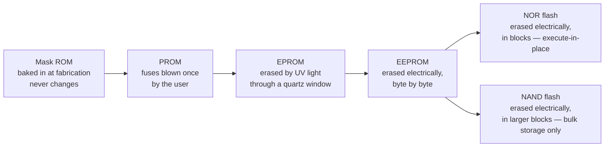
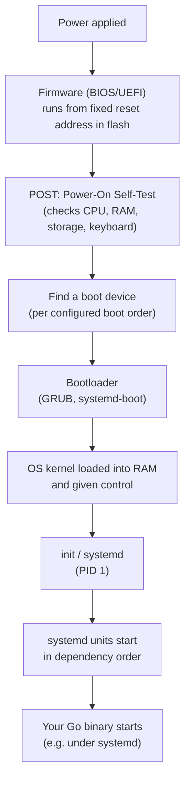
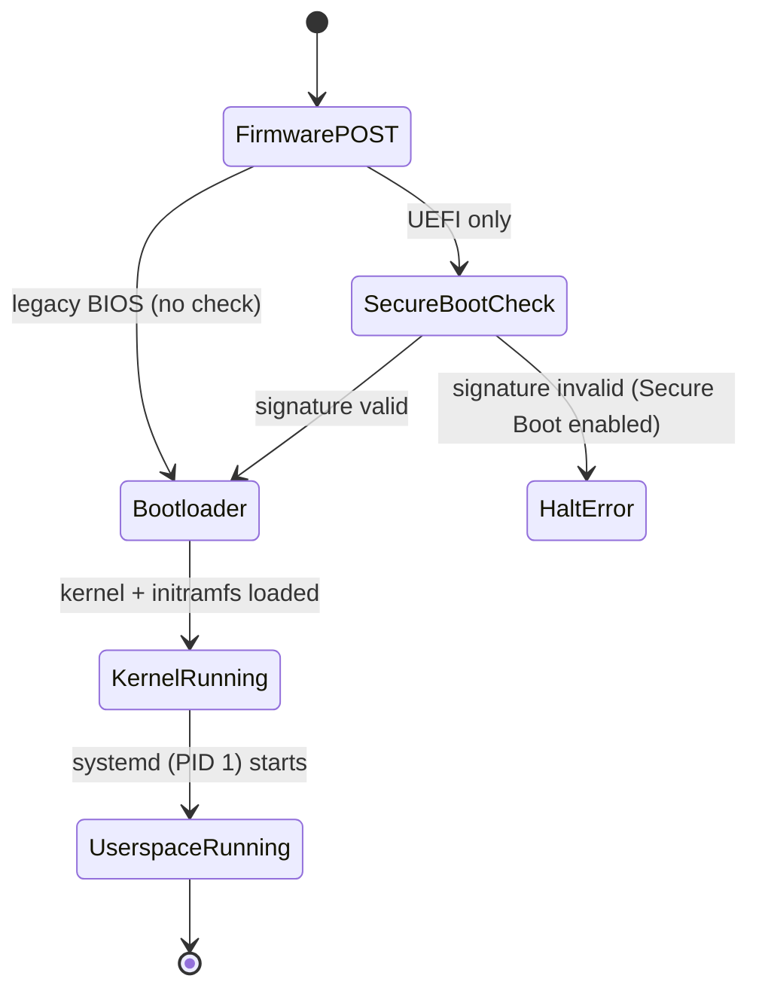
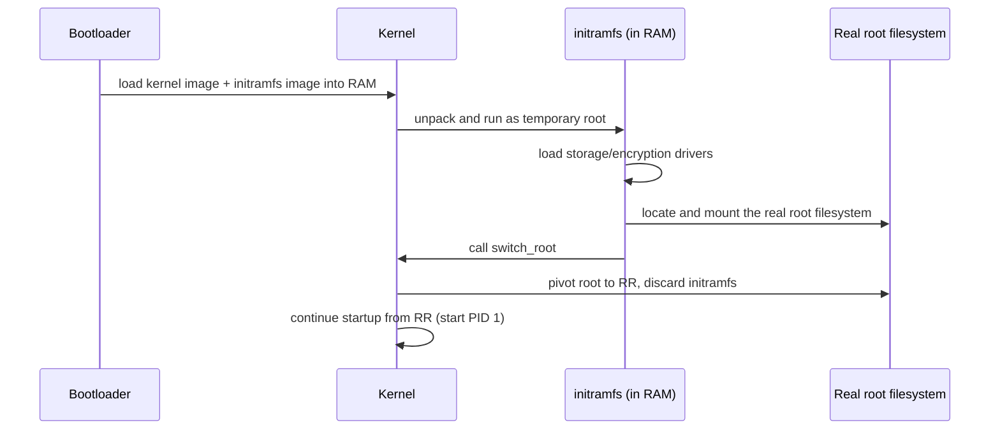
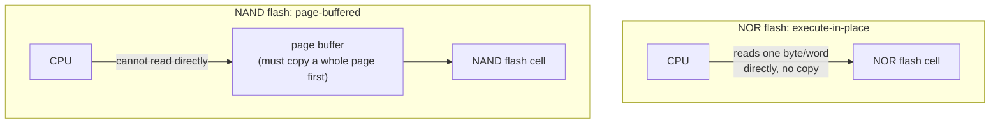
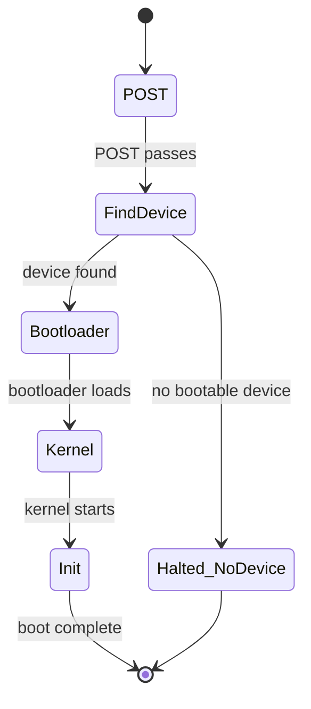

# ROM, Flash, Firmware and the Boot Process

> [!summary] TL;DR
> **ROM** (Read-Only Memory) is non-volatile: it keeps its contents with no power at all, unlike RAM. Modern "ROM" is almost always rewritable **flash** memory, holding **firmware** — the low-level software that runs before any operating system does. The **boot process** is the sequence from power-on through firmware initialization to the operating system taking over, and it's the same mechanism whether the machine is a laptop or a cloud server booting under a hypervisor.

> [!abstract] Core idea
> - ROM is defined by what it isn't: volatile. It survives power loss; RAM does not.
> - The "ROM family" runs from genuinely unchangeable mask ROM through several once-writable technologies (PROM, EPROM, EEPROM) to NOR/NAND flash, which is what actually ships in modern devices and is rewritable many times.
> - Firmware is software, stored in that flash, that runs on a device's own microcontroller before (or instead of) any general-purpose OS — the BIOS/UEFI on a PC's motherboard is one example among many (SSDs, NICs, baseboard management controllers all have their own firmware).
> - The boot sequence is: power on → firmware runs POST and initializes hardware → firmware hands off to a bootloader → bootloader loads the OS kernel → kernel starts `init`/`systemd` → services start, including, eventually, your Go binary.

## 1. Why it exists

Power on a bare CPU and it starts fetching instructions from a fixed, hardwired address (the "reset vector") — but RAM is empty at that instant: DRAM holds nothing meaningful until something writes real data into it, and even if it did, DRAM is volatile and would have lost everything the moment power was off. Something has to exist at that fixed address, intact, the instant power returns, with no operating system, no file system, and no loader yet in sight. That something is ROM (in practice, flash): memory that keeps its contents without power, specifically so the very first instructions a CPU ever fetches after power-on are already sitting there waiting.

Everything this note describes — POST, the bootloader, the kernel handoff — exists to get from "CPU with nothing but a fixed first address" to "a scheduler is running your Go binary," which is the process-creation side of what [[How a Computer Runs a Program]] covers for a single program once an OS already exists to load it.

> [!tip] Remember
> ROM exists for one reason: something must be readable, correct, and already there the instant power returns, before an operating system exists to load anything else.

## 2. Mental model

Think of ROM/flash as a sealed instruction card taped to a vending machine, readable even if the machine's internal lights (RAM, which needs constant power) are off. The boot process is reading that card step by step: first a short self-test ("are the coin slot and dispenser working?" — POST), then "hand control to whatever's loaded in slot 2" (the bootloader), which in turn says "now load and run the big program from the shelf" (the OS kernel).

This analogy breaks down in one place: a vending machine's card never changes. A motherboard's flash chip can be rewritten in place (a firmware update), something a sealed card can never do.

## 3. How it works

### In plain words: what makes memory "ROM" at all

A chip is only "ROM" in the sense that matters for booting if it does one thing: hold its bits with the power completely off. That is the entire definition — nothing about ROM says it must be unchangeable forever, even though the name suggests it.

**Read-Only Memory (ROM):** non-volatile memory, readable at power-on, that may or may not also be rewritable depending on the specific technology.

### Picture it: the ROM family, from unchangeable to rewritable



| Type | Written | Erased | Notes |
|---|---|---|---|
| Mask ROM | At chip fabrication | Never | Contents are physically baked into the silicon; cheapest at huge volume, zero flexibility |
| PROM | Once, by the user (fuses blown) | Never | One-time programmable |
| EPROM | Electrically | By UV light through a quartz window | Reusable, but erasing required physically removing the chip |
| EEPROM | Electrically, byte-addressable | Electrically, byte-addressable | Slow to write, but no UV eraser needed |
| NOR flash | Electrically | Electrically, in blocks | Supports **execute-in-place** (the CPU can run code directly from it); used for firmware |
| NAND flash | Electrically | Electrically, in larger blocks | Denser and cheaper per bit than NOR, but not directly executable — used for bulk storage (SSDs; see [[Storage Devices - HDD, SSD, NVMe]]) |

**Example:** a 2025-era motherboard's "BIOS chip" is, physically, a small SPI NOR flash chip of a few megabytes. It holds firmware that is rewritable (that's what a "BIOS/firmware update" actually does) but, like true ROM, keeps its contents with no power, and unlike NAND flash, can be read directly by the CPU as executable code without first loading it into RAM.

> [!warning] Common mistake
> Calling the BIOS chip "ROM" makes people assume it can never be changed. It is rewritable NOR flash. The "ROM" label describes how it behaves at power-on (intact, non-volatile), not whether a firmware update can rewrite it.

> [!tip] Remember
> "ROM" is a behavior (survives power-off), not a promise of permanence. Only mask ROM and PROM are truly permanent; everything that actually ships today is rewritable flash.

### In plain words: what firmware actually is

Firmware is software, just like an application — written in C or assembly, compiled, and stored as a binary image. Two things set it apart from an ordinary application: it lives in the device's own flash chip rather than on a general-purpose file system, and it runs on the device's own microcontroller (or, for the main system BIOS/UEFI, directly on the CPU) rather than waiting for an operating system to schedule it.

**Example:** every SSD runs firmware that manages its flash translation layer (see [[Storage Devices - HDD, SSD, NVMe]]); every network interface card runs firmware; a server's baseboard management controller (BMC) runs its own independent firmware and OS for out-of-band management (IPMI), entirely separate from whatever OS the main CPU boots.

### Picture it: the boot sequence, stage by stage



Walking through it step by step:

1. **Power on, firmware runs first.** The CPU's reset vector points into the firmware's flash chip. The firmware is the first code to execute — before any OS exists in memory at all.
2. **POST.** The firmware runs Power-On Self-Test: checks that the CPU, RAM, and basic peripherals respond, and halts with an error code (beeps, or a POST code on a diagnostic display) if something critical fails before any OS could even be loaded.
3. **Find a boot device.** The firmware walks its configured boot order (a specific disk, a network boot target, a USB device) looking for something bootable.
4. **Load and run a bootloader.** Rather than loading a full OS kernel directly, the firmware loads a small bootloader (GRUB on most Linux servers, `systemd-boot` on simpler setups) whose job is to find the actual kernel image (and an initial RAM disk, `initramfs`, containing just enough drivers to mount the real root filesystem) and hand off execution to it.
5. **Kernel takes over.** The kernel initializes itself, mounts the real root filesystem, and starts process ID 1 — on nearly all modern Linux systems, `systemd`.
6. **`systemd` starts services in dependency order**, eventually reaching whatever unit starts your Go service (see [[System Calls and User vs Kernel Mode]] for what happens inside the kernel once your process is one of many it schedules).

> [!tip] Remember
> Each stage either hands off cleanly to the next, or halts. Nothing downstream ever gets a chance to run if an earlier stage fails — that ordering is the entire reason boot failures are diagnosed "from the top."

### In plain words: BIOS vs UEFI

**Legacy BIOS** boots in 16-bit real mode, reads the first sector of the boot disk (the Master Boot Record, limited to 2 TB disks and 4 primary partitions), and hands off with almost no structure beyond "jump here." **UEFI** (Unified Extensible Firmware Interface) replaced it on essentially all 2025-era hardware: it runs in native CPU mode from the start, understands the GPT partition table (no 2 TB/4-partition limits), has its own small FAT filesystem (the EFI System Partition) holding bootloader files directly as regular files rather than one raw sector, and supports **Secure Boot** — the firmware verifies a cryptographic signature on the bootloader and kernel before running them, so a chain of trust can be established starting from the firmware itself.

Servers moved to UEFI specifically for GPT's capacity/partition limits and Secure Boot's protection against boot-level malware (bootkits) that legacy BIOS had no mechanism to prevent.



**What happens if** Secure Boot is enabled and you install a kernel the firmware's keys don't trust? The state diagram's `HaltError` branch fires: the firmware refuses to run the unsigned bootloader or kernel at all, and the machine never reaches `KernelRunning`. The fix is either to sign the new binary with a trusted key, or to disable Secure Boot and accept the loss of that integrity guarantee.

### Picture it: why the kernel needs initramfs, and what `switch_root` does

The kernel binary itself is kept small and generic — it doesn't ship a driver for every possible disk controller or encryption scheme. But to mount the *real* root filesystem it might need exactly those drivers. `initramfs` solves this chicken-and-egg problem: it's a small, temporary root filesystem, loaded into RAM by the bootloader alongside the kernel, that holds just enough (storage drivers, disk-encryption unlock logic, sometimes network drivers) to find and mount the real root filesystem.



Step by step:

1. The bootloader hands the kernel two images: the kernel itself, and `initramfs`.
2. The kernel unpacks `initramfs` into RAM and runs it as a temporary root filesystem.
3. `initramfs` loads whatever drivers are needed to see the real storage (and, if the disk is encrypted, to unlock it).
4. Once the real root filesystem is reachable, `initramfs` calls `switch_root`.
5. `switch_root` changes the kernel's notion of "root" to the real filesystem and **discards** `initramfs` from memory — it was only ever a bridge.
6. Startup continues from the real root, eventually starting `systemd` as PID 1.

> [!tip] Remember
> `initramfs` is a bridge, not a destination: its only job is to get the kernel from "no real filesystem is visible yet" to "the real one is mounted," then it is thrown away.

### Picture it: why firmware runs from NOR flash, not NAND



NOR flash supports random-access reads at the bit/byte level directly, so a CPU can fetch and execute instructions straight out of NOR flash without first copying them into RAM — exactly what's needed for the very first instructions after power-on, before any RAM initialization has even happened. NAND flash is cheaper and denser but only supports page-level reads into a buffer first, which is fine for bulk storage (where the OS is already running and can manage that) but unusable as the CPU's reset-vector target.

### In plain words: cloud instances boot through the same stages, one layer down

An AWS EC2 instance, a GCP Compute Engine VM, or any cloud VM boots through this exact sequence from the guest OS's point of view — but the "firmware" the guest sees is itself emulated or passed through by the hypervisor. AWS's Nitro System, for example, handles instance boot largely in dedicated hardware/firmware outside the main host CPU, which is part of why modern cloud instances can report very fast boot times: much of the traditional POST and hardware-discovery work is short-circuited or parallelized by the virtualization layer, rather than every instance repeating a full physical-machine POST from scratch.

This matters operationally: a cold-started container or Lambda-style function pays none of this boot cost (it starts inside an already-booted kernel), while a freshly launched VM instance does pay some version of it — one reason serverless cold starts and VM cold starts have very different latency profiles.

## 4. Worked example

### Whiteboard version

The boot sequence is a strict, ordered state machine — each stage either succeeds and hands off to the next, or fails and halts (or retries, for recoverable failures):

```go
// Each stage either succeeds (move to the next) or fails (halt here).
type Stage struct {
    Name string
    Run  func() error
}
```

### Tracing a clean boot and a failed boot

Walk the same five stages (POST → find device → bootloader → kernel → init) through two scenarios, exactly mirroring the flowchart in section 3:

**Scenario A — clean boot.** POST succeeds → a boot device is found → the bootloader loads → the kernel starts → `init` takes over. All five stages report success, in order; nothing downstream ever runs before something upstream has already succeeded.

**Scenario B — no bootable device.** POST succeeds (the hardware itself is fine) → "find boot device" fails, because the configured boot order has nothing bootable attached → the sequence halts right there. The bootloader, kernel, and init stages never run at all — this is the state-machine property that makes boot failures diagnosable: whichever stage is reached last tells you exactly how far the hardware got.



Runnable Go version: [[ROM, Flash, Firmware and the Boot Process - Go]]

## 5. Variants and comparison

| Firmware interface | Partition table | Boot limits | Security |
|---|---|---|---|
| Legacy BIOS | MBR | 2 TB max disk, 4 primary partitions | None built in |
| UEFI | GPT | No practical disk/partition limit | Secure Boot (signature-verified chain of trust) |

| ROM-family technology | Rewritable | Erase granularity | Typical modern use |
|---|---|---|---|
| Mask ROM | No | N/A | Essentially obsolete for general computing |
| PROM / EPROM | Once / UV-erasable | Whole chip | Legacy embedded systems |
| EEPROM | Yes | Byte | Small configuration data |
| NOR flash | Yes | Block | Firmware (BIOS/UEFI, microcontroller firmware), execute-in-place |
| NAND flash | Yes | Larger block | Bulk storage (SSDs) — see [[Storage Devices - HDD, SSD, NVMe]] |

## 6. Trade-offs and when not to use

- Rewritable flash firmware is convenient (bugs and vulnerabilities can be patched without replacing hardware) but is itself an attack surface: a firmware rootkit that survives an OS reinstall is a documented, real threat class, which is exactly what Secure Boot and signed firmware updates (UEFI capsule updates, `fwupd` on Linux) exist to close off.
- A botched firmware update can brick a device with no working fallback, which is why production fleets stage firmware updates carefully and why some hardware keeps a redundant, read-only fallback firmware image specifically for recovery.
- None of this is something a backend engineer manages directly on cloud infrastructure — the cloud provider owns and secures firmware for the underlying physical hosts (e.g. AWS's Nitro System). It matters here because understanding why a VM boots the way it does, and why boot time is nonzero, explains real operational numbers (VM cold-start latency, why some instance types report faster boots than others).

## 7. In production

- **Real systems:** every x86-64 server motherboard ships UEFI firmware in SPI NOR flash; `systemd` is the PID-1 init system on essentially all mainstream Linux server distributions as of 2025; AWS Nitro, GCP's equivalent custom silicon, and comparable hypervisor designs all handle the firmware/POST-equivalent layer for cloud VM instances outside the guest OS's visibility.
- **Failure modes → fixes:**
  - A server won't POST at all (no display output, no boot) → classic hardware-level failure (RAM seating, a failed component); firmware never got far enough to hand off to anything, so this is diagnosed with POST codes, not OS logs.
  - Secure Boot rejects a kernel or bootloader after a manual OS/kernel change → the new binary isn't signed by a key UEFI trusts; either sign it properly or (for a trusted environment) disable Secure Boot, understanding that this removes the boot-time integrity guarantee.
  - A fleet-wide firmware update goes out and some hosts fail to come back → firmware updates are high-blast-radius; staged rollouts with a tested rollback path exist specifically because firmware failures can require physical intervention to recover from.
- **What to monitor:** boot time itself (a regression here can indicate failing hardware, a growing `initramfs`, or slow service dependency chains in `systemd`), and, for fleets managing firmware directly, firmware version drift across hosts.

## 8. Deep dive

- **Execute-in-place and why firmware uses NOR, not NAND.** Covered visually in section 3; the short version is that NOR's random-access reads let the CPU execute straight out of flash, which is mandatory for the first instructions after power-on, before any RAM initialization has happened.
- **The trusted boot chain, precisely.** Secure Boot's guarantee is only as strong as its root of trust: the firmware itself must be protected (write-protected, or itself measured by a Trusted Platform Module) or an attacker who can rewrite firmware defeats every later signature check. Measured boot extends this further: each stage (firmware → bootloader → kernel) records a cryptographic hash of the next stage into the TPM before running it, producing an auditable, tamper-evident record of exactly what booted, which remote-attestation systems can check without trusting the booted OS itself to self-report honestly.
- **PXE and network boot.** Servers often boot over the network instead of local storage: the firmware's NIC implements enough of DHCP and TFTP to fetch a bootloader and kernel image from the network before any local disk is touched — standard for provisioning bare-metal fleets and diskless nodes, and conceptually identical to the local-disk sequence above with the boot device replaced by a network target.
- **BMC/IPMI, a boot sequence of its own.** A server's baseboard management controller runs its own firmware and its own lightweight OS, independent of and before the main CPU's boot sequence — it can power-cycle the main system, read POST codes, and provide remote console access even if the main OS has never successfully booted at all, which is precisely why it's the tool used to diagnose a host that won't POST.

## 9. Interview questions

> [!question]- What does "non-volatile" mean, and why must the very first boot instructions live in non-volatile memory?
> Non-volatile memory keeps its contents with no power applied at all, unlike RAM, which loses everything. The CPU's reset vector points at a fixed address the instant power returns, before any OS or bootloader has run — so whatever is at that address must already be intact from before power-on, which only non-volatile memory (ROM/flash) can guarantee.

> [!question]- Is the BIOS chip on a modern motherboard actually read-only?
> No — it's rewritable NOR flash (that's what a firmware/BIOS update rewrites), not true unchangeable ROM. It behaves like ROM in the sense that matters for booting (non-volatile, intact at power-on) while still being field-updatable, unlike mask ROM or older PROM/EPROM technologies that were either permanently fixed or required physical removal to erase.

> [!question]- What are the steps from power-on to your application running, in order?
> Firmware runs first from flash → POST checks hardware → firmware finds a configured boot device → a bootloader (GRUB/systemd-boot) is loaded and finds the kernel (and `initramfs`) → the kernel initializes and mounts the real root filesystem → the kernel starts `init`/`systemd` (PID 1) → `systemd` starts units in dependency order, eventually including your application's service unit.

> [!question]- Trap: does Secure Boot protect against every boot-time attack?
> No. Secure Boot only verifies signatures on the bootloader and kernel it's configured to check; it does not protect the firmware itself from tampering (that needs separate protections, e.g. a write-protected or TPM-measured firmware image) and it does not prevent attacks after the OS has already booted and is running — it establishes trust in what *boots*, not in everything that runs afterward.

> [!question]- Why does UEFI matter for servers specifically, beyond "it's newer"?
> Legacy BIOS/MBR caps disks at 2 TB and 4 primary partitions, which modern server storage routinely exceeds; UEFI's GPT partition table removes those limits, and UEFI's Secure Boot closes a real attack surface (bootkits) that legacy BIOS had no mechanism to address at all — both are concrete, not merely cosmetic, reasons servers moved to UEFI.

> [!question]- How does a cloud VM's boot differ from a physical machine's?
> The sequence (firmware-equivalent → bootloader → kernel → init) is the same from the guest OS's perspective, but the "firmware" layer is emulated or handled by the hypervisor/host hardware (e.g. AWS's Nitro System) rather than genuine on-motherboard flash, and much of the physical POST/hardware-discovery work is short-circuited by the virtualization layer — part of why cloud VM boot times, while nonzero, are typically much faster than an equivalent bare-metal POST-to-OS sequence.

> [!question]- Why does the kernel need `initramfs` at all, instead of just mounting the real root filesystem directly?
> The kernel binary is kept generic and doesn't bundle every possible storage or disk-encryption driver. `initramfs` is a small, temporary, RAM-loaded filesystem carrying just enough drivers to locate and mount the real root; once mounted, `switch_root` pivots to it and discards `initramfs`, which was only ever a bridge.

## 10. Cheat sheet

- ROM = non-volatile; survives power loss. RAM does not.
- Modern "ROM" is rewritable flash: NOR (execute-in-place, used for firmware) and NAND (block-addressed, used for bulk storage).
- Firmware = software stored in flash, running on a device's own microcontroller (or the CPU, for BIOS/UEFI), before/instead of a general OS.
- Boot order: power on → firmware/POST → find boot device → bootloader → kernel → `init`/`systemd` → services (your app).
- UEFI replaced legacy BIOS for GPT (no 2 TB/4-partition limit) and Secure Boot (signature-verified boot chain).
- `initramfs` is a temporary RAM-loaded root filesystem holding just enough drivers to mount the real one, then discarded via `switch_root`.
- A server's BMC/IPMI boots and runs independently of the main CPU, specifically so it can diagnose a host that never POSTs.
- Cloud VMs boot through the same sequence conceptually, with firmware/POST handled or short-circuited by the hypervisor layer.

## Links

- **Before this:** [[RAM Technologies - SRAM, DRAM, DDR, GDDR, HBM]]
- **Next:** [[Storage Devices - HDD, SSD, NVMe]], [[System Calls and User vs Kernel Mode]]
- **Compare with:** [[How a Computer Runs a Program]] (the compile/link/load pipeline that produces what the kernel eventually runs)
- **Runnable code:** [[ROM, Flash, Firmware and the Boot Process - Go]]
