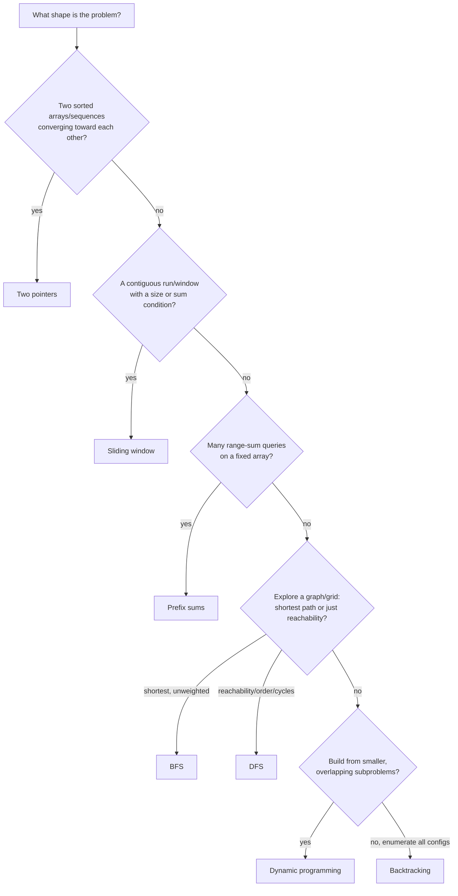
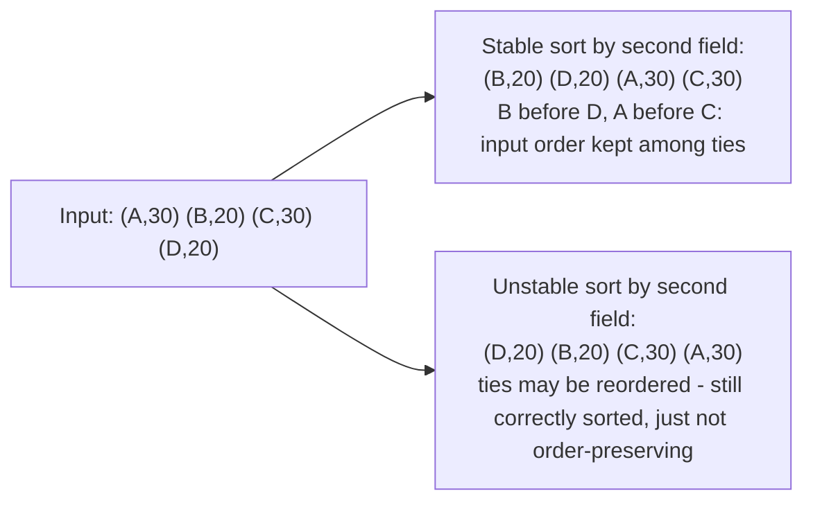
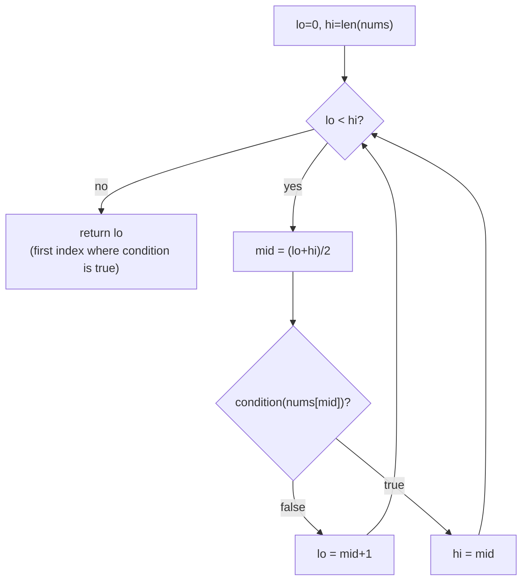
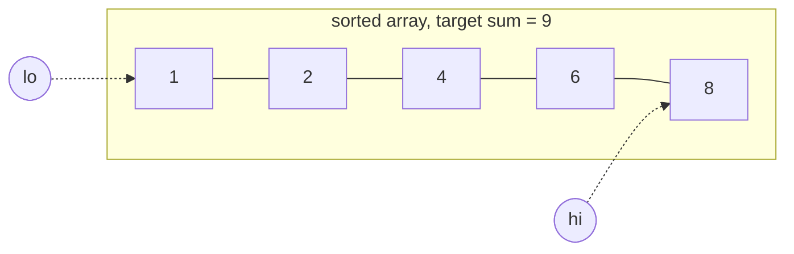
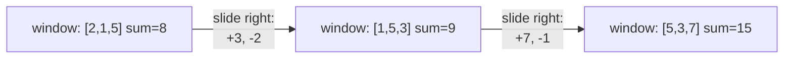
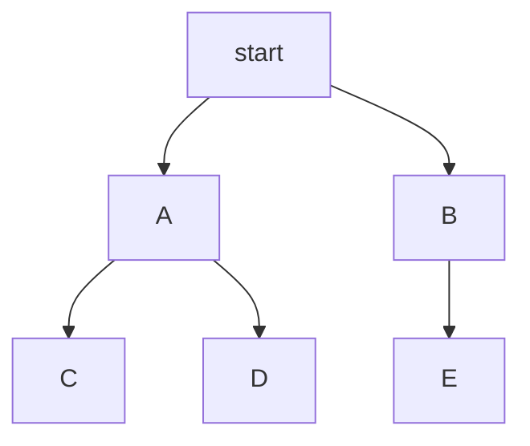
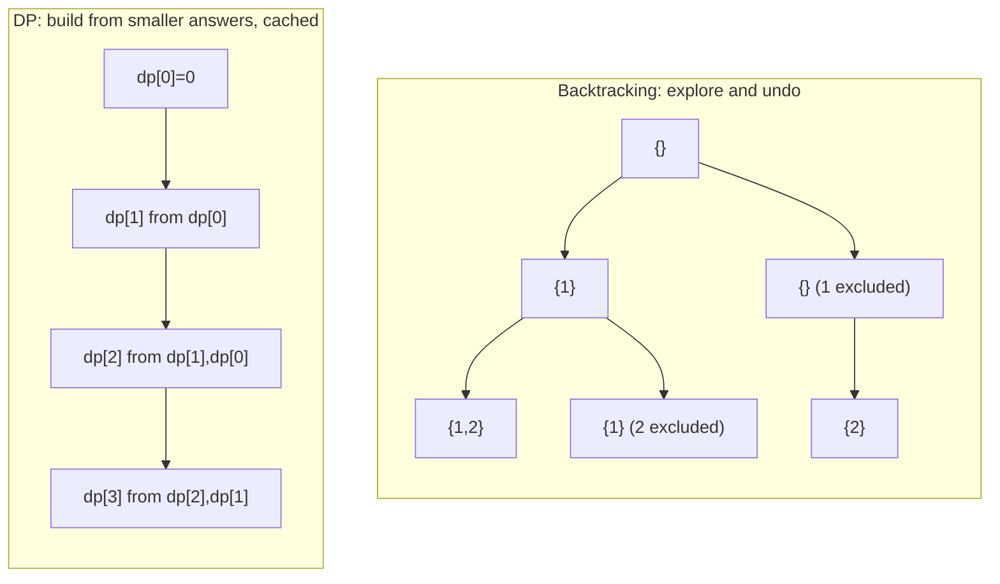

# Sorting, Searching and Interview Patterns

> [!summary] TL;DR
> Sorting puts data in order so that searching, deduplication and range queries all get cheaper; Go's `slices.Sort` uses **pdqsort**, a hybrid algorithm that is fast in the average case but is not stable (equal elements can be reordered). Binary search finds a target in sorted data in `O(log n)`, and Go's `sort.Search` generalizes it to any monotonic yes/no predicate. On top of both sit the recurring interview patterns — two pointers, sliding window, prefix sums, BFS/DFS, backtracking, and dynamic programming — that turn brute-force `O(n²)` or `O(2ⁿ)` solutions into linear or polynomial ones.

> [!abstract] Core idea
> - Comparison sorts have a hard floor of `O(n log n)` comparisons; **stability** (equal elements keep their input order) is a property some algorithms give up for speed.
> - Go's `slices.Sort` is pdqsort — fast, but **not stable**; use `slices.SortStableFunc` / `sort.SliceStable` when order among equal elements matters.
> - Binary search needs sorted data and a monotonic condition; `sort.Search` finds the first index where that condition is true, which also solves "binary search on the answer" problems.
> - Most interview problems are one of a handful of patterns in disguise — recognizing the pattern is most of the work.
> - Classic mistake: reaching for a sort (`O(n log n)`) when a hash set or two pointers would solve the same problem in `O(n)`.

## 1. Why it exists

Say you're given 10 million unsorted log-timestamp records and asked "how many requests happened between 14:00 and 14:05?" Scanning linearly costs `O(n)` **per query**. Sort the records once — `O(n log n)`, done one time — and every later range query becomes two binary searches, `O(log n)` each. The one-time sorting cost pays for itself the moment you run more than a handful of queries.

Searching has the same shape: checking "is `x` present?" against an unsorted list of a million elements costs up to a million comparisons. Sorted, binary search needs at most `log₂(1,000,000) ≈ 20` comparisons — a difference that matters the instant the list is queried more than once.

Most coding-interview problems are really asking "do you recognize which of these well-known patterns applies here," because the patterns turn a naive `O(n²)` or `O(2ⁿ)` brute force into something that runs in time for the given constraints.

> [!tip] Remember
> Sorting and most interview patterns are the same trade: pay a little more work up front (or recognize the right shape) so that every query or step afterward gets dramatically cheaper.

## 2. Mental model

Think of sorting as the one-time cost of **organizing a library** so that later, finding any book by title is a quick jump to a shelf instead of scanning every book. Binary search is "open the book at the middle; is what you want earlier or later? Repeat on the half that matters" — exactly how a reader finds a word in a paper dictionary, and why it needs the dictionary to already be alphabetized.

The interview patterns are mental shortcuts for recognizing shape: "two sorted things, converging from both ends" is two pointers; "a fixed- or variable-size window sliding across an array" is the sliding-window pattern; "I need many range sums fast" is prefix sums; "explore everything reachable, level by level" is BFS; "explore as deep as possible, then back out" is DFS or backtracking; "the answer to a big problem is built from the answers to smaller, overlapping versions of itself" is dynamic programming.



> [!warning] Common mistake
> Treating this flowchart as exhaustive. It covers the handful of patterns this note details; many problems combine two patterns (e.g. sort, then two pointers) or need a structure not listed here (a heap, a trie). Use it to narrow the search, not to replace reading the problem.

## 3. How it works

### In plain words: comparison sorts and the `O(n log n)` floor

A **comparison sort** decides order only by comparing pairs of elements — nothing more. It turns out no comparison sort can beat `O(n log n)` comparisons in the worst case, no matter how cleverly it's written.

**Why:** there are `n!` possible orderings of `n` elements, and each comparison gives at most one bit of information (true/false). Distinguishing `n!` possibilities needs at least `log₂(n!)` bits of information, and `log₂(n!) = Θ(n log n)` by Stirling's approximation.

**Example with numbers:** sorting just 10 elements has `10! ≈ 3.6 million` possible orderings. `log₂(3.6M) ≈ 22` — so even a perfect comparison sort needs roughly 22 comparisons in the worst case to pin down which of those 3.6 million orderings the input actually is.

### Picture it: stability

**Stability** means elements that compare equal keep their original relative order. It matters whenever you sort by one key but care about an earlier sort's order among ties — for example, sort a list of orders by customer, then (stably) by amount, and within a customer the orders stay time-ordered.



> [!warning] Common mistake
> Assuming any sort that "looks right" on a quick test is stable. Both outputs above are correctly sorted by the second field — the only difference is tie order, which a small test is unlikely to catch unless it's specifically checking for it.

Go's `slices.Sort` and the older `sort.Sort`/`sort.Slice` all use **pdqsort** (pattern-defeating quicksort) — a hybrid of quicksort, heapsort and insertion sort that picks good pivots, falls back to heapsort to avoid quicksort's `O(n²)` worst case, and detects already-sorted or few-distinct-value patterns to go faster on them. `sort.Sort`/`sort.Slice` switched to pdqsort in Go 1.19; the `slices` package (and `slices.Sort` with it) was added later, in Go 1.21, using the same algorithm from its first release. It is fast but **not stable**. `slices.SortStableFunc` and `sort.SliceStable` (an `O(n log n)` stable merge-based sort) exist specifically for when stability matters.

> [!tip] Remember
> Fast and stable are in tension: pdqsort trades away stability for speed. If you ever depend on tie order, reach for `SortStableFunc`/`SliceStable` explicitly — never assume.

### Picture it: binary search as a shrinking range

Binary search works only on data where a yes/no condition is **monotonic** — all false values, then all true values (or vice versa), with no mixing. Each step halves the remaining range by checking the midpoint, giving `O(log n)` total steps.



**Example with numbers:** searching `nums = [1, 3, 5, 7, 9, 11]` for the first value `>= 6`. `lo=0, hi=6` → `mid=3`, `nums[3]=7 >= 6` so `hi=3`. `lo=0, hi=3` → `mid=1`, `nums[1]=3 < 6` so `lo=2`. `lo=2, hi=3` → `mid=2`, `nums[2]=5 < 6` so `lo=3`. Now `lo==hi==3`: answer is index 3 (value 7), found in 3 steps instead of scanning up to 6 elements.

Go's `sort.Search(n, f)` is exactly this loop, generalized: it takes a length `n` and a predicate `f(i) bool` that must be false for some prefix and true for the rest, and returns the first index where `f` is true (or `n` if `f` is never true). This generalization is what lets the same function solve "find the first element `>= target`" **and** "binary search on the answer" problems — for example, "what's the smallest capacity that lets a ship carry all packages within `D` days?" — where the predicate is "does capacity `c` work?" instead of a simple comparison.

### Picture it: two pointers converging



Walking it through: `1 + 8 = 9` on the first check — done in one step, because both pointers started at the ends and the sum happened to match immediately. If the sum is too small, `lo` moves right (toward larger values); if too large, `hi` moves left (toward smaller values) — each move discards one element permanently from consideration, which is why the whole pass is `O(n)`, not `O(n²)`.

### Picture it: a sliding window



Each slide adds exactly one entering element and removes exactly one leaving element — the sum is updated incrementally, never recomputed from scratch, which is what keeps the whole scan at `O(n)` instead of `O(n·k)`.

### Picture it: BFS vs DFS exploration order



- **BFS order:** start → A, B (both distance 1) → C, D, E (all distance 2). Every node at distance *k* is visited before any node at distance *k+1* — which is exactly why BFS is guaranteed to find the shortest path first in an unweighted graph.
- **DFS order:** start → A → C (fully explore A's branch before touching B at all) → back out → D → back out → B → E. DFS commits to one branch as deep as possible before trying the next.

> [!warning] Common mistake
> Using DFS and expecting a shortest path. DFS has no distance guarantee at all — it can return *a* path, but not necessarily the shortest one. Shortest-path-in-an-unweighted-graph always means BFS.

### Picture it: backtracking vs DP on overlapping subproblems



Backtracking's tree branches into every possibility and prunes dead ends; DP never re-branches — it fills a table left to right, each cell built once from already-computed smaller cells, so no subproblem is ever solved twice.

> [!tip] Remember
> "How many ways" or "minimum cost" usually means DP (subproblems overlap and get cached); "list every valid configuration" usually means backtracking (every branch must actually be visited).

## 4. Worked example

### Whiteboard version

The bare binary-search loop, before reaching for `sort.Search`: find the first index whose value is `>= target`.

```go
func firstGE(nums []int, target int) int {
    lo, hi := 0, len(nums)
    for lo < hi {
        mid := (lo + hi) / 2
        if nums[mid] >= target {
            hi = mid
        } else {
            lo = mid + 1
        }
    }
    return lo
}
```

`sort.Search` is this exact loop wrapped around an arbitrary predicate, which is why it can express both plain binary search and "binary search on the answer": pass `func(i int) bool { return nums[i] >= target }` and you get `firstGE` back for free, or pass `func(c int) bool { return shipFitsInDays(c, packages, D) }` and the same loop now searches over candidate *capacities* instead of array indices.

Runnable Go version (all six interview patterns, tested): [[Sorting, Searching and Interview Patterns - Go]]

## 5. Variants and comparison

| Pattern / algorithm | How it works | Use when | Cost |
| --- | --- | --- | --- |
| pdqsort (`slices.Sort`) | Hybrid quicksort/heapsort/insertion sort, pattern-aware | General-purpose sorting, order among equal elements doesn't matter | `O(n log n)` average and worst case, not stable |
| Stable sort (`sort.SliceStable`, `slices.SortStableFunc`) | Merge-based, preserves input order among equal elements | Sorting by one key after already sorting by another | `O(n log n)`, stable |
| Binary search (`sort.Search`) | Halve a monotonic search space each step | Sorted data, or any monotonic yes/no predicate ("binary search on the answer") | `O(log n)` |
| Two pointers | Two indices move toward each other or together | Sorted array, pair/triplet sum problems | `O(n)`, `O(1)` extra space |
| Sliding window | A window's bounds move across the array, updating incrementally | Contiguous subarray/substring problems with a size or sum condition | `O(n)` |
| Prefix sums | Precompute cumulative sums once | Many range-sum queries on a fixed array | `O(n)` precompute, `O(1)` per query |
| BFS | Explore level by level via a queue | Shortest path / fewest steps in an unweighted graph | `O(V+E)` |
| DFS | Explore as deep as possible, then back out | Connectivity, cycle detection, topological order | `O(V+E)` |
| Backtracking | Try a choice, recurse, undo, try the next choice | Enumerate all subsets/permutations/valid configurations | Often exponential, pruned in practice |
| Dynamic programming | Build the answer from overlapping smaller subproblems, memoized or bottom-up | Optimal substructure + overlapping subproblems (counting, min/max, feasibility) | Typically polynomial, e.g. `O(amount × coins)` |

> [!warning] Interview trap
> "Just sort it" is sometimes the slow answer. If you only need "does a pair sum to `k`" over unsorted data, a hash set gets there in `O(n)`; sorting first costs `O(n log n)` for no benefit unless the problem also needs the data in order afterward.

## 6. Trade-offs and when not to use

- pdqsort's speed comes at the cost of stability — never assume `slices.Sort` preserves tie order; if a test or a user-visible ordering depends on it, that's a bug waiting to happen.
- Binary search requires the data to already be sorted (or the predicate to already be monotonic); sorting first costs `O(n log n)`, which can erase the benefit if you only search once.
- Backtracking's exponential worst case is only tamed by pruning (cutting a branch early once it can't possibly succeed); without pruning, it's too slow past small inputs.
- DP trades time for memory (the table of subproblem answers); for very large state spaces, memory becomes the real bottleneck, and techniques like rolling arrays (keeping only the last row or two) help.
- Two pointers and sliding window only work cleanly when the data has the right structure (sorted, or a window condition that changes monotonically as the window grows/shrinks) — forcing them onto data that doesn't fit usually produces a subtly wrong answer, not a slow one.

## 7. In production

- **Real systems:**
	- Database query planners choose a sort-merge join (sort both sides, then a two-pointer-style merge) versus a hash join depending on whether the inputs are already sorted or indexed — see [[Query Plans and EXPLAIN]].
	- Go's own standard library leans on `sort.Search` internally wherever a sorted slice needs a lookup — for example, `go/types` uses it to find a method by name in a sorted method set, and `debug/dwarf` and `debug/gosym` use it to search their sorted offset and program-counter tables.
	- Rate limiters and analytics pipelines use prefix-sum-style running totals (often as a sliding window over time buckets) to answer "requests in the last 5 minutes" without rescanning raw events.
	- BFS underlies shortest-path features in maps and networking tools (fewest hops, unweighted); DFS underlies dependency resolution and cycle detection in build systems (see the topological-sort note on [[Graphs and Graph Algorithms]]).
	- Scheduling and resource-allocation systems frequently reduce to DP (e.g., job scheduling to maximize profit under constraints) or backtracking with heavy pruning (constraint solvers).
- **Failure modes → fixes:**
	- Relying on `slices.Sort`'s output order for equal keys (it's pdqsort, unstable) → switch to `slices.SortStableFunc` or sort by a tiebreaker field explicitly.
	- A sliding window that forgets to shrink from the left when the condition is violated → re-derive the window invariant (what must hold true inside the window) before coding, not after a bug report.
	- Unmemoized recursive DP ("just recurse") blowing up exponentially on inputs that looked small in testing → add memoization or switch to the bottom-up tabulated form shown in the Go note.
- **What to monitor:**
	- Sort/search hot paths: whether an `O(n log n)` sort runs once and is reused, versus accidentally re-sorting on every request.
	- Backtracking/DP solvers used in request paths: wall-clock time or an iteration cap, since worst-case inputs can regress badly without a bound.

## 8. Deep dive

- **Why `O(n log n)` is a hard floor for comparison sorts.** There are `n!` possible orderings of `n` elements, and a decision tree where each internal node is one comparison (two outcomes) needs at least `log₂(n!)` levels to distinguish all `n!` outcomes. By Stirling's approximation, `log₂(n!) = Θ(n log n)`. Non-comparison sorts (counting sort, radix sort) can beat this floor only because they exploit structure in the keys (small integer range, fixed-width keys) instead of comparing elements pairwise.
- **How pdqsort avoids quicksort's `O(n²)` worst case.** Plain quicksort degrades to `O(n²)` on adversarial or already-sorted input with a naive pivot choice. pdqsort (the algorithm behind `sort.Sort`/`sort.Slice` since Go 1.19, and `slices.Sort` since the `slices` package's introduction in Go 1.21) picks pivots more carefully (median-of-three or median-of-medians on recursion), detects patterns like many equal elements or already-sorted runs and switches strategy, and falls back to heapsort entirely if it detects it's making bad progress (too many bad partitions) — guaranteeing `O(n log n)` worst case while staying fast on the common case.
- **"Binary search on the answer."** Many optimization problems ("minimum X such that condition holds") are solvable by binary searching over the space of possible answers rather than the input data, as long as the condition is monotonic in the candidate answer. `sort.Search`'s generalized signature (`func(i int) bool`) is built exactly for this: pass a predicate over candidate answers, not over array indices.
- **DP state design is the real skill.** The hard part of dynamic programming is rarely the transition (`dp[a] = min(dp[a], dp[a-c]+1)`) — it's identifying what the state needs to capture so that the "optimal substructure" property holds (the optimal answer to a subproblem can be built purely from optimal answers to smaller subproblems, without needing to know how you got there). Getting the state definition wrong is the most common reason a DP solution produces a wrong answer that still "looks" like DP.
- **Backtracking vs DP on the same problem.** Both explore a space of choices, but backtracking enumerates all valid configurations (and prunes dead branches), while DP collapses overlapping subproblems into a cache so the same sub-answer is never recomputed. A problem asking "how many ways" or "the minimum cost" is usually DP; a problem asking "list all valid configurations" is usually backtracking — recognizing which is being asked is often the actual interview signal.

## 9. Interview questions

> [!question]- Is Go's `slices.Sort` stable? What do you use if you need stability?
> No — `slices.Sort` is pdqsort (the `sort` package switched to pdqsort in Go 1.19; `slices.Sort` has used it since the `slices` package arrived in Go 1.21), which does not preserve the relative order of equal elements. Use `slices.SortStableFunc` or the older `sort.SliceStable` when tie order matters, at the same `O(n log n)` cost.

> [!question]- Implement binary search, then generalize it to `sort.Search`.
> A loop with `lo, hi := 0, len(nums)`, moving `hi = mid` when the condition at `mid` is true and `lo = mid+1` otherwise, terminating when `lo == hi`. `sort.Search(n, f)` is this same loop with `f(i) bool` in place of a direct comparison, which is why it also solves "binary search on the answer" problems where the predicate is "does this candidate answer work?"

> [!question]- Two sorted arrays; find if any pair (one from each) sums to a target. What pattern, and what's the cost?
> Two pointers: one pointer at the start of the first array, one at the end of the second; move the one whose sum is too small forward, or the one too large backward. `O(n + m)` time, `O(1)` extra space — far better than a nested loop's `O(n·m)`.

> [!question]- When would you reach for prefix sums instead of just summing a range each time?
> When there are many range-sum queries on a fixed (non-mutating) array. Precomputing prefix sums costs `O(n)` once, then each query is `O(1)`; without it, each query costs `O(range length)`, which adds up badly across many queries.

> [!question]- What's the difference between BFS and DFS for finding a path, and when does the choice matter?
> BFS explores level by level and is guaranteed to find the shortest path (fewest edges) in an unweighted graph first, because it visits nodes in increasing distance order. DFS explores as deep as possible before backtracking and does not give a shortest-path guarantee, but uses less memory in graphs that are wide but not deep, and is the natural fit for problems like cycle detection or topological sort where "shortest" isn't the question.

> [!question]- Trap: you need the k-th smallest element in an unsorted array. Is sorting the whole array the best approach?
> It works (`O(n log n)`), but it's not optimal: a selection algorithm (Quickselect) finds the k-th smallest in `O(n)` average time by partitioning like quicksort but recursing into only the side that contains the target rank, discarding the other side entirely instead of sorting it. Mention Quickselect as the faster answer, while noting `sort.Search`-style approaches don't apply here since the array isn't sorted yet.

> [!question]- Given a recursive solution that's correct but too slow, how do you tell if memoization will help?
> Check whether the same subproblem (the same arguments) is computed more than once across the recursion tree — if so, it's exhibiting overlapping subproblems, and memoization (caching results keyed by the arguments) turns the exponential blowup into one computation per distinct subproblem. If subproblems never repeat, memoization won't help and the exponential cost is likely inherent (e.g., enumerating all subsets).

## 10. Cheat sheet

- Comparison sorts have a hard floor of `O(n log n)`; `slices.Sort` (pdqsort — in `sort` since Go 1.19, in `slices` since Go 1.21) hits it but is not stable — use `SortStableFunc`/`SliceStable` when ties must keep their order.
- Binary search needs sorted data or a monotonic predicate; `sort.Search(n, f)` generalizes it, including "binary search on the answer."
- Two pointers: `O(n)` on sorted or paired data, converging from both ends.
- Sliding window: `O(n)`, incrementally update a window instead of recomputing it.
- Prefix sums: `O(n)` precompute, `O(1)` per range-sum query.
- BFS = shortest path in unweighted graphs, level by level; DFS = explore deep then backtrack, used for connectivity/cycles/ordering.
- Backtracking enumerates and prunes; DP caches overlapping subproblems — "how many ways / min cost" usually means DP, "list all configurations" usually means backtracking.
- "Just sort it" isn't always right: check if a hash set or two pointers solves the same problem in `O(n)`.

## Links

- **Before this:** [[Arrays and Dynamic Arrays (Go Slices)]], [[Complexity Analysis - Big-O and Amortized Cost]]
- **Next:** [[Tries, Suffix Trees and Suffix Arrays]], [[Union-Find and Skip Lists]]
- **Compare with:** [[Graphs and Graph Algorithms]] (BFS/DFS in full graph context), [[Heaps and Priority Queues]] (top-K and k-way merge patterns built on a heap instead of a sort)
- **Runnable code:** [[Sorting, Searching and Interview Patterns - Go]]
