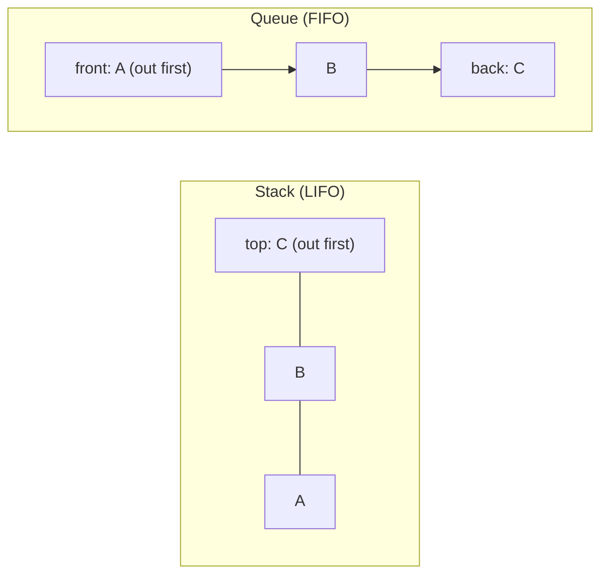
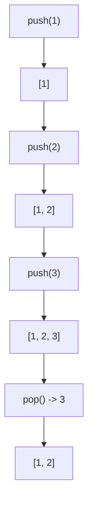
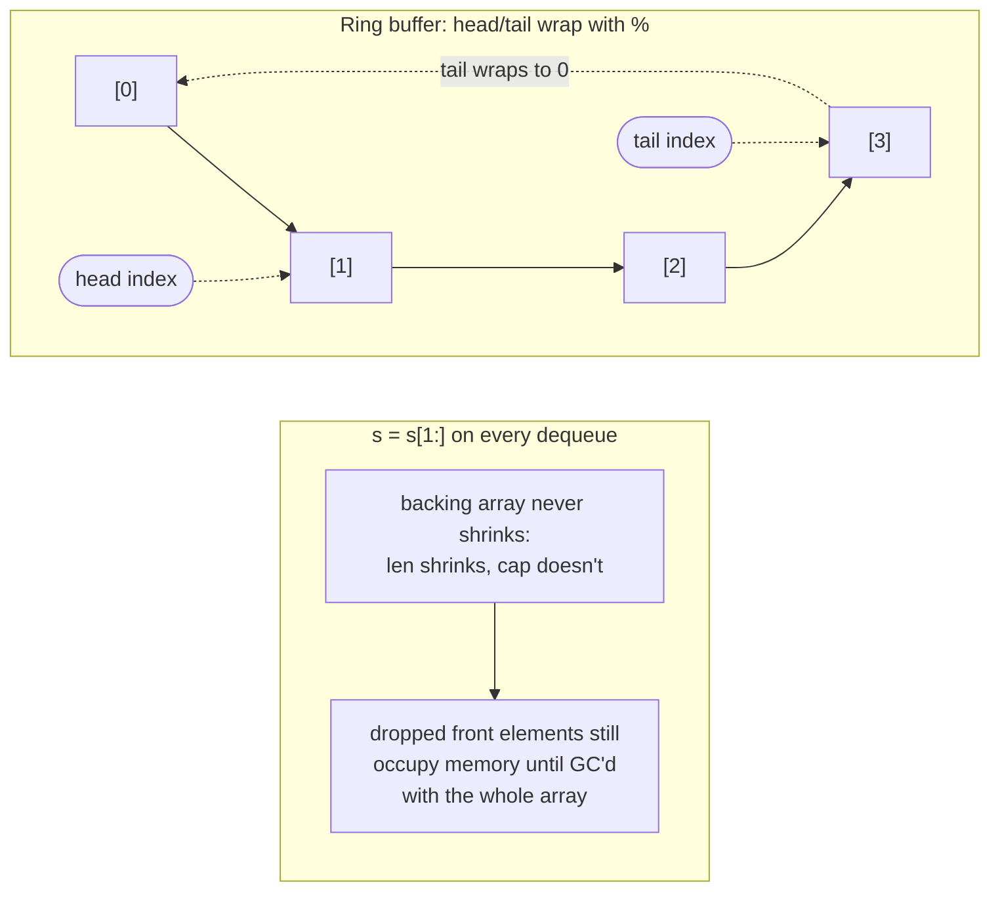
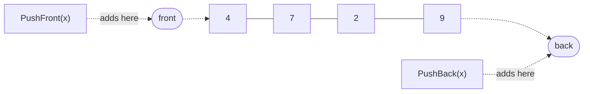
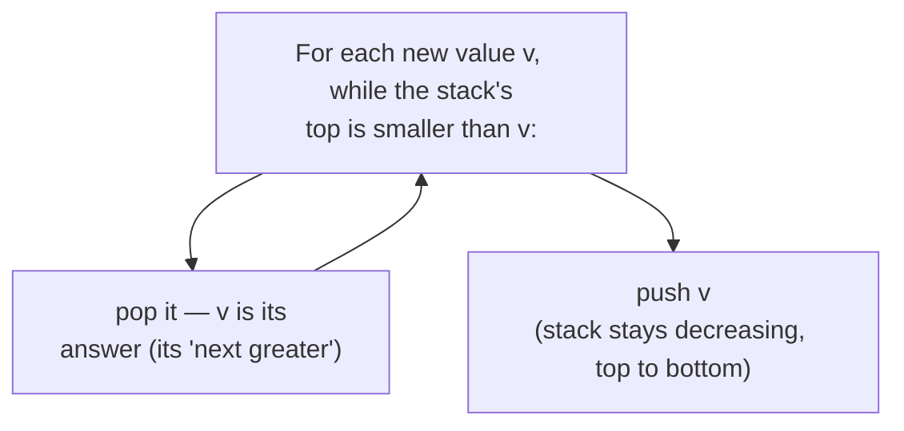
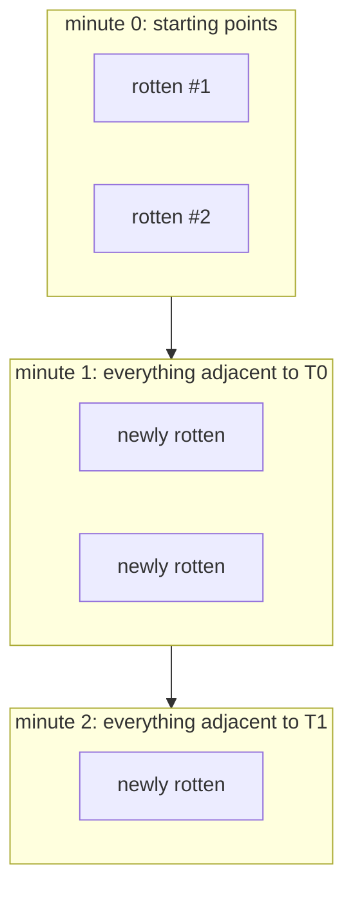
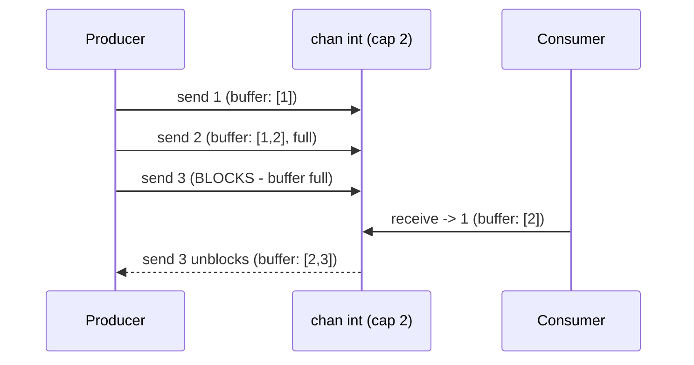
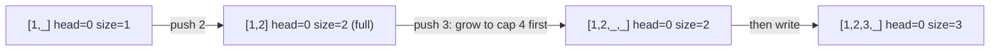

# Stacks, Queues and Deques

> [!summary] TL;DR
> A stack processes items last-in-first-out (LIFO); a queue processes them first-in-first-out (FIFO); a deque (double-ended queue) allows push/pop from both ends. All three are usually built on a Go slice — a stack directly, a queue as a ring buffer so it doesn't leak memory the way `q = q[1:]` does.

> [!abstract] Core idea
> - Stack = LIFO (undo/redo, the call stack, DFS). Queue = FIFO (task queues, BFS, request buffering).
> - A Go slice is a stack for free: `append` to push, `s[len(s)-1]` then `s = s[:len(s)-1]` to pop.
> - A plain slice is a *bad* queue: `s = s[1:]` never frees the dropped prefix's memory. A ring buffer (circular array) or a buffered channel fixes this.
> - A monotonic stack or deque keeps its elements in sorted order as a side effect of its push/pop rule, turning an `O(n²)` brute force into `O(n)`.

## Start here: the basics

**The problem in one story.**
You are writing a text editor and the user presses Ctrl+Z.
You must undo the *most recent* change first, then the one before it.
Meanwhile, your print server must print documents in the order they *arrived*.
The first needs a stack (last in, first out); the second needs a queue (first in, first out).

**Words you need first**

| Word | Plain meaning | Tiny example |
| --- | --- | --- |
| LIFO | Last In, First Out | A stack of plates: take the top one |
| FIFO | First In, First Out | A line at a ticket counter |
| Push / Pop | Add to / remove from a stack | Push "typed A", pop it on undo |
| Enqueue / Dequeue | Add to the back / remove from the front of a queue | Join the line / get served |
| Slice | Go's growable list backed by an array | `s := []int{1, 2, 3}` |
| Ring buffer | A fixed array used in a circle, wrapping around | A 10-slot log that overwrites the oldest |
| Deque | Double-ended queue: add/remove at both ends | A sliding window of recent prices |

**Picture it**



**Analogy.** A stack is a pile of plates; a queue is a line at a bank.
Where it breaks: nobody in a bank line gets dropped for memory reasons, but a Go slice used as a queue keeps old, removed items' memory alive unless you use a ring buffer.

**How the rest of this note builds up**

- First, why these structures exist (section 1) and the LIFO vs FIFO mental model (section 2).
- Then how they work in Go: slice stacks, ring-buffer queues, deques and channels (section 3), with a worked example (section 4).
- Then variants like monotonic stacks and deques, and their trade-offs (sections 5-6).
- Finally the SDE-3 view: queues in production systems and the deep dive (sections 7-8).

> [!tip] Remember
> Stack = most recent first; queue = oldest first; in Go, a slice is a fine stack but a ring buffer is the right queue.

## 1. Why it exists

Say you're parsing a document for balanced brackets, `{[()]}`. You need to know, at the moment you see a closing bracket, "what was the most recent unmatched opening bracket?" — not the first one, not all of them, just the *last* one still open.

That's exactly LIFO: the thing most recently added is the thing you need next. A stack answers this in `O(1)` per character.

Now say you're building a job queue where workers must process jobs in the order they arrived, with producers adding jobs faster than workers can finish them at peak.

You need "what's the oldest job still waiting?" — FIFO — and you need the queue to hold a bursty backlog without leaking memory or blocking producers forever. A ring buffer or a buffered channel answers this in `O(1)` per enqueue/dequeue, bounded memory.

Both are the same underlying idea — a linear sequence with disciplined access at the ends — but the discipline (which end you remove from) is the entire difference between them, and it changes which real-world problems each one solves.

> [!tip] Remember
> Stack and queue are the same structure (a sequence) with opposite removal rules. Memorize the rule, not the structure: LIFO removes what you added most recently, FIFO removes what you added first.

## 2. Mental model

A stack is a **pile of plates**: you can only take the top one off, and you can only put a new one on top. The plate on the bottom was the first one placed and the last one you'll ever reach.

A queue is a **line at a ticket counter**: people join at the back and are served from the front. The first person in line is the first one served, no matter how long the line gets.

A deque is a line where people can also join or leave from the *front* — useful when you need "the largest value visible so far in a shrinking and growing window," which is exactly the monotonic-deque pattern in section 3.

This analogy breaks down for the monotonic patterns below: a real queue never lets someone cut in based on how "useful" they are, but a monotonic stack/deque actively *removes* earlier entries that can never matter again.

## 3. How it works

### In plain words: a stack is a slice used LIFO

**Stack:** a sequence where `push` adds to one end and `pop` removes from that same end — the last thing pushed is the first thing popped.



`push` is `append`; `pop` reads `s[len(s)-1]` then reslices to `s[:len(s)-1]`. Both are `O(1)` amortised, same as any slice append — see [[Arrays and Dynamic Arrays (Go Slices)]].

> [!tip] Remember
> Everything a stack needs is already in a Go slice: `append` to push, reslice off the end to pop. No special type is required for the simple case.

### In plain words: why a plain slice is a bad queue, and what fixes it

**Example with numbers:** start with a slice of capacity 8 holding 8 elements. Dequeue once with `s = s[1:]`: `len` drops to 7, but `cap` is still effectively tied to the same 8-element backing array — the dropped element's memory isn't freed, it's just no longer reachable through `s[0]`. Do this a million times on a million-element queue and the backing array (all of it) stays alive the whole time, even though the logical queue might only ever hold a handful of items at once.



**Ring buffer:** a fixed-size array plus a `head` index and a count; `Push` writes at `(head+size) % cap` and increments `size`, `Pop` reads at `head` and advances `head = (head+1) % cap`. No element ever shifts; the array is reused in place until it's full, at which point it grows once (doubling, like a slice) rather than on every operation.

> [!warning] Common mistake
> Writing `q = q[1:]` in a long-running service and assuming it "just works" because it compiles and the tests pass on small inputs. The leak only shows up as memory growth over the service's actual uptime, which a short-lived test never exercises.

### Picture it: a deque — push and pop from both ends



A deque supports four operations instead of a stack's two or a queue's two: `PushFront`, `PushBack`, `PopFront`, `PopBack`, each `O(1)`. It generalizes both: using only `PushBack`/`PopBack` makes it a stack; using `PushBack`/`PopFront` makes it a queue.

### In plain words: the monotonic stack — "next greater element"

**Monotonic stack:** a stack that's kept sorted (increasing or decreasing) as a side effect of its push rule — before pushing a new value, pop off everything that the new value makes irrelevant.



**Example with numbers:** temperatures `[73, 74, 75, 71, 69, 72]`. Walking left to right with a stack of indices: push `0` (73). See `74`: it's bigger than `73`, so pop index `0` (its answer is `1 - 0 = 1` day), push `1`. See `75`: bigger than `74`, pop index `1` (answer `1` day), push `2`. See `71`: smaller than `75`, just push `3` (stack: `[2,3]`). See `69`: smaller than `71`, push `4` (stack: `[2,3,4]`). See `72`: bigger than `69`, pop `4` (answer `1`); bigger than `71`, pop `3` (answer `2`); not bigger than `75`, stop; push `5`. Index `2` (the `75`) and index `5` (the last day) never get popped, so their answer stays `0` — there is no warmer day left for either within this array. Final answers: `[1,1,0,2,1,0]`.

Because each index is pushed once and popped at most once across the whole pass, the total work is `O(n)` even though it looks like a nested loop.

> [!tip] Remember
> A monotonic stack/deque only answers "what's the *nearest* bigger (or smaller) element" — not "what are the k largest overall." For that, use a heap instead (see [[Heaps and Priority Queues]]).

### Picture it: BFS level order as multi-source expansion

A queue's FIFO order is exactly what makes **BFS level order** work: push every starting point first, then process the queue one full pass ("level") at a time, so everything processed in the same pass is the same distance from a start.



**Example with numbers:** the "rotting oranges" problem is exactly this — multiple rotten oranges rot their neighbours simultaneously, one grid step per minute. That's multi-source BFS where every rotten orange at minute 0 is pushed first, and each queue "level" (one pass over everything currently queued) is exactly one minute, because BFS visits nodes in order of distance from a source.

### Picture it: a buffered channel as a queue with backpressure



A buffered channel *is* a FIFO queue with built-in concurrency safety: `ch := make(chan int, jobs)` gives a queue of capacity `jobs`. A send blocks once the buffer is full, and a receive blocks once it's empty — that blocking is **backpressure**: a slow consumer automatically slows the producer down instead of the queue growing without bound.

> [!warning] Common mistake
> Reading channel capacity as a hard ceiling on total throughput ever processed. It only bounds how many sends can complete without a matching receive — items keep flowing through continuously as long as receives keep pace with sends.

## 4. Worked example

### Whiteboard version

```go
// LIFO: a slice used as a stack
var s []int
s = append(s, 1, 2, 3)      // push 1, 2, 3
top := s[len(s)-1]          // peek: 3
s = s[:len(s)-1]            // pop: s is now [1, 2]
_ = top
```

### Tracing a ring buffer through a growth event

Follow a `RingBuffer` of starting capacity 2 through three pushes, the same scenario the tests check:

1. **Push 1.** `head=0, size=0` → write at `(0+0)%2=0` → buffer `[1,_]`, `size=1`.
2. **Push 2.** Write at `(0+1)%2=1` → buffer `[1,2]`, `size=2` — now full.
3. **Push 3.** `size == cap`, so the buffer must **grow** first: a new array of capacity 4 is allocated, the two existing elements are copied in logical order (`[1,2]`), `head` resets to `0`. Then the push proceeds: write at `(0+2)%4=2` → buffer `[1,2,3,_]`, `size=3`.
4. **Pop three times.** Reads happen at `head`, which advances by one (mod `cap`) each time: `1`, then `2`, then `3` — the FIFO order is preserved exactly across the grow event, even though the underlying array changed.



Runnable Go version: [[Stacks, Queues and Deques - Go]]

## 5. Variants and comparison

| Option | How it works | Use when | Cost |
| --- | --- | --- | --- |
| Slice as a stack | `append`/reslice at the end | LIFO: undo/redo, DFS, expression parsing | `O(1)` amortised push/pop |
| Ring buffer queue | Fixed circular array, head/tail wrap with `%` | FIFO in a single goroutine, bounded or amortised-growing | `O(1)` push/pop, no shift, no leak |
| `container/ring` | Go's built-in fixed-size circular list (a ring, not a growable queue) | A fixed-size rotating buffer (e.g., last N log lines) | `O(1)` move/access by ring position |
| Buffered channel | Built-in concurrent FIFO with blocking semantics | Producer/consumer across goroutines, need backpressure for free | `O(1)` send/receive; blocks instead of growing unbounded |
| Monotonic stack/deque | Pushes maintain a sort order by popping dominated elements first | "Next greater/smaller," sliding-window max/min | `O(n)` total across the whole pass |
| Durable message queue (Kafka, Redis Streams) | Persisted, acknowledged, replayable | Cross-process/cross-service queueing that must survive a crash | Network + disk I/O; see [[Redis as a Queue - Lists, Streams and Pub-Sub]], [[Kafka and Event Streaming]] |

## 6. Trade-offs and when not to use

- **`q = q[1:]` is not a real queue.** It drops the logical front element but keeps the whole backing array alive and growing on every `append`, because `cap` never shrinks; for a long-running queue this is an unbounded memory leak disguised as working code. Use a ring buffer, or compact periodically with `copy(q, q[1:])` if you insist on staying slice-based.
- **An in-memory queue is not a durable one.** A ring buffer or channel disappears with the process; if a job must survive a crash or be retried by a different process, that's a message broker's job (Kafka, Redis Streams), not this structure's.
- **A stack only answers "what's most recent."** If you need "what's oldest" or "what's largest so far," that's a queue or a heap respectively, not a stack — don't force LIFO access onto a FIFO problem.
- **A monotonic stack/deque only helps when the question is about the *nearest* dominating element.** For "the k largest elements overall" (not nearest), a heap is the right tool — see [[Heaps and Priority Queues]].

## 7. In production

- **Real systems:** the JavaScript/Go/most-languages call stack is a stack (literally — stack overflow is this structure overflowing); goroutine scheduling and most thread pools use a work queue; a web server's accept queue for incoming connections is FIFO; browser back/forward history is two stacks; a sliding-window rate limiter can be implemented with a monotonic deque of request timestamps.
- **Failure modes → fixes:** an unbounded in-memory queue causing OOM under a traffic spike → bound it (ring buffer with backpressure, or a buffered channel) and shed load once full, rather than growing without limit; a goroutine leak from a channel that's never closed, leaving a receiver blocked forever → always have a clear owner that closes the channel when production is done; a stack-based recursive algorithm hitting Go's growable-but-still-finite goroutine stack on pathological input → convert to an explicit stack-based iterative version (see Deep dive) for unbounded depth.
- **What to monitor:** queue depth (how full the buffer is) as the leading indicator of a consumer falling behind; for a channel-based pipeline, how often sends block (a proxy for backpressure actually kicking in).

## 8. Deep dive

- **Goroutine stacks vs OS thread stacks.** A goroutine's stack starts at 2 KB and grows (by copying to a bigger segment) and shrinks as needed; an OS thread's stack is typically a fixed ~8 MB reservation. This is one reason Go programs can run hundreds of thousands of concurrent goroutines where an equivalent number of OS threads would exhaust memory on stack reservations alone — each goroutine's stack is sized for what it actually uses, not a worst-case guess.
- **Recursion is an implicit stack.** Every recursive call pushes a new stack frame (return address, local variables, saved registers); deep enough recursion exhausts the stack (a stack overflow) exactly the way pushing too much data onto an explicit stack type would exhaust memory, just automated by the compiler and runtime. Converting a recursive algorithm (like DFS) to use an explicit heap-allocated stack trades the implicit, limited call stack for an explicit one bounded only by available memory.
- **Why monotonic structures are O(n) despite the nested-looking loop.** In the "next greater element" and sliding-window-max patterns, the inner loop that pops looks like it could make the whole thing `O(n²)`, but each index is pushed exactly once and popped at most once across the *entire* run — so total pop operations across all iterations are bounded by `n`, making the amortised cost per index `O(1)` and the whole pass `O(n)`.
- **Channels as queues have scheduler-level cost a slice doesn't.** A channel send/receive that blocks parks the goroutine and involves the Go scheduler; for single-goroutine, non-concurrent queueing, a ring buffer is strictly cheaper. Reach for a channel specifically when the concurrency and backpressure are the point.

## 9. Interview questions

> [!question]- Why is `q = q[1:]` a bug in a long-running queue, even though it compiles and "works"?
> It never reclaims the backing array's dropped prefix: `cap` stays the same (or grows further via `append`) while the logical queue shrinks, so a queue that processes millions of items over its lifetime can pin megabytes of unreachable-looking memory. A ring buffer (or periodic `copy`-based compaction) avoids this.

> [!question]- Implement a queue using two stacks. What's the amortised cost per operation?
> Push onto an "in" stack always. To pop, if the "out" stack is empty, pop everything off "in" and push it onto "out" (reversing order), then pop from "out". Each element is moved from "in" to "out" at most once over its lifetime, so the amortised cost per enqueue/dequeue is `O(1)` even though a single dequeue can occasionally be `O(n)`.

> [!question]- Trap: "a buffered channel of capacity 10 means it can hold at most 10 items forever."
> Capacity bounds how many sends can complete without a matching receive, not a hard ceiling on total throughput — items flow through continuously as receives keep pace with sends. The "forever" framing is the trap: it's a bound on in-flight items, not on the queue's lifetime total.

> [!question]- You need "the maximum of every window of size k" over a stream, in better than O(n·k).
> A monotonic deque of indices, kept in decreasing value order: pop smaller trailing values off the back before pushing a new index (they can never win while the new value is in range), and pop the front once it falls outside the window. Each index enters and leaves the deque once, giving `O(n)` total.

> [!question]- When would you choose `container/ring` over a hand-written ring buffer?
> `container/ring` is a fixed-size circular *list* you rotate and walk (good for "keep the last N items and iterate them in order," like a rolling log buffer); a hand-written ring buffer with head/size indices is better when you need distinct enqueue/dequeue operations with growth, which is the shape of most queue problems.

> [!question]- Why does a stack-based (explicit) DFS avoid a problem that recursive DFS can hit on very deep graphs?
> Recursive DFS uses the call stack, whose size is bounded (even if goroutine stacks grow, they're not unlimited and growth has a cost); an explicit heap-allocated stack can grow to whatever memory allows, trading the implicit stack's automatic frame management for an explicit, effectively unbounded one.

> [!question]- What does backpressure mean for a buffered channel, and why is it useful?
> A send blocks once the channel's buffer is full, which forces the producer to slow down to the consumer's actual processing rate instead of queueing unboundedly; this converts "the consumer falls behind and memory grows forever" into "the producer naturally slows down," which is usually the safer failure mode.

## 10. Cheat sheet

- Stack = LIFO; a Go slice is a stack for free via `append`/reslice.
- Queue = FIFO; never use `q = q[1:]` long-term — use a ring buffer or a buffered channel.
- Deque = push/pop both ends; backs the monotonic sliding-window-max/min pattern.
- Monotonic stack/deque: pop dominated elements before pushing a new one, to get `O(n)` "next greater/smaller" or window-max/min.
- Buffered channels are concurrent FIFOs with free backpressure: a full buffer blocks the producer instead of growing unbounded.
- Goroutine stacks start at 2 KB and grow; OS thread stacks are a fixed ~8 MB — part of why goroutines are cheap.
- In-memory queue ≠ durable queue: a crash loses everything in a ring buffer or channel; use Kafka or Redis Streams when that matters.
- Classic problems: valid parentheses (stack), daily temperatures (monotonic stack), sliding window maximum (monotonic deque), queue from two stacks (amortised O(1)), rotting oranges (multi-source BFS level order with a queue).

## Links

- **Before this:** [[Data Structures Overview and Big-O Cheat Sheet]], [[Arrays and Dynamic Arrays (Go Slices)]], [[Linked Lists]]
- **Next:** [[Graphs and Graph Algorithms]] (stacks and queues drive DFS and BFS)
- **Compare with:** [[Redis as a Queue - Lists, Streams and Pub-Sub]], [[Kafka and Event Streaming]] (durable queues, once in-memory isn't enough)
- **Runnable code:** [[Stacks, Queues and Deques - Go]]

### Watch on YouTube

- [Monotonic Stack Explained: Solve Tricky Coding Problems Easily!](https://www.youtube.com/watch?v=15OuNilu0r0) · CodeLucky · clear intro to the monotonic stack pattern (next-greater/smaller) that the note calls out
- [Monotonic stack - Trapping rain water explained with animation](https://www.youtube.com/watch?v=UMFKP9cTDtI) · InvolveInInnovation · animated walkthrough of the classic monotonic-stack interview problem
