# Storage Devices - HDD, SSD, NVMe

> [!summary] TL;DR
> Storage is non-volatile: data survives power loss. An HDD reads and writes by physically moving a head over a spinning magnetic platter, which is slow (milliseconds) and loves sequential access.
>
> An SSD has no moving parts; it reads and writes NAND flash through a controller that must erase in large blocks before rewriting, which is fast (microseconds) but ages the device and causes write amplification.
>
> NVMe is the modern command protocol that lets an SSD talk to the CPU over PCIe with thousands of parallel queues instead of the one queue SATA allows.

> [!abstract] Core idea
> - HDDs move a physical head (seek + spin), so latency is milliseconds and sequential I/O is far cheaper than random I/O.
> - SSDs have no head to move, but flash can only be erased a whole block at a time, so overwriting data means copying it elsewhere first (write amplification).
> - NVMe is a protocol, not a chip: it lets an SSD controller expose up to 64K queues of 64K commands each over PCIe, instead of SATA's single queue of 32.
> - IOPS × block size = throughput. A device can be throughput-bound (big sequential transfers) or IOPS-bound (small random transfers) depending on the workload.
> - Durability on commit depends on `fsync` actually reaching persistent media, not just the OS's page cache.

## Start here: the basics 🟢

> [!info] How to read this note (pick your level)
> - 🟢 **New to this?** Read "From zero" below, then sections 1, 2 and the cheat sheet (10). Stop there, that is a full first pass.
> - 🟡 **Know the basics?** Add section 3 (how it works), 4 (worked example), then 5 and 6.
> - 🔴 **Interview / SDE-3 prep?** Add 7, 8 and 9. Headings are tagged 🟢🟡🔴 so you always know where you are.

> [!note] Before this note
> - [[Memory Hierarchy and CPU Caches]]: memory comes in layers, from tiny and fast near the CPU to big and slow further away. RAM forgets on power-off; this note is about the layer below it that does not.

**From zero, in 60 seconds** 🟢

Permanent storage comes in two main kinds. An **HDD** (hard disk drive) is a spinning magnetic platter with a moving arm — like a record player. Reading data means physically moving the arm and waiting for the platter to spin around, which takes milliseconds.

An **SSD** (solid-state drive) has no moving parts at all — it stores bits in flash chips, so a read takes microseconds, roughly 100 times quicker.

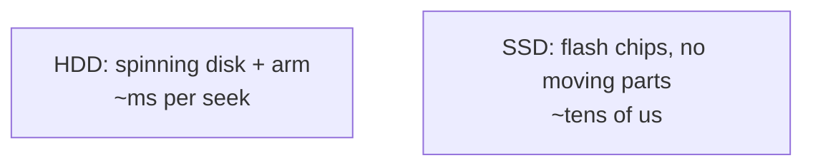

**NVMe** is not a device, it is a faster road: a protocol that lets an SSD talk to the CPU directly over PCIe lanes instead of the old disk cable (SATA).

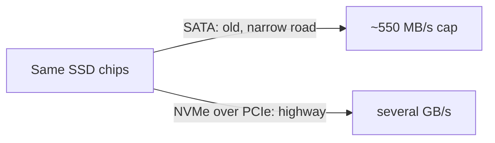

The rest of this note is just three questions:
1. How do HDDs and SSDs physically store and find bits?
2. Why do SSDs have weird rules (erase blocks, write amplification, wear)?
3. Which device for which workload, and what numbers should you remember?

**The problem in one story.**
Your service saves an order, replies "payment confirmed", and then the server loses power.
After restart, is the order still there?
That depends on whether the data really reached the disk, and how fast that disk is decides how many orders per second you can save safely.
This note is about those disks: HDD, SSD and NVMe.

**Words you need first**

| Word | Plain meaning | Tiny example |
| --- | --- | --- |
| Latency | Time for one operation to finish | ~5 ms for one HDD read |
| IOPS | I/O operations per second | An NVMe SSD doing 500K random reads/s |
| Throughput | Bytes moved per second | 3 GB/s sequential read |
| Sequential vs random I/O | Reading data in order vs jumping around | Streaming a video vs looking up 1,000 users |
| Block | The fixed-size unit a disk reads/writes | 4 KB |
| Page cache | RAM the OS uses to hold recent file data | A file you just read opens instantly |
| `fsync` | System call: "make my writes truly durable now" | A database calling it on commit |
| PCIe | The fast internal bus devices plug into | The slot an NVMe drive uses |
| Seek / rotational latency | HDD: moving the arm to the right ring / waiting for the spot to spin under it | about 5 ms + 4 ms |
| NAND flash | The chip type inside SSDs that stores bits as trapped charge | your phone's storage |
| Erase block | The big group of flash pages that must be wiped together | hundreds of 4-16 KB pages |
| FTL (flash translation layer) | SSD firmware that maps the OS's block numbers to real flash pages | hides "erase before write" |
| Write amplification | The SSD writing more bytes inside than you asked it to | 1 GB asked, 3 GB written |
| SATA vs NVMe | Old disk protocol with one queue / new flash protocol with thousands of queues | 32 vs 64K commands in flight |

**Picture it**

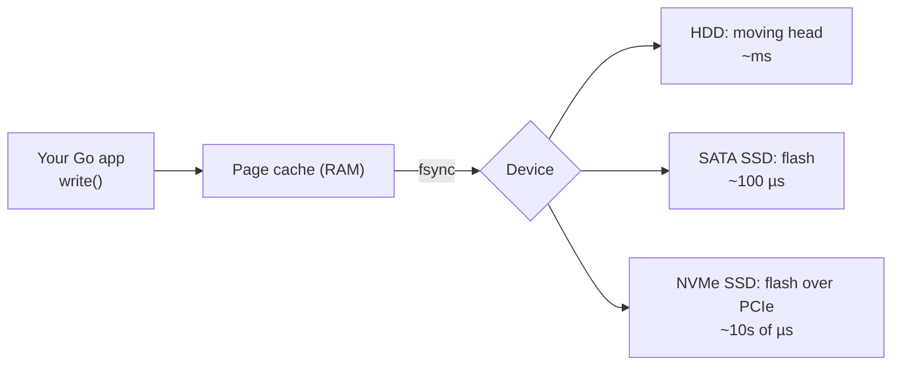

**Analogy.** An HDD is a record player: the needle must physically move to the right track. An SSD is a wall of mailboxes you can open instantly.
Where it breaks: SSD "mailboxes" can't be overwritten in place; a whole block must be erased first, which creates hidden extra writes.

**How the rest of this note builds up**

- First, why storage speed matters (section 1) and a mental model of seek vs no-seek devices (section 2).
- Then how HDDs, SSD flash, the FTL and NVMe queues work (section 3), with IOPS × block size math (section 4).
- Then variants and trade-offs across device types (sections 5-6).
- Finally the SDE-3 view: `fsync` durability, write amplification and tail latency in production and the deep dive (sections 7-8).

> [!tip] Remember
> HDDs pay for moving parts, SSDs pay for erasing blocks, NVMe removes the interface bottleneck, and nothing is durable until `fsync` says so.

## 1. Why it exists 🟢

A backend service writes an order to a database, a log line to disk, or a container image to a volume. All of it has to live somewhere after the process exits and the machine reboots.

RAM loses its contents the instant power is cut (see [[Memory Hierarchy and CPU Caches]]), so every system that needs to remember anything past a restart needs a **non-volatile** tier underneath RAM: slower by 3–5 orders of magnitude, but durable and far cheaper per byte.

Here is why the device you pick matters in practice, not just in theory.

A database doing 10,000 small random writes per second needs a device that can sustain 10,000 **IOPS** (input/output operations per second — one read or write counts as one operation, regardless of how small). An HDD tops out around 100–200 random IOPS, a 50–100× shortfall.

An NVMe SSD sustains hundreds of thousands.

Picking the wrong device class for the access pattern is one of the most common root causes of "the database is slow" incidents — and it is a cause nobody can fix with better code, because the bottleneck is physical.

> [!tip] Remember
> Storage exists because RAM forgets. The device you choose is really a bet about your access pattern: sequential and cold data tolerates slow, cheap devices; random and hot data does not.

### Real-life example 🟢

A laptop that moved from a hard disk to an SSD starts up in seconds instead of a minute, because booting is thousands of small random reads, the thing HDDs are worst at.
A UPI payment service running PostgreSQL waits for an `fsync` on every commit, so the disk's write latency becomes the payment's latency: about 0.1 ms on local NVMe, about 1 ms on a cloud network disk, about 10 ms on a hard disk.
Meanwhile, old photo backups and years of logs often sit on cheap HDD-backed storage such as Amazon S3's colder tiers, because nobody reads them often.

## 2. Mental model 🟢

### The record player and the whiteboard

**In plain words:** An HDD behaves like a record player. A physical arm (the **head**) has to swing to the right groove (**seek**) and then wait for the right point on the spinning disk to arrive (**rotational latency**) before it can read anything. An SSD behaves like a whiteboard with one annoying rule: you can write on any blank cell instantly, but to erase, you must wipe an entire large tile of cells at once — even if only one cell on that tile is wrong.

**Picture it:**

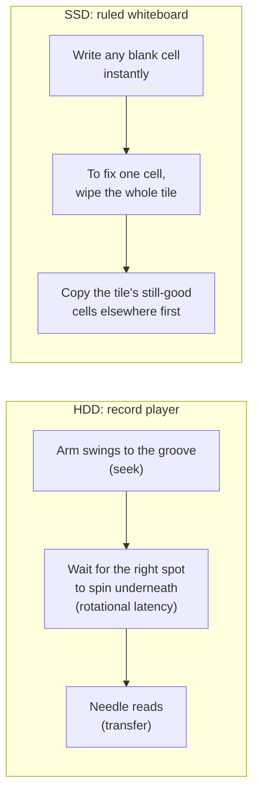

**Example:** Reading one byte from the middle of a record means moving the needle there first — slow, no matter how small the byte is. Reading one byte from a already-open page of the whiteboard costs almost nothing, but erasing is always tile-sized, never cell-sized.

**Why it matters:** Every mechanical cost on an HDD (seek, rotation) is paid per *access*, not per *byte*, so batching accesses into one long sequential run is the single biggest lever you have. Every SSD cost (erase, copy-before-erase) is paid per *block*, not per *write*, so how full the drive is and how the writes are spread across it matter more than their size.

NVMe does not change either whiteboard or record player — it only changes how many clerks are standing at the desk taking requests. A single clerk (SATA/AHCI, one queue) versus thousands of clerks each holding thousands of pending requests (NVMe) is purely about how many requests can be in flight at once, not about the storage medium underneath.

> [!warning] Common mistake
> Treating "SSD" and "NVMe" as synonyms. SSD describes the storage medium (NAND flash); NVMe describes the command protocol used to talk to it. A SATA SSD and an NVMe SSD can use identical flash chips — the difference is entirely in how many requests the CPU can have outstanding at once.

## Common beginner mistakes 🟢

- **Using "SSD" and "NVMe" as the same word** → SSD is the flash storage; NVMe is the protocol it talks over → a SATA SSD and an NVMe SSD can use the same chips but differ hugely in parallel requests.
- **Running a busy database on HDD** → every random read or commit waits about 10 ms for the arm → put the database, or at least its WAL, on SSD/NVMe.
- **Filling an SSD to 99%** → the garbage collector has no empty blocks, so writes slow down and the drive wears faster → keep it below about 80-90% full.
- **Storing important data only on local instance NVMe** → it disappears when the cloud instance stops → keep the real copy on EBS, S3 or a replicated database.
- **Treating RAID 0 as a backup** → it has no redundancy; one failed disk loses everything → use RAID 1/10 plus real backups.

## 3. How it works 🟡

> 🟢 → 🟡 **You now know** that HDDs pay for moving parts, SSDs pay for erasing big blocks, and NVMe is a faster way to talk to an SSD. **Next we open the box:** the three costs of an HDD read, how flash pages and blocks work, cell types, the tricks that reduce extra writes, and why NVMe's many queues matter.

### HDD mechanics: three costs, paid every random access

**In plain words:** A platter spins at a fixed rate. To read one sector, the head first moves to the right track, then waits for that exact sector to rotate underneath it, then transfers the bits. All three steps happen on every random read; only the last one happens on a sequential read that's already at the right track.

**Step by step:**
1. The database asks for one 4 KB sector (the smallest unit a disk reads) somewhere on the disk.
2. Seek: the arm swings to the right track (one ring on the platter). About 5-10 ms.
3. Rotate: the disk spins until that sector is under the head. On average half a turn, about 4 ms at 7,200 rpm (revolutions per minute).
4. Transfer: the bits are read. Well under 1 ms.
5. Total: about 10 ms for one random read, so only about 100 random reads per second. Reading the next sector on the same track skips steps 2 and 3.

**Picture it:**

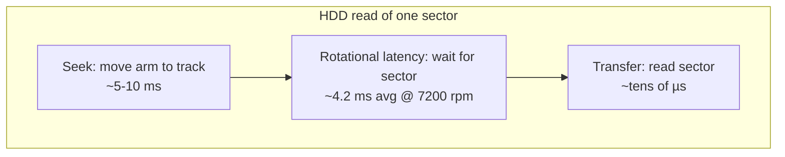

**Example:** Average rotational latency is half a revolution. At 7,200 rpm (120 revolutions/second), one revolution takes 8.33 ms, so the average wait for a random sector is **4.17 ms** (documented: 60,000 ms/min ÷ 7,200 rpm ÷ 2, from rotational speed). Add seek time (~5–10 ms, documented: Seagate Exos datasheets) and a single random read costs roughly **9–14 ms** before any data even starts moving. Sequential reads amortize seek and rotation across a whole track instead of paying them per sector, reaching **150–250 MB/s sequential vs. 100–200 random IOPS** (documented: enterprise HDD datasheets).

**Why it matters:** This is the entire reason databases, Kafka, and WAL-based systems design around sequential writes whenever a spinning disk is anywhere in the picture (see [[Storage Engines - B-tree vs LSM and WAL]]) — a workload that reorders itself to be sequential can be 1,000× cheaper on an HDD than one that doesn't.

> [!tip] Remember
> On an HDD, cost is paid per *access* (seek + rotate), almost regardless of how much data that access transfers. Sequential access pays it once for many sectors; random access pays it every single time.

### SSD internals: pages, blocks, and the FTL

**In plain words:** NAND flash is organized into **pages** (4–16 KB, the smallest unit you can write) grouped into **erase blocks** (hundreds of pages, the smallest unit you can erase). You can write a blank page directly, but you can never rewrite a page in place — it has to be erased first, and erasing only happens a whole block at a time. The **Flash Translation Layer (FTL)** — firmware living inside the SSD — hides this limitation from the OS entirely.

**Step by step:**
1. The OS writes block 7. The FTL puts it in a free flash page and notes "block 7 → page A".
2. The OS writes block 7 again. Flash cannot overwrite page A, so the FTL writes page B and marks A as stale (old, not needed).
3. Over time, many pages are stale. Free pages run low.
4. The garbage collector picks an erase block, copies its still-valid pages somewhere else, then wipes the whole block.
5. Those copies are extra writes the OS never asked for: that is write amplification.

**Picture it:**

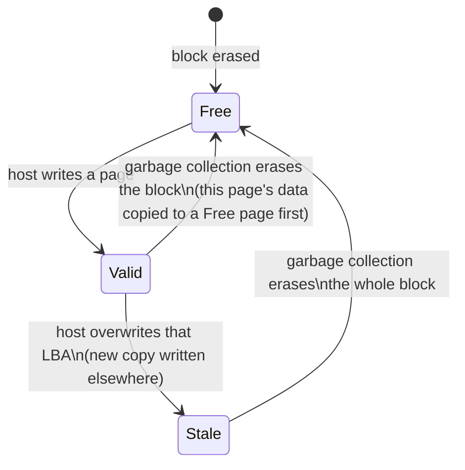

**Example:** Every logical write goes to a fresh physical page; the old physical copy, if there was one, is marked **stale** (dead weight, not yet reclaimed). A background **garbage collector** later picks a block, copies out any pages still marked **valid**, and only then erases the whole block — turning every page in it back to **free**.

**Why it matters:** That copy-before-erase step is not optional bookkeeping — it is the entire reason flash write cost can exceed what the host asked for, and it is the mechanism the worked example below measures directly.

### NAND cell types: a straight trade of density for speed and endurance

**In plain words:** A NAND cell can store more than one bit by distinguishing more voltage levels, but reading and writing more levels is slower and wears the cell out faster.

**Step by step:**
1. SLC stores 1 bit per cell: the cell is either "charged" or "empty". Easy to tell apart.
2. MLC stores 2 bits: 4 charge levels per cell.
3. TLC stores 3 bits: 8 levels. QLC stores 4 bits: 16 levels.
4. More levels means more data per chip (cheaper), but the levels sit closer together, so reading is slower and the cell wears out after fewer erases.

**Picture it:**

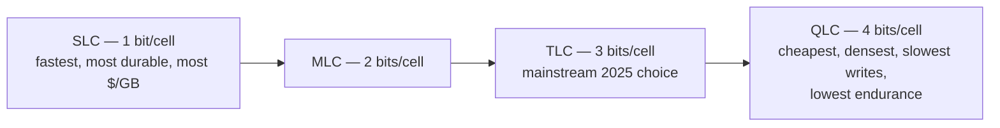

**Example:** A QLC block tolerates roughly 1,000–3,000 erase cycles before it wears out; an SLC block tolerates 30,000–100,000 (documented: SNIA / vendor endurance specs) — a 10–30× gap for the same silicon process, purely from how many voltage levels each cell has to distinguish.

**Why it matters:** This is why archival, read-heavy SSDs use QLC (cheap, dense, endurance doesn't matter if you rarely rewrite) while write-heavy database SSDs use TLC or better.

### Wear leveling, TRIM, and over-provisioning: the three levers that fight write amplification

**Step by step:**
1. You delete a 1 GB file. The OS marks it free in its file system.
2. With TRIM, the OS also tells the SSD "those blocks are dead". Without it, the SSD still thinks they are live and keeps copying them during garbage collection.
3. Wear leveling makes sure new writes go to the least-worn blocks, so no single block dies early.
4. Over-provisioning keeps hidden spare space, so the garbage collector usually finds a mostly empty block to wipe.

- **Wear leveling** spreads writes evenly across blocks so no single block wears out first, since each block tolerates only a finite number of erases.
- **TRIM** is the OS telling the SSD "these logical blocks are deleted, don't bother preserving their data on your next garbage-collection pass." Without TRIM, the FTL keeps copying dead data forever, because it has no way to know the host stopped caring about it.
- **Over-provisioning** is spare physical capacity the FTL reserves beyond the drive's advertised logical size. More spare capacity means the garbage collector almost always finds blocks that are mostly empty to reclaim; less spare capacity (a nearly-full drive) forces it to reclaim blocks still full of live data, multiplying the number of physical writes per host write.

> [!tip] Remember
> Over-provisioning is the one lever you control after purchase: keeping a drive below ~80–90% utilization is, mechanically, keeping the garbage collector's job easy.

### SATA/AHCI vs NVMe: one clerk versus thousands

**In plain words:** SATA SSDs speak **AHCI**, a protocol designed in 2004 for spinning disks — one command queue, depth 32. **NVMe** is a protocol built from scratch for flash, running over PCIe instead of a SATA cable, with up to 64K queues of up to 64K commands each.

**Step by step:**
1. A busy database has 64 threads, each wanting to read from the SSD at the same time.
2. With SATA/AHCI, all requests share one queue that holds at most 32. The rest wait.
3. With NVMe, each CPU core can get its own queue, each holding thousands of requests.
4. The flash chips inside work on many requests in parallel, so NVMe keeps them all busy.
5. Same flash, far more work done per second.

**Picture it:**

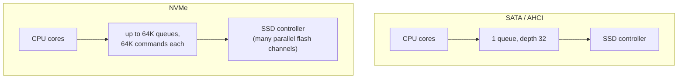

**Example:** SATA SSDs land around **500–550 MB/s** (the SATA III link limit, documented) and roughly 80–100 µs latency (an estimate, not measured on this machine); NVMe SSDs on PCIe 4.0/5.0 reach multiple GB/s and **20–100 µs latency** (documented: NVMe Base Specification; vendor NVMe datasheets, 2025).

**Why it matters:** A single queue of depth 32 becomes the bottleneck long before the flash chips themselves run out of parallelism. NVMe's many deep queues let the OS spread I/O across CPU cores so that no single queue, and no single core, becomes the choke point — matching how parallel the flash itself actually is internally.

## 4. Worked example 🟡

### Whiteboard version

IOPS, block size, and throughput are related by one identity:

```text
throughput = IOPS × block size
```

A device rated at 100,000 random 4 KB IOPS can sustain about 400 MB/s of small random I/O — far below its sequential rating, because sequential transfers use much larger blocks per operation.

When sizing storage for a service, always ask which number matters for the workload: a log shipper doing large sequential appends is **throughput-bound**; an OLTP (online transaction processing: many small reads and writes, like orders and payments) database doing point lookups is **IOPS-bound**.

### Tracing write amplification by hand

Take a tiny toy drive: 10 erase blocks of 4 pages each (40 pages total). Walk a skewed random-write workload across it and watch the garbage collector work.

1. The host writes to LBA 7 (logical block address: the block number the OS uses). The FTL finds a free page, marks it **valid**, and records LBA 7 → that physical page.
2. The host writes to LBA 7 again. The *old* physical page is marked **stale** (it still holds data, but nobody will read it again); a brand-new physical page becomes the current copy.
3. Free pages run low (the toy FTL's threshold is "one block's worth of free pages remaining"). The garbage collector picks the block with the fewest **valid** pages — cheapest to reclaim — and copies those valid pages to fresh locations elsewhere.
4. Only after every valid page is safely copied out does the collector erase the whole block, turning every page in it back to **free**.
5. Every page copied in step 3 is a **gcWrite** — a physical write the host never asked for. **Write amplification** is `(host writes + GC writes) / host writes`; a working set that is 80% of capacity leaves little slack for step 3 to find nearly-empty blocks, so it amplifies far more than a working set at 40%.

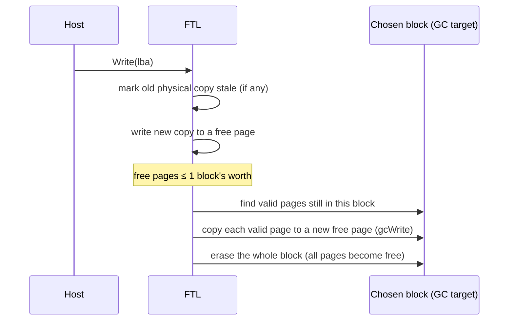

Runnable Go version: [[Storage Devices - HDD, SSD, NVMe - Go]]

## 5. Variants and comparison 🟡

| Device | Mechanism | Typical latency | Typical throughput | Cost per GB | Use when |
| --- | --- | --- | --- | --- | --- |
| HDD (7200 rpm) | Spinning platter, moving head | ~9–14 ms random; <1 ms/track sequential (documented: Seagate Exos datasheets) | 150–250 MB/s sequential; 100–200 random IOPS (documented: enterprise HDD datasheets) | Lowest | Backups, cold/archival tiers, large sequential logs |
| SATA SSD | NAND + FTL, AHCI protocol | ~80–100 µs (estimate) | ~500–550 MB/s (SATA III 6 Gb/s link limit, documented) | Medium | Budget servers, boot volumes, light random I/O |
| NVMe SSD (PCIe 4/5) | NAND + FTL, NVMe protocol | ~20–100 µs (documented: NVMe spec, 2025 vendor datasheets) | Multiple GB/s, millions of IOPS at depth | Higher | Databases, high-IOPS workloads, local instance storage |
| EBS gp3 (network block) | Remote NVMe-backed volume over the network | ~1 ms+ (network hop added) | Baseline 125 MB/s / 3,000 IOPS, provisionable higher (documented: AWS EBS docs, 2025) | Pay for provisioned IOPS/throughput | Durable, detachable cloud block storage |
| EBS io2 (network block) | Remote, replicated, higher durability tier | ~1 ms+ | Up to 256,000 IOPS per volume (documented: AWS EBS docs, 2025) | Highest block tier | Latency-sensitive databases needing guaranteed IOPS |

### RAID: trading capacity for redundancy, and how that interacts with write cost

**In plain words:** RAID combines several physical disks into one logical volume. The layout you pick decides both how much redundancy you get and how expensive each write becomes.

**Picture it:**

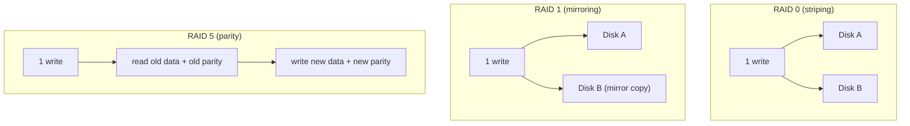

**Example:** RAID 5 computes parity (an extra check value from which any one lost disk's data can be rebuilt) across stripes, so every write requires reading the old data and the old parity, then writing the new data and new parity — the **RAID 5 write penalty**: roughly 4 physical I/Os per logical write. RAID 10 (striped mirrors) just writes to two disks directly, with no parity math at all, at the cost of needing twice the raw capacity instead of one extra parity disk.

**Why it matters:** For a random-write-heavy workload like an OLTP database, that 4-I/O penalty on RAID 5 is a real, measurable latency and throughput cost — which is why production databases usually choose RAID 10 despite its lower usable capacity.

> [!tip] Remember
> RAID 0 has zero redundancy and is not a backup strategy; RAID 1/10 trade capacity for simple, fast redundancy; RAID 5/6 trade write latency for cheaper redundancy.

### SSD vs NVMe vs SATA: people mix these up 🟡

| Word | What it names | Example |
| --- | --- | --- |
| HDD / SSD | The storage medium: spinning platter / flash chips | a 4 TB HDD, a 1 TB SSD |
| SATA (AHCI) | The old cable and protocol: one queue of 32 commands | a 2.5-inch SATA SSD, about 550 MB/s max |
| NVMe | The new protocol over PCIe: up to 64K queues | an M.2 NVMe SSD, several GB/s |

## 6. Trade-offs and when not to use 🟡

- NVMe is not simply "a fast SSD" — it is a different command protocol. A SATA SSD cannot be made NVMe-fast just by changing drivers; the queue depth limit is architectural, built into the hardware.
- Local NVMe instance storage (e.g. EC2 instance store) is often faster and cheaper per IOPS than network-attached EBS, but it is ephemeral: data is lost if the instance stops. Use it for scratch space or data you can rebuild, never the system of record.
- HDDs still win on raw $/GB for cold data accessed rarely and sequentially (backups, write-once logs, archival tiers like S3 Glacier's underlying media) — don't pay SSD prices for data nobody reads.
- RAID 0 (striping) is not a backup: it has no redundancy, and a single disk failure loses everything. RAID 1 (mirroring) and RAID 10 (striped mirrors) add redundancy at the cost of usable capacity; RAID 5/6 use parity instead, trading a slower, CPU-heavier write path for less capacity overhead.
- Choosing per data type: a database's primary data and WAL benefit most from low-latency NVMe; application logs are sequential and can tolerate HDD or object storage; backups want the cheapest durable tier (often object storage, not block storage at all).

> 🟡 → 🔴 **You now know** how HDDs, SSDs and NVMe work, the IOPS × block size rule, write amplification and RAID. **Next comes the advanced part:** cloud block, file and object storage, how disks fail in production, and the deep details: the write-amplification formula, power-loss protection, and the full `fsync` path.

## 7. In production 🔴

- **Real systems:**
	- Cloud block storage: AWS EBS (gp3 general purpose, io2 provisioned IOPS), all backed by NVMe SSDs behind a network layer.
	- Cloud object storage: Amazon S3, which stores objects (not blocks or files) and is commonly backed by large pools of HDDs with SSD caching tiers for metadata and hot objects.
	- Managed file storage: AWS EFS (NFS-based, file-level, shared across instances) vs. EBS (block-level, single-attach by default) vs. S3 (object-level, HTTP API) — three different storage models for three different access patterns.
	- Databases: PostgreSQL and MySQL both assume random-write-capable storage for their WAL and data files; running them on HDD is a known source of commit-latency pain, because `fsync` must wait for rotational latency on every commit.
- **Failure modes → fixes:**
	- A nearly-full SSD shows rising write latency under sustained random writes (write-amplification spiral) → keep utilization below ~80–90%, or increase over-provisioning.
	- An HDD-backed database has high p99 commit latency → move the WAL to SSD/NVMe even if bulk data stays on HDD; or batch commits (`synchronous_commit` tuning) to amortize fsync cost.
	- An EC2 instance using local NVMe loses its data on stop/terminate → replicate to durable storage (EBS, S3, a database's own replication) before relying on it.
	- A drive degrades silently (rising uncorrectable error rate) → monitor SMART/NVMe health attributes (the drive's own self-reported health counters), not just "is it responding".
- **What to monitor:**
	- IOPS and throughput against the device's rated limits (and whether the workload is IOPS-bound or throughput-bound).
	- p99/p999 I/O latency, not just average — tail latency is what users and SLAs actually feel.
	- SSD wear indicators: percentage of rated write endurance used, and SMART/NVMe SMART-log attributes.
	- Queue depth and `iostat`'s `%util` / `await` (how busy the device is / average time each request waited) to see whether the device itself, not the application, is the bottleneck.

## 8. Deep dive 🔴

- **Write amplification factor (WAF)** is formally `(host writes + GC writes) / host writes`. It is driven by three things: how full the drive is (less spare capacity means GC must reclaim blocks with more live data), how skewed the write pattern is (hot LBAs rewritten often vs. spread evenly), and whether TRIM is in use (deleted data the FTL doesn't know about gets uselessly copied forward).
- **Power-loss protection:** enterprise SSDs include capacitors that hold enough charge to flush the device's internal write cache to NAND on sudden power loss. Consumer SSDs often lack this, meaning an `fsync` that the OS believes succeeded can still lose data if the device's own cache hadn't landed on flash yet — a real source of "the database said it committed, but the data is gone after a crash" bugs.
- **The write path and why `fsync` matters:**

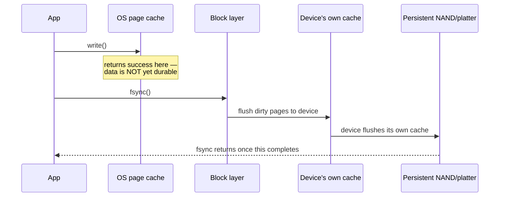

An application `write()` typically lands in the OS page cache first (see [[Page Cache, File Systems and fsync]]), not the device.

`fsync` forces that dirty data out through the block layer to the device, and a well-behaved device then flushes its own cache to persistent NAND/platter before acknowledging.

Any layer that lies about having persisted data (a RAID controller with a non-battery-backed cache, a misconfigured cloud volume) breaks the durability guarantee a database relies on.
- **Block vs. file vs. object storage** are different abstractions over the same physical devices: block storage (EBS) exposes raw addressable blocks that the OS formats with its own filesystem; file storage (EFS) exposes a shared hierarchical namespace (folders and files) over NFS (a protocol for using files on another machine as if local); object storage (S3) exposes flat key → blob access over HTTP with no partial-update semantics — you replace a whole object, you don't seek into it and overwrite bytes.
- **USB drives and SD cards** use the same NAND flash as SSDs but pair it with much simpler, cheaper controllers: thinner wear leveling, little or no over-provisioning, and no power-loss protection — which is why they are reliable for file transfer but a poor choice for a database or anything needing write durability guarantees under power loss.

## 9. Interview questions 🔴

> [!question]- Why is sequential I/O so much faster than random I/O on an HDD, but the gap is much smaller on an SSD?
> On an HDD, each random access costs a full seek (moving the arm) plus rotational latency (waiting for the sector to rotate under the head) — several milliseconds of pure mechanical delay regardless of how little data is transferred. Sequential access does one seek for a whole run of data.
>
> An SSD has no moving parts, so there is no seek/rotation cost; the remaining gap on SSDs comes from controller overhead, parallelism across flash channels, and how garbage collection batches lookups — all much smaller effects.

> [!question]- What is write amplification, and what causes it to get worse?
> It's the ratio of physical bytes an SSD actually writes to the logical bytes the host asked it to write, caused by the FTL's garbage collector copying still-valid pages out of a block before erasing it.
>
> It worsens as the drive fills up (less spare capacity means GC must reclaim blocks with more live data) and as the write pattern gets more skewed (a few hot logical addresses rewritten constantly, instead of writes spread evenly).

> [!question]- Trap: "NVMe is just a faster kind of SSD, like a faster SATA SSD." True or false?
> False. NVMe is a command protocol designed for flash from the ground up, running over PCIe with up to 64K queues of 64K commands each, versus AHCI/SATA's single queue of depth 32.
>
> The NAND flash inside an NVMe drive isn't inherently different from a SATA SSD's; the protocol is what removes the queueing bottleneck and lets the drive's internal parallelism actually be used.

> [!question]- Why does a database's commit latency often track storage latency so tightly?
> A transactional commit typically can't be acknowledged to the client until the write-ahead log entry is durably persisted, which means an `fsync` (or equivalent) has to complete.
>
> That `fsync` blocks on the storage device's actual write latency — rotational latency and seek on an HDD, or program time on NAND — so the device's latency floor becomes the commit latency floor.

> [!question]- What does over-provisioning buy you on an SSD, concretely?
> Spare physical capacity beyond the advertised logical size. It gives the garbage collector blocks to work with that are mostly empty, so it reclaims space cheaply (few live pages to copy).
>
> Less over-provisioning (or a drive that's simply nearly full) forces GC to reclaim blocks full of live data, multiplying physical writes per host write and raising both write amplification and latency.

> [!question]- Block, file, and object storage: what's actually different, not just "where you'd use each"?
> Block storage (EBS) exposes raw fixed-size blocks the OS addresses directly and formats with its own filesystem — you can overwrite any byte range. File storage (EFS/NFS) adds a shared hierarchical namespace with POSIX-like semantics across multiple clients.
>
> Object storage (S3) has no partial writes at all: an object is replaced wholesale via an HTTP API, and there's no OS filesystem layer between you and it — that's also why you can't `fsync` into S3 the way you can into a mounted block device.

> [!question]- Why would you choose RAID 10 over RAID 5 for a database, given RAID 10 wastes more capacity?
> RAID 5 computes parity across stripes, so every write requires reading the old data and parity, then writing new data and new parity (the "RAID 5 write penalty"), which hurts random-write-heavy workloads like OLTP databases.
>
> RAID 10 (striped mirrors) just writes to two disks directly with no parity computation, so write latency and throughput are much better for that workload — at the cost of needing twice the raw capacity instead of just one extra parity disk.

## 10. Cheat sheet 🟢

- HDD: seek (~5–10 ms) + rotational latency (~4.2 ms avg at 7200 rpm) dominate random access; sequential is cheap. Still wins on $/GB for cold, sequential data.
- SSD: NAND pages are written freely but erased only a whole block at a time; the FTL never overwrites in place, so garbage collection must copy live pages before erasing — that copy cost is write amplification.
- IOPS × block size = throughput; know which one bounds your workload.
- NVMe is a protocol (massively parallel queues over PCIe), not just "a newer SSD"; it's why NVMe SSDs scale to millions of IOPS where SATA SSDs cap around SATA III's link speed.
- Over-provisioning (spare flash capacity) keeps write amplification low; a nearly-full SSD under random writes amplifies much more.
- `fsync` durability depends on every layer in the path actually flushing to persistent media, including the device's own write cache (power-loss protection matters here).
- Block (EBS) vs. file (EFS) vs. object (S3) storage are different data models, not just different price points.
- RAID 0 has no redundancy; RAID 10 beats RAID 5 on random-write-heavy workloads because it avoids the parity read-modify-write penalty.

## Self-check 🟢🟡

🟢 Easy

> [!question]- Why is a random read on an HDD so slow?
> The arm must move to the right track and wait for the disk to spin: about 10 ms of moving parts.

> [!question]- Is NVMe a kind of storage chip?
> No. It is a protocol for talking to an SSD over PCIe, with many deep queues.

> [!question]- What does IOPS mean?
> Input/output operations per second: how many reads or writes a device finishes each second.

🟡 Medium

> [!question]- 50,000 IOPS of 4 KB blocks: what throughput is that?
> About 200 MB/s (50,000 × 4 KB).

> [!question]- Why does a nearly full SSD get slower at writing?
> The garbage collector must copy many still-valid pages before erasing each block, so write amplification rises.

> [!question]- Why do databases prefer RAID 10 over RAID 5?
> RAID 5 needs about 4 disk operations per small write (read and write data and parity); RAID 10 just writes two copies.

## Links

- **Before this:** [[Memory Hierarchy and CPU Caches]]
- **Next:** [[Page Cache, File Systems and fsync]], [[Latency Numbers Every Engineer Should Know]]
- **Compare with:** [[RAM Technologies - SRAM, DRAM, DDR, GDDR, HBM]] (volatile, byte-addressable memory vs. non-volatile, block-addressable storage), [[Storage Engines - B-tree vs LSM and WAL]] (how databases lay data out on top of these devices)
- **Runnable Go version:** [[Storage Devices - HDD, SSD, NVMe - Go]]

### Watch on YouTube

- [How Does A SSD Work](https://www.youtube.com/watch?v=v-HF7FLKFBw) · How-Does-It · short visual explainer of SSD/NAND internals vs HDD
- [How Does Flash Memory Work? (SSD)](https://www.youtube.com/watch?v=r2KaVfSH884) · BLITZ · deeper look at NAND flash cells and write amplification
