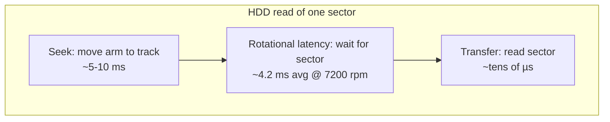
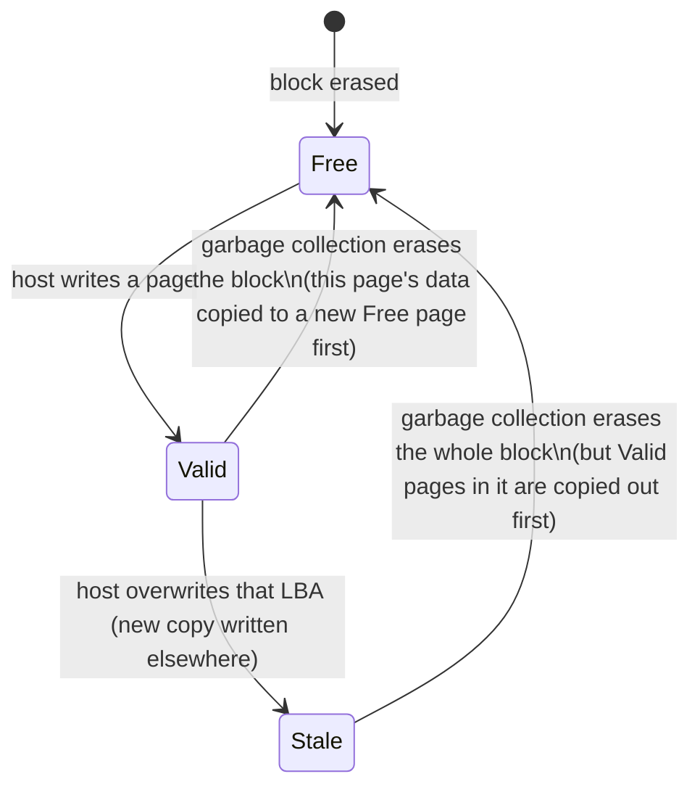

# Storage Devices - HDD, SSD, NVMe

> [!summary] TL;DR
> Storage is non-volatile: data survives power loss. An HDD reads and writes by physically moving a head over a spinning magnetic platter, which is slow (milliseconds) and loves sequential access. An SSD has no moving parts; it reads and writes NAND flash through a controller that must erase in large blocks before rewriting, which is fast (microseconds) but ages the device and causes write amplification. NVMe is the modern command protocol that lets an SSD talk to the CPU over PCIe with thousands of parallel queues instead of the one queue SATA allows.

> [!abstract] Core idea
> - HDDs move a physical head (seek + spin), so latency is milliseconds and sequential I/O is far cheaper than random I/O.
> - SSDs have no head to move, but flash can only be erased a whole block at a time, so overwriting data means copying it elsewhere first (write amplification).
> - NVMe is a protocol, not a chip: it lets an SSD controller expose up to 64K queues of 64K commands each over PCIe, instead of SATA's single queue of 32.
> - IOPS × block size = throughput. A device can be throughput-bound (big sequential transfers) or IOPS-bound (small random transfers) depending on the workload.
> - Durability on commit depends on `fsync` actually reaching persistent media, not just the OS's page cache.

## 1. Why it exists

A backend service writes an order to a database, a log line to disk, or a container image to a volume. All of it has to live somewhere after the process exits and the machine reboots — RAM is volatile (see [[Memory Hierarchy and CPU Caches]]). Storage devices are the non-volatile tier: slower than RAM by 3–5 orders of magnitude, but durable and far cheaper per byte.

Concretely: a database doing 10,000 small random writes per second needs a device that can sustain 10,000 IOPS (input/output operations per second). An HDD tops out around 100–200 random IOPS — a 50–100× shortfall. An NVMe SSD sustains hundreds of thousands. Picking the wrong device class for the access pattern is one of the most common root causes of "the database is slow" incidents.

## 2. Mental model

Think of an HDD as a record player: a physical arm (the head) has to move to the right groove (seek) and then wait for the right point on the spinning disk to arrive (rotational latency) before it can read. Moving the arm is the expensive part, so playing a whole side of a record (sequential read) is efficient, but jumping between tracks constantly (random access) is slow.

Think of an SSD as a whiteboard with a rule: you can write on a blank cell any time, but to erase you must wipe an entire large tile of cells at once, even if only one cell is now wrong. So the controller writes new data to a blank cell elsewhere, marks the old cell "stale", and only occasionally does it erase a tile — but when it does, it must first copy any still-valid cells on that tile to fresh ones. That copying is write amplification.

NVMe is just the "API" between the CPU and the whiteboard: instead of one clerk taking one request at a time (SATA/AHCI), NVMe gives the CPU thousands of clerks who can each hold thousands of pending requests (deep, parallel queues), matching how parallel flash chips actually are internally.

## 3. How it works

### HDD mechanics

A platter spins at a fixed rate (5,400–15,000 rpm); a head on an arm moves radially to the target track, then waits for the target sector to rotate underneath it.



Average rotational latency is half a revolution: at 7,200 rpm (120 rev/s), one revolution takes 8.33 ms, so the average wait is **4.17 ms (documented: 60,000 / 7200 / 2 ms, from rotational speed)**. Add seek time (~5–10 ms, documented: Seagate Exos datasheets) and a single random read costs roughly 9–14 ms before any data moves. Sequential reads amortize seek and rotation across a whole track, reaching **150–250 MB/s sequential vs. 100–200 random IOPS (documented: enterprise HDD datasheets)** — this is why databases, Kafka, and WAL-based systems design around sequential writes whenever a spinning disk is in the picture (see [[Storage Engines - B-tree vs LSM and WAL]]).

### SSD internals: pages, blocks, and the FTL

NAND flash is organized into **pages** (4–16 KB, the smallest unit you can program/write) grouped into **erase blocks** (hundreds of pages, the smallest unit you can erase). You can write to a blank page directly, but you cannot rewrite a page in place — it must be erased first, and erasing only works a whole block at a time.

The **Flash Translation Layer (FTL)**, firmware inside the SSD, hides this by never overwriting in place: every logical write goes to a fresh physical page, the old one is marked stale, and a background **garbage collector** reclaims whole blocks by copying any still-valid pages elsewhere and then erasing the block.



NAND cell types trade endurance and speed for density: **SLC** (1 bit/cell, fastest, most durable, most expensive) → **MLC** (2 bits) → **TLC** (3 bits, the mainstream choice in 2025 consumer and most enterprise drives) → **QLC** (4 bits, cheapest and densest, slower writes and lower endurance, used for read-heavy/archival SSDs).

**Wear leveling** spreads writes evenly across blocks so no single block wears out first (each NAND block tolerates a finite number of erase cycles: roughly 1,000–3,000 for QLC up to 30,000–100,000 for SLC, documented: SNIA / vendor endurance specs). **TRIM** is the OS telling the SSD "these logical blocks are deleted, you don't need to preserve their data on your next GC pass" — without TRIM, the FTL would keep copying dead data forever, inflating write amplification.

**Over-provisioning** is spare physical capacity the FTL reserves beyond the advertised logical capacity. More spare capacity means the garbage collector almost always finds blocks with few live pages to reclaim; less spare capacity (a nearly-full drive) means it is forced to reclaim blocks full of live data, multiplying the number of physical writes per host write. This exact mechanism is simulated in the worked example below.

### SATA/AHCI vs NVMe

SATA SSDs speak AHCI, designed in 2004 for spinning disks: one command queue, depth 32, and the protocol itself adds latency the drive doesn't need. **NVMe** (NVM Express) is a protocol built from scratch for flash, running over PCIe instead of SATA's cable, with **up to 64K queues of up to 64K commands each**, letting the OS spread I/O across many CPU cores with no single queue becoming a bottleneck. The result: SATA SSDs land around 500–550 MB/s (the SATA III link limit, documented) and ~80–100 µs latency (estimate — typical figure, not measured here); NVMe SSDs on PCIe 4.0/5.0 reach multiple GB/s and **20–100 µs latency (documented: NVMe Base Specification; vendor NVMe datasheets, 2025)**.

## 4. Worked example

### Whiteboard version

IOPS, block size, and throughput are related by one identity:

```text
throughput = IOPS × block size
```

A device rated at 100,000 random 4 KB IOPS can sustain about 400 MB/s of small random I/O — far below its sequential rating, because sequential transfers use much larger blocks per operation. When sizing storage for a service, always ask which number matters for the workload: a log shipper doing large sequential appends is throughput-bound; an OLTP database doing point lookups is IOPS-bound.

### Simulating write amplification in Go

The deep mechanism above — pages, blocks, garbage collection, over-provisioning — is small enough to simulate directly. This toy FTL uses a 4-page erase block, a log-structured write cursor, and a garbage collector that reclaims the block with the fewest live pages, copying survivors forward before erasing:

```go
// Package storage is a toy flash translation layer (FTL) that shows why a
// skewed write pattern causes write amplification on an SSD, and how garbage
// collection recovers space by copying still-live pages.
package storage

// Toy geometry: 4 pages per erase block. Real SSDs use blocks of hundreds
// of pages, but the mechanism (page writes, whole-block erase, garbage
// collection copies live pages) is the same.
const pagesPerBlock = 4

type pageState int

const (
	free pageState = iota
	valid
	stale
)

type page struct {
	state pageState
	lba   int // logical block address this physical page holds, if valid
}

// FTL maps logical addresses to physical flash pages and tracks how many
// extra page writes garbage collection caused (write amplification).
type FTL struct {
	blocks      [][]page    // blocks[block][pageInBlock]
	mapTable    map[int]int // lba -> absolute physical page index
	writeCursor int         // next free physical page to write, log-structured
	hostWrites  int         // pages written because the host asked
	gcWrites    int         // pages written by garbage collection (copies)
	erases      int
}

// NewFTL builds an FTL with the given number of erase blocks.
func NewFTL(numBlocks int) *FTL {
	blocks := make([][]page, numBlocks)
	for b := range blocks {
		blocks[b] = make([]page, pagesPerBlock)
	}
	return &FTL{blocks: blocks, mapTable: make(map[int]int)}
}

func (f *FTL) total() int { return len(f.blocks) * pagesPerBlock }

func (f *FTL) at(abs int) *page { return &f.blocks[abs/pagesPerBlock][abs%pagesPerBlock] }

// Write performs a host write to a logical address. Flash cannot overwrite a
// page in place, so the old physical copy (if any) is marked stale and the
// new data goes to a fresh page.
func (f *FTL) Write(lba int) {
	if old, ok := f.mapTable[lba]; ok {
		f.at(old).state = stale
	}
	abs := f.allocPage()
	f.at(abs).state = valid
	f.at(abs).lba = lba
	f.mapTable[lba] = abs
	f.hostWrites++
}

// allocPage returns a free physical page, running garbage collection first
// if free space is low. Real SSDs reserve spare physical capacity (over-
// provisioning) so GC always has somewhere to copy live pages; this toy FTL
// reclaims a block as soon as free pages drop to one block's worth, for the
// same reason.
func (f *FTL) allocPage() int {
	if f.freePages() <= pagesPerBlock {
		f.garbageCollect()
	}
	for tries := 0; tries < f.total(); tries++ {
		abs := f.writeCursor
		f.writeCursor = (f.writeCursor + 1) % f.total()
		if f.at(abs).state == free {
			return abs
		}
	}
	panic("no free page even after GC: raise over-provisioning (fewer logical LBAs for this capacity)")
}

func (f *FTL) freePages() int {
	n := 0
	for _, b := range f.blocks {
		for _, p := range b {
			if p.state == free {
				n++
			}
		}
	}
	return n
}

// garbageCollect picks the block with the fewest valid pages, copies its
// live pages forward (counted as gcWrites, not hostWrites), and erases it.
// This copy-forward cost is exactly what "write amplification" measures.
func (f *FTL) garbageCollect() {
	best, bestLive := -1, pagesPerBlock+1
	for b, pages := range f.blocks {
		live := 0
		for _, p := range pages {
			if p.state == valid {
				live++
			}
		}
		if live < bestLive {
			best, bestLive = b, live
		}
	}
	// Collect the live LBAs first, then erase the whole block in one step.
	// Erasing before copying (instead of copying page-by-page) means the
	// block's own freed pages are legitimately available as copy targets,
	// matching how a real FTL erases a block atomically before reusing it.
	var liveLBAs []int
	for i := range f.blocks[best] {
		if f.blocks[best][i].state == valid {
			liveLBAs = append(liveLBAs, f.blocks[best][i].lba)
		}
		f.blocks[best][i] = page{}
	}
	f.erases++
	for _, lba := range liveLBAs {
		newAbs := f.copyForward()
		f.at(newAbs).state = valid
		f.at(newAbs).lba = lba
		f.mapTable[lba] = newAbs
		f.gcWrites++
	}
}

// copyForward returns the next free physical page for a GC copy, scanning
// forward from the write cursor exactly like a fresh host write would.
func (f *FTL) copyForward() int {
	for i := 0; i < f.total(); i++ {
		abs := f.writeCursor
		f.writeCursor = (f.writeCursor + 1) % f.total()
		if f.at(abs).state == free {
			return abs
		}
	}
	panic("no free page for GC copy: raise over-provisioning (fewer logical LBAs for this capacity)")
}

// WriteAmplification is total physical pages written per host page written.
// 1.0 is ideal (sequential, never-overwritten workload); higher means GC is
// copying live data repeatedly, which is what a skewed random workload does.
func (f *FTL) WriteAmplification() float64 {
	if f.hostWrites == 0 {
		return 1
	}
	return float64(f.hostWrites+f.gcWrites) / float64(f.hostWrites)
}
```

Test, passing under `go test -race` on Go 1.24.4:

```go
package storage

import (
	"math/rand"
	"testing"
)

// Sequential, unique-LBA writes within capacity never trigger GC, so
// amplification stays at the ideal 1.0.
func TestSequentialWritesNoAmplification(t *testing.T) {
	f := NewFTL(6) // 24 pages
	for lba := 0; lba < 20; lba++ {
		f.Write(lba)
	}
	if got := f.WriteAmplification(); got != 1.0 {
		t.Fatalf("sequential fill: amplification = %.2f, want 1.00", got)
	}
}

// writeRandom overwrites a working set of w distinct LBAs n times, in a
// pseudo-random order (so rewrites interleave instead of trailing a clean
// log), and returns the FTL afterwards.
func writeRandom(capacityBlocks, w, n int, seed int64) *FTL {
	f := NewFTL(capacityBlocks)
	r := rand.New(rand.NewSource(seed))
	for i := 0; i < n; i++ {
		f.Write(r.Intn(w))
	}
	return f
}

// The core lesson: write amplification rises as the working set approaches
// the drive's physical capacity, i.e. as over-provisioning (spare physical
// pages) shrinks. A working set at 80% of capacity amplifies more than one
// at 40%.
func TestAmplificationRisesAsOverProvisioningShrinks(t *testing.T) {
	const capacityPages = 40 // 10 blocks * 4 pages/block
	lowFill := writeRandom(10, capacityPages*4/10, 2000, 1)  // 40% full
	highFill := writeRandom(10, capacityPages*8/10, 2000, 1) // 80% full

	lowAmp, highAmp := lowFill.WriteAmplification(), highFill.WriteAmplification()
	if highAmp <= lowAmp {
		t.Fatalf("80%% full amplification = %.2fx, want > 40%% full amplification = %.2fx", highAmp, lowAmp)
	}
	if lowAmp > 1.1 {
		t.Fatalf("40%% full (plenty of over-provisioning) amplified to %.2fx, want close to 1.0", lowAmp)
	}
	t.Logf("40%% full: %.2fx, 80%% full: %.2fx", lowAmp, highAmp)
}

// Garbage collection must never lose or duplicate a live logical page: every
// LBA ever written is still readable at its last written value after heavy
// GC churn.
func TestGCPreservesMapping(t *testing.T) {
	f := NewFTL(10)
	const w = 28
	last := make(map[int]bool)
	for i := 0; i < 5000; i++ {
		lba := i % w
		f.Write(lba)
		last[lba] = true
	}
	if len(f.mapTable) != w {
		t.Fatalf("mapTable has %d entries, want %d (one per LBA ever written)", len(f.mapTable), w)
	}
	for lba := range last {
		abs, ok := f.mapTable[lba]
		if !ok {
			t.Fatalf("lba %d missing from map after GC churn", lba)
		}
		if f.at(abs).state != valid || f.at(abs).lba != lba {
			t.Fatalf("lba %d: physical page %d is not a valid copy of it", lba, abs)
		}
	}
}
```

**Measured** (this toy FTL, 10 blocks × 4 pages = 40-page capacity, 2,000 random writes, Go 1.24.4, 2026-11-06):

| Working set as % of capacity | Write amplification |
| --- | --- |
| 40% full (60% spare/over-provisioned) | 1.06× |
| 80% full (20% spare) | 2.70× |

The lesson generalizes directly: real SSDs with more spare over-provisioned capacity sustain lower, steadier write amplification under random writes; a nearly-full drive under a random-write workload can amplify several times over, which is why databases that do heavy random writes are told to keep SSDs well below 100% utilization.

## 5. Variants and comparison

| Device | Mechanism | Typical latency | Typical throughput | Cost per GB | Use when |
| --- | --- | --- | --- | --- | --- |
| HDD (7200 rpm) | Spinning platter, moving head | ~9–14 ms random; <1 ms/track sequential (documented: Seagate Exos datasheets) | 150–250 MB/s sequential; 100–200 random IOPS (documented: enterprise HDD datasheets) | Lowest | Backups, cold/archival tiers, large sequential logs |
| SATA SSD | NAND + FTL, AHCI protocol | ~80–100 µs (estimate) | ~500–550 MB/s (SATA III 6 Gb/s link limit, documented) | Medium | Budget servers, boot volumes, light random I/O |
| NVMe SSD (PCIe 4/5) | NAND + FTL, NVMe protocol | ~20–100 µs (documented: NVMe spec, 2025 vendor datasheets) | Multiple GB/s, millions of IOPS at depth | Higher | Databases, high-IOPS workloads, local instance storage |
| EBS gp3 (network block) | Remote NVMe-backed volume over the network | ~1 ms+ (network hop added) | Baseline 125 MB/s / 3,000 IOPS, provisionable higher (documented: AWS EBS docs, 2025) | Pay for provisioned IOPS/throughput | Durable, detachable cloud block storage |
| EBS io2 (network block) | Remote, replicated, higher durability tier | ~1 ms+ | Up to 256,000 IOPS per volume (documented: AWS EBS docs, 2025) | Highest block tier | Latency-sensitive databases needing guaranteed IOPS |

## 6. Trade-offs and when not to use

- NVMe is not simply "a fast SSD" — it is a different command protocol. A SATA SSD cannot be made NVMe-fast just by changing drivers; the queue depth limit is architectural.
- Local NVMe instance storage (e.g. EC2 instance store) is often faster and cheaper per IOPS than network-attached EBS, but it is ephemeral: data is lost if the instance stops. Use it for scratch space or data you can rebuild, not the system of record.
- HDDs still win on raw $/GB for cold data accessed rarely and sequentially (backups, write-once logs, archival tiers like S3 Glacier's underlying media) — don't pay SSD prices for data nobody reads.
- RAID 0 (striping) is not a backup: it has no redundancy and a single disk failure loses everything. RAID 1 (mirroring) and RAID 10 (striped mirrors) add redundancy at the cost of usable capacity; RAID 5/6 use parity instead, trading a slower, CPU-heavier write path for less capacity overhead.
- Choosing per data type: a database's primary data and WAL benefit most from low-latency NVMe; application logs are sequential and can tolerate HDD or object storage; backups want the cheapest durable tier (often object storage, not block storage at all).

## 7. In production

- **Real systems:**
	- Cloud block storage: AWS EBS (gp3 general purpose, io2 provisioned IOPS), all backed by NVMe SSDs behind a network layer.
	- Cloud object storage: Amazon S3, which stores objects (not blocks or files) and is commonly backed by large pools of HDDs with SSD caching tiers for metadata and hot objects.
	- Managed file storage: AWS EFS (NFS-based, file-level, shared across instances) vs. EBS (block-level, single-attach by default) vs. S3 (object-level, HTTP API) — three different storage models for three different access patterns.
	- Databases: PostgreSQL and MySQL both assume random-write-capable storage for their WAL and data files; running them on HDD is a known source of commit-latency pain, because `fsync` must wait for rotational latency on every commit.
- **Failure modes → fixes:**
	- A nearly-full SSD shows rising write latency under sustained random writes (write-amplification spiral) → keep utilization below ~80–90%, or increase over-provisioning.
	- An HDD-backed database has high p99 commit latency → move the WAL to SSD/NVMe even if bulk data stays on HDD; or batch commits (`synchronous_commit` tuning) to amortize fsync cost.
	- An EC2 instance using local NVMe loses its data on stop/terminate → replicate to durable storage (EBS, S3, a database's own replication) before relying on it.
	- A drive degrades silently (rising uncorrectable error rate) → monitor SMART/NVMe health attributes, not just "is it responding".
- **What to monitor:**
	- IOPS and throughput against the device's rated limits (and whether the workload is IOPS-bound or throughput-bound).
	- p99/p999 I/O latency, not just average — tail latency is what users and SLAs actually feel.
	- SSD wear indicators: percentage of rated write endurance used, and SMART/NVMe SMART-log attributes.
	- Queue depth and `iostat`'s `%util` / `await` to see whether the device itself, not the application, is the bottleneck.

## 8. Deep dive

- **Write amplification factor (WAF)** is formally `(host writes + GC writes) / host writes`. It is driven by three things: how full the drive is (less spare capacity → GC must reclaim blocks with more live data), how skewed the write pattern is (hot LBAs rewritten often vs. spread evenly), and whether TRIM is in use (deleted data the FTL doesn't know about gets uselessly copied forward).
- **Power-loss protection**: enterprise SSDs include capacitors that hold enough charge to flush the device's internal write cache to NAND on sudden power loss. Consumer SSDs often lack this, meaning an `fsync` that the OS believes succeeded can still lose data if the device's own cache hadn't landed on flash yet — a real source of "the database said it committed, but the data is gone after a crash" bugs.
- **The write path and why `fsync` matters**: an application `write()` typically lands in the OS page cache first (see [[Page Cache, File Systems and fsync]]), not the device. `fsync` forces that dirty data out through the block layer to the device, and a well-behaved device then flushes its own cache to persistent NAND/platter before acknowledging. Any layer that lies about having persisted data (a RAID controller with a non-battery-backed cache, a misconfigured cloud volume) breaks the durability guarantee a database relies on.
- **Block vs. file vs. object storage** are different abstractions over the same physical devices: block storage (EBS) exposes raw addressable blocks that the OS formats with its own filesystem; file storage (EFS) exposes a shared hierarchical namespace over NFS; object storage (S3) exposes flat key → blob access over HTTP with no partial-update semantics — you replace a whole object, you don't seek into it and overwrite bytes.
- **USB drives and SD cards** use the same NAND flash as SSDs but pair it with much simpler, cheaper controllers: thinner wear leveling, little or no over-provisioning, and no power-loss protection — which is why they are reliable for file transfer but a poor choice for a database or anything needing write durability guarantees under power loss.

## 9. Interview questions

> [!question]- Why is sequential I/O so much faster than random I/O on an HDD, but the gap is much smaller on an SSD?
> On an HDD, each random access costs a full seek (moving the arm) plus rotational latency (waiting for the sector to rotate under the head) — several milliseconds of pure mechanical delay regardless of how little data is transferred. Sequential access does one seek for a whole run of data. An SSD has no moving parts, so there is no seek/rotation cost; the remaining gap on SSDs comes from controller overhead, parallelism across flash channels, and how garbage collection batches lookups — all much smaller effects.

> [!question]- What is write amplification, and what causes it to get worse?
> It's the ratio of physical bytes an SSD actually writes to the logical bytes the host asked it to write, caused by the FTL's garbage collector copying still-valid pages out of a block before erasing it. It worsens as the drive fills up (less spare capacity means GC must reclaim blocks with more live data) and as the write pattern gets more skewed (a few hot logical addresses rewritten constantly, instead of writes spread evenly).

> [!question]- Trap: "NVMe is just a faster kind of SSD, like a faster SATA SSD." True or false?
> False. NVMe is a command protocol designed for flash from the ground up, running over PCIe with up to 64K queues of 64K commands each, versus AHCI/SATA's single queue of depth 32. The NAND flash inside an NVMe drive isn't inherently different from a SATA SSD's; the protocol is what removes the queueing bottleneck and lets the drive's internal parallelism actually be used.

> [!question]- Why does a database's commit latency often track storage latency so tightly?
> A transactional commit typically can't be acknowledged to the client until the write-ahead log entry is durably persisted, which means an `fsync` (or equivalent) has to complete. That `fsync` blocks on the storage device's actual write latency — rotational latency and seek on an HDD, or program time on NAND — so the device's latency floor becomes the commit latency floor.

> [!question]- What does over-provisioning buy you on an SSD, concretely?
> Spare physical capacity beyond the advertised logical size. It gives the garbage collector blocks to work with that are mostly empty, so it reclaims space cheaply (few live pages to copy). Less over-provisioning (or a drive that's simply nearly full) forces GC to reclaim blocks full of live data, multiplying physical writes per host write and raising both write amplification and latency.

> [!question]- Block, file, and object storage: what's actually different, not just "where you'd use each"?
> Block storage (EBS) exposes raw fixed-size blocks the OS addresses directly and formats with its own filesystem — you can overwrite any byte range. File storage (EFS/NFS) adds a shared hierarchical namespace with POSIX-like semantics across multiple clients. Object storage (S3) has no partial writes at all: an object is replaced wholesale via an HTTP API, and there's no OS filesystem layer between you and it — that's also why you can't `fsync` into S3 the way you can into a mounted block device.

> [!question]- Why would you choose RAID 10 over RAID 5 for a database, given RAID 10 wastes more capacity?
> RAID 5 computes parity across stripes, so every write requires reading the old data and parity, then writing new data and new parity (the "RAID 5 write penalty"), which hurts random-write-heavy workloads like OLTP databases. RAID 10 (striped mirrors) just writes to two disks directly with no parity computation, so write latency and throughput are much better for that workload — at the cost of needing twice the raw capacity instead of just one extra parity disk.

## 10. Cheat sheet

- HDD: seek (~5–10 ms) + rotational latency (~4.2 ms avg at 7200 rpm) dominate random access; sequential is cheap. Still wins on $/GB for cold, sequential data.
- SSD: NAND pages are written freely but erased only a whole block at a time; the FTL never overwrites in place, so garbage collection must copy live pages before erasing — that copy cost is write amplification.
- IOPS × block size = throughput; know which one bounds your workload.
- NVMe is a protocol (massively parallel queues over PCIe), not just "a newer SSD"; it's why NVMe SSDs scale to millions of IOPS where SATA SSDs cap around SATA III's link speed.
- Over-provisioning (spare flash capacity) keeps write amplification low; a nearly-full SSD under random writes amplifies much more.
- `fsync` durability depends on every layer in the path actually flushing to persistent media, including the device's own write cache (power-loss protection matters here).
- Block (EBS) vs. file (EFS) vs. object (S3) storage are different data models, not just different price points.
- RAID 0 has no redundancy; RAID 10 beats RAID 5 on random-write-heavy workloads because it avoids the parity read-modify-write penalty.

## Links

- **Before this:** [[Memory Hierarchy and CPU Caches]]
- **Next:** [[Page Cache, File Systems and fsync]], [[Latency Numbers Every Engineer Should Know]]
- **Compare with:** [[RAM Technologies - SRAM, DRAM, DDR, GDDR, HBM]] (volatile, byte-addressable memory vs. non-volatile, block-addressable storage), [[Storage Engines - B-tree vs LSM and WAL]] (how databases lay data out on top of these devices)
