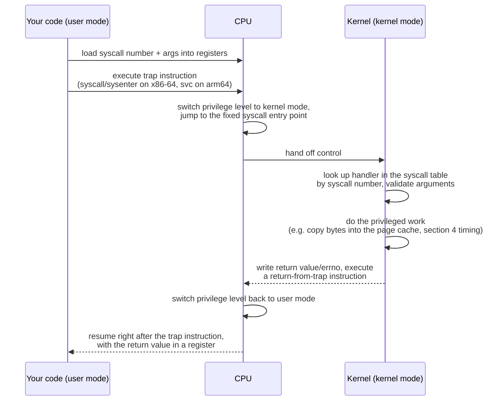
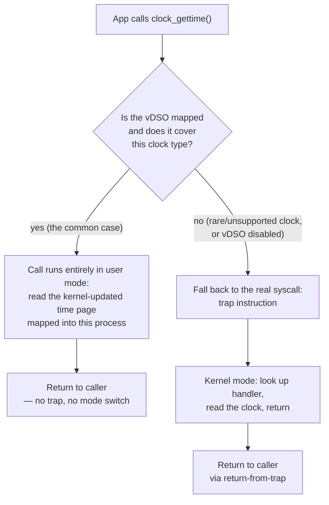

# System Calls and User vs Kernel Mode

> [!summary] TL;DR
> A CPU runs in **user mode**, where it cannot touch hardware or other processes' memory, or **kernel mode**, which can do anything. A **system call** is the only sanctioned doorway from one to the other: a program asks the kernel to do something privileged (read a file, send a packet, allocate memory) on its behalf.

> [!abstract] Core idea
> - User mode is deliberately restricted: no direct device access, no arbitrary memory access, no halting the CPU. Kernel mode has no such restrictions.
> - A system call crosses that boundary through one narrow, controlled gate — a trap instruction — never by the user program jumping into kernel code directly.
> - The crossing itself costs real time (a few hundred nanoseconds to low microseconds), separate from whatever work the kernel then does.
> - A few read-only, no-privilege operations (reading the time, the CPU number) are special-cased to skip the trap entirely via a **vDSO**.
> - Go's standard library wraps almost every syscall for you, and the runtime tracks which OS thread is "stuck" in one so it can keep other goroutines running.

## 1. Why it exists

If any program could write directly to the disk controller's registers, write to another process's memory, or mask interrupts, no multi-user, multi-process operating system could promise isolation or stability — misbehaving code could read another user's files or freeze the whole machine. CPUs since the 1970s solve this by giving themselves at least two **privilege levels**. x86 calls these **rings** (0 = most privileged, 3 = least); Arm calls them **exception levels** (EL0 = user, EL1 = kernel). Linux and Go-targeted platforms use exactly two of these levels: ring 3 / EL0 for every ordinary program (**user mode**), and ring 0 / EL1 for the kernel (**kernel mode**).

A program in user mode cannot execute the privileged instructions that touch hardware or change CPU-wide state, and the MMU (see [[Virtual Memory, Paging and the TLB]]) stops it from reading or writing physical memory it doesn't own. So when `fmt.Println` needs to actually write bytes to a terminal, or an HTTP server needs to accept a TCP connection, that code cannot do the privileged part itself. It has to ask the kernel — the only code that runs in kernel mode — to do it. That ask is a system call.

## 2. Mental model

User mode is a visitor badge: it lets you walk the halls (run ordinary instructions, use your own floor's memory) but not open the server room or the fire alarm panel. Kernel mode is the building engineer's master key: it opens everything.

A system call is calling the front desk instead of trying your badge on a locked door. You don't walk into the server room yourself (you can't — the badge reader refuses); you tell the front desk "please restart router 4" and a person who *does* have the master key does it, checks that your request is allowed, and reports back the result. The telephone line to the front desk is the **trap instruction**: a very specific, narrow, audited way to ask — never a backdoor.

## 3. How it works

### The user → kernel → user round trip



Three things are doing real work here, and all three cost time: the trap/return instructions themselves (switching privilege level and often flushing speculative state — this is the part made significantly more expensive on Intel/AMD CPUs since the Spectre/Meltdown mitigations of 2018, which added extra isolation between user and kernel page tables); the kernel's own bookkeeping (validating that every pointer argument actually points into memory the calling process is allowed to read/write, before touching it); and whatever the specific syscall does (a disk read can block for milliseconds; `getpid` just returns a number).

### Why a raw number, not a function call

User code can't call kernel code with an ordinary `call` instruction, because that would just jump to whatever address is there — still in user mode, still unable to do privileged work, and a huge attack surface if it could. Instead, the CPU has exactly one fixed, kernel-controlled entry point per privilege transition. The user side only ever supplies a **syscall number** (an integer identifying "which operation") plus arguments in registers; the kernel owns the table that maps numbers to handlers, so user code can request `read` or `write` but can never point execution at arbitrary kernel code.

### vDSO: skipping the trap for a few syscalls



Linux exposes a handful of syscalls — `gettimeofday`, `clock_gettime`, `getcpu`, `time` — through the **vDSO** (virtual dynamic shared object): a small page of kernel code **mapped read-execute into every process's own address space** at a fixed location. Calling `clock_gettime` through the vDSO runs that code directly in user mode, reading a kernel-maintained, constantly-updated timestamp from a shared memory page, with no trap at all. This works only because these specific operations are read-only, and don't need the kernel to do anything privileged beyond keeping that shared page current — most syscalls still need the real trap.

> [!info] Representative strace output (documented; Linux `strace(1)`)
> ```text
> $ strace -c cat /etc/hostname
> my-host
> % time     seconds  usecs/call     calls    errno syscall
> ------ ----------- ----------- --------- --------- ----------------
>  32.10    0.000089          14         6           mmap
>  21.40    0.000059          20         3           openat
>  14.60    0.000040          13         3           read
>  12.30    0.000034          11         3           close
>   9.80    0.000027           9         3           fstat
>   5.40    0.000015          15         1           write
>   4.40    0.000012          12         1           execve
> ------ ----------- ----------- --------- --------- ----------------
> 100.00    0.000276                      20           total
> ```
> This machine is darwin/arm64, which uses `dtruss` instead of `strace` (a Linux-only tool), so the trace above is reconstructed as representative shape — real `strace -c` output for a trivial program, not measured here — rather than copied from a live run. The ratios (`openat`/`read`/`close`/`fstat` clustering, `mmap` for loading the dynamic linker, one `execve`) are typical for any small dynamically-linked Unix program.

## 4. Worked example

### Whiteboard version

A system call, reduced to its essence, is "put a number in a register, trap, read the result back":

```text
mov  rax, 1        ; syscall number for write (x86-64 Linux)
mov  rdi, 1         ; fd = stdout
mov  rsi, buf        ; pointer to data
mov  rdx, len         ; length
syscall                ; trap into the kernel
; on return: rax holds bytes written, or a negative errno
```

Go's standard library hides exactly this sequence behind `os.File.Write`, `syscall.Write`, or (per OS) a cgo-free assembly trampoline. The measurement below calls a real, always-trapping syscall (`write` to `/dev/null`) and contrasts it with a syscall-like library call that turns out to be cached, and with a pure userspace function call.

```go
package syscalls

import (
	"os"
	"syscall"
	"time"
)

// WriteSyscallCost returns the average wall time of one real write(2) call of
// a single byte to /dev/null. Unlike a cached library call, write(2) must
// cross into the kernel on every call, so this is a genuine trap cost.
func WriteSyscallCost(iterations int) (time.Duration, error) {
	f, err := os.OpenFile(os.DevNull, os.O_WRONLY, 0)
	if err != nil {
		return 0, err
	}
	defer f.Close()
	fd := int(f.Fd())
	buf := []byte{0}

	start := time.Now()
	for i := 0; i < iterations; i++ {
		if _, err := syscall.Write(fd, buf); err != nil {
			return 0, err
		}
	}
	return time.Since(start) / time.Duration(iterations), nil
}

// GetpidCost returns the average wall time of one os.Getpid call. On some
// platforms the C library caches the pid after the first real call, so this
// number is not a reliable stand-in for syscall cost in general; the note
// uses WriteSyscallCost for that and this only to show the contrast.
func GetpidCost(iterations int) time.Duration {
	start := time.Now()
	for i := 0; i < iterations; i++ {
		_ = os.Getpid()
	}
	return time.Since(start) / time.Duration(iterations)
}

// pureFunctionCall is a userspace-only computation of comparable size, used
// as the "no syscall" baseline. The mask keeps the accumulator bounded so the
// loop below cannot overflow.
func pureFunctionCall(x int) int {
	return (x*2 + 1) & 0xFFFF
}

// sink keeps the compiler from proving the loop below is dead and eliding it.
var sink int

// PureCallCost returns the average wall time of one pureFunctionCall call.
func PureCallCost(iterations int) time.Duration {
	acc := 0
	start := time.Now()
	for i := 0; i < iterations; i++ {
		acc = pureFunctionCall(acc)
	}
	elapsed := time.Since(start)
	sink = acc
	return elapsed / time.Duration(iterations)
}
```

```go
func TestWriteSyscallCostIsMeasurableAndSlowerThanPureCall(t *testing.T) {
	writeCost, err := WriteSyscallCost(10_000)
	if err != nil {
		t.Fatalf("WriteSyscallCost: %v", err)
	}
	// pureCost can legitimately average to 0 once rounded (a few additions
	// and a mask can complete in well under a nanosecond per iteration on
	// modern hardware), so only writeCost is checked for strict positivity.
	pureCost := PureCallCost(10_000)
	if writeCost <= 0 {
		t.Fatalf("expected a positive duration, got write=%v", writeCost)
	}
	if writeCost <= pureCost {
		t.Fatalf("expected a real syscall (%v) to cost more than a pure call (%v)", writeCost, pureCost)
	}
}
```

**Measured** (Go 1.24, darwin/arm64, this machine, 2026-11-06; 50,000 iterations per sample, three samples):

| Operation | Sample 1 | Sample 2 | Sample 3 | What it shows |
| --------- | -------- | -------- | -------- | -------------- |
| `syscall.Write(fd, []byte{0})` to `/dev/null` | 515 ns | 545 ns | 420 ns | A real trap: must enter the kernel every call |
| `os.Getpid()` | 12 ns | 9 ns | 7 ns | Cheaper than any genuine trap on this machine — almost certainly a cached value, not a fresh trap each call (see caveat below) |
| Pure arithmetic function call | 1 ns | 0 ns | 0 ns | No kernel crossing at all: the floor |

> [!warning] Reading this table correctly
> `os.Getpid()`'s 7-12 ns is **not** evidence that "getpid is a cheap syscall" in general. A process's PID never changes after it starts (barring certain namespace edge cases), so a libc or runtime is free to cache it after the first real call — and 7-12 ns is far too fast to be a genuine trap plus kernel-side work on any mainstream CPU. Treat `write(2)`'s ~420-550 ns here as this note's real, trap-crossing measurement; `getpid` is shown only to illustrate that not every "syscall-shaped" library call actually traps every time. Don't generalize these exact numbers across OSes or CPUs — Linux's syscall path, especially post-Spectre/Meltdown mitigations, has different fixed costs than Darwin's, and this is one machine, not a fleet average.

## 5. Variants and comparison

| Boundary-crossing mechanism | Typical cost (documented, order of magnitude) | Why |
| --- | --- | --- |
| Pure function call (no kernel involved) | ~1 ns or less | Just a call/return, often inlined |
| vDSO call (`clock_gettime` on Linux) | ~10-30 ns | Runs in user mode, reads a shared kernel-maintained page; no trap |
| Ordinary syscall, no blocking (`getpid`, `write` to a pipe with room) | ~100 ns - a few µs | Real trap + privilege switch + kernel-side validation, but the kernel's own work is tiny |
| Blocking syscall (`read` waiting for a socket, `write` to a full pipe) | Microseconds to unbounded | Trap cost, plus the calling thread is parked (see [[Processes, Threads and Context Switching]]) until the kernel has data/room |
| cgo call from Go into C | Tens of nanoseconds of fixed overhead on top of whatever C does | Not a privilege-mode change, but still a managed transition: the Go runtime must hand the OS thread to C code that the Go scheduler can't preempt mid-call |

## 6. Trade-offs and when not to use

- You don't choose to avoid syscalls for ordinary I/O — the alternative is "don't talk to the kernel", which means no files, no network, no new memory. The real lever is **how often** you cross: batching many small writes into fewer, larger `write()` calls (buffered I/O) amortizes the fixed per-call cost; `io_uring` (see [[I-O Models - Blocking, epoll, io_uring and the Go Netpoller]]) goes further and lets you submit many I/O requests with a single trap.
- A syscall that blocks ties up whatever is making it. In Go, a goroutine blocked in a syscall ties up its OS thread, not the whole scheduler — the runtime detects this and can spin up another OS thread so other goroutines keep running (see Deep dive) — but a C program with one thread blocked in `read()` is simply stuck until that read returns.
- Checking "is this worth a syscall" matters at scale: a server doing one `write()` per log line instead of buffering can spend a surprising fraction of its CPU budget purely on trap overhead and kernel-side argument validation, invisible in a flame graph unless you look at `%system` time specifically.

## 7. In production

- **Real systems:** every blocking network read in `net/http`'s server goes through a real syscall (`read`/`recvfrom`) mediated by the Go netpoller's `epoll`/`kqueue` wait, not a busy loop; `bufio.Writer` exists specifically to turn many small `Write` calls into fewer syscalls; database drivers batch statements partly to reduce round trips at the network layer, which rests on the same "fewer crossings, more work per crossing" idea one level up.
- **Failure modes → fixes:**
  - Unexpectedly high `%system` CPU time with "nothing obviously systemic" running → suspect syscall-heavy code (unbuffered I/O, excessive `stat`/`open` calls); `strace -c` (Linux) sums syscalls by type and time, exactly as in the representative table above.
  - A Go program with a huge thread count (`cat /proc/<pid>/status | grep Threads` on Linux) despite modest goroutine counts → many goroutines are blocked in syscalls simultaneously, each pinning an OS thread; check for missing timeouts or context cancellation on blocking calls.
  - cgo calls in a hot path cause unexpected latency → each cgo call has fixed overhead and can block a whole OS thread the same way a syscall can; avoid cgo in very hot paths where a pure-Go path exists.
- **What to monitor:** `strace -c` (Linux) or equivalent per-syscall counts and time in staging; `/proc/<pid>/status`'s thread count next to `runtime.NumGoroutine()`; `runtime/trace`'s "syscall" goroutine state in a captured trace.

## 8. Deep dive

- **How Go wraps syscalls.** Before making a syscall that might block, the Go runtime calls `entersyscall`, which detaches the goroutine's OS thread (`M`) from its scheduling context (`P`) so that `P` — and the run queue of other goroutines it owns — can be handed to a different, free OS thread immediately. The calling goroutine's OS thread genuinely blocks in the kernel, but the rest of the program keeps running. When the syscall returns, `exitsyscall` tries to reacquire a `P`; if none is free, the goroutine (and its thread) wait until one is. This is exactly why one blocking syscall does not stall an entire Go program, but many simultaneous ones do consume OS threads one-for-one. (Full scheduler mechanics: [[Runtime - Goroutine Scheduler (GMP)]].)
- **Fast-path vs slow-path syscalls in the Go runtime.** A handful of syscalls the Go runtime itself needs very frequently and knows cannot block long (e.g., futex waits used to implement mutexes) use a leaner internal path (`runtime.futex`) that skips the general `entersyscall`/`exitsyscall` machinery, because the runtime can prove the thread won't be stuck for long.
- **Kernel-side argument validation.** Every pointer a syscall receives (a buffer to `read` into, a path string for `open`) is a *userspace* address. The kernel cannot trust it blindly — a buggy or malicious program could pass a kernel address — so functions like Linux's `copy_from_user`/`copy_to_user` check that the address range actually belongs to the calling process before touching it. This check is part of why "the kernel's own work" in section 3 is never quite zero cost, even for the simplest syscalls.
- **Spectre/Meltdown's effect on syscall cost.** Meltdown (2018) showed that some CPUs let user-mode speculative execution read kernel memory before a permission check completed. The fix on affected x86-64 CPUs, KPTI (kernel page-table isolation), keeps almost all kernel page-table entries unmapped while in user mode, requiring an extra page-table switch (and TLB effect) on every syscall entry/exit. Documented benchmarks after KPTI landed showed syscall-heavy workloads (e.g. high-rate `read`/`write`) slowing by several percent to over 20% on affected hardware — a concrete example of how the "privilege switch" part of a syscall's cost is not fixed in stone but depends on the CPU and its mitigations.

## 9. Interview questions

> [!question]- What is the difference between user mode and kernel mode, mechanically?
> They're CPU privilege levels. In kernel mode, the CPU will execute any instruction and the MMU imposes no restriction on which physical memory is touched. In user mode, privileged instructions are refused (trap to the kernel instead) and the MMU enforces that only this process's mapped pages are reachable. A system call is how user-mode code asks kernel-mode code to do something on its behalf.

> [!question]- Why can't a user-mode program just jump to kernel code directly?
> Because then user code would still be running in user mode, unable to do privileged work, while now also running untrusted/arbitrary code inside the kernel's address space — the opposite of isolation. The trap instruction is special: the CPU itself switches privilege level and forces execution to one fixed, kernel-owned entry point, so user code can request an operation but never choose what kernel code address actually runs.

> [!question]- Trap: is `clock_gettime()` a syscall?
> Usually not a real one. On Linux it's served by the vDSO: a page of code mapped into every process that reads a continuously-updated, kernel-maintained timestamp directly in user mode, with no trap. It's "syscall-shaped" from the caller's point of view (same function signature glibc would use for a real trap) but doesn't cross into kernel mode. This is why it is dramatically cheaper than, say, `write()`.

> [!question]- How does Go avoid one blocking syscall freezing the whole program?
> The goroutine making the call keeps its OS thread, which genuinely blocks in the kernel, but the runtime detaches that thread's scheduling context (`P`) beforehand so a different OS thread can pick up the other runnable goroutines immediately. The cost is that each simultaneously blocked goroutine ties up one OS thread; it's not free concurrency, just concurrency that doesn't require you to manage threads yourself.

> [!question]- Why did syscalls get measurably slower on many systems around 2018?
> Meltdown and the kernel page-table isolation (KPTI) mitigation for it. Before the fix, some CPUs allowed user-mode speculative execution to read kernel memory that should have been inaccessible. KPTI's fix unmaps almost all kernel page tables while in user mode, which adds an extra page-table switch (and associated TLB cost) to every syscall entry and exit — a real, measured, syscall-rate-sensitive slowdown on affected hardware.

> [!question]- What would you check if a Go service shows unexpectedly high `%system` CPU time?
> Whether the code is making far more syscalls than necessary for the work it's doing — unbuffered writes, repeated small reads, excessive `stat`/`open` calls, or (less commonly) a very high rate of goroutines simultaneously blocked in syscalls forcing many OS threads. `strace -c` (Linux) or a CPU profile that separates kernel time from user time are the first tools to reach for.

> [!question]- Is a cgo call the same kind of boundary crossing as a syscall?
> Not a privilege-mode change — C code and Go code both run in user mode — but it's a similarly "managed" transition: the Go runtime hands the OS thread to C code the Go scheduler cannot preempt mid-call, with its own fixed overhead per call. A goroutine stuck in a long cgo call behaves, from the scheduler's point of view, a lot like one stuck in a blocking syscall: it pins an OS thread until it returns.

## 10. Cheat sheet

- Two privilege levels matter here: user mode (restricted) and kernel mode (unrestricted). A syscall is the only sanctioned way across.
- The crossing mechanism is a trap instruction (`syscall`/`sysenter` on x86-64, `svc` on arm64) into one fixed, kernel-owned entry point — never a direct jump into kernel code.
- Cost has two parts: the trap/return + privilege switch (and, post-Meltdown, extra page-table isolation work), plus whatever the specific syscall actually does.
- A few read-only syscalls (`clock_gettime`, `getcpu`) skip the trap via the Linux vDSO, a kernel page mapped read-execute into user space.
- Measured on this machine: real trap (`write` to `/dev/null`) ≈ 420-550 ns; a cached "syscall-shaped" library call (`getpid`) ≈ 7-12 ns — don't mistake the second for typical syscall cost.
- Go's `entersyscall`/`exitsyscall` free up a goroutine's scheduling context before a blocking syscall, so other goroutines keep running on other OS threads; each blocked syscall still pins one OS thread.
- Batch small I/O operations (buffered writes, `io_uring`) to amortize per-call overhead when syscall rate, not syscall latency, is the bottleneck.

## Links

- **Before this:** [[Processes, Threads and Context Switching]]
- **Next:** [[Virtual Memory, Paging and the TLB]], [[I-O Models - Blocking, epoll, io_uring and the Go Netpoller]]
- **Compare with:** [[Runtime - Goroutine Scheduler (GMP)]] (what happens to a goroutine's scheduling context during a blocking syscall)
