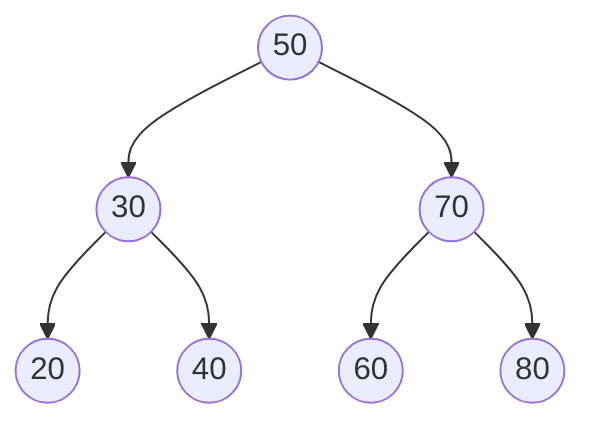
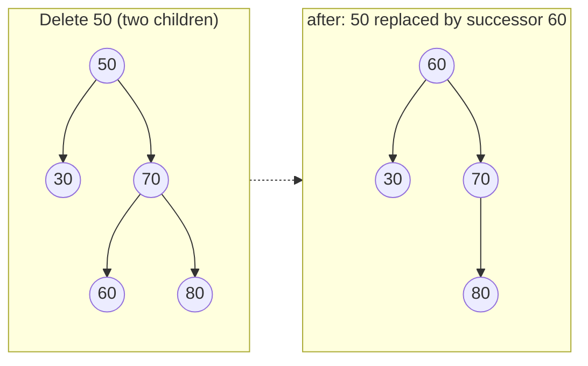

# Trees, BSTs and Balanced Trees

> [!summary] TL;DR
> A tree is hierarchical data: one root, each node with children below it. A **binary search tree (BST)** keeps keys ordered so search, insert and delete run in time proportional to the tree's height — but an unlucky insert order can make that height as bad as a linked list, which is why **balanced trees** (AVL, red-black, B-trees) exist.

> [!abstract] Core idea
> - A BST keeps every left subtree smaller and every right subtree larger than its node, so search halves the remaining space at each step — if the tree is balanced.
> - An unbalanced BST (keys inserted in sorted order) degenerates to a linked list: O(n) instead of O(log n).
> - Self-balancing trees (AVL, red-black) do extra work on insert/delete to keep height at O(log n) always.
> - B-trees and B+trees are a different balancing strategy, shaped around disk/page reads rather than in-memory pointer chasing.

## 1. Why it exists

Say you need to store a million user records and repeatedly ask "is user ID 482913 present?", "give me the next ID after 482913", and "insert ID 619000". A plain sorted array answers the first two in `O(log n)` with binary search, but an insert in the middle shifts up to half a million elements — `O(n)`. A linked list inserts in `O(1)` once you have a pointer to the spot, but finding that spot takes `O(n)`, and there's no way to binary search a linked list because you can't jump to its middle.

A BST gives you both: `O(log n)` search **and** `O(log n)` insert/delete, as long as its height stays close to `log n`. That "as long as" is the whole story of this note — a BST's worst case is as bad as the linked list's, and most of what makes balanced trees worth learning is how they prevent that worst case.

## 2. Mental model

Picture a BST as a game of "guess the number, higher or lower": at the root, if your target is smaller, go left; if larger, go right; repeat at each node you land on. Each step eliminates one whole subtree from consideration — exactly like binary search, except the "array" is a chain of pointers instead of contiguous memory, so you can insert and delete by just relinking pointers instead of shifting elements.

## 3. How it works

### Terms

- **Depth** of a node: the number of edges from the root to it.
- **Height** of a node: the number of edges on the longest path from it down to a leaf. A single node has height 0; an empty tree has height -1 by convention.
- **Degree**: the number of children a node has. In a binary tree, degree is at most 2.
- **Subtree**: a node together with all its descendants.

### BST property and operations

Every node's key is greater than every key in its left subtree and less than every key in its right subtree.



**Search(key)**: start at the root; if `key` equals the node's key, done; if smaller, recurse left; if larger, recurse right; if you reach a nil child, the key isn't present. Cost: `O(h)` where `h` is the tree's height.

**Insert(key)**: search for where `key` would be, and attach it as a new leaf there. Cost: `O(h)`.

**Delete(key)**: find the node. Three cases:
1. **Leaf** — just remove it.
2. **One child** — splice the child up into the deleted node's place.
3. **Two children** — replace the node's key with its **in-order successor** (the smallest key in its right subtree, found by walking left from the right child until there's no more left), then delete that successor node (which has at most one child, so it falls into case 1 or 2).



### Traversals

| Order | Visit sequence | Used for |
|---|---|---|
| In-order | left, node, right | Reads keys in sorted order |
| Pre-order | node, left, right | Cloning/serializing (parent always written before children) |
| Post-order | left, right, node | Deleting/freeing a tree (children always freed before parent) |
| Level-order | breadth-first, using a queue | Printing a tree by level; finding the shallowest match |

### Degenerate case

Insert keys `1, 2, 3, 4, 5` in that order into a BST with no rebalancing: each new key is larger than everything before it, so it always becomes the right child of the previous one. The result is a straight chain — a linked list wearing a tree's clothing — with height `n - 1` instead of `log₂ n`. Search, insert and delete all degrade to `O(n)`.

## 4. Worked example

### Whiteboard version

The bare mechanism: recursive insert and search, no balancing.

```go
type Node struct {
	Key         int
	Left, Right *Node
}

func Insert(n *Node, key int) *Node {
	if n == nil {
		return &Node{Key: key}
	}
	if key < n.Key {
		n.Left = Insert(n.Left, key)
	} else if key > n.Key {
		n.Right = Insert(n.Right, key)
	}
	return n
}
```

The full version below adds search, delete (all three cases), height, four traversals, and the rotations balanced trees build on — tested on Go 1.24.

```go
package bst

type Node struct {
	Key         int
	Left, Right *Node
}

// Insert adds key and returns the (possibly new) root. O(h).
func Insert(n *Node, key int) *Node {
	if n == nil {
		return &Node{Key: key}
	}
	if key < n.Key {
		n.Left = Insert(n.Left, key)
	} else if key > n.Key {
		n.Right = Insert(n.Right, key)
	}
	return n
}

// Search reports whether key exists. O(h).
func Search(n *Node, key int) bool {
	for n != nil {
		switch {
		case key == n.Key:
			return true
		case key < n.Key:
			n = n.Left
		default:
			n = n.Right
		}
	}
	return false
}

func min(n *Node) *Node {
	for n.Left != nil {
		n = n.Left
	}
	return n
}

// Delete removes key and returns the (possibly new) root. O(h).
func Delete(n *Node, key int) *Node {
	if n == nil {
		return nil
	}
	switch {
	case key < n.Key:
		n.Left = Delete(n.Left, key)
	case key > n.Key:
		n.Right = Delete(n.Right, key)
	default:
		if n.Left == nil {
			return n.Right
		}
		if n.Right == nil {
			return n.Left
		}
		succ := min(n.Right)
		n.Key = succ.Key
		n.Right = Delete(n.Right, succ.Key)
	}
	return n
}

// Height: -1 for an empty tree, 0 for a single node.
func Height(n *Node) int {
	if n == nil {
		return -1
	}
	lh, rh := Height(n.Left), Height(n.Right)
	if lh > rh {
		return lh + 1
	}
	return rh + 1
}

func InOrder(n *Node, visit func(int)) {
	if n == nil {
		return
	}
	InOrder(n.Left, visit)
	visit(n.Key)
	InOrder(n.Right, visit)
}

func PreOrder(n *Node, visit func(int)) {
	if n == nil {
		return
	}
	visit(n.Key)
	PreOrder(n.Left, visit)
	PreOrder(n.Right, visit)
}

func PostOrder(n *Node, visit func(int)) {
	if n == nil {
		return
	}
	PostOrder(n.Left, visit)
	PostOrder(n.Right, visit)
	visit(n.Key)
}

func LevelOrder(root *Node, visit func(int)) {
	if root == nil {
		return
	}
	queue := []*Node{root}
	for len(queue) > 0 {
		n := queue[0]
		queue = queue[1:]
		visit(n.Key)
		if n.Left != nil {
			queue = append(queue, n.Left)
		}
		if n.Right != nil {
			queue = append(queue, n.Right)
		}
	}
}

// rotateLeft: the single rotation AVL and red-black trees use to fix a
// right-heavy subtree. Preserves the BST property.
func rotateLeft(n *Node) *Node {
	r := n.Right
	n.Right = r.Left
	r.Left = n
	return r
}

func rotateRight(n *Node) *Node {
	l := n.Left
	n.Left = l.Right
	l.Right = n
	return l
}
```

The test proving delete handles all three cases correctly, and that height differs sharply between a balanced tree and a degenerate chain:

```go
func TestDeleteLeafOneChildTwoChildren(t *testing.T) {
	root := buildTree([]int{50, 30, 70, 20, 40, 60, 80})

	root = Delete(root, 20) // leaf
	root = Delete(root, 30) // one child (40 is spliced up)
	root = Delete(root, 50) // two children: replaced by successor 60

	var got []int
	InOrder(root, func(k int) { got = append(got, k) })
	want := []int{40, 60, 70, 80}
	if !reflect.DeepEqual(got, want) {
		t.Fatalf("InOrder after deletes = %v; want %v", got, want)
	}
}

func TestHeightDegenerateVsBalanced(t *testing.T) {
	balanced := buildTree([]int{50, 30, 70, 20, 40, 60, 80})
	if h := Height(balanced); h != 2 {
		t.Fatalf("Height(balanced 7-node tree) = %d; want 2", h)
	}
	degenerate := buildTree([]int{1, 2, 3, 4, 5}) // sorted input, no rebalancing
	if h := Height(degenerate); h != 4 {
		t.Fatalf("Height(degenerate 5-node chain) = %d; want 4", h)
	}
}
```

**Measured** (Go 1.24.4, `go test -race`): the 7-node balanced tree above has height 2 (`⌊log₂7⌋ = 2`); inserting the same 5 keys in sorted order instead produces height 4 — a chain, confirming the degenerate case is real, not theoretical.

## 5. Variants and comparison

| Structure | How it balances | Height | Use when |
|---|---|---|---|
| Plain BST | Doesn't | O(log n) average, O(n) worst case | Teaching, or input order is guaranteed random |
| **AVL tree** | After every insert/delete, rotate to keep every node's left/right subtree heights within 1 of each other | O(log n) always | Read-heavy workloads: stricter balance means faster lookups, at the cost of more rotations on write |
| **Red-black tree** | Color nodes red/black; rotation + recoloring rules bound the longest root-to-leaf path to at most 2× the shortest | O(log n) always, looser bound than AVL | Write-heavy workloads: fewer rotations than AVL on average; used by Linux's `rbtree` (the CFS scheduler's runqueue), Java's `TreeMap`/`TreeSet`, C++'s `std::map`/`std::set` |
| **B-tree / B+tree** | Each node holds many keys (high fan-out) instead of just one, so the tree stays shallow even with billions of keys | O(log_b n), b in the hundreds | On-disk data: one node = one disk page, so height directly bounds the number of disk reads — see [[Storage Engines - B-tree vs LSM and WAL]] |
| Heap (as a tree) | Only a weaker ordering (parent ≤ children, not left < node < right) | O(log n) | You only ever need the min/max, not arbitrary search — see [[Heaps and Priority Queues]] |
| Trie | Branches by key *prefix*, not by comparison | O(key length) | Keys share structure (strings, routes, IPs) — see [[Tries, Suffix Trees and Suffix Arrays]] |

> [!warning] Interview trap
> "Heap" and "BST" are both trees, but a heap is **not** a BST: a heap only guarantees a parent is ≤ (or ≥) its children, not that left < node < right. You cannot do an ordered in-order traversal of a heap and expect sorted output.

## 6. Trade-offs and when not to use

- A plain BST is only as good as its insert order; never use one on data that might arrive sorted (log files, sequential IDs) without balancing.
- Balanced trees pay rotation cost on every insert/delete to keep height bounded — if your workload is read-only after a one-time bulk load, build a balanced structure once (or just use a sorted slice with binary search) rather than paying ongoing rebalancing cost.
- Go has **no ordered map in the standard library.** If you need sorted iteration or range queries over a map, either keep a separate sorted slice of keys, use a third-party ordered tree (`github.com/google/btree`), or reach for a sorted slice + `slices.BinarySearch` directly if mutation is infrequent.
- Pointer-chasing trees (AVL, red-black) are cache-unfriendly in memory: each node is a separate heap allocation. For in-memory data that fits comfortably, a sorted slice often outperforms a pointer-based tree because of cache locality (see [[Memory Hierarchy and CPU Caches]]).

## 7. In production

- **Real systems:**
	- Linux's completely fair scheduler keeps runnable tasks in a red-black tree ordered by virtual runtime, so "pick the next task to run" is "find the leftmost node," `O(log n)`.
	- Java's `TreeMap`/`TreeSet` and C++'s `std::map`/`std::set` are red-black trees under the hood.
	- PostgreSQL and InnoDB (MySQL) store table indexes as B+trees: internal nodes hold only routing keys, and every row lives in a leaf, with leaves linked together for fast range scans (`WHERE id BETWEEN ...`) — detailed in [[Storage Engines - B-tree vs LSM and WAL]].
	- File systems (ext4's htree directory index, NTFS) and ASTs (Go's own `go/ast` package represents parsed source as a tree) use tree structures for the same reason: hierarchical data with efficient lookup.
	- Decision trees, random forests and gradient-boosted trees (ML) are trees in the literal data-structure sense, each internal node a yes/no split on a feature.
	- Interval trees (a BST ordered by interval start, with each node also tracking the max end point in its subtree) answer "which intervals overlap this point or range?" in `O(log n + k)` — used for calendar/booking conflict checks and for finding overlapping memory regions or network ranges.
- **Failure modes → fixes:**
	- Sorted-order inserts degrade a plain BST to a linked list → use a self-balancing tree, or shuffle/batch-build from sorted input.
	- Deep recursion on a very tall tree can exhaust the goroutine stack on pathological input → bound tree height via balancing, or convert hot-path recursion to the iterative, explicit-stack form.
	- A tree's rotations under heavy concurrent writes serialize all writers → batch writes, or move to a structure built for concurrent access (e.g., a B-tree variant with latch-crabbing, as in production database engines).
- **What to monitor:** tree height (or a cheap proxy like node count vs. log of node count) if you maintain one yourself; for a database, index bloat and the planner's chosen scan type for the query patterns you actually run.

## 8. Deep dive

### AVL vs. red-black, precisely

AVL enforces a strict **balance factor**: for every node, `|height(left) − height(right)| ≤ 1`. This keeps AVL trees closer to perfectly balanced than red-black trees, so lookups are slightly faster, but inserting or deleting a single key can trigger a cascade of rotations back up toward the root to restore the invariant.

Red-black trees use a looser, color-based invariant (every path from a node to its descendant leaves has the same number of black nodes; a red node's children must be black) that bounds the longest root-to-leaf path to at most twice the shortest, rather than within 1. This looser bound means red-black trees need fewer rotations on average per insert/delete — typically a constant number, versus AVL's potential `O(log n)` cascade — which is why red-black trees are the more common choice for general-purpose libraries that mix reads and writes.

### B-trees and B+trees: balancing around disk, not memory

A binary tree's branching factor is 2: height grows as `log₂ n`. For a billion keys, that's about 30 levels — 30 pointer-chases, each potentially a disk seek if the tree doesn't fit in memory. A B-tree instead gives each node hundreds of keys (sized to fill one disk page, typically 4–16 KB), so height grows as `log_b n` with `b` in the hundreds: the same billion keys fit in 3–4 levels. A B+tree additionally keeps all actual data in the leaves (internal nodes hold only routing keys) and links the leaves together in a chain, so a range scan after finding the start key is a straight walk forward through leaves rather than repeated tree descents. This is the shape behind every mainstream relational database index; the write-path trade-offs against LSM-trees are covered fully in [[Storage Engines - B-tree vs LSM and WAL]] — this note only establishes why the tree is wide and shallow rather than binary and tall.

### Why Go's standard library has no balanced tree

Go's designers chose to ship `map` (a hash table) rather than an ordered tree in the standard library, pushing sorted/ordered use cases toward `slices.Sort` + `slices.BinarySearch` on a slice, or third-party packages like `github.com/google/btree` for a true in-memory B-tree. This is a deliberate minimalism choice, not an oversight — it is one of the few gaps interview prep should know is a gap.

### Classic practice problems

**Maximum depth** (the height of the tree plus one, computed with the same recursion as `Height` above); **validate BST** (recurse with an inherited `(min, max)` range, not just a check against immediate children); **lowest common ancestor** (for a BST specifically: walk down from the root, branching left or right by comparing both target keys to the current node — the first node where the targets split to different sides, or match the node itself, is the LCA, O(h)); **serialize/deserialize a binary tree** (pre-order traversal with explicit null markers reconstructs the exact shape); **kth smallest in a BST** (in-order traversal, stopping at the kth value visited, O(h + k)).

## 9. Interview questions

> [!question]- What is the worst-case height of a BST, and when does it happen?
> `O(n)` — a straight chain, one child per node. It happens when keys are inserted in sorted (or reverse-sorted) order with no rebalancing, so every new key becomes the sole child of the previous largest (or smallest) node.

> [!question]- Walk through deleting a node with two children.
> Find its in-order successor: the smallest key in its right subtree, reached by walking left from the right child until there's no more left. Copy that successor's key into the node being "deleted," then delete the successor node itself — which has at most one child, reducing to the simpler leaf or one-child case.

> [!question]- AVL vs. red-black: which would you pick, and why?
> AVL for read-heavy workloads needing the tightest possible height bound; red-black for write-heavy workloads, since its looser balance invariant needs fewer rotations per insert/delete on average. Most general-purpose libraries (Linux's scheduler, Java's `TreeMap`, C++'s `std::map`) pick red-black for that reason.

> [!question]- Why does a database index use a B+tree instead of a binary search tree?
> A B+tree's high fan-out (hundreds of keys per node, one node per disk page) keeps the tree only 3–4 levels deep even at billions of rows, bounding disk reads per lookup to a handful. A binary tree with the same data would be ~30 levels deep, and in a disk-backed structure each level can mean a separate disk seek.

> [!question]- Trap: is every heap also a binary search tree?
> No. A heap only guarantees parent ≤ children (min-heap) or parent ≥ children (max-heap) — it says nothing about left vs. right subtree ordering. An in-order traversal of a heap does not produce sorted output, unlike a BST.

> [!question]- How would you check if a given binary tree is a valid BST?
> Don't just compare each node to its immediate children — that misses violations further down (e.g., a left-subtree node larger than the root). Instead, pass down a valid `(min, max)` range during a recursive traversal, tightening it at each step, and check every node falls strictly inside its inherited range.

> [!question]- What does Go give you instead of a built-in balanced tree?
> Nothing directly ordered in the standard library — Go ships `map` (hash table, unordered) instead. For sorted iteration or range queries, use a sorted slice with `slices.BinarySearch`, or a third-party tree package like `github.com/google/btree`.

## 10. Cheat sheet

- BST invariant: left subtree < node < right subtree. Search/insert/delete are all `O(h)`.
- Worst case height is `O(n)` (sorted insert order, no balancing) — the reason balanced trees exist.
- Delete with two children: replace with the in-order successor (smallest in the right subtree), then delete that successor.
- Traversals: in-order = sorted output; pre-order = serialize/clone; post-order = free/destroy; level-order = breadth-first via a queue.
- AVL = strict balance, more rotations, fastest reads. Red-black = looser balance, fewer rotations, common default (Linux scheduler, `TreeMap`, `std::map`).
- B-tree/B+tree: high fan-out keeps height tiny for disk-backed data; B+tree additionally links leaves for fast range scans.
- A heap is a tree but not a BST — only parent/child order is guaranteed, not left/right.
- Go's standard library has no ordered map/tree; reach for a sorted slice or `google/btree`.

## Links

- **Before this:** [[Arrays and Dynamic Arrays (Go Slices)]], [[Stacks, Queues and Deques]]
- **Next:** [[Heaps and Priority Queues]], [[Storage Engines - B-tree vs LSM and WAL]]
- **Compare with:** [[Hash Tables and Go Maps]] (O(1) but unordered), [[Tries, Suffix Trees and Suffix Arrays]] (branch by prefix, not comparison)
