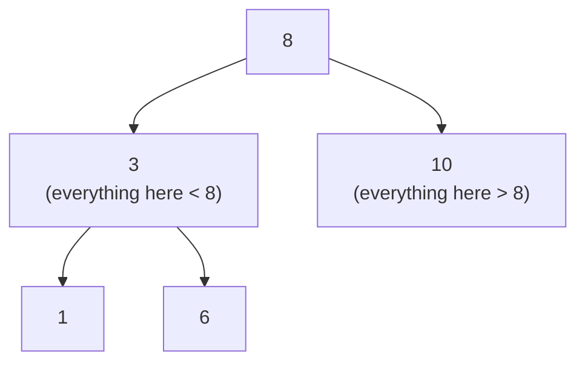
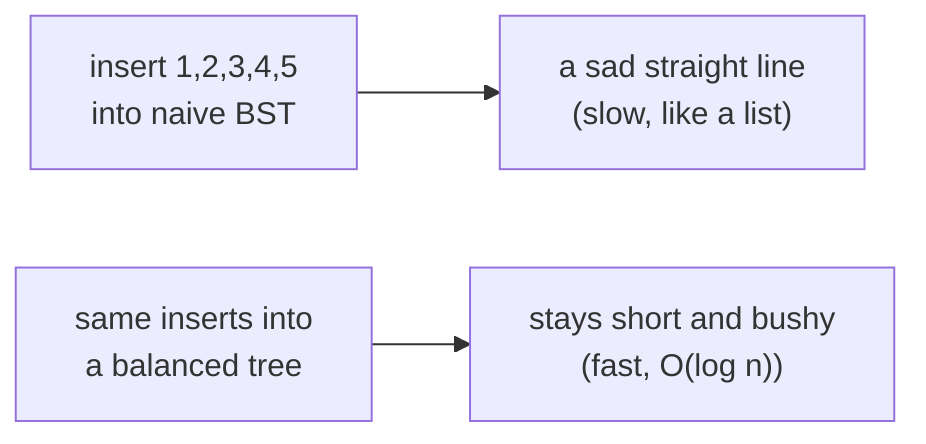
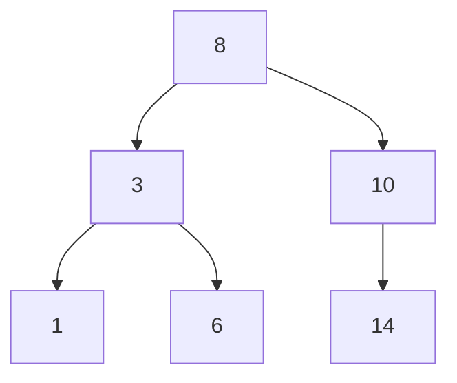
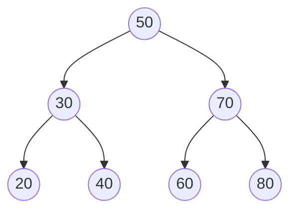
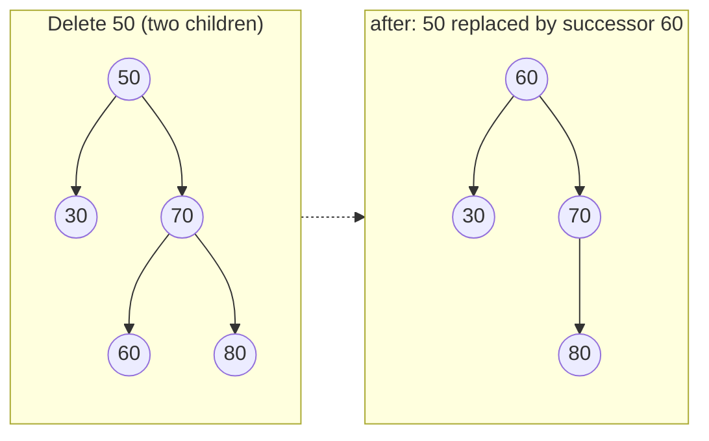
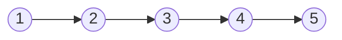
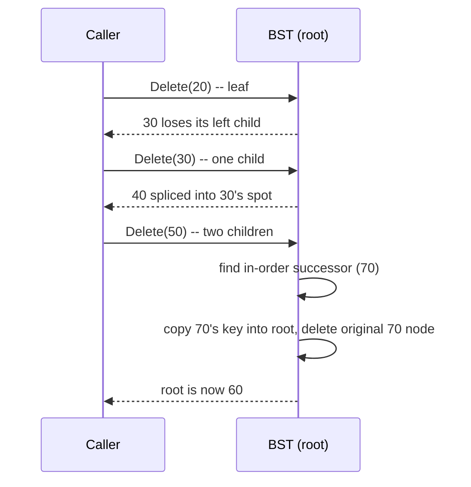
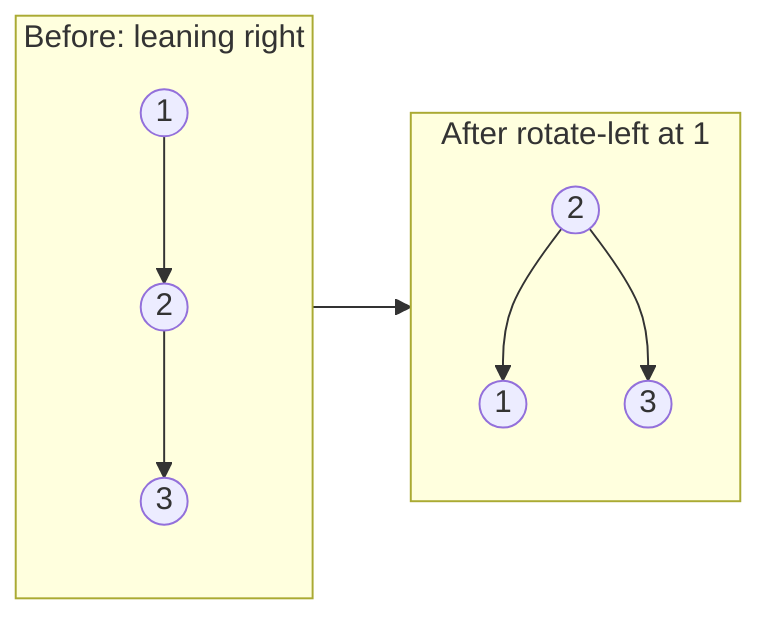
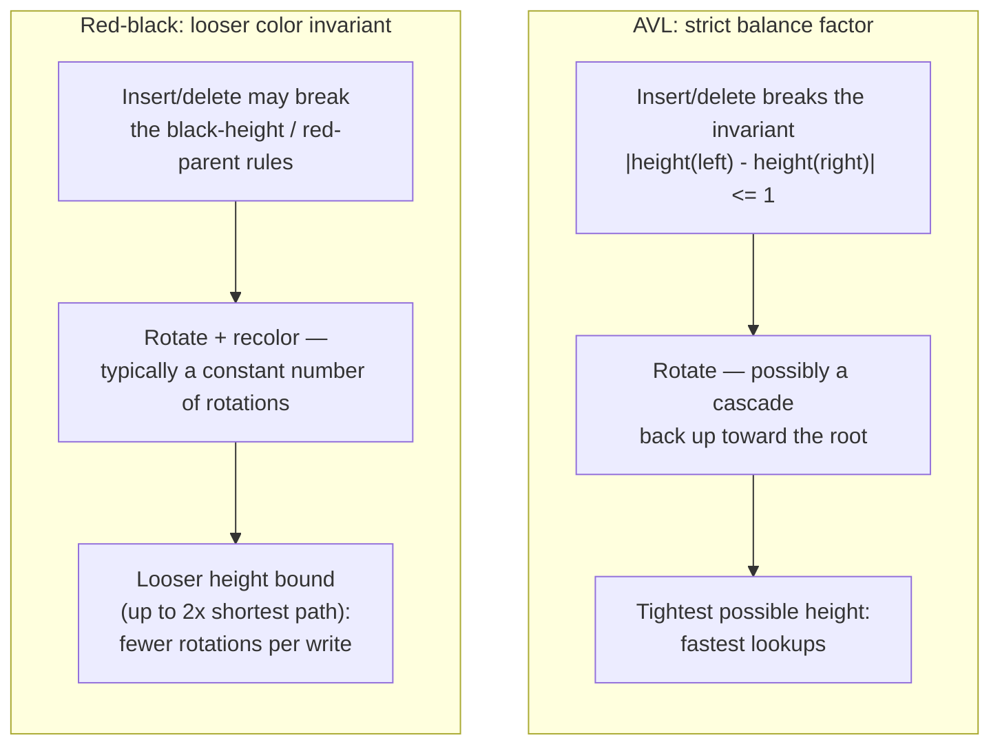
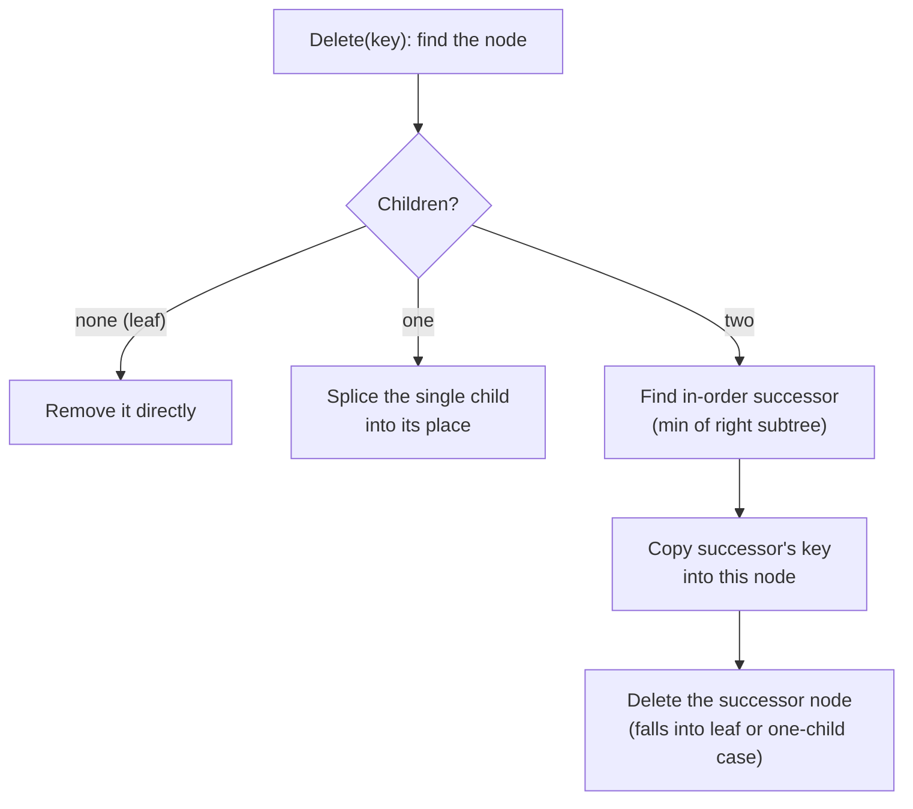

# Trees, BSTs and Balanced Trees

> [!summary] TL;DR
> A tree is hierarchical data: one root, each node with children below it. A **binary search tree (BST)** keeps keys ordered so search, insert and delete run in time proportional to the tree's height — but an unlucky insert order can make that height as bad as a linked list, which is why **balanced trees** (AVL, red-black, B-trees) exist.

> [!abstract] Core idea
> - A BST keeps every left subtree smaller and every right subtree larger than its node, so search halves the remaining space at each step — if the tree is balanced.
> - An unbalanced BST (keys inserted in sorted order) degenerates to a linked list: O(n) instead of O(log n).
> - Self-balancing trees (AVL, red-black) do extra work on insert/delete to keep height at O(log n) always.
> - B-trees and B+trees are a different balancing strategy, shaped around disk/page reads rather than in-memory pointer chasing.

## Start here: the basics 🟢

> [!info] How to read this note (pick your level)
> - 🟢 **New to this?** Read "From zero" below, then sections 1, 2 and the cheat sheet (11). Stop there, that is a full first pass.
> - 🟡 **Know the basics?** Add section 3 (how it works), 4 (worked example), then 5, 6 and 8.
> - 🔴 **Interview / SDE-3 prep?** Add 7, 9 and 10. Headings are tagged 🟢🟡🔴 so you always know where you are.

> [!note] Before this note
> - [[Arrays and Dynamic Arrays (Go Slices)]]: a sorted slice finds things fast with binary search but is slow to insert into the middle.
> - [[Stacks, Queues and Deques]]: a stack (newest first) and a queue (oldest first); tree walks use one or the other.

**From zero, in 60 seconds** 🟢

A **tree** is data arranged like a family tree: one node at the top (the root), each node pointing to children below it. Folders inside folders is a tree you already use daily.

A **binary search tree (BST)** adds one rule: smaller values go left, bigger go right. That rule turns the tree into the "higher or lower" guessing game — each step throws away half the remaining values.



The catch: insert sorted data into a naive BST and it degrades into a straight line — the guessing game is gone. **Balanced** trees (AVL, red-black) reshuffle themselves as you insert, so the tree stays short and lookups stay fast.



The rest of this note is just three questions:
1. How do search, insert and delete work in a BST?
2. How do balanced trees keep themselves short (rotations)?
3. Where do trees run the real world (databases, filesystems), and which interview patterns matter?

**The problem in one story.**
You keep a phone book of 1 million contacts that changes all day.
A sorted array finds a name fast, but inserting "Aaron" means shifting a million entries.
A linked list inserts fast but finds slowly.
A balanced search tree does both in about 20 steps, because each step throws away half of what's left.

**Words you need first**

| Word | Plain meaning | Tiny example |
| --- | --- | --- |
| Node | One box holding a value and links to children | `{key: 8, left, right}` |
| Root / leaf | Top node / a node with no children | 8 is the root; 1 is a leaf |
| Height | Number of levels from root to deepest leaf | A 3-level tree has height 3 |
| BST | Binary Search Tree: left side smaller, right side larger | 3 left of 8, 10 right of 8 |
| Balanced | All branches about the same height | Height ≈ log₂(n) |
| `O(log n)` | Work grows with the number of halvings | 1M items → ~20 steps |
| Rotation | Re-hanging a few nodes to fix balance | AVL and red-black trees use it |
| B-tree | A wide tree with many keys per node, made for disk pages | Database indexes |
| Subtree | A node plus everything below it | the 3-branch under 8 |
| In-order traversal | Visit left, then the node, then right; gives sorted output | 1, 3, 6, 8, 10 |
| AVL / red-black tree | Two kinds of BST that fix their own shape after each change | Java `TreeMap` is red-black |
| Fan-out | How many children a node can have | binary = 2; a B-tree node = hundreds |

**Picture it**



**Analogy.** A BST is the "guess my number" game: each answer ("higher" or "lower") rules out half the remaining numbers.
Where it breaks: the game assumes you always guess the middle; a BST built from sorted input keeps guessing at the edge and becomes a slow linked list.

**How the rest of this note builds up**

- First, why trees exist (section 1) and the mental model of halving at every node (section 2).
- Then how BST search, insert, delete and traversals work (section 3), with a worked example (section 4).
- Then the balanced variants (AVL, red-black, B-tree, B+tree) and trade-offs (sections 5-6).
- Finally the SDE-3 view: trees in production, a whiteboard version and the deep dive (sections 7-9).

> [!tip] Remember
> A BST halves the search at every node only while it stays balanced; balanced trees and B-trees exist to guarantee that.

## 1. Why it exists 🟢

Picture a service that stores a million user records and repeatedly has to answer three kinds of question: "is user ID 482913 present?", "give me the next ID after 482913", and "insert ID 619000." Each existing structure you might reach for falls short in its own way.

A plain sorted array answers the first two questions in `O(log n)` with binary search — fast.

But an insert in the middle shifts up to half a million elements, costing `O(n)` — the array has to make room by physically moving everything after the insertion point.

A linked list inserts in `O(1)` once you already have a pointer to the right spot, but *finding* that spot takes `O(n)`, because you cannot jump to a linked list's middle the way you can jump to an array's middle index.

A **binary search tree** is the structure that gives you both: `O(log n)` search *and* `O(log n)` insert/delete — as long as its height stays close to `log n`.

That "as long as" is the whole story of this note: a BST's worst case is as bad as the linked list's, and most of what makes balanced trees worth learning is how they prevent that worst case from happening.

> [!tip] Remember
> A BST is the structure that tries to give you binary search's speed and a linked list's cheap inserts at the same time — but only while its shape stays balanced.

### Real-life example 🟢

The folders on your phone or laptop form a tree: one root, folders inside folders, files as leaves.
When Flipkart or Swiggy looks up your order by its ID, the database walks a B+tree index (a wide, shallow tree) and finds the row in 3-4 steps among billions.
A calendar or a BookMyShow-style booking system checking "does this new slot overlap an existing one?" can use an interval tree, which is a BST with a little extra data per node.
And Linux decides which program runs next by picking the leftmost node of a red-black tree.

## 2. Mental model 🟢

### Guess-the-number, with pointers instead of an array

**In plain words:** A BST is like playing "guess the number, higher or lower": at the root, if your target is smaller, go left; if larger, go right; repeat at each node you land on. Each step eliminates one whole subtree from consideration — exactly like binary search over a sorted array.

**Picture it:**



**Example:** Searching for `40` in this tree: start at `50` (40 < 50, go left), land on `30` (40 > 30, go right), land on `40` — found it in 3 steps, not 7 (the tree's total size).

**Why it matters:** The "array" here is a chain of pointers instead of contiguous memory, so you can insert and delete by just relinking pointers instead of shifting elements — that's the entire reason a BST exists instead of just always using a sorted array.

> [!warning] Common mistake
> Assuming any binary tree with numbers in it is a BST.
>
> The BST property is strict: *every* node in a left subtree must be smaller than the node above it, and *every* node in a right subtree must be larger — not just the immediate children.
>
> A tree can look locally sorted at every parent-child pair and still violate this globally (see the "validate BST" problem in the Deep dive).

## Common beginner mistakes 🟢

- **Checking only a node's direct children to validate a BST** → a deep node can still break the rule against an ancestor → pass a `(min, max)` range down as you recurse.
- **Inserting sorted data into a plain BST** → it becomes a straight line and every lookup is `O(n)` → use a balanced tree, or build from the middle of the sorted list.
- **Treating a heap as a BST** → a heap only orders parent vs children, not left vs right → use a BST (or sorted slice) when you need sorted output.
- **Forgetting the two-children delete case** → you can't just remove a node with two subtrees → swap in its in-order successor, then delete that.
- **Reaching for a tree in Go by default** → Go has no built-in ordered map, and a sorted slice is often faster for data that rarely changes → use a map for lookups, a sorted slice for ordered reads.

## 3. How it works 🟡

> 🟢 → 🟡 **You now know** that a BST plays "higher or lower" at each node and that its speed depends on staying short. **Next we open the box:** the exact rules for search, insert and delete, the four ways to walk a tree, and how a tree turns into a slow linked list.

### Terms, defined before they're used

- **Depth** of a node: the number of edges (the links between a parent and a child) from the root to it.
- **Height** of a node: the number of edges on the longest path from it down to a leaf. A single node has height 0; an empty tree has height -1 by convention.
- **Degree**: the number of children a node has. In a binary tree, degree is at most 2.
- **Subtree**: a node together with all its descendants.

> [!tip] Remember
> Depth counts down from the root; height counts up from the leaves. A root's depth is always 0; a leaf's height is always 0.

### The BST property and its three operations

**In plain words:** Every node's key is greater than every key in its left subtree and less than every key in its right subtree. This one rule is what makes "go left or right" always lead you to the right place.

**Step by step (tree with 50 at the root):**
1. Search for 60: at 50, 60 is bigger, go right to 70.
2. At 70, 60 is smaller, go left to 60. Found in 3 steps.
3. Insert 65: walk the same way (50 → 70 → 60); at 60, 65 is bigger, and 60 has no right child.
4. Attach 65 as the right child of 60. Done; nothing else moved.
5. Delete is the same walk to find the node, then one of three cases (below).

**Picture it:** (the tree above already shows the property: every value under `30` is < 30; every value under `70` is > 70)

**Example — Search(key):** start at the root; if `key` equals the node's key, done; if smaller, recurse left; if larger, recurse right; if you reach a nil child, the key isn't present. Cost: `O(h)` where `h` is the tree's height.

**Example — Insert(key):** search for where `key` would be, and attach it as a new leaf there. Cost: `O(h)`.

**Example — Delete(key):** find the node, then handle one of three cases:

1. **Leaf** — just remove it.
2. **One child** — splice the child up into the deleted node's place.
3. **Two children** — replace the node's key with its **in-order successor** (the smallest key in its right subtree, found by walking left from the right child until there's no more left), then delete that successor node (which has at most one child, so it falls into case 1 or 2).



**Why it matters:** The two-children case is the only tricky one, and it is tricky for a reason worth internalizing: you cannot just delete a node with two subtrees hanging off it without first finding *some* replacement that preserves the BST property everywhere. The in-order successor is guaranteed to be larger than everything in the left subtree and smaller than everything remaining in the right subtree — the only candidate that fits perfectly.

### Traversals: four ways to walk the same tree

**Step by step (tree: 8 at the root, 3 on the left, 10 on the right):**
1. In-order (left, node, right): 3, 8, 10. Sorted.
2. Pre-order (node, left, right): 8, 3, 10. The parent comes first, so you can rebuild the tree.
3. Post-order (left, right, node): 3, 10, 8. Children come first, so you can free them safely.
4. Level-order (row by row, using a queue): 8, then 3, 10.

| Order | Visit sequence | Used for |
|---|---|---|
| In-order | left, node, right | Reads keys in sorted order |
| Pre-order | node, left, right | Cloning/serializing (parent always written before children) |
| Post-order | left, right, node | Deleting/freeing a tree (children always freed before parent) |
| Level-order | breadth-first, using a queue | Printing a tree by level; finding the shallowest match |

> [!tip] Remember
> If you need sorted output, use in-order. If you need to rebuild the tree from scratch (serialize/clone), use pre-order — the parent always arrives before its children. If you need to tear the tree down safely, use post-order — children go first.

### The degenerate case: when a tree is secretly a linked list

**In plain words:** If you insert keys in already-sorted order, with no rebalancing, every new key is larger than everything before it — so it always becomes the right child of the previous node. The "tree" is now a straight chain.

**Step by step:**
1. Insert 1. It is the root.
2. Insert 2. Bigger than 1, so it hangs to the right of 1.
3. Insert 3. Bigger than 1, bigger than 2, so it hangs right of 2.
4. Keep going to 5: every key hangs off the right of the last one.
5. Finding 5 now takes 5 steps, like walking a linked list.

**Picture it:**



**Example:** Insert `1, 2, 3, 4, 5` in that order into a BST with no rebalancing. The result has height `4` (= `n - 1`), not `⌊log₂5⌋ = 2`. Search, insert and delete all degrade from `O(log n)` to `O(n)`.

**Why it matters:** This is not a rare edge case to shrug off — sorted or near-sorted input is common in practice (timestamps, auto-incrementing IDs, already-sorted log files), and it is the exact failure mode every balanced tree in this note exists to prevent.

## 4. Worked example 🟡

### Whiteboard version

The bare mechanism, no balancing: recursive insert and search.

```go
type Node struct {
	Key         int
	Left, Right *Node
}

func Insert(n *Node, key int) *Node {
	if n == nil {
		return &Node{Key: key}
	}
	if key < n.Key {
		n.Left = Insert(n.Left, key)
	} else if key > n.Key {
		n.Right = Insert(n.Right, key)
	}
	return n
}
```

### Tracing an insert, delete, and height check by hand

1. Start from an empty tree. Insert `50, 30, 70, 20, 40, 60, 80` in that order — each insert recurses left or right until it finds a nil spot, exactly as the whiteboard version above does. The result is the balanced 7-node tree shown in section 3.
2. Delete `20` (a leaf): its parent `30` simply loses that child. No successor search needed.
3. Delete `30` (one child, `40`): `40` is spliced directly into `30`'s old place. No successor search needed.
4. Delete `50` (two children): find the in-order successor by walking left from `70` — there's no left child of `70`, so `70` itself is the successor. Copy `70`'s key into the root's position, then delete the original `70` node (which now has one child, `60`, falling into case 2).
5. Compute `Height` on the result: it should be `2` for the balanced 7-node shape above, versus `4` for the degenerate 5-node chain from the sorted-insert example — the same `Height` function, run on two different shapes, produces numbers that make the difference concrete rather than theoretical.



Runnable Go version: [[Trees, BSTs and Balanced Trees - Go]]

## 5. Variants and comparison 🟡

| Structure | How it balances | Height | Use when |
|---|---|---|---|
| Plain BST | Doesn't | O(log n) average, O(n) worst case | Teaching, or input order is guaranteed random |
| **AVL tree** | After every insert/delete, rotate to keep every node's left/right subtree heights within 1 of each other | O(log n) always | Read-heavy workloads: stricter balance means faster lookups, at the cost of more rotations on write |
| **Red-black tree** | Color nodes red/black; rotation + recoloring rules bound the longest root-to-leaf path to at most 2× the shortest | O(log n) always, looser bound than AVL | Write-heavy workloads: fewer rotations than AVL on average; used by Linux's `rbtree` (the CFS scheduler's runqueue, its list of programs waiting to run), Java's `TreeMap`/`TreeSet`, C++'s `std::map`/`std::set` |
| **B-tree / B+tree** | Each node holds many keys (high fan-out: many children per node) instead of just one, so the tree stays shallow even with billions of keys | O(log_b n), b in the hundreds | On-disk data: one node = one disk page, so height directly bounds the number of disk reads — see [[Storage Engines - B-tree vs LSM and WAL]] |
| Heap (as a tree) | Only a weaker ordering (parent ≤ children, not left < node < right) | O(log n) | You only ever need the min/max, not arbitrary search — see [[Heaps and Priority Queues]] |
| Trie | Branches by key *prefix*, not by comparison | O(key length) | Keys share structure (strings, routes, IPs) — see [[Tries, Suffix Trees and Suffix Arrays]] |

### What a rotation does 🟡

**In plain words:** a rotation lifts a child up into its parent's place and moves the parent down one level, keeping the left-smaller / right-bigger rule true. It is the basic move AVL and red-black trees use to get short again.

**Step by step (fixing the chain 1 → 2 → 3):**
1. The tree leans right: 1 at the top, 2 below it, 3 below that. Height 2.
2. Rotate left at 1: 2 moves up to be the root.
3. 1 becomes 2's left child; 3 stays 2's right child.
4. Height is now 1 and every BST rule still holds: 1 < 2 < 3.



### AVL vs. red-black, side by side

**In plain words:** Both keep height at `O(log n)` always, but they enforce that guarantee with different strictness, which shows up directly in how many rotations each does.

**Picture it:**



**Example:** Inserting a run of ascending keys into an AVL tree can trigger a rotation that itself unbalances an ancestor, requiring another rotation on the way back up to the root — a cascade. The same insert sequence into a red-black tree typically needs only a constant number of rotations (often one or two), because its invariant tolerates more imbalance before requiring a fix.

**Why it matters:** This single difference is why general-purpose libraries overwhelmingly default to red-black trees: most real workloads mix reads and writes, and red-black's cheaper writes usually outweigh AVL's slightly faster reads.

> [!warning] Interview trap
> "Heap" and "BST" are both trees, but a heap is **not** a BST: a heap only guarantees a parent is ≤ (or ≥) its children, not that left < node < right. You cannot do an ordered in-order traversal of a heap and expect sorted output.

### Sorted slice vs BST vs hash map: people mix these up 🟡

| Need | Sorted slice | Balanced BST | Hash map (Go `map`) |
| --- | --- | --- | --- |
| Find one key | `O(log n)` | `O(log n)` | `O(1)` average |
| Insert / delete | `O(n)` (shift) | `O(log n)` | `O(1)` average |
| Walk keys in order / range query | Yes, fast | Yes | No order at all |

## 6. Trade-offs and when not to use 🟡

- A plain BST is only as good as its insert order; never use one on data that might arrive sorted (log files, sequential IDs) without balancing.
- Balanced trees pay rotation cost on every insert/delete to keep height bounded — if your workload is read-only after a one-time bulk load, build a balanced structure once (or just use a sorted slice with binary search) rather than paying ongoing rebalancing cost.
- Go has **no ordered map in the standard library.** If you need sorted iteration or range queries over a map, either keep a separate sorted slice of keys, use a third-party ordered tree (`github.com/google/btree`), or reach for a sorted slice + `slices.BinarySearch` directly if mutation is infrequent.
- Pointer-chasing trees (AVL, red-black) are cache-unfriendly in memory: each node is a separate heap allocation. For in-memory data that fits comfortably, a sorted slice often outperforms a pointer-based tree because of cache locality (see [[Memory Hierarchy and CPU Caches]]).

> 🟡 → 🔴 **You now know** BST operations, traversals, rotations, and how AVL, red-black and B-trees differ. **Next comes the advanced part:** where trees run real systems (Linux, databases, file systems), how they fail under load, and the deep details of AVL vs red-black, B+trees, and classic interview problems.

## 7. In production 🔴

- **Real systems:**
	- Linux's completely fair scheduler keeps runnable tasks in a red-black tree ordered by virtual runtime (how much CPU time each task has had, adjusted by priority), so "pick the next task to run" is "find the leftmost node," `O(log n)`.
	- Java's `TreeMap`/`TreeSet` and C++'s `std::map`/`std::set` are red-black trees under the hood.
	- PostgreSQL and InnoDB (MySQL) store table indexes as B+trees: internal nodes hold only routing keys, and every row lives in a leaf, with leaves linked together for fast range scans (`WHERE id BETWEEN ...`) — detailed in [[Storage Engines - B-tree vs LSM and WAL]].
	- File systems (ext4's htree directory index, NTFS) and ASTs (abstract syntax trees: source code parsed into a tree; Go's own `go/ast` package represents parsed source as a tree) use tree structures for the same reason: hierarchical data with efficient lookup.
	- Decision trees, random forests and gradient-boosted trees (ML) are trees in the literal data-structure sense, each internal node a yes/no split on a feature.
	- Interval trees (a BST ordered by interval start, with each node also tracking the max end point in its subtree) answer "which intervals overlap this point or range?" in `O(log n + k)` — used for calendar/booking conflict checks and for finding overlapping memory regions or network ranges.
- **Failure modes → fixes:**
	- Sorted-order inserts degrade a plain BST to a linked list → use a self-balancing tree, or shuffle/batch-build from sorted input.
	- Deep recursion on a very tall tree can exhaust the goroutine stack on pathological input → bound tree height via balancing, or convert hot-path recursion to the iterative, explicit-stack form.
	- A tree's rotations under heavy concurrent writes serialize all writers → batch writes, or move to a structure built for concurrent access (e.g., a B-tree variant with latch-crabbing, locking a child before releasing its parent while walking down, as in production database engines).
- **What to monitor:** tree height (or a cheap proxy like node count vs. log of node count) if you maintain one yourself; for a database, index bloat (an index much bigger than its live data, from dead entries) and the planner's chosen scan type for the query patterns you actually run.

## 8. Whiteboard version 🟡

The three-case delete, drawn as a decision you'd make at a whiteboard:



## 9. Deep dive 🔴

### AVL vs. red-black, precisely

AVL enforces a strict **balance factor**: for every node, `|height(left) − height(right)| ≤ 1`. This keeps AVL trees closer to perfectly balanced than red-black trees, so lookups are slightly faster, but inserting or deleting a single key can trigger a cascade of rotations back up toward the root to restore the invariant.

Red-black trees use a looser, color-based invariant (every path from a node to its descendant leaves has the same number of black nodes; a red node's children must be black) that bounds the longest root-to-leaf path to at most twice the shortest, rather than within 1.

This looser bound means red-black trees need fewer rotations on average per insert/delete — typically a constant number, versus AVL's potential `O(log n)` cascade — which is why red-black trees are the more common choice for general-purpose libraries that mix reads and writes.

### B-trees and B+trees: balancing around disk, not memory

A binary tree's branching factor is 2: height grows as `log₂ n`. For a billion keys, that's about 30 levels — 30 pointer-chases, each potentially a disk seek if the tree doesn't fit in memory.

A B-tree instead gives each node hundreds of keys (sized to fill one disk page, typically 4–16 KB), so height grows as `log_b n` with `b` in the hundreds: the same billion keys fit in 3–4 levels.

A B+tree additionally keeps all actual data in the leaves (internal nodes hold only routing keys) and links the leaves together in a chain, so a range scan after finding the start key is a straight walk forward through leaves rather than repeated tree descents.

This is the shape behind every mainstream relational database index; the write-path trade-offs against LSM-trees are covered fully in [[Storage Engines - B-tree vs LSM and WAL]] — this note only establishes why the tree is wide and shallow rather than binary and tall.

### Why Go's standard library has no balanced tree

Go's designers chose to ship `map` (a hash table) rather than an ordered tree in the standard library, pushing sorted/ordered use cases toward `slices.Sort` + `slices.BinarySearch` on a slice, or third-party packages like `github.com/google/btree` for a true in-memory B-tree.

This is a deliberate minimalism choice, not an oversight — it is one of the few gaps interview prep should know is a gap.

### Classic practice problems

- **Maximum depth:** the height of the tree plus one, computed with the same recursion as `Height` above.
- **Validate BST:** recurse with an inherited `(min, max)` range, not just a check against immediate children — this is exactly the trap the "Common mistake" callout in section 2 warns about.
- **Lowest common ancestor** (for a BST specifically): walk down from the root, branching left or right by comparing both target keys to the current node — the first node where the targets split to different sides, or match the node itself, is the LCA, `O(h)`.
- **Serialize/deserialize a binary tree:** pre-order traversal with explicit null markers reconstructs the exact shape.
- **Kth smallest in a BST:** in-order traversal, stopping at the kth value visited, `O(h + k)`.

## 10. Interview questions 🔴

> [!question]- What is the worst-case height of a BST, and when does it happen?
> `O(n)` — a straight chain, one child per node. It happens when keys are inserted in sorted (or reverse-sorted) order with no rebalancing, so every new key becomes the sole child of the previous largest (or smallest) node.

> [!question]- Walk through deleting a node with two children.
> Find its in-order successor: the smallest key in its right subtree, reached by walking left from the right child until there's no more left. Copy that successor's key into the node being "deleted," then delete the successor node itself — which has at most one child, reducing to the simpler leaf or one-child case.

> [!question]- AVL vs. red-black: which would you pick, and why?
> AVL for read-heavy workloads needing the tightest possible height bound; red-black for write-heavy workloads, since its looser balance invariant needs fewer rotations per insert/delete on average. Most general-purpose libraries (Linux's scheduler, Java's `TreeMap`, C++'s `std::map`) pick red-black for that reason.

> [!question]- Why does a database index use a B+tree instead of a binary search tree?
> A B+tree's high fan-out (hundreds of keys per node, one node per disk page) keeps the tree only 3–4 levels deep even at billions of rows, bounding disk reads per lookup to a handful. A binary tree with the same data would be ~30 levels deep, and in a disk-backed structure each level can mean a separate disk seek.

> [!question]- Trap: is every heap also a binary search tree?
> No. A heap only guarantees parent ≤ children (min-heap) or parent ≥ children (max-heap) — it says nothing about left vs. right subtree ordering. An in-order traversal of a heap does not produce sorted output, unlike a BST.

> [!question]- How would you check if a given binary tree is a valid BST?
> Don't just compare each node to its immediate children — that misses violations further down (e.g., a left-subtree node larger than the root). Instead, pass down a valid `(min, max)` range during a recursive traversal, tightening it at each step, and check every node falls strictly inside its inherited range.

> [!question]- What does Go give you instead of a built-in balanced tree?
> Nothing directly ordered in the standard library — Go ships `map` (hash table, unordered) instead. For sorted iteration or range queries, use a sorted slice with `slices.BinarySearch`, or a third-party tree package like `github.com/google/btree`.

## 11. Cheat sheet 🟢

- BST invariant: left subtree < node < right subtree. Search/insert/delete are all `O(h)`.
- Worst case height is `O(n)` (sorted insert order, no balancing) — the reason balanced trees exist.
- Delete with two children: replace with the in-order successor (smallest in the right subtree), then delete that successor.
- Traversals: in-order = sorted output; pre-order = serialize/clone; post-order = free/destroy; level-order = breadth-first via a queue.
- AVL = strict balance, more rotations, fastest reads. Red-black = looser balance, fewer rotations, common default (Linux scheduler, `TreeMap`, `std::map`).
- B-tree/B+tree: high fan-out keeps height tiny for disk-backed data; B+tree additionally links leaves for fast range scans.
- A heap is a tree but not a BST — only parent/child order is guaranteed, not left/right.
- Go's standard library has no ordered map/tree; reach for a sorted slice or `google/btree`.

## Self-check 🟢🟡

🟢 Easy

> [!question]- In a BST, where do smaller keys go?
> To the left; bigger keys go to the right, at every level.

> [!question]- Which traversal gives sorted output?
> In-order: left, node, right.

> [!question]- What happens if you insert 1, 2, 3, 4, 5 into a plain BST?
> It becomes a straight chain, so search takes `O(n)` like a linked list.

🟡 Medium

> [!question]- How do you delete a node with two children?
> Copy in its in-order successor (smallest key in the right subtree), then delete that successor node.

> [!question]- Why do databases use B+trees instead of binary trees for indexes?
> Hundreds of keys per node keep the tree 3-4 levels deep, so a lookup needs only a few disk reads.

> [!question]- Why do libraries usually pick red-black over AVL?
> Red-black needs fewer rotations per write, which suits mixed read/write workloads.

## Links

- **Before this:** [[Arrays and Dynamic Arrays (Go Slices)]], [[Stacks, Queues and Deques]]
- **Next:** [[Heaps and Priority Queues]], [[Storage Engines - B-tree vs LSM and WAL]]
- **Compare with:** [[Hash Tables and Go Maps]] (O(1) but unordered), [[Tries, Suffix Trees and Suffix Arrays]] (branch by prefix, not comparison)
- **Runnable Go version:** [[Trees, BSTs and Balanced Trees - Go]]

### Watch on YouTube

- [Balanced BSTs Explained: AVL & Red-Black Trees for Beginners!](https://www.youtube.com/watch?v=Hazb9VMDrdk) · CodeLucky · beginner-friendly comparison of AVL vs red-black balancing
- [Red-Black Trees: Self-Balancing Strategies & Insertion Explained / Data Structures Tutorial](https://www.youtube.com/watch?v=sp7m4uWDi-M) · Amitabha Dey · deep dive on red-black tree rotation/insertion rules
