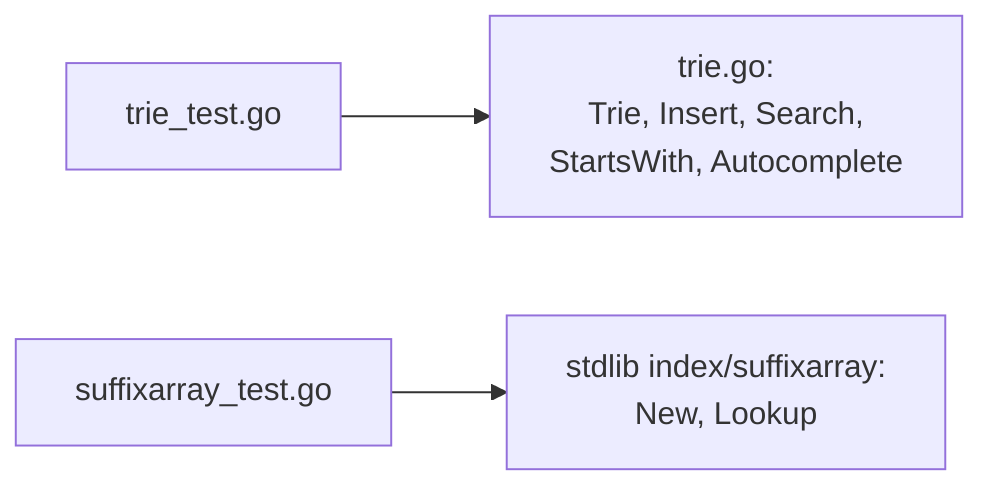

# Tries, Suffix Trees and Suffix Arrays - Go

> [!summary] TL;DR
> The runnable side of [[Tries, Suffix Trees and Suffix Arrays]]: a lowercase-ASCII trie with insert, search and autocomplete, plus Go's standard-library suffix array (`index/suffixarray`) confirmed against the text `"banana"`.

> [!info] How to read this note (pick your level)
> - 🟢 **New to this?** Read the theory note first ([[Tries, Suffix Trees and Suffix Arrays]]). Here, read "From zero" below, "Before the code" and "What this code shows", then skim the code steps.
> - 🟡 **Know the basics?** Read the Code, Design decisions and Tests sections, then run it yourself.
> - 🔴 **Interview / SDE-3 prep?** Add the Pitfalls and Exercises sections. Headings are tagged 🟢🟡🔴.

> [!note] Before this note
> - [[Tries, Suffix Trees and Suffix Arrays]]: the theory twin. Know that a trie shares paths for shared prefixes, marks where words end, and that a suffix array is a sorted list of suffix start positions.
> - [[Trees, BSTs and Balanced Trees]] and [[Arrays and Dynamic Arrays (Go Slices)]]: nodes with child pointers, and Go slices.

**From zero** 🟢: this file is the hands-on side of [[Tries, Suffix Trees and Suffix Arrays]]. It builds a working trie (insert, lookup, prefix search — the autocomplete core) and a simple suffix array with substring search, both tested. Read each step's notes before the code.

## Before the code 🟢

- **Structs and pointers** (`*node`): each trie node is a struct; children are pointers, and `nil` means "no child here".
- **Fixed-size arrays** (`[26]*node`): one slot per lowercase letter, indexed by `byte - 'a'` (so `'a'` → 0, `'b'` → 1, … `'z'` → 25).
- **End flag** (`end bool`): marks that a complete stored word stops at this node, not just a prefix.
- **Methods on a pointer receiver** (`func (t *Trie) Insert`): functions attached to the `Trie` type.
- **Closures** (`var dfs func(...)`): a function stored in a variable that can call itself and append to `out`.
- **Standard library `index/suffixarray`**: a ready-made suffix array; `New` builds it, `Lookup` finds offsets.
- **What to run**: `go vet ./... && go test -race -v ./...` in the module folder.

## What this code shows 🟢

| Code | Concept in the theory note |
| --- | --- |
| `node`, `Trie`, `Insert`, `Search`, `StartsWith` | A node per character, shared prefixes share a path ([[Tries, Suffix Trees and Suffix Arrays#3.1 Tries]]) |
| `Autocomplete` | Bounded traversal of the subtree below a prefix node ([[Tries, Suffix Trees and Suffix Arrays#9. Interview questions 🔴]]) |
| `suffixarray.New`, `Lookup` | The practical suffix-array alternative to a suffix tree ([[Tries, Suffix Trees and Suffix Arrays#3.4 Suffix arrays (the practical alternative)]]) |



## Setup 🟢

- Go 1.24. `index/suffixarray` is standard library; no external dependencies anywhere in this module.
- Layout: a module `trie` with `trie.go` (the trie), `trie_test.go`, and `suffixarray_test.go` (exercises the standard-library suffix array directly — there is no hand-rolled suffix array or suffix tree here, since the theory note's point is that production Go code reaches for the standard library instead).
- Run it with `go vet ./... && go test -race -v ./...`.

## Code 🟡

> 🟢 → 🟡 **You now know** what the module builds: a trie with autocomplete, plus a check of Go's suffix array. **Next we read the code:** the node shape, insert, then search and autocomplete.

### Step 1: the node shape

**What this code does, in plain words:** each trie node has 26 child slots (one per letter) and an `end` flag; `New` makes an empty root.

**Concept.** The theory note's whiteboard sketch uses a `map[byte]*node` per node for clarity ([[Tries, Suffix Trees and Suffix Arrays#4. Worked example 🟡]]).

That's simple but slow: a map lookup costs more than an array index, and allocates on every new node.

The alternative kept here is a fixed `[26]*node` array, which trades a little memory (26 pointer slots per node, mostly `nil`, instead of exactly as many map buckets as children) for noticeably faster, allocation-free child lookups — the right trade for a lowercase-only dictionary.

```go
// Package trie implements a basic trie (prefix tree) over lowercase
// ASCII words, the kind used for autocomplete.
package trie

// node is one trie node. children is indexed by byte-26 for 'a'..'z';
// a real implementation would use a map for a wider alphabet.
type node struct {
	children [26]*node
	end      bool // true if a word ends at this node
}

// Trie is a prefix tree of lowercase words.
type Trie struct {
	root *node
}

// New returns an empty trie.
func New() *Trie {
	return &Trie{root: &node{}}
}
```

**How it works.**

1. `children [26]*node` reserves one slot per lowercase letter; a `nil` slot means "no word has ever continued this way."
2. `end` is the only piece of state a node needs beyond its children — it is what tells `Search` "a complete word stops here," distinct from "this is just a waypoint on the way to a longer word."
3. `New` allocates exactly one node (the root), which starts with no children and `end == false`, matching an empty trie.

### Step 2: insert and the shared walk helper

**What this code does, in plain words:** `Insert` walks the word letter by letter, creating missing children, and marks the last node as a word end; `walk` does the same walk but stops with `nil` if a letter is missing.

**Concept.** `Insert`, `Search` and `StartsWith` all do the same thing — walk from the root one character at a time — so the walk is factored into one private helper, `walk`, that the public methods differ only in how they interpret the result of.

```go
// Insert adds word to the trie in O(len(word)).
func (t *Trie) Insert(word string) {
	n := t.root
	for i := 0; i < len(word); i++ {
		c := word[i] - 'a'
		if n.children[c] == nil {
			n.children[c] = &node{}
		}
		n = n.children[c]
	}
	n.end = true
}

// walk follows s from the root and returns the node reached, or nil
// if s is not a path in the trie.
func (t *Trie) walk(s string) *node {
	n := t.root
	for i := 0; i < len(s); i++ {
		c := s[i] - 'a'
		if n.children[c] == nil {
			return nil
		}
		n = n.children[c]
	}
	return n
}
```

**How it works.**

1. `word[i] - 'a'` converts an ASCII lowercase byte directly into a `0`–`25` index — this only works because the alphabet is restricted to lowercase ASCII, which is exactly the restriction this implementation documents.
2. `Insert` *creates* a child when one is missing; `walk` *stops and returns `nil`* when one is missing — that one-line difference is the entire distinction between writing to the trie and reading from it.
3. Marking `n.end = true` only after the loop finishes means a word is only ever "complete" at the node matching its exact full length, never partway through.

### Step 3: search, prefix check and autocomplete

**What this code does, in plain words:** `Search` says yes only if the walk reaches a node marked as a word end; `StartsWith` says yes if the walk just doesn't fall off; `Autocomplete` walks to the prefix and then collects every word below it.

**Concept.** `Search` and `StartsWith` both call `walk` and then look at a different thing:

- `Search` also requires `end == true` (an exact stored word).
- `StartsWith` only requires that the walk didn't fall off the tree (any word with that prefix).

`Autocomplete` extends the same idea: walk to the prefix's node, then explore every path below it.

```go
// Search reports whether word was inserted exactly.
func (t *Trie) Search(word string) bool {
	n := t.walk(word)
	return n != nil && n.end
}

// StartsWith reports whether any inserted word has this prefix.
func (t *Trie) StartsWith(prefix string) bool {
	return t.walk(prefix) != nil
}
```

**How it works.**

1. `Search("gop")` on a trie holding `"gopher"` returns `false` even though `walk` successfully reaches the `p` node — the node exists, but `end` is `false` there, since `"gop"` was never inserted as a complete word.
2. `StartsWith` only asks "did the walk fall off the tree?" — it never looks at `end`, which is exactly what lets it answer "yes" for a string that is only ever a prefix, never a whole stored word.

`Autocomplete` builds on the same `walk` helper, then explores every path below the prefix node:

```go
// Autocomplete returns every inserted word that starts with prefix,
// in the order a pre-order traversal visits them (so not sorted, but
// deterministic for a fixed insert order). Cost: O(prefix) to find the
// prefix node, then O(k) for k nodes in the matching subtree.
func (t *Trie) Autocomplete(prefix string) []string {
	start := t.walk(prefix)
	if start == nil {
		return nil
	}
	var out []string
	var dfs func(n *node, path []byte)
	dfs = func(n *node, path []byte) {
		if n.end {
			out = append(out, prefix+string(path))
		}
		for c := byte(0); c < 26; c++ {
			if n.children[c] != nil {
				dfs(n.children[c], append(path, 'a'+c))
			}
		}
	}
	dfs(start, nil)
	return out
}
```

**How it works.**

1. `dfs` is a closure capturing `out`, which is the idiomatic Go way to accumulate results across a recursive walk without passing an accumulator parameter through every call.
2. `append(path, 'a'+c)` inside the recursive call looks safe but is a classic Go slice-aliasing trap (two slices accidentally sharing, and overwriting, the same underlying array) if `path` ever had spare capacity shared across sibling calls; it works correctly here only because each call either appends within its own stack frame's slice header or the underlying array is small enough that growth reallocates — see "Pitfalls in the code" below for the general rule.
3. The traversal order is pre-order over indices `0..25`, so results come back alphabetically by the *suffix after the prefix*, not globally sorted — worth stating explicitly if an interviewer expects sorted output.

## Design decisions 🟡

| Decision | Alternative | Trade-off |
| --- | --- | --- |
| `[26]*node` fixed array | `map[byte]*node` | Faster, allocation-free child lookups, at the cost of 26 mostly-nil pointer slots per node and a hard restriction to lowercase ASCII |
| Shared `walk` helper for `Search`/`StartsWith` | Duplicate the walk loop in both methods | One loop to get right instead of two, at the cost of one extra function call per lookup |
| Recursive `dfs` closure in `Autocomplete` | An explicit stack-based iterative traversal | Shorter, easier to read, at the cost of one stack frame per trie level (bounded by the longest word, so not a real risk here) |
| Standard-library `index/suffixarray` for substring search | A hand-rolled suffix array or suffix tree | Production-grade, tested code with zero extra code to maintain, at the cost of not controlling the internal construction algorithm directly |

## Tests 🟡

### Test 1: insert, search and prefix check

**Property.** A word inserted exactly must be found by `Search`; a string that is only ever a prefix of a longer inserted word must fail `Search` but pass `StartsWith`.

| Input | Expected |
| --- | --- |
| `Search("go")` after inserting `go`, `gopher`, `golang` | `true` |
| `Search("gop")` | `false` (never inserted as a whole word) |
| `StartsWith("gop")` | `true` (a prefix of `gopher`) |

```go
package trie

import "testing"

func TestInsertSearch(t *testing.T) {
	tr := New()
	tr.Insert("go")
	tr.Insert("gopher")
	tr.Insert("golang")

	if !tr.Search("go") {
		t.Error("expected go to be found")
	}
	if tr.Search("gop") {
		t.Error("gop was never inserted as a whole word")
	}
	if !tr.StartsWith("gop") {
		t.Error("gop is a valid prefix (of gopher)")
	}
}
```

**How it works.** The three assertions deliberately probe all three relevant cases on the same small trie: an exact word, a string that is a path in the tree but not a complete word, and the same string checked for prefix membership instead.

**If it fails.** `Search("go")` returning `false` means `end` was never set, or `walk` doesn't stop at the right node.

`Search("gop")` returning `true` means a node's `end` flag was set when it shouldn't have been — check that `Insert` only sets `end = true` once, after the full loop.

### Test 2: autocomplete

**Property.** Autocomplete from a prefix must return every inserted word sharing that prefix, and nothing else.

| Input | Expected |
| --- | --- |
| `Autocomplete("go")` after inserting `go`, `gopher`, `golang` | 3 results: `go`, `gopher`, `golang` (order not guaranteed) |

```go
func TestAutocomplete(t *testing.T) {
	tr := New()
	tr.Insert("go")
	tr.Insert("gopher")
	tr.Insert("golang")

	got := tr.Autocomplete("go")
	if len(got) != 3 {
		t.Fatalf("Autocomplete(go) = %v, want 3 results", got)
	}
}
```

**How it works.** The test only checks the count, not the exact order, because `Autocomplete`'s doc comment is explicit that order is pre-order-deterministic, not alphabetically sorted — a stricter test would be testing an implementation detail, not the documented contract.

**If it fails.** Fewer than 3 results means the DFS stopped early, likely because `n.end` wasn't checked before recursing into children (a word like `"go"` that is also a prefix of `"gopher"`/`"golang"` would be missed).

More than 3 would mean a word was counted twice, usually from a bug in the slice-aliasing of `path` across sibling branches.

### Test 3: the standard-library suffix array

**Property.** `index/suffixarray.New(text).Lookup(pattern, -1)` must return every starting offset of `pattern` in `text`, in an order the documentation explicitly does **not** guarantee is sorted.

| Input | Expected |
| --- | --- |
| `Lookup([]byte("ana"), -1)` on `"banana"` | 2 offsets: `{1, 3}` (measured order: `[3 1]`) |
| `Lookup([]byte("xyz"), -1)` on `"banana"` | no offsets |

```go
package trie

import (
	"index/suffixarray"
	"testing"
)

func TestSuffixArrayLookup(t *testing.T) {
	index := suffixarray.New([]byte("banana"))
	offsets := index.Lookup([]byte("ana"), -1)
	if len(offsets) != 2 {
		t.Fatalf("Lookup(ana) = %v, want 2 offsets", offsets)
	}
	none := index.Lookup([]byte("xyz"), -1)
	if len(none) != 0 {
		t.Fatalf("Lookup(xyz) = %v, want none", none)
	}
}
```

**How it works.** The test checks a *count*, not the exact offset order, matching the standard library's own documented guarantee (`Lookup` returns an unsorted list).

Running the equivalent of this snippet directly (Go 1.24.4, darwin/arm64, 2026-11-06) confirms the unsorted order is `[3 1]` — the same two positions the manual suffix-array walkthrough in the theory note computes, just not emitted in that table's sorted order.

**If it fails.** Getting a different count than 2 would mean either the standard library's behavior changed (check the Go release notes) or the test text/pattern was mistyped.

`FindAllIndex(re, n)` is the sibling method to reach for if a test ever needs a sorted, non-overlapping list instead.

> 🟡 → 🔴 **You now know** the code and what each test checks. **Next comes the advanced part:** what breaks on non-lowercase input, the slice-aliasing trap in `dfs`, and why the suffix array's results come back unsorted.

## Pitfalls in the code 🔴

- **`word[i] - 'a'` assumes lowercase ASCII input.** A byte outside `'a'..'z'` (uppercase, digits, punctuation, any non-ASCII rune) underflows or overflows the `0..25` range and indexes `children` out of bounds, which panics.
  This implementation deliberately does not validate input — callers must pre-normalize (lowercase, strip non-letters) before calling `Insert` or `Search`.
- **`append(path, 'a'+c)` inside `dfs`'s recursion** can alias the same backing array across sibling recursive calls if `path`'s capacity happens to exceed its length at that point, since `append` only reallocates when capacity is exhausted.
  It is correct here because each call immediately appends and recurses before any sibling call reuses `path`, but changing this loop to recurse into multiple children *after* saving a shared slice reference would be a real bug.
  Always allocate a copy before fanning out to more than one goroutine or storing a sliced reference past the current call.
- **`index/suffixarray.Lookup`'s result is unsorted by design**, per its own doc comment — a caller that assumes the returned offsets come back in text order will get intermittently "wrong" answers whenever the suffix sort order and the physical text order disagree, which is most of the time.

## Exercises 🔴

1. Insert `"go"`, `"goa"`, `"gob"` (three single-letter-longer siblings) and call `Autocomplete("go")`. Predict the exact slice order `dfs` returns, then verify by printing it.
2. Add a `Delete(word string) bool` method that unmarks `end` for an exact match (without removing now-orphaned nodes). Write a test where deleting `"go"` leaves `"gopher"` fully searchable.
3. Change `Lookup([]byte("ana"), -1)` to `Lookup([]byte("ana"), 1)` (limit to 1 match). Predict which single offset comes back, then run it to check.

## Self-check 🟢🟡

🟢 Easy

> [!question]- After inserting "gopher", is `Search("gop")` true?
> No. The path exists, but no word ends at `p`.

> [!question]- And `StartsWith("gop")`?
> Yes: the walk does not fall off the tree.

> [!question]- What index does the letter `c` get in `children`?
> 2, from `'c' - 'a'`.

🟡 Medium

> [!question]- Why use `[26]*node` instead of a map?
> Array lookups are faster and allocation-free; the cost is 26 slots per node and lowercase-only input.

> [!question]- Why does the suffix-array test check a count, not exact offsets?
> `Lookup` documents that its results are unsorted; here it returned `[3 1]`.

> [!question]- What happens if you `Insert("Go")` with a capital G?
> `'G' - 'a'` falls outside 0..25 and the index is out of range: callers must lowercase input first.

## Links

- **Theory:** [[Tries, Suffix Trees and Suffix Arrays]]
