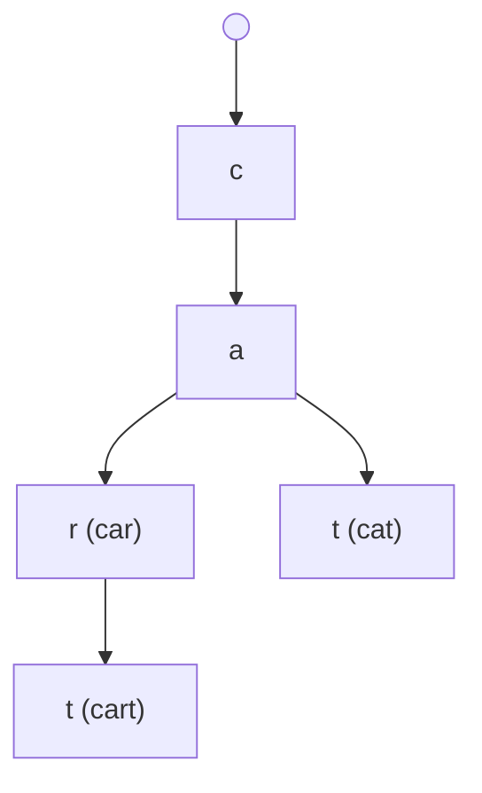
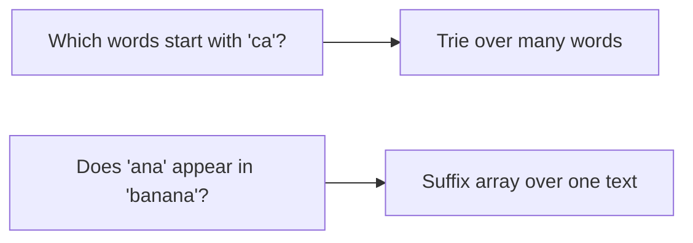
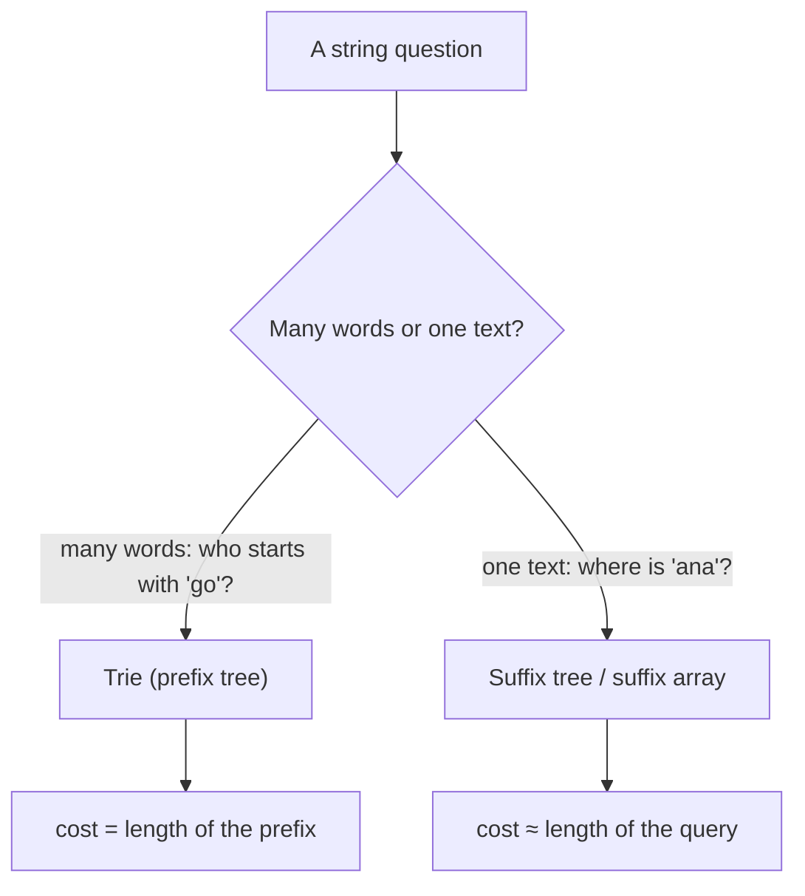
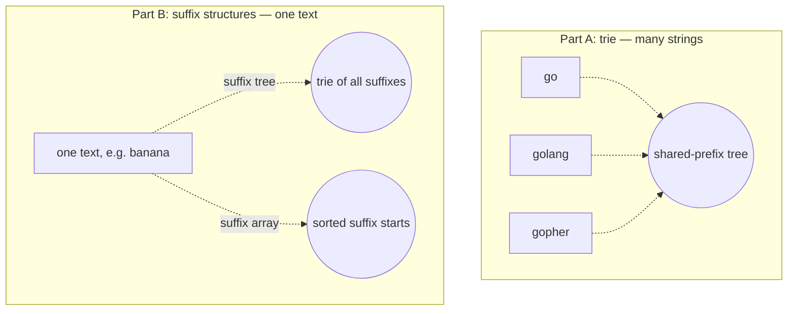
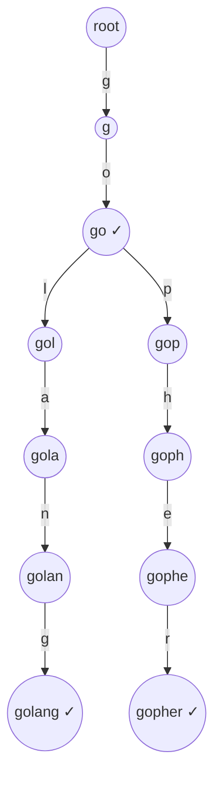
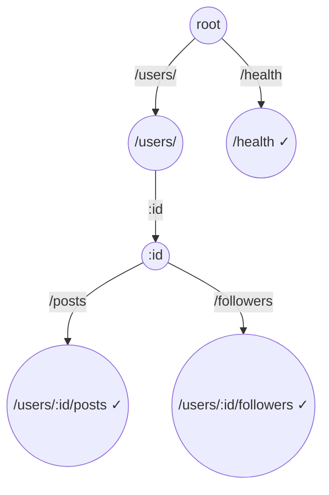
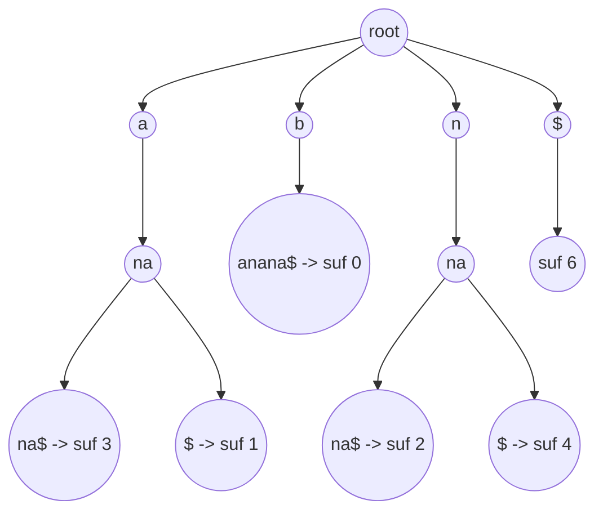
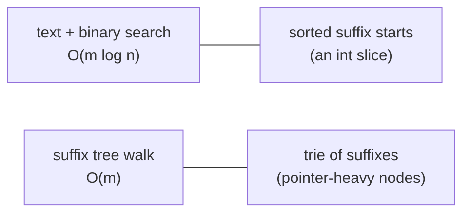

# Tries, Suffix Trees and Suffix Arrays

> [!summary] TL;DR
> A **trie** (prefix tree) stores strings one character per edge so every string sharing a prefix shares a path; it answers "does any word start with this?" in time proportional to the query, not the dictionary size. A **suffix tree** is a trie of every suffix of one text, so it answers "does this text contain this substring?" just as fast. A **suffix array** is the cheaper, flatter alternative: a sorted list of suffix start positions, built and queried with less memory. Runnable Go version: [[Tries, Suffix Trees and Suffix Arrays - Go]].

> [!abstract] Core idea
> - A trie spreads strings over a tree by shared prefix; a node's depth is how many characters matched so far.
> - A suffix tree is "a trie of every suffix of one string" — it turns substring search into a root-to-somewhere walk.
> - A suffix array trades the tree's `O(n)` construction for `O(n log n)` (or `O(n)` with more work) but uses far less memory per character, so real systems reach for it first.
> - Compressed (radix) tries collapse single-child chains into one edge; this is what Go HTTP routers and IP routing tables actually use.
> - Classic mistake: reaching for a suffix tree/array when an inverted index (word → documents) is the right tool, or vice versa — they solve different search problems.

## Start here: the basics 🟢

> [!info] How to read this note (pick your level)
> - 🟢 **New to this?** Read "From zero" below, then sections 1, 2 and the cheat sheet (10). Stop there, that is a full first pass.
> - 🟡 **Know the basics?** Add section 3 (how it works), 4 (worked example), then 5 and 6.
> - 🔴 **Interview / SDE-3 prep?** Add 7, 8 and 9. Headings are tagged 🟢🟡🔴 so you always know where you are.

**From zero, in 60 seconds** 🟢

A **trie** is a tree built from letters. Words that share a beginning share a path: "car", "cat" and "cart" all walk through c → a. That makes "find every word starting with ca..." instant — exactly what autocomplete does.



Tries answer questions about the *starts* of many words. **Suffix** structures flip the idea: take ONE big text, and index every possible ending (suffix) of it. Then "does this substring appear anywhere in the text?" becomes a fast lookup instead of a scan.



The rest of this note is just three questions:
1. How does a trie store and find words, and what does it cost in memory?
2. What are suffix trees and suffix arrays, and when is each worth it?
3. Where are these used for real (autocomplete, search, bioinformatics)?

### The problem in one story

You type "pro" into a phone's search box and it instantly suggests "program", "promise", "protocol".
The phone did not check every word it knows, one by one.
Later you press Ctrl+F in a huge log file and search for "timeout".
Both feel instant because the words were organised ahead of time, letter by letter.

### Words you need first

| Word | Plain meaning | Tiny example |
| --- | --- | --- |
| String | A sequence of characters | `"go"` |
| Prefix | The start of a string | `"go"` is a prefix of `"gopher"` |
| Suffix | The end of a string, from some position onward | `"ana"` is a suffix of `"banana"` |
| Substring | Any unbroken piece of a string | `"nan"` is inside `"banana"` |
| Tree / node / edge | Boxes (nodes) joined by arrows (edges), starting at a root | root → `g` → `o` |
| Binary search | Find an item in a sorted list by halving it each step | 1,000,000 items in ~20 steps |
| Lexicographic order | Dictionary (alphabetical) order | `"a" < "ana" < "b"` |
| `O(L)` | Cost grows with the length `L` of the query only | 6 steps for `"gopher"` |

### Picture it



### Analogy

A trie is like a paper dictionary's thumb tabs: you jump to "G", then "GO", without reading every page.
Where it breaks: a dictionary has fixed tabs only for the first letter; a trie keeps branching at every letter.

### How the rest of this note builds up

- First, **Why it exists** and the **Mental model**: the prefix problem (Part A) vs the substring problem (Part B).
- Then **How it works**: plain tries, compressed (radix) tries, suffix trees, suffix arrays.
- Then a **Worked example**, a **comparison table** and **trade-offs**.
- Finally the SDE-3 **Deep dive**: sentinels, Ukkonen's suffix links, LCP arrays and honest construction costs.

> [!tip] Remember
> Trie = many strings, shared prefixes; suffix tree/array = one text, every substring.

This note covers two genuinely different questions, built from the same underlying trick (index characters instead of comparing whole strings).

- **Part A** (sections 3.1–3.2) is about tries — many short strings, "which ones share this prefix?"
- **Part B** (sections 3.3–3.4) is about suffix trees and arrays — one long text, "where does this substring occur?"

Keep the two apart in your head: that split is itself the most common interview trap in this area.

## 1. Why it exists 🟢

### Part A: the prefix problem

Say you're building a search box that suggests words as the user types, backed by a dictionary of 400,000 English words.

In plain words: checking every single word against the typed prefix on every keystroke is far too slow once the dictionary is large.

A naive approach checks every word for the typed prefix: for a 5-character prefix, that's up to 400,000 string comparisons of up to 5 characters each per keystroke.

A **trie** (a tree where the path you walk spells out a prefix) turns this into "walk 5 edges from the root," then return everything in the subtree below — `O(prefix length)` to locate the subtree, independent of how many words are stored.

> [!tip] Remember
> A trie's cost depends on the query's length, never on how many strings are stored.

### Part B: the substring problem

Now take a different problem: given one large text (a 50 MB log file, a genome, a source-code repository), answer many queries of "does substring `S` occur, and where?"

In plain words: scanning the whole text over and over for every query wastes the fact that the text never changes between queries.

A naive scan is `O(n)` per query, over the whole text, every time. A **suffix tree** (or the leaner **suffix array**) preprocesses the text once — `O(n)` to `O(n log n)` — so each later substring query costs roughly `O(m)`, the length of the query, not the text.

These are two different tools for two different questions — "which stored strings share this prefix?" versus "where in this one text does this substring occur?" — built from the same idea: index strings by their characters instead of comparing them whole.

> [!warning] Common mistake
> Treating "trie" and "suffix tree" as interchangeable because both are trees of characters. A trie indexes *many separate strings*; a suffix tree indexes *every suffix of one string*. Mixing them up in an interview is an immediate red flag.

## 2. Mental model 🟢

### Part A: tries, the filing-cabinet analogy

A trie is a tree where **edges, not nodes, hold the letters**. Walking from the root spells out a prefix; a node marked "end of word" means some inserted string stops exactly there.

**Analogy.** Think of a filing cabinet sorted so aggressively that every shared prefix is stored only once: "CAR", "CARD" and "CARE" share the same first three drawers and only split apart at the fourth letter. Opening a drawer one letter at a time is exactly a trie walk.

Where the analogy breaks down: a real filing cabinet needs a human to decide how deep to split; a trie splits automatically, one character at a time, no matter how the strings happen to be alike or different.

### Part B: suffix trees, the same cabinet applied to one text

A suffix tree is the same structure applied to one text's suffixes: insert `"banana$"`, `"anana$"`, `"nana$"`, …, `"a$"` into a trie (the `$` is a sentinel character lower than everything else, so no suffix is a prefix of another).

Any substring of the original text is a prefix of at least one suffix, so "does this substring occur" becomes "is there a path spelling it out from the root" — exactly the trie question, just asked of a cabinet built from one word's own leftovers instead of many separate words.

A suffix array skips building the tree: it just lists the **starting positions of every suffix, sorted alphabetically**. Searching is then a binary search over that sorted list instead of a tree walk — like replacing the filing cabinet with a single alphabetized index card list that just points back at where each suffix starts.



> [!tip] Remember
> Same mechanism (index by character), different input shape: many strings for a trie, one text's own suffixes for a suffix tree/array.

## 3. How it works 🟡

### 3.1 Tries

**In plain words:** each node holds one slot per possible next character, plus a flag for "a word ends here." Inserting a string walks (or creates) one child per character; searching does the identical walk and checks the flag.

**Picture it:**



**Example:** inserting `"go"`, `"golang"` and `"gopher"` builds exactly this shape: all three share the `g → o` path, then split. A ✓ marks where a complete word ends (`"go"` is itself a word, not just a prefix of the other two).

Walking `g → o → p → h → e → r` for `Search("gopher")` costs exactly 6 steps, whether the trie holds 3 words or 3 million.

**Why it matters:** lookup and insertion both cost `O(L)`, the length of the string, regardless of how many other strings are stored — the dictionary's size never enters the cost, which is why autocomplete stays instant as a dictionary grows.

### 3.2 Compressed (radix) tries

**In plain words:** a plain trie wastes space on long chains of single-child nodes — an edge per character down a 20-character path with no branching. A **radix trie** (also called a Patricia trie) collapses each such chain into one edge holding the whole substring, so the tree has one node per *branch point*, not per character.

**Picture it:**



**Example:** this is precisely how Go's popular HTTP routers work: `julienschmidt/httprouter` and `go-chi/chi` both route by walking a radix tree of path segments, matching static parts byte-for-byte and treating `:id`-style segments as wildcard edges.

Registering 5,000 routes and looking up `/users/42/posts` still costs roughly 3 edge comparisons (`/users/`, `:id`, `/posts`), not 5,000 string comparisons.

IP routing tables use the same trick (a radix trie over address bits) to find the longest prefix match for a destination IP in time proportional to the address length, not the table size.

**Why it matters:** a route lookup costs `O(path length)`, not `O(number of routes)`, which is why these routers stay fast with thousands of registered routes.

### 3.3 Suffix trees

**In plain words:** build a trie, but instead of inserting many separate words, insert every suffix of one text. The tree that comes out answers "does this substring occur" by walking it from the root.

**Picture it:**



(Edges are compressed like the radix trie above — real suffix trees never store one character per edge, or the tree would blow past linear size.)

**Example:** is `"ana"` a substring of `"banana"`? Walk `a → n → a` from the root; reaching a node (not falling off the tree) means yes, and the leaves below that node are every position `"ana"` starts at — positions 1 and 3, matching the two `ana$`/`anana$` leaves in the picture.

**Why it matters:** once the tree is built, every substring query costs only the query's own length, no matter how large the underlying text is — crucial when the text is a 50 MB log file and you're going to ask thousands of queries against it.

> [!warning] Common mistake
> Building a suffix tree by naive insertion (`n` suffixes of average length `n/2`) costs `O(n²)` time and space — fine for a textbook example, unusable for anything beyond a few thousand characters.
>
> **Ukkonen's algorithm** builds the same tree online, left to right, in `O(n)` time using suffix links (shortcuts between nodes that let the algorithm avoid re-walking from the root) — the construction most production suffix trees use, when they use a suffix tree at all.
>
> Don't claim "suffix trees are `O(n)` to build" without naming the algorithm that makes that true.

### 3.4 Suffix arrays (the practical alternative)

**In plain words:** instead of a tree of pointers, just list every suffix's starting index, sort the suffixes lexicographically, and keep only the sorted indices. Searching becomes a binary search over that list.

**Picture it:**

| Suffix (for reference) | Start index |
| ----------------------- | ----------- |
| `$`                      | 6           |
| `a$`                     | 5           |
| `ana$`                   | 3           |
| `anana$`                 | 1           |
| `banana$`                | 0           |
| `na$`                    | 4           |
| `nana$`                  | 2           |

**Example:** the suffix array is just the right column, in that order: `[6, 5, 3, 1, 0, 4, 2]`.

Searching for substring `S` is a **binary search** over this array: `O(m log n)` comparisons, each up to `O(m)` characters, so `O(m log n)` total.

That is slower per query than a suffix tree's `O(m)`, but close in practice and much lighter on memory, since it's one slice of integers instead of a tree of pointer-heavy nodes.



**Why it matters:** pairing the suffix array with an **LCP array** (longest common prefix between each adjacent pair of sorted suffixes) recovers most of what the tree gives you — repeated substrings show up as runs of large LCP values — while staying array-based.

Building both in `O(n)` (the SA-IS algorithm, or `O(n log n)` with simpler doubling algorithms) is what libraries like Go's `index/suffixarray` actually do, which is why most Go code never hand-rolls a suffix tree.

> [!tip] Remember
> A suffix array is the practical default: a flat, sorted slice of integers beats a pointer-heavy tree in memory almost every time the data sets are large.

## 4. Worked example 🟡

### Whiteboard version

The bare trie idea: a node is just "children by character, plus an end flag." Insert walks or creates a child per character; search does the same walk and checks the flag at the end.

```go
type node struct {
    children map[byte]*node
    end      bool
}
```

Trace inserting `"go"` then searching `"go"`: start at the root, create a child for `'g'`, move into it, create a child for `'o'`, move into it, mark `end = true`.

Searching `"go"` repeats exactly the same two-step walk and finds `end == true` — a match.

Searching `"gop"` walks `g`, `o`, then looks for a `'p'` child that doesn't exist and reports no match, having done only 3 character comparisons regardless of how many other words are stored.

The runnable version fixes the one real inefficiency in that sketch — a `map[byte]*node` per node, which is slow and allocates heavily — by using a fixed `[26]*node` array for lowercase words.

It also adds prefix search (autocomplete), a production-grade suffix array from Go's standard library, and tests. Runnable Go version: [[Tries, Suffix Trees and Suffix Arrays - Go]].

## 5. Variants and comparison 🟡

| Structure | How it works | Use when | Cost |
| --- | --- | --- | --- |
| Trie | One edge per character; shared prefixes share a path | Autocomplete, spell-check, a dictionary of many short strings | `O(L)` insert/search, `O(ALPHABET × N)` worst-case memory |
| Radix (compressed) trie | Collapses single-child chains into one edge | HTTP routers (httprouter, chi), IP routing tables | `O(L)` lookup, far less memory than a plain trie |
| Suffix tree | Trie of every suffix of one text | Many substring queries on one fixed, large text | `O(n)` build (Ukkonen), `O(m)` query, high constant-factor memory |
| Suffix array (+ LCP) | Sorted list of suffix start positions | Same as a suffix tree, when memory matters more than query speed | `O(n log n)`–`O(n)` build, `O(m log n)` query, far less memory |
| Inverted index | Maps each token (word) to the documents/positions containing it | Full-text search across many documents | `O(1)` average per-token lookup; see [[Search Engines and Inverted Indexes]] |

> [!warning] Interview trap
> A suffix tree/array answers "where does this substring occur in this one text?" An inverted index answers "which documents contain this word?" Real search engines (and Postgres full-text search) use inverted indexes, not suffix trees — text editors use ropes or piece tables for the editing buffer, not suffix trees either. Reaching for a suffix tree when asked to design a search engine is the classic trap.

## 6. Trade-offs and when not to use 🟡

- A plain trie over a wide alphabet (Unicode, not just `a`–`z`) wastes memory per node if you use a fixed-size array; switch to a `map[rune]*node`, at the cost of slower, pointer-chasing lookups.
- A suffix tree's constant factor is brutal: each of the `n` leaves plus internal nodes typically costs several times the memory of the raw text, because of pointers, edge-label bookkeeping and suffix links. For anything beyond a few hundred MB of text, this stops being practical.
- A suffix array is cheaper but still needs the LCP array for the fastest substring-count queries, and both arrays must be rebuilt (not easily updated) if the text changes — fine for a static genome or a frozen log snapshot, bad for text that's edited live.
- If you only need "does this one word appear" rather than general substrings, a hash set or an inverted index is simpler and faster to build.
- For a small, fixed, rarely changing set of routes or prefixes, a flat sorted slice with binary search can beat a radix trie's pointer overhead — measure before reaching for the trie.

## 7. In production 🔴

- **Real systems:**
	- Go's own HTTP routers: `julienschmidt/httprouter` and `go-chi/chi` route requests through a radix tree keyed by URL path segments.
	- IP routing tables (longest-prefix match) use radix/Patricia tries over address bits — the same compressed-trie idea, applied to binary strings instead of ASCII.
	- Genome alignment tools (BWA, Bowtie) build a Burrows–Wheeler transform and an FM-index — a compressed relative of the suffix array — to align millions of short DNA reads against a reference genome in roughly `O(read length)` per read instead of scanning the whole genome.
	- Go's own `index/suffixarray` package, used internally by some code-search and diff tooling for substring queries over a fixed blob of text.
	- Plagiarism and duplicate-code detectors use suffix arrays or suffix automata to find the longest common substring between two documents.
	- Compression: the Burrows–Wheeler transform (the same BWT used above for genome aligners) is also the first stage of `bzip2`-style compressors — it reorders the text by sorted suffix context so repeated patterns cluster together, which the entropy-coding stage that follows then compresses far better than the raw bytes.
- **Failure modes → fixes:**
	- Building a suffix tree naively (`O(n²)`) on a text that turns out to be large → use Ukkonen's algorithm, or switch to a suffix array built with a linear-time algorithm.
	- A radix-tree HTTP router with overlapping wildcard routes (`/users/:id` vs `/users/new`) picks the wrong route → routers resolve this by trying the more specific static segment first; order route registration deliberately and add route-conflict tests.
	- Treating a suffix structure as a general full-text search index → it doesn't rank, tokenize, or handle "any of these words"; that's an inverted index's job.
- **What to monitor:**
	- Memory per node (for a hand-rolled trie or suffix tree) versus the raw text size — a multiplier much above 2–3× for a suffix array (or 10×+ for a suffix tree) signals the implementation needs compacting.
	- p99 route-lookup latency in an HTTP router under a large, deeply nested route table.
	- Rebuild time for a suffix array/LCP pair when the backing text changes, if the structure is refreshed on any kind of interval.

## 8. Deep dive 🔴

- **Why a sentinel (`$`) matters.** Without a unique terminator lower than every real character, one suffix (`"ana"`) could be a prefix of another suffix (`"anana"`), and a leaf in the suffix tree would need to also be an internal node — breaking the "every suffix ends at a distinct leaf" invariant the structure depends on.

  The sentinel guarantees no suffix is a prefix of another.
- **Suffix links and Ukkonen's trick.** The naive `O(n²)` build re-walks from the root for every new suffix.

  Ukkonen's algorithm keeps a **suffix link** from each internal node to the node representing the same string with its first character stripped, so after inserting the longest suffix it can jump directly to roughly where the next-shorter suffix belongs instead of re-walking from the root — the insight that turns the quadratic construction into a linear one.
- **LCP array mechanics.** `LCP[i]` is the length of the longest common prefix between the `i`-th and `(i-1)`-th suffixes in sorted order.

  Long runs of large LCP values mark repeated substrings; the longest repeated substring in a text is the maximum value anywhere in its LCP array — an `O(n)` scan once the array is built (Kasai's algorithm builds the LCP array from the suffix array in `O(n)`).
- **Construction cost, stated honestly.** A suffix tree is `O(n)` to build only with Ukkonen's algorithm; naive insertion is `O(n²)`.

  A suffix array is `O(n log n)` with a simple prefix-doubling algorithm (sort by 1 character, then 2, then 4, …) and `O(n)` with the more intricate SA-IS algorithm that most production libraries (including the one behind Go's `index/suffixarray`) actually use.

  Neither structure is "just `O(n)` for free" — the fast construction algorithms are genuinely more complex than the naive ones, which is why many codebases reach for a suffix array library instead of hand-rolling Ukkonen's algorithm.
- **Compressed tries at scale.** A production radix router doesn't store one byte per edge either — `httprouter`'s tree stores whole path segments per edge and specializes nodes for static text, named parameters (`:id`) and catch-alls (`*filepath`), so a lookup is a handful of segment comparisons, not hundreds of single-byte steps.

## 9. Interview questions 🔴

> [!question]- Implement a trie with insert and search.
> See the worked example above: a node per character with `[26]*node` children (or a map for wider alphabets) and an `end` flag; insert and search both walk one node per character, `O(L)`.

> [!question]- What's the difference between a suffix tree and a suffix array?
> Both answer "where does this substring occur in this text?" A suffix tree is a trie of every suffix, giving `O(m)` queries but heavy memory (several times the text size) and `O(n)` construction only with Ukkonen's algorithm. A suffix array is a sorted list of suffix start positions, giving `O(m log n)` queries with far less memory and simpler, more common construction algorithms — the practical default.

> [!question]- How do Go's HTTP routers (httprouter, chi) match routes so fast?
> They store registered routes in a radix (compressed) trie keyed by path segment. A request path is matched by walking the tree one segment at a time, so lookup cost is proportional to the path's length, not to how many routes are registered.

> [!question]- Is building a suffix tree really O(n)?
> Only with Ukkonen's algorithm, which uses suffix links to avoid re-walking from the root for each suffix. A naive insertion of all `n` suffixes, each up to length `n`, costs `O(n²)`. Don't claim "suffix trees are linear" without naming the construction algorithm.

> [!question]- Design an autocomplete feature for a search box. What structure, and why?
> A trie over the stored strings (or a radix trie if the dictionary is large and many entries share long prefixes). Typing a prefix walks `O(prefix length)` edges to find the subtree, then a bounded traversal (often ranked by frequency, with a precomputed top-K cached per node) returns the suggestions — independent of dictionary size.

> [!question]- Would you use a suffix tree to build a search engine like Google?
> No. A suffix tree/array indexes substrings of one text; a search engine needs "which of many documents contain this word," ranked by relevance — that's an inverted index (word → postings list), not a suffix structure. See [[Search Engines and Inverted Indexes]].

> [!question]- Your trie uses a `map[byte]*node` per node and is too slow. What's the fix, and what's the trade-off?
> Switch to a fixed-size array indexed by character (`[26]*node` for lowercase ASCII) to avoid map overhead and allocations. The trade-off is memory: a fixed array reserves space for every possible character at every node, which wastes memory for a wide alphabet (Unicode) or a sparse trie — a map is the better fit there.

> [!question]- Given an array of strings, find their longest common prefix.
> Walk the strings together character by character (or insert them all into a trie and walk down while every branch has exactly one child and that child isn't an end-of-word marker from a shorter string); stop at the first mismatch or the first string's end. `O(S)` where `S` is the total length of all strings — a trie makes this the same "shared path" idea as the rest of this note, just read off the common prefix instead of searched for.

> [!question]- Word Search II: given a grid of letters and a list of words, find every word that can be traced through adjacent cells.
> Checking each word with a separate grid DFS costs `O(words × cells)`; instead, insert all the words into a trie and run one DFS over the grid that walks the trie alongside the path, pruning immediately whenever the current cell isn't a child of the current trie node. This turns many independent searches into one combined walk bounded by the grid size and the trie's shared structure, with a `end`-of-word marker (storing the whole word at that node avoids rebuilding it from the path) reporting a match.

## 10. Cheat sheet 🟢

- Trie: one edge per character, shared prefixes share a path, `O(L)` insert/search.
- Radix (compressed) trie: single-child chains collapsed into one edge — this is what httprouter/chi and IP routing tables actually use.
- Suffix tree = trie of every suffix of one text (with a `$` sentinel); `O(m)` substring query, `O(n)` build only via Ukkonen's algorithm (naive is `O(n²)`).
- Suffix array = sorted suffix start positions; `O(m log n)` query, far less memory, the practical default (Go's `index/suffixarray`).
- LCP array + suffix array recovers repeated-substring queries without a tree.
- Suffix structures ≠ inverted indexes: one text's substrings vs many documents' words.
- Don't say "suffix tree construction is O(n)" without naming Ukkonen's algorithm.

## Links

- **Go code:** [[Tries, Suffix Trees and Suffix Arrays - Go]]
- **Before this:** [[Trees, BSTs and Balanced Trees]], [[Arrays and Dynamic Arrays (Go Slices)]]
- **Next:** [[Union-Find and Skip Lists]], [[Sorting, Searching and Interview Patterns]]
- **Compare with:** [[Search Engines and Inverted Indexes]] (word → documents, not substrings of one text), [[Storage Engines - B-tree vs LSM and WAL]] (a different kind of tree, for sorted on-disk data)

### Watch on YouTube

- [Implement Trie (Prefix Tree) Neetcode150 Series (61 of 150) Leetcode - Second Run](https://www.youtube.com/watch?v=FvXQcwYEr7U) · Raymond Chen · interview-style walkthrough of building a trie from scratch
