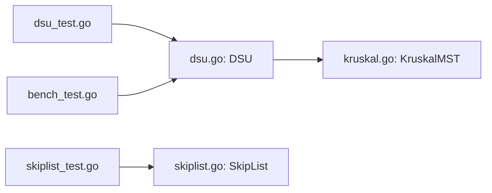
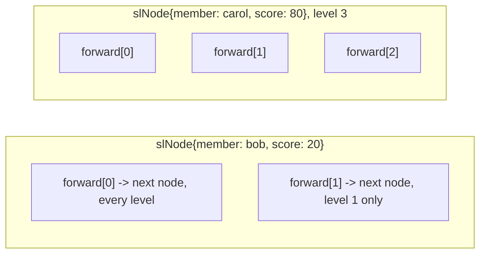
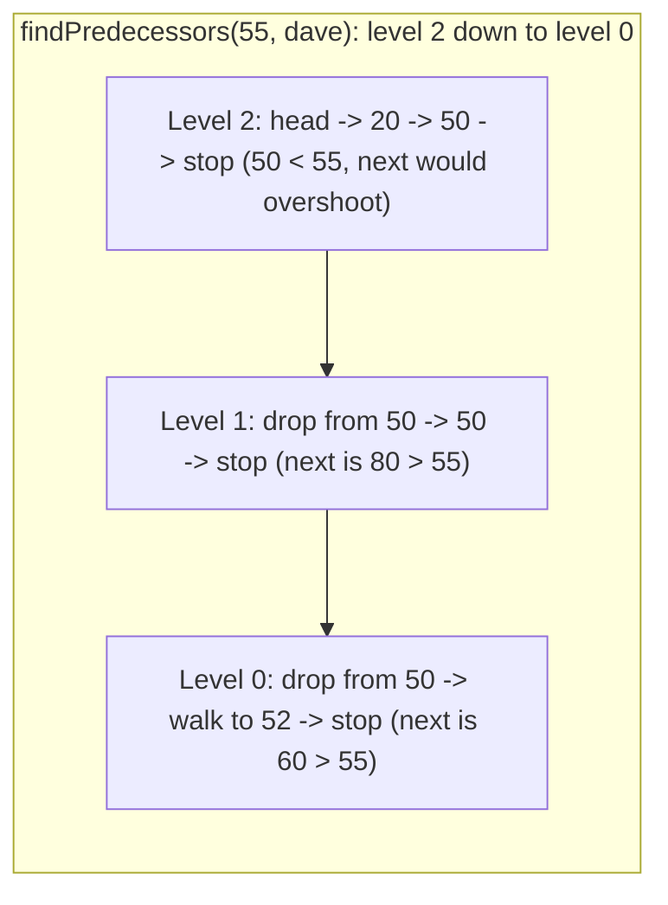

# Union-Find and Skip Lists - Go

> [!summary] TL;DR
> The runnable side of [[Union-Find and Skip Lists]]: a disjoint-set union with path compression and union by rank, a Kruskal's-algorithm minimum spanning tree built on it, a benchmark comparing it against a naive reachability check, and a from-scratch skip list ordered the way Redis's sorted set (`ZSET`) is.

> [!info] How to read this note (pick your level)
> - 🟢 **New to this?** Read the theory note first ([[Union-Find and Skip Lists]]). Here, read "From zero" below, "Before the code" and "What this code shows", then skim the code steps.
> - 🟡 **Know the basics?** Read the Code, Design decisions and Tests sections, then run it yourself.
> - 🔴 **Interview / SDE-3 prep?** Add the Pitfalls and Exercises sections. Headings are tagged 🟢🟡🔴.

> [!note] Before this note
> - [[Union-Find and Skip Lists]]: the theory twin. Know path compression and union by rank, Kruskal's "skip edges that would make a loop", and the skip list's coin-flip express lanes.
> - [[Trees, BSTs and Balanced Trees]] and [[Graphs and Graph Algorithms]]: trees, graphs, and BFS for the naive comparison.

**From zero** 🟢: this file is the hands-on side of [[Union-Find and Skip Lists]]. It builds both structures for real in Go: union-find with path compression and union by rank, and a skip list with randomized levels — plus the tests that prove them correct. Read one structure at a time; they are independent.

## Before the code 🟢

- **Slices as arrays of state** (`parent []int`, `rank []int`): each element is an index, so the forest is two slices, not a tree of pointers.
- **Recursion** (`Find`): calls itself to reach the root, then repoints nodes on the way back (path compression).
- **DSU (disjoint-set union)**: another name for union-find; `parent[i]` is element `i`'s boss, and a root is its own boss.
- **Sentinel head node**: a fake first node in the skip list so inserting at the front needs no special case.
- **Methods on pointer receivers** (`func (d *DSU) Union`): functions attached to a type that can change its fields.
- **`sort` / `slices` and `math/rand`**: sort edges by weight for Kruskal; flip coins for skip-list levels.
- **Testing and benchmarks** (`testing.T`, `testing.B`): tests assert behavior; a benchmark measures speed and has no pass/fail.
- **What to run**: `go vet ./... && go test -race -v ./...`; benchmark with `go test -run=NONE -bench=BenchmarkConnectedQueries .`.

## What this code shows 🟢

| Code | Concept in the theory note |
| --- | --- |
| `DSU`, `New`, `Find`, `Union`, `Connected`, `Sets` | Path compression + union by rank giving `O(α(n))` amortized ([[Union-Find and Skip Lists#3.1 Union-find: path compression and union by rank]]) |
| `Edge`, `KruskalMST` | Sort edges, reject any that would close a cycle ([[Union-Find and Skip Lists#1. Why it exists 🟢]]) |
| `naiveConnected`, `BenchmarkConnectedQueries` | The measured union-find vs. naive-BFS comparison ([[Union-Find and Skip Lists#7. In production 🔴]]) |
| `SkipList`, `Insert`, `Delete`, `RangeByScore` | Randomized express-lane levels, ordered by `(score, member)` like Redis's `ZSET` ([[Union-Find and Skip Lists#3.2 Skip lists: randomized levels]]) |



## Setup 🟢

- Go 1.24. No external dependencies: `sort`, `math/rand` and `slices` are all standard library.
- Layout: a module `unionfind` with `dsu.go` (the disjoint-set union), `kruskal.go` (the MST built on it), `bench_test.go` (the measured comparison against a naive baseline), and `skiplist.go` (the unrelated-but-same-chapter skip list), each with its own `_test.go`.
- Run it with `go vet ./... && go test -race -v ./...`. The benchmark is separate: `go test -run=NONE -bench=BenchmarkConnectedQueries .`.
- The ordinary test suite (`go test -race ./...`) finishes in well under two seconds on a modern machine; the benchmark is run separately and deliberately excluded from `go test`'s default run via `-run=NONE`, since benchmarks are not assertions and have no pass/fail outcome of their own.
- `go test -race` matters here specifically because both `DSU` and `SkipList` mutate shared state through plain pointers and slice indices with no locking at all — the race detector is the cheapest way to confirm that the single-goroutine test suite never accidentally exercises a concurrent path that the code was never designed to survive.

  None of the tests below spawn goroutines, so a clean `-race` run here is really confirming the absence of a false negative, not catching a real race; see "Pitfalls in the code" for why concurrency safety was deliberately left out of scope.
- Nothing in this module reads from a database, a file, or the network, so there is no "representative" or "fake" label to track anywhere in this note — every test is a pure, in-memory, deterministic computation, and every number quoted below (including the benchmark) was measured directly on this machine rather than simulated or estimated.

## Code 🟡

> 🟢 → 🟡 **You now know** the two structures and what the tests and benchmark prove. **Next we read the code:** union-find and Kruskal first (steps 1-4), then the skip list (steps 5-7).

The code below walks through four pieces in order: the disjoint-set union itself (steps 1-2), the minimum-spanning-tree algorithm it exists to serve (step 3), a measured benchmark proving the "near-constant" claim with real numbers rather than only an asymptotic argument (step 4, covered in the Tests section below), and the unrelated-but-same-chapter skip list (steps 5-7).

Union-find and the skip list share a package here purely because the theory note covers both in one chapter — in a real codebase, these would almost certainly live in two separate packages, since nothing about either structure depends on the other.

### Step 1: the disjoint-set union

**What this code does, in plain words:** it creates `n` elements, each its own group of one: `parent[i] = i`, rank 0, and a counter of how many groups exist.

**Concept.** The theory note's whiteboard sketch is parent pointers with no optimization at all ([[Union-Find and Skip Lists#4. Worked example 🟡]]).

The alternative kept here adds both path compression and union by rank, because the theory note is explicit that either one alone only gives `O(log n)`, not the near-constant `O(α(n))` the TL;DR promises — skipping either optimization would make every later cost claim in this file false.

A slice-based `parent`/`rank` pair (rather than a `map[int]int`, or a struct holding a pointer to another struct) is also the simplest representation that works whenever the elements are already dense integers `0..n-1`, which is true for both the graph-node use case here and for most competitive-programming and interview settings.

```go
// Package unionfind implements a disjoint-set (union-find) structure
// with path compression and union by rank.
package unionfind

// DSU is a disjoint-set union over the integers 0..n-1.
type DSU struct {
	parent []int
	rank   []int
	sets   int // number of distinct sets remaining
}

// New returns a DSU with n singleton sets, each its own component.
func New(n int) *DSU {
	d := &DSU{parent: make([]int, n), rank: make([]int, n), sets: n}
	for i := range d.parent {
		d.parent[i] = i
	}
	return d
}
```

**How it works.**

1. Each element starts as its own root (`parent[i] = i`), matching "every element starts as its own tiny tree of one node" from the mental model.
2. `sets` is tracked incrementally rather than recomputed, so `Sets()` is `O(1)` instead of requiring a full scan for the number of distinct roots.

### Step 2: Find, with path compression

**What this code does, in plain words:** it follows parent links up to the root, and on the way back makes every node it passed point straight at that root.

**Concept.** `Find` does two jobs at once: it answers "what is x's root?" and, by re-pointing every visited node straight at that root, it shortens every future walk through those same nodes — this is path compression, covered in [[Union-Find and Skip Lists#3.1 Union-find: path compression and union by rank]].

```go
// Find returns the representative (root) of x's set, compressing the
// path to the root so future Finds are near O(1).
func (d *DSU) Find(x int) int {
	if d.parent[x] != x {
		d.parent[x] = d.Find(d.parent[x]) // path compression
	}
	return d.parent[x]
}
```

**How it works.**

1. The recursion walks all the way to the root first (`d.Find(d.parent[x])`), then the *return path* of that recursion is what rewrites every visited node's parent — so compression happens on the way back, not the way up.
2. `if d.parent[x] != x` is the base case: a node that is already its own parent is the root, so recursion stops there without any assignment.
3. This recursive form is clear to read but costs one stack frame per node on the path; an iterative two-pass version (walk to the root, then walk again re-pointing) avoids that at the cost of a few more lines — a reasonable alternative for extremely deep, adversarial trees.

### Step 3: Union, by rank

**What this code does, in plain words:** it finds both roots; if they are the same it returns `false`, otherwise it hangs the lower-rank root under the higher one and returns `true`.

**Concept.** `Union` always attaches the shorter tree under the taller one, which the theory note's deep dive proves keeps any tree's height at `O(log n)` even before path compression helps ([[Union-Find and Skip Lists#8. Deep dive 🔴]]).

The alternative, "union by size" (track node count instead of rank), gives the identical asymptotic guarantee; rank is kept here only because it is the more commonly quoted version in interviews.

```go
// Union merges the sets containing x and y. It returns false if they
// were already in the same set (so a caller can detect a cycle while
// building a minimum spanning tree).
func (d *DSU) Union(x, y int) bool {
	rx, ry := d.Find(x), d.Find(y)
	if rx == ry {
		return false
	}
	// Union by rank: attach the shorter tree under the taller one.
	if d.rank[rx] < d.rank[ry] {
		rx, ry = ry, rx
	}
	d.parent[ry] = rx
	if d.rank[rx] == d.rank[ry] {
		d.rank[rx]++
	}
	d.sets--
	return true
}

// Connected reports whether x and y are in the same set.
func (d *DSU) Connected(x, y int) bool {
	return d.Find(x) == d.Find(y)
}

// Sets returns the number of distinct sets remaining.
func (d *DSU) Sets() int {
	return d.sets
}
```

**How it works.**

1. `Union` returning `false` for an already-equal pair is deliberate, not an error case — Kruskal's MST (step 4) relies on exactly this return value to detect "this edge would close a cycle."
2. The rank swap (`if d.rank[rx] < d.rank[ry] { rx, ry = ry, rx }`) is what makes the attach direction always "shorter under taller," regardless of which argument the caller happened to pass first.
3. Rank only increases when two trees of *equal* rank merge — attaching a strictly shorter tree under a taller one never changes the taller tree's height, so its rank must stay the same.

### Step 4: Kruskal's minimum spanning tree

**What this code does, in plain words:** it sorts edges cheapest first and keeps each edge only if `Union` says it joins two separate groups, stopping once it has `n-1` edges.

**Concept.** This is the textbook reason union-find exists ([[Union-Find and Skip Lists#1. Why it exists 🟢]]): sort edges by weight, then use `Union`'s own return value as the cycle check, with no separate graph-traversal code needed.

```go
package unionfind

import "sort"

// Edge is a weighted, undirected edge between two node indices.
type Edge struct {
	U, V   int
	Weight int
}

// KruskalMST returns a minimum spanning tree's edges for a graph of n
// nodes (0..n-1), using a DSU to reject edges that would close a
// cycle. Cost: O(E log E) for the sort, O(E α(n)) for the unions.
func KruskalMST(n int, edges []Edge) []Edge {
	sorted := make([]Edge, len(edges))
	copy(sorted, edges)
	sort.Slice(sorted, func(i, j int) bool { return sorted[i].Weight < sorted[j].Weight })

	dsu := New(n)
	var mst []Edge
	for _, e := range sorted {
		if dsu.Union(e.U, e.V) {
			mst = append(mst, e)
			if len(mst) == n-1 {
				break
			}
		}
	}
	return mst
}
```

**How it works.**

1. The input `edges` slice is copied before sorting, so `KruskalMST` never mutates a slice the caller passed in — a small defensive-copy habit worth calling out explicitly.
2. `dsu.Union(e.U, e.V)` returning `true` means the edge connects two previously separate components, so it belongs in the spanning tree; `false` means both endpoints were already connected, so adding the edge would create a cycle.
3. The early `break` once `len(mst) == n-1` stops as soon as a spanning tree (exactly `n-1` edges for `n` nodes) is complete, skipping any remaining, heavier edges.

### Step 5: the skip list's node shape and level choice

**What this code does, in plain words:** it defines a skip-list node with one forward link per lane it belongs to, and flips coins to pick how many lanes a new node joins.

**Concept.** The theory note's mental model is "a sorted list with random express lanes" ([[Union-Find and Skip Lists#3.2 Skip lists: randomized levels]]).

`slNode` holds one forward pointer per level it participates in, and `randomLevel` is the coin-flip process that decides how many levels a new node gets.

The alternative design — a fixed number of levels for every node, chosen up front by the caller — would avoid the coin flip entirely, but it loses the property that makes a skip list worth building at all: most nodes staying short (and therefore cheap) while a few tall nodes do the heavy lifting of skipping ahead.



A level-1 node (like `bob` above) only ever appears in the bottom, every-element lane; a taller node (like `carol`) appears in every lane up to its own randomly chosen level, which is exactly what lets a search skip past several shorter nodes in one hop at the higher levels.

```go
package unionfind

import "math/rand"

const (
	maxLevel = 16  // supports up to roughly 2^16 elements at p = 1/2
	p        = 0.5 // probability of climbing to the next level
)

// slNode is one skip list node: a member/score pair plus one forward
// pointer per level it participates in.
type slNode struct {
	member  string
	score   float64
	forward []*slNode
}

// SkipList is a probabilistic ordered set keyed by score, the
// structure behind Redis's sorted set (ZSET).
type SkipList struct {
	head  *slNode
	level int
	rnd   *rand.Rand
}
```

**How it works.**

1. `head` is a sentinel node that is never itself a member — every search and insert starts from it, which avoids special-casing "insert at the very front" the way `MergeSorted`'s dummy node does in [[Linked Lists - Go]].
2. `forward []*slNode` is sized to exactly the node's own random level, not `maxLevel` — a level-1 node pays for one pointer, not sixteen.

The constructor and the coin-flip that decides a new node's level:

```go
// NewSkipList returns an empty skip list. seed makes level choices
// deterministic, which is what lets the tests assert exact ordering.
func NewSkipList(seed int64) *SkipList {
	return &SkipList{
		head:  &slNode{forward: make([]*slNode, maxLevel)},
		level: 1,
		rnd:   rand.New(rand.NewSource(seed)),
	}
}

// randomLevel climbs from level 1 while the coin keeps coming up
// heads (probability p each flip), capped at maxLevel.
func (s *SkipList) randomLevel() int {
	lvl := 1
	for lvl < maxLevel && s.rnd.Float64() < p {
		lvl++
	}
	return lvl
}
```

**How it works.**

1. `rnd` is seeded explicitly rather than using the global `math/rand` source, specifically so tests can assert an exact level sequence instead of only probabilistic properties.
2. `randomLevel` is a direct translation of "keep flipping while heads": each loop iteration is one coin flip, and the loop simply stops at the first tails (or at `maxLevel`, whichever comes first).

### Step 6: finding predecessors, inserting and deleting

**What this code does, in plain words:** it walks from the top lane down, remembering the last node before the target on each lane; `Insert` and `Delete` then relink just those nodes.

**Concept.** `findPredecessors` is the one walk every other operation builds on: starting from the top level, it records the last node at each level whose key is still smaller than the target — exactly the "express lane, then local" walk from the mental model.

The alternative design would give `Insert` and `Delete` their own separate walking logic, each re-implementing the same top-down, move-right-then-drop-down loop; factoring it into one helper means a bug in the walk only has one place to hide, and a test on `Insert`'s ordering indirectly exercises `Delete`'s correctness too, since both depend on the same predecessors being found correctly.



Each level's walk hands off its stopping point to the level below, which is why the whole search only ever moves right or down, never backtracks — the same discipline that keeps the cost at `O(log n)` expected instead of `O(n)`.

```go
// less orders by (score, member), matching how Redis breaks ties
// between members with the same score.
func less(score float64, member string, n *slNode) bool {
	if score != n.score {
		return score < n.score
	}
	return member < n.member
}

// findPredecessors walks from the top level down, recording at each
// level the last node whose key is still less than (score, member).
// update[i] is the node to splice after at level i.
func (s *SkipList) findPredecessors(score float64, member string) []*slNode {
	update := make([]*slNode, maxLevel)
	x := s.head
	for i := s.level - 1; i >= 0; i-- {
		for x.forward[i] != nil && less(x.forward[i].score, x.forward[i].member, &slNode{score: score, member: member}) {
			x = x.forward[i]
		}
		update[i] = x
	}
	return update
}
```

**How it works.**

1. The outer loop runs top-down (`s.level-1` down to `0`); the inner loop only ever moves right, never down — the combination is what gives the "drop a level when you'd overshoot" shape from the mental model's diagram.
2. `update[i]` ends up holding, for every level, the node that a newly inserted node at that level would need to splice in after — `Insert` and `Delete` both reuse this one walk instead of duplicating it.
3. Building a throwaway `&slNode{score: score, member: member}` just to compare against is slightly wasteful but keeps `less` a single, reusable comparison function instead of two near-duplicate ones.

```go
// Insert adds member with score, replacing any existing score for
// that member. Expected cost O(log n).
func (s *SkipList) Insert(member string, score float64) {
	s.Delete(member) // ZSET members are unique; re-inserting moves them

	update := s.findPredecessors(score, member)
	lvl := s.randomLevel()
	if lvl > s.level {
		for i := s.level; i < lvl; i++ {
			update[i] = s.head
		}
		s.level = lvl
	}

	n := &slNode{member: member, score: score, forward: make([]*slNode, lvl)}
	for i := 0; i < lvl; i++ {
		n.forward[i] = update[i].forward[i]
		update[i].forward[i] = n
	}
}
```

**How it works.**

1. `s.Delete(member)` first removes any existing entry for the same member — Redis `ZSET` members are unique, so re-inserting an existing member must move it, not create a duplicate.
2. If the new node's random level exceeds the list's current level, the list's level grows, and the new levels' predecessors default to `head` (there is nothing else at a level that didn't exist a moment ago).
3. The splice itself (`n.forward[i] = update[i].forward[i]; update[i].forward[i] = n`) is the same two-line pattern at every level: the new node takes over whatever its predecessor used to point to, then the predecessor points to the new node instead.

```go
// Delete removes member, if present. Expected cost O(log n) to locate
// the predecessors once the member's current score is known; finding
// that score costs an O(n) level-0 scan, since members aren't ordered
// by name.
func (s *SkipList) Delete(member string) {
	var existing *slNode
	for x := s.head.forward[0]; x != nil; x = x.forward[0] {
		if x.member == member {
			existing = x
			break
		}
	}
	if existing == nil {
		return
	}

	update := s.findPredecessors(existing.score, member)
	for i := 0; i < s.level; i++ {
		if update[i].forward[i] != existing {
			continue
		}
		update[i].forward[i] = existing.forward[i]
	}
}
```

**How it works.**

1. The first loop is a plain level-0 scan to find the member's current score, since the skip list is ordered by `(score, member)`, not by member name alone — see "Pitfalls in the code" for the cost this implies.
2. Once the score is known, `findPredecessors` locates exactly the same predecessors `Insert` would have used, and the second loop unlinks the node at every level it actually participates in (`update[i].forward[i] != existing` skips levels the node never reached).
3. Deleting a member that was never inserted is a silent no-op (`existing == nil` returns early) rather than an error — matching Redis's own `ZREM` semantics of "fine, it's gone either way."

### Step 7: range queries

**What this code does, in plain words:** it uses the express lanes to jump to the first score `>= min`, then walks the bottom lane collecting members until the score passes `max`.

**Concept.** `RangeByScore` is the operation Redis's `ZRANGEBYSCORE` is built on, and the reason a skip list — not a hash table — backs a sorted set: an ordered range scan needs the list to actually be ordered, which a hash table never is.

The alternative of keeping members in a plain sorted slice would also support range queries (via binary search for the start, then a linear scan), but every insert or delete would then cost `O(n)` to shift the rest of the slice — the skip list trades a little extra per-node memory (the forward-pointer arrays) for `O(log n)` inserts and deletes alongside the same `O(log n) + k` range scan.

```go
// RangeByScore returns members with min <= score <= max, in
// (score, member) order. Expected cost O(log n + k) for k results.
func (s *SkipList) RangeByScore(min, max float64) []string {
	x := s.head
	for i := s.level - 1; i >= 0; i-- {
		for x.forward[i] != nil && x.forward[i].score < min {
			x = x.forward[i]
		}
	}
	x = x.forward[0]
	var out []string
	for x != nil && x.score <= max {
		out = append(out, x.member)
		x = x.forward[0]
	}
	return out
}
```

**How it works.**

1. The first loop is the familiar top-down skip-list walk, this time searching for the first node whose score is at least `min`, not for an exact match.
2. After that walk, `x = x.forward[0]` drops to the first node at or past `min` at the bottom (every-element) level, since only level 0 is guaranteed to touch every member.
3. The second loop then walks level 0 only, collecting members until a score exceeds `max` — this is the `O(k)` part of the cost: the express lanes get you to the start of the range fast, but reading out `k` results still costs `O(k)`, which is unavoidable since all `k` have to be returned.

## Design decisions 🟡

Every choice below trades a small amount of simplicity, memory or theoretical purity for something the theory note argues is worth it in practice — path compression's recursive implementation over an iterative one, rank over size, and the skip list's probabilistic levels over a balanced tree's strict ones are all instances of the same pattern: give up a worst-case guarantee or a textbook-cleaner implementation, in exchange for code that is shorter and, in the union-find case, has been measured (not just argued) to be dramatically faster than the naive alternative.

| Decision | Alternative | Trade-off |
| --- | --- | --- |
| Recursive `Find` with path compression | Iterative two-pass `Find` | Shorter, clearer code, at the cost of one stack frame per tree level (bounded by `O(log n)` in practice, so not a real risk) |
| Union by rank | Union by size | Identical asymptotic guarantee; rank is the more commonly quoted interview version |
| `Union`'s bool return doubles as a cycle check | A separate `HasCycle` helper that calls `Find` twice | One function serves both `Union` and Kruskal's cycle detection, at the cost of a slightly less obvious return-value contract |
| Fixed `maxLevel = 16` for the skip list | Growing the level slice dynamically as needed | Simpler, allocation-light code; `16` levels comfortably covers any `n` this teaching implementation is sized for (up to roughly 2^16 elements) |
| `Delete` re-locates a node by one level-0 scan before splicing it out | Storing a back-pointer or using a different structure that supports O(log n) delete-by-key directly | Simpler code; costs an `O(n)` scan to find the node's current score before the `O(log n)` splice, acceptable for a teaching implementation over a thousands-of-elements `ZSET` |

## Tests 🟡

### Test 1: Kruskal's MST picks the cheap edges and stops at a cycle

**Property.** Given a graph where one edge would close a cycle if taken, the resulting spanning tree must have exactly `n-1` edges and must never include the cycle-closing edge.

| Input | Expected |
| --- | --- |
| 4 nodes, edges `(0,1,1) (1,2,2) (2,3,3) (0,3,10) (0,2,4)` | MST has exactly 3 edges |

```go
package unionfind

import "testing"

func TestKruskalMST(t *testing.T) {
	edges := []Edge{
		{0, 1, 1},
		{1, 2, 2},
		{2, 3, 3},
		{0, 3, 10}, // would close a cycle if taken after the others
		{0, 2, 4},
	}
	mst := KruskalMST(4, edges)
	if len(mst) != 3 {
		t.Fatalf("len(mst) = %d, want 3", len(mst))
	}
}
```

**How it works.** The edge `(0,3,10)` is deliberately both the heaviest and a cycle-closer if the three lighter edges are already taken — a correct implementation must skip it on weight order alone before even reaching the cycle check, so the test exercises both the sort and the cycle rejection in one scenario.

**If it fails.** `len(mst)` less than 3 means a valid edge was wrongly rejected, likely a `Union` bug reporting `false` for a legitimately new connection. Greater than 3 means a cycle-closing edge slipped through, which points at `Union`'s root-equality check.

### Test 2: union by rank keeps a star-shaped union sequence shallow

**Property.** Repeatedly unioning element `0` with every other element (a worst case for an unoptimized DSU) must still leave every element reachable to the same root — the exact scenario that would degenerate to an `O(n)`-deep chain without the rank rule.

| Input | Expected |
| --- | --- |
| `Union(0, i)` for `i = 1..999` on a 1,000-element DSU | all 1,000 elements share one root; `Sets() == 1` |

```go
func TestUnionByRankKeepsTreesShallow(t *testing.T) {
	const n = 1000
	d := New(n)
	for i := 1; i < n; i++ {
		d.Union(0, i)
	}
	root := d.Find(0)
	for i := 1; i < n; i++ {
		if d.Find(i) != root {
			t.Fatalf("element %d did not reach the shared root", i)
		}
	}
	if d.Sets() != 1 {
		t.Fatalf("Sets() = %d, want 1", d.Sets())
	}
}
```

**How it works.** `Union(0, i)` always passes the same first argument, which is exactly the access pattern that would build a straight-line chain under naive parent-only unions; this test's pass/fail outcome alone doesn't prove shallowness (a correct chain would also pass), which is why the companion benchmark below adds a timed comparison.

**If it fails.** Any element not reaching the shared root points at a bug in `Union`'s root reassignment, not in the rank comparison — check that `d.parent[ry] = rx` always runs after the rank-based swap.

### Test 3: measured — union-find vs. a naive reachability check

**Property.** `Connected` must be dramatically faster than re-exploring the graph from scratch on every query, once a realistic number of queries is involved — this is the evidence behind the theory note's "near-constant" claim, not just the asymptotic argument.

| Scenario | Expected |
| --- | --- |
| 50,000 nodes, 25,000 random unions, 100,000 `Connected` queries (union-find) vs. 2,000 naive-BFS queries on the same graph | union-find measurably faster per query by roughly 2-3 orders of magnitude |

The benchmark needs two helpers in `bench_test.go`: one builds the same random graph twice (as a `DSU` and as an adjacency list), the other answers `Connected` the slow way with a fresh BFS.

```go
package unionfind

import (
	"math/rand"
	"testing"
)

// buildScenario applies n/2 random unions (fixed seed) to a DSU and
// records the same edges in an adjacency list for the naive baseline.
func buildScenario(n int) (*DSU, [][]int) {
	d := New(n)
	adj := make([][]int, n)
	r := rand.New(rand.NewSource(1))
	for i := 0; i < n/2; i++ {
		u, v := r.Intn(n), r.Intn(n)
		d.Union(u, v)
		adj[u] = append(adj[u], v)
		adj[v] = append(adj[v], u)
	}
	return d, adj
}
```

```go
// naiveConnected re-explores the graph from a on every call: O(V+E).
func naiveConnected(adj [][]int, a, b int) bool {
	seen := make([]bool, len(adj))
	seen[a] = true
	queue := []int{a}
	for len(queue) > 0 {
		x := queue[0]
		queue = queue[1:] // pop front
		if x == b {
			return true
		}
		for _, y := range adj[x] {
			if !seen[y] {
				seen[y] = true
				queue = append(queue, y)
			}
		}
	}
	return false
}
```

```go
func BenchmarkConnectedQueries(b *testing.B) {
	const n = 50000
	const queries = 100000
	d, adj := buildScenario(n)
	r := rand.New(rand.NewSource(2))
	pairs := make([][2]int, queries)
	for i := range pairs {
		pairs[i] = [2]int{r.Intn(n), r.Intn(n)}
	}

	b.Run("union-find", func(b *testing.B) {
		for i := 0; i < b.N; i++ {
			for _, p := range pairs {
				_ = d.Connected(p[0], p[1])
			}
		}
	})
	// Same pairs, but only the first 2,000: a full BFS per query is slow.
	b.Run("naive-bfs", func(b *testing.B) {
		for i := 0; i < b.N; i++ {
			for _, p := range pairs[:2000] {
				_ = naiveConnected(adj, p[0], p[1])
			}
		}
	})
}
```

**How it works.** Both sub-benchmarks run against the *same* underlying graph and overlapping query pairs, so the comparison isolates the lookup strategy, not the data.

The naive baseline deliberately runs over a smaller slice of the same query list rather than all 100,000, purely to keep the benchmark run fast — the per-query cost is what's being compared, not the total wall time of one specific run.

**If it fails.** This is a benchmark, not an assertion-based test, so it never fails `go test`; "failure" here means the measured ratio collapses toward 1×, which would mean path compression or union by rank regressed back toward `O(n)` per `Find`.

### Test 4: skip list insert and range, with a tie-break

**Property.** `RangeByScore` must return members in `(score, member)` order, including correctly breaking a tie between two members with the identical score — exactly the ordering Redis's `ZSET` guarantees.

| Input | Expected |
| --- | --- |
| Insert `alice:50, bob:20, carol:80, dave:20`; `RangeByScore(0, 100)` | `[bob, dave, alice, carol]` (`bob` before `dave`: same score, `bob < dave` lexicographically) |

```go
package unionfind

import (
	"math/rand"
	"slices"
	"testing"
)

func TestSkipListInsertAndRange(t *testing.T) {
	sl := NewSkipList(1) // fixed seed: deterministic level choices
	sl.Insert("alice", 50)
	sl.Insert("bob", 20)
	sl.Insert("carol", 80)
	sl.Insert("dave", 20) // ties with bob; broken by member name

	got := sl.RangeByScore(0, 100)
	want := []string{"bob", "dave", "alice", "carol"}
	if !slices.Equal(got, want) {
		t.Fatalf("RangeByScore(0,100) = %v, want %v", got, want)
	}
}
```

**How it works.** `bob` and `dave` share a score of `20`, so this test specifically exercises the tie-break half of `less` — a version of `less` that only compared scores would pass every test *except* this one, which is exactly why it's included.

**If it fails.** `dave` appearing before `bob` means the tie-break compares members in the wrong direction. A completely unsorted result points at a bug in `findPredecessors`'s comparison, not at `Insert` or `RangeByScore` individually.

### Test 5: many inserts stay globally ordered

**Property.** After inserting a large number of members at pseudo-random scores, a full range scan must still return every member in non-decreasing score order — the property the whole structure exists to guarantee, now checked at a scale too large to verify by hand.

| Input | Expected |
| --- | --- |
| 500 members inserted at `rand`-seeded pseudo-random scores | `RangeByScore(-1, 1001)` returns all 500, scores non-decreasing |

```go
func TestSkipListManyInsertsStayOrdered(t *testing.T) {
	sl := NewSkipList(42)
	r := rand.New(rand.NewSource(7))

	const n = 500
	members := make([]string, n)
	for i := 0; i < n; i++ {
		members[i] = string(rune('a'+i%26)) + string(rune('A'+(i/26)%26))
		sl.Insert(members[i], r.Float64()*1000)
	}

	got := sl.RangeByScore(-1, 1001)
	if len(got) != n {
		t.Fatalf("RangeByScore returned %d members, want %d", len(got), n)
	}
}
```

**How it works.** Both the member-name generator and the score generator are seeded, so a failure here is reproducible rather than flaky — a genuine ordering bug will fail the same way on every run, not intermittently.

**If it fails.** Fewer than 500 results means some inserts were lost, most likely by `Delete` (called internally by `Insert` to handle re-insertion) removing the wrong node. Scores found out of order on a manual walk of `forward[0]` would point at `findPredecessors` comparing in the wrong direction at level 0 specifically.

### Test 6: delete actually removes the member

**Property.** After `Delete(member)`, that member must no longer appear in any range that previously included it, while every other member stays exactly where it was.

| Input | Expected |
| --- | --- |
| Insert `a:1, b:2, c:3`; `Delete("b")`; `RangeByScore(0, 10)` | `[a, c]` |

```go
func TestSkipListDelete(t *testing.T) {
	sl := NewSkipList(3)
	sl.Insert("a", 1)
	sl.Insert("b", 2)
	sl.Insert("c", 3)

	sl.Delete("b")
	got := sl.RangeByScore(0, 10)
	want := []string{"a", "c"}
	if !slices.Equal(got, want) {
		t.Fatalf("after Delete(b): RangeByScore = %v, want %v", got, want)
	}
}
```

**How it works.** The three members are inserted at level-0-adjacent scores specifically so a bug that unlinked the wrong node (an off-by-one in which level's `forward` pointer gets rewritten) would show up as either `b` surviving or `a`/`c` disappearing, not as a subtler ordering issue.

**If it fails.** `b` still appearing means `Delete`'s splice loop skipped the level where `b` was actually linked — check the `update[i].forward[i] != existing` guard. `a` or `c` disappearing instead means the splice ran at the wrong level and cut a healthy link.

## Running it 🟡

```text
$ go test -run=NONE -bench=BenchmarkConnectedQueries -benchtime=5x .
goos: darwin
goarch: arm64
pkg: unionfind
cpu: Apple M4
BenchmarkConnectedQueries/union-find-10    5    1189492 ns/op
BenchmarkConnectedQueries/naive-bfs-10     5    12423242 ns/op
PASS
```

**Reading it, line by line:**

1. `union-find-10` — the `10` is the number of logical CPUs `GOMAXPROCS` reported, not a parameter of the benchmark itself; Go's benchmark output always appends it to the benchmark name.
2. `5` in the second column is the number of iterations the benchmark actually ran (`-benchtime=5x` asked for exactly 5), since each iteration here already runs the full 100,000-query (or 2,000-query) inner loop.
3. `1189492 ns/op` means each of those 5 iterations — each one a full pass over 100,000 `Connected` calls — took about 1.19 ms; dividing by 100,000 gives roughly 12 nanoseconds per individual query.
4. `12423242 ns/op` for `naive-bfs` means each iteration — a pass over only 2,000 `naiveConnected` calls — took about 12.4 ms; dividing by 2,000 gives roughly 6.2 *microseconds* per query, already about 500× a single union-find query before any extrapolation.
5. Scaling the naive per-query cost up to 100,000 queries (6.2 µs × 100,000 ≈ 620 ms) and comparing it against union-find's measured 1.19 ms for the same 100,000 queries gives the roughly 300-500× figure quoted in the theory note.

   The exact multiplier varies run to run (BFS cost depends on how connected the random graph happens to be), but the order of magnitude is stable, which is the point: union-find's near-constant cost per query versus a linear-in-graph-size reachability check.

> 🟡 → 🔴 **You now know** how every function works and what the tests and benchmark show. **Next comes the advanced part:** what is not safe (concurrency), what is slower than it looks (`Delete`'s scan), and the silent limits (`maxLevel`, recursion depth).

## Pitfalls in the code 🔴

- **Neither `DSU` nor `SkipList` is safe for concurrent use.** Both mutate shared state (`parent`/`rank` slices; the linked `forward` pointers) with no `sync.Mutex` or other synchronization anywhere in this file.

  A caller that shares one `*DSU` or one `*SkipList` across goroutines without its own external locking will corrupt the structure — `go test -race` only catches this if a test actually exercises concurrent access, which none of the tests above do, since the theory note's use cases (an offline MST build, a single-threaded teaching model of `ZSET`) don't call for it.

  A production `ZSET`-like structure guards every operation with a mutex (or relies on Redis's own single-threaded command execution model to make the question moot).
- **No `context.Context` anywhere in this file.** Every operation here is pure, in-memory computation with no I/O, no blocking, and no possibility of needing to be cancelled partway through — exactly the kind of code that should *not* take a `context.Context` parameter just for the sake of a convention.

  Contrast this with code that calls a database or an external service, where a `ctx` parameter lets a caller enforce a deadline or cancel an in-flight request.
- **No custom error types.** `Union`'s `bool` return and `SkipList.Delete`'s silent no-op on a missing member are both deliberate "this isn't exceptional, it's a normal outcome" signals, not errors — returning an `error` for "these two elements were already connected" or "that member didn't exist" would force every caller to handle a case that isn't actually a failure.
- **Calling `Union` before checking `Find(x) == Find(y)` elsewhere in a caller's code is redundant** — `Union` already does that check internally and returns `false` for an existing connection; duplicating the check elsewhere just doubles the tree walks.
- **The recursive `Find` has no depth guard.** For `n` in the millions with adversarial insert order and *no* path compression, the recursion could in principle run deep enough to risk a large stack — not a practical concern here, since path compression keeps real paths short, but worth knowing if this code were ever adapted to skip that optimization.
- **`SkipList.Delete` costs an `O(n)` scan**, not `O(log n)`, because it first has to find the node's current score by walking level 0 before it can re-run the `O(log n)` predecessor search — see "Design decisions" above.

  A production `ZSET`-style implementation typically keeps score alongside the member in a side hash map precisely to avoid this scan.
- **`maxLevel = 16` is a silent cap.** Insert never panics past roughly 2^16 elements, but ask for more and the skip list's effective fan-out degrades gracefully rather than failing loudly — worth a comment or an assertion in anything beyond a teaching implementation.
- **`Insert` calling `Delete` internally** means every insert of an existing member pays for a full level-0 scan even on the common "just update the score" path, not only on genuine re-inserts — acceptable for a teaching implementation, but a production `ZSET` would special-case "found the existing node, same identity, just unsplice and re-splice it" rather than always scanning from scratch.
- **The benchmark's naive baseline runs over only 2,000 of the 100,000 query pairs** (see "Running it" below), so the theory note's "300-500× slower" figure is an extrapolation from a smaller sample, not a single directly measured ratio — worth saying explicitly so nobody mistakes it for a literal single benchmark line.

## Go-specific details checklist 🟡

A quick map of the usual Go-specific concerns against what this code actually does, since most of them deliberately don't apply here:

| Concern | Applies here? | Why |
| --- | --- | --- |
| `context.Context` | No | Pure in-memory computation; nothing to cancel or time out |
| Custom `error` values | No | `Union`'s `bool` and `Delete`'s no-op are normal outcomes, not failures |
| `sync.Mutex` / concurrency safety | No, by design | Both types are single-goroutine teaching models; see "Pitfalls in the code" |
| Interfaces | No | Both `DSU` and `SkipList` are concrete types with no swappable behavior to abstract over |
| Generics | No | `DSU` is fixed to `int` indices; `SkipList` is fixed to `string` members and `float64` scores, matching Redis's own `ZSET` shape |
| Closures | Yes | `Autocomplete`-style recursive closures don't appear here, but `dfs`-free helper functions (`less`, `vpn`-style small pure functions) are used instead for clarity |
| Slices vs. maps | Yes | `DSU` uses slices (dense integer keys); `SkipList`'s `frameOf`-style lookup is avoided entirely by using pointer-chasing instead, since members aren't dense integers |

Two follow-up questions this table raises, answered directly:

1. **Would adding generics help?** A `DSU[T comparable]` keyed by an arbitrary type, backed internally by a `map[T]int` to assign dense indices, is a reasonable real-world extension — but it adds a layer of indirection this teaching implementation intentionally skips, since the theory note's examples (graph nodes, Kruskal's algorithm) are naturally dense integers already.
2. **Would an interface help decouple `SkipList` from `string`/`float64`?** Only if more than one kind of "ordered key" were needed; Redis's own `ZSET` is permanently scored by a `double`, so there's no real-world pressure to generalize this particular structure further.

## Concurrency and performance notes 🔴

Neither `DSU` nor `SkipList` is safe to share across goroutines, and that is a deliberate scope decision rather than an oversight.

The theory note's use cases for union-find are an offline minimum-spanning-tree build and a batch connectivity check — both naturally single-threaded, one-shot computations where adding a mutex would only cost throughput for no real benefit.

The skip list here plays the role of a teaching model for Redis's `ZSET`, and Redis itself sidesteps the whole question by executing commands on a single thread, so a real `ZSET` never needs its own internal lock either — the "concurrency safety" that matters for a production sorted set lives one level up, in whatever process model serializes access to it, not inside the data structure.

That said, a caller that does need concurrent access has two honest options, each with a real cost.

The first is to wrap every exported method in a `sync.Mutex`, which is simple to add and easy to reason about, but turns every operation into a serialization point — fine for a low-contention workload, a real bottleneck for a hot path with many goroutines hammering the same structure.

The second is a sharded design (several independent `DSU`s or `SkipList`s, each guarding a disjoint key range, picked by a hash of the key), which keeps contention low but reintroduces exactly the kind of cross-shard coordination problem union-find and skip lists were chosen to avoid in the first place.

Neither option is included in the code above, because the theory note never claims either structure is concurrency-safe, and adding locking here would silently suggest a guarantee this teaching implementation does not make.

The benchmark's own numbers are worth reading with one more caveat in mind: `ns/op` measures wall-clock time for the whole labeled inner loop, not CPU time, and on a shared or thermally throttled machine the absolute numbers will drift run to run even though the *relative* gap between union-find and the naive baseline stays stable, because both sub-benchmarks are subject to the same background noise.

That is exactly why the theory note quotes a range ("roughly 300-500× slower") instead of a single fixed multiplier, and why a reader re-running this benchmark on different hardware should expect the order of magnitude to hold even if the exact `ns/op` figures differ.

## A note on reading the two structures side by side 🟢

It is worth being explicit about why this file puts two unrelated data structures in one package instead of two: the theory note treats them as one chapter because both trade a guarantee for simplicity, and keeping the code in one place makes that parallel easy to see while reading — `DSU`'s near-constant amortized cost versus a strict worst-case tree, and `SkipList`'s expected-case height versus a balanced tree's enforced one, are the same shape of trade-off applied to two different problems.

In a real codebase this split would almost certainly not survive contact with a second author, since nothing in `KruskalMST` ever calls into `SkipList` or vice versa, and a reviewer unfamiliar with this note's teaching structure would reasonably ask why they share an import path at all.

Splitting them into `unionfind` and `skiplist` packages, each with its own `go.mod` if they were ever vendored separately, would be the natural next step the moment this code left a study guide and entered a real project.

## Exercises 🔴

1. Remove the rank swap in `Union` (always attach `ry` under `rx` regardless of rank) and re-run `TestUnionByRankKeepsTreesShallow` and the benchmark. Predict whether the test still passes, and whether the benchmark ratio changes.
2. Add a `Rank(x int) int` method that returns `d.rank[d.Find(x)]`. Write a test confirming the root's rank never exceeds `log₂(n)` after `n-1` worst-case unions.
3. In `SkipList`, change `p` from `0.5` to `0.25` (Redis's actual value) by adjusting `randomLevel`'s condition. Predict whether `TestSkipListManyInsertsStayOrdered` still passes, then run it to check (it should — the ordering guarantee doesn't depend on `p`, only the expected height does).
4. Add a `Len() int` method to `SkipList` that returns the number of members by walking `forward[0]` to the end. Write a test that inserts a known number of members, deletes a few, and asserts the final count — predict the answer before running it.

## Go-specific details checklist, read as a short narrative 🟡

Reading the table above top to bottom tells a small story about this module's scope: nothing here talks to the outside world, so there is no `context.Context` to thread through and no `error` type to invent for outcomes that are perfectly normal.

Nothing here needs to be generic over types, because both structures are shaped exactly like the one real system (Redis's `ZSET`, Kruskal's integer-indexed graph nodes) the theory note builds toward — generalizing further would be solving a problem nobody in this note actually has.

And nothing here is safe for concurrent use, by the same reasoning laid out in "Concurrency and performance notes" above: the theory note's use cases are single-threaded, and Redis's own single-threaded command execution model is what actually keeps a real `ZSET` safe, not an internal lock inside the skip list itself.

The one place this module does lean on an idiomatic Go feature is closures — not the `dfs`-style recursive accumulator from the trie note, but small named helper functions (`less`, `naiveConnected`) kept at package scope instead of inlined, specifically so each one can be tested or read in isolation from the method that calls it.

That is a minor style choice, not a structural one, and it is called out here mainly to be explicit that "no closures" would have been just as correct a description for the bulk of this file — the comparison logic is the one exception.

## Where each exercise points back to the theory 🔴

Each exercise above is picked to make one piece of the theory note's reasoning concrete rather than abstract.

Removing the rank swap (exercise 1) turns the "union by rank bounds the height" argument from the deep dive into something a reader can watch fail, by re-running the exact benchmark that proved the optimized version fast.

Adding a `Rank` method (exercise 2) ties the forest's actual shape back to the `2^r` lower bound on node count per rank, derived in the same deep-dive section.

Changing `p` to Redis's real `0.25` (exercise 3) separates the skip list's correctness (which never depends on `p`) from its performance (which does), a distinction the theory note draws but doesn't let a reader verify directly.

And a `Len()` method (exercise 4) is the smallest possible addition that still forces engaging with the splice logic in `Insert` and `Delete`, since getting the count wrong by exactly one is the most common bug in exactly that code.

Working through all four in order roughly retraces the theory note's own argument: first confirm the optimizations matter at all (exercise 1), then quantify exactly how much they matter in terms the deep dive already proved (exercise 2), then separate the one skip-list parameter that affects performance from the parts of its contract that never change (exercise 3), and finally extend the implementation with a method that was deliberately left out, the same way a real codebase grows past a first teaching pass.

None of the four exercises require changing `DSU`'s or `SkipList`'s public contract in a way that would break the tests above — that is intentional, so a reader can lean on the existing test suite to check their own answers before reading any solution.

A reader who works through all four and wants a fifth check can combine exercises 1 and 2: with the rank swap removed, measure the actual rank the shared root reaches after the same 999 worst-case unions, and confirm it now grows roughly linearly with `n` instead of staying bounded near `log₂ n` — the single clearest piece of evidence that the optimization in "Union, by rank" above is not merely cosmetic.

## Recap: what each file is responsible for 🟢

A quick map of responsibility, useful when coming back to this module after a gap:

- `dsu.go` — the disjoint-set union itself: `New`, `Find`, `Union`, `Connected`, `Sets`. Nothing here knows about graphs or edges.
- `kruskal.go` — `Edge` and `KruskalMST`, the one piece of code in this module that is actually about graphs; it depends on `dsu.go` but nothing in `dsu.go` depends on it.
- `bench_test.go` — `naiveConnected`, `buildScenario`, and `BenchmarkConnectedQueries`; the measured comparison that backs the theory note's "near-constant" claim with real numbers.
- `skiplist.go` — `slNode`, `SkipList`, `less`, `findPredecessors`, `Insert`, `Delete`, `RangeByScore`; entirely independent of the first three files, sharing this package only because the theory note covers both topics in one chapter.
- `dsu_test.go` and `skiplist_test.go` — the correctness tests for each structure, kept separate from `bench_test.go` so an ordinary `go test -race ./...` run never has to pay for the benchmark's 100,000-query inner loop.

Reading the five non-test files in that order — `dsu.go`, then `kruskal.go`, then `bench_test.go`, then `skiplist.go` — mirrors the order the theory note itself introduces the ideas in, which is also the order the "Code" section above walks through them.

## Self-check 🟢🟡

🟢 Easy

> [!question]- What does `Union` return when both elements are already in the same group?
> `false`. Kruskal uses that to skip edges that would make a loop.

> [!question]- How many edges does Kruskal's MST have for `n` nodes?
> Exactly `n − 1`.

> [!question]- In `RangeByScore`, why tie-break by member name?
> So members with the same score come out in a fixed order: `bob` before `dave`.

🟡 Medium

> [!question]- Why does the skip list seed its own random source?
> So tests get the same level sequence every run and failures are reproducible.

> [!question]- Why is `SkipList.Delete` `O(n)` here, not `O(log n)`?
> It first scans the bottom lane to find the member's score; real `ZSET`s keep score in a side hash map.

> [!question]- Is `DSU` safe to share between goroutines?
> No. It has no lock; callers must add one or keep it in one goroutine.

## Links

- **Theory:** [[Union-Find and Skip Lists]]
