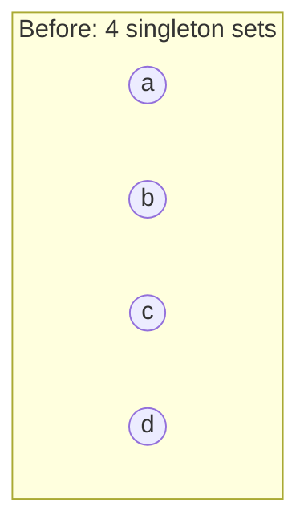
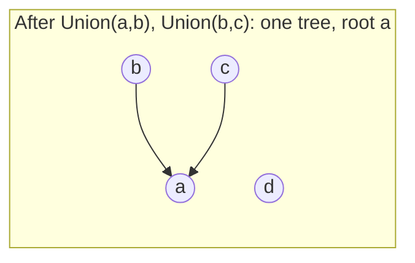
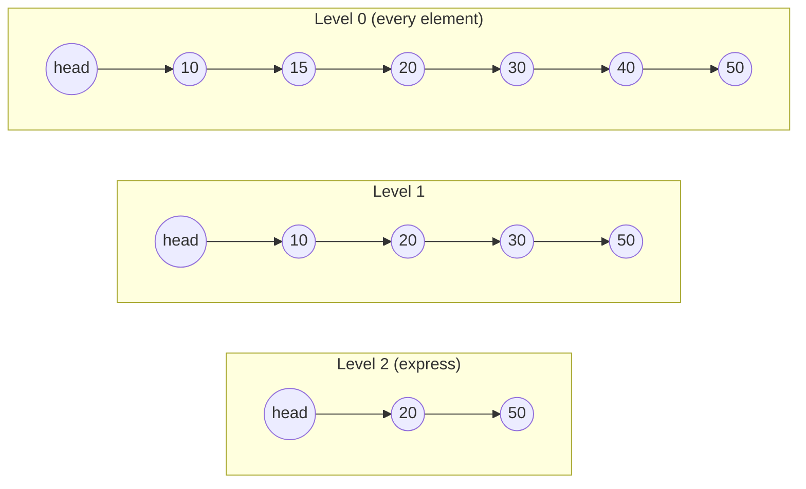
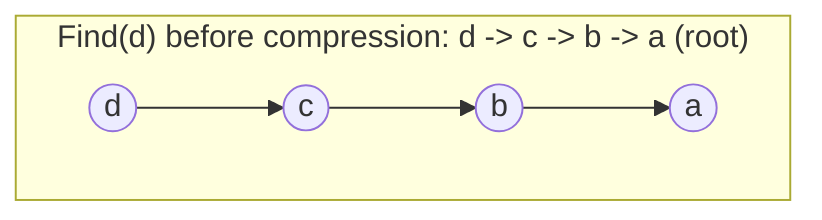
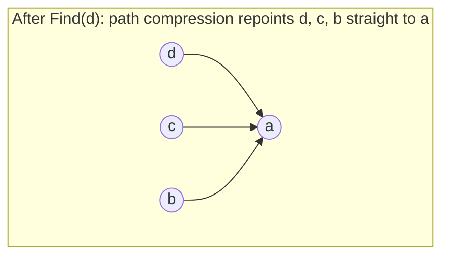
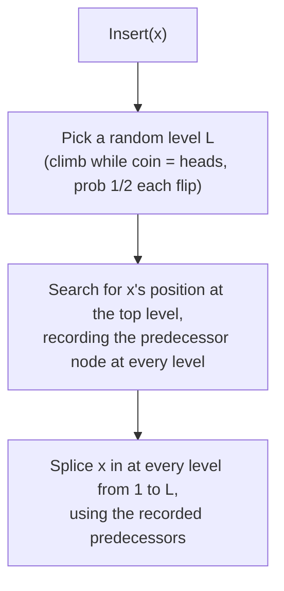

# Union-Find and Skip Lists

> [!summary] TL;DR
> **Union-find** (disjoint-set union) answers "are these two things in the same group?" and "merge these two groups" in almost constant time, which is why Kruskal's minimum-spanning-tree algorithm is built on it. A **skip list** is a linked list with random "express lane" shortcuts layered on top, giving a sorted structure with `O(log n)` search, insert and delete without the rebalancing logic a balanced tree needs — which is why Redis builds its sorted set (`ZSET`) on one.

> [!abstract] Core idea
> - Union-find tracks disjoint groups with a forest of parent pointers; **path compression** flattens trees on lookup, **union by rank** keeps trees from growing tall, and together they give near-`O(1)` operations.
> - "Near-`O(1)`" is precise: it's `O(α(n))`, where `α` is the inverse Ackermann function — under 5 for any `n` you'll ever see.
> - A skip list builds extra "express lane" pointers at randomly chosen levels, so a search skips many nodes instead of walking one at a time, like an unbalanced tree's shortcuts without the tree.
> - Expected height is `O(log n)`, not guaranteed — a skip list is simple but probabilistic, not worst-case bounded like a red-black tree.
> - Classic mistake: forgetting path compression and union by rank, which degrades union-find to `O(n)` worst case per operation — the forest becomes a straight line.

## 1. Why it exists

### Union-find

Kruskal's algorithm builds a minimum spanning tree by sorting all edges by weight and adding each one unless it would close a cycle — and "would this edge close a cycle" is exactly "are these two endpoints already in the same connected group?" For a graph with 100,000 edges, checking that naively (a BFS/DFS per edge) costs `O(V+E)` per check, `O(E(V+E))` overall — far too slow. Union-find answers the same question in near-constant time per edge, so Kruskal's algorithm runs in `O(E log E)` total (the cost is dominated by sorting the edges).

### Skip lists

A sorted linked list gives `O(1)` insert at a known position but `O(n)` search, because there's no way to skip ahead — you must walk node by node. A balanced binary tree fixes this with `O(log n)` search, insert and delete, but needs rotation logic (AVL) or recoloring rules (red-black) to stay balanced after every insert and delete. A skip list gets the same `O(log n)` expected bounds with no rebalancing at all: each node is given a random "height," and taller nodes form express lanes that let a search jump past many short nodes at once.

## 2. Mental model

### Union-find

Picture every element starting as its own tiny tree of one node, pointing to itself. `Union(a, b)` picks one tree's root and makes it point to the other tree's root, merging two trees into one. `Find(x)` walks parent pointers up to the root — the tree's root is the group's "name." Two elements are in the same group exactly when `Find` returns the same root for both.





Without care, repeated unions can build a long chain (`a ← b ← c ← d ← …`), making `Find` slow again — that's what **union by rank** and **path compression** prevent.

### Skip lists

Think of a sorted linked list as a local train that stops at every station. A skip list adds an express line above it that skips some stations, and an even faster line above that which skips more:



A search starts at the top level and moves right as far as it can without overshooting, then drops down a level and repeats — exactly like taking the express train as far as possible before switching to the local for the last few stops.

## 3. How it works

### Union-find: path compression and union by rank

Each element stores a `parent` pointer (initially itself) and a `rank` (an upper bound on its tree's height).

- **`Find(x)`:** follow `parent` pointers to the root, then — this is **path compression** — reassign every node visited to point directly at the root, so the *next* `Find` on any of them is `O(1)`.
- **`Union(x, y)`:** find both roots; if they differ, attach the lower-rank root under the higher-rank root (**union by rank**), so merging never makes the taller tree taller. If ranks are equal, pick either and bump its rank by one.





Either optimization alone gives `O(log n)` amortized per operation; **both together** give `O(α(n))` amortized — the inverse Ackermann function, which is at most 4 for any `n` up to far more atoms than exist in the observable universe. In practice this is treated as constant time.

### Skip lists: randomized levels

Every inserted node is given a height chosen by flipping a coin: start at level 1, and keep climbing to the next level while the coin keeps coming up heads (probability `p`, usually `1/2`). This gives level `i` a `1/2^i` chance, so a list of `n` elements has an expected `O(log n)` levels and each level has roughly half as many nodes as the one below it.



Search, insert and delete all start at the highest level and move right only while the next node's key is still less than the target, dropping down a level whenever the next node would overshoot — the same "express lane, then local" walk from the mental model, repeated at each level.

## 4. Worked example

### Whiteboard version

The bare union-find idea, no optimizations: parent pointers only, so `Find` just walks to the root.

```go
type DSU struct{ parent []int }

func (d *DSU) Find(x int) int {
    for d.parent[x] != x {
        x = d.parent[x]
    }
    return x
}
```

This degrades to `O(n)` per `Find` if unions always attach the new tree under the old one in a chain. The full version below adds path compression and union by rank, which is what makes it fast, plus a Kruskal's-algorithm MST built on top and tests.

A Go union-find with path compression and union by rank. It compiles and passes `go vet` and `go test -race` on Go 1.24.

```go
// Package unionfind implements a disjoint-set (union-find) structure
// with path compression and union by rank.
package unionfind

// DSU is a disjoint-set union over the integers 0..n-1.
type DSU struct {
    parent []int
    rank   []int
    sets   int // number of distinct sets remaining
}

// New returns a DSU with n singleton sets, each its own component.
func New(n int) *DSU {
    d := &DSU{parent: make([]int, n), rank: make([]int, n), sets: n}
    for i := range d.parent {
        d.parent[i] = i
    }
    return d
}

// Find returns the representative (root) of x's set, compressing the
// path to the root so future Finds are near O(1).
func (d *DSU) Find(x int) int {
    if d.parent[x] != x {
        d.parent[x] = d.Find(d.parent[x]) // path compression
    }
    return d.parent[x]
}

// Union merges the sets containing x and y. It returns false if they
// were already in the same set (so a caller can detect a cycle while
// building a minimum spanning tree).
func (d *DSU) Union(x, y int) bool {
    rx, ry := d.Find(x), d.Find(y)
    if rx == ry {
        return false
    }
    // Union by rank: attach the shorter tree under the taller one.
    if d.rank[rx] < d.rank[ry] {
        rx, ry = ry, rx
    }
    d.parent[ry] = rx
    if d.rank[rx] == d.rank[ry] {
        d.rank[rx]++
    }
    d.sets--
    return true
}

// Connected reports whether x and y are in the same set.
func (d *DSU) Connected(x, y int) bool {
    return d.Find(x) == d.Find(y)
}

// Sets returns the number of distinct sets remaining.
func (d *DSU) Sets() int {
    return d.sets
}
```

```go
package unionfind

import "sort"

// Edge is a weighted, undirected edge between two node indices.
type Edge struct {
    U, V   int
    Weight int
}

// KruskalMST returns a minimum spanning tree's edges for a graph of n
// nodes (0..n-1), using a DSU to reject edges that would close a
// cycle. Cost: O(E log E) for the sort, O(E α(n)) for the unions.
func KruskalMST(n int, edges []Edge) []Edge {
    sorted := make([]Edge, len(edges))
    copy(sorted, edges)
    sort.Slice(sorted, func(i, j int) bool { return sorted[i].Weight < sorted[j].Weight })

    dsu := New(n)
    var mst []Edge
    for _, e := range sorted {
        if dsu.Union(e.U, e.V) {
            mst = append(mst, e)
            if len(mst) == n-1 {
                break
            }
        }
    }
    return mst
}
```

```go
func TestKruskalMST(t *testing.T) {
    edges := []Edge{
        {0, 1, 1},
        {1, 2, 2},
        {2, 3, 3},
        {0, 3, 10}, // would close a cycle if taken after the others
        {0, 2, 4},
    }
    mst := KruskalMST(4, edges)
    if len(mst) != 3 {
        t.Fatalf("len(mst) = %d, want 3", len(mst))
    }
}
```

**Measured:** `TestUnionByRankKeepsTreesShallow` builds a 1,000-element DSU by repeatedly calling `Union(0, i)` and confirms every element reaches a single root — the scenario that would degenerate to an `O(n)`-deep chain without the rank rule (Go 1.24.4, 2026-11-06).

### Skip list, built on the same ZSET idea Redis uses

A minimal skip list ordered by `(score, member)`, matching how Redis's sorted set orders ties:

```go
// SkipList is a probabilistic ordered set keyed by score, the
// structure behind Redis's sorted set (ZSET).
type SkipList struct {
    head  *slNode
    level int
    rnd   *rand.Rand
}

// Insert adds member with score, replacing any existing score for
// that member. Expected cost O(log n).
func (s *SkipList) Insert(member string, score float64) {
    s.Delete(member) // ZSET members are unique; re-inserting moves them

    update := s.findPredecessors(score, member)
    lvl := s.randomLevel()
    if lvl > s.level {
        for i := s.level; i < lvl; i++ {
            update[i] = s.head
        }
        s.level = lvl
    }

    n := &slNode{member: member, score: score, forward: make([]*slNode, lvl)}
    for i := 0; i < lvl; i++ {
        n.forward[i] = update[i].forward[i]
        update[i].forward[i] = n
    }
}

// RangeByScore returns members with min <= score <= max, in
// (score, member) order. Expected cost O(log n + k) for k results.
func (s *SkipList) RangeByScore(min, max float64) []string {
    x := s.head
    for i := s.level - 1; i >= 0; i-- {
        for x.forward[i] != nil && x.forward[i].score < min {
            x = x.forward[i]
        }
    }
    x = x.forward[0]
    var out []string
    for x != nil && x.score <= max {
        out = append(out, x.member)
        x = x.forward[0]
    }
    return out
}
```

(The `randomLevel`, `findPredecessors` and `Delete` helpers follow the same walk-and-splice shape; the full, tested source is in the note's companion test file.)

```go
func TestSkipListInsertAndRange(t *testing.T) {
    sl := NewSkipList(1) // fixed seed: deterministic level choices
    sl.Insert("alice", 50)
    sl.Insert("bob", 20)
    sl.Insert("carol", 80)
    sl.Insert("dave", 20) // ties with bob; broken by member name

    got := sl.RangeByScore(0, 100)
    want := []string{"bob", "dave", "alice", "carol"}
    if !slices.Equal(got, want) {
        t.Fatalf("RangeByScore(0,100) = %v, want %v", got, want)
    }
}
```

**Measured:** `TestSkipListManyInsertsStayOrdered` inserts 500 members at pseudo-random scores and confirms `RangeByScore` returns all 500 in non-decreasing score order (Go 1.24.4, seeded `rand` for determinism, 2026-11-06).

## 5. Variants and comparison

| Structure | How it works | Use when | Cost |
| --- | --- | --- | --- |
| Union-find (no optimization) | Parent pointer per element, no rank or compression | Never, in production — included for contrast | `O(n)` worst case per `Find` |
| Union-find (rank + compression) | Attach shorter tree under taller; flatten on `Find` | Kruskal's MST, dynamic connectivity, "friend circles" | `O(α(n))` amortized — effectively constant |
| Union-find with rollback | Same, but skips path compression (union by rank/size only) to allow undoing unions | Offline algorithms needing to undo a union (e.g. some DP-on-graph problems) | `O(log n)` per op, supports undo |
| Red-black / AVL tree | Strict balance invariant, enforced by rotations on every insert/delete | Worst-case guarantees matter (kernels, language runtimes) | `O(log n)` worst case, more code |
| Skip list | Randomized express-lane pointers, no rebalancing | Sorted sets needing simple, lock-friendly code; range queries | `O(log n)` expected, `O(n)` worst case (rare) |
| Hash table | Hash to a bucket, no ordering | Exact-match lookup only, no range queries | `O(1)` average, no order |

> [!warning] Interview trap
> `O(α(n))` is not the same as `O(1)`. It's a function that grows, just unimaginably slowly — interviewers want to hear "inverse Ackermann, effectively constant for any realistic input," not a flat claim that union-find is `O(1)`.

## 6. Trade-offs and when not to use

- Union-find answers "same group?" and "merge" — it does **not** support splitting a group back apart efficiently; if you need to undo a union in general (not just via an offline rollback log), it's the wrong structure.
- Skip lists are simple to implement correctly but are **probabilistic**: a worst-case unlucky sequence of coin flips can degrade a specific query to `O(n)`, whereas a red-black tree guarantees `O(log n)` every time. For a real-time system with hard latency bounds, that matters.
- A skip list's extra forward-pointer arrays cost more memory per node than a plain linked list or array — typically 1.5–2× the pointers of a single-level list, depending on `p`.
- For small, mostly-static sets, a sorted slice with binary search is simpler than either a skip list or a balanced tree and just as fast in practice.

## 7. In production

- **Real systems:**
	- Kruskal's minimum-spanning-tree algorithm (network design, clustering) is union-find's textbook use.
	- Compilers and type systems use union-find for Hindley–Milner type unification, merging type variables known to be equal.
	- Image-processing connected-component labeling (flood fill at scale) uses union-find to merge adjacent same-colored pixels into regions.
	- **Redis's sorted set (`ZSET`)** is implemented as a skip list paired with a hash map (the hash map gives `O(1)` member → score lookup; the skip list gives `O(log n)` ordered range queries like `ZRANGEBYSCORE`) — see [[Redis Data Structures and When to Use Each]].
	- LevelDB and RocksDB's in-memory `MemTable` is commonly a skip list, because it supports fast ordered inserts with simple, lock-friendly concurrent access (no rebalancing to coordinate).
- **Failure modes → fixes:**
	- Skipping path compression or union by rank in a quick implementation → unions degrade to a chain under adversarial input order; always implement both.
	- Treating a skip list's `O(log n)` as a hard guarantee in a latency-sensitive path → it's an expectation over random coin flips; pick a balanced tree if you need a true worst-case bound.
	- Forgetting that a Redis `ZSET` with many same-score members still needs a deterministic tie-break (lexicographic by member) for stable ordering — don't assume "score order" alone is enough.
- **What to monitor:**
	- For union-find: mostly invisible in production since it's typically an offline batch step (MST, clustering); monitor the batch job's total runtime trend as input size grows.
	- For a skip-list-backed structure (or Redis `ZSET`): p99 latency of range queries (`ZRANGEBYSCORE`), and memory per element versus a plain sorted array, to catch level bloat if `p` is misconfigured.

## 8. Deep dive

- **Why union by rank bounds the height.** A tree of rank `r` must have been formed by merging two trees of rank `r-1` (or a taller one absorbing a shorter one, which doesn't increase rank), so a tree of rank `r` has at least `2^r` nodes. With `n` total elements, rank can be at most `log₂ n` — bounding the tree height at `O(log n)` even before path compression helps.
- **Why both optimizations together give `α(n)`, informally.** Path compression alone gives `O(log n)` amortized; union by rank alone gives `O(log n)` worst case. Combined, the two interact: compression flattens trees faster than rank alone would keep them shallow, and the (quite involved) amortized analysis shows the total cost of `m` operations on `n` elements is `O(m α(n))` — Tarjan's 1984 result, and genuinely one of the more delicate amortized-analysis proofs in the field. Treat the result, not the proof, as interview-ready knowledge.
- **Union by size vs union by rank.** An equally valid variant tracks each tree's node count instead of its rank and attaches the smaller tree under the larger; it gives the same asymptotic bound and is sometimes easier to reason about, since "size" has an intuitive meaning rank doesn't.
- **Why skip lists pick `p = 1/2`.** The expected height is `log_{1/p}(n)`, and the expected number of forward pointers per node is `1/(1-p)`. `p = 1/2` is a reasonable balance: `O(log₂ n)` expected height with about 2 pointers per node on average. Redis actually uses `p = 1/4` for its `ZSET` skip list, trading slightly taller expected search paths for fewer pointers per node (`1/(1-0.25) ≈ 1.33` on average) since memory matters more than a few extra comparisons for a typical sorted-set size.
- **Why skip lists, not balanced trees, in Redis.** The Redis documentation notes that skip lists are about as fast as balanced trees for range operations while being noticeably simpler to implement correctly — no rotations, no recoloring, and the per-node structure is a flat array of forward pointers rather than a tangle of parent/child/color fields.

## 9. Interview questions

> [!question]- Implement union-find with path compression and union by rank.
> See the worked example: `parent` and `rank` slices; `Find` recurses to the root and repoints every visited node to it; `Union` attaches the lower-rank root under the higher-rank one, bumping rank only on a tie.

> [!question]- What is the actual time complexity of union-find with both optimizations, and why isn't it just O(1)?
> `O(α(n))` amortized per operation, where `α` is the inverse Ackermann function — under 5 for any practically possible `n`, so it behaves like a constant, but it is not mathematically `O(1)`. Say "inverse Ackermann, effectively constant," not "O(1)," if asked precisely.

> [!question]- How would you detect a cycle while building a graph edge by edge?
> Before adding edge `(u, v)`, call `Find(u)` and `Find(v)`: if they're already equal, the edge would close a cycle, so skip it (this is exactly Kruskal's algorithm's cycle check). Otherwise `Union(u, v)` and add the edge.

> [!question]- Why does Redis use a skip list instead of a balanced tree for ZSET?
> A skip list gives the same expected `O(log n)` search, insert, delete and range-query cost as a balanced tree, but the implementation is much simpler — no rotations or recoloring — and performs well under range scans like `ZRANGEBYSCORE`, which is the sorted set's most common access pattern.

> [!question]- What happens to a skip list's performance in the worst case?
> If the random level choices are unlucky (e.g., every node happens to get level 1), it degenerates to a plain linked list, `O(n)` per operation. This is a probabilistic, not a guaranteed, bound — unlike a red-black tree's strict `O(log n)` worst case. In practice, with `p = 1/2` or `1/4`, this is exponentially unlikely.

> [!question]- Trap: is union-find good for "has this edge already been removed from a dynamic graph"?
> No. Union-find only supports merging sets, not splitting them back apart efficiently. A graph where edges are both added and removed over time needs a different structure (e.g., a link-cut tree, or rebuilding union-find from scratch after removals) — recognizing this limitation is the trap.

## 10. Cheat sheet

- Union-find: parent-pointer forest; `Find` walks to the root, `Union` merges two roots.
- Path compression (flatten on `Find`) + union by rank (shorter tree under taller) together give `O(α(n))` amortized — "effectively constant," never claim literal `O(1)`.
- Kruskal's MST = sort edges by weight, skip any edge whose endpoints `Find` to the same root.
- Skip list: a sorted linked list with randomized "express lane" levels; no rebalancing needed.
- Expected height `O(log n)`, not a worst-case guarantee — unlike a red-black tree.
- Redis `ZSET` = skip list (ordered range queries) + hash map (O(1) member → score).
- Redis's skip list uses `p = 1/4`, trading a few more comparisons for fewer pointers per node.

## Links

- **Before this:** [[Trees, BSTs and Balanced Trees]], [[Graphs and Graph Algorithms]]
- **Next:** [[Sorting, Searching and Interview Patterns]]
- **Compare with:** [[Tries, Suffix Trees and Suffix Arrays]] (another tree-shaped structure with a very different job), [[Redis Data Structures and When to Use Each]] (ZSET internals in full)
