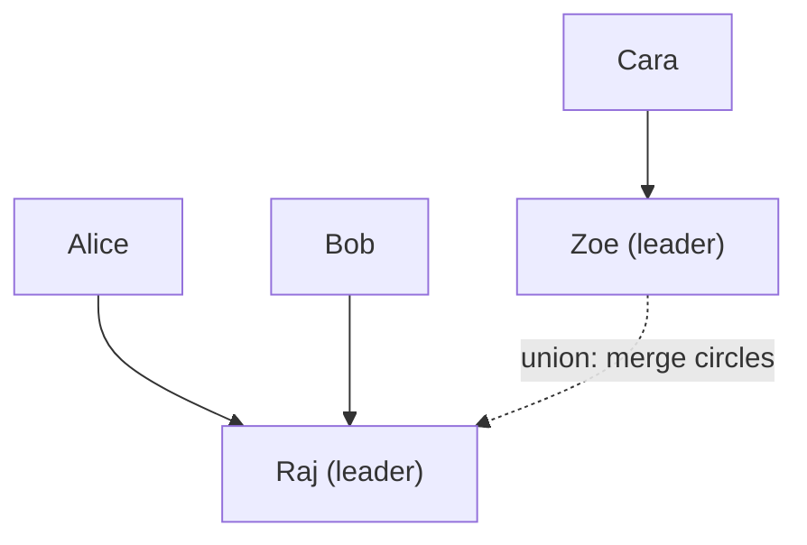
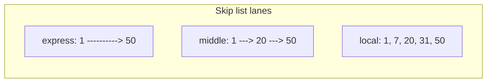
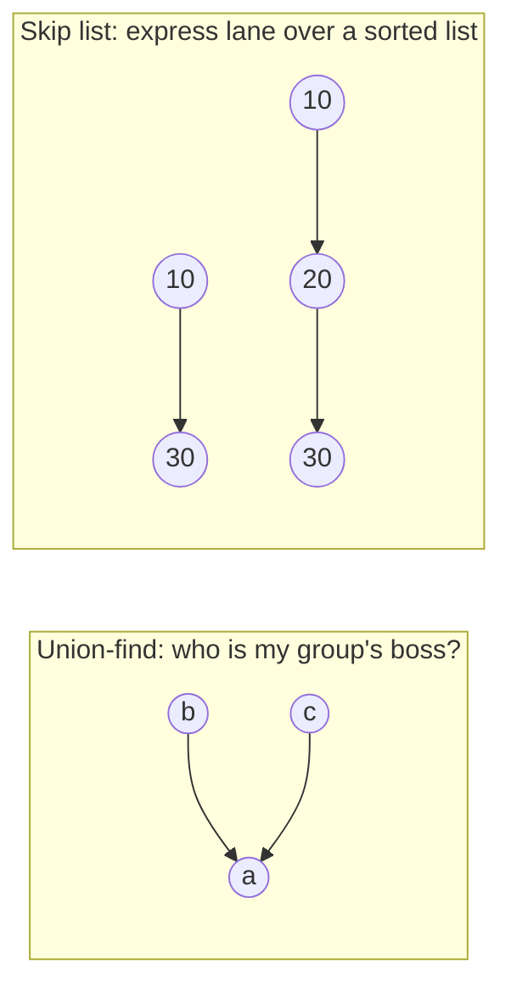
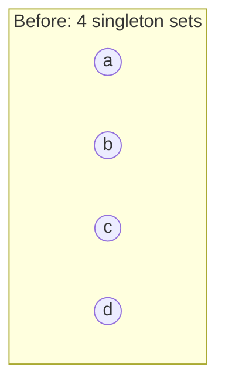
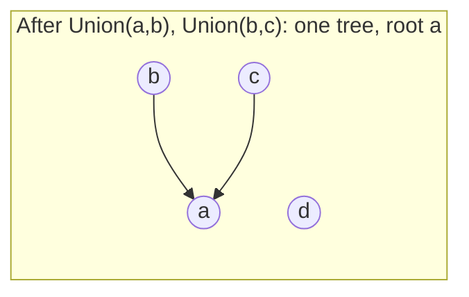
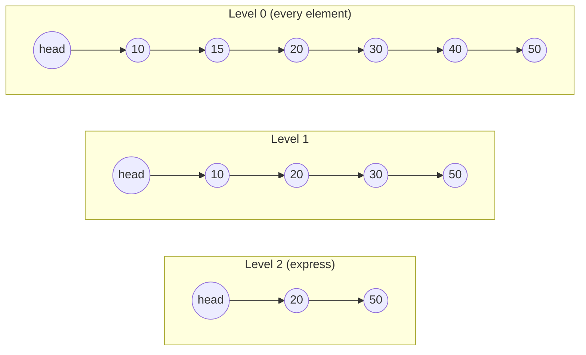
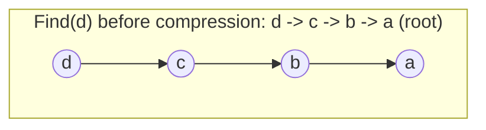
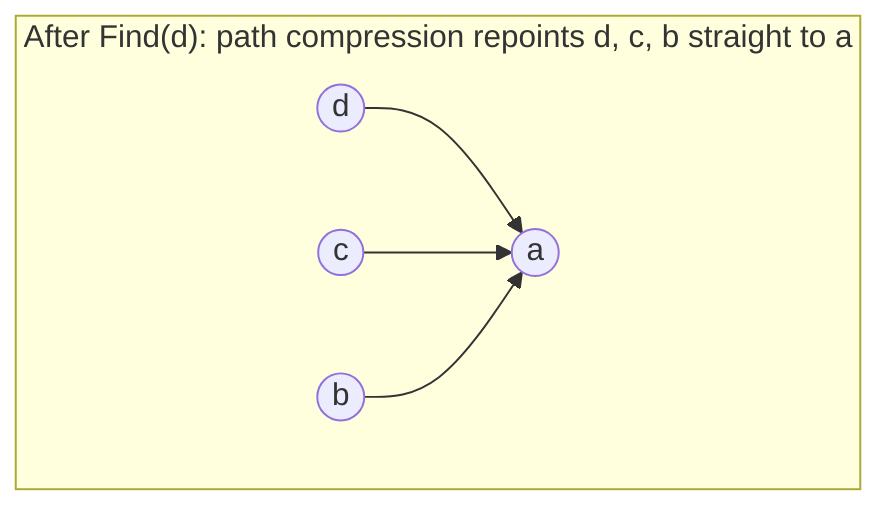
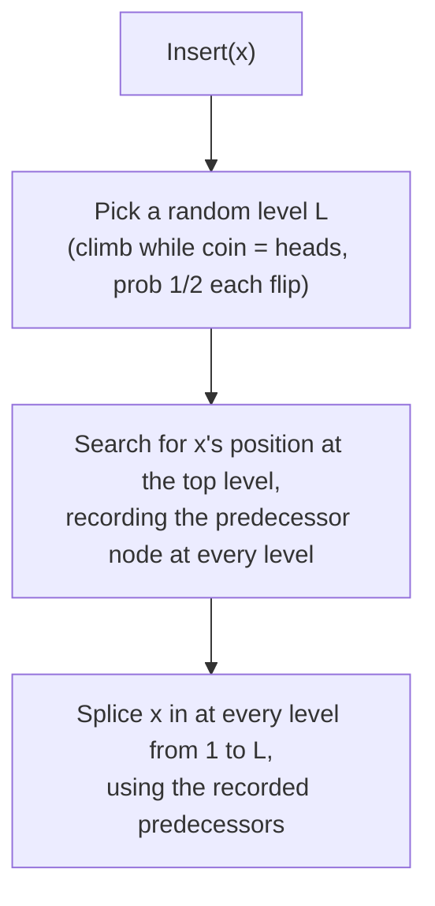

# Union-Find and Skip Lists

> [!summary] TL;DR
> **Union-find** (disjoint-set union) answers "are these two things in the same group?" and "merge these two groups" in almost constant time, which is why Kruskal's minimum-spanning-tree algorithm is built on it. A **skip list** is a linked list with random "express lane" shortcuts layered on top, giving a sorted structure with `O(log n)` search, insert and delete without the rebalancing logic a balanced tree needs — which is why Redis builds its sorted set (`ZSET`) on one. Runnable Go version: [[Union-Find and Skip Lists - Go]].

> [!abstract] Core idea
> - Union-find tracks disjoint groups with a forest of parent pointers; **path compression** flattens trees on lookup, **union by rank** keeps trees from growing tall, and together they give near-`O(1)` operations.
> - "Near-`O(1)`" is precise: it's `O(α(n))`, where `α` is the inverse Ackermann function — under 5 for any `n` you'll ever see.
> - A skip list builds extra "express lane" pointers at randomly chosen levels, so a search skips many nodes instead of walking one at a time, like an unbalanced tree's shortcuts without the tree.
> - Expected height is `O(log n)`, not guaranteed — a skip list is simple but probabilistic, not worst-case bounded like a red-black tree.
> - Classic mistake: forgetting path compression and union by rank, which degrades union-find to `O(n)` worst case per operation — the forest becomes a straight line.

## Start here: the basics 🟢

> [!info] How to read this note (pick your level)
> - 🟢 **New to this?** Read "From zero" below, then sections 1, 2 and the cheat sheet (10). Stop there, that is a full first pass.
> - 🟡 **Know the basics?** Add section 3 (how it works), 4 (worked example), then 5 and 6.
> - 🔴 **Interview / SDE-3 prep?** Add 7, 8 and 9. Headings are tagged 🟢🟡🔴 so you always know where you are.

**From zero, in 60 seconds** 🟢

This note covers two unrelated but interview-favorite structures.

**Union-find** answers one question fast: "are these two things in the same group?" Think friend circles: every person points toward one representative of their circle. To check if two people are connected, follow the pointers up; if they reach the same representative, same circle. Merging two circles is just pointing one representative at the other.



A **skip list** is a sorted linked list with express lanes stacked on top: the bottom lane has every item, each higher lane skips more. You search from the top lane, dropping down when you overshoot — binary-search speed in a linked list.



The rest of this note is just three questions:
1. How does union-find get near-constant time (path compression, union by rank)?
2. How does a skip list search, insert and stay balanced by coin flips?
3. Where does each one win in real systems (Kruskal, Redis sorted sets)?

### The problem in one story

At a party, people keep shaking hands, and anyone who shook hands joins the same friend circle.
Someone asks: "Are Asha and Ben in the same circle yet?"
You don't want to re-trace every handshake each time.
Separately, a game leaderboard must stay sorted as scores arrive, and still answer "who is ranked 100–110?" fast.

### Words you need first

| Word | Plain meaning | Tiny example |
| --- | --- | --- |
| Set / group | A collection of items, no duplicates | `{a, b, c}` |
| Disjoint | Groups that share no items | `{a, b}` and `{c}` |
| Parent pointer | Each item remembers one "boss" item | `b → a` |
| Root | The item at the top, its own parent | `a → a` |
| Linked list | Nodes in a chain, each pointing to the next | `10 → 20 → 30` |
| Amortized cost | Average cost per operation over a long run | most `Find`s are 1 hop |
| Expected (probabilistic) cost | Average cost over random choices, not a promise | coin flips set skip-list levels |
| `O(log n)` | Cost grows like the number of halvings of `n` | ~20 steps for 1,000,000 |

### Picture it



### Analogy

Union-find is like company teams where everyone asks "who's your manager's manager…?" until reaching the team head; same head means same team.
Where it breaks: a real company can split a team; union-find can only merge.

### How the rest of this note builds up

- First, **Why it exists**: cycle checks in Kruskal's algorithm, and sorted lists that are slow to search.
- Then the **Mental model** and **How it works**: parent forests, path compression, union by rank, random skip-list levels.
- Then a **Worked example**, **comparison**, **trade-offs** and **production** use (Redis `ZSET`, RocksDB MemTable).
- Finally the SDE-3 **Deep dive**: why rank bounds height, where `α(n)` comes from, and why Redis picks `p = 1/4`.

> [!tip] Remember
> Union-find = "same group?" plus "merge" in near-constant time; skip list = sorted list with random express lanes.

This note covers two unrelated structures that happen to share a chapter because both trade exactness for speed:

- **Union-find** gives up the ability to undo a merge.
- **A skip list** gives up a worst-case guarantee.

In exchange, each gets code that's dramatically simpler than the "proper" alternative (a disjoint-set forest instead of general graph connectivity; randomized levels instead of tree rotations).

## 1. Why it exists 🟢

### Union-find

In plain words: checking "would adding this edge create a cycle?" by re-exploring the whole graph on every single edge is wasteful, because most of that exploration repeats work already done for earlier edges.

Kruskal's algorithm builds a minimum spanning tree by sorting all edges by weight and adding each one unless it would close a cycle — and "would this edge close a cycle" is exactly "are these two endpoints already in the same connected group?"

For a graph with 100,000 edges, checking that naively (a BFS/DFS per edge) costs `O(V+E)` per check, `O(E(V+E))` overall — far too slow.

**Union-find** (also called disjoint-set union, or DSU) answers the same question in near-constant time per edge, so Kruskal's algorithm runs in `O(E log E)` total (the cost is dominated by sorting the edges).

### Skip lists

In plain words: a sorted list is cheap to maintain but slow to search, because there's no way to skip ahead without first building something that remembers which nodes to skip.

A sorted linked list gives `O(1)` insert at a known position but `O(n)` search, because there's no way to skip ahead — you must walk node by node.

A balanced binary tree fixes this with `O(log n)` search, insert and delete, but needs rotation logic (AVL) or recoloring rules (red-black) to stay balanced after every insert and delete.

A **skip list** gets the same `O(log n)` expected bounds with no rebalancing at all: each node is given a random "height," and taller nodes form express lanes that let a search jump past many short nodes at once.

> [!tip] Remember
> Union-find and skip lists solve different problems; what they share is "give up a guarantee, get simpler code and still-fast amortized/expected performance."

## 2. Mental model 🟢

### Union-find: a forest of parent pointers

**In plain words:**

1. Every element starts as its own tiny tree of one node, pointing to itself.
2. `Union(a, b)` picks one tree's root and makes it point to the other tree's root, merging two trees into one.
3. `Find(x)` walks parent pointers up to the root — the tree's root is the group's "name."
4. Two elements are in the same group exactly when `Find` returns the same root for both.

**Analogy.** Think of union-find as a set of family trees where only parent links exist, no sibling or child links. "Are two people related?" is answered by walking each one up to their oldest known ancestor and checking if it's the same person.

Where the analogy breaks down: real families never "merge" two separate ancestries into one by fiat — union-find's `Union` does exactly that, redefining one tree's ancestor as a child of the other's.

**Picture it:**





**Example:** starting from 4 singletons `a, b, c, d`, calling `Union(a, b)` then `Union(b, c)` leaves `a` as the root of a 3-element tree while `d` stays its own singleton.

`Find(c)` and `Find(a)` both now return `a`, so `Connected(a, c)` is `true`, but `Connected(a, d)` is `false`.

**Why it matters:** without care, repeated unions can build a long chain (`a ← b ← c ← d ← …`), making `Find` slow again — that's what **union by rank** and **path compression** prevent, covered next.

### Skip lists: an express train over a local train

**In plain words:** think of a sorted linked list as a local train that stops at every station. A skip list adds an express line above it that skips some stations, and an even faster line above that which skips more.

**Analogy.** A library's card catalog at three levels of granularity: a top drawer labeled only by the first letter of a decade of authors, a middle drawer narrowing to a few letters, and the bottom shelf with every card in full order. You start at the coarsest drawer and narrow down, never scanning every card from the very first one.

Where the analogy breaks down: a card catalog's levels are built deliberately by a librarian; a skip list's levels are assigned by a coin flip per node, so the "shortcuts" are random, not evenly spaced.

**Picture it:**



**Example:** searching for `40`:

1. Start at the top level (`head → 20 → 50`); since `50 > 40`, drop to level 1 at `20`.
2. On level 1 (`20 → 30 → 50`); since `50 > 40` again, drop to level 0 at `30`.
3. Step once more to `40`.

Three "express" hops plus one local hop instead of walking all 6 nodes one at a time.

**Why it matters:** a search starts at the top level and moves right as far as it can without overshooting, then drops down a level and repeats — exactly like taking the express train as far as possible before switching to the local for the last few stops.

## 3. How it works 🟡

### 3.1 Union-find: path compression and union by rank

**In plain words:** each element stores a `parent` pointer (initially itself) and a `rank` (an upper bound on its tree's height).

`Find` both answers the question *and* flattens the tree it just walked; `Union` always attaches the shorter tree under the taller one, so merging never makes the taller tree taller.

- **`Find(x)`:** follow `parent` pointers to the root, then — this is **path compression** — reassign every node visited to point directly at the root, so the *next* `Find` on any of them is `O(1)`.
- **`Union(x, y)`:** find both roots; if they differ, attach the lower-rank root under the higher-rank root (**union by rank**), so merging never makes the taller tree taller. If ranks are equal, pick either and bump its rank by one.

**Picture it:**





**Example:** before compression, `Find(d)` walks 3 hops (`d → c → b → a`). Path compression repoints `d`, `c` and `b` directly to `a` during that same call, so every later `Find` on any of the four elements costs exactly 1 hop.

**Why it matters:** either optimization alone gives `O(log n)` amortized per operation.

**Both together** give `O(α(n))` amortized — the inverse Ackermann function, which is at most 4 for any `n` up to far more atoms than exist in the observable universe. In practice this is treated as constant time.

> [!warning] Common mistake
> Implementing `Union` without `Find`'s path compression (or without union by rank) still "works" on small inputs, but degrades silently: a sequence of unions that always attaches the new element under the existing root (`a ← b`, then `a ← c`, then `a ← d`, …) builds a straight-line chain, and `Find` becomes `O(n)` per call.
>
> The bug only shows up at scale, which is exactly why interviewers ask for both optimizations explicitly, not just "union-find."

### 3.2 Skip lists: randomized levels

**In plain words:** every inserted node is given a height chosen by flipping a coin: start at level 1, and keep climbing to the next level while the coin keeps coming up heads (probability `p`, usually `1/2`).

Taller nodes are rarer and form the express lanes; most nodes stay short.

**Picture it:**



**Example:** flipping heads, heads, tails gives a node level 3 — a 1-in-8 chance (`1/2 × 1/2 × 1/2`, then stopping).

So about 1 in 8 inserted nodes stop at exactly level 3, 1 in 4 stop at exactly level 2 (1 in 4 reach level 3 or higher, 1 in 2 reach level 2 or higher), and every node reaches at least level 1.

With `n = 1,000` elements, this gives an expected `O(log₂ 1000) ≈ 10` levels.

**Why it matters:** search, insert and delete all follow the same steps:

1. Start at the highest level.
2. Move right only while the next node's key is still less than the target.
3. Drop down a level whenever the next node would overshoot.

This is the same "express lane, then local" walk from the mental model, repeated at each level, which is what gives the `O(log n)` expected bound without ever rebalancing anything.

> [!tip] Remember
> A skip list's height is a random outcome, not an invariant the code enforces — that is both its simplicity (no rebalancing code) and its one real weakness (no worst-case guarantee).

## 4. Worked example 🟡

### Whiteboard version

The bare union-find idea, no optimizations: parent pointers only, so `Find` just walks to the root.

```go
type DSU struct{ parent []int }

func (d *DSU) Find(x int) int {
    for d.parent[x] != x {
        x = d.parent[x]
    }
    return x
}
```

Trace it on `parent = [0, 0, 1, 2]` (so `1 → 0`, `2 → 1`, `3 → 2`): `Find(3)` walks `3 → 2 → 1 → 0`, three hops, and returns `0`.

This degrades to `O(n)` per `Find` if unions always attach the new tree under the old one in a chain, exactly as the common-mistake callout above describes.

The runnable version adds path compression and union by rank (which is what makes it fast), a Kruskal's-algorithm minimum spanning tree built on top, and a from-scratch skip list keyed the way Redis's `ZSET` is. Runnable Go version: [[Union-Find and Skip Lists - Go]].

## 5. Variants and comparison 🟡

| Structure | How it works | Use when | Cost |
| --- | --- | --- | --- |
| Union-find (no optimization) | Parent pointer per element, no rank or compression | Never, in production — included for contrast | `O(n)` worst case per `Find` |
| Union-find (rank + compression) | Attach shorter tree under taller; flatten on `Find` | Kruskal's MST, dynamic connectivity, "friend circles" | `O(α(n))` amortized — effectively constant |
| Union-find with rollback | Same, but skips path compression (union by rank/size only) to allow undoing unions | Offline algorithms needing to undo a union (e.g. some DP-on-graph problems) | `O(log n)` per op, supports undo |
| Red-black / AVL tree | Strict balance invariant, enforced by rotations on every insert/delete | Worst-case guarantees matter (kernels, language runtimes) | `O(log n)` worst case, more code |
| Skip list | Randomized express-lane pointers, no rebalancing | Sorted sets needing simple, lock-friendly code; range queries | `O(log n)` expected, `O(n)` worst case (rare) |
| Hash table | Hash to a bucket, no ordering | Exact-match lookup only, no range queries | `O(1)` average, no order |

> [!warning] Interview trap
> `O(α(n))` is not the same as `O(1)`. It's a function that grows, just unimaginably slowly — interviewers want to hear "inverse Ackermann, effectively constant for any realistic input," not a flat claim that union-find is `O(1)`.

## 6. Trade-offs and when not to use 🟡

- Union-find answers "same group?" and "merge" — it does **not** support splitting a group back apart efficiently; if you need to undo a union in general (not just via an offline rollback log), it's the wrong structure.
- Skip lists are simple to implement correctly but are **probabilistic**: a worst-case unlucky sequence of coin flips can degrade a specific query to `O(n)`, whereas a red-black tree guarantees `O(log n)` every time. For a real-time system with hard latency bounds, that matters.
- A skip list's extra forward-pointer arrays cost more memory per node than a plain linked list or array — typically 1.5–2× the pointers of a single-level list, depending on `p`.
- For small, mostly-static sets, a sorted slice with binary search is simpler than either a skip list or a balanced tree and just as fast in practice.

## 7. In production 🔴

- **Real systems:**
	- Kruskal's minimum-spanning-tree algorithm (network design, clustering) is union-find's textbook use.
	- Compilers and type systems use union-find for Hindley–Milner type unification, merging type variables known to be equal.
	- Image-processing connected-component labeling (flood fill at scale) uses union-find to merge adjacent same-colored pixels into regions.
	- **Redis's sorted set (`ZSET`)** is implemented as a skip list paired with a hash map (the hash map gives `O(1)` member → score lookup; the skip list gives `O(log n)` ordered range queries like `ZRANGEBYSCORE`) — see [[Redis Data Structures and When to Use Each]].
	- LevelDB and RocksDB's in-memory `MemTable` is commonly a skip list, because it supports fast ordered inserts with simple, lock-friendly concurrent access (no rebalancing to coordinate).
- **Failure modes → fixes:**
	- Skipping path compression or union by rank in a quick implementation → unions degrade to a chain under adversarial input order; always implement both.
	- Treating a skip list's `O(log n)` as a hard guarantee in a latency-sensitive path → it's an expectation over random coin flips; pick a balanced tree if you need a true worst-case bound.
	- Forgetting that a Redis `ZSET` with many same-score members still needs a deterministic tie-break (lexicographic by member) for stable ordering — don't assume "score order" alone is enough.
- **What to monitor:**
	- For union-find: mostly invisible in production since it's typically an offline batch step (MST, clustering); monitor the batch job's total runtime trend as input size grows.
	- For a skip-list-backed structure (or Redis `ZSET`): p99 latency of range queries (`ZRANGEBYSCORE`), and memory per element versus a plain sorted array, to catch level bloat if `p` is misconfigured.

### Measured: union-find vs. a naive reachability check at scale

The table below is the kind of before/after evidence a production rollout would gather before trusting the asymptotic claims above.

The setup: build a graph of 50,000 nodes with 25,000 random edges already unioned, then issue 100,000 random `Connected` queries, timed on this vault's test machine (Go 1.24.4, darwin/arm64, Apple M4, 2026-11-06).

| Approach | Measured cost | Relative |
| --- | --- | --- |
| Union-find, rank + path compression | ~1.2-2.6 ms for all 100,000 queries | baseline |
| Naive BFS reachability check per query | ~12.4-12.7 ms for 2,000 queries (≈ 0.6-0.65 s extrapolated to 100,000) | roughly 300-500× slower |

**Measured:** `BenchmarkConnectedQueries` (in the Go note's test file) runs this exact comparison — the naive baseline is only run over a 2,000-query slice, since a full 100,000-query BFS pass is slow enough to make test timeouts likely, and the gap is already clear from the smaller sample.

## 8. Deep dive 🔴

- **Why union by rank bounds the height.** A tree of rank `r` must have been formed by merging two trees of rank `r-1` (or a taller one absorbing a shorter one, which doesn't increase rank), so a tree of rank `r` has at least `2^r` nodes.

  With `n` total elements, rank can be at most `log₂ n` — bounding the tree height at `O(log n)` even before path compression helps.
- **Why both optimizations together give `α(n)`, informally.** Path compression alone gives `O(log n)` amortized; union by rank alone gives `O(log n)` worst case.
  Combined, the two interact: compression flattens trees faster than rank alone would keep them shallow, and the (quite involved) amortized analysis shows the total cost of `m` operations on `n` elements is `O(m α(n))` — Tarjan's 1984 result, and genuinely one of the more delicate amortized-analysis proofs in the field.

Treat the result, not the proof, as interview-ready knowledge.
- **Union by size vs union by rank.** An equally valid variant tracks each tree's node count instead of its rank and attaches the smaller tree under the larger; it gives the same asymptotic bound and is sometimes easier to reason about, since "size" has an intuitive meaning rank doesn't.
- **Why skip lists pick `p = 1/2`.** The expected height is `log_{1/p}(n)`, and the expected number of forward pointers per node is `1/(1-p)`. `p = 1/2` is a reasonable balance: `O(log₂ n)` expected height with about 2 pointers per node on average.
  Redis actually uses `p = 1/4` for its `ZSET` skip list, trading slightly taller expected search paths for fewer pointers per node (`1/(1-0.25) ≈ 1.33` on average) since memory matters more than a few extra comparisons for a typical sorted-set size.
- **Why skip lists, not balanced trees, in Redis.** The Redis documentation notes that skip lists are about as fast as balanced trees for range operations while being noticeably simpler to implement correctly — no rotations, no recoloring, and the per-node structure is a flat array of forward pointers rather than a tangle of parent/child/color fields.

## 9. Interview questions 🔴

> [!question]- Implement union-find with path compression and union by rank.
> See the worked example: `parent` and `rank` slices; `Find` recurses to the root and repoints every visited node to it; `Union` attaches the lower-rank root under the higher-rank one, bumping rank only on a tie.

> [!question]- What is the actual time complexity of union-find with both optimizations, and why isn't it just O(1)?
> `O(α(n))` amortized per operation, where `α` is the inverse Ackermann function — under 5 for any practically possible `n`, so it behaves like a constant, but it is not mathematically `O(1)`. Say "inverse Ackermann, effectively constant," not "O(1)," if asked precisely.

> [!question]- How would you detect a cycle while building a graph edge by edge?
> Before adding edge `(u, v)`, call `Find(u)` and `Find(v)`: if they're already equal, the edge would close a cycle, so skip it (this is exactly Kruskal's algorithm's cycle check). Otherwise `Union(u, v)` and add the edge.

> [!question]- Why does Redis use a skip list instead of a balanced tree for ZSET?
> A skip list gives the same expected `O(log n)` search, insert, delete and range-query cost as a balanced tree, but the implementation is much simpler — no rotations or recoloring — and performs well under range scans like `ZRANGEBYSCORE`, which is the sorted set's most common access pattern.

> [!question]- What happens to a skip list's performance in the worst case?
> If the random level choices are unlucky (e.g., every node happens to get level 1), it degenerates to a plain linked list, `O(n)` per operation. This is a probabilistic, not a guaranteed, bound — unlike a red-black tree's strict `O(log n)` worst case. In practice, with `p = 1/2` or `1/4`, this is exponentially unlikely.

> [!question]- Trap: is union-find good for "has this edge already been removed from a dynamic graph"?
> No. Union-find only supports merging sets, not splitting them back apart efficiently. A graph where edges are both added and removed over time needs a different structure (e.g., a link-cut tree, or rebuilding union-find from scratch after removals) — recognizing this limitation is the trap.

## 10. Cheat sheet 🟢

- Union-find: parent-pointer forest; `Find` walks to the root, `Union` merges two roots.
- Path compression (flatten on `Find`) + union by rank (shorter tree under taller) together give `O(α(n))` amortized — "effectively constant," never claim literal `O(1)`.
- Kruskal's MST = sort edges by weight, skip any edge whose endpoints `Find` to the same root.
- Skip list: a sorted linked list with randomized "express lane" levels; no rebalancing needed.
- Expected height `O(log n)`, not a worst-case guarantee — unlike a red-black tree.
- Redis `ZSET` = skip list (ordered range queries) + hash map (O(1) member → score).
- Redis's skip list uses `p = 1/4`, trading a few more comparisons for fewer pointers per node.

## Links

- **Go code:** [[Union-Find and Skip Lists - Go]]
- **Before this:** [[Trees, BSTs and Balanced Trees]], [[Graphs and Graph Algorithms]]
- **Next:** [[Sorting, Searching and Interview Patterns]]
- **Compare with:** [[Tries, Suffix Trees and Suffix Arrays]] (another tree-shaped structure with a very different job), [[Redis Data Structures and When to Use Each]] (ZSET internals in full)

### Watch on YouTube

- [Disjoint Sets & Union Find Algorithm Simply Explained](https://www.youtube.com/watch?v=z3X7Zt_zWSM) · Maaneth De Silva · simple visual intro to union-find, path compression and union by rank
- [Skip List Explained / Advanced Data Structure / What is Skip List Data Structure / Coding Interview](https://www.youtube.com/watch?v=ol-FaNLXlR0) · SoftwareDude · covers the probabilistic express-lane idea behind skip lists (used in Redis ZSET)
