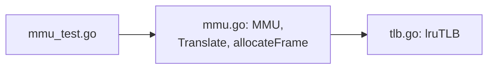

# Virtual Memory, Paging and the TLB - Go

> [!summary] TL;DR
> The runnable side of [[Virtual Memory, Paging and the TLB]]: a small, deterministic `MMU` that simulates a page table, a fixed-capacity LRU TLB, and demand paging with a bounded number of physical frames — so a TLB hit, a TLB miss, a minor fault and a major fault are all things a test can actually observe and assert on.

> [!info] How to read this note (pick your level)
> - 🟢 **New to this?** Read the theory note first ([[Virtual Memory, Paging and the TLB]]). Here, read "From zero" below, "Before the code" and "What this code shows", then skim the code steps.
> - 🟡 **Know the basics?** Read the Code, Design decisions and Tests sections, then run it yourself.
> - 🔴 **Interview / SDE-3 prep?** Add the Pitfalls and Exercises sections. Headings are tagged 🟢🟡🔴.

> [!note] Before this note
> - [[Virtual Memory, Paging and the TLB]]: the theory twin. Know the four outcomes of a memory access: TLB hit, TLB miss, minor fault, major fault.
> - [[Memory Hierarchy and CPU Caches]] and [[Processes, Threads and Context Switching]]: caches and processes, background only.

**From zero** 🟢: this file is the hands-on side of [[Virtual Memory, Paging and the TLB]]. It builds a tiny pretend MMU in Go — a page table, a small LRU TLB and a few physical frames — so that TLB hits, TLB misses and page faults become things a test can trigger and check on purpose. Read the notes, then the tests.

## Before the code 🟢

- **Maps** (`map[uint64]*pte`): Go's built-in hash table. Here it plays the page table and the TLB's storage.
- **PTE (page table entry)**: one row of the page table: which physical frame a virtual page uses, and whether it is present or swapped out.
- **VPN (virtual page number)**: the address divided by the page size (4096); the offset is the remainder.
- **Pointers to structs** (`*pte`, `*MMU`): changing `entry.swapped` through a pointer changes the one shared entry, not a copy.
- **Defined types** (`type Event string`): a new named type built on `string`, so only the four named constants are meant to be used.
- **Slices** (`order []uint64`): a growable list. The TLB uses one to remember which page was used least recently.
- **Methods** (`func (m *MMU) Translate`): functions attached to a type, called as `m.Translate(addr)`.
- **What to run:** `go vet ./... && go test -race -v ./...` inside the module. No goroutines, interfaces or generics are needed here.

## What this code shows 🟢

| Code | Concept in the theory note |
| --- | --- |
| `Event`, `TLBHit`, `TLBMiss`, `MinorFault`, `MajorFault` | The four possible outcomes of a translation ([[Virtual Memory, Paging and the TLB#The translation path]]) |
| `pte`, `MMU`, `NewMMU` | One process's page table plus a bounded pool of physical frames ([[Virtual Memory, Paging and the TLB#Multi-level page tables]]) |
| `MMU.Translate` | The TLB-then-page-table-then-fault decision tree ([[Virtual Memory, Paging and the TLB#The translation path]]) |
| `MMU.allocateFrame` | Eviction and swap-out once the process is at its frame cap ([[Virtual Memory, Paging and the TLB#6. Trade-offs and when not to use 🟡]]) |
| `lruTLB` | The TLB as a small, fixed-capacity, evicting cache ([[Virtual Memory, Paging and the TLB#The TLB is just a small, fast cache]]) |



## Setup 🟢

- Go 1.24. No external dependencies — everything here is standard-library-free, pure in-memory simulation.
- Layout: a module `vm` with `mmu.go` (the `MMU`, page table and fault logic), `tlb.go` (the LRU TLB), and `mmu_test.go` (all four tests, pinning down the exact event sequence the theory note describes).
- Run it with `go vet ./... && go test -race -v ./...`.
- This is a teaching model, not a real MMU. Real hardware walks a radix-tree page table in silicon, and the OS handles faults in kernel code written in C/assembly.
- Here both are modelled directly in plain Go. The sequence of events (TLB hit, TLB miss, minor fault, major fault) is visible and testable in a few milliseconds, with no root privileges, kernel module or virtual machine required.

## Code 🟡

> 🟢 → 🟡 **You now know** what the toy MMU simulates. **Next we read the code:** steps 1-5 build the MMU, steps 6-8 build the small LRU TLB.

**Reading order.** Steps 1-5 build `mmu.go`: the outcome names, the MMU's state, the two cheap translation paths, the two fault paths, and frame allocation with eviction.

Steps 6-8 build `tlb.go`, the small LRU cache that sits in front of the page table. The tests at the end pin each of the four outcomes to one concrete access sequence, so read a step and then find the test that exercises it.

### Step 1: naming the four outcomes

**What this code does, in plain words:** it names the four possible results of an access and defines a page-table entry with a frame number plus "present" and "swapped" flags.

**Concept.** The theory note's translation-path diagram ends in one of four named outcomes ([[Virtual Memory, Paging and the TLB#The translation path]]).

Giving each one an explicit `Event` string, rather than returning a bare `bool` or an `int` code, makes every test assertion below read as "this access was a TLB hit" instead of "this access returned `2`" — worth the small verbosity for code whose entire purpose is to make an invisible hardware mechanism legible.

```go
// Package vm is a small, deterministic simulation of the paging mechanism:
// a page table, a fixed-size TLB with LRU eviction, and demand paging with
// a bound on physical frames so pages can be swapped out and faulted back in.
package vm

const pageSize = 4096 // bytes; matches the common x86-64/arm64 base page size

// Event names the kind of access that just happened, cheapest first.
type Event string

const (
	TLBHit     Event = "TLB hit"
	TLBMiss    Event = "TLB miss, page table hit"
	MinorFault Event = "minor fault (new page, zero-filled)"
	MajorFault Event = "major fault (page was swapped out)"
)

// pte is one page-table entry: where a virtual page currently lives.
type pte struct {
	frame   uint64
	present bool // in physical memory right now
	swapped bool // was mapped before, but its frame was reclaimed
}
```

**How it works.**

1. `Event` is a defined string type, not a plain `string` — that one-line distinction lets a test or caller only ever compare against the four named constants, with the compiler catching a typo like `TLBHitt` instead of silently comparing unequal strings.
2. `pte` carries two booleans instead of one three-way enum (`present`/`swapped`/neither) because the third state — never mapped at all — is represented by the *absence* of a `pte` in the page table map, not by a flag on one.

### Step 2: the MMU's state and constructor

**What this code does, in plain words:** it builds the pretend MMU: an empty page table, an empty TLB of a given size, and a cap on how many physical frames it may use.

**Concept.** `MMU` holds exactly the state the theory note's mental model needs: a page table (the big, slow map), a TLB (the small, fast cache in front of it), and a bounded pool of physical frames.

The frame pool is bounded because demand paging only becomes observable once frames can run out ([[Virtual Memory, Paging and the TLB#Multi-level page tables]]).

```go
// MMU models one process's address translation.
type MMU struct {
	pageTable map[uint64]*pte // virtual page number -> entry
	tlb       *lruTLB

	frames    map[uint64]uint64 // physical frame -> virtual page number it holds
	freeFrame uint64
	maxFrames uint64 // physical frames available to this process (forces eviction)
}

// NewMMU creates an MMU with tlbSize TLB entries and maxFrames physical
// frames backing this process (a tiny number, to make eviction observable).
func NewMMU(tlbSize int, maxFrames uint64) *MMU {
	return &MMU{
		pageTable: make(map[uint64]*pte),
		tlb:       newLRUTLB(tlbSize),
		frames:    make(map[uint64]uint64),
		maxFrames: maxFrames,
	}
}

func vpn(addr uint64) uint64    { return addr / pageSize }
func offset(addr uint64) uint64 { return addr % pageSize }
```

**How it works.**

1. `maxFrames` is deliberately tiny in every test below (2 or 8, not millions) — a real process might have gigabytes of physical memory behind it, but the *mechanism* being tested (what happens when frames run out) is identical at any scale, and a small number makes eviction happen after just two or three accesses instead of after millions.
2. `vpn` and `offset` are the two halves of splitting a virtual address, matching the diagram in the theory note's multi-level page table section: integer division finds which page an address falls in, and the remainder is the byte offset within that page.

### Step 3: Translate — the fast paths

**What this code does, in plain words:** it splits the address into page and offset, returns a TLB hit if the page is cached, a TLB miss if the page table has it, and otherwise hands off to the fault handler.

**Concept.** `Translate` is the code form of the theory note's translation-path flowchart: check the TLB first, and if that misses, check the page table for an already-resident mapping ([[Virtual Memory, Paging and the TLB#The translation path]]).

This piece handles the two cheap outcomes; the next step handles the two fault outcomes.

```go
// Translate converts a virtual address to a physical address, simulating the
// hardware/OS steps: TLB, then page table, then a page fault if needed.
func (m *MMU) Translate(vaddr uint64) (paddr uint64, event Event) {
	vp := vpn(vaddr)

	if frame, ok := m.tlb.lookup(vp); ok {
		return frame*pageSize + offset(vaddr), TLBHit
	}

	entry, ok := m.pageTable[vp]
	if ok && entry.present {
		m.tlb.insert(vp, entry.frame)
		return entry.frame*pageSize + offset(vaddr), TLBMiss
	}

	return m.handleFault(vp, vaddr, entry, ok)
}
```

**How it works.**

1. The TLB check happens before anything else touches the page table — exactly the "fast cache first" order the theory note insists on, since checking the page table first would defeat the entire point of having a TLB.
2. A TLB miss that *does* find a present entry in the page table fills the TLB (`m.tlb.insert`) before returning, so the very next access to the same page is a TLB hit — this is what "the TLB caches recent translations" means in code.
3. Anything that isn't a present page-table entry — the entry exists but was swapped, or no entry exists at all — falls through to `handleFault`, kept as a separate function so this step stays focused on the two non-faulting outcomes.

### Step 4: Translate — the two fault outcomes

**What this code does, in plain words:** if the page was swapped out it reports a major fault, otherwise a minor fault; either way it gets a frame, updates the page table and caches the translation.

**Concept.** The theory note draws a sharp line between a minor fault (no disk I/O) and a major fault (data must come back from "swap") ([[Virtual Memory, Paging and the TLB#The translation path]]).

`handleFault` is where that distinction actually lives in code: it is entirely about whether a page-table entry already exists in the swapped state.

```go
// handleFault resolves the two possible fault outcomes: a page that was
// swapped out before (major fault) or one that was never mapped (minor
// fault, demand paging).
func (m *MMU) handleFault(vp, vaddr uint64, entry *pte, existed bool) (paddr uint64, event Event) {
	if existed && entry.swapped {
		frame := m.allocateFrame(vp)
		entry.frame, entry.present, entry.swapped = frame, true, false
		m.tlb.insert(vp, frame)
		return frame*pageSize + offset(vaddr), MajorFault
	}

	// Never mapped before: demand paging allocates and zero-fills a frame.
	frame := m.allocateFrame(vp)
	m.pageTable[vp] = &pte{frame: frame, present: true}
	m.tlb.insert(vp, frame)
	return frame*pageSize + offset(vaddr), MinorFault
}
```

**How it works.**

1. `existed && entry.swapped` is the entire test for "this is a major fault, not a minor one" — a page-table entry that exists but is marked swapped is exactly a page the process used before, whose frame was later reclaimed.
2. Both branches call the same `allocateFrame` helper (step 5) — a real OS would also treat "bring a page back from swap" and "allocate a brand-new zero-filled page" as two calls into the same frame-allocation machinery, differing only in what gets written into the frame afterward.
3. Both branches fill the TLB before returning, matching `Translate`'s TLB-miss path — every successful translation, fault or not, ends with the TLB primed for the next access to the same page.

### Step 5: allocating (and evicting) physical frames

**What this code does, in plain words:** it hands out the next free frame, or, when all frames are used, takes one back from another page, marks that page as swapped, and removes it from the TLB.

**Concept.** This is where the theory note's "the hotel only has so many rooms" idea becomes concrete: once `maxFrames` is reached, giving a new page a frame means taking one away from some other page first ([[Virtual Memory, Paging and the TLB#6. Trade-offs and when not to use 🟡]]).

```go
// allocateFrame hands back a free frame, evicting the oldest-mapped page
// (a simple FIFO "clock-like" policy) when the process is at its frame cap.
func (m *MMU) allocateFrame(forPage uint64) uint64 {
	if uint64(len(m.frames)) < m.maxFrames {
		f := m.freeFrame
		m.freeFrame++
		m.frames[f] = forPage
		return f
	}
	return m.evictAndReuse(forPage)
}
```

The fast path above is just a counter: while the process is under its frame cap, it hands out the next unused frame number. Only when the cap is hit does the slower eviction path below run.

```go
// evictAndReuse picks the lowest-numbered occupied frame as the eviction
// victim (a simplified stand-in for a real clock/LRU page-replacement
// policy), marks its page swapped out, and hands the freed frame to forPage.
func (m *MMU) evictAndReuse(forPage uint64) uint64 {
	var victimFrame, victimPage uint64
	first := true
	for f, p := range m.frames {
		if first || f < victimFrame {
			victimFrame, victimPage, first = f, p, false
		}
	}
	delete(m.frames, victimFrame)
	if e := m.pageTable[victimPage]; e != nil {
		e.present, e.swapped = false, true
	}
	m.tlb.invalidate(victimPage)
	m.frames[victimFrame] = forPage
	return victimFrame
}
```

**How it works.**

1. The frame-count check (`len(m.frames) < m.maxFrames`) is the entire difference between "memory is still available" and "something has to be evicted" — exactly the condition the theory note's overcommit discussion generalizes to a whole system instead of one process's frame pool.
2. `evictAndReuse`'s victim selection (lowest-numbered occupied frame) is a deliberately simple stand-in for a real page-replacement policy like clock or true LRU — picking by frame number, not by recency of access, is simpler code but not what a real kernel does; see "Pitfalls in the code" for why this matters.
3. Marking the victim's page-table entry `swapped = true` is what makes the *next* access to that page a major fault instead of a silent re-allocation — the entry still exists, it just no longer has a frame.
4. `m.tlb.invalidate(victimPage)` is easy to forget and easy to get subtly wrong: a stale TLB entry pointing at a frame that now holds a *different* page's data would be a real memory-corruption bug, not just a performance issue.

### Step 6: the TLB's shape and constructor

**What this code does, in plain words:** it defines the TLB as a map (page → frame) plus a list that remembers which page was used least recently.

**Concept.** `lruTLB` is the code form of "the TLB is just a small, fast cache" ([[Virtual Memory, Paging and the TLB#The TLB is just a small, fast cache]]) — a fixed-capacity map plus a recency-ordered list of keys, the classic shape of any hand-rolled LRU cache.

```go
// lruTLB is a tiny fixed-capacity, fully-associative cache from virtual page
// number to physical frame, evicting the least-recently-used entry. Real
// TLBs are implemented in hardware as content-addressable memory; a slice
// scan is a fine stand-in at the sizes this simulation uses.
type lruTLB struct {
	capacity int
	order    []uint64          // page numbers, most-recently-used at the end
	frameOf  map[uint64]uint64 // page -> frame
}

func newLRUTLB(capacity int) *lruTLB {
	return &lruTLB{capacity: capacity, frameOf: make(map[uint64]uint64)}
}
```

**How it works.**

1. `frameOf` is the actual cache content; `order` exists purely to answer "which entry was touched longest ago," which a plain map can't answer on its own since Go map iteration order is unspecified.
2. Capacity is fixed at construction and never grows — matching real hardware, where a TLB has a fixed number of hardware slots, not a dynamically resizable one.

### Step 7: lookup, insert and touch

**What this code does, in plain words:** `lookup` finds a cached translation and marks it recently used; `insert` adds one, first evicting the least recently used entry if the TLB is full.

**Concept.** `lookup` and `insert` are the TLB's two operations from the theory note's diagrams: check for a cached translation, and record a new one, evicting the oldest if the TLB is already full.

```go
func (t *lruTLB) lookup(page uint64) (frame uint64, ok bool) {
	frame, ok = t.frameOf[page]
	if ok {
		t.touch(page)
	}
	return frame, ok
}

func (t *lruTLB) insert(page, frame uint64) {
	if _, exists := t.frameOf[page]; !exists && len(t.frameOf) >= t.capacity {
		t.evictOldest()
	}
	t.frameOf[page] = frame
	t.touch(page)
}

// touch moves page to the most-recently-used end of order, whether it was
// already present or is being inserted for the first time.
func (t *lruTLB) touch(page uint64) {
	for i, p := range t.order {
		if p == page {
			t.order = append(t.order[:i], t.order[i+1:]...)
			break
		}
	}
	t.order = append(t.order, page)
}
```

**How it works.**

1. `lookup` calling `touch` on every hit is what makes this genuinely LRU rather than FIFO — a page accessed over and over stays at the "recently used" end of `order` and is never the eviction victim, no matter how long ago it was first inserted.
2. `insert`'s capacity check only evicts when the page is *new* (`!exists`) — re-inserting a translation that's already cached (refreshing it after a page fault, say) must never trigger an eviction it doesn't need.
3. `touch`'s linear scan to remove `page` from `order` before re-appending it is `O(capacity)`, not `O(1)` — acceptable here because a TLB's capacity is small by definition (dozens to a few thousand entries in real hardware), but a production software LRU cache at a much larger scale would use a doubly linked list with a side map for `O(1)` moves instead.

### Step 8: invalidate and eviction

**What this code does, in plain words:** it removes one page's cached translation, and finds the oldest entry to evict.

**Concept.** `invalidate` is what `allocateFrame`'s eviction path calls when a page's physical frame is reclaimed — a stale TLB entry must not survive past the point its underlying mapping stopped being true.

```go
func (t *lruTLB) invalidate(page uint64) {
	delete(t.frameOf, page)
	for i, p := range t.order {
		if p == page {
			t.order = append(t.order[:i], t.order[i+1:]...)
			break
		}
	}
}

func (t *lruTLB) evictOldest() {
	if len(t.order) == 0 {
		return
	}
	oldest := t.order[0]
	t.order = t.order[1:]
	delete(t.frameOf, oldest)
}
```

**How it works.**

1. `invalidate` and `touch` share the same "find and remove from `order`" loop, duplicated rather than factored into one more helper — a reasonable call at this size, though a larger codebase would likely pull it into a shared `removeFromOrder` function.
2. `evictOldest` reads `order[0]` because `touch` always appends to the *end*, making the front of `order` the least-recently-used entry by construction — the two functions' invariants depend on each other, which is worth noticing when changing either one.

## Design decisions 🟡

| Decision | Alternative | Trade-off |
| --- | --- | --- |
| `Event` as a defined string type | A plain `int` status code | Self-documenting test failures and log lines, at the cost of slightly more verbose constant declarations |
| Frame eviction picks the lowest-numbered occupied frame | A true LRU or clock policy over frame access order | Much simpler code; does not model which page was actually least recently used, only which frame number is smallest — see "Pitfalls in the code" |
| TLB as a slice-backed LRU (`order` + map) | A doubly linked list with O(1) move-to-front | Simpler to read; `O(capacity)` per touch instead of `O(1)`, acceptable only because real TLB capacities are small |
| `handleFault` split out from `Translate` | One long `Translate` method with all four outcomes inline | Keeps each function under the vault's code-block length guideline and gives the fault-only logic its own name and doc comment |
| No `context.Context`, no `error` returns anywhere | Threading a `ctx` and returning `error` from every method, "to be safe" | This is pure, synchronous, in-memory computation with nothing to cancel and no failure mode that isn't one of the four named `Event`s — adding either would be decoration, not design |

## Tests 🟡

### Test 1: first touch is a minor fault

**Property.** The very first access to a page that was never mapped before must be a minor fault — no disk I/O, just demand paging.

| Input | Expected |
| --- | --- |
| `NewMMU(4, 8).Translate(0x1000)` (first call ever) | `MinorFault` |

```go
package vm

import "testing"

func TestFirstTouchIsMinorFault(t *testing.T) {
	m := NewMMU(4, 8)
	_, ev := m.Translate(0x1000)
	if ev != MinorFault {
		t.Fatalf("first access to a new page: got %s, want %s", ev, MinorFault)
	}
}
```

**How it works.** A fresh `MMU` has an empty page table and an empty TLB, so the very first `Translate` call is guaranteed to fall through both fast paths into `handleFault`'s "never mapped before" branch.

**If it fails.** Getting `TLBHit` or `TLBMiss` instead would mean `NewMMU` somehow pre-populated state it shouldn't have; getting `MajorFault` would mean the page-table entry was incorrectly created as `swapped` instead of `present` on first touch.

### Test 2: repeated access hits the TLB

**Property.** A second access to the same page, right after the first, must be a TLB hit — the whole reason a TLB exists.

| Input | Expected |
| --- | --- |
| `Translate(0x1000)` then `Translate(0x1004)` (same page, different offset) | `MinorFault`, then `TLBHit` |

```go
func TestRepeatedAccessHitsTheTLB(t *testing.T) {
	m := NewMMU(4, 8)
	m.Translate(0x1000) // minor fault, also warms the TLB
	_, ev := m.Translate(0x1004)
	if ev != TLBHit {
		t.Fatalf("second access to the same page: got %s, want %s", ev, TLBHit)
	}
}
```

**How it works.** `0x1000` and `0x1004` both fall in the same 4 KB page (page 1, since `0x1000` is exactly 4096 and `0x1004` is 4 bytes past it), so the second call's `vpn` is identical to the first — this test is specifically checking that a *different byte in the same page* is still a hit, not just a literally repeated address.

**If it fails.** Getting `TLBMiss` instead of `TLBHit` would mean the first call's `MinorFault` path forgot to call `m.tlb.insert` before returning.

### Test 3: TLB eviction still hits the page table

**Property.** Evicting a translation from the TLB must not lose the underlying page-table mapping — the next access should cost a page-table walk (a miss), not a fault.

| Input | Expected |
| --- | --- |
| A 2-entry TLB; access pages `0x1000`, `0x2000`, `0x3000` (evicts `0x1000`'s TLB entry), then `0x1000` again | `TLBMiss` on the re-access |

```go
func TestTLBEvictionStillHitsThePageTable(t *testing.T) {
	m := NewMMU(2, 8) // only 2 TLB entries
	m.Translate(0x1000)
	m.Translate(0x2000)
	m.Translate(0x3000) // evicts page 0x1000's TLB entry (LRU)

	_, ev := m.Translate(0x1000) // page table still has it: no fault, just a miss
	if ev != TLBMiss {
		t.Fatalf("after TLB eviction: got %s, want %s", ev, TLBMiss)
	}
}
```

**How it works.** With `maxFrames = 8`, no physical frame is ever reclaimed in this test — only the 2-entry TLB is under pressure — so the third access necessarily evicts `0x1000` from the TLB (least recently used) while its page-table entry, and its physical frame, stay fully intact.

**If it fails.** Getting `TLBHit` would mean the TLB's capacity enforcement in `insert`/`evictOldest` isn't actually evicting.

Getting `MinorFault` or `MajorFault` instead of `TLBMiss` would mean the page-table entry was somehow lost or marked swapped when only the TLB, not the frame pool, was supposed to be under pressure.

### Test 4: frame exhaustion causes a major fault on re-access

**Property.** Once physical frames run out, giving a new page a frame must evict an existing page's frame and mark it swapped — so re-accessing the evicted page is a major fault, not silent data loss.

| Input | Expected |
| --- | --- |
| 2 physical frames; access `0x1000`, `0x2000`, `0x3000` (evicts `0x1000`'s frame), then `0x1000` again | `MajorFault` on the re-access |

```go
func TestFrameExhaustionCausesMajorFaultOnReaccess(t *testing.T) {
	m := NewMMU(8, 2) // only 2 physical frames

	m.Translate(0x1000) // frame 0
	m.Translate(0x2000) // frame 1
	m.Translate(0x3000) // no free frame: evicts page 0x1000, swaps it out

	_, ev := m.Translate(0x1000) // must fault back in from "swap"
	if ev != MajorFault {
		t.Fatalf("re-accessing a swapped-out page: got %s, want %s", ev, MajorFault)
	}
}
```

**How it works.** With `maxFrames = 2`, the third distinct page forces `allocateFrame` into `evictAndReuse`.

That function marks whichever page it evicts (the lowest-numbered frame, here frame 0, holding page `0x1000`) as `swapped`; the fourth call then finds that `swapped` entry and takes the major-fault branch in `handleFault`.

**If it fails.** Getting `MinorFault` instead of `MajorFault` would mean `evictAndReuse` deleted the page-table entry entirely instead of marking it swapped.

That is a correctness bug that would look like "re-accessing lost data silently becomes a fresh zero-filled page," which is a much worse failure than a slow major fault.

> 🟡 → 🔴 **You now know** the whole MMU model and the four tests that pin each outcome. **Next comes the advanced part:** where this model is simpler than a real kernel (eviction choice, no real swap data, no locking) and the `O(capacity)` cost hidden in the TLB.

## Pitfalls in the code 🔴

- **The eviction policy is not a real LRU over frames.** `evictAndReuse` picks the *lowest-numbered* occupied frame, not the least-recently-accessed page — two different things.
  - A real kernel's clock algorithm (or true LRU, which is expensive to implement exactly in hardware) approximates "least recently used page," not "smallest frame number."
  - This simulation's choice is simpler and deterministic (useful for tests), but it does not model realistic eviction behavior under a mixed access pattern.
- **`lruTLB`'s `order` is `O(capacity)` per touch.** Fine at TLB-sized capacities (tens to low thousands); the same pattern at, say, a 1,000,000-entry application-level cache would need a doubly linked list with O(1) splice instead of a slice with linear search-and-remove.
- **No concurrency safety anywhere in this file.** `MMU` and `lruTLB` both mutate shared state with no locking.
  - A real kernel's MMU-adjacent data structures are protected by fine-grained locks (or per-CPU structures) precisely because multiple CPUs can fault concurrently.
  - Sharing one `*MMU` across goroutines here without external synchronization will race.
- **`handleFault`'s major-fault branch never actually reads data from anywhere.** This simulation only tracks *that* a major fault would occur and updates the bookkeeping state; it doesn't model an actual backing store (disk or swap file) with its own latency, since the theory note's point is the event sequence, not a disk I/O simulator.
- **Frame numbers are never reused across different `MMU` instances or returned to a shared pool.** `freeFrame` only ever increments within one `MMU`'s lifetime; this is a single-process model, not a multi-process physical-memory allocator.

## Exercises 🔴

1. Change `evictAndReuse`'s victim selection from "lowest-numbered frame" to true LRU (track access order per *frame*, not per TLB entry) and re-run `TestFrameExhaustionCausesMajorFaultOnReaccess` with a third page added. Predict which page gets evicted under each policy before running it.
2. Add a `Stats() (hits, misses, minorFaults, majorFaults int)` method to `MMU` that counts each `Event` across every `Translate` call. Write a test asserting the exact counts after a fixed sequence of accesses.
3. `lruTLB.touch` and `invalidate` both scan `order` linearly to find a page. Refactor `lruTLB` to use a `map[uint64]int` of page→index into a doubly linked list (or Go's `container/list`) for `O(1)` touch and invalidate, then confirm all four existing tests still pass unchanged.

## Self-check 🟢🟡

🟢 Easy

> [!question]- What does the very first `Translate` on a new page return?
> `MinorFault`: the page was never mapped.

> [!question]- Why is `Translate(0x1004)` right after `Translate(0x1000)` a TLB hit?
> Both addresses are in page 1 (4096-8191), which the first call cached.

> [!question]- What does a 2-frame MMU do when a third page arrives?
> It evicts a frame, marks that page swapped, and reuses the frame.

🟡 Medium

> [!question]- Why does evicting a TLB entry give a `TLBMiss`, not a fault, on re-access?
> The page table still has the mapping; only the cached copy was dropped.

> [!question]- Why must `evictAndReuse` call `tlb.invalidate`?
> Otherwise a stale TLB entry would point at a frame that now holds another page's data.

> [!question]- Why is the re-access in Test 4 a `MajorFault`?
> The evicted page's entry was kept but marked swapped, which means its data must come back from "disk".

## Links

- **Theory:** [[Virtual Memory, Paging and the TLB]]
