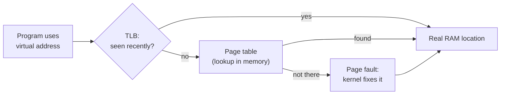
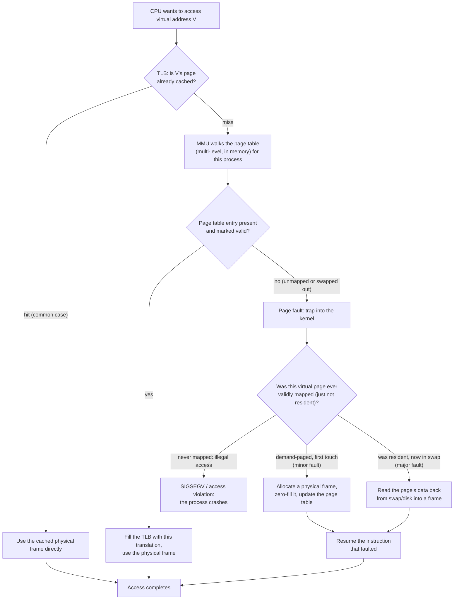
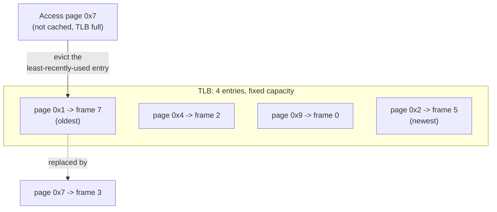
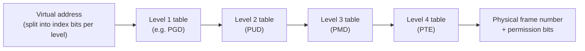
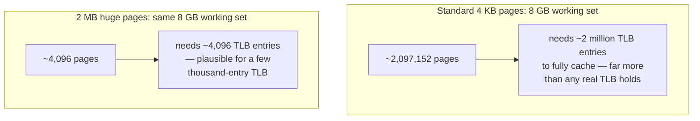

# Virtual Memory, Paging and the TLB

> [!summary] TL;DR
> Every process sees its own private **virtual** address space; the CPU's MMU and the kernel's **page tables** translate each virtual address to a real **physical** address, 4 KB (or larger) page at a time. A small hardware cache of recent translations, the **TLB**, makes that translation fast; missing it means walking the page table in memory, and accessing a page that isn't mapped in at all triggers a **page fault**. Runnable Go version: [[Virtual Memory, Paging and the TLB - Go]].
>
> This is advanced, SDE-3-depth material (transparent-hugepage compaction stalls, OOM scoring, ASLR, the RSS/VSZ split, `fork`'s copy-on-write internals) built on top of the basic idea in the Mental model section below — read that section first if virtual memory itself is new to you.

> [!abstract] Core idea
> - Addresses your program sees are virtual. The MMU rewrites every one of them to a physical address using per-process page tables, invisibly.
> - Translation happens one fixed-size page at a time (commonly 4 KB), never per-byte, which keeps the page table small enough to be practical.
> - The TLB caches recent virtual→physical translations so most memory accesses skip the page-table walk entirely; a TLB miss costs the walk, a page fault costs far more (possibly disk I/O).
> - "Minor" page faults just map in a page already resident in RAM (or freshly zeroed); "major" page faults must pull the page's data in from disk/swap, which is orders of magnitude slower.
> - This is why two processes can each believe they own address `0x1000`, why `fork` can be fast (section 3), and why Linux will overcommit memory and sometimes kill a process (the OOM killer) rather than honor every promise it made.

## Start here: the basics

**The problem in one story.**
You run two programs at once: a browser and a music player.
Both were written assuming "my data starts at address 1000".
If they both really wrote to the same spot in RAM, one would wreck the other.
Virtual memory gives each program its own private copy of "address 1000" that points somewhere different in real RAM.

**Words you need first**

| Word | Plain meaning | Tiny example |
| --- | --- | --- |
| Address | A number naming one byte of memory | `0x1000` = byte number 4096 |
| RAM (physical memory) | The real memory chips in the machine | 16 GB of DDR5 |
| Process | One running program with its own memory | Your Go server is one process |
| Kernel | The core of the OS that controls hardware | Linux deciding which process gets RAM |
| Page | A fixed-size chunk of memory handled as one unit | 4 KB = 4096 bytes |
| Cache | A small, fast copy of data you used recently | Browser keeping images you just saw |
| Disk / swap | Slow storage the kernel can park memory on | Part of an SSD used as overflow RAM |

**Picture it**



**Analogy.** Each program has its own phone contact list. "Mom" in your phone and "Mom" in your friend's phone dial different numbers. The phone (MMU) looks up the real number every time you call.
Where it breaks: a phone never secretly swaps a contact's number to someone else's; the kernel does reassign real RAM behind a program's back (swap, eviction).

**How the rest of this note builds up**

- First, why virtual memory exists (section 1) and a mental model of private addresses (section 2).
- Then the translation path: TLB, page table, page faults (section 3), plus multi-level tables and huge pages.
- Then a small worked example in Go and a latency ladder (section 4), and variants like copy-on-write and `mmap` (section 5).
- Finally the SDE-3 deep dive: overcommit and the OOM killer, thrashing, production debugging, ASLR, RSS vs VSZ and `fork` internals (sections 6-8).

> [!tip] Remember
> Every program gets made-up addresses; hardware and the kernel quietly map them to real RAM, one page at a time.

## 1. Why it exists

Before virtual memory, programs addressed physical RAM directly: if your program's code happened to load at physical address `0x8000`, every pointer, every jump target, baked in `0x8000`-relative addresses.

Two programs couldn't be loaded into memory at the same time without one of them being relinked to avoid overlapping the other.

And one program's bug (an out-of-bounds write) could silently corrupt another program's memory or the OS itself — there was no boundary.

Virtual memory gives every process its own **address space**: a private range of addresses from `0` up to the architecture's limit, that only *that* process can use, and which the MMU translates to real physical memory behind the scenes.

Two processes can both have code at virtual address `0x400000` and never collide, because the kernel maps each one's `0x400000` to a different physical page.

A buggy write to a bad pointer faults (segfaults) instead of corrupting another process, because the MMU simply refuses translations outside a process's own mappings.

It also decouples "how much memory a process is promised" from "how much physical RAM actually backs it right now". Pages can be:

1.  mapped in lazily on first use (demand paging, section 3);
2. shared between processes that both want the same read-only data (shared libraries, `fork`'s copy-on-write);
3. or pushed out to disk under memory pressure (swap).

All of this happens without the process's own view of its addresses ever changing.

## 2. Mental model

**In plain words:** before reading any mechanism, build one picture: every process has its own private, made-up set of addresses, and one piece of hardware (helped by the kernel) silently rewrites each one to a real location in RAM.

**Analogy:** think of a hotel with one lobby directory (the MMU + page table) per guest, not one global room list.

Every guest has their own private floor plan starting at "Room 1, Room 2, Room 3…" — **virtual** room numbers that only exist on that guest's own map.

The hotel's actual physical rooms are numbered completely differently, and the front desk (MMU) translates "guest A, Room 12" to physical room 847 and "guest B, Room 12" to physical room 203, with neither guest ever seeing the real room numbers.

Guests don't get individually sized rooms — the hotel only has one room size (a **page**, 4 KB), so a guest needing more space gets more rooms, not one bigger room.

The front desk doesn't look up every single step you take inside your room (every byte you touch); it only looks up which physical room a virtual room maps to, and remembers the last several lookups on a sticky note (the **TLB**) so repeat visits to the same room are instant.

If a guest asks for a room that hasn't been assigned a physical room yet, that's a **page fault**: the front desk scrambles to assign one, which is cheap if a spare room is sitting ready (**minor fault**) and slow if it has to move someone's stuff back from the hotel's off-site storage first (**major fault**, i.e. swap).

**Where the analogy breaks down:** a real hotel's front desk never repossesses an occupied room to give to another guest without evicting them first.

The kernel does exactly that under memory pressure (that's the eviction and swap-out machinery in the diagrams below), and it can even promise a guest a room it doesn't currently have spare capacity for — the **overcommit** behaviour covered in section 6.

> [!tip] Remember
> Virtual addresses are a story every process is told; physical addresses are where the bytes actually live. The MMU is the only thing that knows how the two relate, per process.

## 3. How it works

### The translation path

**In plain words:** every single memory access — even just reading one variable — has to go through this check-the-fast-cache-first, fall-back-to-the-slow-table-second, and-only-then-ask-the-kernel path, in that order, before the CPU gets a real physical address.



A **minor fault** never touches a disk: the page just wasn't mapped yet (a freshly `mmap`'d region, a stack growing into a new page, a copy-on-write page about to be duplicated) and the kernel can satisfy it from RAM alone — allocate a frame, maybe zero it, update the page table.

A **major fault** means the data has to be fetched from backing storage (a memory-mapped file, or swap), which can cost milliseconds instead of microseconds. This is the single biggest cause of a process suddenly feeling "stuck" under memory pressure.

**Example, with numbers:** say a process touches a brand-new 4 KB page for the first time. That single access walks the path above once:

1. TLB miss (page was never cached, ~1 ns wasted).
2. Page-table miss (entry doesn't exist yet).
3. Then a minor fault — allocate a frame, zero it, insert the page-table entry, fill the TLB — costing perhaps 2 µs total.

Every later access to any byte in that same 4 KB page costs the TLB-hit price instead, under 1 ns, for as long as the TLB keeps the entry.

That roughly 2,000× cost difference between the first touch and every later touch is why "working set fits in the TLB" matters so much for performance.

> [!warning] Common mistake
> Treating a TLB miss and a page fault as the same kind of event. A TLB miss still finds the translation — just one memory access away, in the page table — and never traps into the kernel. A page fault means the page table itself has no valid mapping, and *always* traps into the kernel, whether that turns out to be a cheap minor fault or an expensive major one.

> [!tip] Remember
> Three speeds, three completely different costs: a TLB hit is part of a normal memory access, a TLB miss is one extra memory read, and a page fault is a trap into the kernel that might mean disk I/O.

### The TLB is just a small, fast cache

**In plain words:** the TLB is not magic — it is a tiny, fixed-size lookup table of "virtual page → physical frame" pairs, exactly like any other cache, which means it can fill up and has to evict something old to make room for something new.

**Picture it:**



**Example:** a TLB with only 4 slots, all full, sees an access to a 5th page it has never cached. It must evict one entry to make room.

It typically picks the **least-recently-used** one, on the theory that a page nobody has touched in a while is the least likely to be touched again soon.

The evicted page isn't lost data; its translation still lives in the page table, so the next access to it simply costs one more page-table walk (a TLB miss, not a fault) to bring it back.

**Why it matters:** a working set (the pages actively being touched) bigger than the TLB's capacity causes a steady stream of evictions and refills — this is exactly the problem huge pages, covered next, are built to reduce.

### Multi-level page tables

**In plain words:** a page table big enough to have one entry for every possible virtual page, all the time, would be enormous — so real systems build it as a tree instead, and most of that tree simply doesn't exist for addresses a process never uses.

A single flat table mapping every possible virtual page directly to a physical frame would be enormous (a 48-bit virtual address space with 4 KB pages has 2^36 possible pages) — far too large to keep resident for every process.

Real page tables are **multi-level** (radix trees): a top-level table of pointers to second-level tables of pointers to third-level tables, and so on, down to the entries that finally hold a physical frame number.

x86-64 Linux commonly uses 4 levels (PGD → PUD → PMD → PTE); only the branches a process actually uses need to exist, so an address space with large unused gaps costs almost nothing in page-table memory.

**Picture it:**



**Example:** a 48-bit virtual address is split into five pieces — four 9-bit indices (one per level, 512 entries per table) plus a 12-bit in-page offset (2^12 = 4096 bytes, matching the 4 KB page size).

Each level adds a memory access on a TLB miss — a full 4-level walk is up to 4 extra memory reads before the real access, which is exactly why the TLB matters so much: without it, *every* memory access would cost 4-5× a normal memory access.

> [!tip] Remember
> The page table is a tree so unused address ranges cost nothing; only the branches a process actually touches get allocated.

### Huge pages

**In plain words:** if one TLB entry could cover far more memory than 4 KB, a process touching gigabytes of data would need far fewer TLB entries to keep its whole working set cached.

Because each TLB entry only covers one page, a process that touches gigabytes of memory (a large in-memory cache, a database buffer pool) needs far more TLB entries than a TLB can hold (TLBs typically hold dozens to a few thousand entries), causing frequent TLB misses.

**Huge pages** (2 MB or 1 GB on x86-64, configurable on arm64) make one TLB entry cover far more memory, trading flexibility (can't swap or partially map a huge page as finely) for a much lower TLB miss rate on large working sets.

**Picture it:**



**Example:** an 8 GB working set needs about 2 million standard 4 KB pages, but only about 4,096 huge (2 MB) pages — a roughly 512× reduction in how many TLB entries are needed to cover the same memory, which is the entire point of reaching for huge pages on a large, hot dataset.

**Why it matters:** Linux's **Transparent Huge Pages (THP)** tries to do this automatically, but can introduce latency spikes when it has to compact memory to find a contiguous 2 MB region — a well-known source of tail-latency jitter in Redis and database deployments, which is why many of them run with THP set to `madvise` rather than `always`.

> [!warning] Common mistake
> Assuming huge pages are a free performance win. They cut TLB misses, but a huge page can only be reclaimed or swapped out as one 2 MB (or 1 GB) unit — far less granular than a 4 KB page — and background compaction to assemble a free contiguous 2 MB block can itself stall a request. "Fewer TLB misses" and "worse reclaim granularity" are the same trade-off, not two separate facts.

## 4. Worked example

### Whiteboard version

The mechanism in one sentence: keep a small map from virtual page number to physical frame number (the TLB), and fall back to a bigger, slower map (the page table) on a miss:

```go
type PageTable map[uint64]uint64 // virtual page number -> physical frame
type TLB map[uint64]uint64       // same shape, much smaller, much faster

func translate(pt PageTable, tlb TLB, vpn uint64) (frame uint64, hit bool) {
    if f, ok := tlb[vpn]; ok {
        return f, true // TLB hit
    }
    f, ok := pt[vpn]
    return f, ok // false means page fault, not just a miss
}
```

**Trace it:** with `tlb = {}` and `pt = {5: 42}`, calling `translate(pt, tlb, 5)` finds nothing in `tlb`, falls through to `pt`, finds frame `42`, and returns `(42, false)` — a TLB miss, not a fault, because the page table *did* have the mapping.

Calling `translate(pt, tlb, 9)` finds nothing in either map and returns `(0, false)` — this time a real page fault, since page `9` was never mapped at all.

The runnable version distinguishes exactly these two `false` cases (and fills the TLB on a hit), adds a fixed-capacity LRU TLB, demand paging bounded by a small number of physical frames (so eviction and swap-in are observable), and tests that pin down the whole event sequence section 3 describes. Runnable Go version: [[Virtual Memory, Paging and the TLB - Go]].

**Latency ladder for this mechanism** (documented, 2025-era order-of-magnitude; DDR5/NVMe figures per vendor datasheets and widely published measurements, not benchmarked in this vault):

| Step | Typical cost |
| ---- | ------------ |
| TLB hit | ~0.5-1 ns (part of a normal memory access) |
| TLB miss, page table walk (4 levels, each could itself hit/miss cache) | ~5-20 ns if the page table levels are cached, more if not |
| Minor page fault (zero-fill, no disk) | ~1-10 µs (trap + kernel bookkeeping, no I/O) |
| Major page fault, modern NVMe SSD (PCIe 4/5, documented vendor QD1 random-read figures) | ~tens to ~100 µs |
| Major page fault, swapping to a spinning HDD (legacy, included for scale) | ~several ms (dominated by seek time) |

## 5. Variants and comparison

| Mechanism | What changes | Use when | Cost |
| --------- | ------------- | -------- | ---- |
| Standard 4 KB pages | Default everywhere | General-purpose workloads | Fine TLB granularity, more TLB pressure for large working sets |
| Huge pages (2 MB/1 GB x86-64, similar on arm64) | One TLB entry covers far more memory | Large, mostly-resident working sets: DB buffer pools, JVM heaps, Redis with big datasets | Fewer TLB misses; less flexible reclaim/swap granularity; THP can stall on compaction |
| Copy-on-write pages | Two mappings point at one physical page, read-only, until either writes | `fork`, shared libraries, `mmap(MAP_PRIVATE)` | First write after sharing costs one extra page copy + fault; otherwise free sharing |
| Swap / page-out | A resident page's data is written to disk and its frame reclaimed | Memory pressure, inactive pages | Major fault (slow) on next access; avoids an immediate OOM kill |
| `mmap` of a file | A file's data is paged in on demand instead of read up front | Large files, especially read mostly randomly | Pages fault in lazily; the page cache (see [[Page Cache, File Systems and fsync]]) backs it, so repeat access across processes shares one copy |

## 6. Trade-offs and when not to use

- Virtual memory is not optional in any general-purpose OS — the question is tuning, not whether. Huge pages trade reclaim/compaction flexibility for TLB efficiency; most server workloads with large resident working sets benefit, interactive/short-lived workloads often don't need them.
- **What happens if the kernel promises more memory than it has?** This is overcommit: the kernel can promise more virtual memory than it has physical RAM + swap to back, betting that not every process will touch every page it allocated.

  Linux's default overcommit heuristic allows this; a program that then touches memory it was "promised" can trigger the kernel's **OOM killer**, which picks a process (scored by `oom_score`, roughly RSS usage) and `SIGKILL`s it.

  That is a surprise to anyone expecting `malloc`/`mmap` to fail cleanly instead.

  ```mermaid
  flowchart TD
      ALLOC["Process calls malloc/mmap<br/>for more memory than is physically free"] --> OK["Kernel allows it (overcommit):<br/>only virtual address space is reserved"]
      OK --> TOUCH["Process later writes to<br/>that memory for real"]
      TOUCH --> CHECK{"Enough physical RAM<br/>+ swap right now?"}
      CHECK -- "yes" --> FINE["Page fault resolves normally"]
      CHECK -- "no" --> OOM["OOM killer picks a victim<br/>by oom_score and SIGKILLs it"]
  ```

  **Why it matters:** the process that gets killed is often not the one whose allocation finally tipped the system over — it is whichever process scores worst on the kernel's heuristic, which surprises operators expecting a clean allocation failure instead.
- Swapping anything latency-sensitive is close to always wrong: a major fault to a disk is 10,000-100,000× slower than a TLB-hit memory access. Databases and caches typically run with swap disabled or minimized (low `vm.swappiness` on Linux) precisely to avoid trading a little extra RAM headroom for occasional multi-millisecond stalls.
- **Thrashing** is what happens when memory pressure is bad enough that the kernel spends more time paging data in and out than running processes: every process's working set keeps getting evicted before it finishes using it.

  So the next access is almost always a major fault, which evicts someone else's page in turn.

  The symptom is a system that looks "stuck" with high disk I/O and low useful CPU work; the fix is adding RAM, shrinking the working set, or killing something, not tuning page-replacement policy.

> [!tip] Remember
> Overcommit turns a memory problem into a surprise `SIGKILL` later, not a clean allocation failure now — that's the trade-off, not a bug.

## 7. In production

- **Real systems:** PostgreSQL's and Redis's recommendations to disable or tightly limit swap and to use `madvise` (not `always`) THP; the JVM's and PostgreSQL's optional use of huge pages for large heaps/shared buffers to cut TLB misses; container memory limits (cgroups) that the OOM killer (or a cgroup-scoped OOM killer) enforces by killing processes that exceed them.
- **Failure modes → fixes:**
  - A process is unexpectedly `SIGKILL`'d with no application-level error → check `dmesg`/`journalctl` for an OOM-killer entry; it means the kernel, not the application, decided to free memory by killing something.
  - Sudden, unexplained latency spikes on an otherwise idle-looking box → check for swapping (`vmstat`'s `si`/`so` columns) or THP compaction stalls (`/sys/kernel/mm/transparent_hugepage/enabled`, and `perf` showing time in `khugepaged`/compaction).
  - High CPU with no obvious cause on a workload touching lots of scattered memory → check the TLB miss rate (`perf stat -e dTLB-load-misses`) before assuming it's an algorithmic problem; a bad memory-access pattern can be a TLB problem in disguise.
  - A Go process's RSS looks far larger (or smaller) than expected → remember Go's reported heap size is influenced by `GOGC`/`GOMEMLIMIT` and that the Go runtime may not immediately return freed pages to the OS; RSS and "live heap objects" are related but not identical numbers.
- **What to monitor:** `vmstat`'s `si`/`so` (swap in/out) and `free`/`buff`/`cache`; per-process `VmRSS` vs `VmSwap` in `/proc/<pid>/status`; `perf stat -e dTLB-load-misses,dTLB-store-misses` for TLB pressure; kernel log entries containing `Out of memory: Killed process`.

## 8. Deep dive

- **ASLR and ISA-specific translation.** Address space layout randomization places the stack, heap, libraries and sometimes the executable itself at randomized virtual base addresses each run, specifically to make memory-corruption exploits harder to write (an attacker can't hardcode "the stack is at address X").

  This rides entirely on virtual memory: the randomized addresses are virtual, so it costs nothing in physical layout.

  x86-64 Linux's 4-level page tables (5-level on very large-memory systems, extending the addressable range) and arm64's broadly similar scheme are different concrete implementations of the same multi-level idea in section 3.
- **RSS vs VSZ, and why they diverge.** `VSZ` (virtual size) counts every page a process has *mapped*, whether or not it's ever been touched; `RSS` (resident set size) counts pages actually backed by physical RAM right now.

  A process that `mmap`s a 10 GB file but only reads the first 10 MB of it has a `VSZ` near 10 GB and an `RSS` near 10 MB.

  Go programs often show `VSZ` far larger than intuition suggests because the runtime reserves large stretches of virtual address space up front for its heap arenas, without that space costing physical memory until touched.

  ```mermaid
  flowchart LR
      subgraph VSZ["VSZ: 10 GB (every mapped page)"]
          direction LR
          M1["10 MB actually touched"] --- M2["~9.99 GB reserved,<br/>never touched"]
      end
      subgraph RSS["RSS: ~10 MB (physically backed right now)"]
          direction LR
          R1["Only the 10 MB<br/>that was touched"]
      end
      VSZ -.->|"RSS is the<br/>subset that's real"| RSS
  ```

- **Why `fork` is fast despite "copying" an address space (cross-reference).** As covered in [[Processes, Threads and Context Switching]], `fork` marks the parent's and child's page table entries copy-on-write rather than duplicating physical pages; the first write by either side triggers a minor fault that finally copies just that one page. The mechanism is the same page-fault machinery this note describes, just triggered by a write-protect violation instead of a not-present entry.

  **Step by step:**
  1. `fork()` returns in both the parent and the child; no physical page has been copied yet.
  2. Every page table entry both processes share is marked **read-only** and **copy-on-write**, even pages the original process could write to before the fork.
  3. Both processes keep reading the same physical pages for free — a read never triggers anything special.
  4. The moment either process writes to one of those shared pages, the hardware sees a write to a read-only page and raises a fault.
  5. The kernel's fault handler recognizes this as a copy-on-write fault specifically (not an illegal access), allocates a fresh physical frame, copies the page's data into it, and repoints *only that process's* page table entry at the new frame, now writable.
  6. The write instruction is retried and succeeds; the other process's view of that page is untouched.

  ```mermaid
  flowchart LR
      subgraph before["Right after fork(): one physical page, two mappings"]
          direction LR
          P1["Parent's PTE<br/>(read-only, COW)"] --> PAGE(("physical page"))
          C1["Child's PTE<br/>(read-only, COW)"] --> PAGE
      end
  ```

  ```mermaid
  flowchart LR
      subgraph after["After the child writes: one copy made"]
          direction LR
          P2["Parent's PTE<br/>(unchanged)"] --> PAGE2(("original<br/>physical page"))
          C2["Child's PTE<br/>(now private, writable)"] --> PAGE3(("new copy,<br/>made on the<br/>write fault"))
      end
  ```

  **Why it matters:** a `fork` of a multi-gigabyte process returns almost instantly, because the "copy" that intuition expects only ever happens one page at a time, and only for pages that are actually written to afterward — most forked processes (for example, one that immediately calls `exec`) never trigger a single one of these copies.
- **Why huge pages cause latency jitter.** Allocating a 2 MB huge page needs 512 contiguous physical 4 KB frames. Under long-running memory pressure, physical memory fragments.

  The kernel's `khugepaged`/compaction machinery may need to actively move pages around to free up a contiguous 2 MB block before it can satisfy the request — work that can stall the requesting (or an unrelated) process for milliseconds, the documented reason several databases default THP to `madvise`.

## 9. Interview questions

> [!question]- What problem does virtual memory actually solve?
> Three things at once: isolation (one process can't read/corrupt another's memory, because the MMU only ever translates addresses the kernel mapped for that process), simplicity (every process can assume it has a large, contiguous address space starting near zero, regardless of what's physically free), and flexibility (pages can be mapped lazily, shared, or swapped out without the process's own addresses changing).

> [!question]- What's the difference between a TLB miss and a page fault?
> A TLB miss just means the translation wasn't in the fast cache; the kernel (via the MMU) walks the page table in memory and finds it there — slower than a hit, but no trap into the kernel's fault handler and no chance of I/O. A page fault means the page table itself says this page isn't currently mapped to a physical frame; it always traps into the kernel, and can be cheap (minor fault: just allocate/zero a frame) or expensive (major fault: pull data in from disk).

> [!question]- Trap: does running out of RAM always crash the process that asked for more memory?
> No, and this surprises people. Linux can overcommit — promising virtual memory it doesn't yet have physical RAM to back — so an allocation call can succeed even when the system is already tight on memory. The crash shows up later, when something actually tries to use memory the kernel can't find room for: the kernel's OOM killer picks a process (often not the one that made the fatal allocation) and kills it outright, rather than failing the original `malloc`/`mmap` call.

> [!question]- Why do huge pages help some workloads and not others?
> They reduce TLB misses by making one TLB entry cover far more memory (2 MB or 1 GB instead of 4 KB), which matters a lot for workloads with a large, mostly-resident working set that's scanned unpredictably (DB buffer pools, big in-memory caches). Workloads with small working sets already fit comfortably in the TLB and gain little, while THP's background compaction to assemble contiguous huge pages can introduce latency spikes — a real cost some latency-sensitive services aren't willing to pay, hence `madvise` instead of `always`.

> [!question]- How does `fork` avoid copying a multi-gigabyte address space?
> It doesn't copy data at fork time at all. The kernel marks the parent's and the new child's page table entries for the shared pages as copy-on-write and read-only. Both processes keep reading the same physical pages for free. Only when either process writes to a shared page does a (minor) page fault occur, and the kernel copies just that one page before letting the write proceed.

> [!question]- What would you check if `perf` shows a CPU-bound Go service spending a lot of time on memory stalls that don't look like cache misses?
> The TLB miss rate specifically (`perf stat -e dTLB-load-misses`), not just L1/L2/L3 cache misses — a program that scans a huge amount of memory with poor locality can be TLB-bound even with a reasonable cache hit rate, since the TLB is much smaller than any CPU cache. Huge pages, or restructuring the access pattern for better locality, are the usual fixes.

> [!question]- Why does swap hurt latency so much more than a cache-level miss?
> Because a major page fault isn't a memory operation at all — it's an I/O operation. Even a fast NVMe SSD's documented access latency (tens to roughly a hundred microseconds) is many thousands of times slower than a DRAM access (around a hundred nanoseconds), and a spinning disk is slower again by another couple of orders of magnitude. A process is parked, unable to run, for the whole round trip, which is exactly the kind of multi-millisecond stall that shows up as a latency spike in a service that otherwise looks healthy.

## 10. Cheat sheet

- Virtual addresses are per-process and private; the MMU + page tables translate them to physical addresses, one page (commonly 4 KB) at a time.
- Order of lookups: TLB (fast, small) → page table (multi-level, in memory) → page fault (trap into the kernel) if not mapped at all.
- Minor fault: no disk I/O needed (demand paging, zero-fill, copy-on-write). Major fault: data must come from disk/swap — orders of magnitude slower.
- Huge pages trade reclaim flexibility for far fewer TLB misses on large working sets; THP's background compaction can itself cause latency spikes.
- Overcommit lets allocations succeed past physical capacity; the kernel's OOM killer, not a failed `malloc`, is often how that debt gets called in.
- `fork`'s copy-on-write is this same page-fault machinery, triggered by a write to a read-only-shared page.
- RSS (resident, backed by real RAM) and VSZ (virtual, reserved) diverge a lot for programs (including Go programs) that reserve large virtual ranges up front.

## Links

- **Go code:** [[Virtual Memory, Paging and the TLB - Go]]
- **Before this:** [[Memory Hierarchy and CPU Caches]], [[Processes, Threads and Context Switching]]
- **Next:** [[Process Memory Layout - Stack vs Heap]], [[Page Cache, File Systems and fsync]]
- **Compare with:** [[System Calls and User vs Kernel Mode]] (a page fault is itself a kind of trap into the kernel)

### Watch on YouTube

- [Virtual Memory Explained (including Paging)](https://www.youtube.com/watch?v=fGP6VHxqkIM) · BitLemon · 15-min visual intro to virtual addresses, page tables and paging
- [Virtual Memory - 03 : Implementation of Page Table and Associative memory (TLB)](https://www.youtube.com/watch?v=49INMdDm1CU) · Learn with Maitrik Shah · deep dive specifically on TLB/page-table implementation and hit/miss cost
