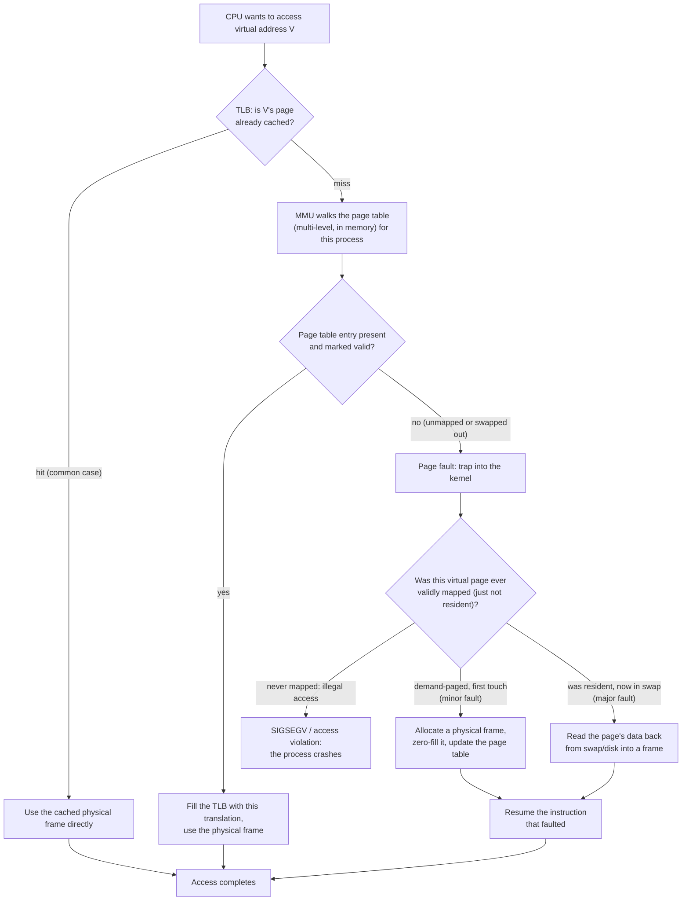
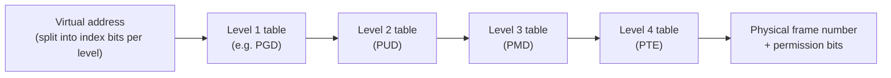

# Virtual Memory, Paging and the TLB

> [!summary] TL;DR
> Every process sees its own private **virtual** address space; the CPU's MMU and the kernel's **page tables** translate each virtual address to a real **physical** address, 4 KB (or larger) page at a time. A small hardware cache of recent translations, the **TLB**, makes that translation fast; missing it means walking the page table in memory, and accessing a page that isn't mapped in at all triggers a **page fault**.

> [!abstract] Core idea
> - Addresses your program sees are virtual. The MMU rewrites every one of them to a physical address using per-process page tables, invisibly.
> - Translation happens one fixed-size page at a time (commonly 4 KB), never per-byte, which keeps the page table small enough to be practical.
> - The TLB caches recent virtual→physical translations so most memory accesses skip the page-table walk entirely; a TLB miss costs the walk, a page fault costs far more (possibly disk I/O).
> - "Minor" page faults just map in a page already resident in RAM (or freshly zeroed); "major" page faults must pull the page's data in from disk/swap, which is orders of magnitude slower.
> - This is why two processes can each believe they own address `0x1000`, why `fork` can be fast (section 3), and why Linux will overcommit memory and sometimes kill a process (the OOM killer) rather than honor every promise it made.

## 1. Why it exists

Before virtual memory, programs addressed physical RAM directly: if your program's code happened to load at physical address `0x8000`, every pointer, every jump target, baked in `0x8000`-relative addresses. Two programs couldn't be loaded into memory at the same time without one of them being relinked to avoid overlapping the other, and one program's bug (an out-of-bounds write) could silently corrupt another program's memory or the OS itself — there was no boundary.

Virtual memory gives every process its own **address space**: a private range of addresses from `0` up to the architecture's limit, that only *that* process can use, and which the MMU translates to real physical memory behind the scenes. Two processes can both have code at virtual address `0x400000` and never collide, because the kernel maps each one's `0x400000` to a different physical page. A buggy write to a bad pointer faults (segfaults) instead of corrupting another process, because the MMU simply refuses translations outside a process's own mappings.

It also decouples "how much memory a process is promised" from "how much physical RAM actually backs it right now": pages can be mapped in lazily on first use (demand paging, section 3), shared between processes that both want the same read-only data (shared libraries, `fork`'s copy-on-write), or pushed out to disk under memory pressure (swap) — all without the process's own view of its addresses ever changing.

## 2. Mental model

Think of a hotel with one lobby directory (the MMU + page table) per guest, not one global room list. Every guest has their own private floor plan starting at "Room 1, Room 2, Room 3…" — **virtual** room numbers that only exist on that guest's own map. The hotel's actual physical rooms are numbered completely differently, and the front desk (MMU) translates "guest A, Room 12" to physical room 847 and "guest B, Room 12" to physical room 203, with neither guest ever seeing the real room numbers.

Guests don't get individually sized rooms — the hotel only has one room size (a **page**, 4 KB), so a guest needing more space gets more rooms, not one bigger room. The front desk doesn't look up every single step you take inside your room (every byte you touch); it only looks up which physical room a virtual room maps to, and remembers the last several lookups on a sticky note (the **TLB**) so repeat visits to the same room are instant. If a guest asks for a room that hasn't been assigned a physical room yet, that's a **page fault**: the front desk scrambles to assign one, which is cheap if a spare room is sitting ready (**minor fault**) and slow if it has to move someone's stuff back from the hotel's off-site storage first (**major fault**, i.e. swap).

## 3. How it works

### The translation path



A **minor fault** never touches a disk: the page just wasn't mapped yet (a freshly `mmap`'d region, a stack growing into a new page, a copy-on-write page about to be duplicated) and the kernel can satisfy it from RAM alone — allocate a frame, maybe zero it, update the page table. A **major fault** means the data has to be fetched from backing storage (a memory-mapped file, or swap), which can cost milliseconds instead of microseconds: this is the single biggest cause of a process suddenly feeling "stuck" under memory pressure.

### Multi-level page tables

A single flat table mapping every possible virtual page directly to a physical frame would be enormous (a 48-bit virtual address space with 4 KB pages has 2^36 possible pages) — far too large to keep resident for every process. Real page tables are **multi-level** (radix trees): a top-level table of pointers to second-level tables of pointers to third-level tables, and so on, down to the entries that finally hold a physical frame number. x86-64 Linux commonly uses 4 levels (PGD → PUD → PMD → PTE); only the branches a process actually uses need to exist, so an address space with large unused gaps costs almost nothing in page-table memory.



Each level adds a memory access on a TLB miss — a full 4-level walk is up to 4 extra memory reads before the real access, which is exactly why the TLB matters so much: without it, *every* memory access would cost 4-5× a normal memory access.

### Huge pages

Because each TLB entry only covers one page, a process that touches gigabytes of memory (a large in-memory cache, a database buffer pool) needs far more TLB entries than a TLB can hold (TLBs typically hold dozens to a few thousand entries), causing frequent TLB misses. **Huge pages** (2 MB or 1 GB on x86-64, configurable on arm64) make one TLB entry cover far more memory, trading flexibility (can't swap or partially map a huge page as finely) for a much lower TLB miss rate on large working sets. Linux's **Transparent Huge Pages (THP)** tries to do this automatically, but can introduce latency spikes when it has to compact memory to find a contiguous 2 MB region — a well-known source of tail-latency jitter in Redis and database deployments, which is why many of them run with THP set to `madvise` rather than `always`.

## 4. Worked example

### Whiteboard version

The mechanism in one sentence: keep a small map from virtual page number to physical frame number (the TLB), and fall back to a bigger, slower map (the page table) on a miss:

```go
type PageTable map[uint64]uint64 // virtual page number -> physical frame
type TLB map[uint64]uint64       // same shape, much smaller, much faster to search

func translate(pt PageTable, tlb TLB, vpn uint64) (frame uint64, hit bool) {
    if f, ok := tlb[vpn]; ok {
        return f, true // TLB hit
    }
    f, ok := pt[vpn]
    if ok {
        tlb[vpn] = f // fill the TLB for next time
    }
    return f, false // TLB miss (hit page table, or ok==false: fault)
}
```

The full version below adds an LRU-bounded TLB (real TLBs are fixed-size), demand paging with a bounded number of physical frames (so page eviction and swap-in are observable), and distinguishes minor from major faults, exactly as section 3 describes.

```go
// Package vm is a small, deterministic simulation of the paging mechanism:
// a page table, a fixed-size TLB with LRU eviction, and demand paging with
// a bound on physical frames so pages can be swapped out and faulted back in.
// It is a teaching model, not a real MMU: real hardware walks a radix-tree
// page table and the OS handles faults; here both are modelled directly so
// the sequence of events (TLB hit, TLB miss, minor fault, major fault) is
// visible and testable.
package vm

const pageSize = 4096 // bytes; matches the common x86-64/arm64 base page size

// Event names the kind of access that just happened, cheapest first.
type Event string

const (
	TLBHit     Event = "TLB hit"
	TLBMiss    Event = "TLB miss, page table hit"
	MinorFault Event = "minor fault (new page, zero-filled)"
	MajorFault Event = "major fault (page was swapped out)"
)

type pte struct {
	frame   uint64
	present bool // in physical memory right now
	swapped bool // was mapped before, but its frame was reclaimed
}

// MMU models one process's address translation.
type MMU struct {
	pageTable map[uint64]*pte // virtual page number -> entry
	tlb       *lruTLB

	frames    map[uint64]uint64 // physical frame -> virtual page number it holds
	freeFrame uint64
	maxFrames uint64 // physical frames available to this process (forces eviction)
}

// NewMMU creates an MMU with tlbSize TLB entries and maxFrames physical
// frames backing this process (a tiny number, to make eviction observable).
func NewMMU(tlbSize int, maxFrames uint64) *MMU {
	return &MMU{
		pageTable: make(map[uint64]*pte),
		tlb:       newLRUTLB(tlbSize),
		frames:    make(map[uint64]uint64),
		maxFrames: maxFrames,
	}
}

func vpn(addr uint64) uint64    { return addr / pageSize }
func offset(addr uint64) uint64 { return addr % pageSize }

// Translate converts a virtual address to a physical address, simulating the
// hardware/OS steps: TLB, then page table, then a page fault if needed.
func (m *MMU) Translate(vaddr uint64) (paddr uint64, event Event) {
	vp := vpn(vaddr)

	if frame, ok := m.tlb.lookup(vp); ok {
		return frame*pageSize + offset(vaddr), TLBHit
	}

	entry, ok := m.pageTable[vp]
	switch {
	case ok && entry.present:
		m.tlb.insert(vp, entry.frame)
		return entry.frame*pageSize + offset(vaddr), TLBMiss

	case ok && entry.swapped:
		frame := m.allocateFrame(vp)
		entry.frame, entry.present, entry.swapped = frame, true, false
		m.tlb.insert(vp, frame)
		return frame*pageSize + offset(vaddr), MajorFault

	default: // never mapped: demand paging allocates and zero-fills a frame
		frame := m.allocateFrame(vp)
		m.pageTable[vp] = &pte{frame: frame, present: true}
		m.tlb.insert(vp, frame)
		return frame*pageSize + offset(vaddr), MinorFault
	}
}

// allocateFrame hands back a free frame, evicting the oldest-mapped page
// (a simple FIFO "clock-like" policy) when the process is at its frame cap.
func (m *MMU) allocateFrame(forPage uint64) uint64 {
	if uint64(len(m.frames)) < m.maxFrames {
		f := m.freeFrame
		m.freeFrame++
		m.frames[f] = forPage
		return f
	}
	var victimFrame, victimPage uint64
	first := true
	for f, p := range m.frames {
		if first || f < victimFrame {
			victimFrame, victimPage, first = f, p, false
		}
	}
	delete(m.frames, victimFrame)
	if e := m.pageTable[victimPage]; e != nil {
		e.present, e.swapped = false, true
	}
	m.tlb.invalidate(victimPage)
	m.frames[victimFrame] = forPage
	return victimFrame
}
```

The TLB itself (a tiny fixed-capacity LRU cache, exactly what section 3 described as "a sticky note of recent lookups"):

```go
package vm

// lruTLB is a tiny fixed-capacity, fully-associative cache from virtual page
// number to physical frame, evicting the least-recently-used entry. Real
// TLBs are implemented in hardware as content-addressable memory; a slice
// scan is a fine stand-in at the sizes this simulation uses, and keeps the
// mechanism easy to read.
type lruTLB struct {
	capacity int
	order    []uint64          // page numbers, most-recently-used at the end
	frameOf  map[uint64]uint64 // page -> frame
}

func newLRUTLB(capacity int) *lruTLB {
	return &lruTLB{capacity: capacity, frameOf: make(map[uint64]uint64)}
}

func (t *lruTLB) lookup(page uint64) (frame uint64, ok bool) {
	frame, ok = t.frameOf[page]
	if ok {
		t.touch(page)
	}
	return frame, ok
}

func (t *lruTLB) insert(page, frame uint64) {
	if _, exists := t.frameOf[page]; !exists && len(t.frameOf) >= t.capacity {
		t.evictOldest()
	}
	t.frameOf[page] = frame
	t.touch(page)
}

func (t *lruTLB) invalidate(page uint64) {
	delete(t.frameOf, page)
	for i, p := range t.order {
		if p == page {
			t.order = append(t.order[:i], t.order[i+1:]...)
			break
		}
	}
}

func (t *lruTLB) touch(page uint64) {
	for i, p := range t.order {
		if p == page {
			t.order = append(t.order[:i], t.order[i+1:]...)
			break
		}
	}
	t.order = append(t.order, page)
}

func (t *lruTLB) evictOldest() {
	if len(t.order) == 0 {
		return
	}
	oldest := t.order[0]
	t.order = t.order[1:]
	delete(t.frameOf, oldest)
}
```

Tests that pin down the exact sequence of events this note describes:

```go
func TestFirstTouchIsMinorFault(t *testing.T) {
	m := NewMMU(4, 8)
	_, ev := m.Translate(0x1000)
	if ev != MinorFault {
		t.Fatalf("first access to a new page: got %s, want %s", ev, MinorFault)
	}
}

func TestRepeatedAccessHitsTheTLB(t *testing.T) {
	m := NewMMU(4, 8)
	m.Translate(0x1000) // minor fault, also warms the TLB
	_, ev := m.Translate(0x1004)
	if ev != TLBHit {
		t.Fatalf("second access to the same page: got %s, want %s", ev, TLBHit)
	}
}

func TestTLBEvictionStillHitsThePageTable(t *testing.T) {
	m := NewMMU(2, 8) // only 2 TLB entries
	m.Translate(0x1000)
	m.Translate(0x2000)
	m.Translate(0x3000) // evicts page 0x1000's TLB entry (LRU)

	_, ev := m.Translate(0x1000) // page table still has it: no fault, just a miss
	if ev != TLBMiss {
		t.Fatalf("after TLB eviction: got %s, want %s", ev, TLBMiss)
	}
}

func TestFrameExhaustionCausesMajorFaultOnReaccess(t *testing.T) {
	m := NewMMU(8, 2) // only 2 physical frames

	m.Translate(0x1000) // frame 0
	m.Translate(0x2000) // frame 1
	m.Translate(0x3000) // no free frame: evicts page 0x1000, swaps it out

	_, ev := m.Translate(0x1000) // must fault back in from "swap"
	if ev != MajorFault {
		t.Fatalf("re-accessing a swapped-out page: got %s, want %s", ev, MajorFault)
	}
}
```

`go test -race ./vm/...` — all four tests above plus a same-page-same-offset consistency check pass.

**Latency ladder for this mechanism** (documented, 2025-era order-of-magnitude; DDR5/NVMe figures per vendor datasheets and widely published measurements, not benchmarked in this vault):

| Step | Typical cost |
| ---- | ------------ |
| TLB hit | ~0.5-1 ns (part of a normal memory access) |
| TLB miss, page table walk (4 levels, each could itself hit/miss cache) | ~5-20 ns if the page table levels are cached, more if not |
| Minor page fault (zero-fill, no disk) | ~1-10 µs (trap + kernel bookkeeping, no I/O) |
| Major page fault, modern NVMe SSD (PCIe 4/5, documented vendor QD1 random-read figures) | ~tens to ~100 µs |
| Major page fault, swapping to a spinning HDD (legacy, included for scale) | ~several ms (dominated by seek time) |

## 5. Variants and comparison

| Mechanism | What changes | Use when | Cost |
| --------- | ------------- | -------- | ---- |
| Standard 4 KB pages | Default everywhere | General-purpose workloads | Fine TLB granularity, more TLB pressure for large working sets |
| Huge pages (2 MB/1 GB x86-64, similar on arm64) | One TLB entry covers far more memory | Large, mostly-resident working sets: DB buffer pools, JVM heaps, Redis with big datasets | Fewer TLB misses; less flexible reclaim/swap granularity; THP can stall on compaction |
| Copy-on-write pages | Two mappings point at one physical page, read-only, until either writes | `fork`, shared libraries, `mmap(MAP_PRIVATE)` | First write after sharing costs one extra page copy + fault; otherwise free sharing |
| Swap / page-out | A resident page's data is written to disk and its frame reclaimed | Memory pressure, inactive pages | Major fault (slow) on next access; avoids an immediate OOM kill |
| `mmap` of a file | A file's data is paged in on demand instead of read up front | Large files, especially read mostly randomly | Pages fault in lazily; the page cache (see [[Page Cache, File Systems and fsync]]) backs it, so repeat access across processes shares one copy |

## 6. Trade-offs and when not to use

- Virtual memory is not optional in any general-purpose OS — the question is tuning, not whether. Huge pages trade reclaim/compaction flexibility for TLB efficiency; most server workloads with large resident working sets benefit, interactive/short-lived workloads often don't need them.
- Overcommit means the kernel can promise more virtual memory than it has physical RAM + swap to back, betting that not every process will touch every page it allocated. Linux's default overcommit heuristic allows this; a program that then touches memory it was "promised" can trigger the kernel's **OOM killer**, which picks a process (scored by `oom_score`, roughly RSS usage) and `SIGKILL`s it — a surprise to anyone expecting `malloc`/`mmap` to fail cleanly instead.
- Swapping anything latency-sensitive is close to always wrong: a major fault to a disk is 10,000-100,000× slower than a TLB-hit memory access. Databases and caches typically run with swap disabled or minimized (low `vm.swappiness` on Linux) precisely to avoid trading a little extra RAM headroom for occasional multi-millisecond stalls.
- **Thrashing** is what happens when memory pressure is bad enough that the kernel spends more time paging data in and out than running processes: every process's working set keeps getting evicted before it finishes using it, so the next access is almost always a major fault, which evicts someone else's page in turn. The symptom is a system that looks "stuck" with high disk I/O and low useful CPU work; the fix is adding RAM, shrinking the working set, or killing something, not tuning page-replacement policy.

## 7. In production

- **Real systems:** PostgreSQL's and Redis's recommendations to disable or tightly limit swap and to use `madvise` (not `always`) THP; the JVM's and PostgreSQL's optional use of huge pages for large heaps/shared buffers to cut TLB misses; container memory limits (cgroups) that the OOM killer (or a cgroup-scoped OOM killer) enforces by killing processes that exceed them.
- **Failure modes → fixes:**
  - A process is unexpectedly `SIGKILL`'d with no application-level error → check `dmesg`/`journalctl` for an OOM-killer entry; it means the kernel, not the application, decided to free memory by killing something.
  - Sudden, unexplained latency spikes on an otherwise idle-looking box → check for swapping (`vmstat`'s `si`/`so` columns) or THP compaction stalls (`/sys/kernel/mm/transparent_hugepage/enabled`, and `perf` showing time in `khugepaged`/compaction).
  - High CPU with no obvious cause on a workload touching lots of scattered memory → check the TLB miss rate (`perf stat -e dTLB-load-misses`) before assuming it's an algorithmic problem; a bad memory-access pattern can be a TLB problem in disguise.
  - A Go process's RSS looks far larger (or smaller) than expected → remember Go's reported heap size is influenced by `GOGC`/`GOMEMLIMIT` and that the Go runtime may not immediately return freed pages to the OS; RSS and "live heap objects" are related but not identical numbers.
- **What to monitor:** `vmstat`'s `si`/`so` (swap in/out) and `free`/`buff`/`cache`; per-process `VmRSS` vs `VmSwap` in `/proc/<pid>/status`; `perf stat -e dTLB-load-misses,dTLB-store-misses` for TLB pressure; kernel log entries containing `Out of memory: Killed process`.

## 8. Deep dive

- **ASLR and ISA-specific translation.** Address space layout randomization places the stack, heap, libraries and sometimes the executable itself at randomized virtual base addresses each run, specifically to make memory-corruption exploits harder to write (an attacker can't hardcode "the stack is at address X"). This rides entirely on virtual memory: the randomized addresses are virtual, so it costs nothing in physical layout. x86-64 Linux's 4-level page tables (5-level on very large-memory systems, extending the addressable range) and arm64's broadly similar scheme are different concrete implementations of the same multi-level idea in section 3.
- **RSS vs VSZ, and why they diverge.** `VSZ` (virtual size) counts every page a process has *mapped*, whether or not it's ever been touched; `RSS` (resident set size) counts pages actually backed by physical RAM right now. A process that `mmap`s a 10 GB file but only reads the first 10 MB of it has a `VSZ` near 10 GB and an `RSS` near 10 MB. Go programs often show `VSZ` far larger than intuition suggests because the runtime reserves large stretches of virtual address space up front for its heap arenas, without that space costing physical memory until touched.
- **Why `fork` is fast despite "copying" an address space (cross-reference).** As covered in [[Processes, Threads and Context Switching]], `fork` marks the parent's and child's page table entries copy-on-write rather than duplicating physical pages; the first write by either side triggers a minor fault that finally copies just that one page. The mechanism is the same page-fault machinery this note describes, just triggered by a write-protect violation instead of a not-present entry.
- **Why huge pages cause latency jitter.** Allocating a 2 MB huge page needs 512 contiguous physical 4 KB frames. Under long-running memory pressure, physical memory fragments, and the kernel's `khugepaged`/compaction machinery may need to actively move pages around to free up a contiguous 2 MB block before it can satisfy the request — work that can stall the requesting (or an unrelated) process for milliseconds, the documented reason several databases default THP to `madvise`.

## 9. Interview questions

> [!question]- What problem does virtual memory actually solve?
> Three things at once: isolation (one process can't read/corrupt another's memory, because the MMU only ever translates addresses the kernel mapped for that process), simplicity (every process can assume it has a large, contiguous address space starting near zero, regardless of what's physically free), and flexibility (pages can be mapped lazily, shared, or swapped out without the process's own addresses changing).

> [!question]- What's the difference between a TLB miss and a page fault?
> A TLB miss just means the translation wasn't in the fast cache; the kernel (via the MMU) walks the page table in memory and finds it there — slower than a hit, but no trap into the kernel's fault handler and no chance of I/O. A page fault means the page table itself says this page isn't currently mapped to a physical frame; it always traps into the kernel, and can be cheap (minor fault: just allocate/zero a frame) or expensive (major fault: pull data in from disk).

> [!question]- Trap: does running out of RAM always crash the process that asked for more memory?
> No, and this surprises people. Linux can overcommit — promising virtual memory it doesn't yet have physical RAM to back — so an allocation call can succeed even when the system is already tight on memory. The crash shows up later, when something actually tries to use memory the kernel can't find room for: the kernel's OOM killer picks a process (often not the one that made the fatal allocation) and kills it outright, rather than failing the original `malloc`/`mmap` call.

> [!question]- Why do huge pages help some workloads and not others?
> They reduce TLB misses by making one TLB entry cover far more memory (2 MB or 1 GB instead of 4 KB), which matters a lot for workloads with a large, mostly-resident working set that's scanned unpredictably (DB buffer pools, big in-memory caches). Workloads with small working sets already fit comfortably in the TLB and gain little, while THP's background compaction to assemble contiguous huge pages can introduce latency spikes — a real cost some latency-sensitive services aren't willing to pay, hence `madvise` instead of `always`.

> [!question]- How does `fork` avoid copying a multi-gigabyte address space?
> It doesn't copy data at fork time at all. The kernel marks the parent's and the new child's page table entries for the shared pages as copy-on-write and read-only. Both processes keep reading the same physical pages for free. Only when either process writes to a shared page does a (minor) page fault occur, and the kernel copies just that one page before letting the write proceed.

> [!question]- What would you check if `perf` shows a CPU-bound Go service spending a lot of time on memory stalls that don't look like cache misses?
> The TLB miss rate specifically (`perf stat -e dTLB-load-misses`), not just L1/L2/L3 cache misses — a program that scans a huge amount of memory with poor locality can be TLB-bound even with a reasonable cache hit rate, since the TLB is much smaller than any CPU cache. Huge pages, or restructuring the access pattern for better locality, are the usual fixes.

> [!question]- Why does swap hurt latency so much more than a cache-level miss?
> Because a major page fault isn't a memory operation at all — it's an I/O operation. Even a fast NVMe SSD's documented access latency (tens to roughly a hundred microseconds) is many thousands of times slower than a DRAM access (around a hundred nanoseconds), and a spinning disk is slower again by another couple of orders of magnitude. A process is parked, unable to run, for the whole round trip, which is exactly the kind of multi-millisecond stall that shows up as a latency spike in a service that otherwise looks healthy.

## 10. Cheat sheet

- Virtual addresses are per-process and private; the MMU + page tables translate them to physical addresses, one page (commonly 4 KB) at a time.
- Order of lookups: TLB (fast, small) → page table (multi-level, in memory) → page fault (trap into the kernel) if not mapped at all.
- Minor fault: no disk I/O needed (demand paging, zero-fill, copy-on-write). Major fault: data must come from disk/swap — orders of magnitude slower.
- Huge pages trade reclaim flexibility for far fewer TLB misses on large working sets; THP's background compaction can itself cause latency spikes.
- Overcommit lets allocations succeed past physical capacity; the kernel's OOM killer, not a failed `malloc`, is often how that debt gets called in.
- `fork`'s copy-on-write is this same page-fault machinery, triggered by a write to a read-only-shared page.
- RSS (resident, backed by real RAM) and VSZ (virtual, reserved) diverge a lot for programs (including Go programs) that reserve large virtual ranges up front.

## Links

- **Before this:** [[Memory Hierarchy and CPU Caches]], [[Processes, Threads and Context Switching]]
- **Next:** [[Process Memory Layout - Stack vs Heap]], [[Page Cache, File Systems and fsync]]
- **Compare with:** [[System Calls and User vs Kernel Mode]] (a page fault is itself a kind of trap into the kernel)
