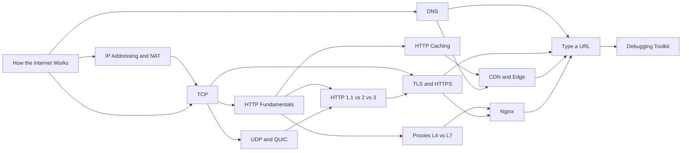

# 02 Networking & Web MOC

> [!summary] What this folder covers
> How bytes cross the internet, from IP packets and DNS through TCP, UDP, QUIC, HTTP/1.1/2/3 and TLS, to HTTP caching, CDNs and proxies. After reading it you can trace a request end to end and debug it with real tools.

## Before and after

- **Before this:** [[01 CS Fundamentals MOC]]
- **After this:** [[03 Frontend MOC]] · [[05 APIs MOC]] · [[12 Security & Auth MOC]]

## Learning path

Back to [[Home]].

1. [[How the Internet Works - IP, Ports, Packets, OSI vs TCP-IP]] · basic. The layer model and the packet's journey that every later note assumes. · Go code: [[How the Internet Works - IP, Ports, Packets, OSI vs TCP-IP - Go]]
2. [[IP Addressing, Subnets, NAT and VPC Basics]] · basic. How addresses, CIDR blocks and NAT shape the networks your services live in. · Go code: [[IP Addressing, Subnets, NAT and VPC Basics - Go]]
3. [[DNS - Resolution, Records and Caching]] · basic. How a name becomes an IP address, and why stale records cause outages. · Go code: [[DNS - Resolution, Records and Caching - Go]]
4. [[TCP - Handshake, Reliability, Flow and Congestion Control]] · intermediate. The reliable byte stream underneath most of the web, and where its latency comes from. · Go code: [[TCP - Handshake, Reliability, Flow and Congestion Control - Go]]
5. [[UDP and QUIC]] · intermediate. Why a connectionless datagram protocol became the base of HTTP/3. · Go code: [[UDP and QUIC - Go]]
6. [[HTTP Fundamentals - Methods, Status Codes, Headers, Cookies]] · basic. The request and response vocabulary every backend engineer uses daily. · Go code: [[HTTP Fundamentals - Methods, Status Codes, Headers, Cookies - Go]]
7. [[HTTP-1.1 vs HTTP-2 vs HTTP-3]] · intermediate. How each version fixed the previous one's head-of-line blocking. · Go code: [[HTTP-1.1 vs HTTP-2 vs HTTP-3 - Go]]
8. [[TLS and HTTPS]] · intermediate. The handshake, the cryptography and the certificate chain that make HTTPS trustworthy. · Go code: [[TLS and HTTPS - Go]]
9. [[HTTP Caching - Cache-Control, ETag, Conditional Requests]] · intermediate. The headers that decide whether a response is reused, revalidated or refetched. · Go code: [[HTTP Caching - Cache-Control, ETag, Conditional Requests - Go]]
10. [[CDN and Edge]] · intermediate. Moving content and logic close to users, and how to invalidate it safely. · Go code: [[CDN and Edge - Go]]
11. [[Forward and Reverse Proxies - L4 vs L7]] · intermediate. What a proxy can see and do at the transport layer versus the application layer. · Go code: [[Forward and Reverse Proxies - L4 vs L7 - Go]]
12. [[Nginx]] · intermediate. The most common reverse proxy, configured for TLS, upstreams and rate limits.
13. [[What Happens When You Type a URL]] · intermediate. The classic interview question that ties every earlier note together. · Go code: [[What Happens When You Type a URL - Go]]
14. [[Network Debugging Toolkit - dig, curl, ss, tcpdump]] · advanced. The commands that turn a vague "network issue" into a specific cause. · Go code: [[Network Debugging Toolkit - dig, curl, ss, tcpdump - Go]]

## Concept map

## Interview focus

- What happens when you type a URL into the browser and press Enter? See [[What Happens When You Type a URL]].
- Explain the TCP three-way handshake, and the difference between flow control and congestion control. See [[TCP - Handshake, Reliability, Flow and Congestion Control]].
- When would you choose UDP over TCP, and what problems does QUIC solve? See [[UDP and QUIC]].
- What changed between HTTP/1.1, HTTP/2 and HTTP/3, and what is head-of-line blocking? See [[HTTP-1.1 vs HTTP-2 vs HTTP-3]].
- Walk through a TLS 1.3 handshake and explain how a certificate chain is verified. See [[TLS and HTTPS]].
- How does DNS resolution work, and how do TTLs affect a failover? See [[DNS - Resolution, Records and Caching]].
- Which HTTP methods are idempotent, and what do 401, 403, 429 and 503 mean? See [[HTTP Fundamentals - Methods, Status Codes, Headers, Cookies]].
- How do Cache-Control and ETag work together, and how do you invalidate a CDN? See [[HTTP Caching - Cache-Control, ETag, Conditional Requests]] and [[CDN and Edge]].
- What is the difference between an L4 and an L7 load balancer or proxy? See [[Forward and Reverse Proxies - L4 vs L7]].
- How would you debug a service that is slow or unreachable over the network? See [[Network Debugging Toolkit - dig, curl, ss, tcpdump]].

## Sources worth reading

- Ilya Grigorik, *High Performance Browser Networking* (free online at hpbn.co).
- Julia Evans, networking zines and the "How DNS works" comics.
- Cloudflare Learning Center articles on DNS, TLS, CDNs and HTTP/3.
- MDN Web Docs, HTTP reference (methods, status codes, headers and caching).
- RFC 9110 (HTTP Semantics), RFC 9111 (HTTP Caching), RFC 9000 (QUIC) and RFC 8446 (TLS 1.3).
- nginx.org documentation, Beginner's Guide.
