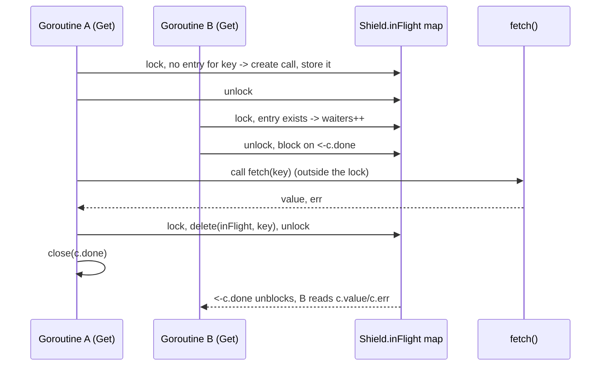

# CDN and Edge - Go

> [!summary] TL;DR
> This code is a miniature **origin shield**: a `Shield` type that collapses concurrent cache misses on the same key into one call to a backing fetcher, so a mass TTL expiry at a real CDN turns into one origin request instead of one per concurrent caller. See the theory in [[CDN and Edge]].

> [!info] How to read this note (pick your level)
> - 🟢 **New to this?** Read the "From zero" paragraph below, then "Before the code", "What this code shows" and Setup. Stop there.
> - 🟡 **Know the basics?** Read the Code, Tests and Running it sections top to bottom; each big block has a plain-words opener first.
> - 🔴 **Interview / SDE-3 prep?** Add Design decisions, Pitfalls and the Exercises. Headings are tagged 🟢🟡🔴 so you always know where you are.

**From zero** 🟢 — This file is the hands-on twin of [[CDN and Edge]]. It builds, in about 60 lines of Go, the one trick an origin shield does: when 100 people ask for the same missing item at the same moment, only ONE request goes to the far-away origin server, and the other 99 simply wait and share that one answer. The tests then prove it — 100 simultaneous askers, exactly 1 origin call. Read each "In plain words" line before its code block and you can follow without deep Go knowledge.

## Before the code 🟢

- **Goroutines**: functions running concurrently (`go f()`); the tests start 100 at once to simulate a burst of cache misses.
- **`sync.Mutex`**: a lock so only one goroutine touches the `inFlight` map at a time.
- **Channels (`chan struct{}`)**: closing a channel wakes every goroutine waiting on it, which is how one result is broadcast to all waiters.
- **Maps**: `map[string]*call` tracks which cache keys already have a fetch running.
- **What to run**: `go vet ./...` and `go test -race ./...` (the race detector checks for unsafe shared memory).

## What this code shows 🟢

| Code | Theory concept | Theory section |
| --- | --- | --- |
| `Shield.Get` | Request collapsing at an origin shield | [[CDN and Edge#Request collapsing and the origin shield]] |
| `inFlight map[string]*call` | One shared result per cache key, while a fetch is in progress | [[CDN and Edge#Request collapsing and the origin shield]] |
| `TestGetCollapsesConcurrentMisses` | Proof that 100 concurrent misses become 1 origin call | [[CDN and Edge#Request collapsing and the origin shield]] |
| `TestNewFetchAfterInFlightCompletes` | Collapsing does not last forever — the next `Get` after completion refetches | [[CDN and Edge#Deep dive]] (request collapsing's limit) |

## Setup 🟢

- **Module layout:** a single package, `shield`, with `shield.go` and `shield_test.go` in one directory.
- **Go version:** 1.24.
- **Dependencies:** standard library only (`sync`).
- **Run it:**

```text
go mod init shield
go vet ./...
go test -race ./...
```

## Code 🟡

### The shared state: one in-flight call per key

**In plain words:** the shield keeps a small notebook — "someone is already out fetching product 42." Anyone else asking for product 42 just signs the notebook and waits, instead of making their own trip.

```go
package shield

import "sync"

// Fetcher loads a value for key, as the origin would on a cache miss.
type Fetcher func(key string) (value []byte, err error)

// Shield collapses concurrent misses on the same key into a single
// in-flight call to fetch. Every caller waiting on that key gets the same
// result; the next call after it finishes starts a fresh fetch.
type Shield struct {
	fetch func(key string) ([]byte, error)

	mu       sync.Mutex
	inFlight map[string]*call
}

type call struct {
	done    chan struct{}
	waiters int
	value   []byte
	err     error
}

func New(fetch Fetcher) *Shield {
	return &Shield{fetch: fetch, inFlight: make(map[string]*call)}
}
```

**Concept.** This implements the shield box in [[CDN and Edge#Request collapsing and the origin shield]]: a map from cache key to "a fetch is already happening for this key."

The alternative design would be a mutex per key held for the whole fetch duration, but that forces every waiter to block on a lock rather than a channel, and gives no easy way to count how many callers actually shared one fetch — which is exactly what the test below needs to prove collapsing happened.

A `sync.Map` was also considered, but a plain map plus one `sync.Mutex` is simpler here because every access already needs the mutex for the waiter count, so a lock-free map buys nothing.

**How it works.**
1. `Fetcher` is the shape of "go ask the origin" — kept as a type so the shield has no idea whether `fetch` means an HTTP call, a database read, or anything else.
2. `call` is one in-flight (or just-finished) fetch: `done` is closed exactly once, when the result is ready, so any number of goroutines can `<-c.done` and all wake up together.
3. `waiters` counts how many callers joined this one call, purely for observability and for the test's assertion.
4. `New` wires a `Shield` to a concrete fetch function and a ready-to-use map; a nil map read would panic, so this is the only place `inFlight` is allocated before first use.

### Get: join an in-flight call, or start one

**In plain words:** `Get` is the doorman logic — if a trip for this key is already underway, join the waiting group; if not, become the one person who makes the trip, then wake everyone up with the result.

```go
// Get returns the cached-or-fetched value for key, and the number of
// callers that shared this particular fetch (1 means no collapsing happened).
func (s *Shield) Get(key string) (value []byte, shared int, err error) {
	s.mu.Lock()
	if c, ok := s.inFlight[key]; ok {
		c.waiters++
		shared := c.waiters
		s.mu.Unlock()
		<-c.done
		return c.value, shared, c.err
	}

	c := &call{done: make(chan struct{}), waiters: 1}
	s.inFlight[key] = c
	s.mu.Unlock()

	c.value, c.err = s.fetch(key)

	s.mu.Lock()
	delete(s.inFlight, key)
	s.mu.Unlock()

	close(c.done)
	return c.value, c.waiters, c.err
}
```

**Concept.** This is the section [[CDN and Edge#Request collapsing and the origin shield]] describes as "the PoP recognizes a fetch is already in flight and makes every other caller wait."

The alternative of using a `sync.WaitGroup` per key was rejected because a `WaitGroup` carries no result value back to the waiters — a closed channel plus fields read only after the channel closes is the idiomatic Go way to broadcast one result to many goroutines.

**How it works.**
1. The mutex is held only long enough to check the map and either register a waiter or create a new `call` — never across the actual fetch, so unrelated keys never block on each other.
2. The existing-call branch increments `waiters`, releases the lock immediately, then blocks on `<-c.done`. Reading `c.value`/`c.err` after the channel closes is safe without further locking, because a closed channel establishes a happens-before relationship in Go's memory model: everything written before `close(c.done)` is visible to every goroutine that observes the close.
3. The new-call branch registers itself in `inFlight` *before* releasing the lock and calling `fetch`, so any caller arriving in that window sees the in-flight entry rather than starting a second fetch — this ordering is the entire point of the mutex.
4. `delete(s.inFlight, key)` happens before `close(c.done)`, so a caller that arrives after the fetch finishes but before the close either joins the just-finishing call (rare, harmless — it gets the same result) or, after `delete`, starts a genuinely fresh fetch, matching "the next call after it finishes starts a fresh fetch."



> [!example]- Full file
> ```go
> // Package shield implements request collapsing, the mechanism an origin
> // shield uses so that a mass cache expiry turns into one origin fetch
> // instead of one fetch per concurrent miss.
> package shield
>
> import "sync"
>
> // Fetcher loads a value for key, as the origin would on a cache miss.
> type Fetcher func(key string) (value []byte, err error)
>
> // Shield collapses concurrent misses on the same key into a single
> // in-flight call to fetch. Every caller waiting on that key gets the same
> // result; the next call after it finishes starts a fresh fetch.
> type Shield struct {
> 	fetch func(key string) ([]byte, error)
>
> 	mu       sync.Mutex
> 	inFlight map[string]*call
> }
>
> type call struct {
> 	done    chan struct{}
> 	waiters int
> 	value   []byte
> 	err     error
> }
>
> func New(fetch Fetcher) *Shield {
> 	return &Shield{fetch: fetch, inFlight: make(map[string]*call)}
> }
>
> // Get returns the cached-or-fetched value for key, and the number of
> // callers that shared this particular fetch (1 means no collapsing happened).
> func (s *Shield) Get(key string) (value []byte, shared int, err error) {
> 	s.mu.Lock()
> 	if c, ok := s.inFlight[key]; ok {
> 		c.waiters++
> 		shared := c.waiters
> 		s.mu.Unlock()
> 		<-c.done
> 		return c.value, shared, c.err
> 	}
>
> 	c := &call{done: make(chan struct{}), waiters: 1}
> 	s.inFlight[key] = c
> 	s.mu.Unlock()
>
> 	c.value, c.err = s.fetch(key)
>
> 	s.mu.Lock()
> 	delete(s.inFlight, key)
> 	s.mu.Unlock()
>
> 	close(c.done)
> 	return c.value, c.waiters, c.err
> }
> ```

## Design decisions 🔴

| Choice | Alternative | Trade-off |
| --- | --- | --- |
| Channel-based broadcast (`close(c.done)`) | `sync.WaitGroup` per key | A closed channel can carry a result to unlimited waiters via the happens-before rule; a `WaitGroup` only signals completion, not a value |
| Single `sync.Mutex` guarding the map | `sync.Map` | The waiter count needs a lock anyway, so a lock-free map adds complexity without removing the mutex |
| Mutex held only around map access, not the fetch | Holding the lock for the whole fetch | Holding it during `fetch` would serialize fetches for *different* keys too, destroying concurrency the shield is supposed to allow |
| Delete the in-flight entry before closing `done` | Close `done` first, delete after | Closing first risks a waiter re-reading the map and joining a call that's about to vanish mid-cleanup; deleting first means any latecomer either joins cleanly or starts fresh |

## Tests 🟡

### TestGetCollapsesConcurrentMisses

**In plain words:** the test freezes the one fetch mid-trip, piles 100 askers onto it, then lets the trip finish — and checks the origin's doorbell rang exactly once.

**Property proved:** 100 concurrent callers asking for the same key while a fetch is deliberately held open all share exactly one origin call. This is the entire reason a shield exists — without it, a mass TTL expiry turns into a stampede.

| Input | Expected output |
| --- | --- |
| 100 goroutines call `Get("product:42")` while `fetch` blocks on a channel | `originCalls == 1`; every goroutine's result equals `"value-for-product:42"` |

A failure here (`originCalls > 1`) would mean the collapsing logic has a race: two goroutines both saw "no entry" and both started their own fetch — exactly the stampede the shield exists to prevent.

The fetch function is deliberately held open on a channel, so the test controls exactly when it is allowed to finish — this is what lets all 100 goroutines reliably arrive *while* the one fetch is still in flight, rather than racing to see whether they overlap:

```go
func TestGetCollapsesConcurrentMisses(t *testing.T) {
	var originCalls int64
	block := make(chan struct{})

	s := New(func(key string) ([]byte, error) {
		atomic.AddInt64(&originCalls, 1)
		<-block // hold the fetch open so all 100 callers arrive while it's in flight
		return []byte("value-for-" + key), nil
	})

	const n = 100
	var wg sync.WaitGroup
	results := make([]string, n)
	wg.Add(n)
	for i := 0; i < n; i++ {
		go func(i int) {
			defer wg.Done()
			v, _, err := s.Get("product:42")
			if err != nil {
				t.Errorf("Get: %v", err)
				return
			}
			results[i] = string(v)
		}(i)
	}
```

Once all 100 goroutines have had a chance to register as waiters, the test releases the blocked fetch and checks that exactly one origin call happened and every goroutine got the same value:

```go
	time.Sleep(20 * time.Millisecond) // let all 100 goroutines join the in-flight call
	close(block)
	wg.Wait()

	if got := atomic.LoadInt64(&originCalls); got != 1 {
		t.Fatalf("origin was called %d times, want 1", got)
	}
	for i, v := range results {
		if v != "value-for-product:42" {
			t.Fatalf("result[%d] = %q, want value-for-product:42", i, v)
		}
	}
}
```

### TestNewFetchAfterInFlightCompletes

**Property proved:** collapsing is temporary. Once a fetch finishes and its entry is removed from `inFlight`, the next caller for the same key is a genuine cache miss again, not an accidental join onto a stale call.

Without this property, a key would permanently share its very first fetch's result forever, which is wrong — a shield must still eventually ask the origin again on the next real miss.

| Input | Expected output |
| --- | --- |
| `Get("product:42")` called, then called again after the first call has returned | `originCalls == 2` |

A failure here (`originCalls == 1` on the second call) would mean the shield is accidentally caching values forever instead of only collapsing *concurrent* misses — a correctness bug that would serve stale data indefinitely.

```go
func TestNewFetchAfterInFlightCompletes(t *testing.T) {
	var originCalls int64
	s := New(func(key string) ([]byte, error) {
		atomic.AddInt64(&originCalls, 1)
		return []byte("value-for-" + key), nil
	})

	if _, _, err := s.Get("product:42"); err != nil {
		t.Fatalf("first Get: %v", err)
	}
	if _, _, err := s.Get("product:42"); err != nil {
		t.Fatalf("second Get: %v", err)
	}

	if got := atomic.LoadInt64(&originCalls); got != 2 {
		t.Fatalf("origin was called %d times, want 2 (each Get after completion is a fresh fetch)", got)
	}
}
```

## Running it 🟡

```text
$ go vet ./...
$ go test -race ./... -v
=== RUN   TestGetCollapsesConcurrentMisses
--- PASS: TestGetCollapsesConcurrentMisses (0.02s)
=== RUN   TestNewFetchAfterInFlightCompletes
--- PASS: TestNewFetchAfterInFlightCompletes (0.00s)
PASS
ok  	cdn	1.555s
```

Reading it line by line: `go vet` printed nothing, meaning no suspicious constructs (unreachable code, wrong `Printf` verbs, lock-copying) were found.

Both tests ran under `-race`, Go's data-race detector, which instruments every memory access and would fail the build if two goroutines touched the same memory without synchronization — passing here is the actual proof that the mutex-and-channel design has no race, not just that the assertions happened to pass.

## Pitfalls in the code 🔴

- **Forgetting to delete from `inFlight` before closing `done`** would leave a finished call's entry in the map forever, so every later `Get` for that key would join a dead call and block on an already-closed channel forever reading stale data — this is why the delete happens strictly before the close.
- **Holding `s.mu` during the call to `fetch`** would serialize every key through one lock, turning a tool meant to protect the *origin* from concurrency into a tool that removes concurrency from the *shield* itself; the lock here is released before `fetch` runs specifically to avoid this.
- **Reading `c.value`/`c.err` without going through `<-c.done` first** would be a data race: those fields are written by the fetching goroutine and read by waiters, and only the channel close establishes the happens-before edge that makes that read safe.

## Exercises 🔴

1. Change `Get` so the lock is held during the call to `fetch` (move `s.mu.Unlock()` to after the `fetch` call instead of before it). Predict what `go test -race` reports, and what happens to the 100-goroutine test's wall-clock time if `fetch` is made to sleep for 50ms. Then run it and compare.
2. Add a `shared` return value assertion to `TestGetCollapsesConcurrentMisses`: capture each goroutine's own `shared` count and assert that at least one of them equals 100 (the very first caller to register should eventually see the final waiter count). Predict whether this is possible given the current code, since `shared` is captured at registration time, not at completion time — then try it.
3. Add a per-key TTL so that even if a value is fetched once, `Get` still refetches after `ttl` has elapsed, combining this shield with the `CachingResolver` pattern from [[DNS - Resolution, Records and Caching - Go]]. Predict which lock(s) need to be held when checking the TTL, and write a test proving a stale-but-present value still triggers a refetch after expiry.

## Links

- **Theory:** [[CDN and Edge]]
- **Related:** [[Forward and Reverse Proxies - L4 vs L7]], [[Cache Failure Modes - Stampede, Avalanche, Penetration, Hot and Big Keys]]
