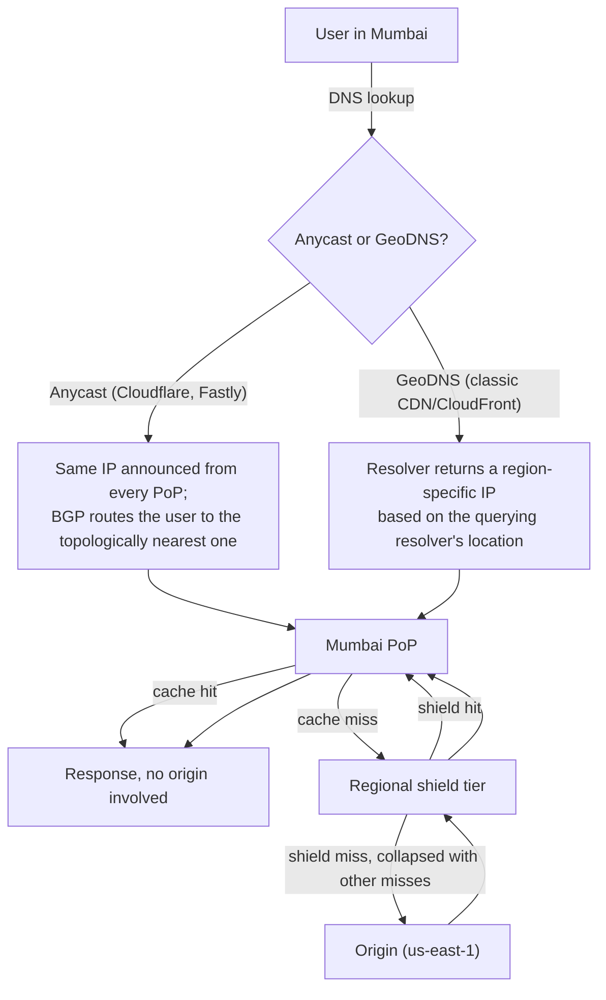
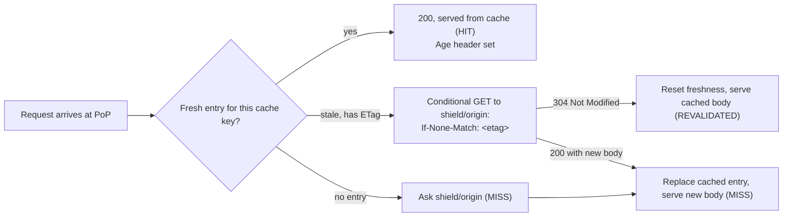
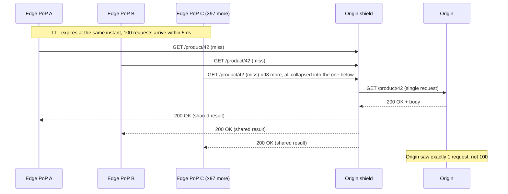
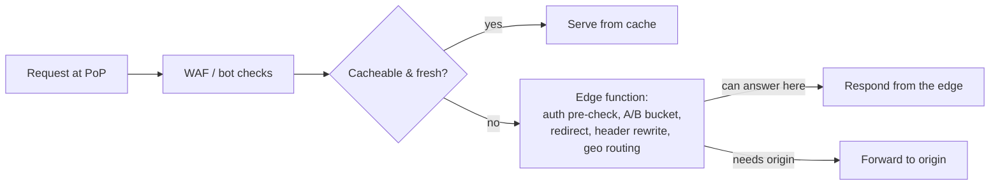

# CDN and Edge

> [!summary] TL;DR
> A **CDN** (content delivery network) is a global fleet of cache servers, called **PoPs** (points of presence), that sit between users and your **origin** server and answer requests from the copy nearest the user instead of sending every request across the planet. **Edge compute** goes further and runs your code at those same PoPs, before the request ever reaches the origin.

> [!abstract] Core idea
> - Users are routed to the nearest PoP by **anycast** (same IP announced everywhere, routers pick the closest) or **GeoDNS** (DNS answers with a region-specific IP).
> - A PoP answers from cache on a **hit**; on a **miss** it asks an **origin shield** tier, which **collapses** concurrent misses into one origin fetch.
> - `Cache-Control` headers and the **cache key** decide what gets cached, for how long, and whether two requests share a cache entry.
> - Classic mistake: thinking a CDN only serves static files. TLS termination near the user, keep-alive pools to the origin, and HTTP/3 all speed up **dynamic**, uncacheable requests too.

## 1. Why it exists

A user in Mumbai requests `product.jpg` from an origin server in Virginia. Round-trip time alone is typically 180–250 ms each way on the open internet for an India-to-US-East route (a representative range for that geography, not a specific measurement); add TCP and TLS handshakes and the first byte of a cold connection can take 400–600 ms before the image even starts downloading. Serve 50,000 users a day and the Virginia server also now has to open and hold 50,000 TLS connections and push every byte itself.

A CDN puts a copy of `product.jpg` on a server inside Mumbai's own network. The same request now completes in single-digit milliseconds of network time, and the origin in Virginia serves it exactly once — to the CDN, the first time anyone in that region asks for it.

**Measured**, `curl` from this session against `developer.mozilla.org` (served by Fastly), 2026-11-06:

```text
dns_lookup:0.003s  connect:0.004s  tls:0.149s  ttfb:0.216s  total:0.252s
```

```http
HTTP/2 200
cache-control: public, max-age=3600
age: 2205
x-cache: MISS, HIT, MISS
x-served-by: cache-sin-wsat1880030-SIN, cache-sin-wsat1880030-SIN, cache-sin-wsat1880086-SIN, cache-ccu830028-CCU
```

`age: 2205` means this exact response has been sitting in a cache for 2205 seconds — the origin did not see this request. `x-cache` shows three tiers: the page missed at one shield node, hit at a nearby one, and missed again going toward a further tier — this is the shield/regional/origin tier structure in a single header, not a single flat cache.

## 2. Mental model

Think of a CDN as a chain of warehouses between a factory (the origin) and a customer's door (the user):

- The **PoP** is the local warehouse nearest the customer. Most orders are filled from its shelves (a **hit**).
- Behind it, a smaller number of **regional / shield** warehouses hold a superset of the stock. If the local warehouse is out, it asks the regional one before ever bothering the factory.
- The **factory** (origin) only ships when no warehouse anywhere has the item, and it only has to make one shipment even if a thousand local warehouses ran out of the same item at the same moment.

**Edge compute** is a small workbench installed inside every warehouse: it can repack a box, check an ID, or redirect an order, without ever calling the factory.

## 3. How it works

### Getting the user to a PoP



- **Anycast**: every PoP announces the *same* IP address over BGP. Internet routers naturally send a packet to the announcing PoP with the fewest network hops. No DNS trickery is needed, and failover is just BGP withdrawing a bad PoP's route. Cloudflare and Fastly run this way.
- **GeoDNS**: the CDN's own DNS servers look at the resolver's IP (via EDNS Client Subnet, or the resolver's own location) and return a different A/AAAA record per region. CloudFront and classic Akamai setups use this. It is coarser-grained than anycast and depends on the *resolver* being close to the user, not the user directly.

### Hit, miss and revalidation



A **304** is cheap: the origin confirms the cached copy is still correct without resending the body. This needs the origin to send a validator (`ETag`, or `Last-Modified`) in the first place — see [[HTTP Caching - Cache-Control, ETag, Conditional Requests]] for how the validator itself is computed and compared; this note only covers what the CDN tier does with it.

### Cache-Control: who may cache, and for how long

```http
Cache-Control: public, max-age=31536000, immutable
Cache-Control: public, max-age=60, s-maxage=3600, stale-while-revalidate=30, stale-if-error=600
Cache-Control: private, no-cache
Cache-Control: no-store
```

| Directive | Meaning | Common mistake |
| --- | --- | --- |
| `max-age=N` | Fresh for `N` seconds in **every** cache: browser and CDN alike | Thinking it only applies to the browser — it does not; `s-maxage` is what's CDN-only |
| `s-maxage=N` | Overrides `max-age` for **shared** caches (CDN, corporate proxy) only; browsers ignore it | Forgetting it, so the CDN and the browser cache for the same, often too-short, time |
| `no-cache` | May be cached, but **must revalidate** with the origin before serving (not "don't cache") | Confusing with `no-store` |
| `no-store` | Must not be stored anywhere, ever | Using `no-cache` when you meant this |
| `private` | Only the end-user's own browser may cache it; shared caches (CDN) must not | Leaving this off a per-user response and having the CDN cache one user's data for everyone |
| `immutable` | This exact URL's content will never change while it's fresh — skip revalidation entirely even on a hard refresh | Only safe on hashed, versioned asset URLs |
| `stale-while-revalidate=N` | Serve the stale copy immediately, refresh in the background for `N` seconds after expiry | Great for hiding origin latency on a popular, slightly-stale-tolerant resource |
| `stale-if-error=N` | If the origin errors (5xx) or is unreachable, serve the stale copy for up to `N` seconds instead of the error | The single biggest and cheapest availability win a CDN gives you for free |

### Cache key and `Vary`

The **cache key** is the set of request attributes the CDN uses to decide whether two requests share a cached entry. By default it's usually scheme + host + path + query string.

- Adding a header to the key via `Vary: Accept-Encoding` is normal and safe — it just means gzip and brotli variants get separate entries.
- `Vary: Cookie` is close to disabling caching: since almost every request carries a different cookie, almost every request becomes its own cache key, and the hit ratio collapses toward zero. Strip session cookies at the edge before the cache lookup instead, or move personalization out of the cached response entirely.
- Tracking query parameters (`utm_source`, `gclid`) that don't change the response should be stripped from the cache key (most CDNs call this a "cache key normalization" or "query string allowlist" rule) — otherwise `/product/42?utm_source=a` and `/product/42?utm_source=b` are two cache misses for the same page.

### Request collapsing and the origin shield

When a popular object's TTL expires, hundreds of edge requests can arrive within milliseconds of each other, all seeing a miss at the same instant. Without protection, every one of them hits the origin — a self-inflicted stampede (see [[Cache Failure Modes - Stampede, Avalanche, Penetration, Hot and Big Keys]] for the general pattern; this is the CDN-specific instance of it).

Two mechanisms fix it:

- **Request collapsing**: the PoP recognizes that a fetch for this exact cache key is already in flight and makes every other caller wait for that one fetch's result instead of starting its own.
- **Origin shield**: a single, designated regional tier that every PoP's miss is routed through. Even if collapsing only happens per-PoP, routing all PoPs' misses through one shield means the *origin* still sees at most one request per object, because the shield itself also collapses.



### Invalidation

| Strategy | How | When to use |
| --- | --- | --- |
| Versioned URLs | `/app.8f3a1c.js`; a new deploy produces a new URL | Static build assets — pair with `immutable, max-age=31536000`; the old URL is simply abandoned, no purge needed |
| Surrogate-key / cache-tag purge | Tag each cached response with one or more keys (e.g. `product:42`) at store time; purge by tag later | Dynamic pages where one database update should invalidate every page that embedded that object |
| Soft purge | Mark cached entries stale instead of deleting them, so the next request can still get `stale-while-revalidate` behavior while a fresh copy is fetched | Avoids a thundering-herd on the origin right after a purge |
| Purge everything | Wipe the whole cache | Emergency only — this turns your entire traffic into origin traffic for a window, and is how a bad deploy becomes a bigger outage |

### Private content: never cache what shouldn't be shared

- Never let a response carrying `Set-Cookie` get cached by a shared cache — most CDNs refuse this by default, but an explicit `private` or `no-store` on authenticated responses is the safer habit.
- For paid downloads or video, use **signed URLs** (a query string with an expiry and an HMAC signature, verified by the CDN edge) or **signed cookies** (one signed cookie grants access to a whole path prefix, useful for an entire video's segment files).
- **Cache poisoning**: if the cache key ignores a header the origin's response actually varies on (e.g. `X-Forwarded-Host`, or an unkeyed `Accept-Language` that the origin still uses to render), an attacker's single poisoned response can get cached and served to every other user who shares that key. **Cache deception**: tricking a CDN into caching a response that *looks* static (by appending `/nonexistent.css` to a dynamic, authenticated URL) when the origin actually ignores the extra path and returns the private page anyway. Fix: make every cache-key input match every response-varying input, and have the origin reject or correctly route unexpected path suffixes rather than silently serving the same handler.

### Dynamic content acceleration

Not everything a CDN speeds up is cacheable. For a request that must always reach the origin (checkout, a logged-in dashboard), the CDN still helps:

- **TLS and TCP terminate at the nearby PoP.** The slow part of a connection — the handshake round trips — happens over the short, low-latency hop to the PoP; the PoP already holds a warm, keep-alive connection pool to the origin and reuses it.
- **HTTP/3 (QUIC)** between the user and the PoP avoids TCP head-of-line blocking and survives a Wi-Fi-to-cellular network change without restarting the connection (see [[HTTP-1.1 vs HTTP-2 vs HTTP-3]]).
- **Route optimization**: some providers carry the request over their own private backbone from the PoP to the origin region instead of the public internet for the long leg.

This is why "dynamic site acceleration" is a real CDN product, separate from caching.

### Edge compute

Edge compute runs your own code at the PoP, before (or instead of) a round trip to the origin.



| Platform | Model | Typical limit |
| --- | --- | --- |
| Cloudflare Workers | V8 isolate, runs on every request path | CPU time capped per request (tens of ms), no local filesystem |
| AWS Lambda@Edge | Full Lambda, runs at a CloudFront regional edge cache, not every PoP | Up to 30s (origin-response) but adds cold-start latency; fewer locations than CloudFront's full PoP count |
| AWS CloudFront Functions | Tiny JS subset, runs at every PoP | Sub-millisecond budget; no network calls — header/URL rewrites and redirects only |
| Fastly Compute | WebAssembly, runs at every PoP | Millisecond-scale CPU budget, no local disk |

What belongs at the edge: a JWT **signature and expiry** pre-check (so a clearly invalid or expired token gets a fast 401 without a trip to origin) — but the **authoritative** authorization decision (does this specific user own this specific resource) stays at the origin, where the source of truth for permissions lives. Also at the edge: A/B bucket assignment, geo-based redirects, header normalization, and lightweight WAF rules.

What stays at origin: anything that needs strongly consistent reads, writes with business logic, or a decision that must never be wrong because the edge's view of the world (its JWT public keys, its feature-flag snapshot) is only **eventually consistent** — edge KV stores typically replicate globally in seconds, not instantly. An edge function's own deploy should be versioned and roll out gradually with the ability to roll back, exactly like an origin deploy, because a bad edge rule affects every PoP at once.

**Observability**: correlate an edge-side request ID (most providers inject one, e.g. Cloudflare's `cf-ray`) with the origin's own request ID/trace ID so a slow or failed request can be followed edge → shield → origin in one trace.

### Push vs pull, and media delivery

- **Pull CDN** (the default): the CDN fetches from origin lazily, on the first miss. Simple, and the common choice.
- **Push CDN**: you upload content to the CDN's storage ahead of time. Useful when you want to guarantee every PoP has the content before the first user asks (e.g. a scheduled release), at the cost of managing that upload yourself.
- **Video**: large files are split into short segments (HLS `.m3u8` + `.ts`/`.fmp4`, or DASH `.mpd` + segments) specifically so a CDN can cache and serve each segment independently, and a client can switch bitrate mid-stream by requesting a different segment variant without re-downloading what it already has.

## 4. Worked example

### Whiteboard version

A product page's image gets requested by 1,000 users across 3 regions in one minute. With no CDN, the origin serves 1,000 full-size image responses. With a CDN: the first user in each region causes a miss (3 origin fetches total, one per region's shield); the other 997 requests are all hits. Origin traffic drops from 1,000 responses to 3.

### Origin shield in Go: request collapsing

This is the mechanism a CDN's shield tier implements, shown in miniature: concurrent misses for the same key become one fetch.

```go
// Package shield implements request collapsing, the mechanism an origin
// shield uses so that a mass cache expiry turns into one origin fetch
// instead of one fetch per concurrent miss.
package shield

import "sync"

// Fetcher loads a value for key, as the origin would on a cache miss.
type Fetcher func(key string) (value []byte, err error)

// Shield collapses concurrent misses on the same key into a single
// in-flight call to fetch. Every caller waiting on that key gets the same
// result; the next call after it finishes starts a fresh fetch.
type Shield struct {
	fetch func(key string) ([]byte, error)

	mu       sync.Mutex
	inFlight map[string]*call
}

type call struct {
	done    chan struct{}
	waiters int
	value   []byte
	err     error
}

func New(fetch Fetcher) *Shield {
	return &Shield{fetch: fetch, inFlight: make(map[string]*call)}
}

// Get returns the cached-or-fetched value for key, and the number of
// callers that shared this particular fetch (1 means no collapsing happened).
func (s *Shield) Get(key string) (value []byte, shared int, err error) {
	s.mu.Lock()
	if c, ok := s.inFlight[key]; ok {
		c.waiters++
		shared := c.waiters
		s.mu.Unlock()
		<-c.done
		return c.value, shared, c.err
	}

	c := &call{done: make(chan struct{}), waiters: 1}
	s.inFlight[key] = c
	s.mu.Unlock()

	c.value, c.err = s.fetch(key)

	s.mu.Lock()
	delete(s.inFlight, key)
	s.mu.Unlock()

	close(c.done)
	return c.value, c.waiters, c.err
}
```

The test proves the promise directly: 100 concurrent misses on the same key produce exactly 1 origin call.

```go
func TestGetCollapsesConcurrentMisses(t *testing.T) {
	var originCalls int64
	block := make(chan struct{})

	s := New(func(key string) ([]byte, error) {
		atomic.AddInt64(&originCalls, 1)
		<-block // hold the fetch open so all 100 callers arrive while it's in flight
		return []byte("value-for-" + key), nil
	})

	const n = 100
	var wg sync.WaitGroup
	results := make([]string, n)
	wg.Add(n)
	for i := 0; i < n; i++ {
		go func(i int) {
			defer wg.Done()
			v, _, err := s.Get("product:42")
			if err != nil {
				t.Errorf("Get: %v", err)
				return
			}
			results[i] = string(v)
		}(i)
	}

	time.Sleep(20 * time.Millisecond) // let all 100 goroutines join the in-flight call
	close(block)
	wg.Wait()

	if got := atomic.LoadInt64(&originCalls); got != 1 {
		t.Fatalf("origin was called %d times, want 1", got)
	}
	for i, v := range results {
		if v != "value-for-product:42" {
			t.Fatalf("result[%d] = %q, want value-for-product:42", i, v)
		}
	}
}
```

**Measured** (Go 1.24, `go test -race`, this scratch module, 2026-11-06): both this test and a second one — confirming a *new* fetch happens once the in-flight call has finished, so collapsing doesn't last forever — pass under the race detector.

### Reading real cache headers

**Measured**, `curl -sI` against `www.cloudflare.com`'s marketing page, 2026-11-06:

```http
HTTP/2 200
cache-control: no-store
x-served-by: marketing-site
```

`no-store` here is deliberate: this particular page is personalized/experimentation-heavy, so the origin opts the whole response out of any shared cache rather than risk serving one visitor's variant to everyone. Compare with the MDN example above, where `cache-control: public, max-age=3600` plus a visible `age` and `x-cache` chain show real caching happening.

## 5. Variants and comparison

| Provider style | How it routes users | Strength | Cost model |
| --- | --- | --- | --- |
| Cloudflare | Anycast, every PoP is "full" (cache + WAF + Workers) | Huge PoP count, edge compute at every node | Often bundled with other security products |
| Fastly / Akamai | Anycast (Fastly) or mixed anycast/GeoDNS (Akamai), strong shielding and instant purge | Sub-second purge propagation, fine-grained VCL/Compute logic | Pay for requests + bandwidth + compute |
| AWS CloudFront | GeoDNS to regional edge caches, origin shield as an explicit opt-in feature | Deep integration with S3/ALB/Lambda@Edge | Pay for requests + data transfer, cheaper within AWS |
| Self-hosted (Varnish/Nginx at a few regions) | Manual GeoDNS or anycast you operate yourself | Full control of cache logic | You own the hardware, the BGP sessions, and the on-call |

## 6. Trade-offs and when not to use

- A CDN adds a layer that can itself fail or serve stale data; debugging "it works from my laptop but not for users in Brazil" now means checking a PoP you don't control.
- It solves **aggregate** key traffic, not **one** hot key: a single viral URL still funnels through one cache key, so a true hot-key problem needs the fixes in [[Cache Failure Modes - Stampede, Avalanche, Penetration, Hot and Big Keys]], not just "add a CDN."
- Highly personalized, rarely-repeated responses (a unique search-results page per query) get little benefit from caching and should instead lean on dynamic acceleration (TLS/TCP termination, keep-alive pooling) rather than cache hit ratio.
- For an internal service with no public, geographically spread user base, a CDN is pure overhead — a regular [[Forward and Reverse Proxies - L4 vs L7|reverse proxy]] or [[Load Balancing|load balancer]] in front of your own servers is simpler and sufficient.

## 7. In production

- **Real systems:** Akamai (the original 1998 commercial CDN), CloudFront in front of S3-hosted sites and APIs, Cloudflare and Fastly for both static and dynamic acceleration, video platforms building on HLS/DASH segment caching.
- **Failure modes → fixes:**
  - Stale content after a deploy → purge failed or TTL too long → use versioned asset URLs so the old cache entry is simply abandoned, not relied upon to expire.
  - Cache stampede on mass expiry → add an origin shield and request collapsing (shown above); use `stale-while-revalidate` so users get the old copy instantly while one request refreshes it.
  - Private data cached publicly → audit for missing `private`/`no-store` on any response with `Set-Cookie` or per-user content; add automated tests that assert this header on authenticated routes.
  - Origin overload right after a "purge everything" → prefer tag-based or soft purge; if a full purge is unavoidable, pre-warm critical URLs or rate-limit the resulting origin traffic.
  - Cache poisoning via an unkeyed header → ensure the cache key includes every header the origin's response actually varies on.
- **What to monitor:** request hit ratio (and separately, byte hit ratio, since one giant cached video skews the request ratio), origin offload (% of requests that never reached origin), TTFB broken down by PoP region, purge success/latency, and egress/bandwidth cost per region.

## 8. Deep dive

- **Anycast stability.** Anycast's biggest operational risk is route flapping: if BGP announcements change mid-session (a user's packets start arriving at a different PoP), a stateful connection (a WebSocket, a long HTTP/2 stream) can break. Providers mitigate this by keeping anycast announcements maximally stable and terminating connections at a consistent tier.
- **Why `s-maxage` exists at all.** `max-age` predates the shared/private distinction being commonly needed; `s-maxage` was added so an operator could give a CDN a longer (or shorter) freshness window than the end-user's own browser without needing two different response bodies.
- **Cost shape.** CDN egress is usually priced per GB and varies sharply by region (serving out of some regions costs several times more per GB than others) — a cost-aware CDN config routes large downloads toward cheaper egress paths or a provider with flat-rate bandwidth, and a high hit ratio directly reduces the *origin's* egress bill even where the CDN's own bandwidth is a separate line item.
- **Edge KV consistency.** Most edge key-value stores (Cloudflare KV, CloudFront KeyValueStore) are optimized for fast, frequent *reads* at every PoP and slow, infrequent *writes* that propagate over seconds to tens of seconds — fine for a feature flag or an A/B bucket assignment, wrong for a counter or anything needing read-your-writes consistency.
- **Request collapsing's limit.** Collapsing only helps while a fetch is genuinely in flight; it cannot help a key that is cold at every PoP simultaneously with staggered, non-overlapping requests (no stampede to collapse because there's no overlap) — that's just normal traffic, and the origin shield's job there is simply to be the one tier that ends up holding the warm cache entry everyone else asks.

## 9. Interview questions

> [!question]- What's the difference between `max-age` and `s-maxage`?
> `max-age` applies to every cache that sees the response, browser included. `s-maxage` overrides it, but only for shared caches like a CDN; browsers ignore `s-maxage` entirely. Set both when you want the CDN to hold a response longer (or shorter) than the end user's own browser does.

> [!question]- A page's cache hit ratio suddenly drops to near zero after a developer adds `Vary: Cookie`. Why?
> Because almost every request now carries a different cookie value, so almost every request becomes its own cache key — there's effectively no sharing left. Strip the cookie before the cache lookup, or stop varying the cached response on it and move the per-user part out of the cached body.

> [!question]- How does an origin shield reduce origin load on a cache-wide expiry, beyond what per-PoP caching already does?
> Many PoPs can each have their own in-flight miss for the same key at the same moment; per-PoP collapsing only stops duplicate requests *within* one PoP. Routing every PoP's miss through one shield tier means the shield itself collapses them again, so the origin sees at most one request total, not one per PoP.

> [!question]- Trap: "A CDN only helps if content is cacheable, so it can't help my logged-in dashboard." True or false?
> False. Even fully dynamic, uncacheable responses benefit from dynamic content acceleration: TLS/TCP termination at the nearby PoP, a warm keep-alive pool to the origin, and HTTP/3's connection migration all cut latency regardless of caching.

> [!question]- What should run at the edge versus stay at the origin, for authorization?
> A JWT's signature and expiry can be checked at the edge for a fast reject on an obviously invalid token. The authoritative decision — does this user actually have permission for this resource right now — has to stay at the origin, since the edge's view of permissions (via an edge KV store) is only eventually consistent and can be stale by seconds.

> [!question]- What's the real difference between cache poisoning and cache deception?
> Poisoning: the cache key is missing an input the origin's response varies on, so one attacker-triggered bad response gets cached and served to everyone sharing that key. Deception: tricking the origin into serving (and the CDN into caching) a *private* response under a URL that looks like a static, cacheable one — e.g. appending a fake static extension to an authenticated path the origin doesn't actually validate.

> [!question]- Why would you ever choose GeoDNS over anycast, or vice versa?
> Anycast gives finer-grained, near-instant failover (withdraw a BGP route) and doesn't depend on resolver geography, but needs you to operate or buy into anycast routing. GeoDNS is simpler to reason about and works with ordinary DNS infrastructure, but its accuracy depends on the resolver being close to the user, and DNS answers get cached by resolvers for their TTL, so failover is slower.

## 10. Cheat sheet

- Anycast (same IP everywhere, BGP picks nearest) or GeoDNS (region-specific DNS answer) gets the user to a PoP.
- PoP → regional shield → origin; the shield collapses concurrent misses into one origin fetch.
- `max-age` = every cache; `s-maxage` = shared caches only; `no-cache` = must revalidate; `no-store` = never cache.
- `stale-while-revalidate` hides origin latency; `stale-if-error` hides origin outages — both nearly free wins.
- Cache key + `Vary` decide what's shared; `Vary: Cookie` silently kills your hit ratio.
- Versioned URLs need no purge; tag/surrogate-key purge targets dynamic pages; "purge everything" is an emergency lever, not a routine tool.
- Never cache a response with `Set-Cookie`; use signed URLs/cookies for private content.
- Edge compute: fast pre-checks and routing at the edge, authoritative decisions and strongly consistent writes at origin.
- Monitor hit ratio (request and byte), origin offload, TTFB by region, and egress cost.

## Links

- **Before this:** [[HTTP Fundamentals - Methods, Status Codes, Headers, Cookies]], [[DNS - Resolution, Records and Caching]]
- **Next:** [[Forward and Reverse Proxies - L4 vs L7]], [[What Happens When You Type a URL]]
- **Compare with:** [[HTTP Caching - Cache-Control, ETag, Conditional Requests]] (the browser/origin side of the same headers), [[Cache Failure Modes - Stampede, Avalanche, Penetration, Hot and Big Keys]] (the general pattern this note's shield section is one instance of), [[Load Balancing]] (balancing within one origin fleet, not across the globe)
