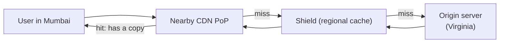
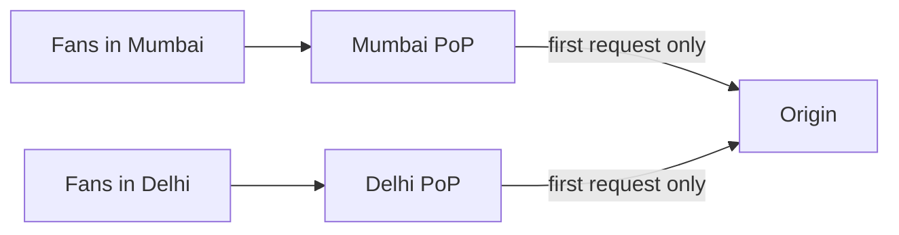
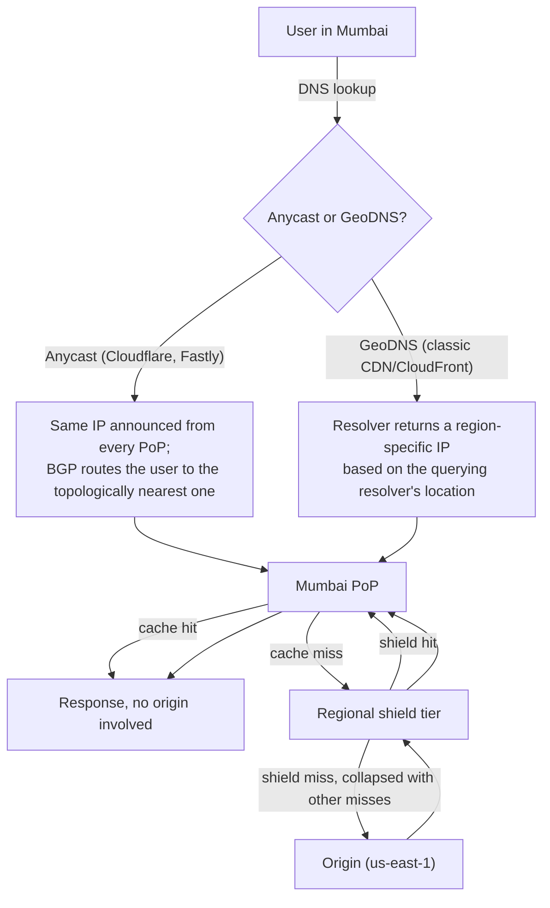
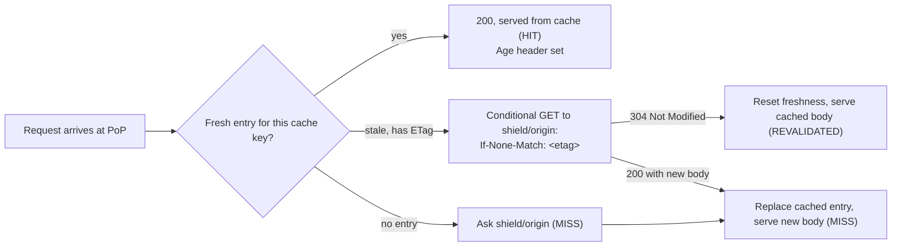
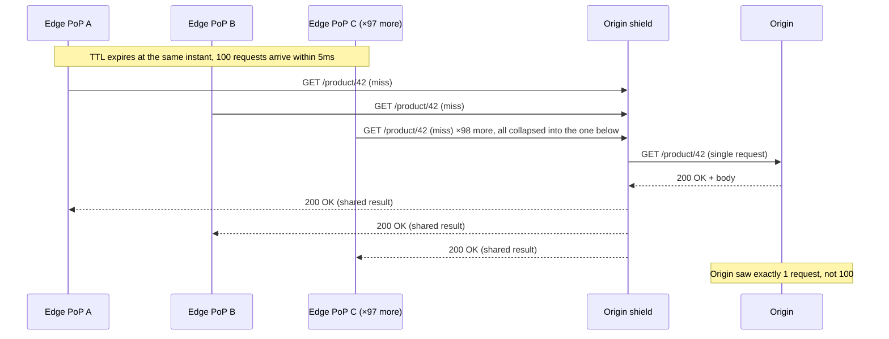
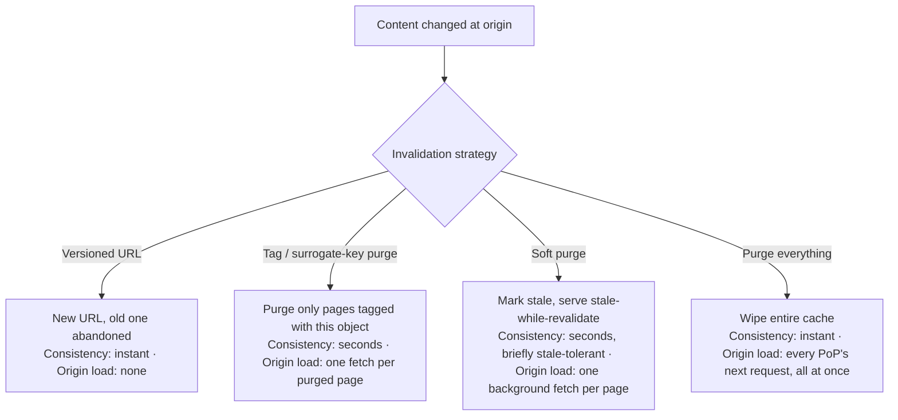
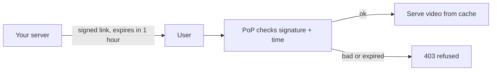
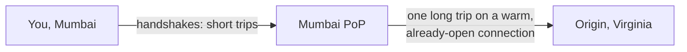
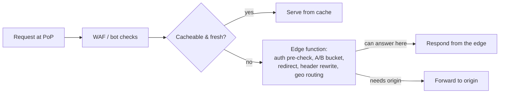

# CDN and Edge

> [!summary] TL;DR
> A **CDN** (content delivery network) is a global fleet of cache servers, called **PoPs** (points of presence), that sit between users and your **origin** server and answer requests from the copy nearest the user instead of sending every request across the planet. **Edge compute** goes further and runs your code at those same PoPs, before the request ever reaches the origin.

> [!abstract] Core idea
> - Users are routed to the nearest PoP by **anycast** (same IP announced everywhere, routers pick the closest) or **GeoDNS** (DNS answers with a region-specific IP).
> - A PoP answers from cache on a **hit**; on a **miss** it asks an **origin shield** tier, which **collapses** concurrent misses into one origin fetch.
> - `Cache-Control` headers and the **cache key** decide what gets cached, for how long, and whether two requests share a cache entry.
> - Classic mistake: thinking a CDN only serves static files. TLS termination near the user, keep-alive pools to the origin, and HTTP/3 all speed up **dynamic**, uncacheable requests too.

## Start here: the basics 🟢

> [!info] How to read this note (pick your level)
> - 🟢 **New to this?** Read "From zero" below, then sections 1, 2 and the cheat sheet (10). Stop there, that is a full first pass.
> - 🟡 **Know the basics?** Add section 3 (how it works) and 4 (worked example).
> - 🔴 **Interview / SDE-3 prep?** Add 7, 8 and 9. Headings are tagged 🟢🟡🔴 so you always know where you are.

> [!note] Before this note
> - [[HTTP Fundamentals - Methods, Status Codes, Headers, Cookies]]: a browser sends a request, a server sends back a response, and both carry small labels called headers.
> - [[DNS - Resolution, Records and Caching]]: before connecting, your device turns a name like `myshop.com` into an IP address.

**From zero, in 60 seconds** 🟢

You open a shopping app. The pictures live on one computer far away (that computer is called the **origin**).


Far away = slow. So companies put many small helper servers all over the world. Each helper keeps a **copy** of the pictures. You get your copy from the helper in your own city.


That whole network of helper servers is the **CDN**. That is it. Everything else in this note is just three questions:
1. How do you reach the *nearest* helper?
2. What may the helper keep a copy of, and for how long?
3. What happens when the copy is old or missing?


**The problem in one story.**
Your shop's server sits in Virginia, USA.
A shopper in Mumbai opens your product page.
Every image travels halfway around the planet, so the page feels slow.
A CDN keeps copies of those images on servers inside India, so the shopper gets them from nearby.

**Words you need first**

| Word | Plain meaning | Tiny example |
| --- | --- | --- |
| Origin | Your own server, the real source of the content | `api.myshop.com` in us-east-1 |
| Latency / RTT | Time for a message to go there and back | Mumbai to Virginia, about 200 ms |
| Cache | A stored copy kept so you need not fetch again | The CDN's saved `product.jpg` |
| Hit / miss | Copy was found / was not found in the cache | `x-cache: HIT` |
| TTL | How long a cached copy counts as fresh | `max-age=3600` = 1 hour |
| DNS | The internet's phone book: name to IP address | `myshop.com` to `104.16.1.1` |
| PoP | One CDN data center in a city | The CDN's Mumbai PoP |
| Header | Extra key-value info sent with an HTTP message | `Cache-Control: public` |
| Anycast | Many servers share one IP address; the network sends you to the closest one | Every PoP answers on `104.16.1.1` |
| Origin shield | One middle cache that all PoPs ask before the origin | A Singapore shield in front of Virginia |
| Cache key | The "name tag" a cache uses to match a request to a saved copy | host + path, e.g. `myshop.com/product/42` |
| Purge | Telling the CDN to throw away saved copies now | Purge `product:42` after a price change |
| Handshake | The few back-and-forth messages that open a connection before data flows | TCP hello, then TLS key exchange |

**Picture it**



**Analogy.** A CDN is a chain of local warehouses for a factory. Most orders ship from the warehouse in your city; only when every warehouse is out does the factory ship.
Where it breaks: a warehouse cannot know the factory changed a product; a CDN keeps serving an old copy until its TTL runs out or you purge it.

**How the rest of this note builds up**

- First, why a CDN exists (section 1) and the warehouse mental model (section 2).
- Then how users reach a PoP (anycast vs GeoDNS), hits, misses and revalidation (section 3).
- Then cache keys, request collapsing and the origin shield.
- Finally, the SDE-3 deep dive on edge compute: what belongs at the edge vs the origin, and failure modes.

> [!tip] Remember
> A CDN moves copies close to users and shields the origin from repeated work; headers decide what it may keep.

## 1. Why it exists 🟢

🟢 **Plain version:** Far away means slow. A message from Mumbai to Virginia and back takes about 200 ms, and opening a secure connection needs a few of those trips. So one picture can wait half a second before it even starts to download. A CDN keeps a copy in Mumbai, so the trip is a few milliseconds and the far server does almost no work. The `curl` output below is a real check; you can skip its details on a first read.

A user in Mumbai requests `product.jpg` from an origin server in Virginia. Round-trip time alone is typically 180–250 ms each way on the open internet for an India-to-US-East route (a representative range for that geography, not a specific measurement); add TCP and TLS handshakes (the opening messages that set up a connection, then make it secure) and the first byte of a cold connection can take 400–600 ms before the image even starts downloading.

Serve 50,000 users a day and the Virginia server also now has to open and hold 50,000 TLS connections and push every byte itself.

A CDN puts a copy of `product.jpg` on a server inside Mumbai's own network. The same request now completes in single-digit milliseconds of network time, and the origin in Virginia serves it exactly once — to the CDN, the first time anyone in that region asks for it.

**Measured**, `curl` from this session against `developer.mozilla.org` (served by Fastly), 2026-11-06:

```text
dns_lookup:0.003s  connect:0.004s  tls:0.149s  ttfb:0.216s  total:0.252s
```

```http
HTTP/2 200
cache-control: public, max-age=3600
age: 2205
x-cache: MISS, HIT, MISS
x-served-by: cache-sin-wsat1880030-SIN, cache-sin-wsat1880030-SIN, cache-sin-wsat1880086-SIN, cache-ccu830028-CCU
```

In the output, `ttfb` is time to first byte (how long until the first piece of the answer arrives). `age: 2205` means this exact response has been sitting in a cache for 2205 seconds — the origin did not see this request.

`x-cache` shows three tiers: the page missed at one shield node, hit at a nearby one, and missed again going toward a further tier — this is the shield/regional/origin tier structure in a single header, not a single flat cache.

### Real-life example: a trailer launch 🟢

A new movie trailer drops and millions open BookMyShow or YouTube in the same ten minutes.
The poster and the video pieces are the same file for everyone.
If every phone pulled them from one server, that server would melt and India-to-USA trips would make the video stutter.
With a CDN, the Mumbai, Delhi and Chennai PoPs each fetch the file once, then serve it to everyone nearby.
The booking step itself (your seat, your payment) is per-user, so it still goes to the origin, just over a faster connection.



## 2. Mental model 🟢

Think of a CDN as a chain of warehouses between a factory (the origin) and a customer's door (the user):

- The **PoP** is the local warehouse nearest the customer. Most orders are filled from its shelves (a **hit**).
- Behind it, a smaller number of **regional / shield** warehouses hold a superset of the stock. If the local warehouse is out, it asks the regional one before ever bothering the factory.
- The **factory** (origin) only ships when no warehouse anywhere has the item, and it only has to make one shipment even if a thousand local warehouses ran out of the same item at the same moment.

**Edge compute** is a small workbench installed inside every warehouse: it can repack a box, check an ID, or redirect an order, without ever calling the factory.

## Common beginner mistakes 🟢

- **Thinking a CDN is only for images and JS files** → it also speeds up logins and checkouts by opening the slow connection nearby → put dynamic routes behind the CDN too, just mark them `no-store`.
- **Using `no-cache` when you mean "never store"** → `no-cache` still stores the copy, it only checks with the origin before using it → use `no-store` for secrets.
- **Changing a file but keeping the same URL** → PoPs keep the old copy until its time runs out → put a version or hash in the file name, like `app.8f3a1c.js`.
- **Adding `Vary: Cookie` to be "safe"** → every user gets their own copy, so the CDN stops sharing anything → strip cookies before the cache lookup instead.
- **Forgetting `private` on a logged-in page** → the CDN may save one user's page and show it to others → mark per-user responses `private` or `no-store`.

## 3. How it works 🟡

> 🟢 → 🟡 **You now know** what a CDN is: nearby helper servers holding copies so users skip the long trip. **Next we open the box**: how a user finds the nearest helper, how the helper decides a copy is still good, and how it protects the origin when many people ask at once. Each subsection starts with a plain step-by-step walk; the full detail follows it.

### Getting the user to a PoP

**In plain words:** your request should land on the *nearest* helper server. There are two tricks for that, and you only need to know their names.

**Step by step:**
1. You type `myshop.com` in Mumbai. Your phone asks DNS for its IP address.
2. With **anycast**, DNS returns one IP, say `104.16.1.1`, that every PoP in the world uses. Internet routers carry your packets to the closest PoP that answers on it, here Mumbai.
3. With **GeoDNS**, DNS itself looks at where the question came from and hands back the Mumbai PoP's own IP.
4. Either way you land in Mumbai. If Mumbai has a copy, you are done in a few milliseconds.
5. If not, Mumbai asks a shield, and only the shield may call the origin in Virginia.



- **Anycast**: every PoP announces the *same* IP address over BGP (Border Gateway Protocol: the system internet providers use to tell each other which addresses they can reach). Internet routers naturally send a packet to the announcing PoP with the fewest network hops. No DNS trickery is needed, and failover is just BGP withdrawing a bad PoP's route. Cloudflare and Fastly run this way.
- **GeoDNS**: the CDN's own DNS servers look at the resolver's IP (via EDNS Client Subnet, an extra field where the resolver passes along part of the user's IP, or the resolver's own location) and return a different A/AAAA record (the DNS answer that holds an IPv4 or IPv6 address) per region. CloudFront and classic Akamai setups use this. It is coarser-grained than anycast and depends on the *resolver* (the DNS helper your device asks, usually run by your ISP or a service like 8.8.8.8) being close to the user, not the user directly.

### Hit, miss and revalidation

**In plain words:** the helper either has a fresh copy (hit = instant), has an old copy (it quickly asks the origin "is this still right?"), or has nothing (miss = it fetches one copy for everyone).

**Step by step:**
1. A request for `/product.jpg` reaches the Mumbai PoP.
2. The PoP looks up its saved copy. Fresh (saved 10 minutes ago, allowed 1 hour)? It answers at once: a **HIT**.
3. Copy too old? The PoP asks the origin "I have version `abc`, is it still current?" using the `If-None-Match` header.
4. Origin says **304 Not Modified** (tiny reply, no body). The PoP marks its copy fresh again and serves it.
5. Origin sends **200** with a new body instead? The PoP swaps in the new copy. No copy at all? It fetches one: a **MISS**.



A **304** is cheap: the origin confirms the cached copy is still correct without resending the body.

This needs the origin to send a validator (`ETag`, a short fingerprint of the file's contents, or `Last-Modified`, the time it last changed) in the first place — see [[HTTP Caching - Cache-Control, ETag, Conditional Requests]] for how the validator itself is computed and compared; this note only covers what the CDN tier does with it.

### Cache-Control: who may cache, and for how long

**In plain words:** the origin sticks a label on every answer saying *who may keep a copy and for how long*. The labels are just expiry dates and "do not store" stickers.

**Step by step:**
1. The origin answers with `Cache-Control: public, max-age=60, s-maxage=3600`.
2. `public` says any cache may keep it, including the CDN.
3. `max-age=60` tells the browser: reuse it for 60 seconds.
4. `s-maxage=3600` tells the CDN, a **shared cache** (one cache used by many people): reuse it for 1 hour.
5. A logged-in page instead says `private` (browser only) or `no-store` (nobody keeps it).

```http
Cache-Control: public, max-age=31536000, immutable
Cache-Control: public, max-age=60, s-maxage=3600, stale-while-revalidate=30, stale-if-error=600
Cache-Control: private, no-cache
Cache-Control: no-store
```

| Directive | Meaning | Common mistake |
| --- | --- | --- |
| `max-age=N` | Fresh for `N` seconds in **every** cache: browser and CDN alike | Thinking it only applies to the browser — it does not; `s-maxage` is what's CDN-only |
| `s-maxage=N` | Overrides `max-age` for **shared** caches (CDN, corporate proxy) only; browsers ignore it | Forgetting it, so the CDN and the browser cache for the same, often too-short, time |
| `no-cache` | May be cached, but **must revalidate** with the origin before serving (not "don't cache") | Confusing with `no-store` |
| `no-store` | Must not be stored anywhere, ever | Using `no-cache` when you meant this |
| `private` | Only the end-user's own browser may cache it; shared caches (CDN) must not | Leaving this off a per-user response and having the CDN cache one user's data for everyone |
| `immutable` | This exact URL's content will never change while it's fresh — skip revalidation entirely even on a hard refresh | Only safe on hashed, versioned asset URLs |
| `stale-while-revalidate=N` | Serve the stale copy immediately, refresh in the background for `N` seconds after expiry | Great for hiding origin latency on a popular, slightly-stale-tolerant resource |
| `stale-if-error=N` | If the origin errors (5xx) or is unreachable, serve the stale copy for up to `N` seconds instead of the error | The single biggest and cheapest availability win a CDN gives you for free |

### Cache key and `Vary`

**In plain words:** the cache key is the name tag on each saved copy. Two requests with the same name tag share one copy. Wrong name tag = either everyone gets the wrong copy, or nobody shares anything.

**Step by step:**
1. Ana asks for `myshop.com/product/42`. The key is that host + path. Miss, so the PoP stores the copy under that key.
2. Ben asks for the same URL. Same key, so he gets Ana's saved copy: a hit.
3. Chen asks for `/product/42?utm_source=ad`. If the tracking part stays in the key, it is a new key and a needless miss.
4. If the response says `Vary: Accept-Encoding`, the gzip and brotli versions get two keys. That is fine, only two copies.
5. If it says `Vary: Cookie`, nearly every user has a different cookie, so nearly every request gets its own key and nothing is shared.

The **cache key** is the set of request attributes the CDN uses to decide whether two requests share a cached entry. By default it's usually scheme + host + path + query string.

- Adding a header to the key via `Vary: Accept-Encoding` is normal and safe — it just means gzip and brotli variants get separate entries.
- `Vary: Cookie` is close to disabling caching: since almost every request carries a different cookie, almost every request becomes its own cache key, and the hit ratio (the share of requests answered from cache) collapses toward zero. Strip session cookies at the edge before the cache lookup instead, or move personalization out of the cached response entirely.
- Tracking query parameters (`utm_source`, `gclid`) that don't change the response should be stripped from the cache key (most CDNs call this a "cache key normalization" or "query string allowlist" rule) — otherwise `/product/42?utm_source=a` and `/product/42?utm_source=b` are two cache misses for the same page.

### Request collapsing and the origin shield

**In plain words:** when a popular copy expires, thousands ask for it in the same second. Instead of thousands of calls to the origin, the CDN lets ONE call go through and everyone else waits for that answer.

**Step by step:**
1. The cached `/product/42` expires at 12:00:00.
2. In the next 5 ms, 100 users across 3 PoPs ask for it. All 100 see "no fresh copy".
3. Inside each PoP, the first request goes out; the rest of that PoP's requests wait for it. That is **request collapsing**.
4. All 3 PoPs send their one request to the same **origin shield**, which also lets just one through.
5. The origin answers once. The answer flows back to all 100 users.

When a popular object's TTL expires, hundreds of edge requests can arrive within milliseconds of each other, all seeing a miss at the same instant.

Without protection, every one of them hits the origin — a self-inflicted stampede (see [[Cache Failure Modes - Stampede, Avalanche, Penetration, Hot and Big Keys]] for the general pattern; this is the CDN-specific instance of it).

Two mechanisms fix it:

- **Request collapsing**: the PoP recognizes that a fetch for this exact cache key is already in flight and makes every other caller wait for that one fetch's result instead of starting its own.
- **Origin shield**: a single, designated regional tier that every PoP's miss is routed through. Even if collapsing only happens per-PoP, routing all PoPs' misses through one shield means the *origin* still sees at most one request per object, because the shield itself also collapses.



### Invalidation

**In plain words:** you changed the file, but the world still holds old copies. These are the four ways to get rid of old copies, from "free" to "dangerous".

**Step by step:**
1. You fix a typo in `app.js` and deploy.
2. Easiest fix: the build names the new file `app.9b2d.js`. Pages now point to the new name, so the old copy is simply never asked for again.
3. For a product page that changed price, you purge by tag: "drop everything tagged `product:42`". Only those pages refetch.
4. A soft purge marks those copies old instead of deleting them, so users still get an answer while one fresh copy is fetched.
5. "Purge everything" drops all copies at once, so every user's next request goes to the origin together. Use it only in an emergency.

| Strategy | How | When to use |
| --- | --- | --- |
| Versioned URLs | `/app.8f3a1c.js`; a new deploy produces a new URL | Static build assets — pair with `immutable, max-age=31536000`; the old URL is simply abandoned, no purge needed |
| Surrogate-key / cache-tag purge | Tag each cached response with one or more keys (e.g. `product:42`) at store time; purge by tag later | Dynamic pages where one database update should invalidate every page that embedded that object |
| Soft purge | Mark cached entries stale instead of deleting them, so the next request can still get `stale-while-revalidate` behavior while a fresh copy is fetched | Avoids a thundering-herd on the origin right after a purge |
| Purge everything | Wipe the whole cache | Emergency only — this turns your entire traffic into origin traffic for a window, and is how a bad deploy becomes a bigger outage |

**Picture it:** the four strategies trade off two things — how fast the change is consistent everywhere, and how much origin load the purge itself creates. A versioned URL is instant and free (the old URL is just abandoned); a full purge is instant but can overload the origin; tag-based and soft purge sit in between.



> [!tip] Remember
> Versioned URLs need no purge at all; tag-based and soft purge trade a little staleness for low origin load; "purge everything" is the only one that can turn a routine deploy into an outage.

### Private content: never cache what shouldn't be shared

**In plain words:** a shared cache must never hand one person's private page to someone else. And paid files need a ticket that only the CDN can check.

**Step by step:**
1. Your account page sets a login cookie with `Set-Cookie`. It must be marked `private` or `no-store`, so the CDN never saves it.
2. For a paid video, your server builds a link like `/movie.mp4?expires=1700000000&sig=ab12`.
3. The `sig` is a signature made with a secret that only your server and the CDN know.
4. The PoP recomputes the signature and checks the time. Wrong or expired? It refuses. Correct? It serves the file from cache.



- Never let a response carrying `Set-Cookie` get cached by a shared cache — most CDNs refuse this by default, but an explicit `private` or `no-store` on authenticated responses is the safer habit.
- For paid downloads or video, use **signed URLs** (a query string with an expiry and an HMAC signature, a code made by mixing the URL with a secret key so nobody can forge it, verified by the CDN edge) or **signed cookies** (one signed cookie grants access to a whole path prefix, useful for an entire video's segment files).
- **Cache poisoning**: if the cache key ignores a header the origin's response actually varies on (e.g. `X-Forwarded-Host`, or an unkeyed `Accept-Language` that the origin still uses to render), an attacker's single poisoned response can get cached and served to every other user who shares that key. **Cache deception**: tricking a CDN into caching a response that *looks* static (by appending `/nonexistent.css` to a dynamic, authenticated URL) when the origin actually ignores the extra path and returns the private page anyway. Fix: make every cache-key input match every response-varying input, and have the origin reject or correctly route unexpected path suffixes rather than silently serving the same handler.

### Dynamic content acceleration

**In plain words:** even things that can never be cached (your cart, your login) get faster, because the slow hello-handshake happens with the nearby helper instead of across the ocean.

**Step by step:**
1. You open your cart in Mumbai. The cart is per-user, so it can never come from cache.
2. Your phone still connects to the Mumbai PoP. The TCP and TLS handshakes take a few short trips of about 5 ms each.
3. The PoP already has an open, warm connection to the origin. It reuses it, so no new handshakes cross the ocean.
4. Your request takes one long trip (about 200 ms) instead of three or four.



Not everything a CDN speeds up is cacheable. For a request that must always reach the origin (checkout, a logged-in dashboard), the CDN still helps:

- **TLS and TCP terminate at the nearby PoP.** The slow part of a connection — the handshake round trips — happens over the short, low-latency hop to the PoP; the PoP already holds a warm, keep-alive connection pool (a set of connections kept open between requests instead of closed after each one) to the origin and reuses it.
- **HTTP/3 (QUIC)** between the user and the PoP avoids TCP head-of-line blocking (one lost packet making everything behind it wait) and survives a Wi-Fi-to-cellular network change without restarting the connection (see [[HTTP-1.1 vs HTTP-2 vs HTTP-3]]).
- **Route optimization**: some providers carry the request over their own private backbone (the provider's own long-distance network cables) from the PoP to the origin region instead of the public internet for the long leg.

This is why "dynamic site acceleration" is a real CDN product, separate from caching.

### Edge compute

**In plain words:** the helper servers can also *run small bits of your code*, like a doorman who checks tickets and gives directions so most visitors never walk to the main office.

**Step by step:**
1. A request arrives at the PoP. First, the WAF (web application firewall: a filter that blocks known attack patterns) and bot checks run.
2. If a fresh cached copy exists, it is served. Done.
3. If not, your small edge function runs. Say it checks that the login token is not expired.
4. Expired token? The function answers `401` right there, no trip to the origin.
5. Valid token? The function adds a header (say, which A/B test group the user is in) and forwards the request to the origin.

Edge compute runs your own code at the PoP, before (or instead of) a round trip to the origin.



| Platform | Model | Typical limit |
| --- | --- | --- |
| Cloudflare Workers | V8 isolate (a light sandbox from Chrome's JavaScript engine that starts in milliseconds), runs on every request path | CPU time capped per request (tens of ms), no local filesystem |
| AWS Lambda@Edge | Full Lambda, runs at a CloudFront regional edge cache, not every PoP | Up to 30s (origin-response) but adds cold-start latency (extra delay when a new copy of the function has to boot); fewer locations than CloudFront's full PoP count |
| AWS CloudFront Functions | Tiny JS subset, runs at every PoP | Sub-millisecond budget; no network calls — header/URL rewrites and redirects only |
| Fastly Compute | WebAssembly (a compact, safe code format many languages can compile to), runs at every PoP | Millisecond-scale CPU budget, no local disk |

What belongs at the edge: a JWT (JSON Web Token: a signed login token the client sends with each request) **signature and expiry** pre-check (so a clearly invalid or expired token gets a fast 401 without a trip to origin) — but the **authoritative** authorization decision (does this specific user own this specific resource) stays at the origin, where the source of truth for permissions lives.

Also at the edge: A/B bucket assignment, geo-based redirects, header normalization, and lightweight WAF rules.

What stays at origin: anything that needs strongly consistent reads, writes with business logic, or a decision that must never be wrong because the edge's view of the world (its JWT public keys, its feature-flag snapshot) is only **eventually consistent** (every PoP gets the update, but not at the same instant) — edge KV (key-value) stores typically replicate globally in seconds, not instantly.

An edge function's own deploy should be versioned and roll out gradually with the ability to roll back, exactly like an origin deploy, because a bad edge rule affects every PoP at once.

**Observability**: correlate an edge-side request ID (most providers inject one, e.g. Cloudflare's `cf-ray`) with the origin's own request ID/trace ID so a slow or failed request can be followed edge → shield → origin in one trace.

### Push vs pull, and media delivery

**In plain words:** either the CDN fetches a file the first time someone asks (pull), or you upload it to the CDN ahead of time (push).

**Step by step:**
1. Pull: user asks Mumbai PoP for `poster.jpg`, it has none, it fetches from the origin once and keeps it.
2. Push: before a 6 pm release, you upload `poster.jpg` to the CDN yourself, so the first user at 6 pm already gets a hit.
3. Video: a 2-hour movie is cut into small pieces of a few seconds each, so each piece is cached and served on its own.

- **Pull CDN** (the default): the CDN fetches from origin lazily, on the first miss. Simple, and the common choice.
- **Push CDN**: you upload content to the CDN's storage ahead of time. Useful when you want to guarantee every PoP has the content before the first user asks (e.g. a scheduled release), at the cost of managing that upload yourself.
- **Video**: large files are split into short segments (HLS, Apple's streaming format: a `.m3u8` list file + `.ts`/`.fmp4` pieces, or DASH, the open-standard equivalent: `.mpd` + segments) specifically so a CDN can cache and serve each segment independently, and a client can switch bitrate (video quality, measured in bits per second) mid-stream by requesting a different segment variant without re-downloading what it already has.

## 4. Worked example 🟡

### Whiteboard version

A product page's image gets requested by 1,000 users across 3 regions in one minute. With no CDN, the origin serves 1,000 full-size image responses. With a CDN: the first user in each region causes a miss (3 origin fetches total, one per region's shield); the other 997 requests are all hits. Origin traffic drops from 1,000 responses to 3.

### Tracing request collapsing step by step

This is the mechanism a CDN's shield tier implements, shown in miniature: concurrent misses for the same key become one fetch. Walk through 100 edge requests arriving for the same expired key within a few milliseconds of each other:

1. Request #1 arrives, finds no fetch already in progress for this key, and registers itself as "the one doing the fetch."
2. Requests #2 through #100 arrive while #1's fetch is still running. Each one finds the registration from step 1 and simply waits for its result instead of starting its own.
3. Request #1's fetch completes. Its result is handed to all 100 waiters at once, and the registration is removed.
4. Request #101, arriving a moment later after the registration was removed, finds no fetch in progress — correctly treated as a brand-new miss, not an accidental 101st waiter on a stale result.

> [!warning] Common mistake
> Holding a single lock for the *entire* fetch (not just the bookkeeping step) looks safer but is slower: it would force every other **key**, not just the same key, to wait its turn, removing the concurrency a shield exists to preserve. The lock should protect only "check and register," never the fetch itself.

**What happens if** step 4's cleanup ran *after* handing out the result instead of before?

A request arriving in that narrow window would join a call that's already finished and about to be deleted — harmless here since it gets the same already-computed result, but it's the kind of ordering detail that turns into a real bug if the cleanup and the handoff are ever reordered carelessly.

**Measured** (Go 1.24, `go test -race`, scratch module, 2026-11-09): a test asserting exactly 1 origin call for 100 concurrent requesters, and a second test confirming a *new* fetch happens once the in-flight call has finished (so collapsing doesn't last forever), both pass under the race detector.

Runnable Go version: [[CDN and Edge - Go]].

### Reading real cache headers

**Measured**, `curl -sI` against `www.cloudflare.com`'s marketing page, 2026-11-06:

```http
HTTP/2 200
cache-control: no-store
x-served-by: marketing-site
```

`no-store` here is deliberate: this particular page is personalized/experimentation-heavy, so the origin opts the whole response out of any shared cache rather than risk serving one visitor's variant to everyone. Compare with the MDN example above, where `cache-control: public, max-age=3600` plus a visible `age` and `x-cache` chain show real caching happening.

## 5. Variants and comparison 🟡

| Provider style | How it routes users | Strength | Cost model |
| --- | --- | --- | --- |
| Cloudflare | Anycast, every PoP is "full" (cache + WAF + Workers) | Huge PoP count, edge compute at every node | Often bundled with other security products |
| Fastly / Akamai | Anycast (Fastly) or mixed anycast/GeoDNS (Akamai), strong shielding and instant purge | Sub-second purge propagation, fine-grained VCL/Compute logic | Pay for requests + bandwidth + compute |
| AWS CloudFront | GeoDNS to regional edge caches, origin shield as an explicit opt-in feature | Deep integration with S3/ALB/Lambda@Edge | Pay for requests + data transfer, cheaper within AWS |
| Self-hosted (Varnish/Nginx at a few regions) | Manual GeoDNS or anycast you operate yourself | Full control of cache logic | You own the hardware, the BGP sessions, and the on-call |

### CDN vs the things people mix it up with 🟡

| Thing | Where it sits | What it does | Not the same as a CDN because |
| --- | --- | --- | --- |
| Browser cache | On the user's own device | Saves copies for one user | Nobody else shares it |
| Reverse proxy (Nginx) | In front of your servers, in one region | Routes, terminates TLS, may cache | It is in one place, not in 100 cities |
| Load balancer | In front of your server fleet | Spreads requests across servers | Usually caches nothing and is not near users |
| CDN | Hundreds of PoPs worldwide | Caches near users and shields the origin | (this note) |

## 6. Trade-offs and when not to use 🟡

- A CDN adds a layer that can itself fail or serve stale data; debugging "it works from my laptop but not for users in Brazil" now means checking a PoP you don't control.
- It solves **aggregate** key traffic, not **one** hot key: a single viral URL still funnels through one cache key, so a true hot-key problem needs the fixes in [[Cache Failure Modes - Stampede, Avalanche, Penetration, Hot and Big Keys]], not just "add a CDN."
- Highly personalized, rarely-repeated responses (a unique search-results page per query) get little benefit from caching and should instead lean on dynamic acceleration (TLS/TCP termination, keep-alive pooling) rather than cache hit ratio.
- For an internal service with no public, geographically spread user base, a CDN is pure overhead — a regular [[Forward and Reverse Proxies - L4 vs L7|reverse proxy]] or [[Load Balancing|load balancer]] in front of your own servers is simpler and sufficient.

## 7. In production 🔴

> 🟡 → 🔴 **You now know** how a CDN routes, caches, collapses misses and purges. **Next comes the advanced part**: what breaks in real deployments, what to watch on dashboards, and the questions an SDE-3 interviewer uses to check you understand the trade-offs.

- **Real systems:** Akamai (the original 1998 commercial CDN), CloudFront in front of S3-hosted sites and APIs, Cloudflare and Fastly for both static and dynamic acceleration, video platforms building on HLS/DASH segment caching.
- **Failure modes → fixes:**
  - Stale content after a deploy → purge failed or TTL too long → use versioned asset URLs so the old cache entry is simply abandoned, not relied upon to expire.
  - Cache stampede on mass expiry → add an origin shield and request collapsing (shown above); use `stale-while-revalidate` so users get the old copy instantly while one request refreshes it.
  - Private data cached publicly → audit for missing `private`/`no-store` on any response with `Set-Cookie` or per-user content; add automated tests that assert this header on authenticated routes.
  - Origin overload right after a "purge everything" → prefer tag-based or soft purge; if a full purge is unavoidable, pre-warm critical URLs or rate-limit the resulting origin traffic.
  - Cache poisoning via an unkeyed header → ensure the cache key includes every header the origin's response actually varies on.
- **What to monitor:** request hit ratio (and separately, byte hit ratio, the share of *bytes* served from cache, since one giant cached video skews the request ratio), origin offload (% of requests that never reached origin), TTFB (time to first byte) broken down by PoP region, purge success/latency, and egress (data sent out, which providers bill per GB)/bandwidth cost per region.

## 8. Deep dive 🔴

- **Anycast stability.** Anycast's biggest operational risk is route flapping (routes switching back and forth quickly): if BGP announcements change mid-session (a user's packets start arriving at a different PoP), a stateful connection (a WebSocket, a long HTTP/2 stream) can break. Providers mitigate this by keeping anycast announcements maximally stable and terminating connections at a consistent tier.
- **Why `s-maxage` exists at all.** `max-age` predates the shared/private distinction being commonly needed; `s-maxage` was added so an operator could give a CDN a longer (or shorter) freshness window than the end-user's own browser without needing two different response bodies.
- **Cost shape.** CDN egress is usually priced per GB and varies sharply by region (serving out of some regions costs several times more per GB than others) — a cost-aware CDN config routes large downloads toward cheaper egress paths or a provider with flat-rate bandwidth, and a high hit ratio directly reduces the *origin's* egress bill even where the CDN's own bandwidth is a separate line item.
- **Edge KV consistency.** Most edge key-value stores (Cloudflare KV, CloudFront KeyValueStore) are optimized for fast, frequent *reads* at every PoP and slow, infrequent *writes* that propagate over seconds to tens of seconds — fine for a feature flag or an A/B bucket assignment, wrong for a counter or anything needing read-your-writes consistency.
- **Request collapsing's limit.** Collapsing only helps while a fetch is genuinely in flight; it cannot help a key that is cold at every PoP simultaneously with staggered, non-overlapping requests (no stampede to collapse because there's no overlap) — that's just normal traffic, and the origin shield's job there is simply to be the one tier that ends up holding the warm cache entry everyone else asks.

## 9. Interview questions 🔴

> [!question]- What's the difference between `max-age` and `s-maxage`?
> `max-age` applies to every cache that sees the response, browser included. `s-maxage` overrides it, but only for shared caches like a CDN; browsers ignore `s-maxage` entirely. Set both when you want the CDN to hold a response longer (or shorter) than the end user's own browser does.

> [!question]- A page's cache hit ratio suddenly drops to near zero after a developer adds `Vary: Cookie`. Why?
> Because almost every request now carries a different cookie value, so almost every request becomes its own cache key — there's effectively no sharing left. Strip the cookie before the cache lookup, or stop varying the cached response on it and move the per-user part out of the cached body.

> [!question]- How does an origin shield reduce origin load on a cache-wide expiry, beyond what per-PoP caching already does?
> Many PoPs can each have their own in-flight miss for the same key at the same moment; per-PoP collapsing only stops duplicate requests *within* one PoP. Routing every PoP's miss through one shield tier means the shield itself collapses them again, so the origin sees at most one request total, not one per PoP.

> [!question]- Trap: "A CDN only helps if content is cacheable, so it can't help my logged-in dashboard." True or false?
> False. Even fully dynamic, uncacheable responses benefit from dynamic content acceleration: TLS/TCP termination at the nearby PoP, a warm keep-alive pool to the origin, and HTTP/3's connection migration all cut latency regardless of caching.

> [!question]- What should run at the edge versus stay at the origin, for authorization?
> A JWT's signature and expiry can be checked at the edge for a fast reject on an obviously invalid token. The authoritative decision — does this user actually have permission for this resource right now — has to stay at the origin, since the edge's view of permissions (via an edge KV store) is only eventually consistent and can be stale by seconds.

> [!question]- What's the real difference between cache poisoning and cache deception?
> Poisoning: the cache key is missing an input the origin's response varies on, so one attacker-triggered bad response gets cached and served to everyone sharing that key. Deception: tricking the origin into serving (and the CDN into caching) a *private* response under a URL that looks like a static, cacheable one — e.g. appending a fake static extension to an authenticated path the origin doesn't actually validate.

> [!question]- Why would you ever choose GeoDNS over anycast, or vice versa?
> Anycast gives finer-grained, near-instant failover (withdraw a BGP route) and doesn't depend on resolver geography, but needs you to operate or buy into anycast routing. GeoDNS is simpler to reason about and works with ordinary DNS infrastructure, but its accuracy depends on the resolver being close to the user, and DNS answers get cached by resolvers for their TTL, so failover is slower.

## 10. Cheat sheet 🟢

🟢 **Plain version:** A CDN is many copy-holding servers near users. You reach the nearest one automatically. Headers on each answer say who may keep a copy and for how long. When many people ask at once, only one request goes to your server. Put a version in file names so you never need to clear the cache by hand.

- Anycast (same IP everywhere, BGP picks nearest) or GeoDNS (region-specific DNS answer) gets the user to a PoP.
- PoP → regional shield → origin; the shield collapses concurrent misses into one origin fetch.
- `max-age` = every cache; `s-maxage` = shared caches only; `no-cache` = must revalidate; `no-store` = never cache.
- `stale-while-revalidate` hides origin latency; `stale-if-error` hides origin outages — both nearly free wins.
- Cache key + `Vary` decide what's shared; `Vary: Cookie` silently kills your hit ratio.
- Versioned URLs need no purge; tag/surrogate-key purge targets dynamic pages; "purge everything" is an emergency lever, not a routine tool.
- Never cache a response with `Set-Cookie`; use signed URLs/cookies for private content.
- Edge compute: fast pre-checks and routing at the edge, authoritative decisions and strongly consistent writes at origin.
- Monitor hit ratio (request and byte), origin offload, TTFB by region, and egress cost.

## Self-check 🟢🟡

> [!question]- 🟢 What is the "origin"?
> Your own server, the real source of the content that the CDN copies from.

> [!question]- 🟢 What does a cache HIT mean at a PoP?
> The PoP already had a fresh copy and answered without asking the origin.

> [!question]- 🟢 Why does a CDN make a page faster for a user in Mumbai when the server is in Virginia?
> The copy sits a few km away instead of 12,000 km, so each trip takes milliseconds instead of about 200 ms.

> [!question]- 🟡 What is the difference between `no-cache` and `no-store`?
> `no-cache` may store the copy but must check with the origin before using it; `no-store` must never store it.

> [!question]- 🟡 100 users ask for an expired object at the same moment. How many requests reach the origin with a shield and collapsing?
> One. Each PoP lets one request through, and the shield collapses those into one origin fetch.

> [!question]- 🟡 Why are versioned file names better than purging?
> A new name is a new cache key, so the old copy is simply never asked for; no purge, no burst of origin traffic.

## Links

- **Before this:** [[HTTP Fundamentals - Methods, Status Codes, Headers, Cookies]], [[DNS - Resolution, Records and Caching]]
- **Next:** [[Forward and Reverse Proxies - L4 vs L7]], [[What Happens When You Type a URL]]
- **Compare with:** [[HTTP Caching - Cache-Control, ETag, Conditional Requests]] (the browser/origin side of the same headers), [[Cache Failure Modes - Stampede, Avalanche, Penetration, Hot and Big Keys]] (the general pattern this note's shield section is one instance of), [[Load Balancing]] (balancing within one origin fleet, not across the globe)
- **Code:** [[CDN and Edge - Go]]

### Watch on YouTube

- [What is a CDN (Content Delivery Network)?](https://www.youtube.com/watch?v=b4_6thkYZXs) · Gaurav Sen · system-design-style explainer on PoPs, origin and caching at the edge
- [Is Your Website Slow? Here's What a CDN Actually Does](https://www.youtube.com/watch?v=kzbVb3PQt0k) · WebFX · accessible explainer tying CDN hit/miss and latency together
