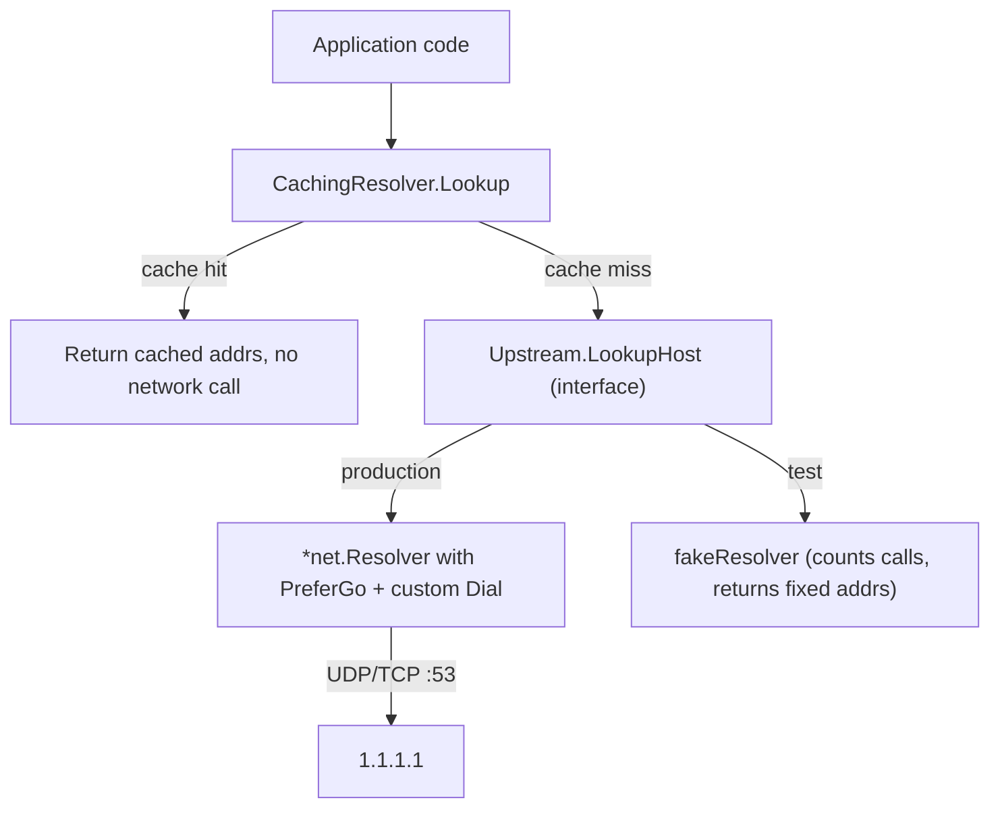

# DNS - Resolution, Records and Caching - Go

> [!summary] TL;DR
> This code is a `CachingResolver` that wraps Go's `net.Resolver` with the TTL-aware caching the standard library deliberately leaves out, plus a helper showing how to force the pure-Go resolver and point it at a specific DNS server. See the theory in [[DNS - Resolution, Records and Caching]].

## What this code shows

| Code | Theory concept | Theory section |
| --- | --- | --- |
| `CachingResolver.Lookup` | Application-level caching Go doesn't provide on its own | [[DNS - Resolution, Records and Caching#Caching layers, TTL, and negative caching]] |
| `entry.expires` | TTL-bounded freshness, the same idea every cache layer implements | [[DNS - Resolution, Records and Caching#Caching layers, TTL, and negative caching]] |
| `realResolverExample` (`PreferGo`, custom `Dial`) | The pure-Go vs cgo resolver split, and pointing at a specific server | [[DNS - Resolution, Records and Caching#4. Worked example]] |
| `TestCacheHitSuppressesUpstreamQuery` | Proof the cache actually suppresses a redundant query within the TTL, and requeries after it | [[DNS - Resolution, Records and Caching#Caching layers, TTL, and negative caching]] |

## Setup

- **Module layout:** a single package, `dnscache`, with `dnscache.go` and `dnscache_test.go`.
- **Go version:** 1.24.
- **Dependencies:** standard library only (`net`, `sync`, `time`).
- **Run it:**

```text
go mod init dnscache
go vet ./...
go test -race ./...
```

## Code

### The bare call this wraps

Go's resolver answers a query but caches nothing — every call is a fresh network round trip unless the caller caches it:

```go
addrs, err := net.DefaultResolver.LookupHost(context.Background(), "example.com")
```

### The cache entry and the resolver interface

```go
// Package dnscache wraps net.Resolver with the TTL-aware caching that Go's
// standard library deliberately does not provide: every call to
// Resolver.LookupHost hits the resolver again, so an app that wants fewer
// upstream queries caches the answer itself and honours the record's TTL.
package dnscache

import (
	"context"
	"net"
	"sync"
	"time"
)

// Resolver is the subset of *net.Resolver this package needs, so tests can
// fake it without a real DNS query.
type Resolver interface {
	LookupHost(ctx context.Context, host string) ([]string, error)
}

type entry struct {
	addrs   []string
	expires time.Time
}
```

**Concept.** `Resolver` is a narrow interface — just the one method this package calls — rather than depending on `*net.Resolver` directly. The alternative, taking a concrete `*net.Resolver`, was rejected because tests would then have no way to simulate a slow or failing resolver, or count calls, without an actual DNS query.

**How it works.**
1. `Resolver` lets `*net.Resolver` satisfy it for free (it already has a matching `LookupHost` method), while also letting a test substitute a `fakeResolver`.
2. `entry` holds exactly what freshness requires: the cached value and when it stops being valid.

### CachingResolver and Lookup

```go
// CachingResolver caches LookupHost answers in memory for ttl, the way an
// application-level resolver cache (or systemd-resolved) avoids re-querying
// upstream for every connection within a record's lifetime.
type CachingResolver struct {
	Upstream Resolver
	TTL      time.Duration
	Now      func() time.Time // overridable for tests

	mu    sync.Mutex
	cache map[string]entry
}
```

`Lookup` is the method that actually checks the cache before falling back to the network — first the cache-hit path, which returns without ever calling `Upstream`:

```go
// Lookup returns cached addresses if they have not expired, otherwise
// queries Upstream and caches the result for TTL.
func (c *CachingResolver) Lookup(ctx context.Context, host string) ([]string, bool, error) {
	now := c.Now
	if now == nil {
		now = time.Now
	}
	c.mu.Lock()
	if c.cache == nil {
		c.cache = make(map[string]entry)
	}
	if e, ok := c.cache[host]; ok && now().Before(e.expires) {
		c.mu.Unlock()
		return e.addrs, true, nil // cache hit
	}
	c.mu.Unlock()
```

Falling through to here means the cache missed, so the upstream resolver is queried and the fresh answer is stored before being returned:

```go
	addrs, err := c.Upstream.LookupHost(ctx, host)
	if err != nil {
		return nil, false, err
	}
	c.mu.Lock()
	c.cache[host] = entry{addrs: addrs, expires: now().Add(c.TTL)}
	c.mu.Unlock()
	return addrs, false, nil // cache miss, freshly queried
}
```

**Concept.** This is the TTL-respecting cache described in [[DNS - Resolution, Records and Caching#Caching layers, TTL, and negative caching]]. A fixed `TTL` field was chosen over reading the TTL out of each real DNS answer, to keep the mechanism easy to see in one type; a production version would plumb the record's own TTL through instead of a constant.

**How it works.**
1. `Now` defaults to `time.Now` only when nil, so production code needs zero configuration while a test can inject a controllable clock.
2. The mutex is locked twice, never across the actual `Upstream.LookupHost` call — exactly the same shape as the CDN shield's `Shield.Get`, for the same reason: don't hold a lock across a slow network call.
3. The boolean second return value (`hit`) exists purely so a caller — or a test — can tell a cache hit from a miss without inspecting internal state.
4. On an upstream error, nothing is cached: a failed lookup should not poison the cache with a non-answer.

### A production-shaped resolver: forcing pure-Go and a specific server

```go
// realResolverExample shows the production shape: a context-aware,
// pure-Go resolver pointed at a specific DNS server (bypassing cgo /
// /etc/resolv.conf), as described in the note's Go section.
func realResolverExample() *net.Resolver {
	return &net.Resolver{
		PreferGo: true,
		Dial: func(ctx context.Context, network, address string) (net.Conn, error) {
			d := net.Dialer{Timeout: 3 * time.Second}
			return d.DialContext(ctx, network, "1.1.1.1:53")
		},
	}
}
```

**Concept.** `net.DefaultResolver.LookupHost` makes a fresh query every call — the standard library intentionally does no caching, leaving TTL handling to the caller (the `CachingResolver` above) or to the OS resolver it delegates to. Go has **two resolver implementations**: a pure-Go one (parses `/etc/resolv.conf` and speaks DNS itself) and a cgo one (calls the OS's native resolver via libc). Go picks automatically based on `/etc/resolv.conf` and `GODEBUG=netdns=`, but setting `Resolver.PreferGo = true` forces the pure-Go path — useful in minimal containers without a working libc resolver, or when a specific DNS server needs to be targeted directly.

**How it works.**
1. `PreferGo: true` forces Go's own DNS client instead of delegating to libc — the alternative (leaving it unset) means behavior silently depends on the host's `/etc/resolv.conf`, which is harder to reason about in a container.
2. The custom `Dial` ignores whatever address the resolver would normally pick and always dials `1.1.1.1:53`, which is how an application pins itself to a specific, known-good DNS server rather than trusting `/etc/resolv.conf`.
3. The `ctx` parameter flows through to `DialContext`, so a caller's timeout or cancellation on the outer `LookupHost` call is honored by the dial itself, not just by the lookup as a whole.



> [!example]- Full file
> ```go
> // Package dnscache wraps net.Resolver with the TTL-aware caching that Go's
> // standard library deliberately does not provide: every call to
> // Resolver.LookupHost hits the resolver again, so an app that wants fewer
> // upstream queries caches the answer itself and honours the record's TTL.
> package dnscache
>
> import (
> 	"context"
> 	"net"
> 	"sync"
> 	"time"
> )
>
> // Resolver is the subset of *net.Resolver this package needs, so tests can
> // fake it without a real DNS query.
> type Resolver interface {
> 	LookupHost(ctx context.Context, host string) ([]string, error)
> }
>
> type entry struct {
> 	addrs   []string
> 	expires time.Time
> }
>
> // CachingResolver caches LookupHost answers in memory for ttl, the way an
> // application-level resolver cache (or systemd-resolved) avoids re-querying
> // upstream for every connection within a record's lifetime.
> type CachingResolver struct {
> 	Upstream Resolver
> 	TTL      time.Duration
> 	Now      func() time.Time // overridable for tests
>
> 	mu    sync.Mutex
> 	cache map[string]entry
> }
>
> // Lookup returns cached addresses if they have not expired, otherwise
> // queries Upstream and caches the result for TTL.
> func (c *CachingResolver) Lookup(ctx context.Context, host string) ([]string, bool, error) {
> 	now := c.Now
> 	if now == nil {
> 		now = time.Now
> 	}
> 	c.mu.Lock()
> 	if c.cache == nil {
> 		c.cache = make(map[string]entry)
> 	}
> 	if e, ok := c.cache[host]; ok && now().Before(e.expires) {
> 		c.mu.Unlock()
> 		return e.addrs, true, nil // cache hit
> 	}
> 	c.mu.Unlock()
>
> 	addrs, err := c.Upstream.LookupHost(ctx, host)
> 	if err != nil {
> 		return nil, false, err
> 	}
> 	c.mu.Lock()
> 	c.cache[host] = entry{addrs: addrs, expires: now().Add(c.TTL)}
> 	c.mu.Unlock()
> 	return addrs, false, nil // cache miss, freshly queried
> }
>
> // fakeResolver is a stand-in for net.Resolver used in tests: it counts
> // calls so the test can assert the cache actually suppressed a query.
> type fakeResolver struct {
> 	mu    sync.Mutex
> 	calls int
> 	addrs []string
> }
>
> func (f *fakeResolver) LookupHost(ctx context.Context, host string) ([]string, error) {
> 	f.mu.Lock()
> 	f.calls++
> 	f.mu.Unlock()
> 	return f.addrs, nil
> }
>
> // realResolverExample shows the production shape: a context-aware,
> // pure-Go resolver pointed at a specific DNS server (bypassing cgo /
> // /etc/resolv.conf), as described in the note's Go section.
> func realResolverExample() *net.Resolver {
> 	return &net.Resolver{
> 		PreferGo: true,
> 		Dial: func(ctx context.Context, network, address string) (net.Conn, error) {
> 			d := net.Dialer{Timeout: 3 * time.Second}
> 			return d.DialContext(ctx, network, "1.1.1.1:53")
> 		},
> 	}
> }
> ```

## Design decisions

| Choice | Alternative | Trade-off |
| --- | --- | --- |
| Fixed `TTL` field on `CachingResolver` | Read the TTL out of each real DNS answer | Simpler to demonstrate; a real version needs the raw record TTL, which `net.Resolver`'s high-level API does not expose |
| Narrow `Resolver` interface | Depend on `*net.Resolver` concretely | Enables a fake in tests without a real DNS query; costs one extra interface type |
| Injectable `Now func() time.Time` | Use `time.Now()` directly | Makes TTL-expiry tests deterministic and fast instead of requiring a real sleep |
| `PreferGo: true` + custom `Dial` | Rely on the OS resolver via cgo | Works identically in a minimal container with no libc resolver, and lets the app pin a specific DNS server |

## Tests

### TestCacheHitSuppressesUpstreamQuery

**Property proved:** a lookup inside the TTL window is served from cache with zero extra upstream calls, and a lookup past the TTL triggers exactly one fresh upstream call. This is the entire value of the cache — without it, both lookups would hit the network.

| Input | Expected output |
| --- | --- |
| Lookup at `t=0` | Cache miss, 1 upstream call, returns `93.184.216.34` |
| Lookup at `t=30s` (TTL is 60s) | Cache hit, still 1 upstream call total |
| Lookup at `t=61s` (past the 60s TTL) | Cache miss again, 2 upstream calls total |

A failure where the `t=30s` lookup shows a miss would mean the expiry check is comparing the wrong clock or the wrong boundary (`Before` vs `After`). A failure where the `t=61s` lookup still shows a hit would mean expired entries are never actually treated as stale — silently serving data that could be arbitrarily out of date.

```go
func TestCacheHitSuppressesUpstreamQuery(t *testing.T) {
	fake := &fakeResolver{addrs: []string{"93.184.216.34"}}
	now := time.Date(2026, 1, 1, 0, 0, 0, 0, time.UTC)
	c := &CachingResolver{
		Upstream: fake,
		TTL:      60 * time.Second,
		Now:      func() time.Time { return now },
	}

	addrs, hit, err := c.Lookup(context.Background(), "example.com")
	if err != nil {
		t.Fatal(err)
	}
	if hit {
		t.Fatal("first lookup must be a cache miss")
	}
	if len(addrs) != 1 || addrs[0] != "93.184.216.34" {
		t.Fatalf("addrs = %v, want [93.184.216.34]", addrs)
	}
```

The remaining two phases move the injected clock forward without any real delay, proving TTL expiry deterministically:

```go
	// Still inside the 60s TTL: must be served from cache.
	now = now.Add(30 * time.Second)
	_, hit, err = c.Lookup(context.Background(), "example.com")
	if err != nil {
		t.Fatal(err)
	}
	if !hit {
		t.Fatal("lookup within TTL should be a cache hit")
	}
	if fake.calls != 1 {
		t.Fatalf("upstream calls = %d, want 1 (cache should have suppressed the second query)", fake.calls)
	}

	// Past the TTL: must requery upstream.
	now = now.Add(31 * time.Second) // 61s total elapsed > 60s TTL
	_, hit, err = c.Lookup(context.Background(), "example.com")
	if err != nil {
		t.Fatal(err)
	}
	if hit {
		t.Fatal("lookup after TTL expiry should be a cache miss")
	}
	if fake.calls != 2 {
		t.Fatalf("upstream calls = %d, want 2 (TTL expiry should trigger a requery)", fake.calls)
	}
}
```

### TestRealResolverExampleIsWellFormed

**Property proved:** `realResolverExample` actually returns a resolver configured the way the surrounding text claims — `PreferGo` set, and a non-nil custom `Dial`. This guards against a future edit silently dropping one of those two settings.

| Input | Expected output |
| --- | --- |
| Call `realResolverExample()` | `PreferGo == true`; `Dial != nil` |

A failure here would mean the resolver silently fell back to the OS/cgo path, or stopped pinning a specific DNS server — both are configuration regressions a type check alone wouldn't catch.

```go
func TestRealResolverExampleIsWellFormed(t *testing.T) {
	r := realResolverExample()
	if !r.PreferGo {
		t.Fatal("expected PreferGo: true so the pure-Go resolver is used")
	}
	if r.Dial == nil {
		t.Fatal("expected a custom Dial pointed at a specific DNS server")
	}
}
```

## Running it

```text
$ go vet ./...
$ go test -race ./... -v
=== RUN   TestCacheHitSuppressesUpstreamQuery
--- PASS: TestCacheHitSuppressesUpstreamQuery (0.00s)
=== RUN   TestRealResolverExampleIsWellFormed
--- PASS: TestRealResolverExampleIsWellFormed (0.00s)
PASS
ok  	dnscache	1.478s
```

Reading it: `go vet` found nothing to flag, and both tests pass under the race detector, meaning the mutex around `cache` genuinely serializes every access — important since `Lookup` is meant to be called concurrently by multiple goroutines resolving different hosts at once.

## Pitfalls in the code

- **Caching an error result** would mean a transient upstream failure gets "remembered" and returned to every subsequent caller until some other code path clears it — this is why `Lookup` returns early on `err != nil`, before ever touching `c.cache`.
- **Comparing `now().Before(e.expires)` the wrong way round** (e.g. `After` instead of `Before`) would silently invert expiry, caching forever or never caching at all — exactly the kind of off-by-one the TTL-expiry test exists to catch.
- **Forgetting `PreferGo: true`** would make `realResolverExample`'s custom `Dial` meaningless on a system where Go picks the cgo resolver instead, since the cgo path doesn't go through Go's own dialing code at all.

## Exercises

1. Change `TTL` from a single `time.Duration` field to a `map[string]time.Duration` keyed by host, so different hosts can have different TTLs (closer to how real DNS answers carry their own TTL). Predict which existing test would need to change, then update it.
2. Remove the early return on `err != nil` in `Lookup` so a failed lookup still gets cached (with a very short TTL, say 1 second) as a "negative cache" entry, mirroring [[DNS - Resolution, Records and Caching#Caching layers, TTL, and negative caching]]'s negative caching. Predict what a repeated lookup for a permanently broken host now does differently, then write a test for it.
3. Add a `Close` method that clears the cache map, and a test proving a lookup immediately after `Close` is a cache miss even though the TTL hasn't expired. Predict whether the existing mutex is sufficient for this without any other change.

## Links

- **Theory:** [[DNS - Resolution, Records and Caching]]
- **Related:** [[CDN and Edge]]
