# DNS - Resolution, Records and Caching

> [!summary] TL;DR
> DNS converts human-readable names like `example.com` into the IP addresses computers actually route traffic to. A **resolver** walks down the naming hierarchy — root, then top-level domain, then the domain's own **authoritative** nameservers — asking each one "who knows more," and caches the answer for as long as its **TTL** says it's valid.

> [!abstract] Core idea
> - A name is a hierarchy read right to left: `.` (root) → `.com` (TLD) → `example.com` (domain) → `www.example.com` (subdomain).
> - A **recursive resolver** (your ISP's, 8.8.8.8, 1.1.1.1, or a VPC's built-in resolver) does the multi-step walk on your behalf; **authoritative** servers answer only for the zones they own.
> - Records come in types: `A`/`AAAA` for addresses, `CNAME` for aliases, `MX` for mail, `TXT` for arbitrary text (often SPF/DKIM/DMARC), `NS`/`SOA` for delegation, `PTR` for reverse lookup, `SRV` for service location, `CAA` for certificate authority policy.
> - Every answer carries a **TTL**; caches at every layer (browser, OS, resolver) honor it, which is what people mean by "DNS propagation" — there's no propagation, just waiting out old TTLs.
> - DNS can also load-balance and fail over traffic by returning different answers to different clients (GeoDNS, health-checked routing), all before any HTTP request is even sent.

## Start here: the basics 🟢

> [!info] How to read this note (pick your level)
> - 🟢 **New to this?** Read "From zero" below, then sections 1, 2 and the cheat sheet (10). Stop there, that is a full first pass.
> - 🟡 **Know the basics?** Add section 3 (how it works), 4 (worked example) and 5 (variants).
> - 🔴 **Interview / SDE-3 prep?** Add 7, 8 and 9. Headings are tagged 🟢🟡🔴 so you always know where you are.

**From zero, in 60 seconds** 🟢

You type `example.com` into your browser. But computers do not find each other by names. They find each other by numbers, called **IP addresses** (like `172.66.147.243`).

So someone has to turn the name into the number. That lookup system is **DNS**.

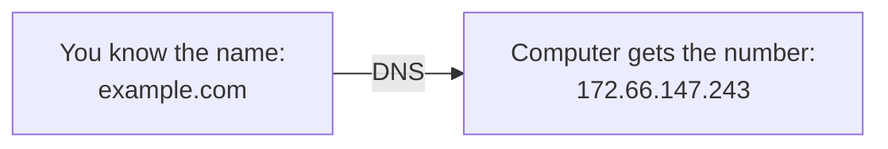

Your computer does not know the number itself. It asks a helper server called a **resolver**. The resolver asks around until someone who owns the answer replies.

Then everyone writes the answer down for a while, so next time nobody has to ask. That saved copy is a **cache**, and it comes with an expiry timer.

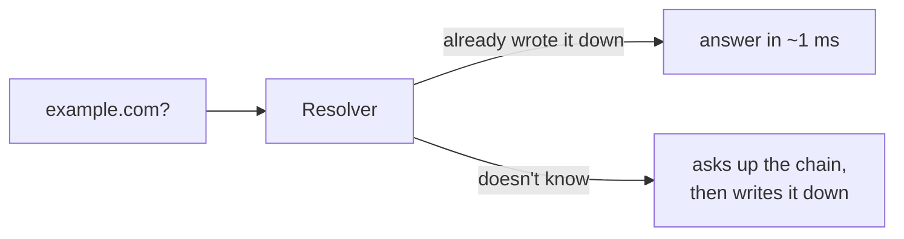

The rest of this note is just these 3 questions:
1. Who does my computer ask, and who does *that* server ask?
2. What kinds of answers (records) can DNS hold?
3. How long is a saved answer trusted, and what goes wrong when it is stale?

**The problem in one story.**
You want to visit a friend's shop, and you know its name, not its street address.
You ask a directory desk, which asks a bigger directory, until someone knows the exact address.
You write the address on a sticky note so next time you skip the asking.
DNS is that directory system for the internet: names in, IP addresses out, with sticky notes (caches) everywhere.

**Words you need first**

| Word | Plain meaning | Tiny example |
| --- | --- | --- |
| IP address | The number computers use to reach a machine | `172.66.147.243` |
| Domain name | The human-friendly name for that machine | `example.com` |
| Resolver | A server that looks names up for you | `1.1.1.1` (Cloudflare) |
| Authoritative server | The server that owns the true answer for a domain | `example.com`'s own nameservers |
| Record | One entry in DNS, with a type | `A` record: name → IPv4 address |
| Cache | A saved copy of a recent answer | Your laptop remembering `example.com`'s IP |
| TTL | How many seconds a cached answer stays valid | `TTL 300` = trust it for 5 minutes |

**Picture it**

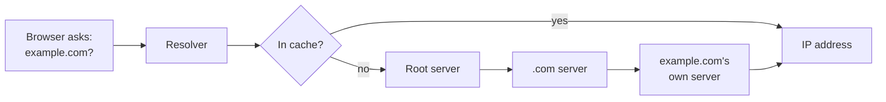

**Analogy.** DNS is a phone directory split across many offices: the head office only knows which regional office to ask, and the local office knows your friend's number.
Where it breaks: a printed directory never changes; DNS answers expire after their TTL, and the owner can change them any time.

**How the rest of this note builds up**

- First, why DNS exists (section 1) and the phone-book mental model (section 2).
- Then how a lookup walks root → TLD → authoritative, and how caching and TTL work (section 3).
- Next, record types, DNS-based routing, Kubernetes DNS, DNSSEC and DoH/DoT (rest of section 3), plus a worked example (section 4).
- Finally, trade-offs, production failures and the SDE-3 deep dive on EDNS0, anycast and why Go doesn't cache (sections 6-8).

> [!tip] Remember
> DNS turns names into IPs by asking down a chain of servers, and every answer is cached only until its TTL runs out.

## 1. Why it exists 🟢

Computers route on numbers (IP addresses); people remember names. Without DNS, sharing a website means sharing `172.66.147.243` and hoping it never changes. Worse, one service might need to run across many machines, in many regions, or move to a new data center entirely — the IP changes constantly, but the name should not.

DNS solves this by giving every name an **owner** (the zone's authoritative nameservers) who can change the underlying IP at any time, and a global **caching lookup system** so that change propagates to clients automatically, bounded only by how long clients already cached the old answer (the TTL).

This is also why "DNS propagation" after a change isn't really propagation across the internet — the new answer is available at the authoritative server immediately; what takes time is every resolver and client that cached the *old* answer waiting out its TTL.

### Whiteboard version

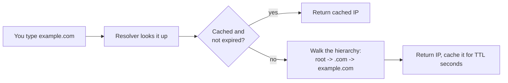

## 2. Mental model 🟢

DNS is a **distributed, delegated phone book**. Nobody holds the whole book; instead, the root knows which smaller book covers `.com`, the `.com` book knows which even smaller book covers `example.com`, and only `example.com`'s own book (its authoritative nameservers) has the actual entry you want.

A resolver's job is to follow that chain of referrals so you don't have to, and to remember the final answer for a while so it doesn't have to ask again immediately.

## 3. How it works 🟡

### Name hierarchy

**In plain words:** a domain name is like a postal address read backwards — country first, then city, then street. `www.example.com` is really root → `.com` → `example` → `www`.

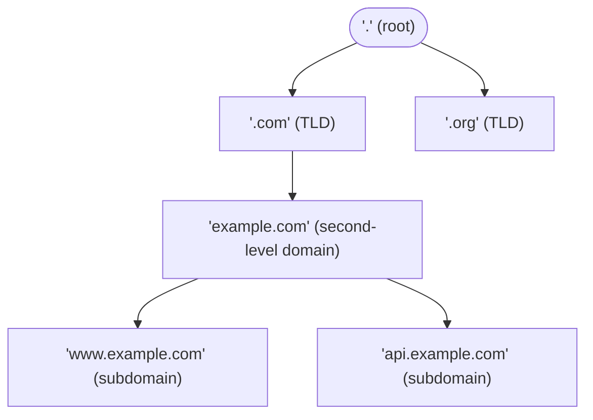

Every fully qualified domain name technically ends in an (usually hidden) trailing dot for the root: `example.com.`. Reading right to left: root, then TLD (`.com`), then the registered second-level domain (`example.com`), then any subdomains the owner creates (`www`, `api`).

### Stub resolver, recursive resolver, and the recursive-vs-iterative split

**In plain words:** your laptop is lazy — it asks one helper ("get me the final answer"), and that helper does all the legwork, asking server after server until it finds the owner of the answer.

Your laptop's networking stack is a **stub resolver**: it doesn't know how to walk the hierarchy itself.

It asks a **recursive resolver** — your ISP's, a public one like `8.8.8.8` (Google) or `1.1.1.1` (Cloudflare), or a cloud VPC's built-in resolver (e.g. AWS's `.2` address in each VPC subnet, `169.254.169.253` for EC2 instance metadata-based resolution) — to do the whole lookup and hand back a final answer.

The recursive resolver does the actual walk using **iterative** queries: it asks the root "who handles `.com`," gets a **referral** (not the final answer, just "ask this other server"), asks the `.com` TLD server "who handles `example.com`," gets another referral, and finally asks `example.com`'s own authoritative server for the `A` record.

The client's query to the recursive resolver is "recursive" (give me the final answer or an error, don't make me do the walk); the resolver's queries to root/TLD/authoritative servers are "iterative" (give me your best answer or a referral, I'll handle the rest).

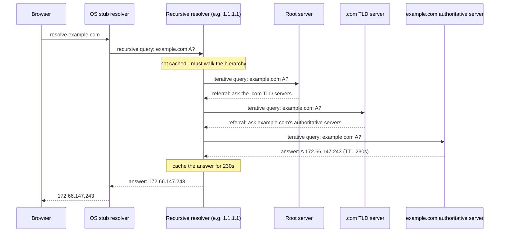

This redraws the hierarchy walk as a sequence: browser cache is checked first, then the OS/stub resolver cache, then the recursive resolver's cache; only a full miss at all three triggers the root → TLD → authoritative walk, and the fresh answer is cached going back up.

### Caching layers, TTL, and negative caching

**In plain words:** every answer gets written on sticky notes at several desks (browser, laptop, resolver), and each sticky note has its own expiry timer. "Nothing here" answers get a sticky note too.

A DNS answer is cached at several independent layers, each with its own lifetime bounded by the record's **TTL** (seconds):

| Layer | Typical lifetime | Notes |
| --- | --- | --- |
| Browser DNS cache | Seconds to a couple of minutes, capped regardless of TTL | Chrome caches for up to 60s by default even if TTL is longer |
| OS resolver (`systemd-resolved`, Windows DNS Client, macOS `mDNSResponder`) | Honors TTL | `/etc/hosts` entries bypass DNS entirely and never expire |
| Recursive resolver (ISP, 8.8.8.8, 1.1.1.1, VPC resolver) | Honors TTL | Shared across every client using that resolver — the layer with the biggest real-world cache-hit impact |
| Application-level cache (e.g. Go's `net.Resolver` wrapped manually) | Whatever you build | Go's standard library does **not** cache lookups itself — see the Go section below |

Choosing a TTL is a trade-off: a **low TTL** (seconds to low minutes) means a DNS failover or IP change takes effect almost immediately everywhere, at the cost of far more queries hitting your authoritative servers.

A **high TTL** (hours to a day) means better cache-hit rates and lower load, at the cost of a slow rollout when you do need to change the IP — which is why operators deliberately **lower the TTL before a planned migration** and raise it back afterward.

**Negative caching** (RFC 2308) caches the *absence* of a record too: when a name doesn't exist (`NXDOMAIN`) or a record type doesn't exist for that name, the resolver caches that negative answer for the TTL given on the `SOA` record's minimum field, so repeatedly asking for a misspelled or not-yet-created name doesn't hammer the authoritative servers either.

**Measured (dig 9.10.6, 2026-11-06), an NXDOMAIN response carries the zone's SOA in the authority section, which supplies the negative-caching TTL:**

```text
$ dig doesnotexist-xyz123.example.com A +noall +authority
example.com.  1790  IN  SOA  elliott.ns.cloudflare.com. dns.cloudflare.com. 2418004112 10000 2400 604800 1800
```

The last field (`1800`) is the negative-cache TTL: resolvers hold onto "this name doesn't exist" for up to 1800 seconds.

**Picture it:** each layer's cache empties on its own clock, counting down from the moment it first saw the answer, not from when the record was created:

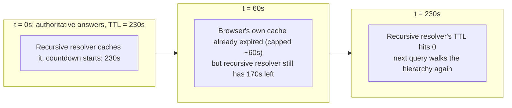

> [!tip] Remember
> A record's TTL is a countdown that starts fresh at each cache layer the moment that layer first saw the answer — not a single shared clock, which is why a browser's artificially short cap can expire well before the recursive resolver's copy does.

### Zones, delegation, and glue records

A **zone** is the portion of the naming tree one set of nameservers is authoritative for. `example.com` is delegated from the `.com` zone via `NS` records naming `example.com`'s nameservers; `.com` itself is delegated from the root the same way.

**In plain words:** delegation just means "the parent zone doesn't hold the answer itself, it holds a pointer to whoever does." Usually that pointer is enough, because the nameserver's own name resolves independently. The glue record problem only appears in the one case where that pointer points at *itself*.

**Picture it:** when a nameserver's own name is *inside* the zone it serves (e.g. `ns1.example.com` serving `example.com`), resolving that nameserver's address would require already knowing it — a circular dependency. The parent zone breaks the cycle by publishing a **glue record**, an `A`/`AAAA` record for `ns1.example.com` attached directly to the delegation, bypassing the circularity entirely:

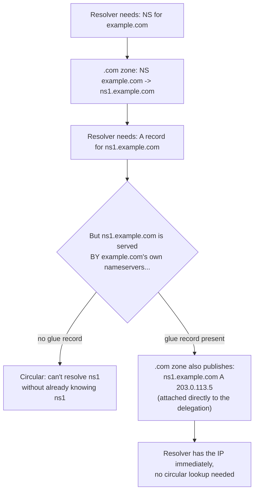

**Example:** `example.com`'s own nameserver is literally named `ns1.example.com` on many real domains. Without a glue record, asking "what is `ns1.example.com`'s address" would require asking `example.com`'s nameservers — which you can't reach yet, because you don't have their address. The `.com` zone sidesteps this by handing out the IP directly, in the same response that names the delegation.

**Why it matters:** forgetting to configure glue records (a common mistake when moving a domain's own nameservers under itself) breaks resolution for the entire zone — not gradually, but completely, the moment every cached copy of the old working answer expires.

### 13 root identities, anycast, and UDP/TCP

**In plain words:** there are 13 root server *names*, but each name is really hundreds of machines sharing one address — the internet just routes you to the nearest one, like calling one toll-free number and reaching your local branch.

There are only **13 root server names** (`a.root-servers.net` through `m.root-servers.net`), a limit baked into the original protocol's 512-byte UDP response size.

But each of those 13 names is served from **hundreds of physical locations worldwide via anycast** — the same IP address announced via BGP from many places, with normal internet routing sending each query to the topologically nearest instance (see [[How the Internet Works - IP, Ports, Packets, OSI vs TCP-IP]] for how anycast works at the routing layer).

So "13 root servers" really means 13 *identities*, not 13 machines.

DNS queries normally run over **UDP port 53** for speed (no handshake), falling back to **TCP port 53** when a response is too large for one UDP datagram (common for DNSSEC-signed responses, or a name with many records) or when a client asks for a zone transfer.

**EDNS0** (RFC 6891) extends the original 512-byte UDP limit, letting a resolver advertise a larger buffer size (commonly 1232 or 4096 bytes) in its queries, so more responses fit in UDP without needing the TCP fallback.

### Records

**In plain words:** DNS is not just name → IP. It is a small filing cabinet per domain, with different drawer types: addresses, mail servers, aliases, free-text proofs, and more. The table lists the drawers you will actually meet.

| Type | Purpose | Example |
| --- | --- | --- |
| `A` | Maps a name to an IPv4 address | `example.com. 230 IN A 172.66.147.243` |
| `AAAA` | Maps a name to an IPv6 address | `example.com. 230 IN AAAA 2606:4700:10::6814:179a` |
| `CNAME` | Aliases one name to another (the resolver re-queries the target) | `www.github.com. 1024 IN CNAME github.com.` |
| `MX` | Which mail server(s) handle mail for this domain, with a priority | `google.com. 300 IN MX 10 smtp.google.com.` |
| `TXT` | Arbitrary text; commonly SPF/DKIM/DMARC or domain-ownership proof | `google.com. 300 IN TXT "google-site-verification=4ibFUgB-..."` |
| `NS` | Delegates a zone to a set of authoritative nameservers | `example.com. 86130 IN NS elliott.ns.cloudflare.com.` |
| `SOA` | One per zone: primary nameserver, admin contact, serial, refresh/retry/expire/minimum-TTL | `iana.org. 3600 IN SOA sns.dns.icann.org. noc.dns.icann.org. 2026110301 7200 3600 1209600 3600` |
| `PTR` | Reverse lookup: IP back to a name, under the special `in-addr.arpa`/`ip6.arpa` zones | `8.8.8.8.in-addr.arpa. 76554 IN PTR dns.google.` |
| `SRV` | Service location: priority, weight, port, and target host for a named service | `_caldavs._tcp.google.com. 2557 IN SRV 5 0 443 calendar.google.com.` |
| `CAA` | Which Certificate Authorities may issue TLS certs for this domain | `google.com. 86400 IN CAA 0 issue "pki.goog"` |

**Measured (dig 9.10.6, against the live DNS system, 2026-11-06)** — every row above is a real answer captured with `dig <name> <TYPE> +noall +answer`, not invented data.

**CNAME rule at the zone apex:** a `CNAME` record cannot coexist with any other record type at the same name (RFC 1034 §3.6.2), and the **zone apex** (the bare domain, e.g. `example.com` itself, which must carry the zone's `SOA` and `NS` records) can never be a `CNAME`.

This is why you can't `CNAME` a bare domain straight to a load balancer's hostname — the workaround is a provider-specific **ALIAS** record (Route 53's "Alias" target, Cloudflare's "CNAME flattening") that behaves like a CNAME to clients but is implemented inside the DNS provider so it can legally sit at the apex alongside `SOA`/`NS`.

**SPF/DKIM/DMARC** are all published as `TXT` records, not a dedicated record type: SPF lists which servers may send mail as your domain (`v=spf1 include:_spf.google.com ~all`), DKIM publishes a public key under a selector subdomain for verifying a cryptographic mail signature, and DMARC (`_dmarc.example.com TXT`) tells receivers what to do when SPF/DKIM fail (quarantine, reject, or just report).

### DNS-based load balancing, GeoDNS, and health-checked failover

**In plain words:** because the directory can give different people different answers, it can steer traffic — send Mumbai users to Mumbai, stop handing out a dead server's number — all before anyone even connects.

Because a resolver can return *different* answers to different queries, DNS itself becomes a crude load balancer and failover mechanism, entirely before any connection is attempted:

- **Round-robin DNS**: return multiple `A`/`AAAA` records (as example.com does above) and let the client (or its OS) pick one, usually the first or a random one — simple, but a client can keep retrying a dead IP until its own cache expires.
- **GeoDNS / latency-based routing**: the authoritative server inspects the querying resolver's location (approximated from its IP) and returns the IP of the nearest region or data center — this is how a single name like `example.com` can route users in Mumbai to a Mumbai data center and users in Dublin to a Dublin one.
- **Health-checked failover** (e.g. AWS Route 53 health checks): the authoritative server actively probes each candidate endpoint and stops returning the IP of one that's failing health checks, automatically failing traffic over to a healthy region within the next TTL-bounded lookup.

**Picture it:** all three strategies answer the same question — "which IP does this client get?" — using different inputs, at a different speed of reaction to a problem:

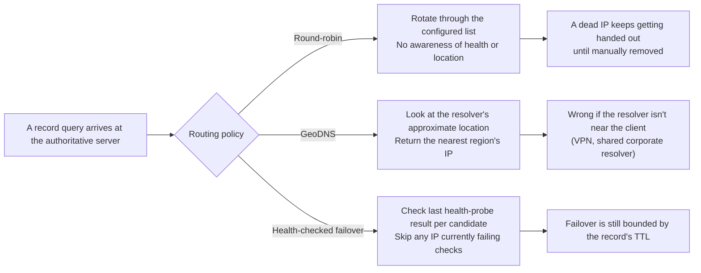

**Why it matters:** none of these three ever inspects the request itself — they all answer *before* a connection exists, which is the fundamental ceiling on what DNS-based load balancing can do, however it's configured.

This is deliberately *not* the same thing as the load-balancing algorithms (round robin, least connections, consistent hashing) a proxy or load balancer runs per-request — those operate after a connection is already established to one IP; see [[Load Balancing]] for that layer.

DNS-based routing only ever decides *which IP a client receives*, coarsely and bounded by caching, not which backend handles each individual request.

### Kubernetes DNS

**In plain words:** inside a Kubernetes cluster there is a private mini phone book (CoreDNS) so pods can find services by short names, and it tries a list of "maybe you meant..." suffixes before giving up.

Inside a Kubernetes cluster, **CoreDNS** is the cluster's internal DNS server, resolving service names like `my-svc.my-namespace.svc.cluster.local` to a Service's ClusterIP.

Pods get a resolver config with `ndots:5` by default and a `search` list of domain suffixes (the namespace, `svc.cluster.local`, the cluster domain) — a bare name like `my-svc` tries each search suffix in turn (`my-svc.my-namespace.svc.cluster.local` first) before falling back to treating it as fully qualified.

A name with 5 or more dots skips the search list entirely and is queried as-is, which is the usual culprit when a pod can resolve external names slowly (every search suffix is tried and fails before the final absolute lookup succeeds) — one real fix is appending a trailing dot to fully qualified external names in application config to force an absolute query immediately.

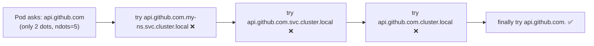

### Security: DNSSEC, DoH/DoT, cache poisoning

**In plain words:** plain DNS is a postcard — anyone can read it and anyone can forge a reply. DNSSEC adds a tamper-proof signature on the answer; DoH/DoT put the whole conversation in an envelope.

Plain DNS has no authentication: a resolver has no cryptographic way to know an answer wasn't forged by an on-path attacker or injected via a poisoned cache (classically, racing a forged response to arrive before the real authoritative answer, exploiting predictable query IDs or ports).

**DNSSEC** fixes this by having zones cryptographically sign their records (`RRSIG`) with keys published as `DNSKEY` records, chained up to the root via `DS` records at each parent zone, so a validating resolver can verify an answer wasn't tampered with.

**Picture it:** trust is established by walking up the delegation chain, the same chain the resolver already walked to find the answer, verifying one cryptographic link at a time:

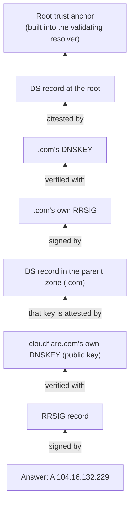

**Example:** the measured answer below carries both the data and its signature in the same response — a validating resolver fetches the `DNSKEY`/`DS` chain separately and checks the signature before trusting the `A` records at all.

**Why it matters:** a resolver that doesn't validate DNSSEC has no way to detect a forged answer even if every zone in the chain signed correctly — the protection only applies if something actually checks it, which is why DNSSEC's real-world benefit depends on which recursive resolver a client happens to use.

**Measured (dig 9.10.6, 2026-11-06)**, a DNSSEC-signed answer for a real zone:

```text
$ dig cloudflare.com +dnssec A +noall +answer
cloudflare.com.  116  IN  A      104.16.132.229
cloudflare.com.  116  IN  A      104.16.133.229
cloudflare.com.  111  IN  RRSIG  A 13 2 300 20261107192411 20261105172411 34505 cloudflare.com. EeoK3n2y...
```

DNSSEC authenticates answers but does not encrypt the query itself — anyone on the network path (an ISP, a coffee-shop Wi-Fi operator) can still see which domains you're resolving.

**DoH** (DNS over HTTPS, RFC 8484) and **DoT** (DNS over TLS, RFC 7858) fix that by encrypting the query/response channel between the stub and recursive resolver, at the cost of resolvers needing TLS termination and some networks' middleboxes no longer being able to filter plain-text DNS.

### Reading `dig` output and `+trace`

**In plain words:** `dig` is the ask-DNS-by-hand tool; its output is just name, seconds left on the cache timer, type, and the answer.

```text
$ dig example.com A +noall +answer
example.com.  230  IN  A  172.66.147.243
example.com.  230  IN  A  104.20.23.154
```

Columns, left to right: name, **TTL remaining in seconds**, class (`IN` = internet, effectively always), type, and the record's data.

`dig +trace` repeats the resolver's own iterative walk visibly, starting at the root and printing each referral — useful for debugging "why is this name resolving to the wrong thing," since it shows exactly which nameserver answered at each level rather than trusting a possibly-stale cache.

## 4. Worked example 🟡

### Whiteboard version

The bare idea: Go's resolver answers a query, but caches nothing — every call is a fresh network round trip unless you cache it yourself.

```go
addrs, err := net.DefaultResolver.LookupHost(context.Background(), "example.com")
```

The gap that call leaves open: calling it twice in a row for the same host makes two real network round trips, even though the first answer's TTL hasn't expired yet. A TTL-respecting cache wraps it with exactly the bookkeeping the standard library leaves out:

1. On a lookup, check whether a cached entry for this host exists and its expiry time hasn't passed yet.
2. If it has — a cache hit — return the cached addresses without touching the network.
3. If not — a cache miss — call the upstream resolver, store the result with a new expiry of `now + TTL`, and return it.
4. A lookup that arrives after expiry repeats step 3, exactly like a resolver's own TTL-bounded cache.

> [!warning] Common mistake
> Picking one fixed `TTL` for the whole cache (as this minimal version does) ignores that real DNS answers carry their *own*, different TTLs per record. A production cache would read the TTL out of the actual DNS response rather than hardcoding it — this version fixes the TTL only to keep the mechanism easy to see.

**What happens if** the clock used for expiry checks is the real wall clock instead of an injectable one?

The test below could only prove TTL expiry by actually sleeping for the TTL's duration, making the test slow and flaky under load — this is why the cache takes an overridable `Now func() time.Time`, so a test can fast-forward time deterministically.

**Measured (Go 1.24.4, darwin/arm64, 2026-11-09):** a test proving a lookup inside the TTL window is served from cache (zero extra upstream calls) and a lookup past the TTL triggers a fresh upstream query, both pass under `go test -race`.

Runnable Go version, including the cache's full code, both tests, and the pure-Go-vs-cgo resolver notes: [[DNS - Resolution, Records and Caching - Go]].

## 5. Variants and comparison 🟡

| Approach | How it decides the answer | Use when | Cost |
| --- | --- | --- | --- |
| Round-robin DNS | Rotates through multiple `A`/`AAAA` records | Simple multi-homing, no real traffic awareness needed | Clients may retry a dead IP until TTL expiry |
| GeoDNS / latency routing | Returns the nearest region's IP based on resolver location | Multi-region services wanting users routed to the closest data center | Coarse: routes by resolver's location, not the client's exact location |
| Health-checked failover (Route 53 et al.) | Actively probes endpoints, withholds unhealthy ones | Automatic regional failover | Failover is bounded by TTL, not instant |
| Anycast (same IP, many locations) | Routing layer (BGP), not DNS, picks the nearest instance | Root/TLD servers, large CDNs, needing failover faster than any TTL | Requires owning IP announcement infrastructure, not just a DNS zone |
| Split-horizon DNS | Different answers for internal vs external queries | Internal services that should resolve privately, same name externally | Operational complexity: keeping two zones consistent |

## 6. Trade-offs and when not to use 🟡

- DNS-based routing only changes *which IP* a client gets, bounded by TTL and by clients/resolvers that ignore TTL and over-cache — it is not a substitute for an L4/L7 load balancer's per-request routing (see [[Load Balancing]], [[Forward and Reverse Proxies - L4 vs L7]]).
- A very low TTL for fast failover means every cache layer re-queries constantly, raising load and latency on authoritative servers and on every client's own lookup path.
- Split-horizon DNS and similar tricks add real operational complexity (keeping two answer sets in sync) for a benefit that's often better solved by proper network segmentation.
- GeoDNS approximates a user's location from their resolver's IP, which is wrong for anyone using a VPN, a public DNS resolver far from them, or a corporate resolver serving a geographically spread-out company.

## 7. In production 🔴

- **Real systems:** every public website; AWS Route 53 (health checks, weighted/latency/geolocation routing policies, and ALIAS records at the zone apex); Cloudflare and Google Public DNS as widely used recursive resolvers; Kubernetes' CoreDNS for cluster-internal service discovery.
- **Failure modes → fixes:**
	- **Forgot to lower TTL before a migration** → the old IP stays cached (and receiving traffic) for up to the old TTL everywhere, including resolvers you don't control; plan TTL reductions a full TTL period ahead of any planned cutover.
	- **CNAME at the apex** attempted directly → DNS providers reject it (or silently break) because `SOA`/`NS` must coexist there; use an ALIAS/flattened-CNAME record instead.
	- **Cache poisoning / spoofed responses** → deploy DNSSEC validation, and prefer resolvers that randomize source ports and query IDs (a mitigation, not a fix, for the pre-DNSSEC class of attacks).
	- **`ndots:5` slow external lookups in Kubernetes** → append a trailing dot to external FQDNs in config, or tune `ndots` per pod, to skip the search-suffix retries.
	- **Negative caching masking a just-fixed record** → a client that already cached an `NXDOMAIN` keeps getting it until the `SOA` minimum TTL expires, even after you add the missing record — this is distinct from, and usually shorter-lived than, a stale positive answer.
- **What to monitor:** query volume and error rate (`SERVFAIL`, `NXDOMAIN`) at your authoritative nameservers, DNSSEC validation failures, health-check status on any GeoDNS/failover policy, and resolver response time from each client region.

## 8. Deep dive 🔴

- **Why the recursive/iterative split matters for trust and load:** the stub resolver trusts its recursive resolver completely (it can't verify the walk itself), which is exactly the trust boundary DNSSEC validation and DoH/DoT both operate on — a malicious or compromised recursive resolver can lie to every client behind it, which is why some organizations run their own validating recursive resolver rather than trusting a third party blindly.
- **EDNS0 and fragmentation risk:** advertising a large UDP buffer (4096 bytes) avoids the TCP fallback round trip, but large UDP DNS responses are also the classic vector for **DNS amplification attacks** (a spoofed source IP triggers a small query that returns a response many times larger, flooding the spoofed victim) — operators rate-limit and apply response-size policies specifically because of this.
- **Anycast's interaction with TCP:** anycast works cleanly for UDP (each packet can independently route to the nearest instance), but a TCP connection must stay pinned to one instance for its lifetime; if BGP routes change mid-connection (a "anycast flap"), the TCP connection breaks even though the IP address never changed — root/TLD operators engineer their routing to avoid exactly this.
- **Why Go deliberately doesn't cache:** the standard library's position is that caching is a policy decision (how long, how to handle rotation, how to handle failures) that belongs in the application or in the OS resolver it already delegates to by default — baking in one cache policy would be wrong for some callers and right for others, so `net/http`'s default transport also does not cache DNS answers across requests on its own.
- **DNSSEC's chain of trust and its gaps:** validating a record means walking `RRSIG` → `DNSKEY` → parent zone's `DS` record all the way to a trust anchor for the root — but DNSSEC authenticates non-existence awkwardly too (via `NSEC`/`NSEC3` records that prove no record exists between two names), and a large share of recursive resolvers still don't validate by default, so DNSSEC protects a zone only as well as the weakest validating resolver in the path actually checks it.

## 9. Interview questions 🔴

> [!question]- What's the difference between a recursive and an authoritative DNS server?
> A recursive resolver does the full lookup on a client's behalf, walking root → TLD → authoritative and caching the result; it owns no data itself. An authoritative server holds the actual records for the zones it's responsible for and answers only for those — it never does the walk for anyone else.

> [!question]- Trap: "DNS propagation after a change can take up to 48 hours."
> There's no propagation delay in the sense people mean — the authoritative server's new answer is available immediately. What takes time is every cache (browser, OS, recursive resolver) that already holds the *old* answer waiting out its TTL. Lowering the TTL well before a planned change is the fix; raising it back afterward reduces load once things settle.

> [!question]- Why can't you put a CNAME record at the zone apex (the bare domain)?
> A CNAME can't coexist with any other record type at the same name, but the apex must carry the zone's SOA and NS records. DNS providers work around this with a provider-specific ALIAS or "CNAME flattening" record that behaves like a CNAME to clients but is resolved internally by the provider, so it can legally sit alongside SOA/NS.

> [!question]- How does negative caching work, and why does it matter?
> A response saying a name or record type doesn't exist (NXDOMAIN, or NODATA) is cached too, using the TTL from the zone's SOA minimum field (carried in the authority section of the response). Without this, a typo'd or not-yet-created name would get re-queried against the authoritative servers on every single lookup.

> [!question]- What's the practical difference between DNS-based load balancing and a load balancer's own routing algorithm?
> DNS-based routing (round-robin, GeoDNS, health-checked failover) only decides which IP a client receives, and that decision is cached for up to the TTL — it happens before any connection exists. A load balancer's algorithm (round robin, least connections, consistent hashing) routes each individual request or connection in real time, after a client has already connected to one IP.

> [!question]- Does Go's net.Resolver cache DNS answers between calls?
> No — every call to LookupHost (or similar methods) triggers a fresh query. If you want TTL-respecting reuse, you wrap the resolver yourself (or rely on the OS resolver it may delegate to), because the standard library deliberately leaves caching policy to the caller.

> [!question]- What problem do DoH and DoT solve that DNSSEC doesn't?
> DNSSEC authenticates that an answer wasn't tampered with, but the query and response still travel in plain text, visible to anyone on the network path. DoH (over HTTPS) and DoT (over TLS) encrypt that channel between the stub and recursive resolver, protecting query privacy — a separate concern from answer integrity.

## 10. Cheat sheet 🟢

- Hierarchy: root `.` → TLD (`.com`) → second-level domain → subdomains; delegated via NS records at each level, with glue records breaking the self-referential case.
- Stub resolver asks a recursive resolver (recursive query); the recursive resolver walks root/TLD/authoritative itself (iterative queries + referrals).
- Record types to know cold: A, AAAA, CNAME, MX, TXT, NS, SOA, PTR, SRV, CAA.
- CNAME can't sit at the zone apex or beside another record type; use ALIAS/flattening there instead.
- TTL governs every cache layer; "propagation" is just TTL expiry, not something that spreads across the internet.
- Negative caching (NXDOMAIN) uses the zone's SOA minimum TTL.
- DNS-based load balancing (round-robin, GeoDNS, health-checked failover) picks an IP before any connection; it's not the same layer as a proxy's per-request load balancing.
- Go's `net.Resolver` never caches on its own; wrap it if you need TTL-aware reuse.
- DNSSEC authenticates answers; DoH/DoT encrypt the query channel — different problems, often both wanted.

## Links

- **Before this:** [[How the Internet Works - IP, Ports, Packets, OSI vs TCP-IP]], [[IP Addressing, Subnets, NAT and VPC Basics]]
- **Next:** [[TLS and HTTPS]], [[CDN and Edge]]
- **Compare with:** [[Load Balancing]] (per-request routing vs DNS's per-lookup routing), [[Forward and Reverse Proxies - L4 vs L7]]
- **Code:** [[DNS - Resolution, Records and Caching - Go]]

### Watch on YouTube

- [How DNS Works — Explained for Beginners (Full Deep Dive)](https://www.youtube.com/watch?v=hjSX9ah4z18) · Bit Byte Talks · full walkthrough of the DNS resolution hierarchy (root, TLD, authoritative) and record types
