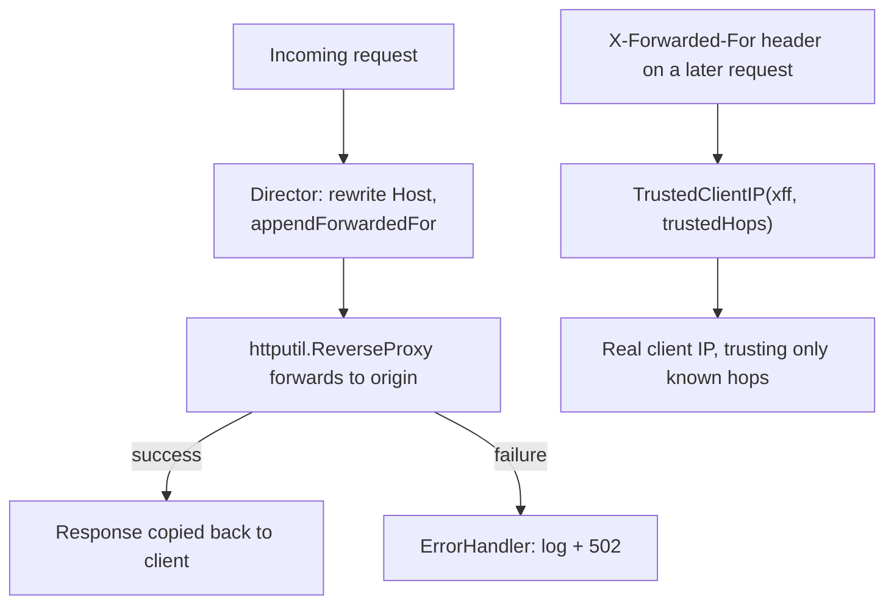

# Forward and Reverse Proxies - L4 vs L7 - Go

> [!summary] TL;DR
> This code builds a minimal reverse proxy on top of `net/http/httputil.ReverseProxy` that correctly appends `X-Forwarded-For`, returns a clean `502` on a dead backend, and includes the hop-trust logic (`TrustedClientIP`) for reading that header safely. See the theory in [[Forward and Reverse Proxies - L4 vs L7]].

> [!info] How to read this note (pick your level)
> - 🟢 **New to this?** Read "From zero" below, then "Before the code", "What this code shows" and "Running it". You do not need to follow every line of Go yet.
> - 🟡 **Know the basics?** Add the "Code", "Design decisions" and "Tests" sections.
> - 🔴 **Interview / SDE-3 prep?** Add "Pitfalls" and do the exercises. Headings are tagged 🟢🟡🔴.

> [!note] Before this note
> - [[HTTP Fundamentals - Methods, Status Codes, Headers, Cookies]]: requests carry headers like `Host`, and a 502 status means "the server behind me failed".
> - [[TCP - Handshake, Reliability, Flow and Congestion Control]]: a connection to a dead server is refused, which is what the 502 test simulates.
> - [[Forward and Reverse Proxies - L4 vs L7]] (theory twin): what a reverse proxy is and why `X-Forwarded-For` must be read from the right.

**From zero, in 60 seconds** 🟢

In plain words: this file builds a tiny receptionist (a **reverse proxy**) in Go. It takes each incoming request, notes down who really sent it (the `X-Forwarded-For` list), passes the request to the real server, and answers with a clean "502" error when that server is down. It also includes the one function everyone gets wrong — reading that sender list *safely*, trusting only the entries our own machines wrote. Read the short explanation around each code block first; the code just does what the sentence above it says.

## Before the code 🟢

- **`net/http/httputil.ReverseProxy`**: a ready-made reverse proxy from the standard library; we only customize it.
- **Closures (`Director`, `ErrorHandler`)**: functions stored in struct fields (a closure is a function that remembers variables from where it was created); the proxy calls them per request.
- **`log/slog`**: structured logging with key/value pairs.
- **`net/http/httptest`**: starts real local HTTP servers inside tests, so the proxy is tested end to end.
- **Goroutines (implicit)**: every request is served on its own goroutine, which is why tests run with `-race`.
- **Run it**: `go vet ./...` then `go test -race ./...` (see Setup).

## What this code shows 🟢

| Code | Theory concept | Theory section |
| --- | --- | --- |
| `NewReverseProxy`, `Director` override | A reverse proxy terminating and re-forwarding a request | [[Forward and Reverse Proxies - L4 vs L7#Reverse proxy]] |
| `appendForwardedFor` | Appending (never overwriting) `X-Forwarded-For` | [[Forward and Reverse Proxies - L4 vs L7#Forwarded headers and trust]] |
| `ErrorHandler` returning 502 | The 502 vs 504 distinction | [[Forward and Reverse Proxies - L4 vs L7#Timeouts, and why a proxy gives you two different error codes]] |
| `TrustedClientIP` | Trusting only a fixed number of hops from the right | [[Forward and Reverse Proxies - L4 vs L7#Forwarded headers and trust]] |

## Setup 🟢

- **Module layout:** a single package, `proxy`, with `proxy.go` and `proxy_test.go`.
- **Go version:** 1.24.
- **Dependencies:** standard library only (`net/http`, `net/http/httputil`, `log/slog`).
- **Run it:**

```text
go mod init proxy
go vet ./...
go test -race ./...
```

## Code 🟡

> 🟢 → 🟡 **You now know** what the proxy must do: forward, note the sender, answer 502 on failure. **Next we read the code**: the two hooks we customize on Go's built-in proxy, the header-append helper, and the safe reader for the sender list.

### Building the proxy and rewriting outbound requests

**In plain words:** we take Go's ready-made proxy and customize two moments — just before a request is forwarded (fix the Host, note the sender), and when the backend fails (log it and answer 502).

```go
package proxy

import (
	"log/slog"
	"net"
	"net/http"
	"net/http/httputil"
	"net/url"
	"strings"
)

// NewReverseProxy builds a reverse proxy to a single upstream origin. It
// rewrites the request to the origin's scheme and host, and appends this
// hop's observed client IP to X-Forwarded-For (never trusting an inbound
// value from an untrusted client).
func NewReverseProxy(origin *url.URL, logger *slog.Logger) *httputil.ReverseProxy {
	proxy := httputil.NewSingleHostReverseProxy(origin)

	director := proxy.Director
	proxy.Director = func(req *http.Request) {
		director(req)
		req.Host = origin.Host // many origins route on Host; keep it in sync with the target
		appendForwardedFor(req)
	}
```

The second half wires in the failure path — what happens when the origin can't be reached at all:

```go
	proxy.ErrorHandler = func(w http.ResponseWriter, r *http.Request, err error) {
		logger.Error("proxy error", "err", err, "path", r.URL.Path)
		w.WriteHeader(http.StatusBadGateway) // 502: we could not reach or read from the upstream
	}

	return proxy
}
```

**Concept.** This implements the reverse proxy walked through in [[Forward and Reverse Proxies - L4 vs L7#A minimal Go reverse proxy, traced step by step]].

`httputil.ReverseProxy`'s own `Director` is wrapped rather than replaced — calling the original `director` first keeps all of the standard library's own rewriting (scheme, path, query merging) and only adds the two things it doesn't do: forcing `req.Host` to match the origin, and appending `X-Forwarded-For`.

Writing a reverse proxy entirely from scratch (manual `http.Client` calls) was rejected because `httputil.ReverseProxy` already handles streaming bodies, header hop-by-hop stripping (removing headers like `Connection` that only apply to one link, not the whole path), and connection reuse correctly.

**How it works.**
1. `director := proxy.Director` captures the standard library's default rewriting function before replacing it, so the override can still call it.
2. `req.Host = origin.Host` matters because many origins route on the `Host` header, not just the URL — without this line, a multi-tenant origin (one server hosting many customers' sites, told apart by `Host`) could route to the wrong backend.
3. `ErrorHandler` is the only hook `httputil.ReverseProxy` gives for "the backend didn't answer correctly"; returning `502` here is what turns a raw Go error (connection refused, timeout) into the correct HTTP status for the client.

### Appending X-Forwarded-For and X-Forwarded-Proto

**In plain words:** add the caller's address to the end of the sender list — never erase what earlier hops wrote — so the final server can still trace the chain.

```go
// appendForwardedFor appends the immediate peer's IP to X-Forwarded-For.
// Only a proxy we trust may add to this header; a client-supplied value
// before us is kept, since an upstream trust boundary decides how many
// hops to believe (see TrustedClientIP).
func appendForwardedFor(req *http.Request) {
	host, _, err := net.SplitHostPort(req.RemoteAddr)
	if err != nil {
		host = req.RemoteAddr
	}
	if prior := req.Header.Get("X-Forwarded-For"); prior != "" {
		req.Header.Set("X-Forwarded-For", prior+", "+host)
	} else {
		req.Header.Set("X-Forwarded-For", host)
	}
	if req.Header.Get("X-Forwarded-Proto") == "" {
		req.Header.Set("X-Forwarded-Proto", "http")
	}
}
```

**Concept.** This is the append-not-overwrite rule from [[Forward and Reverse Proxies - L4 vs L7#Forwarded headers and trust]]. Overwriting the header (replacing it with just this hop's IP) was rejected because it would destroy any earlier hop's information — a chain of trusted proxies needs every hop's append to survive so the final backend (or `TrustedClientIP`) can count hops correctly.

**How it works.**
1. `net.SplitHostPort` strips the port from `req.RemoteAddr`, since `X-Forwarded-For` conventionally carries IPs, not `ip:port` pairs; a parse failure (an unusual `RemoteAddr` format) falls back to using the raw string rather than erroring out.
2. The `prior != ""` branch is what makes this an *append*: an existing header value is kept, with this hop's IP added after a comma.
3. `X-Forwarded-Proto` is set only if absent, so an upstream proxy's own (correct) value is never clobbered by this hop defaulting to `"http"`.

### Reading X-Forwarded-For safely: TrustedClientIP

**In plain words:** the sender list can be forged at the front, so count from the back — trust exactly as many entries as proxies you actually run, and ignore the rest.

```go
// TrustedClientIP returns the real client IP from X-Forwarded-For, trusting
// only the last n hops added by our own known proxies. Everything to the
// left of that is attacker-controlled and must never be used for
// rate-limiting or access control.
func TrustedClientIP(xff string, trustedHops int) string {
	if xff == "" || trustedHops <= 0 {
		return ""
	}
	parts := strings.Split(xff, ",")
	for i := range parts {
		parts[i] = strings.TrimSpace(parts[i])
	}
	if trustedHops > len(parts) {
		trustedHops = len(parts)
	}
	return parts[len(parts)-trustedHops]
}
```

**Concept.** This implements the hop-counting rule in [[Forward and Reverse Proxies - L4 vs L7#Forwarded headers and trust]]: trust exactly as many entries from the right as you have proxies you control. Trusting the left-most entry (the common bug) was rejected for the reason the theory note's trap interview question covers — the left-most entry is exactly what an attacker fully controls.

**How it works.**
1. Early-returning `""` on an empty header or non-positive `trustedHops` avoids an out-of-range slice index below, rather than panicking on malformed input.
2. `strings.TrimSpace` handles the conventional `", "`-separated format, where entries commonly have a leading space after the comma.
3. Clamping `trustedHops` to `len(parts)` means asking for more trusted hops than entries present returns the left-most (oldest) entry rather than panicking — a defensive choice for a header that a load balancer's misconfiguration could shorten unexpectedly.
4. `parts[len(parts)-trustedHops]` counts from the right, which is the entire point: the rightmost entries are the ones appended by proxies you actually run, in append order.



> [!example]- Full file
> ```go
> package proxy
>
> import (
> 	"log/slog"
> 	"net"
> 	"net/http"
> 	"net/http/httputil"
> 	"net/url"
> 	"strings"
> )
>
> // NewReverseProxy builds a reverse proxy to a single upstream origin. It
> // rewrites the request to the origin's scheme and host, and appends this
> // hop's observed client IP to X-Forwarded-For (never trusting an inbound
> // value from an untrusted client).
> func NewReverseProxy(origin *url.URL, logger *slog.Logger) *httputil.ReverseProxy {
> 	proxy := httputil.NewSingleHostReverseProxy(origin)
>
> 	director := proxy.Director
> 	proxy.Director = func(req *http.Request) {
> 		director(req)
> 		req.Host = origin.Host // many origins route on Host; keep it in sync with the target
> 		appendForwardedFor(req)
> 	}
>
> 	proxy.ErrorHandler = func(w http.ResponseWriter, r *http.Request, err error) {
> 		logger.Error("proxy error", "err", err, "path", r.URL.Path)
> 		w.WriteHeader(http.StatusBadGateway) // 502: we could not reach or read from the upstream
> 	}
>
> 	return proxy
> }
>
> // appendForwardedFor appends the immediate peer's IP to X-Forwarded-For.
> // Only a proxy we trust may add to this header; a client-supplied value
> // before us is kept, since an upstream trust boundary decides how many
> // hops to believe (see TrustedClientIP).
> func appendForwardedFor(req *http.Request) {
> 	host, _, err := net.SplitHostPort(req.RemoteAddr)
> 	if err != nil {
> 		host = req.RemoteAddr
> 	}
> 	if prior := req.Header.Get("X-Forwarded-For"); prior != "" {
> 		req.Header.Set("X-Forwarded-For", prior+", "+host)
> 	} else {
> 		req.Header.Set("X-Forwarded-For", host)
> 	}
> 	if req.Header.Get("X-Forwarded-Proto") == "" {
> 		req.Header.Set("X-Forwarded-Proto", "http")
> 	}
> }
>
> // TrustedClientIP returns the real client IP from X-Forwarded-For, trusting
> // only the last n hops added by our own known proxies. Everything to the
> // left of that is attacker-controlled and must never be used for
> // rate-limiting or access control.
> func TrustedClientIP(xff string, trustedHops int) string {
> 	if xff == "" || trustedHops <= 0 {
> 		return ""
> 	}
> 	parts := strings.Split(xff, ",")
> 	for i := range parts {
> 		parts[i] = strings.TrimSpace(parts[i])
> 	}
> 	if trustedHops > len(parts) {
> 		trustedHops = len(parts)
> 	}
> 	return parts[len(parts)-trustedHops]
> }
> ```

## Design decisions 🟡

| Choice | Alternative | Trade-off |
| --- | --- | --- |
| Wrap `httputil.ReverseProxy`'s `Director` | Hand-roll a proxy with `http.Client` | `httputil.ReverseProxy` already handles streaming, hop-by-hop headers and connection reuse correctly; reinventing it risks subtle bugs those already solve |
| Append to `X-Forwarded-For` | Overwrite with just this hop's IP | Appending preserves the full hop chain so `TrustedClientIP` (or the backend) can still count hops correctly |
| `ErrorHandler` writes 502 unconditionally | Distinguish 502 vs 504 in code | A real proxy would check for a timeout error specifically to return 504 instead; this minimal version always returns 502 to keep the example to one code path (see Exercise 1) |
| Clamp `trustedHops` to `len(parts)` in `TrustedClientIP` | Return `""` or panic if `trustedHops` exceeds the entry count | Clamping degrades gracefully (returns the oldest entry) instead of crashing on a header shorter than expected |

## Tests 🟡

### TestReverseProxyForwardsAndSetsHeaders

**Property proved:** a normal request through the proxy reaches the origin with the correct `Host`, a populated `X-Forwarded-For`, and `X-Forwarded-Proto: http`, and the origin's response comes back to the client unchanged.

| Input | Expected output |
| --- | --- |
| `GET /widgets/7` through the proxy to a healthy origin | `200`, body `"hello from origin"`; origin sees `Host` = origin's host, non-empty `X-Forwarded-For`, `X-Forwarded-Proto: http` |

A failure where `X-Forwarded-For` is empty would mean `appendForwardedFor` never ran or `RemoteAddr` parsing failed silently — the backend would then have no way to recover the real client IP at all.

**What this code does, in plain words:** it starts a fake origin server that records the headers it receives, puts the proxy in front of it, sends `GET /widgets/7` through the proxy, and keeps what the origin saw for the checks below.

```go
func TestReverseProxyForwardsAndSetsHeaders(t *testing.T) {
	var gotHost, gotXFF, gotProto string
	origin := httptest.NewServer(http.HandlerFunc(func(w http.ResponseWriter, r *http.Request) {
		gotHost = r.Host
		gotXFF = r.Header.Get("X-Forwarded-For")
		gotProto = r.Header.Get("X-Forwarded-Proto")
		w.WriteHeader(http.StatusOK)
		_, _ = w.Write([]byte("hello from origin"))
	}))
	defer origin.Close()

	originURL, err := url.Parse(origin.URL)
	if err != nil {
		t.Fatalf("parse origin url: %v", err)
	}

	logger := slog.New(slog.NewTextHandler(io.Discard, nil))
	rp := NewReverseProxy(originURL, logger)

	front := httptest.NewServer(rp)
	defer front.Close()

	resp, err := http.Get(front.URL + "/widgets/7")
	if err != nil {
		t.Fatalf("do request: %v", err)
	}
	defer resp.Body.Close()
```

The assertions confirm both the body passed through untouched and every header the Director was responsible for setting:

```go
	body, _ := io.ReadAll(resp.Body)
	if resp.StatusCode != http.StatusOK {
		t.Fatalf("status = %d, want 200", resp.StatusCode)
	}
	if !strings.Contains(string(body), "hello from origin") {
		t.Fatalf("body = %q, want origin response", body)
	}
	if gotHost != originURL.Host {
		t.Errorf("origin saw Host %q, want %q", gotHost, originURL.Host)
	}
	if gotXFF == "" {
		t.Error("X-Forwarded-For was not set")
	}
	if gotProto != "http" {
		t.Errorf("X-Forwarded-Proto = %q, want http", gotProto)
	}
}
```

### TestReverseProxyReturns502OnUnreachableOrigin

**Property proved:** when the backend is unreachable, the proxy returns a clean `502` rather than hanging or returning a misleading `200`.

| Input | Expected output |
| --- | --- |
| Request through the proxy to a closed/unreachable origin | `502 Bad Gateway` |

A failure here (the client request hanging, or getting a `200`) would mean `ErrorHandler` never fired — exactly the silently-dropped-connection failure mode the theory note warns against.

**What this code does, in plain words:** it starts a server, shuts it down at once so nothing is listening, points the proxy at that dead address, and checks the answer is 502.

```go
func TestReverseProxyReturns502OnUnreachableOrigin(t *testing.T) {
	// A closed listener: nothing answers, so the proxy must report 502, not hang or 200.
	dead := httptest.NewServer(http.HandlerFunc(func(w http.ResponseWriter, r *http.Request) {}))
	deadURL, _ := url.Parse(dead.URL)
	dead.Close() // close immediately so the address is refused

	logger := slog.New(slog.NewTextHandler(io.Discard, nil))
	rp := NewReverseProxy(deadURL, logger)
	front := httptest.NewServer(rp)
	defer front.Close()

	resp, err := http.Get(front.URL + "/")
	if err != nil {
		t.Fatalf("do request: %v", err)
	}
	defer resp.Body.Close()
	if resp.StatusCode != http.StatusBadGateway {
		t.Fatalf("status = %d, want 502", resp.StatusCode)
	}
}
```

### TestTrustedClientIPTrustsOnlyKnownHops

**Property proved:** given a header with an attacker-forged entry followed by two genuinely trusted proxy hops, trusting exactly 2 hops returns the correct real client IP, not the attacker's forged one.

| Input | Expected output |
| --- | --- |
| `xff = "attacker-spoofed, 203.0.113.9, 10.0.0.5"`, `trustedHops = 2` | `"203.0.113.9"` |

A failure returning `"attacker-spoofed"` would mean the hop-counting logic is reading from the wrong end of the list — the exact bug the theory note's trap interview question describes.

**What this code does, in plain words:** it feeds `TrustedClientIP` a header with one forged entry and two real proxy entries, says "I run 2 proxies", and checks it returns the real client `203.0.113.9`.

```go
func TestTrustedClientIPTrustsOnlyKnownHops(t *testing.T) {
	// attacker, then two of our own proxies appending in order.
	xff := "attacker-spoofed, 203.0.113.9, 10.0.0.5"
	got := TrustedClientIP(xff, 2) // we trust the last 2 hops (our own LB and this proxy)
	if got != "203.0.113.9" {
		t.Fatalf("got %q, want 203.0.113.9", got)
	}
}
```

## Running it 🟢

```text
$ go vet ./...
$ go test -race ./... -v
=== RUN   TestReverseProxyForwardsAndSetsHeaders
--- PASS: TestReverseProxyForwardsAndSetsHeaders (0.00s)
=== RUN   TestReverseProxyReturns502OnUnreachableOrigin
--- PASS: TestReverseProxyReturns502OnUnreachableOrigin (0.00s)
=== RUN   TestTrustedClientIPTrustsOnlyKnownHops
--- PASS: TestTrustedClientIPTrustsOnlyKnownHops (0.00s)
PASS
ok  	proxy	1.481s
```

Reading it: all three tests pass under `-race`; since `httptest.NewServer` spins up real listening goroutines, this also incidentally proves no data race exists between the test's own assertions and the handler goroutines serving the requests.

## Pitfalls in the code 🔴

> 🟡 → 🔴 **You now know** how each hook and helper works and what the tests prove. **Next, the advanced part**: the small edits that would silently break hop counting or hide outages, and exercises that add 504 handling and path routing.

- **Forgetting to call the original `director` before the override's own logic** would silently lose the standard library's own request rewriting (path/query merging), producing requests the origin can't route correctly — this is why `director(req)` is called first, not skipped.
- **Setting `X-Forwarded-For` instead of appending** would make a multi-hop deployment indistinguishable from a single-hop one, breaking `TrustedClientIP`'s hop-counting for everyone downstream.
- **Returning `200` or leaving the response unwritten in `ErrorHandler`** would hide a real backend outage from monitoring that watches for `5xx` rates, since the client would see success or a hang instead of a clear signal.

## Exercises 🔴

1. Change `ErrorHandler` to distinguish a context-deadline-exceeded error (slow backend) from any other error (backend refused/reset), returning `504` for the former and `502` for the rest. Predict which existing test still passes unmodified, then verify.
2. Add a `MaxTrustedHops` guard to `TrustedClientIP` that returns `""` instead of clamping when `trustedHops > len(parts)`, on the reasoning that a shorter-than-expected header might itself be a sign of tampering. Predict which call sites in a real proxy would need to handle an empty-string "unknown" result, then update the test to cover it.
3. Add a second origin and extend `NewReverseProxy` into a `NewPathRouter(routes map[string]*url.URL, logger *slog.Logger) http.Handler` that picks an origin by path prefix. Predict how `X-Forwarded-For` behavior should change, if at all, then write a test with two origins and two paths.

## Self-check 🟢🟡

> [!question]- 🟢 Which standard library type does the forwarding work?
> `httputil.ReverseProxy`; this code only customizes its `Director` and `ErrorHandler` hooks.

> [!question]- 🟢 What status does the proxy return when the origin is down?
> 502 Bad Gateway, written by the custom `ErrorHandler`.

> [!question]- 🟢 Does the proxy overwrite or append `X-Forwarded-For`?
> It appends the caller's IP after any existing entries.

> [!question]- 🟡 Why call the original `director(req)` first in the override?
> It keeps Go's own rewriting of scheme, path and query; skipping it breaks routing to the origin.

> [!question]- 🟡 With `"attacker-spoofed, 203.0.113.9, 10.0.0.5"` and `trustedHops = 1`, what does `TrustedClientIP` return?
> `10.0.0.5`, the last entry, because only one hop is trusted.

> [!question]- 🟡 Why does this code always return 502, never 504?
> It keeps one error path for simplicity; exercise 1 adds a timeout check to return 504.

## Links

- **Theory:** [[Forward and Reverse Proxies - L4 vs L7]]
- **Related:** [[Load Balancing]], [[Nginx]]
