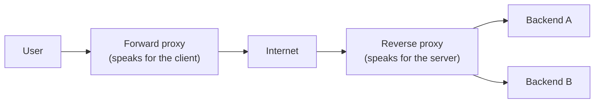
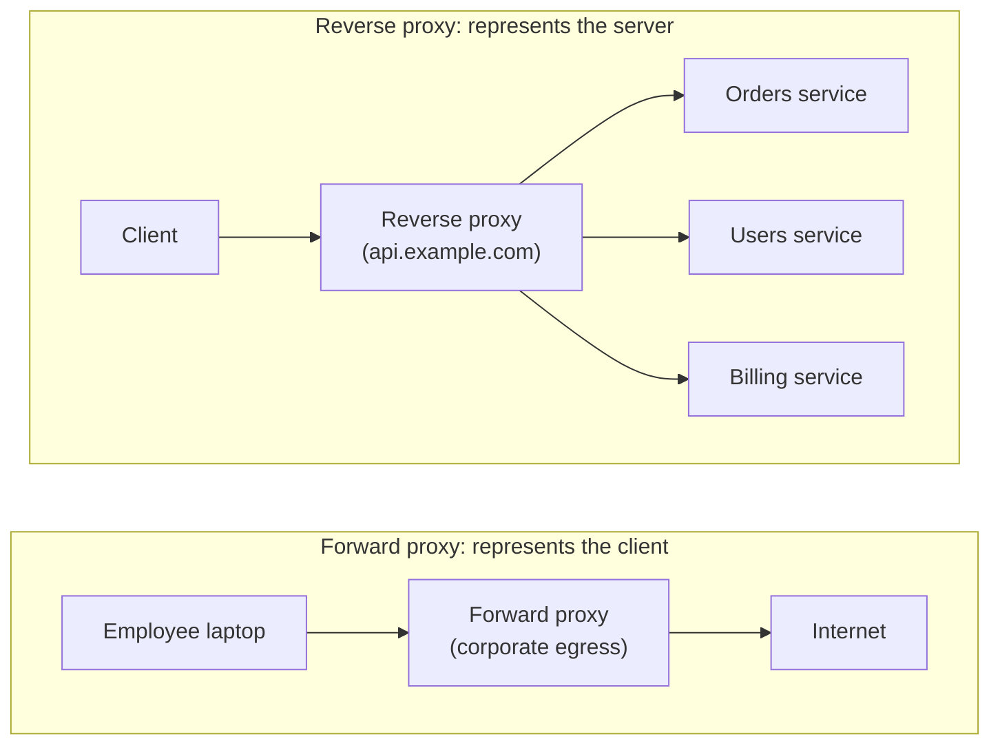
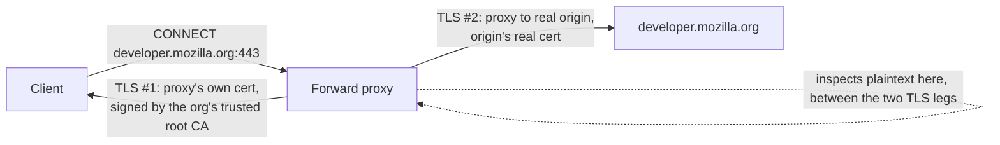
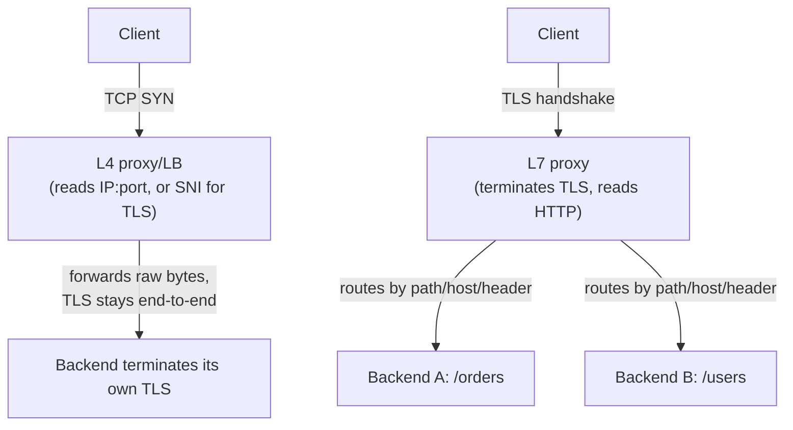
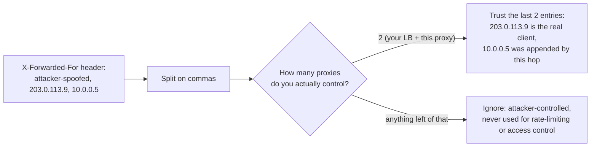
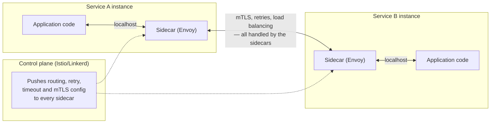
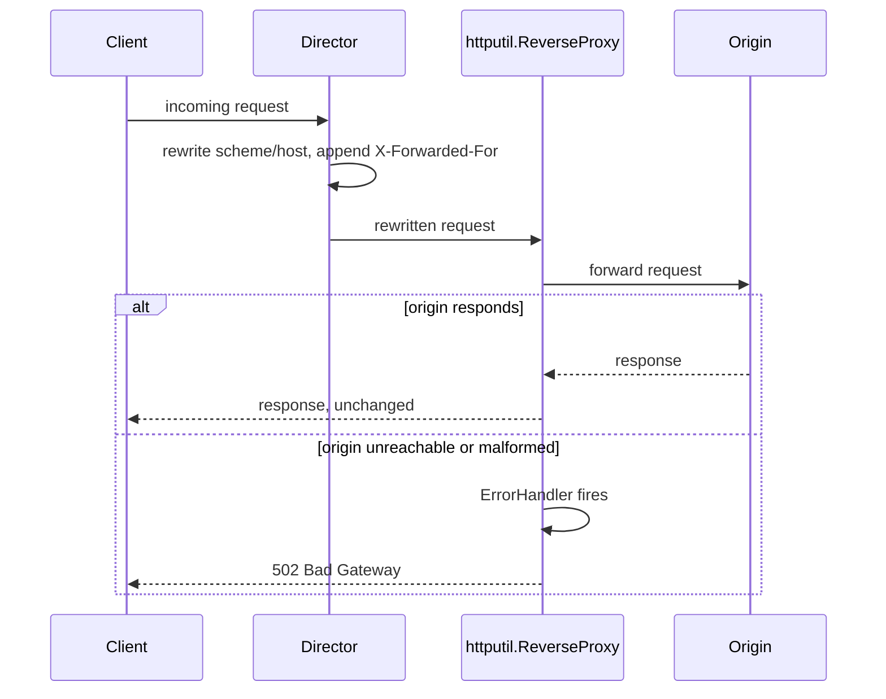
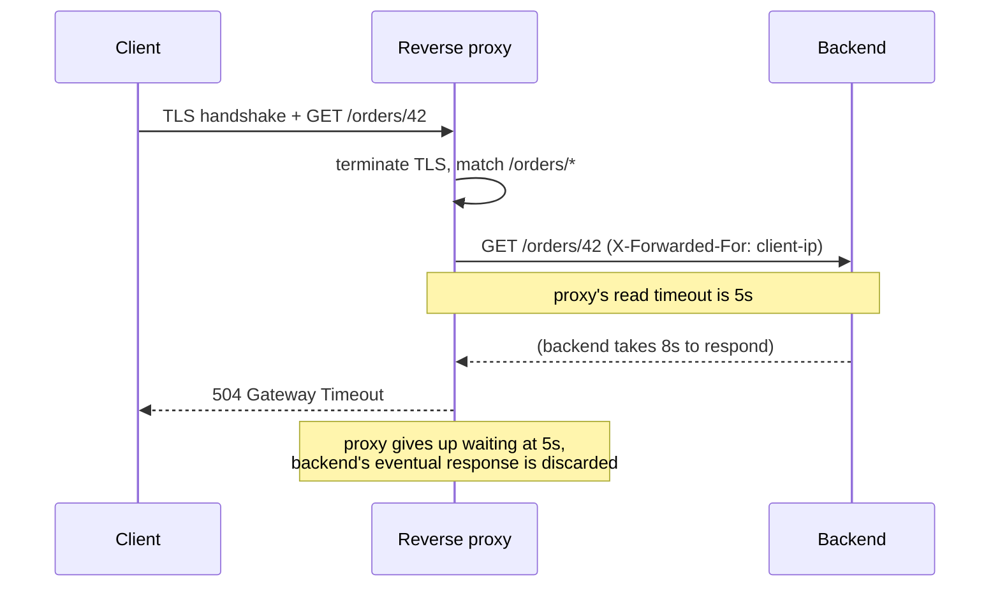

# Forward and Reverse Proxies - L4 vs L7

> [!summary] TL;DR
> A **proxy** is a server that sits between two ends of a connection and forwards traffic on their behalf. A **forward proxy** represents the client (it hides who's asking); a **reverse proxy** represents the server (it hides what's answering). Either one can work at **L4** (forwarding raw TCP/UDP by IP and port, blind to HTTP) or **L7** (parsing HTTP and routing by path, header, or host).

> [!abstract] Core idea
> - Forward proxy: the client's agent, usually for egress control, filtering, or anonymization — the server often doesn't know a proxy was involved.
> - Reverse proxy: the server's agent, standing in front of one or more backends, usually for TLS termination, routing, and protecting the origin.
> - L4 forwards bytes by IP:port (or passes TLS through using the SNI hostname) without understanding HTTP; L7 terminates the connection and reads the request to route it.
> - Classic mistake: trusting an inbound `X-Forwarded-For` header from the client itself. Only a header appended by a proxy **you control** is trustworthy.

## Start here: the basics

**The problem in one story.**
You type `shop.com` and get a page.
Behind that name are ten servers, not one.
You never see them; one machine in front takes your request and hands it to a free server.
That machine in the middle is a proxy.

**Words you need first**

| Word | Plain meaning | Tiny example |
| --- | --- | --- |
| Client | The program asking for something | Your browser |
| Server / backend | The program answering | The orders service |
| IP address and port | Where a program listens on a network | `10.0.0.5:8080` |
| TCP connection | A reliable two-way byte pipe between two programs | Browser to server on port 443 |
| HTTP request | A message like "GET /orders" with headers | `GET /users/7 Host: api.example.com` |
| TLS | Encryption wrapped around the connection | The padlock in the browser |
| Header | A name/value line attached to a request | `X-Forwarded-For: 203.0.113.9` |
| L4 / L7 | Network layers: L4 = connections and ports, L7 = the HTTP message | L4 sees "port 443", L7 sees "/orders" |

**Picture it**



**Analogy.** A forward proxy is your personal assistant who makes calls for you, so the other side sees the assistant's number. A reverse proxy is a company receptionist who answers every call and transfers it to the right desk.
Where it breaks: a receptionist cannot read a sealed letter, but an L7 proxy that holds the TLS key can open and inspect every request.

**How the rest of this note builds up**

- First, why proxies exist (section 1) and the forward vs reverse mental model (section 2).
- Then how each works (section 3), including the L4 vs L7 split and HTTPS interception.
- Then forwarded headers, PROXY protocol, connection pooling and timeouts.
- Finally the SDE-3 deep dive: trusting `X-Forwarded-For`, sidecars and service meshes, and interview traps.

> [!tip] Remember
> Forward proxy hides the client, reverse proxy hides the server; L4 moves bytes, L7 reads requests.

## 1. Why it exists

A company has three backend services behind three different internal addresses, and wants `api.example.com` to serve all of them over one TLS certificate, hide the internal topology, and apply one set of rate limits regardless of which service answers.

Without a proxy, every client would need to know three internal hostnames, each service would need its own TLS certificate and its own rate-limiting code, and none of it could be changed without redeploying every client.

A **reverse proxy** in front of all three solves this: one public hostname, one TLS certificate, one place to add rate limiting, and routing rules (`/orders/*` → orders service, `/users/*` → users service) that can change without touching any client.

The mirror case: a company wants every employee laptop's outbound internet traffic to go through one controlled egress point, so it can block known-bad domains and log what left the network. That's a **forward proxy** — it represents the client, not the server.

## 2. Mental model

- **Forward proxy** = a mail forwarding service you set up before you move. Nobody you write to needs to know your new address; your mail just appears to come from the forwarding service.
- **Reverse proxy** = a company's front reception desk. Visitors only ever talk to reception; reception decides which internal office actually handles them, and nobody outside needs to know the building's internal layout.



## 3. How it works

### Forward proxy

The client is configured (by OS proxy settings, or a PAC file pushed by IT) to send every outbound request to the forward proxy instead of directly to the destination.

For plain HTTP, the proxy sees the full request and can inspect, filter, or cache it.

For HTTPS, the client instead issues an HTTP `CONNECT` request naming the destination host and port; the proxy opens a raw TCP tunnel to that destination and from then on just relays encrypted bytes in both directions, blind to their content.

The exception is when the organization also deploys its own CA certificate on every device and the proxy performs a deliberate TLS interception (terminating the client's TLS, inspecting the plaintext, and re-encrypting to the real destination with a certificate it mints on the fly, signed by that internal CA).

**Measured**, this session is itself running behind exactly such a TLS-inspecting corporate forward proxy (`openssl s_client` and `curl` from this sandbox, 2026-11-06):

```text
$ echo | openssl s_client -connect developer.mozilla.org:443 -tls1_3
subject=/CN=n.sni-347-default.ssl.fastly.net/O=Zscaler Inc./OU=Zscaler Inc.
issuer=/C=US/ST=California/O=Zscaler Inc./OU=Zscaler Inc./CN=Zscaler Intermediate Root CA (zscalerthree.net) (t)
Protocol  : TLSv1.3
Cipher    : AEAD-AES256-GCM-SHA384
```

The certificate for `developer.mozilla.org` is signed by **Zscaler**, not by Fastly's real CA.

The forward proxy intercepted the handshake, presented its own certificate (trusted because the corporate root CA is installed on this machine), and re-established its own TLS connection onward to the real destination.

This is the textbook shape of corporate HTTPS inspection: two separate TLS connections stitched together at the proxy, with the client only ever seeing the proxy's certificate.



Without interception, the proxy's job is simpler and more common: blind tunneling (allowlist/denylist by destination host only, since it can't see inside the tunnel), or full visibility and caching for plain HTTP.

### Reverse proxy

A reverse proxy terminates the client's connection and makes its own, separate connection(s) to whichever backend it decides should handle the request:

- **TLS termination**: the proxy holds the certificate and decrypts the client's TLS; traffic to the backend may be plaintext (inside a trusted network) or re-encrypted (mTLS to the backend, common in a service mesh).
- **Routing**: by host (`api.example.com` vs `www.example.com`), by path (`/orders` vs `/users`), or by header.
- **Buffering**: the proxy can read a slow client's full request before forwarding it, so a backend thread isn't tied up trickling bytes from a slow connection — at the cost of needing memory or disk to hold the buffered body.
- **Compression, caching, rate limiting, WAF**: applied once, centrally, instead of in every backend service.
- **Hiding topology**: clients only ever see the proxy's address, never the backend's internal IPs.

### L4 vs L7

| | L4 (transport layer) | L7 (application layer) |
| --- | --- | --- |
| What it sees | IP addresses, ports, and (for TLS) the SNI hostname in the unencrypted ClientHello | The full HTTP request: method, path, headers, body |
| Can it route by path or header? | No | Yes |
| Can it terminate TLS? | No — it passes the encrypted bytes through unchanged (SNI passthrough), or merely forwards the TCP stream | Yes — it holds the certificate and decrypts |
| Overhead | Very low; no parsing | Higher; must parse and often re-encrypt |
| Typical tools | A network load balancer (AWS NLB), `iptables`/IPVS, raw TCP proxies | Nginx, Envoy, HAProxy (L7 mode), API gateways |
| Use when | You don't need to inspect HTTP, need raw throughput, or must preserve end-to-end TLS (the backend terminates it, not the proxy) | You need routing, header/body manipulation, WAF rules, or per-path policy |

L4 can still make a routing-ish decision without decrypting: it reads the **SNI** (Server Name Indication) field, sent unencrypted in the TLS ClientHello specifically so a middlebox can see which hostname the client wants, and picks a backend based on that name alone — this is how one L4 listener can front multiple TLS-terminating backends without ever touching the key material.

The deeper algorithms for *which* backend instance gets picked (round robin, least connections, consistent hashing) are covered in [[Load Balancing]]; this note is only about the proxying layer itself.



### Forwarded headers and trust

A reverse proxy that terminates TLS and makes its own connection to the backend necessarily replaces the backend's view of "who is the client" — from the backend's perspective, every request now comes from the proxy's own IP. Two headers restore that information:

- `X-Forwarded-For`: a comma-separated list, each hop appending the IP it saw the request arrive from.
- `Forwarded` (RFC 7239): a standardized, structured alternative (`for=`, `proto=`, `host=`), less widely adopted than `X-Forwarded-For` in practice but less ambiguous.

The trap: **a client can set `X-Forwarded-For` to anything it wants.** If the backend blindly trusts the left-most value as "the real client IP", an attacker self-reports a fake IP to bypass an IP allowlist or rate limit.

> [!warning] Common mistake
> Trusting the left-most (or only) entry in `X-Forwarded-For` as "the real client IP." An attacker controls everything they send, including that header, so the left-most entry is exactly the value an attacker can forge freely.

The only sound rule is to trust exactly as many hops from the **right** as you have proxies you control, and discard or ignore everything further left — because only your own, known proxies append truthfully:



**Example:** with the header above and `trustedHops = 2`, the real client IP is `203.0.113.9` — the second-from-right entry, since `10.0.0.5` is this proxy's own append and `203.0.113.9` is the one appended by the proxy you trust just before it. `attacker-spoofed` is discarded outright.

If there's exactly one reverse proxy you control in front of the backend, `trustedHops` is 1: take the last entry, ignore everything before it.

If the request also passed through an upstream CDN before your own reverse proxy, `trustedHops` is 2, and so on — this number is a fact about **your own infrastructure's topology**, never something inferred from the request.

The `TrustedClientIP` function implementing this rule, with its test, is in [[Forward and Reverse Proxies - L4 vs L7 - Go]].

**PROXY protocol** (originated by HAProxy) solves a related but different problem: when an L4 proxy forwards a raw TCP connection, the backend sees the proxy's IP as the connection's source and has no HTTP headers to fall back on at all.

PROXY protocol prepends a small, fixed-format header (the real source/destination IP and port) to the byte stream before the real payload, so even a non-HTTP backend (or an L4 hop in front of an L7 proxy) can learn the original client address.

### Timeouts, and why a proxy gives you two different error codes

A reverse proxy has timeouts on both of its legs — client-facing and backend-facing — and they fail differently:

- **502 Bad Gateway**: the proxy could not get a valid response from the backend at all — connection refused, connection reset, or a malformed response.
- **504 Gateway Timeout**: the proxy reached the backend, but it took too long to respond and the proxy's own upstream read/response timeout fired first.

| Timeout | What it bounds | Too short → | Too long → |
| --- | --- | --- | --- |
| Connect timeout | Time to establish the TCP (+TLS) connection to the backend | 502s on a healthy-but-slow-to-accept backend | Proxy threads/connections pile up waiting on a dead backend |
| Read/response timeout | Time waiting for the backend to send (more) data | 504s on legitimately slow endpoints (a big report query) | Client connections held open long after the user gave up |
| Idle/keep-alive timeout | Time a reused connection may sit idle before being closed | Connection pool churns, extra handshake overhead | Stale connections the backend already closed get reused and fail |

### Upstream keepalive

Opening a new TCP (and TLS) connection per request to the backend wastes a handshake on every single request.

A reverse proxy keeps a **pool** of already-connected, idle connections to each backend and reuses them (`Keep-Alive`/HTTP persistent connections), sized to roughly match the backend's own concurrency so the pool neither starves (too few, so requests queue for a free connection) nor exhausts the backend's own connection limits (too many).

### Body limits, and proxying non-HTTP/1.1 traffic

- A reverse proxy should enforce a maximum request body size itself (returning `413 Payload Too Large`) rather than letting an unbounded upload exhaust backend memory or disk.
- **WebSocket**: proxying requires forwarding the `Upgrade: websocket` and `Connection: Upgrade` handshake headers and then holding the connection open as a raw bidirectional pipe — not treating it as a normal request/response cycle.
- **HTTP/2 and gRPC**: gRPC is HTTP/2-only and uses long-lived streams multiplexed over one connection; an L7 proxy must itself speak HTTP/2 to both legs (not just HTTP/1.1 to the backend) to avoid breaking multiplexing or adding a translation penalty.

### Sidecars and service mesh

In a microservice fleet, a **sidecar proxy** (most commonly Envoy) runs alongside every service instance, and all of that instance's inbound and outbound traffic passes through its own local sidecar instead of the application code talking to the network directly.

**In plain words:** instead of every service's own code having to implement retries, mTLS and metrics, each service gets a dedicated local proxy that does it on its behalf — the application just talks to `localhost`, and the sidecar handles the rest.

**Picture it:**



**Example:** Service A's code calls `http://localhost:15001/orders`, believing it's talking directly to Service B.

In reality its sidecar intercepts that call, establishes an mTLS connection to Service B's sidecar, retries on a transient failure according to the control plane's policy, and only then hands the request to Service B's own application code — none of which Service A's code had to implement itself.

A control plane configures every sidecar's routing, retries, timeouts, and mTLS certificates centrally — this is what a **service mesh** (Istio, Linkerd) is. It moves cross-cutting proxy concerns (retries, mTLS, observability) out of application code, at the cost of an extra network hop per call and real operational complexity.

> [!tip] Remember
> A sidecar is just another reverse (and forward) proxy — one per instance instead of one in front of a whole fleet — configured centrally rather than per-service.

### Reverse proxy vs API gateway vs load balancer

These three terms describe overlapping software doing different jobs, and the overlap is exactly why people mix them up:

| | Primary job | Typically adds |
| --- | --- | --- |
| Reverse proxy | Terminate and forward traffic to backends | TLS termination, routing, buffering |
| Load balancer | Spread traffic across many instances of one backend | Health checks, balancing algorithms — see [[Load Balancing]] |
| API gateway | Front an API for external clients | Auth, per-client quotas, request/response transformation, API analytics — see [[API Gateway and BFF]] |

A single piece of software (Nginx, Envoy) is often configured to do all three jobs at once; the distinction is about which responsibility you're describing, not which binary is running it.

## 4. Worked example

### Whiteboard version

A client calls `https://api.example.com/orders/42`. The reverse proxy terminates TLS, matches `/orders/*`, and forwards a plaintext (or re-encrypted) request to one instance of the orders service, adding `X-Forwarded-For` and `X-Forwarded-Proto` so that service still knows the original client IP and that the original request was HTTPS.

### A minimal Go reverse proxy, traced step by step

`net/http/httputil.ReverseProxy` does the actual forwarding; the production code adds two things a bare `NewSingleHostReverseProxy` doesn't: a correct, appended `X-Forwarded-For`, and a `502` on backend failure instead of a silently dropped connection. Tracing one request through it:

1. The proxy's `Director` function runs first, rewriting the request's scheme and host to match the origin, and appending the immediate peer's IP to `X-Forwarded-For` (never trusting an inbound value — it only ever appends).
2. `httputil.ReverseProxy` dials the origin and forwards the (now-rewritten) request.
3. If the origin responds normally, the response is copied back to the client unchanged.
4. If the origin is unreachable, times out, or sends a malformed response, the custom `ErrorHandler` runs instead, logging the failure and writing `502 Bad Gateway` — the alternative, doing nothing, would let the client's connection hang or see Go's own default (less informative) error page.

> [!warning] Common mistake
> Trusting whatever `X-Forwarded-For` the request already carries and simply overwriting it. The correct behavior is to *append*, keeping any prior hops, so a chain of proxies builds a full, auditable path — overwriting silently throws away every earlier hop's information.



**Measured** (Go 1.24, `go vet` and `go test -race`, scratch module, 2026-11-09): a test proving normal forwarding sets the right headers, a test proving an unreachable backend produces a clean `502` instead of a hang, and a test proving `TrustedClientIP` picks the right hop out of a forged header — all three pass.

Runnable Go version, with the full reverse proxy, `TrustedClientIP`, and all three tests: [[Forward and Reverse Proxies - L4 vs L7 - Go]].

### Sequence: a request, and a 504 when the backend is slow



## 5. Variants and comparison

| Concept | Represents | TLS | Typical tool |
| --- | --- | --- | --- |
| Forward proxy (blind tunnel) | Client | Passed through via `CONNECT`, untouched | Squid, corporate PAC-configured proxy |
| Forward proxy (TLS-inspecting) | Client | Intercepted and re-terminated with an internally trusted CA | Zscaler, corporate MITM appliances |
| Reverse proxy, L7 | Server | Terminated at the proxy | Nginx, Envoy, HAProxy (L7 mode), Caddy |
| Reverse proxy, L4 | Server (or passthrough) | Untouched (SNI-based routing only) | AWS NLB, IPVS, HAProxy (L4 mode) |
| Sidecar proxy | Each individual service instance | Often mTLS, terminated and re-established by the sidecar | Envoy (Istio/Linkerd data plane) |

## 6. Trade-offs and when not to use

- Every proxy hop adds latency (a handshake, a parse, a forward) and a new single point of failure if not itself made redundant.
- An L4 passthrough keeps end-to-end TLS (the backend, not the proxy, sees the real certificate and client), which is sometimes a requirement — but it also means the proxy cannot add any HTTP-aware feature (path routing, header rewriting, WAF rules) at all.
- A sidecar-per-instance service mesh adds meaningful memory and CPU overhead across a large fleet, and another moving part to operate — not worth it for a handful of services that can agree on a shared library instead.
- Trusting forwarded headers blindly is worse than not using them at all: a backend that reads `X-Forwarded-For` without validating the trusted-hop count is handing every attacker a free way to spoof their own IP.

## 7. In production

- **Real systems:** Nginx and HAProxy as classic L7/L4 reverse proxies in front of monoliths and API fleets; Envoy as both an edge proxy (Envoy Gateway, Istio ingress) and a sidecar; AWS NLB (L4) in front of ALB or Envoy fleets for connection-level load spreading before HTTP routing; corporate forward proxies (Zscaler, Blue Coat) for egress control and TLS inspection, as measured above.
- **Failure modes → fixes:**
  - Spoofed client IP via `X-Forwarded-For` → trust only a fixed number of hops from the right, based on your own known proxy count, never the left-most value.
  - 502s after a backend restart → health checks should catch the instance going down before traffic routes to it; keep the upstream connection pool's idle timeout shorter than the backend's own.
  - 504s under load → distinguish "backend is genuinely slow" (needs capacity or query optimization) from "proxy's timeout is miscalibrated for this endpoint" (needs a per-route timeout override) before changing either.
  - A buffered large upload exhausts proxy memory → cap body size and prefer streaming/chunked forwarding for large uploads (see [[File Upload Architecture]] for the presigned-upload alternative that avoids proxying the bytes at all).
  - WebSocket drops after an idle period → the proxy's idle timeout closed a connection the application considered still alive; raise the proxy's idle timeout or add application-level pings.
- **What to monitor:** proxy-reported 4xx/5xx split from backend-reported ones (a 502/504 at the proxy means the backend never even answered correctly, which is a different signal than the backend returning its own 500), upstream connect/response latency, active/idle connection pool size, TLS handshake failure rate, and body-size rejection count.

## 8. Deep dive

- **Why SNI makes L4 TLS routing possible at all.** Before SNI, a TLS listener needed one IP per certificate, because the server had to pick a certificate before it knew which hostname the client wanted (the ClientHello came first, encryption started only after). SNI puts the hostname in the clear in the ClientHello specifically so a server — or an L4 proxy sitting in front of several TLS-terminating backends — can pick the right certificate or backend without seeing anything else about the request.
- **Buffering's hidden cost.** A proxy that buffers the entire request body before forwarding protects backend threads from slow clients ("slowloris"-style attacks), but for large uploads it doubles memory/disk use (once at the proxy, once at the backend) and adds latency equal to the slowest part of the upload. Streaming the body through instead avoids the double-buffering but reopens the slow-client exposure, which is why proxies offer both modes and a timeout as the real defense either way.
- **The `CONNECT` method's narrow scope.** `CONNECT` only establishes a tunnel; the proxy that issued the `200 Connection Established` response has no visibility into anything that follows unless it's also doing active TLS interception. This is exactly why a non-intercepting forward proxy can allowlist by **destination hostname** (seen in the `CONNECT` request line) but not by URL path or request body — those are inside the now-opaque tunnel.
- **mTLS inside a service mesh changes the trust model entirely.** Instead of "trust the last N hops of a header", each sidecar presents a certificate identifying its own service identity (often SPIFFE-style), and every hop can cryptographically verify who it's actually talking to — this is a stronger and more automatically-rotated trust boundary than header-based forwarding, at the cost of mesh-wide certificate issuance and rotation infrastructure.

## 9. Interview questions

> [!question]- What's the core difference between a forward proxy and a reverse proxy?
> A forward proxy is the client's agent: it sits in front of clients and forwards their outbound requests, usually so the destination server never needs to know about it. A reverse proxy is the server's agent: it sits in front of one or more backends and accepts inbound requests on their behalf, usually so clients never need to know which backend actually answered.

> [!question]- Trap: your service checks `X-Forwarded-For` to rate-limit by client IP, and a user reports they're blocked despite never making that many requests. What's the likely bug?
> The code is almost certainly trusting the left-most (or only) value in `X-Forwarded-For` without validating how many hops are genuinely yours. An attacker can set that header to the victim's real IP and send requests that get blamed on them, or more commonly here, trusting an unvalidated header at all lets anyone inject an arbitrary IP. Fix: only trust the last N entries, where N is the number of proxies you actually operate.

> [!question]- How is an L4 proxy able to route TLS traffic to the right backend without decrypting it?
> It reads the SNI (Server Name Indication) hostname, which is sent unencrypted in the TLS ClientHello specifically so a middlebox or multi-certificate server can select a destination before any encryption begins. The proxy then forwards the raw TCP bytes to the chosen backend, which performs the actual TLS termination itself.

> [!question]- Your proxy returns 502 for some requests and 504 for others under the same load spike. What's the difference, and what would you check for each?
> 502 means the proxy couldn't get a valid response at all — check backend health, connection refusals, and crashes. 504 means the proxy reached the backend but gave up waiting for a response within its configured timeout — check backend latency, slow queries, and whether the timeout itself is miscalibrated for that specific route.

> [!question]- Why would proxying gRPC need more care than proxying plain REST over HTTP/1.1?
> gRPC requires HTTP/2 and relies on long-lived, multiplexed streams over a single connection. A proxy that only speaks HTTP/1.1 to the backend (even if it accepts HTTP/2 from the client) breaks multiplexing by opening a new backend connection per stream, or fails outright; the proxy needs genuine HTTP/2 support end-to-end.

> [!question]- When would you deliberately choose an L4 passthrough over an L7 reverse proxy?
> When you need end-to-end TLS with no intermediary able to see plaintext (regulatory or security requirement), when the backend itself needs to see the original client's TLS session (e.g. for client certificate auth it performs itself), or when you need the lowest possible added latency and have no need for path/header-based routing.

## 10. Cheat sheet

- Forward proxy = client's agent (egress control, allowlists, optional TLS inspection via `CONNECT`). Reverse proxy = server's agent (TLS termination, routing, hiding backend topology).
- L4 forwards bytes by IP:port or SNI, blind to HTTP; L7 terminates and routes by path/host/header.
- Never trust an `X-Forwarded-For` value from further left than your own known proxy count; `Forwarded` (RFC 7239) is the standardized alternative.
- PROXY protocol carries the real client address across an L4 hop that has no HTTP headers to use instead.
- 502 = backend never answered correctly; 504 = backend was too slow for the proxy's own timeout.
- Keep a sized, reused connection pool to the backend; don't open a new TCP+TLS handshake per request.
- WebSocket and gRPC need explicit proxy support (`Upgrade` handling, real HTTP/2) — they aren't ordinary request/response traffic.
- Reverse proxy, load balancer, and API gateway are overlapping responsibilities, often one binary, but different jobs: forward/terminate, spread across instances, and add API-specific policy, respectively.

## Links

- **Before this:** [[HTTP Fundamentals - Methods, Status Codes, Headers, Cookies]], [[TCP - Handshake, Reliability, Flow and Congestion Control]]
- **Next:** [[Nginx]], [[TLS and HTTPS]]
- **Compare with:** [[Load Balancing]] (the algorithms that decide *which* backend instance, once a proxy decides to forward), [[API Gateway and BFF]] (the API-specific policy layer, often built on the same proxy software), [[CDN and Edge]] (a globally distributed reverse-proxy tier specialized for caching)
- **Code:** [[Forward and Reverse Proxies - L4 vs L7 - Go]]

### Watch on YouTube

- [Layer 4 vs Layer 7 Proxying In Details Explained with Examples](https://www.youtube.com/watch?v=ylkAc9wmKhc) · Hussein Nasser · deep dive on L4 vs L7 proxying distinction the note is built around
- [Proxy vs Reverse Proxy vs Load Balancer / Simply Explained](https://www.youtube.com/watch?v=xo5V9g9joFs) · TechWorld with Nana · clear visual comparison of forward proxy vs reverse proxy roles
