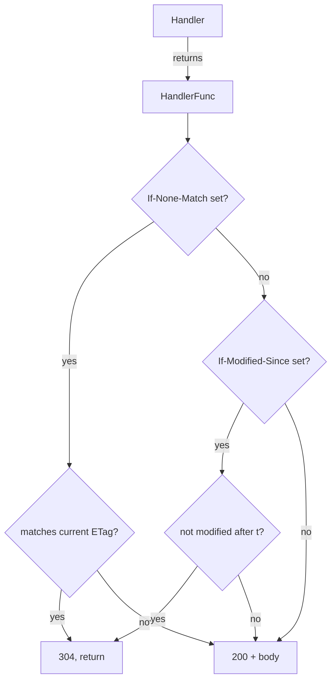

# HTTP Caching - Cache-Control, ETag, Conditional Requests - Go

> [!summary] TL;DR
> This code demonstrates the full caching contract from [[HTTP Caching - Cache-Control, ETag, Conditional Requests]] in a single `net/http` handler: it sets `Cache-Control`, `ETag`, `Last-Modified` and `Vary`, then answers `304 Not Modified` with no body whenever a client's `If-None-Match` (or, as a fallback, `If-Modified-Since`) proves nothing changed.

> [!info] How to read this note (pick your level)
> - 🟢 **New to this?** Read the "From zero" paragraph below, then "Before the code" and "What this code shows". Stop there.
> - 🟡 **Know the basics?** Add "Code", "Tests" and "Running it".
> - 🔴 **Interview / SDE-3 prep?** Add "Design decisions", "Pitfalls" and the exercises. Headings are tagged 🟢🟡🔴.

**From zero, in 60 seconds** 🟢

This file is the hands-on twin of the theory note. It builds one small Go web handler that does real HTTP caching: it stamps each response with a fingerprint (**ETag**) and a "trust this for 60 seconds" rule, and when a client asks "did it change?" it answers with a tiny empty `304` instead of resending the file. Read the code top to bottom — each block has a plain explanation right after it — and the tests at the end prove the saving really happens (14 bytes down to 0).

## Before the code 🟢

- **`net/http` handlers**: a function `func(w http.ResponseWriter, req *http.Request)` that reads request headers and writes a response.
- **Closures**: `Handler` returns a function that remembers `get` and `maxAge`, so each request sees the current resource.
- **Struct methods**: `Resource.etag()` is a method on a value type that hashes the body with `crypto/sha256`.
- **`httptest.NewServer`**: starts a real local HTTP server inside a test, so requests go over a real socket.
- **What to run**: `go vet ./...` then `go test -race ./...` from the module root.

## What this code shows 🟢

| Code piece | Theory concept | Theory section |
| --- | --- | --- |
| `Resource.etag()` | An ETag as a content hash | [[HTTP Caching - Cache-Control, ETag, Conditional Requests#ETag and conditional requests]] |
| `Handler`'s `Cache-Control` line | `max-age` + `must-revalidate` freshness | [[HTTP Caching - Cache-Control, ETag, Conditional Requests#Cache-Control directives]] |
| `If-None-Match` check, then `If-Modified-Since` fallback | ETag-over-timestamp precedence (RFC 9110 §13.1.3) | [[HTTP Caching - Cache-Control, ETag, Conditional Requests#ETag and conditional requests]] |
| `Vary` header | Separate cache entries per `Accept-Encoding` | [[HTTP Caching - Cache-Control, ETag, Conditional Requests#Vary]] |

## Setup 🟢

- Module layout: a single package, `cachedemo`, with the handler in one file and its tests in another.
- Go 1.24. Standard library only — no external dependencies.
- Run with `go vet ./...` then `go test -race ./...` from the module root.

## Code 🟡

### Step 1: the resource and its fingerprint

**In plain words:** we make a tiny "thing to serve" (some bytes plus a last-changed time) and teach it to produce its own fingerprint — like stamping a parcel with a code that changes whenever the contents change.

**Concept.** The theory note's ETag is "an opaque fingerprint of the response body." Here that fingerprint is a truncated SHA-256 hash of the resource's bytes, computed fresh on every request rather than stored and trusted from write time.

Hashing on read, instead of caching a pre-computed tag, guarantees the ETag can never drift out of sync with the actual bytes being served.

The alternative design (store the ETag alongside the data and trust it) is cheaper per request but risks the two falling out of sync if the data is ever mutated through a path that forgets to update the stored tag.

```go
package cachedemo

import (
	"crypto/sha256"
	"encoding/hex"
	"net/http"
	"time"
)

// Resource is a stand-in for a row fetched from a database: an ETag handler
// hashes its current bytes and compares that hash with what the client
// already has, instead of trusting a timestamp.
type Resource struct {
	Body         []byte
	LastModified time.Time
}

func (r Resource) etag() string {
	sum := sha256.Sum256(r.Body)
	return `"` + hex.EncodeToString(sum[:8]) + `"`
}
```

**How it works.**
1. `Resource` carries both a strong validator's raw material (`Body`, hashed on demand) and a weak validator's raw material (`LastModified`), so the handler can offer both and let the client's headers pick which one actually gets checked.
2. `sha256.Sum256` returns a fixed-size `[32]byte` array value, not a slice — `sum[:8]` takes just the first 8 bytes, which is plenty of entropy to detect accidental collisions for this demo without hex-encoding a full 32-byte hash into every response header.
3. The ETag is wrapped in literal double quotes (`` `"` + ... + `"` ``) because RFC 9110 defines the ETag header's value as a quoted string — a server that forgets the quotes produces a header real clients will fail to match correctly.

### Step 2: the handler

**In plain words:** this is the web server's answering desk. On every request it writes the caching labels first, then checks "does the caller already have this exact version?" — if yes, it sends a tiny "nothing changed" note and stops; if no, it sends the whole file.

**Concept.** This is [[HTTP Caching - Cache-Control, ETag, Conditional Requests#Cache-Control directives]] and [[HTTP Caching - Cache-Control, ETag, Conditional Requests#ETag and conditional requests]] combined into one request path: set the freshness and validator headers unconditionally, then check validators in priority order before deciding whether to write a body at all.

An alternative design would run validation first and only compute headers on the `200` path, but that duplicates the header-setting logic across two branches.
Setting headers once up front and branching only on the body keeps the 304 and 200 paths from drifting apart over time.

```go
// Handler serves Resource with Cache-Control, ETag, Last-Modified and
// conditional-request (304) support. maxAge controls how long a shared or
// private cache may reuse the response without revalidating.
func Handler(get func() Resource, maxAge time.Duration) http.HandlerFunc {
	return func(w http.ResponseWriter, req *http.Request) {
		res := get()
		etag := res.etag()

		w.Header().Set("Cache-Control", fmt.Sprintf("public, max-age=%d, must-revalidate", int(maxAge.Seconds())))
		w.Header().Set("ETag", etag)
		w.Header().Set("Last-Modified", res.LastModified.UTC().Format(http.TimeFormat))
		w.Header().Set("Vary", "Accept-Encoding")
```

**How it works.**
1. `Handler` takes a `get func() Resource` rather than a bare `Resource`, so each request can read the current state (e.g. from a database) instead of closing over one frozen value — important because the whole point of conditional requests is detecting *changes* between calls.
2. Headers are set before any branching, so both the `304` and `200` paths carry an identical, correct `Cache-Control`/`ETag`/`Last-Modified`/`Vary` set — a `304` must repeat these per RFC 9111.

The rest of the same function body checks the validators and decides whether to write a body:

```go
		// If-None-Match takes priority over If-Modified-Since per RFC 9110 §13.1.3:
		// strong validators are exact, timestamps only have second resolution.
		if inm := req.Header.Get("If-None-Match"); inm != "" {
			if inm == etag {
				w.WriteHeader(http.StatusNotModified)
				return
			}
		} else if ims := req.Header.Get("If-Modified-Since"); ims != "" {
			if t, err := http.ParseTime(ims); err == nil && !res.LastModified.After(t) {
				w.WriteHeader(http.StatusNotModified)
				return
			}
		}

		w.WriteHeader(http.StatusOK)
		w.Write(res.Body)
	}
}
```

**How it works.**
1. The `if/else if` on `If-None-Match` then `If-Modified-Since` is the precedence rule itself in code: the `else` branch is only reached when the client sent no `If-None-Match` at all, never when it sent one that simply didn't match.
2. `!res.LastModified.After(t)` reads as "the resource was not modified after the time the client already has" — the double negative is the standard idiom for "modified at or before `t`," which is the correct comparison for "unchanged since."
3. Returning immediately after `WriteHeader(http.StatusNotModified)` is what keeps the body empty; `net/http` does not strip a body written after a `304` automatically — the handler must simply not call `Write`.

> [!example]- Full file
> ```go
> package cachedemo
>
> import (
> 	"crypto/sha256"
> 	"encoding/hex"
> 	"fmt"
> 	"net/http"
> 	"time"
> )
>
> type Resource struct {
> 	Body         []byte
> 	LastModified time.Time
> }
>
> func (r Resource) etag() string {
> 	sum := sha256.Sum256(r.Body)
> 	return `"` + hex.EncodeToString(sum[:8]) + `"`
> }
>
> func Handler(get func() Resource, maxAge time.Duration) http.HandlerFunc {
> 	return func(w http.ResponseWriter, req *http.Request) {
> 		res := get()
> 		etag := res.etag()
>
> 		w.Header().Set("Cache-Control", fmt.Sprintf("public, max-age=%d, must-revalidate", int(maxAge.Seconds())))
> 		w.Header().Set("ETag", etag)
> 		w.Header().Set("Last-Modified", res.LastModified.UTC().Format(http.TimeFormat))
> 		w.Header().Set("Vary", "Accept-Encoding")
>
> 		if inm := req.Header.Get("If-None-Match"); inm != "" {
> 			if inm == etag {
> 				w.WriteHeader(http.StatusNotModified)
> 				return
> 			}
> 		} else if ims := req.Header.Get("If-Modified-Since"); ims != "" {
> 			if t, err := http.ParseTime(ims); err == nil && !res.LastModified.After(t) {
> 				w.WriteHeader(http.StatusNotModified)
> 				return
> 			}
> 		}
>
> 		w.WriteHeader(http.StatusOK)
> 		w.Write(res.Body)
> 	}
> }
> ```



## Tests 🟡

### `TestConditionalRequestReturns304`

**In plain words:** this test plays the role of a browser visiting twice — first with empty hands (gets the full file), then holding the fingerprint (gets the tiny "unchanged" reply), then holding a wrong fingerprint (gets the full file again).

| Property it proves | Why it matters |
| --- | --- |
| A cold request gets a full `200` with `ETag` and the exact `Cache-Control` string | Confirms the handler sets all required headers on the first response, before any validator exists to compare |
| A repeat request with the stored `If-None-Match` gets `304` with a **zero-length** body | This is the entire saving conditional requests exist for — if the body is non-empty here, caching gained nothing |
| A request with a stale (non-matching) `If-None-Match` falls through to `200` | Proves the comparison is a real equality check, not something that always returns `304` |

| Input | Expected output |
| --- | --- |
| First `GET`, no validators | `200`, `ETag` present, `Cache-Control: public, max-age=60, must-revalidate` |
| `GET` with matching `If-None-Match` | `304`, 0-byte body |
| `GET` with `If-None-Match: "stale-value"` | `200` |

A failure here would mean either the server stopped sending required cache headers (breaking every downstream cache's ability to reason about this response), or — more seriously — that a matching ETag is no longer short-circuiting to `304`, silently turning every cache hit back into a full re-download.

The test imports and server setup:

```go
package cachedemo

import (
	"io"
	"net/http"
	"net/http/httptest"
	"testing"
	"time"
)

func TestConditionalRequestReturns304(t *testing.T) {
	res := Resource{Body: []byte(`{"price": 199}`), LastModified: time.Date(2026, 11, 1, 10, 0, 0, 0, time.UTC)}
	srv := httptest.NewServer(Handler(func() Resource { return res }, 60*time.Second))
	defer srv.Close()
	client := srv.Client()
```

The first assertion block checks the cold, first request:

```go
	resp1, err := client.Get(srv.URL)
	if err != nil {
		t.Fatalf("get: %v", err)
	}
	body1, _ := io.ReadAll(resp1.Body)
	resp1.Body.Close()
	if resp1.StatusCode != http.StatusOK {
		t.Fatalf("first request: got %d, want 200", resp1.StatusCode)
	}
	etag := resp1.Header.Get("ETag")
	if etag == "" {
		t.Fatal("first response carries no ETag")
	}
	if got := resp1.Header.Get("Cache-Control"); got != "public, max-age=60, must-revalidate" {
		t.Fatalf("Cache-Control = %q", got)
	}
```

The second part replays the stored ETag, then replays a deliberately wrong one, closing out the same test function:

```go
	req, _ := http.NewRequest(http.MethodGet, srv.URL, nil)
	req.Header.Set("If-None-Match", etag)
	resp2, err := client.Do(req)
	if err != nil {
		t.Fatalf("conditional get: %v", err)
	}
	body2, _ := io.ReadAll(resp2.Body)
	resp2.Body.Close()
	if resp2.StatusCode != http.StatusNotModified {
		t.Fatalf("conditional request: got %d, want 304", resp2.StatusCode)
	}
	if len(body2) != 0 {
		t.Fatalf("304 response carried a body: %q", body2)
	}

	req2, _ := http.NewRequest(http.MethodGet, srv.URL, nil)
	req2.Header.Set("If-None-Match", `"stale-value"`)
	resp3, err := client.Do(req2)
	if err != nil {
		t.Fatalf("stale conditional get: %v", err)
	}
	resp3.Body.Close()
	if resp3.StatusCode != http.StatusOK {
		t.Fatalf("stale If-None-Match: got %d, want 200", resp3.StatusCode)
	}

	t.Logf("full body %d bytes, 304 body %d bytes, ETag %s", len(body1), len(body2), etag)
}
```

### `TestLastModifiedFallback`

**In plain words:** some older clients don't know about fingerprints and only ask "changed since this date?" — this test checks that path still gets the tiny "unchanged" reply.

| Property it proves | Why it matters |
| --- | --- |
| A request with only `If-Modified-Since` (no `If-None-Match`) still gets `304` when unchanged | Confirms the fallback path works on its own, for clients/proxies that only understand timestamps |

| Input | Expected output |
| --- | --- |
| `GET` with `If-Modified-Since` equal to the resource's `LastModified` | `304` |

A failure here would mean the fallback branch is unreachable or broken — clients or intermediaries that only send `If-Modified-Since` (common for older caches) would stop getting `304`s entirely, even though nothing changed.

```go
func TestLastModifiedFallback(t *testing.T) {
	mod := time.Date(2026, 11, 1, 10, 0, 0, 0, time.UTC)
	res := Resource{Body: []byte("v1"), LastModified: mod}
	srv := httptest.NewServer(Handler(func() Resource { return res }, 30*time.Second))
	defer srv.Close()
	client := srv.Client()

	req, _ := http.NewRequest(http.MethodGet, srv.URL, nil)
	req.Header.Set("If-Modified-Since", mod.UTC().Format(http.TimeFormat))
	resp, err := client.Do(req)
	if err != nil {
		t.Fatalf("get: %v", err)
	}
	defer resp.Body.Close()
	if resp.StatusCode != http.StatusNotModified {
		t.Fatalf("got %d, want 304 via If-Modified-Since", resp.StatusCode)
	}
}
```

**Measured (Go 1.24.4, darwin/arm64, scratch module, 2026-11-09):** `go vet ./...` clean; `go test -race ./...` → `ok roll10/cachedemo`, both tests pass. The full response body was 14 bytes; the `304` response body was 0 bytes — the entire saving of a conditional request.

## Design decisions 🔴

| Choice | Alternative | Trade-off |
| --- | --- | --- |
| Hash the body on every request | Pre-compute and store the ETag alongside the data | Hashing on read costs CPU per request but can never drift out of sync with the actual bytes; a stored tag is free to read but risks staleness if an update path forgets to refresh it |
| Truncate the SHA-256 hash to 8 bytes | Hex-encode the full 32-byte hash | Shorter headers on every response, at a (here, acceptable) higher theoretical collision chance than a full hash |
| Check `If-None-Match` before `If-Modified-Since` with `if/else if` | Check both independently and OR the results | Directly encodes the RFC 9110 §13.1.3 precedence rule instead of accidentally treating the two validators as equally authoritative |
| Take `get func() Resource` instead of a bare `Resource` | Close over one fixed `Resource` value | Lets each request observe the resource's current state, which is required for conditional requests to ever detect a real change |

## Running it 🟡

```text
$ go test -race -v ./cachedemo/...
=== RUN   TestConditionalRequestReturns304
    cache_test.go:...: full body 14 bytes, 304 body 0 bytes, ETag "0f26d0f1409cfc3c"
--- PASS: TestConditionalRequestReturns304 (0.00s)
=== RUN   TestLastModifiedFallback
--- PASS: TestLastModifiedFallback (0.00s)
PASS
ok      roll10/cachedemo       1.471s
```

Reading it line by line: the first test's log line confirms the measurable claim this whole note makes — a `200` cost 14 bytes of body, the matching `304` cost 0.

Both `PASS` lines confirm the handler branches correctly on both validator types, and `-race` passing confirms no data race exists even though `Handler` closes over a `get` function that could, in a real server, read from a concurrently-updated store.

## Pitfalls in the code 🔴

- `Resource.etag()` hashes `Body` only — if a real implementation hashed `Body` plus something that changes incidentally (a request-scoped timestamp, a random nonce), the ETag would change on every call and `304` would never fire again.
- The `Cache-Control` value is built with `fmt.Sprintf` on every request; for a hot path, precomputing it once per `maxAge` value (there are usually few distinct values) avoids repeated string formatting.
- `If-Modified-Since` parsing uses `http.ParseTime`, which accepts several legacy date formats for compatibility — a hand-rolled parser that only accepts one format will silently break interoperability with older clients.

## Exercises 🔴

1. Change `sum[:8]` to `sum[:4]` and predict what happens to `TestConditionalRequestReturns304` (it still passes — the test does not check ETag length, only that one is present and that an exact match round-trips to `304`). Then add an assertion on the ETag's length to see the test actually constrain it.
2. Remove the `else` in `} else if ims := ...` so both validators are always checked independently. Predict whether `TestConditionalRequestReturns304`'s third case (a stale `If-None-Match`) still correctly returns `200` — trace through why the precedence rule from the theory note stops mattering once both branches can independently trigger a `304`.
3. Add a new field `Resource.Version int` and fold it into the ETag hash. Write a short test that changes only `Version` (not `Body`) and confirms a previously-stored `If-None-Match` now gets a `200` — this is the "what if the content changed in a way the body hash alone wouldn't catch" scenario.

## Links

- **Theory:** [[HTTP Caching - Cache-Control, ETag, Conditional Requests]]
- **Related:** [[Caching Fundamentals]], [[Cache Invalidation, TTL and Consistency]], [[CDN and Edge]]
