# HTTP Caching - Cache-Control, ETag, Conditional Requests

> [!summary] TL;DR
> HTTP caching lets a browser, proxy or CDN reuse a previous response instead of asking the origin server again. `Cache-Control` tells a cache how long a response is fresh and who may store it; once it goes stale, a conditional request (`If-None-Match` or `If-Modified-Since`) lets the server answer "nothing changed" with an empty `304` instead of resending the whole body.

> [!abstract] Core idea
> - **Freshness** (`max-age`) decides whether a cache can answer from its own copy with zero network round trips at all.
> - **Validation** (`ETag`/`If-None-Match`, `Last-Modified`/`If-Modified-Since`) decides, once a copy is stale, whether the server can say "unchanged" (`304`, no body) instead of resending everything.
> - `no-cache` means "revalidate every time"; `no-store` means "never keep a copy anywhere" — they are opposites of two different axes, not a slider.
> - Classic mistake: assuming a `200` on every request means caching isn't working. A `304` is caching working correctly — the headers just moved, not the body.

### Whiteboard version

**In plain words:** this picture shows the whole trick in two visits — the first visit downloads the file, the second visit just asks "did it change?" and gets a tiny "no" back.

One static JSON response, requested twice:

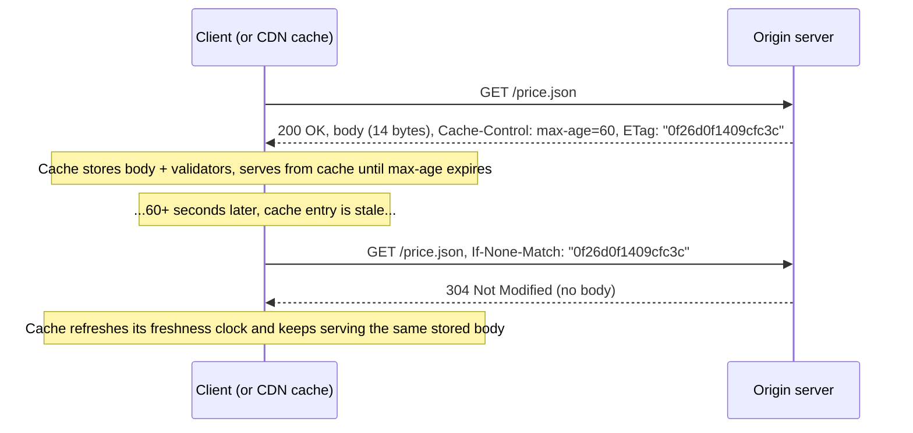

The second response carries no body at all — just a status line and a couple of headers — because the server can prove nothing changed.

## Start here: the basics 🟢

> [!info] How to read this note (pick your level)
> - 🟢 **New to this?** Read "From zero" below, then sections 1, 2 and the cheat sheet (10). Stop there, that is a full first pass.
> - 🟡 **Know the basics?** Add section 3 (how it works), 4 (worked example), 5 and 6.
> - 🔴 **Interview / SDE-3 prep?** Add 7, 8 and 9. Headings are tagged 🟢🟡🔴 so you always know where you are.

> [!note] Before this note
> - [[HTTP Fundamentals - Methods, Status Codes, Headers, Cookies]]: a request gets a response with a status code (200, 304, ...), headers, and usually a body.
> - [[HTTP-1.1 vs HTTP-2 vs HTTP-3]]: each request costs at least one trip to the server and back, which is exactly what caching tries to skip.

**From zero, in 60 seconds** 🟢

You visit the same website every day. The logo never changes. Downloading it again every day is a waste.

So your browser keeps a saved copy. That saved copy is called a **cache**.

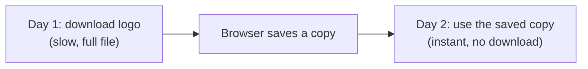

But what if the logo *did* change? The server solves this with two tools. It puts a "best before" time on the copy (**TTL**, like `max-age=60` meaning "trust this for 60 seconds"). And it gives the copy a short fingerprint (**ETag**). After the time runs out, the browser just asks "is my fingerprint still current?" — if yes, the server replies with a tiny "nothing changed" message instead of the whole file.

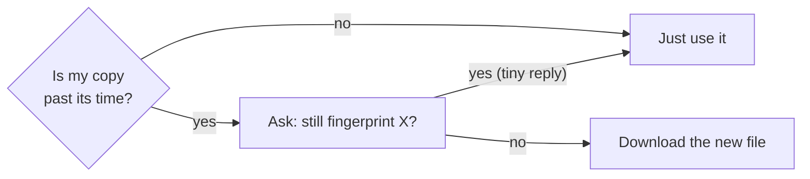

That is all of HTTP caching. The rest of this note is just these 3 questions:
1. How long may a copy be trusted without asking? (freshness)
2. Once that time is up, how do you check cheaply whether it changed? (validation)
3. Who is allowed to keep a copy at all? (browser only, or shared servers too)

**The problem in one story.**
You open a shopping site every morning.
The logo, the fonts and the page layout are the same as yesterday.
If your browser downloaded all of it again each time, pages would be slow and the site's servers would do the same work millions of times.
HTTP caching lets your browser (and servers in between) keep a copy and reuse it safely.

**Words you need first**

| Word | Plain meaning | Tiny example |
| --- | --- | --- |
| Request / response | The question a browser sends and the answer a server sends back | `GET /price.json` → `200 OK` + body |
| Header | A labelled line of extra info attached to a request or response | `Cache-Control: max-age=60` |
| Body | The actual content of a response | The 14 bytes `{"price": 199}` |
| Status code | A number saying how the request went | `200` = OK, `304` = Not Modified |
| Origin server | The real server that owns the data | `api.shop.com` behind the CDN |
| Cache | A stored copy of a response, reused later | Your browser's copy of the logo |
| CDN | A network of servers near users that keep cached copies | An edge server in Mumbai serving a US site |
| Fingerprint (hash) | A short string that changes whenever the content changes | `"0f26d0f1409cfc3c"` |
| Fresh / stale | Copy is still inside its allowed time / its time has run out | `max-age=60`: fresh for 60 s, stale after |
| ETag | The server's fingerprint for one version of a response | `ETag: "0f26d0f1409cfc3c"` |
| Conditional request | A request that says "only send the body if it changed" | `If-None-Match: "0f26d0f1409cfc3c"` |
| 304 Not Modified | The server's tiny "nothing changed, keep your copy" reply, with no body | Sent when the ETag still matches |
| Shared cache | One cache used by many people, unlike your own browser's | A CDN or an office proxy |

**Picture it**

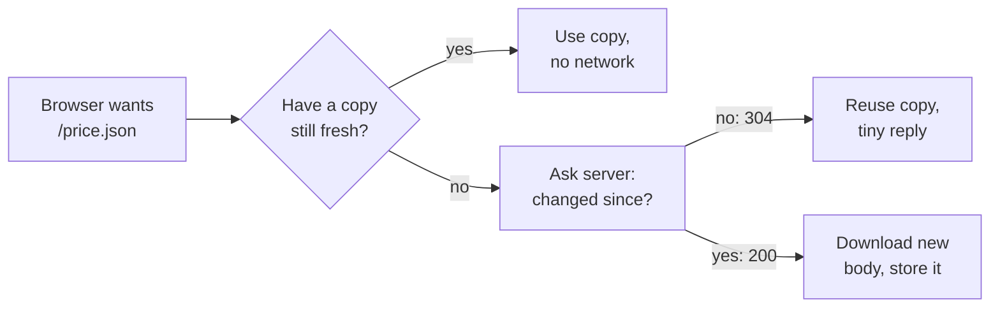

**Analogy.** A cached response is like milk in your fridge with a "best before" date.
Before the date, you just drink it. After the date, you sniff it: if it is fine, you keep it (`304`); if not, you buy a new carton (`200`).
Where it breaks: milk can go bad before its date, but an HTTP copy is treated as correct until its time runs out, even if the server's data already changed.

**How the rest of this note builds up**

- First, why caching exists (section 1) and the two-question mental model: freshness, then validation (section 2).
- Then how it works: `Cache-Control` directives, ETags, conditional requests and `Vary` (section 3), with a worked example (section 4).
- Next, variants, trade-offs and production usage (sections 5-7).
- Finally, the SDE-3 deep dive on strong vs weak validators and request collapsing (section 8), plus interview questions.

> [!tip] Remember
> Fresh copy: use it with no network call. Stale copy: ask cheaply whether it changed.

## 1. Why it exists 🟢

Imagine a product page whose price rarely changes, but a thousand people load that page every minute. Without caching, every single one of those thousand loads re-fetches the same CSS, the same images, the same font, and the same price JSON from the origin server — even when nothing has changed since the visit a few seconds earlier.

That is wasted bandwidth (the amount of data the network must carry), wasted origin CPU and database load, and real latency the user feels on every navigation.

**HTTP caching** is the general name for the set of rules (defined mainly in RFC 9111, the official HTTP caching spec) that let a client, proxy or CDN store a copy of a response and reuse it later instead of asking the origin again. It solves the problem with two separate mechanisms that work at different times:

- **Freshness** avoids the network round trip entirely, for a window of time the server names up front (`max-age`).
- **Validation** avoids re-sending the body once that window has passed, by letting the server answer "still the same" cheaply.

A concrete example: an e-commerce product page's price JSON is 14 bytes.

- Served fresh from a CDN edge cache (`max-age=60`), 60 seconds of traffic costs the origin zero requests.
- After that, a conditional request with `If-None-Match` costs the origin a cheap hash comparison and a `304` with no body — versus re-sending the full response (and in a real page, the full HTML/CSS/JS bundle, usually many kilobytes, not 14 bytes) on every single request.

> [!tip] Remember
> Caching exists to avoid paying for the same answer twice: once by skipping the trip entirely, and once by skipping the resend when the trip is unavoidable.

### Real-life example: the Netflix home screen 🟢

When you open Netflix or Hotstar, the app loads hundreds of poster images.
A poster image rarely changes, so an app like this can serve it with a long `max-age` and a versioned file name, and your phone can reuse it for days.
The "Continue watching" row is different: it is yours alone and changes all the time, so it should be `private` and checked again on every open.
This is one reason the second launch of the app feels much faster than the first: most of the screen comes from the phone's own cache.

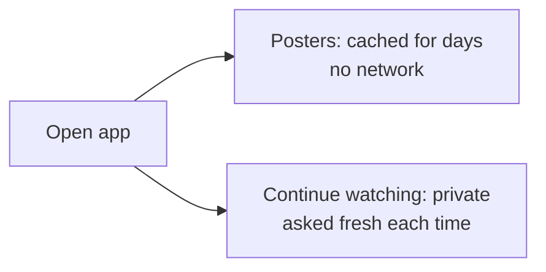

## 2. Mental model 🟢

**In plain words:** think of a cache as a assistant sitting between you and a busy office. The assistant asks two questions, in order, every time you want something: "do I already have a recent-enough copy?" and, if not, "has it actually changed since I last checked?"

1. **"Do I even need to ask the server?"** — governed by `Cache-Control`'s `max-age`/`s-maxage`. If the stored copy is still fresh, the cache answers from its own copy, no network call at all.
2. **"Has it actually changed since I last checked?"** — governed by validators (`ETag`, `Last-Modified`). Once the copy is stale, the cache *must* ask, but it asks a cheap question ("is this fingerprint still current?") instead of re-downloading everything.

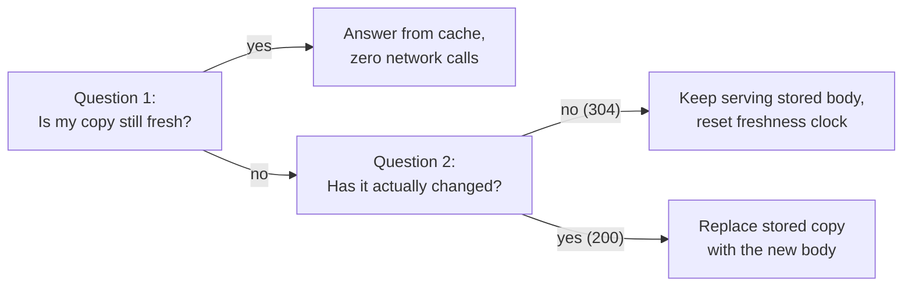

> [!warning] Common mistake
> `no-cache` and `no-store` sound like synonyms but answer different questions entirely. `no-cache` says "you may keep a copy, but always check with me first" — it skips straight to question 2, forever. `no-store` says "don't keep a copy at all" — neither question applies, because there is nothing to check.

> [!tip] Remember
> A cache always asks "can I skip the trip?" before it ever asks "can I skip the resend?" — freshness and validation are two separate gates, not one setting.

## Common beginner mistakes 🟢

- **Thinking `no-cache` means "do not cache"** → it means "store it, but check with the server before every use" → use `no-store` when nothing may be kept.
- **Worrying that 304s mean caching is broken** → a 304 is caching working: the body was not sent again → look for repeat 200s on unchanged data instead.
- **Putting a timestamp inside the content you hash for the ETag** → the ETag changes on every request, so you never get a 304 → hash only the real content.
- **Marking a logged-in page `public`** → a CDN may show one user's page to another → mark it `private` (or `no-store`).
- **Using `immutable` on a URL whose content can change (like `/app.js`)** → users keep the old file even on reload → only use it on versioned names like `app.3f8a21.js`.

## 3. How it works 🟡

> 🟢 → 🟡 **You now know** the two questions every cache asks: "is my copy still fresh?" and, if not, "has it changed?". **Next we open the box**: the exact header words that answer each question, how the fingerprint check works, and how one URL can need several saved copies. Each subsection starts with a plain step-by-step walk; the full detail follows it.

### Cache-Control directives

**In plain words:** `Cache-Control` is a response header the origin sends that tells every cache along the way — the browser, a corporate proxy, a CDN edge — how long it may treat this exact response as current, and who is allowed to keep a copy at all.

**Step by step:**
1. The server answers `/price.json` with `Cache-Control: public, max-age=60`.
2. `public`: any cache may keep it, including a CDN. `max-age=60`: it is fresh for 60 seconds.
3. You reload at 30 s: the browser uses its copy, no network at all.
4. You reload at 70 s: the copy is stale, so the browser must ask the server (with its ETag, next subsection).
5. With `stale-while-revalidate=30` added, the browser would show the old copy at once and check in the background instead.

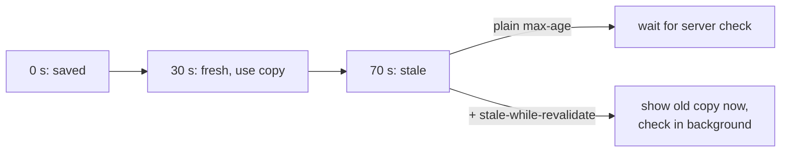

**Picture it:**

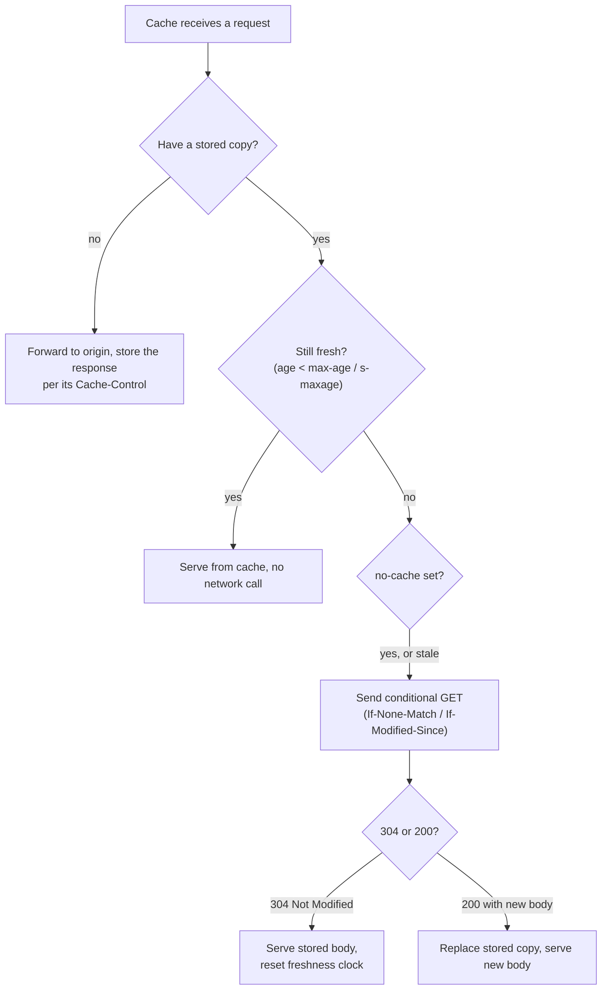

**Example:** a response arrives with `Cache-Control: public, max-age=60`. A cache that first sees it at `t=0` can serve it from memory, with zero origin contact, for every request up to `t=60`. At `t=61` the copy is stale and the cache must at least ask.

Here is what each directive actually promises:

| Directive | What it means | Analogy |
| --- | --- | --- |
| `max-age=N` | Fresh for `N` seconds from the response's own `Date`, for any cache (browser or shared) | A "best before" date on a food label |
| `s-maxage=N` | Overrides `max-age`, but only for *shared* caches (CDNs, corporate proxies) | A separate, longer shelf-life rule that applies only to the warehouse, not your home fridge |
| `no-cache` | May store the response, but **must revalidate with the origin before reusing it**, every time | A librarian who keeps a copy on the desk but always phones ahead to check nothing changed before lending it |
| `no-store` | Must not store any part of the request or response, anywhere | A message that self-destructs: nothing is ever written down |
| `private` | Only a single user's own browser cache may store this; shared caches must not | A locker that only opens with your own key |
| `public` | Explicitly allows shared caches to store it even if the request had authentication | A notice board anyone passing by may read |
| `immutable` | This exact URL will never change its content, so skip revalidation entirely even on a user reload | A sealed, numbered edition that is never reprinted under the same number |
| `stale-while-revalidate=N` | Serve the stale copy immediately while revalidating in the background for up to `N` seconds past expiry | Handing over yesterday's newspaper while someone runs to fetch today's |
| `stale-if-error=N` | Serve the stale copy if the origin errors or is unreachable, for up to `N` seconds | Keeping yesterday's weather forecast handy in case today's station is down |

`immutable` is meant for content-hashed filenames like `app.3f8a21.js` — a URL whose content can never legitimately change under that exact name — never for a URL that gets reused with different content over time.

> [!warning] Common mistake
> Thinking `no-cache` forbids caching. It does the opposite: it allows storing the response, it just forces a cheap revalidation check before every reuse. The directive that actually forbids storing anything is `no-store`.

> [!tip] Remember
> `max-age`/`s-maxage` answer "how long," `no-cache`/`no-store` answer "under what conditions at all," and `public`/`private` answer "who."

### ETag and conditional requests

**In plain words:** once a cached copy goes stale, the cache does not have to re-download the whole thing blind. It can send back a short fingerprint of what it already has and ask the server "is this still current?"

**Step by step:**
1. First visit: server sends the price JSON with `ETag: "0f26d0f1409cfc3c"`. The browser keeps both.
2. 60 seconds pass. The copy is stale.
3. The browser sends `GET /price.json` with `If-None-Match: "0f26d0f1409cfc3c"`.
4. The server works out the current fingerprint. Same? It replies `304`, no body. The browser keeps using its copy.
5. Price changed? The fingerprint differs, so the server sends `200` with the new body and a new ETag.

An **ETag** is that fingerprint: an opaque string (the client never reads meaning into it, only compares it) the server chooses (a content hash, a version number, a database row's `updated_at` serialized, meaning written out as text). `Last-Modified` is the same idea using a timestamp instead of a fingerprint.

**Picture it:**

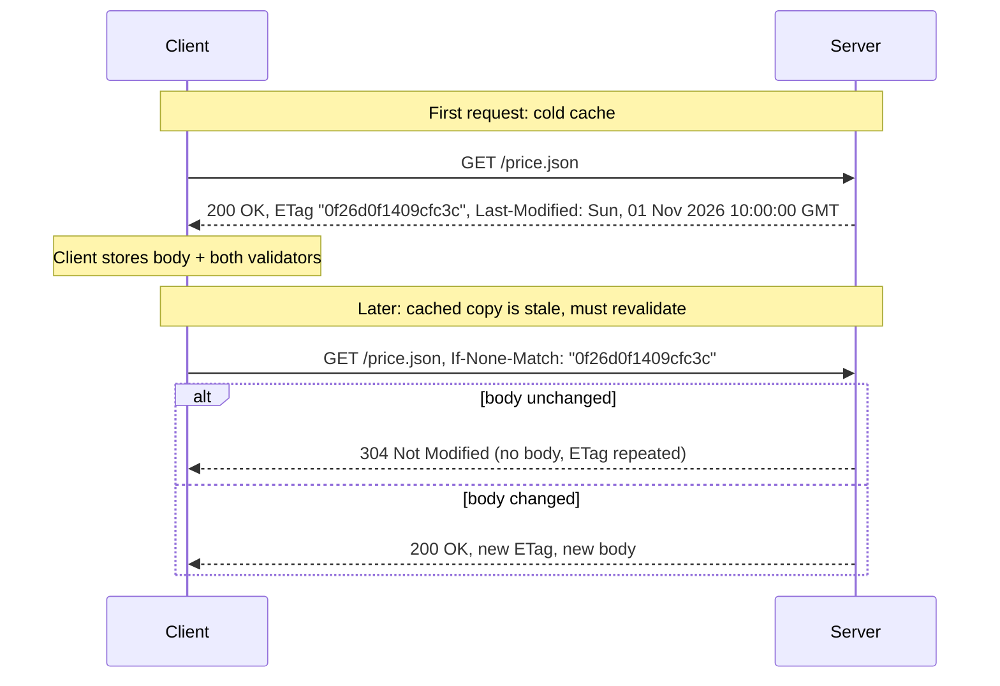

**Example:** a price JSON hashes to `"0f26d0f1409cfc3c"`. A client that already stored that exact tag sends `If-None-Match: "0f26d0f1409cfc3c"` on its next request. If the price has not changed, the hash is identical and the server can prove "nothing changed" without even reading the body it would otherwise have sent — it just compares two short strings.

**`If-None-Match` takes priority over `If-Modified-Since`** (RFC 9110 §13.1.3) whenever both are present: ETags are exact (byte-for-byte), while `Last-Modified` only has one-second resolution and can't detect a change that round-trips back to the same content within the same second. A server should always prefer checking `If-None-Match` first if it sent an `ETag`.

> [!warning] Common mistake
> Embedding something that changes on every response — a timestamp, a per-process random value — inside the bytes an ETag hashes. That produces a new ETag on every single request even when nothing meaningful changed, which silently defeats the whole point of conditional requests: the server will never again answer `304`.

> [!tip] Remember
> An ETag is exact but costs a hash; `Last-Modified` is cheap but only as precise as one second. When both are present, exactness wins.

### Vary

**In plain words:** some responses are not one single thing — the same URL might return gzip-compressed bytes to one client and plain bytes to another, depending on what the client asked for. `Vary` tells a shared cache which request header splits those into separate cache entries.

**Step by step:**
1. Chrome asks for `/app.js` with `Accept-Encoding: gzip` (it can unpack compressed files).
2. An old tool asks for the same URL with no compression support.
3. The server answers with `Vary: Accept-Encoding`, so the CDN keeps two copies: one compressed, one plain.
4. Each later request gets the copy that matches its own `Accept-Encoding`. Only a few values exist, so caching still works well.

**Example:** `Vary: Accept-Encoding` tells a CDN "store a separate copy per distinct value of the client's `Accept-Encoding` header" — a gzip-compressed response and an uncompressed one are not interchangeable, even for the identical URL, so the cache must keep both.

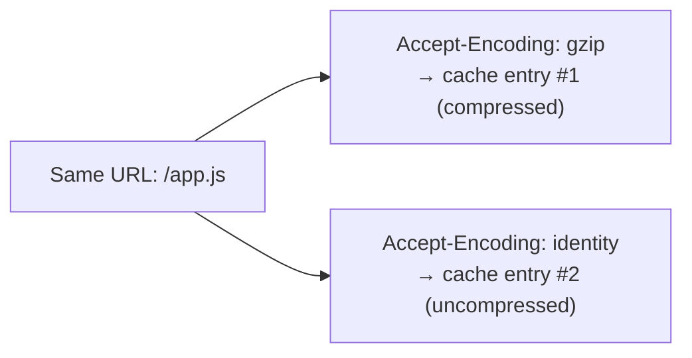

> [!warning] Common mistake
> `Vary: Cookie` looks harmless but is a well-known anti-pattern (a common habit that looks fine but causes harm): since cookies are often unique per user, it effectively creates one cache entry per visitor — a near-infinite number of possible cache keys — while still being technically "correct." The practical effect is that caching stops helping at all for that response.

> [!tip] Remember
> `Vary` is a correctness tool, not a performance one by itself — it only pays off when the header it names actually has few distinct values in practice.

## 4. Worked example 🟡

A handler computes a hash of the current body as its ETag, and answers `304` whenever the client already has that exact hash:

```go
w.Header().Set("Cache-Control", "public, max-age=60, must-revalidate")
w.Header().Set("ETag", etag)
if r.Header.Get("If-None-Match") == etag {
    w.WriteHeader(http.StatusNotModified)
    return
}
w.Write(body)
```

Trace it step by step for one resource, `price.json`, over two requests:

1. **Cold request.** No `If-None-Match` header arrives (the client has nothing stored yet). The handler computes the ETag, sets `Cache-Control`, `ETag`, `Last-Modified` and `Vary`, and writes a `200` with the full 14-byte body.
2. **Client stores it.** The client remembers the body plus the `ETag` it received.
3. **60+ seconds pass.** The cached copy's `max-age=60` window has expired; the client's cache now considers it stale and must revalidate before reusing it.
4. **Conditional request.** The client sends `GET` again, this time with `If-None-Match: "0f26d0f1409cfc3c"`.
5. **Server compares.** The handler recomputes the current ETag and compares it with the incoming `If-None-Match`. They match, so nothing changed.
6. **`304` with no body.** The handler writes `304 Not Modified` and returns immediately — the 14-byte body is never written a second time.

Runnable Go version: [[HTTP Caching - Cache-Control, ETag, Conditional Requests - Go]].

## 5. Variants and comparison 🟡

| Mechanism | Answers | Saves | Cost of getting it wrong |
| --- | --- | --- | --- |
| `max-age` / `s-maxage` | "Can I skip asking entirely?" | Full round trip | Stale data served past intended freshness if too long; unnecessary origin load if too short or absent |
| `ETag` + `If-None-Match` | "Did it change?" (exact) | Response body on a `304` | A weak/unstable ETag (e.g. includes a timestamp that changes without content changing) defeats caching by never matching |
| `Last-Modified` + `If-Modified-Since` | "Did it change?" (one-second resolution) | Response body on a `304` | Can't detect two changes within the same second; some servers get the date formatting wrong and break the comparison |
| `stale-while-revalidate` | "Can I answer instantly and check in the background?" | User-facing latency on revalidation | Serves data up to `N` seconds out of date by design — know that trade-off is intentional |
| `Vary` | "Which request header splits the cache key?" | Nothing by itself — it's a correctness constraint | `Vary: Cookie` (or any high-cardinality header, one with many different values) silently defeats shared caching |

### HTTP caching vs the things people mix it up with 🟡

| Thing | Who keeps the copy | Who controls it | Note |
| --- | --- | --- | --- |
| HTTP caching (this note) | Browser, proxy, CDN | Response headers from the server | Works for any HTTP client automatically |
| App cache (Redis, in-memory) | Your own servers | Your code | Saves database work; the client never sees it |
| CDN | Servers near users | Headers plus CDN settings and purges | One kind of shared HTTP cache |
| Service worker cache | The browser, under your page's own script | Your JavaScript | Can ignore HTTP rules; used for offline apps |

## 6. Trade-offs and when not to use 🟡

**In plain words:** caching is always the same deal — you accept slightly old data in exchange for speed. The only question is how old is acceptable for *this* data.

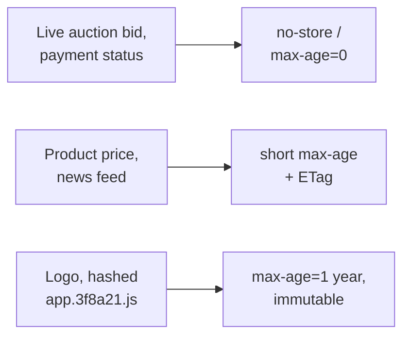

- Caching trades freshness for speed and origin load; anything that must reflect the absolute latest state on every read (a live auction bid count, a real-time stock ticker) should set `no-store` or a very short `max-age`, not rely on revalidation alone.
- ETags cost a hash computation per response; for very large or expensive-to-hash bodies, `Last-Modified` (if you already track an update timestamp) is cheaper, at the cost of coarser precision.
- `stale-while-revalidate` and `stale-if-error` intentionally serve data that is known to be out of date; never use them for anything where a stale read is a correctness bug, not just a UX nuisance (an inventory count close to zero, a payment status).
- Application-level caching (Redis, in-memory caches) and CDN edge-caching policy are different layers with different lifetimes and invalidation tools — see [[Caching Fundamentals]] and [[CDN and Edge]]; this note covers only the HTTP-level contract between a client/cache and the origin.

## 7. In production 🔴

> 🟡 → 🔴 **You now know** the directives, ETags, conditional requests and `Vary`. **Next comes the advanced part**: how real pipelines set these headers, the failures that leak or stale data, and finer points like strong vs weak ETags and `must-revalidate`.

- **Real systems:** browsers, forward and reverse proxies, and CDNs (see [[CDN and Edge]]) all implement this same `Cache-Control`/validator contract; static-asset pipelines commonly pair content-hashed filenames (`app.3f8a21.js`) with `Cache-Control: public, max-age=31536000, immutable` so a changed file gets a new URL instead of ever needing revalidation, while HTML itself usually ships `no-cache` so navigation always revalidates.
- **Failure modes → fixes:**
  - **Serving stale data silently** because `max-age` was set far too long for data that actually changes often → shorten `max-age` or switch to `no-cache` with strong ETags so every request still revalidates cheaply.
  - **Caching a per-user response at a shared cache** (a CDN or corporate proxy serving user A's account page to user B) → mark it `private`, and double-check anything containing a `Set-Cookie` or auth-scoped data is never marked `public`.
  - **`Vary: Cookie` silently disabling shared caching** → split the cacheable, cookie-independent parts of a response from the personalized parts, or drop the dependency on cookies for the cacheable path entirely.
  - **ETag changes on every request even though content didn't** (a timestamp embedded in the hashed bytes, or per-process randomness) → hash only the stable, meaningful content fields, not metadata that changes incidentally.
- **What to monitor:** cache hit ratio (share of requests served without reaching origin) and `304` ratio (requests that reached origin but needed no body resent) — both reduce origin load, but a persistently low `304` ratio on content that should be stable usually means an unstable ETag.

## 8. Deep dive 🔴

- **Strong vs weak validators.** An ETag without a `W/` prefix is a *strong* validator: byte-identical content guaranteed. `W/"..."` marks a *weak* validator: semantically equivalent but not necessarily byte-identical (e.g. same JSON data re-serialized with different key order).
  Range requests (`Range:`/`If-Range:`, asking for only part of a file, such as resuming a partial download) require a strong validator, because combining two differently-ordered byte ranges from a "weakly equivalent" response would be silently wrong.
- **`must-revalidate` vs plain staleness.** Without `must-revalidate`, RFC 9111 permits a cache to serve a *stale* response anyway under certain conditions (e.g. the origin is unreachable) unless told not to. `must-revalidate` forbids serving a stale copy without successfully checking with the origin first — the right choice whenever stale-but-available is worse than failing the request.
- **Why `304` responses still carry headers.** A `304` must repeat any headers that would have been sent with the full `200` and that the cache needs to update its stored copy's metadata (a fresh `Cache-Control`, a possibly-changed `ETag` if the server supports multiple valid representations) — the body is what's elided, not the header contract.
- **Request collapsing** (mentioned here because it interacts directly with conditional requests): when many concurrent requests for the same stale URL arrive at a cache simultaneously, a well-built cache sends only *one* revalidation request upstream and lets the rest wait on its result, instead of a thundering herd (a crowd of identical requests all arriving at once) of identical revalidations hitting the origin at once.
  This is a CDN/reverse-proxy implementation detail, not an HTTP header — see [[CDN and Edge]].

## 9. Interview questions 🔴

> [!question]- What's the actual difference between `no-cache` and `no-store`?
> `no-cache` allows storing the response but requires revalidating with the origin before reusing it on every single use — the cache still does its job of avoiding a full re-download on a `304`. `no-store` forbids keeping any copy of the response at all, anywhere, so there is nothing to revalidate; use it for genuinely sensitive one-time content.

> [!question]- Why does `If-None-Match` win over `If-Modified-Since` when a client sends both?
> ETags are exact, arbitrary fingerprints the server controls, so they can detect any change, including one that happens to round-trip back to identical content within the same second. `Last-Modified` only has one-second resolution. RFC 9110 requires a server to prefer `If-None-Match` when it understands the ETag, specifically because it's the more precise check.

> [!question]- Trap: if every request to an endpoint returns `200`, is HTTP caching broken?
> Not necessarily — if the client never had a fresh copy to validate (first visit, cache evicted the entry, or `max-age` was set to 0 with no validators), `200` with a full body is correct.
>
> The question to check is whether `304`s show up *when a validator the client already holds is still current* — if a repeat request with a correct `If-None-Match` still gets `200`, that's the actual bug (likely an unstable ETag).

> [!question]- When would you use `stale-while-revalidate` instead of just shortening `max-age`?
> When the user-facing request must never wait on a round trip to the origin, but the data can tolerate being a little stale. `stale-while-revalidate=30` serves instantly from the stale copy while kicking off a background revalidation.
>
> So the *next* request (not this one) gets the fresh data — a shorter `max-age` alone would make some requests pay the full round-trip latency instead.

> [!question]- Why is `Vary: Cookie` almost always a mistake on a cacheable response?
> `Vary` tells a shared cache it needs a separate stored entry per distinct value of the named header. Cookies are typically unique per user (session IDs, CSRF tokens, random values that guard forms against forged submissions), so `Vary: Cookie` effectively creates one cache entry per visitor — technically correct, but it means the shared cache almost never gets a hit.
>
> If the response really differs per user, mark it `private` instead and don't rely on a shared cache for it at all.

> [!question]- A CDN in front of your API is configured with `s-maxage=300` but the browser still seems to refetch on every page load. Why might that be correct behavior?
> `s-maxage` governs *shared* caches (the CDN) only; it doesn't set the browser's own private cache freshness. If `max-age` is absent or `0`, the browser must revalidate on every load even though the CDN itself is serving from its 300-second-fresh copy without reaching your origin. Set both directives deliberately when the two audiences (CDN vs browser) should behave differently.

## 10. Cheat sheet 🟢

🟢 **Plain version:** A cache keeps a copy and asks two questions. Is it still fresh (`max-age`)? Then use it with no network. Stale? Ask the server with the fingerprint (ETag); a `304` means "keep yours". `no-store` means never keep a copy; `private` means only the user's own browser may. The dense list below is for revision.

- Freshness (`max-age`/`s-maxage`) skips the network call entirely; validation (`ETag`/`Last-Modified`) skips resending the body once stale.
- `no-cache` = "store it, but always revalidate first"; `no-store` = "never keep a copy anywhere" — not two ends of one scale.
- `public`/`private` controls who may cache (shared vs single-user); `immutable` skips revalidation forever for content-hashed URLs only.
- `If-None-Match` (exact) beats `If-Modified-Since` (one-second resolution) whenever both are sent.
- A matching validator gets a `304` with **no body** — that's caching working, not caching failing.
- `Vary: Accept-Encoding` is normal; `Vary: Cookie` (or any high-cardinality header) usually kills shared cacheability.
- `stale-while-revalidate` and `stale-if-error` are deliberate staleness trade-offs for latency and resilience, never for data where staleness is a correctness bug.

## Self-check 🟢🟡

> [!question]- 🟢 What does `max-age=60` tell a cache?
> The copy is fresh for 60 seconds, so it can be reused with no network call until then.

> [!question]- 🟢 What does a `304 Not Modified` reply contain?
> Headers only, no body: it says "your saved copy is still right".

> [!question]- 🟢 What is an ETag?
> A short fingerprint the server gives to one version of a response.

> [!question]- 🟡 `no-cache` vs `no-store`: which still keeps a copy?
> `no-cache` keeps it but checks with the server before each use; `no-store` keeps nothing.

> [!question]- 🟡 A client sends both `If-None-Match` and `If-Modified-Since`. Which does the server use?
> `If-None-Match`, because ETags are exact while dates only have one-second precision.

> [!question]- 🟡 Why is `immutable` safe on `app.3f8a21.js` but not on `app.js`?
> A hashed name gets a new URL when content changes; `app.js` keeps its name, so users would be stuck with the old file.

## Links

- **Before this:** [[HTTP-1.1 vs HTTP-2 vs HTTP-3]], [[HTTP Fundamentals - Methods, Status Codes, Headers, Cookies]]
- **Next:** [[CDN and Edge]], [[Caching Fundamentals]]
- **Compare with:** [[Cache Invalidation, TTL and Consistency]] (application/Redis-level caching instead of the HTTP contract covered here)
- **Runnable code:** [[HTTP Caching - Cache-Control, ETag, Conditional Requests - Go]]

### Watch on YouTube

- [HTTP Caching with E-Tags -  (Explained by Example)](https://www.youtube.com/watch?v=TgZnpp5wJWU) · Hussein Nasser · concise, example-driven walkthrough of ETag/If-None-Match conditional caching
- [Everything you need to know about HTTP Caching](https://www.youtube.com/watch?v=HiBDZgTNpXY) · the roadmap · broader overview tying Cache-Control, freshness and validation together
