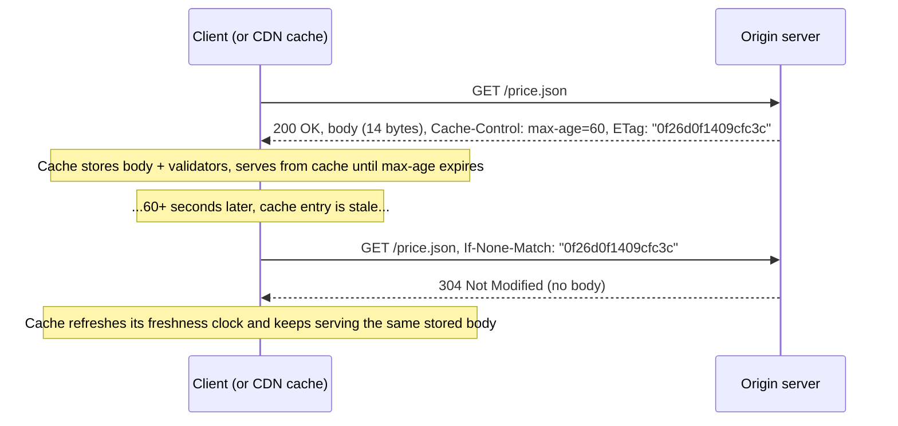
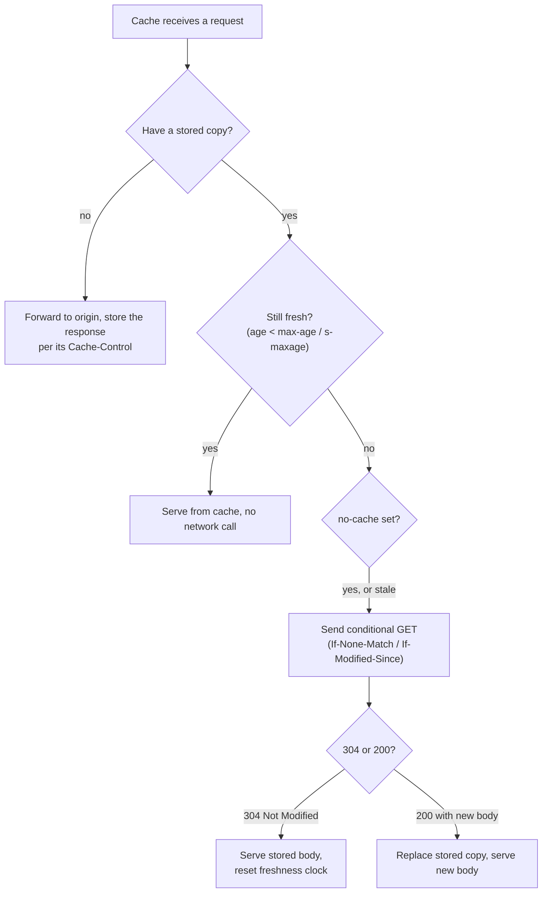
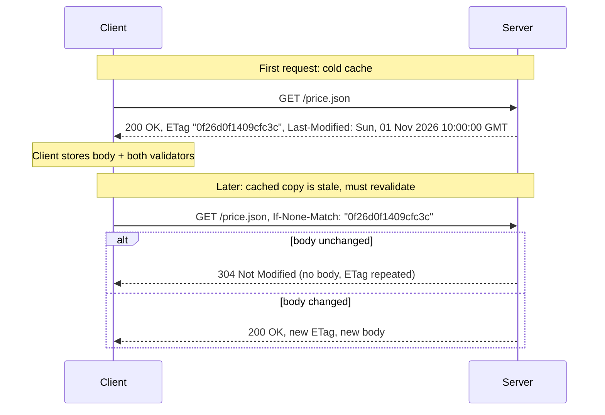

# HTTP Caching - Cache-Control, ETag, Conditional Requests

> [!summary] TL;DR
> HTTP caching lets a browser, proxy or CDN reuse a previous response instead of asking the origin server again. `Cache-Control` tells a cache how long a response is fresh and who may store it; once it goes stale, a conditional request (`If-None-Match` or `If-Modified-Since`) lets the server answer "nothing changed" with an empty `304` instead of resending the whole body.

> [!abstract] Core idea
> - **Freshness** (`max-age`) decides whether a cache can answer from its own copy with zero network round trips at all.
> - **Validation** (`ETag`/`If-None-Match`, `Last-Modified`/`If-Modified-Since`) decides, once a copy is stale, whether the server can say "unchanged" (`304`, no body) instead of resending everything.
> - `no-cache` means "revalidate every time"; `no-store` means "never keep a copy anywhere" — they are opposites of two different axes, not a slider.
> - Classic mistake: assuming a `200` on every request means caching isn't working. A `304` is caching working correctly — the headers just moved, not the body.

### Whiteboard version

One static JSON response, requested twice:



The second response carries no body at all — just a status line and a couple of headers — because the server can prove nothing changed.

## 1. Why it exists

Without caching, every single page load re-fetches every CSS file, every image, every font and every JSON payload from the origin, even when nothing has changed since the last visit a few seconds ago. That means wasted bandwidth, wasted origin CPU and database load, and real latency the user feels on every navigation.

HTTP caching solves this with two separate mechanisms that work at different times:
- **Freshness** avoids the network round trip entirely for a window of time the server names up front (`max-age`).
- **Validation** avoids re-sending the body once that window has passed, by letting the server answer "still the same" cheaply.

A concrete example: an e-commerce product page's price JSON is 14 bytes. Served fresh from a CDN edge cache (`max-age=60`), 60 seconds of traffic costs the origin zero requests. After that, a conditional request with `If-None-Match` costs the origin a cheap hash comparison and a `304` with no body — versus re-sending the full response (and in a real page, the full HTML/CSS/JS bundle, which is usually many kilobytes, not 14 bytes) on every single request.

## 2. Mental model

Think of two separate questions a cache asks, in order:

1. **"Do I even need to ask the server?"** — governed by `Cache-Control`'s `max-age`/`s-maxage`. If the stored copy is still fresh, the cache answers from its own copy, no network call at all.
2. **"Has it actually changed since I last checked?"** — governed by validators (`ETag`, `Last-Modified`). Once the copy is stale, the cache *must* ask, but it asks a cheap question ("is this fingerprint still current?") instead of re-downloading everything.

`no-cache` and `no-store` sound similar but answer different questions entirely: `no-cache` says "you may keep a copy, but always check with me first" (skips straight to step 2 forever); `no-store` says "don't keep a copy at all" (neither step applies — there's nothing to check).

## 3. How it works

### Cache-Control directives



- **`max-age=N`:** fresh for `N` seconds from the response's own `Date`, for any cache (browser or shared).
- **`s-maxage=N`:** overrides `max-age`, but only for *shared* caches (CDNs, corporate proxies) — lets an operator cache a response at the edge longer (or shorter) than browsers should privately.
- **`no-cache`:** may store the response, but **must revalidate with the origin before reusing it**, every time. Despite the name, this does not forbid caching.
- **`no-store`:** must not store any part of the request or response, anywhere. For truly sensitive responses (a one-time password, a payment form page).
- **`private`:** only a single user's own browser cache may store this; shared caches (CDNs, proxies) must not — the right directive for a per-user response like "my account balance".
- **`public`:** explicitly allows shared caches to store it even if the request had authentication (normally a reason shared caches would refuse to cache).
- **`immutable`:** tells the browser this exact URL will never change its content, so skip revalidation entirely even on a user-initiated reload — meant for content-hashed filenames like `app.3f8a21.js`, never for a URL that gets reused with different content.
- **`stale-while-revalidate=N`:** allows a cache to serve the stale copy immediately while it revalidates in the background for up to `N` seconds past expiry — trades strict freshness for a latency win; the user never waits on the revalidation request.
- **`stale-if-error=N`:** allows serving the stale copy if the origin returns an error or is unreachable, for up to `N` seconds — a resilience mechanism, not a freshness one.

### ETag and conditional requests

An **ETag** is an opaque fingerprint of the response body (any string the server chooses — a content hash, a version number, a database row's `updated_at` serialized). `Last-Modified` is a timestamp instead. Both let the client ask "has this changed since I last saw `X`?" without re-downloading the body:



**`If-None-Match` takes priority over `If-Modified-Since`** (RFC 9110 §13.1.1) whenever both are present: ETags are exact (byte-for-byte), while `Last-Modified` only has one-second resolution and can't detect a change that round-trips back to the same content within the same second. A server should always prefer checking `If-None-Match` first if it sent an `ETag`.

### Vary

`Vary: Accept-Encoding` tells a shared cache that responses differ by the listed request header, so it must store a **separate cached entry per distinct value of that header** — a gzip-compressed response and an uncompressed one are not interchangeable, even for the identical URL. `Vary: Accept-Encoding` is safe and common. `Vary: Cookie` is a well-known anti-pattern: since cookies are often unique per user, it effectively makes the response uncacheable by any shared cache (a near-infinite number of possible cache keys), while still technically being "correct" — so caching stops helping at all.

## 4. Worked example

### Whiteboard version

A handler computes a hash of the current body as its ETag, and answers `304` whenever the client already has that exact hash.

```go
w.Header().Set("Cache-Control", "public, max-age=60, must-revalidate")
w.Header().Set("ETag", etag)
if r.Header.Get("If-None-Match") == etag {
    w.WriteHeader(http.StatusNotModified)
    return
}
w.Write(body)
```

The full version below is tested: it serves `Cache-Control`, `ETag`, `Last-Modified` and `Vary`, answers `304` on a matching `If-None-Match`, falls back to `If-Modified-Since`, and falls through to a full `200` when the validator doesn't match.

```go
package cachedemo

import (
	"crypto/sha256"
	"encoding/hex"
	"fmt"
	"net/http"
	"time"
)

// Resource is a stand-in for a row fetched from a database: an ETag handler
// hashes its current bytes and compares that hash with what the client
// already has, instead of trusting a timestamp.
type Resource struct {
	Body         []byte
	LastModified time.Time
}

func (r Resource) etag() string {
	sum := sha256.Sum256(r.Body)
	return `"` + hex.EncodeToString(sum[:8]) + `"`
}

// Handler serves Resource with Cache-Control, ETag, Last-Modified and
// conditional-request (304) support. maxAge controls how long a shared or
// private cache may reuse the response without revalidating.
func Handler(get func() Resource, maxAge time.Duration) http.HandlerFunc {
	return func(w http.ResponseWriter, req *http.Request) {
		res := get()
		etag := res.etag()

		w.Header().Set("Cache-Control", fmt.Sprintf("public, max-age=%d, must-revalidate", int(maxAge.Seconds())))
		w.Header().Set("ETag", etag)
		w.Header().Set("Last-Modified", res.LastModified.UTC().Format(http.TimeFormat))
		w.Header().Set("Vary", "Accept-Encoding")

		// If-None-Match takes priority over If-Modified-Since per RFC 9110 §13.1.1:
		// strong validators are exact, timestamps only have second resolution.
		if inm := req.Header.Get("If-None-Match"); inm != "" {
			if inm == etag {
				w.WriteHeader(http.StatusNotModified)
				return
			}
		} else if ims := req.Header.Get("If-Modified-Since"); ims != "" {
			if t, err := http.ParseTime(ims); err == nil && !res.LastModified.After(t) {
				w.WriteHeader(http.StatusNotModified)
				return
			}
		}

		w.WriteHeader(http.StatusOK)
		w.Write(res.Body)
	}
}
```

```go
package cachedemo

import (
	"io"
	"net/http"
	"net/http/httptest"
	"testing"
	"time"
)

func TestConditionalRequestReturns304(t *testing.T) {
	res := Resource{Body: []byte(`{"price": 199}`), LastModified: time.Date(2026, 11, 1, 10, 0, 0, 0, time.UTC)}
	srv := httptest.NewServer(Handler(func() Resource { return res }, 60*time.Second))
	defer srv.Close()
	client := srv.Client()

	// First request: a cold cache, must get a full 200 with validators.
	resp1, err := client.Get(srv.URL)
	if err != nil {
		t.Fatalf("get: %v", err)
	}
	body1, _ := io.ReadAll(resp1.Body)
	resp1.Body.Close()
	if resp1.StatusCode != http.StatusOK {
		t.Fatalf("first request: got %d, want 200", resp1.StatusCode)
	}
	etag := resp1.Header.Get("ETag")
	if etag == "" {
		t.Fatal("first response carries no ETag")
	}
	if got := resp1.Header.Get("Cache-Control"); got != "public, max-age=60, must-revalidate" {
		t.Fatalf("Cache-Control = %q", got)
	}

	// Second request: client replays the ETag it stored, server must answer
	// 304 with no body instead of resending the 14-byte payload.
	req, _ := http.NewRequest(http.MethodGet, srv.URL, nil)
	req.Header.Set("If-None-Match", etag)
	resp2, err := client.Do(req)
	if err != nil {
		t.Fatalf("conditional get: %v", err)
	}
	body2, _ := io.ReadAll(resp2.Body)
	resp2.Body.Close()
	if resp2.StatusCode != http.StatusNotModified {
		t.Fatalf("conditional request: got %d, want 304", resp2.StatusCode)
	}
	if len(body2) != 0 {
		t.Fatalf("304 response carried a body: %q", body2)
	}

	// A stale If-None-Match (resource changed) must fall through to 200.
	req2, _ := http.NewRequest(http.MethodGet, srv.URL, nil)
	req2.Header.Set("If-None-Match", `"stale-value"`)
	resp3, err := client.Do(req2)
	if err != nil {
		t.Fatalf("stale conditional get: %v", err)
	}
	resp3.Body.Close()
	if resp3.StatusCode != http.StatusOK {
		t.Fatalf("stale If-None-Match: got %d, want 200", resp3.StatusCode)
	}

	t.Logf("full body %d bytes, 304 body %d bytes, ETag %s", len(body1), len(body2), etag)
}

func TestLastModifiedFallback(t *testing.T) {
	mod := time.Date(2026, 11, 1, 10, 0, 0, 0, time.UTC)
	res := Resource{Body: []byte("v1"), LastModified: mod}
	srv := httptest.NewServer(Handler(func() Resource { return res }, 30*time.Second))
	defer srv.Close()
	client := srv.Client()

	req, _ := http.NewRequest(http.MethodGet, srv.URL, nil)
	req.Header.Set("If-Modified-Since", mod.UTC().Format(http.TimeFormat))
	resp, err := client.Do(req)
	if err != nil {
		t.Fatalf("get: %v", err)
	}
	defer resp.Body.Close()
	if resp.StatusCode != http.StatusNotModified {
		t.Fatalf("got %d, want 304 via If-Modified-Since", resp.StatusCode)
	}
}
```

**Measured (Go 1.24.4, darwin/arm64, this machine, 2026-11-06):** `go vet` clean; `go test -race -v` → both tests pass. The full response body was 14 bytes; the `304` response body was 0 bytes — the entire saving of a conditional request.

### Representative output: a real conditional request

```text
$ curl -v https://example.com/price.json 2>&1 | grep -iE "< (cache-control|etag|last-modified|HTTP)"
< HTTP/1.1 200 OK
< Cache-Control: public, max-age=60, must-revalidate
< ETag: "0f26d0f1409cfc3c"
< Last-Modified: Sun, 01 Nov 2026 10:00:00 GMT
```

```text
$ curl -v -H 'If-None-Match: "0f26d0f1409cfc3c"' https://example.com/price.json 2>&1 | grep -iE "< HTTP|< etag"
< HTTP/1.1 304 Not Modified
< ETag: "0f26d0f1409cfc3c"
```
*(representative output (curl 8.x against a server implementing this note's Handler); the exact ETag value depends on the response body's hash.)*

## 5. Variants and comparison

| Mechanism | Answers | Saves | Cost of getting it wrong |
| --- | --- | --- | --- |
| `max-age` / `s-maxage` | "Can I skip asking entirely?" | Full round trip | Stale data served past intended freshness if too long; unnecessary origin load if too short or absent |
| `ETag` + `If-None-Match` | "Did it change?" (exact) | Response body on a `304` | A weak/unstable ETag (e.g. includes a timestamp that changes without content changing) defeats caching by never matching |
| `Last-Modified` + `If-Modified-Since` | "Did it change?" (one-second resolution) | Response body on a `304` | Can't detect two changes within the same second; some servers get the date formatting wrong and break the comparison |
| `stale-while-revalidate` | "Can I answer instantly and check in the background?" | User-facing latency on revalidation | Serves data up to `N` seconds out of date by design — know that trade-off is intentional |
| `Vary` | "Which request header splits the cache key?" | Nothing by itself — it's a correctness constraint | `Vary: Cookie` (or any high-cardinality header) silently defeats shared caching |

## 6. Trade-offs and when not to use

- Caching trades freshness for speed and origin load; anything that must reflect the absolute latest state on every read (a live auction bid count, a real-time stock ticker) should set `no-store` or a very short `max-age`, not rely on revalidation alone.
- ETags cost a hash computation per response; for very large or expensive-to-hash bodies, `Last-Modified` (if you already track an update timestamp) is cheaper, at the cost of coarser precision.
- `stale-while-revalidate` and `stale-if-error` intentionally serve data that is known to be out of date; never use them for anything where a stale read is a correctness bug, not just a UX nuisance (an inventory count close to zero, a payment status).
- Application-level caching (Redis, in-memory caches) and CDN edge-caching policy are different layers with different lifetimes and invalidation tools — see [[Caching Fundamentals]] and [[CDN and Edge]]; this note covers only the HTTP-level contract between a client/cache and the origin.

## 7. In production

- **Real systems:** browsers, forward and reverse proxies, and CDNs (see [[CDN and Edge]]) all implement this same `Cache-Control`/validator contract; static-asset pipelines commonly pair content-hashed filenames (`app.3f8a21.js`) with `Cache-Control: public, max-age=31536000, immutable` so a changed file gets a new URL instead of ever needing revalidation, while HTML itself usually ships `no-cache` so navigation always revalidates.
- **Failure modes → fixes:**
  - **Serving stale data silently** because `max-age` was set far too long for data that actually changes often → shorten `max-age` or switch to `no-cache` with strong ETags so every request still revalidates cheaply.
  - **Caching a per-user response at a shared cache** (a CDN or corporate proxy serving user A's account page to user B) → mark it `private`, and double-check anything containing a `Set-Cookie` or auth-scoped data is never marked `public`.
  - **`Vary: Cookie` silently disabling shared caching** → split the cacheable, cookie-independent parts of a response from the personalized parts, or drop the dependency on cookies for the cacheable path entirely.
  - **ETag changes on every request even though content didn't** (a timestamp embedded in the hashed bytes, or per-process randomness) → hash only the stable, meaningful content fields, not metadata that changes incidentally.
- **What to monitor:** cache hit ratio (requests served without reaching origin) and `304` ratio (requests that reached origin but needed no body resent) — both reduce origin load, but a persistently low `304` ratio on content that should be stable usually means an unstable ETag.

## 8. Deep dive

- **Strong vs weak validators.** An ETag without a `W/` prefix is a *strong* validator: byte-identical content guaranteed. `W/"..."` marks a *weak* validator: semantically equivalent but not necessarily byte-identical (e.g. same JSON data re-serialized with different key order). Range requests (`Range:`/`If-Range:`, resuming a partial download) require a strong validator, because combining two differently-ordered byte ranges from a "weakly equivalent" response would be silently wrong.
- **`must-revalidate` vs plain staleness.** Without `must-revalidate`, RFC 9111 permits a cache to serve a *stale* response anyway under certain conditions (e.g. the origin is unreachable) unless told not to. `must-revalidate` forbids serving a stale copy without successfully checking with the origin first — the right choice whenever stale-but-available is worse than failing the request.
- **Why `304` responses still carry headers.** A `304` must repeat any headers that would have been sent with the full `200` and that the cache needs to update its stored copy's metadata (a fresh `Cache-Control`, a possibly-changed `ETag` if the server supports multiple valid representations) — the body is what's elided, not the header contract.
- **Request collapsing** (mentioned here because it interacts directly with conditional requests): when many concurrent requests for the same stale URL arrive at a cache simultaneously, a well-built cache sends only *one* revalidation request upstream and lets the rest wait on its result, instead of a thundering herd of identical revalidations hitting the origin at once. This is a CDN/reverse-proxy implementation detail, not an HTTP header — see [[CDN and Edge]].

## 9. Interview questions

> [!question]- What's the actual difference between `no-cache` and `no-store`?
> `no-cache` allows storing the response but requires revalidating with the origin before reusing it on every single use — the cache still does its job of avoiding a full re-download on a `304`. `no-store` forbids keeping any copy of the response at all, anywhere, so there is nothing to revalidate; use it for genuinely sensitive one-time content.

> [!question]- Why does `If-None-Match` win over `If-Modified-Since` when a client sends both?
> ETags are exact, arbitrary fingerprints the server controls, so they can detect any change, including one that happens to round-trip back to identical content within the same second. `Last-Modified` only has one-second resolution. RFC 9110 requires a server to prefer `If-None-Match` when it understands the ETag, specifically because it's the more precise check.

> [!question]- Trap: if every request to an endpoint returns `200`, is HTTP caching broken?
> Not necessarily — if the client never had a fresh copy to validate (first visit, cache evicted the entry, or `max-age` was set to 0 with no validators), `200` with a full body is correct. The question to check is whether `304`s show up *when a validator the client already holds is still current* — if a repeat request with a correct `If-None-Match` still gets `200`, that's the actual bug (likely an unstable ETag).

> [!question]- When would you use `stale-while-revalidate` instead of just shortening `max-age`?
> When the user-facing request must never wait on a round trip to the origin, but the data can tolerate being a little stale. `stale-while-revalidate=30` serves instantly from the stale copy while kicking off a background revalidation, so the *next* request (not this one) gets the fresh data — a shorter `max-age` alone would make some requests pay the full round-trip latency instead.

> [!question]- Why is `Vary: Cookie` almost always a mistake on a cacheable response?
> `Vary` tells a shared cache it needs a separate stored entry per distinct value of the named header. Cookies are typically unique per user (session IDs, CSRF tokens), so `Vary: Cookie` effectively creates one cache entry per visitor — technically correct, but it means the shared cache almost never gets a hit. If the response really differs per user, mark it `private` instead and don't rely on a shared cache for it at all.

> [!question]- A CDN in front of your API is configured with `s-maxage=300` but the browser still seems to refetch on every page load. Why might that be correct behavior?
> `s-maxage` governs *shared* caches (the CDN) only; it doesn't set the browser's own private cache freshness. If `max-age` is absent or `0`, the browser must revalidate on every load even though the CDN itself is serving from its 300-second-fresh copy without reaching your origin. Set both directives deliberately when the two audiences (CDN vs browser) should behave differently.

## 10. Cheat sheet

- Freshness (`max-age`/`s-maxage`) skips the network call entirely; validation (`ETag`/`Last-Modified`) skips resending the body once stale.
- `no-cache` = "store it, but always revalidate first"; `no-store` = "never keep a copy anywhere" — not two ends of one scale.
- `public`/`private` controls who may cache (shared vs single-user); `immutable` skips revalidation forever for content-hashed URLs only.
- `If-None-Match` (exact) beats `If-Modified-Since` (one-second resolution) whenever both are sent.
- A matching validator gets a `304` with **no body** — that's caching working, not caching failing.
- `Vary: Accept-Encoding` is normal; `Vary: Cookie` (or any high-cardinality header) usually kills shared cacheability.
- `stale-while-revalidate` and `stale-if-error` are deliberate staleness trade-offs for latency and resilience, never for data where staleness is a correctness bug.

## Links

- **Before this:** [[HTTP-1.1 vs HTTP-2 vs HTTP-3]], [[HTTP Fundamentals - Methods, Status Codes, Headers, Cookies]]
- **Next:** [[CDN and Edge]], [[Caching Fundamentals]]
- **Compare with:** [[Cache Invalidation, TTL and Consistency]] (application/Redis-level caching instead of the HTTP contract covered here)
