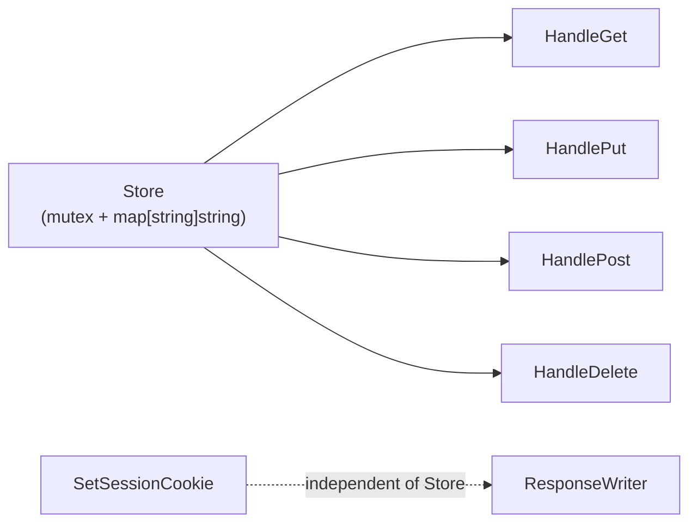

# HTTP Fundamentals - Methods, Status Codes, Headers, Cookies - Go

> [!summary] TL;DR
> This code is a tiny in-memory item store exposed over `net/http` that demonstrates method semantics from [[HTTP Fundamentals - Methods, Status Codes, Headers, Cookies]] directly in running behavior: `GET` is safe and supports conditional `304` requests, `PUT`/`DELETE` are idempotent, `POST` is not, and a helper sets a correctly-attributed session cookie.

## Before the code

- **`net/http` handlers**: functions `func(w http.ResponseWriter, r *http.Request)` that read a request and write a status, headers and body.
- **`r.PathValue("id")`**: Go 1.22+ routing that pulls `{id}` out of a pattern like `GET /items/{id}`.
- **`sync.Mutex`**: a lock so concurrent requests cannot corrupt the shared map.
- **`atomic.Int64`**: a counter safe to bump from many goroutines without a lock.
- **`httptest`**: fake requests and a response recorder, so tests run handlers without a real network.
- **Run it**: `go vet ./...` then `go test -race ./...` from the module root.

## What this code shows

| Code piece | Theory concept | Theory section |
| --- | --- | --- |
| `HandleGet` | Safe method + conditional request `304` | [[HTTP Fundamentals - Methods, Status Codes, Headers, Cookies#Conditional requests avoiding a resend you dont need]] |
| `HandlePut` | Idempotent method: same end state on repeat | [[HTTP Fundamentals - Methods, Status Codes, Headers, Cookies#Methods safe and idempotent are two different properties]] |
| `HandlePost` | Non-idempotent method: repeat creates duplicates | [[HTTP Fundamentals - Methods, Status Codes, Headers, Cookies#Methods safe and idempotent are two different properties]] |
| `HandleDelete` | Idempotent by end state, not by response | [[HTTP Fundamentals - Methods, Status Codes, Headers, Cookies#Methods safe and idempotent are two different properties]] |
| `SetSessionCookie` | Cookie attributes: `Secure`, `HttpOnly`, `SameSite` | [[HTTP Fundamentals - Methods, Status Codes, Headers, Cookies#Cookies how state survives a stateless protocol]] |

## Setup

- Module layout: single package `httpdemo`, handlers in one file, tests in another.
- Go 1.24. Standard library only (`net/http`'s `PathValue` routing requires Go 1.22+).
- Run with `go vet ./...` then `go test -race ./...` from the module root.



## Code

### Step 1: the store and its fingerprint helper

**Concept.** A real resource store would be a database table; this one is a mutex-guarded map, kept deliberately simple so the test focuses on HTTP semantics rather than storage mechanics.

`etag` mirrors [[HTTP Caching - Cache-Control, ETag, Conditional Requests#ETag and conditional requests]]'s approach of hashing the current content rather than trusting a separately-maintained version counter, for the same reason: it cannot drift out of sync with what is actually stored.

```go
package httpdemo

import (
	"crypto/sha256"
	"encoding/hex"
	"encoding/json"
	"fmt"
	"net/http"
	"sync"
	"sync/atomic"
)

// Store is a tiny in-memory resource store used to demonstrate method
// semantics: GET is safe, PUT and DELETE are idempotent, POST is not.
type Store struct {
	mu      sync.Mutex
	items   map[string]string
	nextID  int64
	created atomic.Int64 // counts how many times POST actually created something
}

func NewStore() *Store {
	return &Store{items: make(map[string]string)}
}

func etag(body string) string {
	sum := sha256.Sum256([]byte(body))
	return `"` + hex.EncodeToString(sum[:8]) + `"`
}
```

**How it works.**
1. `Store.mu` guards both `items` and `nextID` together, so a `PUT` and a `POST` racing against the same store can never interleave a partial read and write — the alternative, a `sync.RWMutex`, would let concurrent `GET`s run in parallel but adds complexity this demo doesn't need.
2. `created atomic.Int64` is a separate counter from the map itself, used only so the test can assert "three POSTs created three distinct resources" without re-deriving that fact from the map's final size.

### Step 2: `GET` — safe, with conditional request support

**Concept.** This is the safe-method half of [[HTTP Fundamentals - Methods, Status Codes, Headers, Cookies#Methods safe and idempotent are two different properties]]: `HandleGet` only ever reads from the store, never writes to it, which is what makes it legal for a browser or crawler to call speculatively.

Layering the conditional-`304` check on top (rather than a separate endpoint) keeps the caching contract attached to the same handler that owns the data, instead of splitting cache logic into a wrapper that has to independently know the resource's shape.

```go
// HandleGet is safe: it never changes state, so it may be cached, retried
// and prefetched freely. It also implements conditional GET: if the
// client's If-None-Match matches the current ETag, it replies 304 Not
// Modified with no body instead of resending unchanged bytes.
func (s *Store) HandleGet(w http.ResponseWriter, r *http.Request) {
	id := r.PathValue("id")
	s.mu.Lock()
	body, ok := s.items[id]
	s.mu.Unlock()
	if !ok {
		http.Error(w, "not found", http.StatusNotFound)
		return
	}
	tag := etag(body)
	w.Header().Set("ETag", tag)
	w.Header().Set("Cache-Control", "max-age=60")
	if r.Header.Get("If-None-Match") == tag {
		w.WriteHeader(http.StatusNotModified)
		return
	}
	w.Header().Set("Content-Type", "application/json")
	json.NewEncoder(w).Encode(map[string]string{"id": id, "body": body})
}
```

**How it works.**
1. The lock is held only long enough to read `s.items[id]` into a local variable — `body` — and then released before any header writing or encoding happens, so a slow client doesn't hold the store's mutex hostage.
2. `r.PathValue("id")` uses Go 1.22's method-and-pattern routing (`"GET /items/{id}"` registered on the mux in Step 5) instead of manually parsing `r.URL.Path`.
3. The `If-None-Match` comparison and early `304` return happen before `Content-Type` is set or the body is encoded — exactly the "set headers, then decide whether to write a body" shape from [[HTTP Caching - Cache-Control, ETag, Conditional Requests - Go]].

### Step 3: `PUT` and `DELETE` — idempotent, but not safe

**Concept.** Both handlers change state, so neither is safe — but both leave the store in the same place no matter how many times they are called with the same input, which is the idempotency promise from the theory note.

`HandleDelete` always returns `204` whether or not the item existed, which is the direct code expression of "idempotency is about end state, not about the response being identical."

```go
// HandlePut is idempotent: setting the same body twice leaves the exact
// same state as setting it once.
func (s *Store) HandlePut(w http.ResponseWriter, r *http.Request) {
	id := r.PathValue("id")
	var req struct{ Body string }
	if err := json.NewDecoder(r.Body).Decode(&req); err != nil {
		http.Error(w, "bad request: "+err.Error(), http.StatusBadRequest)
		return
	}
	s.mu.Lock()
	_, existed := s.items[id]
	s.items[id] = req.Body
	s.mu.Unlock()
	if existed {
		w.WriteHeader(http.StatusOK)
	} else {
		w.WriteHeader(http.StatusCreated)
	}
}

// HandleDelete is idempotent: deleting an already-deleted resource still
// ends with it gone, so it returns 204 whether or not it existed.
func (s *Store) HandleDelete(w http.ResponseWriter, r *http.Request) {
	id := r.PathValue("id")
	s.mu.Lock()
	delete(s.items, id)
	s.mu.Unlock()
	w.WriteHeader(http.StatusNoContent)
}
```

**How it works.**
1. `HandlePut` checks `existed` before overwriting, purely to pick `200` vs `201` — the *stored value* after either branch is identical (`req.Body`), which is what idempotency actually requires; the status code difference is a response-level nicety, not a correctness requirement.
2. `delete(s.items, id)` on a Go map is itself idempotent by language design: deleting a key that isn't present is a silent no-op, so `HandleDelete` needs no existence check at all before deleting.
3. Neither handler is marked safe in its doc comment, because both mutate `s.items` under the lock — the comment language ("is idempotent" vs "is safe") deliberately mirrors the two-axis table in the theory note.

### Step 4: `POST` — not idempotent, and a cookie helper

**Concept.** `HandlePost` is the counter-example: every successful call appends a brand-new resource with a freshly incremented ID, so replaying the same request body (as a naive retry-on-timeout would) creates a second, third, fourth resource. `SetSessionCookie` is unrelated to the store but demonstrates the cookie attribute table from the theory note in one call.

```go
// HandlePost is NOT idempotent: every successful call appends a brand new
// resource with a new ID, so retrying a POST after a timeout can create a
// duplicate.
func (s *Store) HandlePost(w http.ResponseWriter, r *http.Request) {
	var req struct{ Body string }
	if err := json.NewDecoder(r.Body).Decode(&req); err != nil {
		http.Error(w, "bad request: "+err.Error(), http.StatusBadRequest)
		return
	}
	s.mu.Lock()
	s.nextID++
	id := fmt.Sprintf("%d", s.nextID)
	s.items[id] = req.Body
	s.mu.Unlock()
	s.created.Add(1)
	w.Header().Set("Location", "/items/"+id)
	w.WriteHeader(http.StatusCreated)
}
```

**How it works.**
1. `s.nextID++` happens inside the same critical section as the map write, so two concurrent `POST`s can never be assigned the same ID — an alternative using a package-level `atomic.Int64` for IDs would work too, but would decouple ID assignment from the map write it has to stay in sync with.
2. The `Location` header on the `201` response is the standard way a server tells the client where the newly created resource now lives, per RFC 9110.

The cookie helper is unrelated to `Store` but belongs in the same package as a second demonstration of header semantics:

```go
// SetSessionCookie shows the attributes a session cookie needs in
// production: Secure (HTTPS only), HttpOnly (no JS access, blunts XSS
// cookie theft), SameSite=Strict (not sent on cross-site requests, blunts
// CSRF), and a scoping Path.
func SetSessionCookie(w http.ResponseWriter, sessionID string) {
	http.SetCookie(w, &http.Cookie{
		Name:     "session_id",
		Value:    sessionID,
		Path:     "/",
		MaxAge:   3600,
		Secure:   true,
		HttpOnly: true,
		SameSite: http.SameSiteStrictMode,
	})
}
```

**How it works.**
1. `http.SetCookie` is a helper that formats a `Set-Cookie` header correctly (ordering, attribute syntax) — hand-building that header string is error-prone and is why the standard library provides this instead.
2. `SameSite: http.SameSiteStrictMode` is a typed constant, not a bare string, so a typo like `"strict"` would be a compile error instead of a silently-ignored cookie attribute.

> [!example]- Full file
> ```go
> package httpdemo
>
> import (
> 	"crypto/sha256"
> 	"encoding/hex"
> 	"encoding/json"
> 	"fmt"
> 	"net/http"
> 	"sync"
> 	"sync/atomic"
> )
>
> type Store struct {
> 	mu      sync.Mutex
> 	items   map[string]string
> 	nextID  int64
> 	created atomic.Int64
> }
>
> func NewStore() *Store { return &Store{items: make(map[string]string)} }
>
> func etag(body string) string {
> 	sum := sha256.Sum256([]byte(body))
> 	return `"` + hex.EncodeToString(sum[:8]) + `"`
> }
>
> func (s *Store) HandleGet(w http.ResponseWriter, r *http.Request) {
> 	id := r.PathValue("id")
> 	s.mu.Lock()
> 	body, ok := s.items[id]
> 	s.mu.Unlock()
> 	if !ok {
> 		http.Error(w, "not found", http.StatusNotFound)
> 		return
> 	}
> 	tag := etag(body)
> 	w.Header().Set("ETag", tag)
> 	w.Header().Set("Cache-Control", "max-age=60")
> 	if r.Header.Get("If-None-Match") == tag {
> 		w.WriteHeader(http.StatusNotModified)
> 		return
> 	}
> 	w.Header().Set("Content-Type", "application/json")
> 	json.NewEncoder(w).Encode(map[string]string{"id": id, "body": body})
> }
>
> func (s *Store) HandlePut(w http.ResponseWriter, r *http.Request) {
> 	id := r.PathValue("id")
> 	var req struct{ Body string }
> 	if err := json.NewDecoder(r.Body).Decode(&req); err != nil {
> 		http.Error(w, "bad request: "+err.Error(), http.StatusBadRequest)
> 		return
> 	}
> 	s.mu.Lock()
> 	_, existed := s.items[id]
> 	s.items[id] = req.Body
> 	s.mu.Unlock()
> 	if existed {
> 		w.WriteHeader(http.StatusOK)
> 	} else {
> 		w.WriteHeader(http.StatusCreated)
> 	}
> }
>
> func (s *Store) HandlePost(w http.ResponseWriter, r *http.Request) {
> 	var req struct{ Body string }
> 	if err := json.NewDecoder(r.Body).Decode(&req); err != nil {
> 		http.Error(w, "bad request: "+err.Error(), http.StatusBadRequest)
> 		return
> 	}
> 	s.mu.Lock()
> 	s.nextID++
> 	id := fmt.Sprintf("%d", s.nextID)
> 	s.items[id] = req.Body
> 	s.mu.Unlock()
> 	s.created.Add(1)
> 	w.Header().Set("Location", "/items/"+id)
> 	w.WriteHeader(http.StatusCreated)
> }
>
> func (s *Store) HandleDelete(w http.ResponseWriter, r *http.Request) {
> 	id := r.PathValue("id")
> 	s.mu.Lock()
> 	delete(s.items, id)
> 	s.mu.Unlock()
> 	w.WriteHeader(http.StatusNoContent)
> }
>
> func SetSessionCookie(w http.ResponseWriter, sessionID string) {
> 	http.SetCookie(w, &http.Cookie{
> 		Name:     "session_id",
> 		Value:    sessionID,
> 		Path:     "/",
> 		MaxAge:   3600,
> 		Secure:   true,
> 		HttpOnly: true,
> 		SameSite: http.SameSiteStrictMode,
> 	})
> }
> ```

## Tests

### `TestPUTIsIdempotent`

| Property it proves | Why it matters |
| --- | --- |
| Two identical `PUT`s to the same resource leave identical stored state | This is the literal definition of idempotent being verified, not assumed |

| Input | Expected output |
| --- | --- |
| First `PUT /items/42` `{"Body":"v1"}` | `201 Created` |
| Second, identical `PUT /items/42` `{"Body":"v1"}` | `200 OK`, stored value still `"v1"` |

A failure would mean either the status-code convention broke (still returning `201` on the second call), or worse, that the stored value diverged between the two calls — the actual idempotency violation.

The shared test setup — imports and the mux helper every test below reuses:

```go
package httpdemo

import (
	"net/http"
	"net/http/httptest"
	"strings"
	"testing"
)

func newMux(s *Store) *http.ServeMux {
	mux := http.NewServeMux()
	mux.HandleFunc("GET /items/{id}", s.HandleGet)
	mux.HandleFunc("PUT /items/{id}", s.HandlePut)
	mux.HandleFunc("DELETE /items/{id}", s.HandleDelete)
	mux.HandleFunc("POST /items", s.HandlePost)
	return mux
}
```

The test itself:

```go
func TestPUTIsIdempotent(t *testing.T) {
	s := NewStore()
	mux := newMux(s)

	req := httptest.NewRequest(http.MethodPut, "/items/42", strings.NewReader(`{"Body":"v1"}`))
	rec := httptest.NewRecorder()
	mux.ServeHTTP(rec, req)
	if rec.Code != http.StatusCreated {
		t.Fatalf("first PUT: got %d, want 201", rec.Code)
	}

	req2 := httptest.NewRequest(http.MethodPut, "/items/42", strings.NewReader(`{"Body":"v1"}`))
	rec2 := httptest.NewRecorder()
	mux.ServeHTTP(rec2, req2)
	if rec2.Code != http.StatusOK {
		t.Fatalf("second PUT: got %d, want 200", rec2.Code)
	}
	if got := s.items["42"]; got != "v1" {
		t.Fatalf("stored body = %q, want v1", got)
	}
}
```

### `TestPOSTIsNotIdempotent`

| Property it proves | Why it matters |
| --- | --- |
| Three identical `POST`s create three distinct resources | Directly demonstrates the non-idempotency risk that motivates idempotency keys |

| Input | Expected output |
| --- | --- |
| Three `POST /items` with the same body, in a loop | Each returns `201`; `s.created` ends at `3` |

A failure (fewer than 3 created) would hide the exact bug idempotency keys exist to prevent: a client retry that should have created one resource silently collapsing into fewer.

```go
func TestPOSTIsNotIdempotent(t *testing.T) {
	s := NewStore()
	mux := newMux(s)
	for i := 0; i < 3; i++ {
		req := httptest.NewRequest(http.MethodPost, "/items", strings.NewReader(`{"Body":"dup"}`))
		rec := httptest.NewRecorder()
		mux.ServeHTTP(rec, req)
		if rec.Code != http.StatusCreated {
			t.Fatalf("POST %d: got %d, want 201", i, rec.Code)
		}
	}
	if got := s.created.Load(); got != 3 {
		t.Fatalf("created = %d, want 3 distinct resources", got)
	}
}
```

### `TestConditionalGETReturns304`

| Property it proves | Why it matters |
| --- | --- |
| A repeat `GET` with a matching `If-None-Match` gets a zero-length `304` body | Confirms the HTTP-layer caching contract is actually wired into this handler |

| Input | Expected output |
| --- | --- |
| `GET /items/1` then `GET /items/1` with the stored `ETag` | Second response: `304`, 0-byte body |

```go
func TestConditionalGETReturns304(t *testing.T) {
	s := NewStore()
	s.items["1"] = "hello"
	mux := newMux(s)

	req1 := httptest.NewRequest(http.MethodGet, "/items/1", nil)
	rec1 := httptest.NewRecorder()
	mux.ServeHTTP(rec1, req1)
	tag := rec1.Header().Get("ETag")

	req2 := httptest.NewRequest(http.MethodGet, "/items/1", nil)
	req2.Header.Set("If-None-Match", tag)
	rec2 := httptest.NewRecorder()
	mux.ServeHTTP(rec2, req2)
	if rec2.Code != http.StatusNotModified {
		t.Fatalf("conditional GET: got %d, want 304", rec2.Code)
	}
	if rec2.Body.Len() != 0 {
		t.Fatalf("304 response should have no body, got %d bytes", rec2.Body.Len())
	}
}
```

### `TestSessionCookieAttributes`

| Property it proves | Why it matters |
| --- | --- |
| The session cookie carries `Secure`, `HttpOnly` and `SameSite=Strict` | A session cookie missing any one of these is a real, shippable vulnerability |

| Input | Expected output |
| --- | --- |
| `SetSessionCookie(rec, "abc123")` | Resulting `Set-Cookie`: `Secure=true`, `HttpOnly=true`, `SameSite=Strict` |

```go
func TestSessionCookieAttributes(t *testing.T) {
	rec := httptest.NewRecorder()
	SetSessionCookie(rec, "abc123")
	c := rec.Result().Cookies()[0]
	if !c.Secure || !c.HttpOnly {
		t.Fatalf("cookie must be Secure and HttpOnly, got Secure=%v HttpOnly=%v", c.Secure, c.HttpOnly)
	}
	if c.SameSite != http.SameSiteStrictMode {
		t.Fatalf("SameSite = %v, want Strict", c.SameSite)
	}
}
```

**Measured** on this machine (Go 1.24.4, darwin/arm64, scratch module, `go test -race`, 2026-11-09): all four tests pass — two `PUT`s to the same resource produce `201` then `200` with identical stored state, three `POST`s create three distinct resources, a repeated conditional `GET` returns `304` with a zero-length body, and the session cookie carries `Secure`, `HttpOnly` and `SameSite=Strict`.

## Design decisions

| Choice | Alternative | Trade-off |
| --- | --- | --- |
| One `sync.Mutex` guarding the whole `Store` | Per-key locking (e.g. `sync.Map` or a sharded lock) | Simpler to reason about correctness; serializes all access, which would matter at real concurrency but not for a teaching example |
| Separate `atomic.Int64` counter for `created` | Recompute "how many created" from `len(s.items)` after the fact | Avoids coupling the test's assertion to deletions ever happening to the same store; the counter only ever goes up |
| `DELETE` always returns `204` regardless of prior existence | Return `404` if the item didn't exist | Matches the idempotency contract exactly: "the resource is gone" is true either way, so the response shouldn't depend on which call happened to do the deleting |
| Cookie built via `http.SetCookie` + `http.Cookie` struct | Hand-format the `Set-Cookie` header string | The standard library handles attribute ordering and escaping correctly; a hand-built string is an easy source of a malformed or silently-ignored attribute |

## Running it

```text
$ go test -race -v ./httpdemo/...
=== RUN   TestPUTIsIdempotent
--- PASS: TestPUTIsIdempotent (0.00s)
=== RUN   TestPOSTIsNotIdempotent
--- PASS: TestPOSTIsNotIdempotent (0.00s)
=== RUN   TestConditionalGETReturns304
--- PASS: TestConditionalGETReturns304 (0.00s)
=== RUN   TestSessionCookieAttributes
--- PASS: TestSessionCookieAttributes (0.00s)
PASS
ok      roll10/httpdemo 2.280s
```

Reading it line by line: four `PASS` lines confirm each method-semantics claim independently rather than as one combined assertion, and the overall `ok` with `-race` confirms the mutex-guarded `Store` has no data race even under the `-race` detector's instrumented, concurrency-sensitive execution.

## Pitfalls in the code

- `HandlePost`'s `s.nextID++` and the map write happen under the same lock, but if a future change moved ID generation outside the lock (e.g. to reduce contention), two concurrent `POST`s could read the same `nextID` before either increments it, producing a duplicate ID — a classic check-then-act race.
- `HandleGet` returns a generic `404` for "not found" without setting `Cache-Control` on the error path — a real service usually wants a short negative-cache `Cache-Control` on `404`s too, to avoid hammering the origin for a resource that doesn't exist.
- `SetSessionCookie` hardcodes `MaxAge: 3600`; a production version would typically make this configurable rather than a literal constant.

## Exercises

1. Change `HandleDelete` to return `404` when the item didn't already exist, then predict (and run) whether `TestConditionalGETReturns304` or `TestPUTIsIdempotent` still pass unchanged — they should, since neither test exercises `DELETE` — and discuss why this change would still be a bad idea per the idempotency contract even though no test catches it.
2. Move `s.nextID++` in `HandlePost` outside the `s.mu.Lock()`/`Unlock()` pair (keep the map write inside). Run `go test -race ./httpdemo/...` and read what the race detector reports.
3. Add `SameSite: http.SameSiteLaxMode` as an alternative `SetSessionCookie` variant and write a test asserting it. Predict which real-world scenario (a user clicking a link from an email to your site while logged in) behaves differently between `Strict` and `Lax`.

## Links

- **Theory:** [[HTTP Fundamentals - Methods, Status Codes, Headers, Cookies]]
- **Related:** [[REST and HTTP API Design]], [[Idempotency and Idempotency Keys]], [[HTTP Caching - Cache-Control, ETag, Conditional Requests - Go]]
