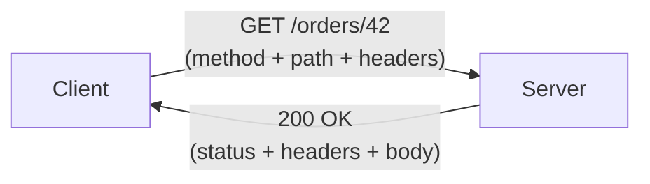
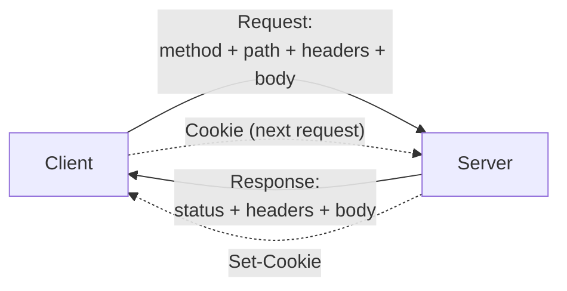
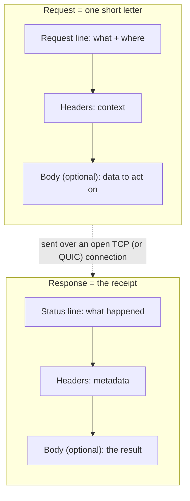
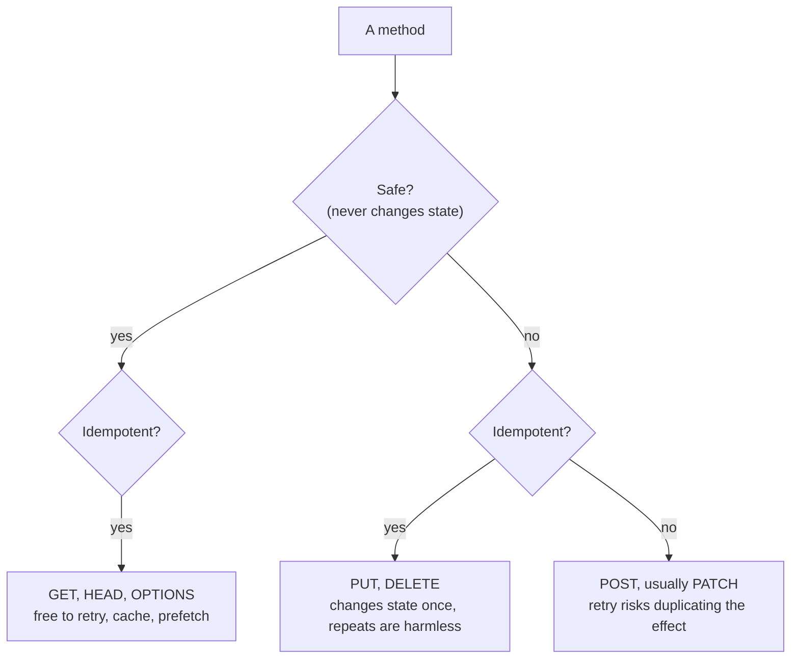
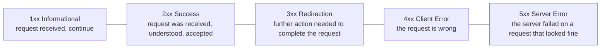
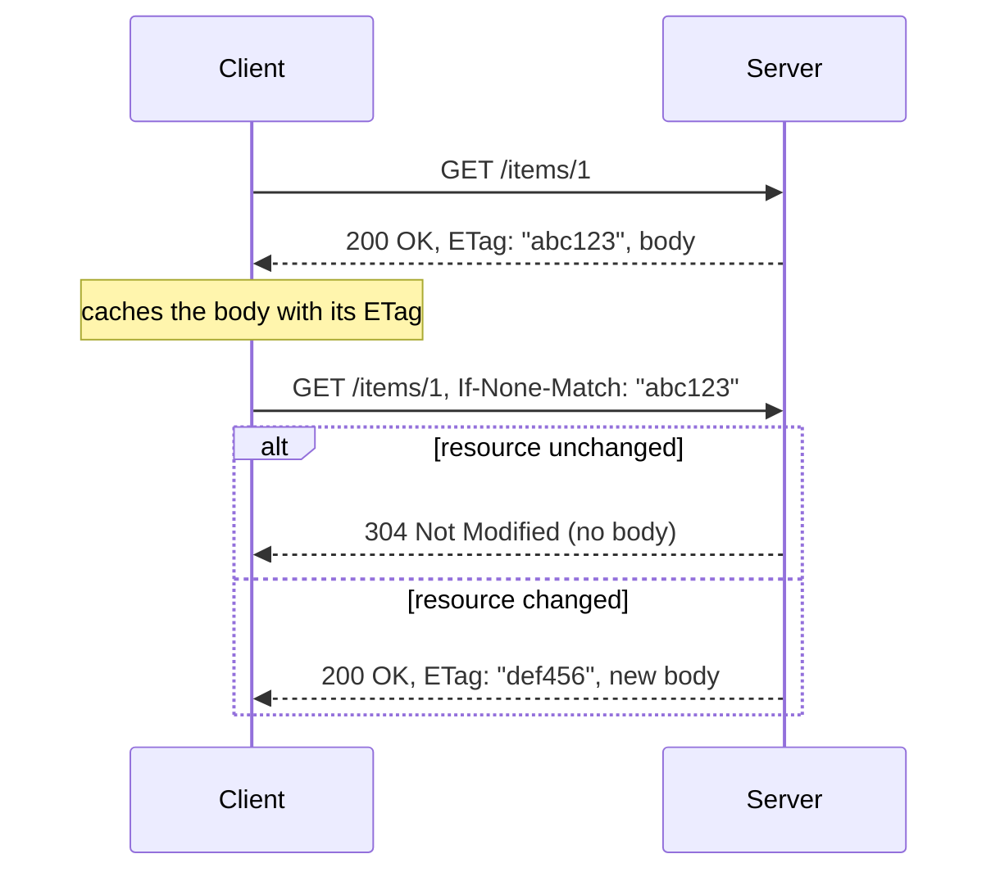
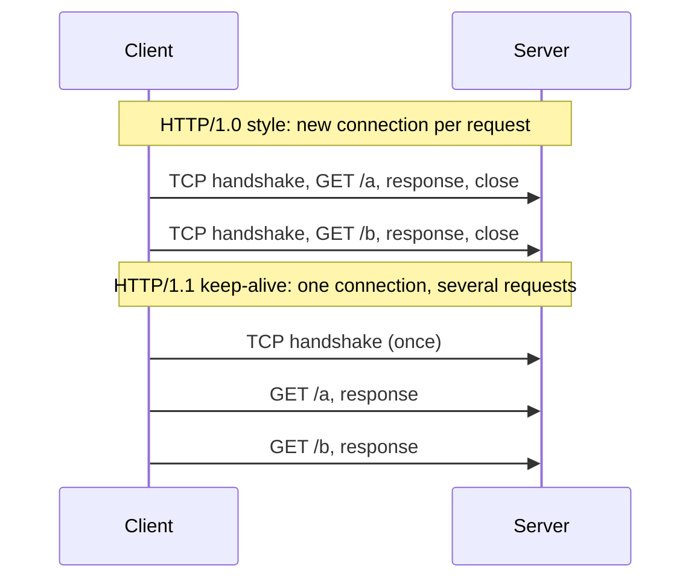

# HTTP Fundamentals - Methods, Status Codes, Headers, Cookies

> [!summary] TL;DR
> HTTP is a text-based request/response protocol: a client sends a method, a path and headers, and a server replies with a status code, headers and a body. Everything above this note — REST APIs, caching, cookies, auth — is built from these same five parts.

> [!abstract] Core idea
> - A request is a method + path + headers + optional body; a response is a status code + headers + optional body.
> - Methods carry two independent promises: **safe** (never changes server state) and **idempotent** (repeating it has the same effect as doing it once).
> - Status codes group into five classes; the two codes people confuse most are 401 vs 403 and 400 vs 422.
> - Classic mistake: assuming the HTTP/1.1 "connection" you write code against still means one TCP connection per request — keep-alive and multiplexing both change that picture.

### Whiteboard version



One request, one response, nothing remembered in between — that last part ("nothing remembered") is the single idea everything else in this note builds on.

## Start here: the basics

**The problem in one story.**
You open a shopping app and tap "My orders".
Your phone has to ask a far-away computer for that list, and the computer has to answer.
Both sides were built by different people, in different languages.
HTTP is the shared set of rules that lets any app ask and any server answer.

**Words you need first**

| Word | Plain meaning | Tiny example |
| --- | --- | --- |
| Client | The program that asks | Your browser or a Go `http.Client` |
| Server | The program that answers | A Go service listening on port 8080 |
| Request | One message from client to server | `GET /orders/42` |
| Response | The server's reply to one request | `200 OK` plus the order as JSON |
| Header | A `Name: value` line of extra info | `Content-Type: application/json` |
| Body | The actual data carried by a message | The JSON text of an order |
| Status code | A 3-digit number saying what happened | `404` = not found |
| Cookie | A small value the browser stores and sends back each time | `session=abc123` |

**Picture it**



**Analogy.** Ordering at a restaurant counter: you say what you want (method and path), add notes like "no onions" (headers), and get a tray back with a receipt saying "done" or "sold out" (status code).
Where it breaks: the counter staff forget you the moment you leave; HTTP itself remembers nothing, so cookies or tokens must carry who you are on every request.

**How the rest of this note builds up**

- First, why a shared protocol exists (section 1) and the letter-and-receipt mental model (section 2).
- Then the request and response anatomy, methods (safe vs idempotent) and status codes.
- Next the headers that matter most, conditional requests, cookies and keep-alive.
- Finally the SDE-3 deep dive: 400 vs 422, why safety lets infrastructure retry, idempotency as end state, and chunked transfer.

> [!tip] Remember
> HTTP = ask with a method and path, answer with a status code; nothing is remembered between requests unless a cookie or token carries it.

## 1. Why it exists

Imagine every website invented its own private way of asking for a page and its own private way of saying "found it" or "not found" — a browser built for one site couldn't talk to any other.

Before **HTTP** (HyperText Transfer Protocol — a shared, text-readable request/response vocabulary any client and any server can speak regardless of what they're written in), every service that wanted to serve documents over a network invented its own protocol: its own way to ask for a resource, its own way to signal success or failure, its own framing.

HTTP (originally defined in RFC 1945, now specified across RFC 9110–9114) standardized that exchange into one shape. A browser from 1996 and a Go server written today still agree on what `GET /index.html HTTP/1.1` means.

**Example:** an API client calling `POST /orders` needs a way to say *what kind of operation this is* (create something) and the server needs a way to say *what happened* (created, `201`; rejected, `400`; server broke, `500`) without the client having to parse a custom error format for every different backend. Methods and status codes are that shared vocabulary.

> [!tip] Remember
> HTTP's whole job is to be a vocabulary every client and server already agree on, so nobody has to invent their own.

## 2. Mental model

**In plain words:** a request is a short, structured letter.

The first line says what you want and from where (`GET /orders/42`), a block of headers gives context (who you are, what formats you accept, whether you have a cached copy already), and an optional body carries data for the server to act on.

A response mirrors the shape back: a status line says what happened, headers give metadata about the reply, and an optional body carries the result.

**Analogy:** think of it like sending a letter to a post office counter and getting a receipt back. You write what you want on the front (the request line), attach any supporting notes (headers), maybe include a form to fill out (the body).

The clerk hands back a receipt stating what happened (status line), any stamps or notices (response headers), and maybe the item you asked for (response body).

Where the analogy breaks down: the clerk has no memory of you from your last visit — **statelessness** is part of the HTTP model, not an accident.

Anything that needs to persist across requests — login state, a shopping cart — has to ride along in every request, usually via a cookie or a token, because the protocol itself remembers nothing between them.



> [!warning] Common mistake
> Assuming the server "remembers" a previous request because the connection stayed open (keep-alive). The TCP connection may persist, but HTTP itself carries no memory across requests — the server only knows what this exact request tells it, plus whatever a cookie or token happens to carry along.

> [!tip] Remember
> Every request must be understandable entirely on its own — that's what "stateless" buys the system: any server in a pool can answer any request.

## 3. How it works

### Request and response anatomy

A **measured** request/response exchange against a local Go `net/http` server (Go 1.24, `curl` 8.7.1, loopback, 2026-11-06):

```console
$ curl -v http://127.0.0.1:8099/items/1
> GET /items/1 HTTP/1.1
> Host: 127.0.0.1:8099
> User-Agent: curl/8.7.1
> Accept: */*
>
< HTTP/1.1 200 OK
< Cache-Control: max-age=60
< Content-Type: application/json
< Etag: "2cf24dba5fb0a30e"
< Date: Fri, 06 Nov 2026 18:41:46 GMT
< Content-Length: 26
<
{"body":"hello","id":"1"}
```

`>` lines are what `curl` sent, `<` lines are what the server replied with — exactly the request/response anatomy above, with real header names.

### Methods: safe and idempotent are two different properties

**In plain words:** two separate promises hide behind every HTTP method's name. **Safe** means a method must never change server state — a crawler, a prefetcher, or a browser's back button can call it freely.

**Idempotent** means calling it N times has the same effect on server state as calling it once (though the *response* can still legitimately differ — a second `DELETE` of an already-gone resource still ends with it gone, even if the first call returned `200` and the second `404` or `204` depending on API design).

**Picture it:**



| Method | Safe | Idempotent | What it means |
| --- | --- | --- | --- |
| `GET` | Yes | Yes | Retrieve a representation; never changes anything |
| `HEAD` | Yes | Yes | Like GET, but headers only, no body — used to check existence/metadata cheaply |
| `OPTIONS` | Yes | Yes | Ask what methods/headers are allowed (also the CORS preflight method) |
| `PUT` | No | Yes | Replace a resource entirely; doing it twice with the same body leaves the same end state |
| `DELETE` | No | Yes | Remove a resource; doing it twice still ends with it gone |
| `POST` | No | No | Create or trigger a side effect; retrying can create a duplicate |
| `PATCH` | No | No (usually) | Partially modify a resource; a relative patch (`increment += 1`) is not idempotent even though the request body looks identical each time |

**Example:** the trap hides in `PATCH`. A patch document like `{"status": "shipped"}` is idempotent — setting the same value twice is harmless. But `{"$inc": {"stock": -1}}` is not — sending it twice decrements stock twice. The method name doesn't decide idempotency; the *semantics of the operation* do.

> [!warning] Common mistake
> Assuming idempotent means "the response is identical every time." It only means the *end state* is the same. A second `DELETE /items/42` can legitimately return `404` instead of repeating the first call's `204` — the item being gone either way is what makes it idempotent.

This is exactly why non-idempotent operations that must tolerate client retries (payment creation, order placement) need an explicit idempotency key rather than relying on the HTTP method alone — see [[Idempotency and Idempotency Keys]].

> [!tip] Remember
> Safe and idempotent are two separate questions. `GET` is both; `PUT`/`DELETE` are idempotent but not safe; `POST` is neither.

### Status codes: five classes, and the pairs people confuse

**In plain words:** every HTTP response's status code falls into one of five families, numbered by their first digit. Knowing the family tells you who should act next.



**Example:** a `201 Created` (2xx) means the server did what was asked and here is the new thing; a `404 Not Found` (4xx) means the client asked for something that doesn't exist; a `500 Internal Server Error` (5xx) means the client did nothing wrong, the server broke.

The two pairs people mix up most:

| Code | Means | Commonly confused with |
| --- | --- | --- |
| `401 Unauthorized` | You are not authenticated (missing or invalid credentials) | `403`: 401 says "log in"; 403 says "I know who you are, and you still can't" |
| `403 Forbidden` | You are authenticated but not authorized for this resource | `401`: never send 403 to someone who hasn't even proven who they are if that leaks information you don't want to leak |
| `400 Bad Request` | The request is malformed — broken JSON, wrong type, missing required field | `422`: 400 is "I can't even parse/validate the shape of this"; 422 is "I understood it fine, but the content fails a business rule" |
| `422 Unprocessable Entity` | The request is well-formed and understood but semantically invalid (e.g. end date before start date) | `400`: see above |
| `409 Conflict` | The request conflicts with the current state (e.g. a version mismatch on optimistic locking, a duplicate unique key) | `422`: 409 is about *state*, not the request's own shape |
| `502 Bad Gateway` | A proxy/gateway got an invalid response from the upstream server | `503`/`504`: 502 means the upstream answered, just badly or not in a valid protocol shape |
| `503 Service Unavailable` | The server (or upstream) is temporarily unable to handle requests — overloaded or in maintenance | `502`/`504`: 503 often comes with a `Retry-After` header; the server itself is saying "not now" |
| `504 Gateway Timeout` | A proxy/gateway gave up waiting for the upstream to respond at all | `502`/`503`: 504 means no response arrived in time, not that an invalid one arrived |

> [!warning] Common mistake
> Treating `401` vs `403` as "logged in or not" in casual terms — it's really about whether the *request itself* carries valid credentials. A perfectly logged-in user hitting an admin-only endpoint with their normal user token gets `403`, not `401`, because their credentials are valid, just insufficient.

> [!tip] Remember
> 401 = "I don't know who you are." 403 = "I know exactly who you are, and the answer is still no."

### Headers: the handful that do the most work

**In plain words:** headers are key-value metadata riding alongside the request line or status line. A handful of them show up in almost every real system.

| Header | Direction | Purpose |
| --- | --- | --- |
| `Host` | Request | Which virtual host/domain is being asked for — mandatory since HTTP/1.1 |
| `Content-Type` | Both | The media type of the body (`application/json`, `multipart/form-data`, …) |
| `Content-Length` | Both | Body size in bytes, so the receiver knows where the body ends |
| `Authorization` | Request | Credentials: `Bearer <token>`, `Basic <base64>`, etc. |
| `Cache-Control` | Both | Caching directives (`max-age`, `no-store`, `must-revalidate`) — see [[HTTP Caching - Cache-Control, ETag, Conditional Requests]] |
| `ETag` / `If-None-Match` | Response / Request | A fingerprint of a representation, used for conditional requests (see below) |
| `Set-Cookie` / `Cookie` | Response / Request | Server asks the client to store a cookie; client sends it back on later requests |
| `Connection` | Both | `keep-alive` to reuse the TCP connection, `close` to tear it down after this response |

### Conditional requests: avoiding a resend you don't need

**In plain words:** a server can tag a representation with an **ETag** — a hash of its content. A client that already has a copy sends `If-None-Match: <etag>` on its next `GET`; if nothing changed, the server replies `304 Not Modified` with **no body at all**, saving the full transfer.



**Example:** a 2KB JSON representation gets fetched once (`200`, full body), then checked again a minute later. If nothing changed, the second response is a few bytes of headers and nothing else — the full detail of this mechanism, including `Cache-Control` and the precedence between validators, lives in [[HTTP Caching - Cache-Control, ETag, Conditional Requests]].

> [!tip] Remember
> A `304` is the server proving "nothing changed" cheaply — it is caching working correctly, not a failure.

### Cookies: how state survives a stateless protocol

**In plain words:** a cookie is just a header the server asks the client to store and resend on every later request. Its attributes decide how exposed it is.

| Attribute | What it controls | Why it matters |
| --- | --- | --- |
| `Secure` | Only sent over HTTPS | Without it, the cookie (session token and all) can be sniffed on plain HTTP |
| `HttpOnly` | Not readable from JavaScript (`document.cookie`) | Blunts cookie theft via XSS — a malicious script literally cannot read the value |
| `SameSite` | Whether the cookie is sent on cross-site requests (`Strict`, `Lax`, `None`) | `Strict`/`Lax` blunts CSRF by not attaching the session cookie to requests originating from another site |
| `Domain` | Which hosts the cookie is sent to | Too broad a domain leaks the cookie to unrelated subdomains |
| `Path` | Which URL paths the cookie is sent on | Scopes a cookie to, say, `/admin` instead of the whole site |

**Example:** a session cookie set with `Secure; HttpOnly; SameSite=Strict; Path=/` is sent back by the browser on every request to the same site, over HTTPS only, invisible to any JavaScript running on the page, and never attached to a request that originated from another site.

> [!warning] Common mistake
> Setting only `HttpOnly` and assuming the cookie is now safe. `HttpOnly` blocks JavaScript from reading it; it does nothing against the cookie being sniffed on plain HTTP (that needs `Secure`) or against it riding along on a forged cross-site request (that needs `SameSite`). The three attributes block three different attacks.

Full CSRF/XSS defenses and CORS belong to [[CSRF, XSS and Security Headers]] and [[CORS and Same-Origin Policy]] — this note only covers the cookie attributes themselves.

> [!tip] Remember
> `Secure` stops eavesdropping, `HttpOnly` stops script theft, `SameSite` stops forged cross-site requests — all three, not any one of them alone.

### Keep-alive: one request does not need one new TCP connection

**In plain words:** HTTP/1.0 opened a fresh TCP connection per request. HTTP/1.1 defaults to `Connection: keep-alive`, reusing the same TCP connection for several sequential requests — avoiding a fresh handshake (and, under TLS, a fresh TLS handshake) every time.



This is still head-of-line-blocked at the HTTP/1.1 level: requests on one connection are still answered one at a time unless the client opens multiple connections, which is why browsers historically capped and then parallelized connections per host, and why HTTP/2 multiplexing (see [[HTTP-1.1 vs HTTP-2 vs HTTP-3]]) exists.

> [!tip] Remember
> Keep-alive saves handshakes, not ordering — one connection still answers one request at a time until HTTP/2.

## 4. Worked example

A Go `net/http` server trace, step by step, for one `PUT` sent twice to the same resource:

1. **First `PUT /items/42`** with body `{"Body":"v1"}` arrives. The store has no entry for `42` yet.
2. **Handler writes it.** The store now holds `items["42"] = "v1"`.
3. **Handler responds `201 Created`**, because the resource did not exist before this call.
4. **Same `PUT /items/42`** with the identical body arrives again — simulating a client retry after a timeout.
5. **Handler writes the same value again.** The store still holds exactly `items["42"] = "v1"` — unchanged from step 2.
6. **Handler responds `200 OK`** this time, because the resource already existed — but critically, the *stored state* after both calls is identical. That is what "idempotent" means in practice, traced through actual state.

Runnable Go version: [[HTTP Fundamentals - Methods, Status Codes, Headers, Cookies - Go]].

## 5. Variants and comparison

| Representation style | How it works | Use when | Cost |
| --- | --- | --- | --- |
| HTTP/1.1 text protocol | Plain-text request/response lines, keep-alive reuses one TCP connection | Universal baseline; simple to debug by hand (`telnet`, `nc`) | One request at a time per connection; verbose headers repeated every request |
| HTTP/2 (binary framing) | Same methods/status/headers semantics, multiplexed binary frames over one TCP connection | Many parallel requests to one host | TCP-level head-of-line blocking still possible (see [[TCP - Handshake, Reliability, Flow and Congestion Control]]) |
| HTTP/3 (over QUIC) | Same semantics again, framed over QUIC streams | Lossy or high-latency networks, mobile clients | Needs UDP to reach the server; see [[UDP and QUIC]] |

> [!warning] Interview trap
> HTTP's methods, status codes and headers are the same across HTTP/1.1, HTTP/2 and HTTP/3 — only the **wire format and connection model** changed. A candidate who says "HTTP/2 added new status codes" has it backwards; see [[HTTP-1.1 vs HTTP-2 vs HTTP-3]] for what actually changed.

## 6. Trade-offs and when not to use

- HTTP's statelessness is a deliberate simplicity trade: every request must carry its own context (auth token, session cookie), which is overhead compared to a protocol with a persistent session, but it's also why any server in a pool can answer any request.
- Plain-text headers repeated on every HTTP/1.1 request are wasteful at scale; HTTP/2's HPACK header compression exists specifically to fix this (see [[HTTP-1.1 vs HTTP-2 vs HTTP-3]]).
- For truly bidirectional, low-latency, many-small-messages traffic (chat, live updates), request/response HTTP is the wrong shape entirely — see [[Real-time APIs - WebSocket, SSE and Long Polling]].

## 7. In production

- **Real systems:** every browser, every REST/HTTP API, every CDN and load balancer speaks this vocabulary; API gateways and reverse proxies route and rewrite based on exactly these methods, paths, and headers (see [[Forward and Reverse Proxies - L4 vs L7]]).
- **Failure modes → fixes:**
	- A client treats `403` as "please log in" and redirects to a login page → wrong UX; `403` means re-authenticating won't help, the account lacks permission.
	- A non-idempotent `POST` is retried blindly by a client library on timeout → duplicate orders/charges; use an idempotency key (see [[Idempotency and Idempotency Keys]]).
	- A `GET` endpoint is implemented to have a side effect (e.g. "mark as read" on fetch) → breaks prefetching, crawling and caching, which all assume `GET` is safe.
	- Missing `Secure`/`HttpOnly` on a session cookie → the session token is stealable over plain HTTP or via any XSS on the page.
- **What to monitor:** status code distribution by class (a rising share of `5xx` is a server health signal; a rising share of `4xx` is often a client or API-contract problem), `304` hit rate on cacheable `GET` endpoints, and `Connection: close` rate (frequent forced connection closes defeat keep-alive's savings).

## 8. Deep dive

- **Why 422 exists separately from 400 at all.** RFC 9110 defines 400 generically as "the server cannot or will not process the request due to something perceived as a client error," which technically covers everything from broken JSON to a business-rule violation — 422 (from WebDAV, RFC 4918, widely reused outside WebDAV) gives APIs a way to distinguish "your request is malformed" from "your request is well-formed but fails validation," which matters because client code often reacts differently (a 400 usually means a client bug; a 422 usually means user input needs correcting).
- **Why safe methods matter beyond "don't delete things."** Safety is what lets infrastructure the request author never thought about — browser prefetchers, crawlers, CDNs, retry logic in HTTP client libraries — treat `GET`/`HEAD`/`OPTIONS` as free to issue speculatively or repeatedly. Breaking that contract (a `GET` with a side effect) causes bugs far from the code that violated it.
- **Idempotency is about end state, not about the response being identical.** A second `DELETE /items/42` after the first succeeded can legitimately return `404` instead of repeating `204` — the method is still idempotent because the *server state* (item 42 does not exist) is the same either way. Confusing "same response" with "idempotent" is a common interview slip.
- **Why `Content-Length` and chunked transfer both exist.** `Content-Length` requires knowing the full body size before sending the first byte, which doesn't work for a response generated as a stream (e.g. a long-running export).

  `Transfer-Encoding: chunked` lets the server send the body in pieces of unknown total length up front, each prefixed with its own size, terminated by a zero-length chunk — HTTP/2 and HTTP/3 replace this mechanism with their own binary framing, which doesn't need chunking at all.

## 9. Interview questions

> [!question]- What's the difference between a safe method and an idempotent one?
> Safe means the method never changes server state at all (so it's always okay to call speculatively or repeatedly) — `GET`, `HEAD`, `OPTIONS`. Idempotent means repeating the call N times has the same effect on state as calling it once, but the call can still change state the first time — `PUT` and `DELETE` are idempotent but not safe.

> [!question]- When should an API return 401 versus 403?
> 401 means the request itself lacks valid credentials — the server can't tell who's asking, or the credentials it got are invalid/expired. 403 means the server knows exactly who's asking and that identity is simply not allowed to do this. A valid, logged-in user hitting an admin-only route gets 403, not 401.

> [!question]- What's the practical difference between 400 and 422, and does it matter?
> 400 says the request couldn't even be understood — malformed JSON, wrong content type, missing required structure. 422 says the request was understood perfectly but fails a business or semantic rule (an end date before a start date, a duplicate email).
>
> It matters for client error handling: a 400 usually signals a client bug to fix in code; a 422 usually signals a user-facing validation message to show.

> [!question]- A client gets intermittent 502s and 504s from the same endpoint. What's the first thing you'd check?
> Whether the upstream is actually responding at all. 504 means the gateway never got a response in time (a timeout, possibly an overloaded or hung upstream); 502 means the upstream *did* respond, just with something the gateway couldn't parse as a valid HTTP response.
>
> Check upstream latency/health for 504s, and the upstream's actual raw response (or a crash/panic mid-response) for 502s.

> [!question]- Trap: is `PATCH` always non-idempotent, and is `PUT` always idempotent?
> No to both, in practice. `PUT` is idempotent by definition (it replaces the whole resource with the given representation), but a buggy implementation that, say, appends to a log on every `PUT` would violate that contract.
>
> `PATCH` is usually not idempotent because partial-update documents often describe relative changes (`increment`), but a `PATCH` body that sets absolute values (`{"status":"shipped"}`) is idempotent in practice even though the method itself makes no such promise.

> [!question]- Why does HTTP need both `Secure` and `HttpOnly` on a cookie — isn't one enough?
> They block different attacks. `Secure` stops the cookie from ever being sent over plain HTTP, where a network observer could read it. `HttpOnly` stops client-side JavaScript from reading the cookie at all, which blocks an XSS payload from exfiltrating it even if the attacker got arbitrary script execution on the page. Either alone leaves the other attack path open.

> [!question]- What problem does `SameSite` solve, and what's the trade-off of `Strict` versus `Lax`?
> It controls whether a cookie is attached to a request that originated from a different site, which is the mechanism CSRF relies on (a malicious site makes your browser send a request to your bank, cookie included).
>
> `Strict` never sends the cookie cross-site, which is safest but breaks things like clicking a link from an email and landing already logged in; `Lax` (the modern browser default) allows the cookie on top-level navigations (clicking a link) but not on embedded cross-site requests (an image, a form auto-submit), balancing security and usability.

## 10. Cheat sheet

- Request = method + path + headers + optional body; response = status code + headers + optional body.
- Safe = never changes state (`GET`, `HEAD`, `OPTIONS`); idempotent = same effect if repeated (`GET`, `PUT`, `DELETE`, not `POST`, usually not `PATCH`).
- 401 = not authenticated; 403 = authenticated but not allowed.
- 400 = malformed/unparseable request; 422 = well-formed but semantically invalid.
- 502 = upstream answered badly; 503 = server/upstream overloaded or down; 504 = upstream never answered in time.
- `ETag` + `If-None-Match` → `304 Not Modified` avoids resending an unchanged body.
- Cookie attributes: `Secure` (HTTPS only), `HttpOnly` (no JS access), `SameSite` (cross-site sending policy), `Domain`/`Path` (scope).
- Keep-alive reuses one TCP connection across requests; it doesn't remove per-connection ordering until HTTP/2's multiplexing.

## Links

- **Before this:** [[TCP - Handshake, Reliability, Flow and Congestion Control]]
- **Next:** [[HTTP-1.1 vs HTTP-2 vs HTTP-3]], [[HTTP Caching - Cache-Control, ETag, Conditional Requests]], [[REST and HTTP API Design]]
- **Compare with:** [[Sessions and Cookies]] (cookies as a session mechanism, in depth), [[Idempotency and Idempotency Keys]] (handling non-idempotent retries), [[CORS and Same-Origin Policy]] and [[CSRF, XSS and Security Headers]] (the security side of cookies and headers)
- **Runnable code:** [[HTTP Fundamentals - Methods, Status Codes, Headers, Cookies - Go]]

### Watch on YouTube

- [How websites and HTTP work? Web Basics Crash Course](https://www.youtube.com/watch?v=iD2fgC74ZtA) · Mehul Mohan · covers methods, status codes, headers and cookies together in one crash course
- [HTTP Fundamentals in 10 Minutes](https://www.youtube.com/watch?v=qv5-5hhsKpE) · The Cyber Mentors · fast 10-minute recap good for pre-interview review
