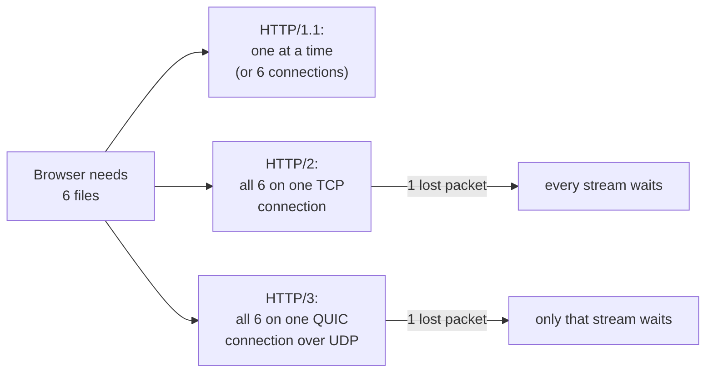
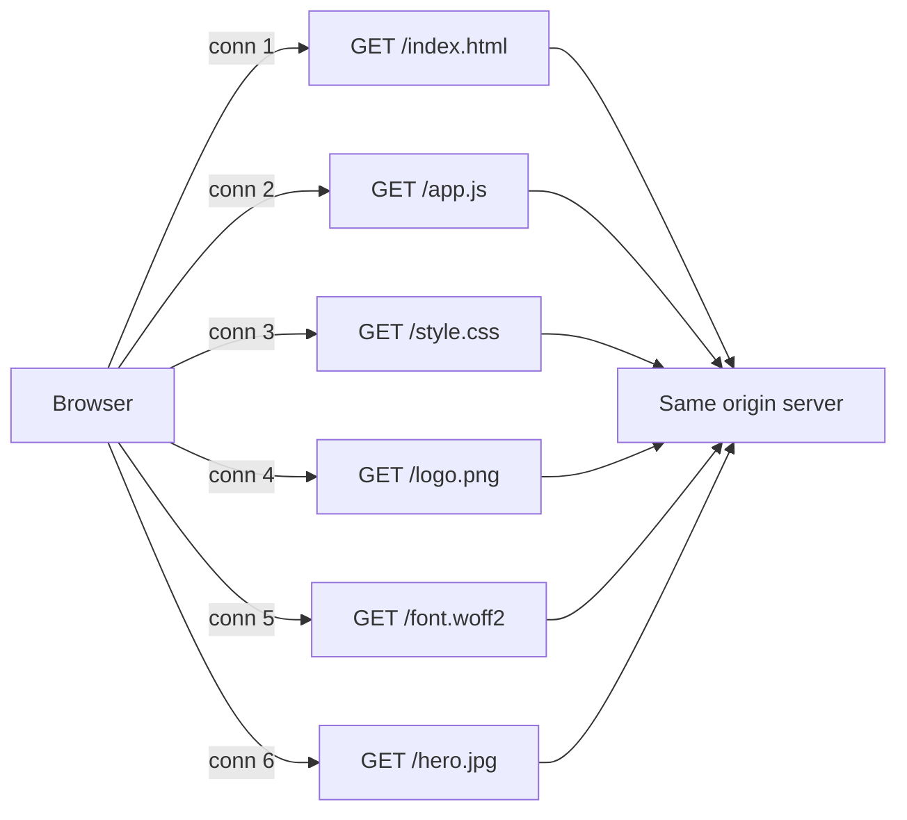
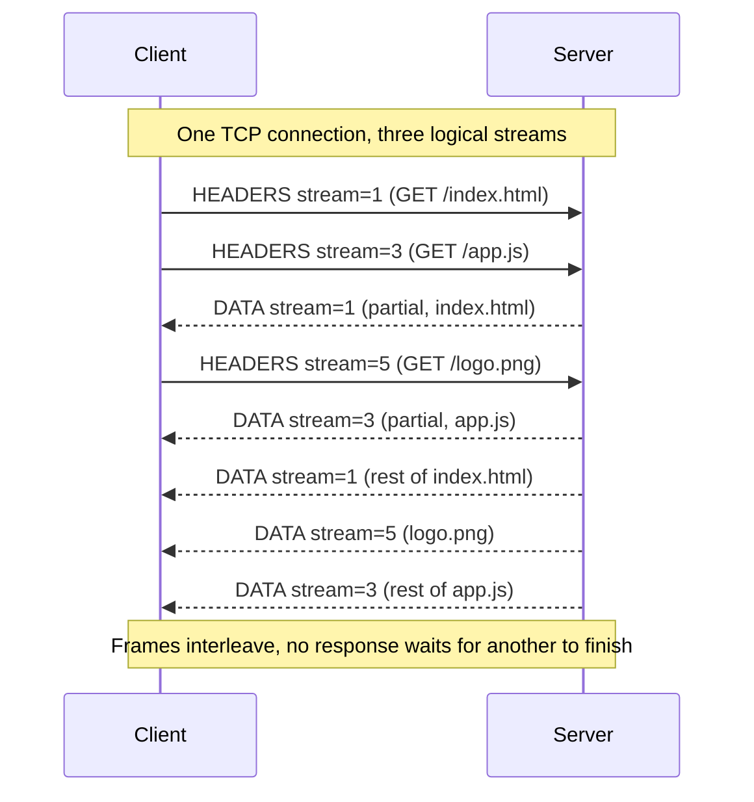
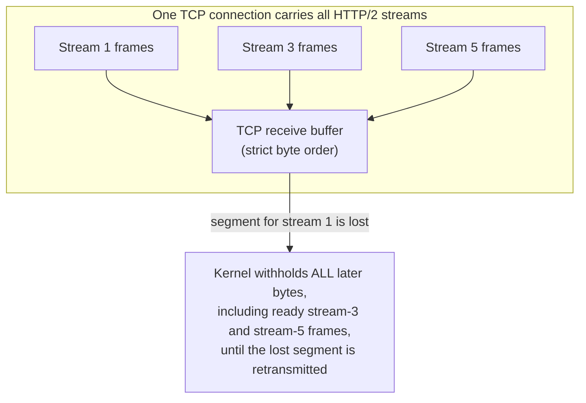
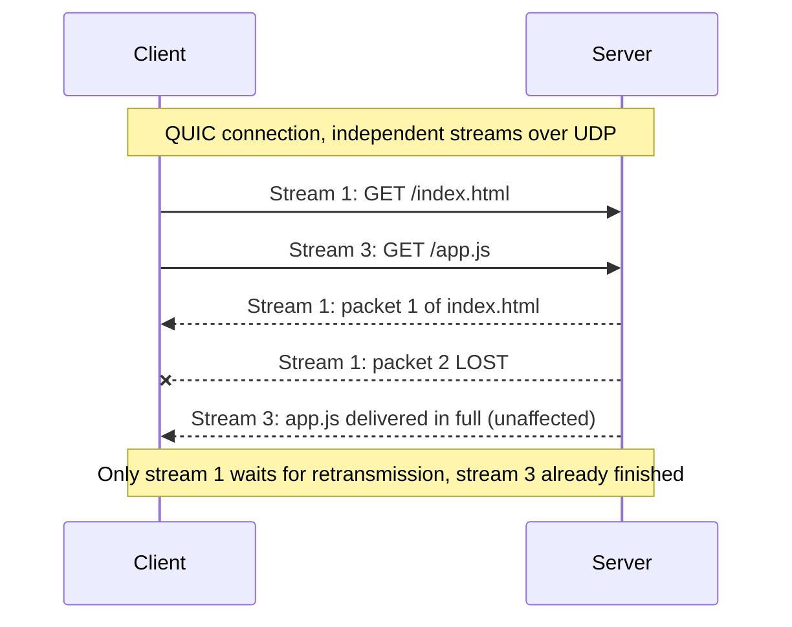
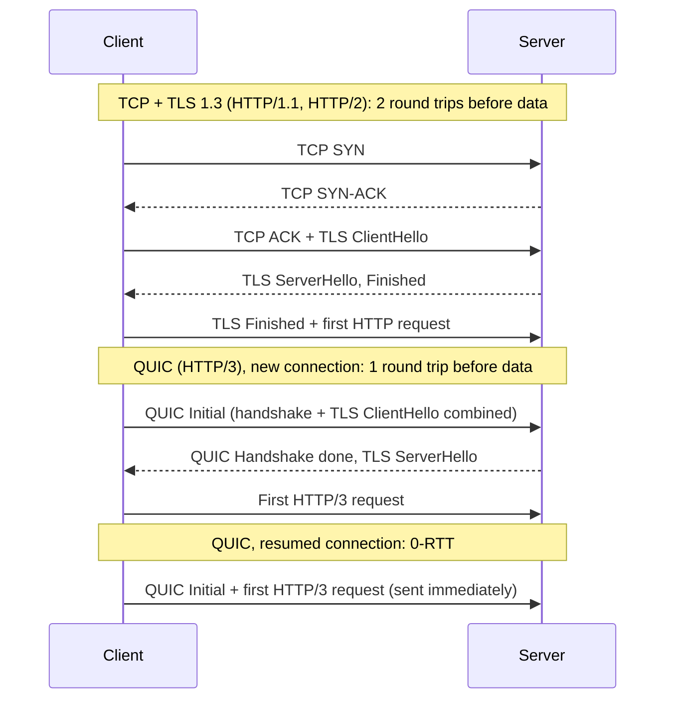
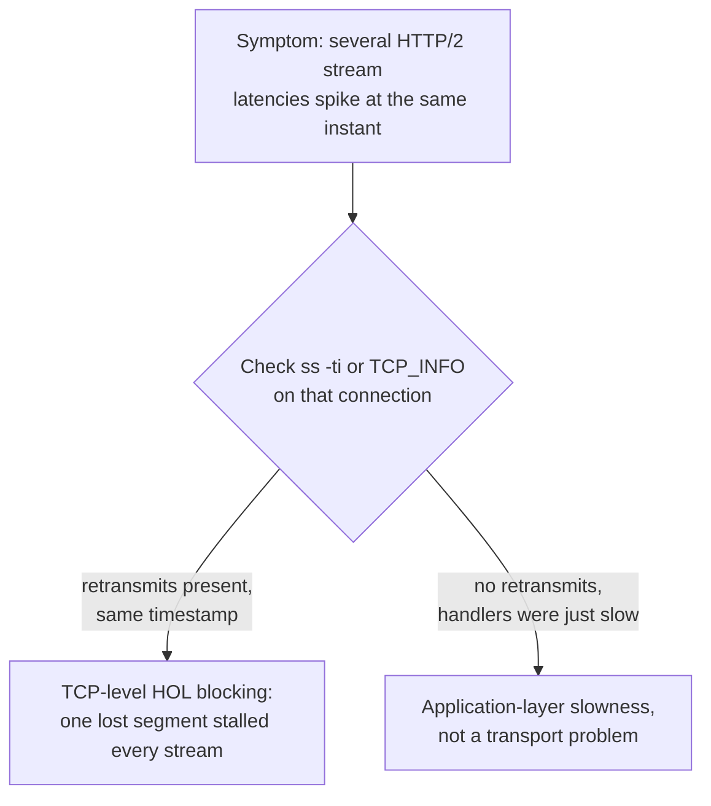

# HTTP-1.1 vs HTTP-2 vs HTTP-3

> [!summary] TL;DR
> HTTP/1.1, HTTP/2 and HTTP/3 are three ways of carrying the same request/response messages. Each one fixes a specific bottleneck the previous version hit at scale: HTTP/1.1 wastes connections, HTTP/2 shares one connection but trips over TCP's own ordering, and HTTP/3 replaces TCP itself so one lost packet only stalls the stream that lost it.

> [!abstract] Core idea
> - HTTP/1.1 sends one request at a time per connection (pipelining existed but no browser shipped it), so clients open many TCP connections to get parallelism.
> - HTTP/2 multiplexes many streams over **one** TCP connection using binary frames, and compresses headers with HPACK — but a single lost TCP segment still blocks every stream on that connection.
> - HTTP/3 keeps HTTP/2's framing model but runs it over QUIC (on UDP) instead of TCP, so each stream has its own loss recovery and one lost packet only stalls its own stream.
> - Classic mistake: assuming HTTP/2 fixed head-of-line blocking completely. It only fixed it at the HTTP layer; TCP's in-order delivery still blocks everything underneath.

### Whiteboard version

Six requests, each taking 50ms to answer, fired at the same server:

| Protocol, one connection | What happens | Measured here |
| --- | --- | --- |
| HTTP/1.1, no pipelining | Requests queue; each must finish before the next starts | ~310ms for 6 requests |
| HTTP/2, multiplexed | All 6 travel as interleaved frames on one connection and are handled concurrently | ~62ms for 6 requests |

That gap is the entire reason HTTP/2 exists: one connection, many requests in flight at once, instead of one request at a time or one connection per request.

## Start here: the basics

**The problem in one story.**
You open a news site. The page needs the HTML, a stylesheet, scripts, twenty images and a font.
Your browser has to ask the server for each one.
If it can only ask one thing at a time, the page crawls in piece by piece.
HTTP/1.1, HTTP/2 and HTTP/3 are three answers to "how do we ask for many things at once, quickly, even when the network drops data?"

**Words you need first**

| Word | Plain meaning | Tiny example |
| --- | --- | --- |
| Request / response | A question the browser sends and the server's answer | `GET /logo.png` → the image bytes |
| Connection | An open line between browser and server that messages travel on | One TCP connection to `example.com:443` |
| TCP | The transport that delivers bytes reliably and in order | A lost byte is resent before later bytes are handed over |
| UDP | A transport that sends packets with no ordering or retry promises | Video calls, DNS, and QUIC run on it |
| Packet loss | The network silently drops some data on the way | Wi-Fi glitch drops one packet out of a thousand |
| Round trip (RTT) | Time for a message to go to the server and back | 40ms from Mumbai to Singapore |
| Multiplexing | Mixing many conversations on one line, each tagged so they can be separated | Six downloads interleaved on one connection |
| Head-of-line blocking | One stuck item at the front makes everything behind it wait | A slow customer at the only checkout counter |

**Picture it**



**Analogy.** HTTP/1.1 is a single-lane road where cars go one after another. HTTP/2 is one lane carrying cars from many families, interleaved; if one car breaks down, the whole lane stops. HTTP/3 gives each family its own lane on the same highway, so a breakdown only stops that lane.
Where it breaks: real lanes do not share one congestion budget or one encryption setup, but QUIC streams share both at the connection level.

**How the rest of this note builds up**

- First, why HTTP/1.1's one-at-a-time model forced browsers into 6 connections (section 1) and a mental model of the three versions (section 2).
- Then, how each version frames messages: HTTP/1.1 text, HTTP/2 binary frames and HPACK, HTTP/3 on QUIC with QPACK (section 3).
- Then, the Go test that measures the HTTP/1.1 vs HTTP/2 gap on one machine (section 4).
- Finally, the SDE-3 deep dive on TCP head-of-line blocking, 0-RTT replay, priority, and compression side channels, plus interview questions.

> [!tip] Remember
> Each version fixes the previous one's bottleneck: HTTP/2 shares one connection, HTTP/3 stops one lost packet from stalling every stream.

## 1. Why it exists

Browsers load a page that references dozens of resources: HTML, CSS, several JS bundles, a dozen images, a font.

Under HTTP/1.1 a single TCP connection serves requests strictly one at a time. RFC 9112 allows pipelining several requests back to back, but responses must still come back in the same order, so one slow response blocks every response queued behind it.

No major browser ever enabled pipelining because a single slow or buggy response (or an intermediary that mishandled it) stalled the whole queue. That history is why pipelining is widely considered a failed feature today.

The workaround browsers actually shipped was to open 6 TCP connections per host and spread requests across them. That buys parallelism but at a cost: 6x the TCP and TLS handshakes, 6x the congestion-control state starting from scratch, and 6 connections all fighting the same bottleneck link.

**Picture it:**



**Example:** a page with 30 resources, loaded over 6 connections, still needs 5 round trips per connection on average (30 ÷ 6) — each connection serializes its own share, so parallelism tops out at "however many sockets the browser is willing to open," typically capped at 6 per host specifically to avoid overwhelming the server and the shared network link.

> [!warning] Common mistake
> Thinking more connections is a free lunch. Each extra connection repeats the TCP handshake (1 RTT) and, over HTTPS, the TLS handshake (1–2 more RTTs) before a single byte of the actual resource arrives — six connections pay that setup cost six times over.

**Measured on this machine:** 6 requests against a handler that sleeps 50ms, through one HTTP/1.1 connection (`http.Transport{MaxConnsPerHost: 1}`) versus one multiplexed HTTP/2 connection — see the Go test in Section 4. HTTP/1.1 took 311ms (serial: 6 × 50ms), HTTP/2 took 62ms (parallel: ~50ms plus per-stream overhead).

HTTP/2 (2015, based on Google's SPDY) fixes this by multiplexing: many logical streams share one TCP connection, so you get the parallelism of 6 connections without opening 6 connections. HTTP/3 (RFC 9114, standardized 2022) goes further: it replaces TCP with QUIC, because even HTTP/2's one connection still suffers when the network drops a single packet.

## 2. Mental model

Think of a single doctor's office (one TCP connection):

- **HTTP/1.1:** one patient is called in, finishes completely, then the next is called. To see two patients "at once" you need two separate offices (two TCP connections).
- **HTTP/2:** one receptionist interleaves several patients in the same room, picking up one patient's chart, working on it, swapping to another chart, swapping back — all patients make progress concurrently, but it's still one room (one TCP connection). If the building's single entrance (TCP's byte stream) jams, every patient in that room waits.
- **HTTP/3:** each patient gets their own entrance into the building (an independent QUIC stream), so a jam at one entrance doesn't block the others, even though they all still belong to the same building (the same QUIC connection, which carries its own encryption and congestion control).

## 3. How it works

### HTTP/1.1: text framing, no multiplexing

A request and response are plain text, terminated by a blank line, with chunked or `Content-Length`-delimited bodies:

```text
GET /style.css HTTP/1.1
Host: example.com
Accept-Encoding: gzip, br

```

Keep-alive (the default since HTTP/1.1) reuses the TCP connection for the next request, but strictly one in flight at a time per connection unless pipelining is used — and pipelining is dead in practice.

### HTTP/2: binary framing, multiplexing, HPACK

HTTP/2 wraps every request and response in small binary **frames** (`HEADERS`, `DATA`, `SETTINGS`, `WINDOW_UPDATE`, `RST_STREAM`, ...), each tagged with a **stream ID**. Frames from different streams interleave freely on the same TCP connection; the receiver reassembles each stream from its tagged frames.



**HPACK (RFC 7541)** compresses headers instead of sending them as repetitive plain text on every request:
- A **static table** of 61 common header/value pairs (`:method: GET`, `content-type: text/html`, ...) referenced by a one-byte index.
- A **dynamic table** per connection: headers seen before (like `cookie` or a long `user-agent`) get added once and referenced by index afterward.
- Huffman coding compresses literal values that aren't in either table.

**Stream priority** let a client hint which streams matter more (so, for example, render-blocking CSS could jump ahead of a background image) via a dependency tree and weights.

In practice priority signals were inconsistently implemented and often ignored by servers. HTTP/2's extensible priority scheme was later replaced by RFC 9218 ("Extensible Prioritization Scheme for HTTP"), which both HTTP/2 and HTTP/3 can use.

**Server push** (`PUSH_PROMISE` frames, letting a server proactively send `app.js` before the client asks) is part of RFC 9113 but is deprecated in practice.

Chrome removed support in 2022 for two reasons:

1. Measured cache-hit rates showed browsers already had the asset cached most of the time, making push waste bandwidth.
2. Push made HTTP caching semantics harder to reason about.

Treat server push as a historical feature, not something to design around; use `<link rel="preload">` or `103 Early Hints` instead.

**TCP head-of-line blocking still exists.** All of HTTP/2's streams share one TCP byte stream.

TCP guarantees **in-order delivery**, so if segment #42 is lost, the kernel withholds segments #43, #44, ... from the application until #42 is retransmitted and arrives — even though those bytes may belong to a completely different, otherwise-ready HTTP/2 stream.

One lost packet stalls every stream on the connection. This is the specific problem HTTP/3 was built to remove.



### HTTP/3: QPACK over QUIC

HTTP/3 keeps HTTP/2's request/response and frame model but changes the transport: QUIC (RFC 9000) runs over UDP and gives **each HTTP stream its own independent QUIC stream**, each with its own loss detection and retransmission. A packet lost on stream 5 only stalls stream 5; streams 1 and 3 keep delivering.



QUIC also folds the TLS 1.3 handshake into its own handshake (see [[TLS and HTTPS]]) so a new connection needs only 1-RTT (0-RTT on a resumed connection), and it migrates connections across network changes using a connection ID instead of the IP/port 4-tuple TCP relies on — useful when a phone switches from Wi-Fi to cellular mid-request.

**In plain words:** TCP and TLS used to be two separate handshakes, stacked one after the other — first agree on a reliable byte stream, then agree on encryption keys on top of it. QUIC negotiates both at once, because it was designed after TLS 1.3 existed and could fold the two together from the start.

**Picture it:**



**Example:** on a connection with 50ms round-trip time to the server, a fresh HTTP/2 connection pays roughly 100ms (2 RTT) before the first request byte even leaves the client; a fresh HTTP/3 connection pays about 50ms (1 RTT); a resumed HTTP/3 connection (0-RTT) pays close to 0ms of handshake delay, sending the request in the very first packet.

> [!tip] Remember
> Fewer round trips before the first request is not a minor optimization — on a high-latency mobile link, the handshake can be a larger fraction of page-load time than the actual data transfer.

Because QUIC has no TCP-style header compression state to rebuild per connection, HTTP/3 uses **QPACK (RFC 9204)** instead of HPACK.

QPACK's dynamic table updates travel on a dedicated, unidirectional stream rather than inline with the headers. That way a lost packet updating the table doesn't block headers on unrelated streams from being decoded.

HPACK's inline, strictly-ordered table updates would have reintroduced head-of-line blocking at the compression layer.

### Spotting TCP-level head-of-line blocking in production

**In plain words:** section 3's claim — "one lost TCP segment stalls every HTTP/2 stream on that connection" — is invisible at the HTTP layer: the application only sees requests that are slow, not *why*. Proving it is TCP-level HOL blocking, rather than a slow handler or a slow database, needs a transport-layer signal, not an HTTP-layer one.

**Picture it:**



**Example:** `ss -ti` (Linux) on a live connection prints a `retrans:a/b` field per socket — `a` retransmits in the current loss recovery episode, `b` total since the socket opened — alongside `rtt` and `unacked`.

If a handful of HTTP/2 streams on the *same* TCP connection all show their response latency jump at the same moment while `ss -ti` shows a nonzero `retrans` count on exactly that connection, that correlation is the signature of TCP-level HOL blocking.

Go's `net.Conn` exposes the same underlying socket via `(*net.TCPConn).SyscallConn()` and a raw `getsockopt(TCP_INFO)` call if you need this from inside an application rather than from the command line.

> [!warning] Common mistake
> Watching only HTTP-level metrics (request latency, error rate) and concluding "HTTP/2 multiplexing isn't working" when the real cause is a TCP retransmission storm underneath it. The fix in that case is not a code change to the HTTP layer at all — it's either accepting the trade-off or moving to HTTP/3, which removes the shared TCP byte stream entirely.

> [!tip] Remember
> The HTTP layer cannot see TCP-level HOL blocking directly — correlate simultaneous stream stalls with a nonzero retransmit counter on that one connection (`ss -ti`'s `retrans` field, or `TCP_INFO`'s `tcpi_lost`/`tcpi_retransmits`) to tell it apart from ordinary application slowness.

## 4. Worked example

The only thing that actually changes between protocols, as far as `net/http` is concerned, is which `http.RoundTripper` the client uses and what the server negotiates over TLS (ALPN, see [[TLS and HTTPS]]). The application code (handlers, `http.ResponseWriter`) is identical — which is itself worth noticing: the protocol upgrade is a transport-layer decision, not something application code has to branch on.

Trace the proof step by step, for one handler that sleeps 50ms before replying, fired 6 times concurrently:

1. **Baseline expectation.** If 6 requests truly run one at a time, the batch should take about 6 × 50ms = 300ms. If they truly run at once, the batch should take about 50ms plus a little overhead.
2. **HTTP/2 path.** A test server is started with HTTP/2 enabled over TLS (ALPN negotiates `h2`). All 6 requests go out concurrently on the client's one negotiated connection.
3. **HTTP/1.1 path.** A second test server is started as plain HTTP/1.1, with the client's transport explicitly capped to one TCP connection per host — recreating exactly the single-connection scenario this note's theory describes.
4. **Measure both batches' wall-clock time** and compare them against the two baselines from step 1.
5. **Result:** the HTTP/1.1 batch lands close to the 300ms serial ideal; the HTTP/2 batch lands close to the 50ms parallel ideal — the entire multiplexing claim, proven as a passing test rather than asserted in prose.

Runnable Go version, with the full test code, line-by-line explanation and measured output: [[HTTP-1.1 vs HTTP-2 vs HTTP-3 - Go]].

HTTP/3 needs a QUIC implementation (`golang.org/x/net/http3` or `quic-go`); the standard library's `net/http` does not speak QUIC as of Go 1.24, so an HTTP/3 server or client in Go means adding that module — representative, not demonstrated here to keep the Go note's dependencies to the standard library.

### Representative output: what a real negotiation looks like

```text
$ curl -v --http2 https://example.com/ 2>&1 | grep -E "ALPN|HTTP/2"
* ALPN: curl offers h2,http/1.1
* ALPN: server accepted h2
< HTTP/2 200
```

```text
$ curl -v --http3 https://cloudflare.com/ 2>&1 | grep -E "using HTTP|HTTP/3"
* using HTTP/3
< HTTP/3 200
```
*(representative output (curl 8.x with HTTP/3 support); exact ALPN and curl diagnostic lines vary by curl build and server.)*

## 5. Variants and comparison

| Version | Transport | Multiplexing | Header compression | Head-of-line blocking | Typical use today |
| --- | --- | --- | --- | --- | --- |
| HTTP/1.1 | TCP | None (pipelining unused) | None (plain text, repeated) | Per connection; mitigated only by opening more connections | Simple services, legacy clients, some internal APIs |
| HTTP/2 | TCP + TLS (ALPN `h2`) | Yes, one connection, many streams | HPACK (static + dynamic table) | Fixed at the HTTP layer; **still present at the TCP layer** | Default for most web traffic and gRPC |
| HTTP/3 | QUIC over UDP | Yes, independent per-stream loss recovery | QPACK (table updates on a side channel) | Fixed at both layers: one lost packet stalls only its own stream | Browsers and CDNs on lossy or mobile networks (YouTube, Google, Facebook, Cloudflare, Fastly) |

## 6. Trade-offs and when not to use

- HTTP/2 and HTTP/3 add real complexity: frame parsing, flow-control windows per stream and per connection, and (for HTTP/3) a full QUIC stack. A tiny internal service talking to one known client gains little from either.
- QUIC's UDP transport is sometimes blocked or throttled by restrictive corporate firewalls and some middleboxes that only recognize TCP; a client must be able to fall back to HTTP/2 (`Alt-Svc` header advertises HTTP/3 availability so this fallback is explicit, not silent).
- QUIC does its congestion control and loss recovery in userspace, costing more CPU per byte than the kernel's TCP stack — real but usually acceptable at typical CDN and browser traffic volumes.
- Pick HTTP/1.1 only when you control both ends, don't need multiplexing (e.g. one slow batch endpoint called rarely), or are debugging — HTTP/1.1 is far easier to read on the wire.

## 7. In production

- **Real systems:** Go's `net/http` server and client negotiate HTTP/2 automatically over TLS. gRPC (see [[gRPC]] in `05 APIs`) requires HTTP/2 for multiplexed streaming RPCs. Major CDNs (Cloudflare, Fastly, Google, Akamai) serve HTTP/3 by default at the edge and advertise it via the `Alt-Svc` header so clients upgrade opportunistically.
- **Failure modes → fixes:**
  - A single slow stream degrades an entire HTTP/2 connection under packet loss → prefer HTTP/3 on lossy networks, or open a second HTTP/2 connection for latency-sensitive traffic.
  - HTTP/2 servers under a flood of cheap `RST_STREAM` frames (the "Rapid Reset" attack, CVE-2023-44487) can be driven to exhaust CPU creating and tearing down streams → rate-limit stream resets per connection and cap concurrent streams (`SETTINGS_MAX_CONCURRENT_STREAMS`).
  - UDP-based HTTP/3 traffic blocked by a middlebox silently falls back to TCP → rely on the client's automatic fallback via `Alt-Svc` rather than assuming HTTP/3 reached the server.
- **What to monitor:** negotiated protocol version per response (`resp.Proto` in Go, or an access-log field), concurrent streams per connection, stream reset rate, and QUIC-specific packet loss/retransmission rate at the edge.

## 8. Deep dive

- **Why pipelining really failed.** RFC 9112 still permits HTTP/1.1 pipelining, but responses must return in request order, so one response that never returns, or an intermediary that buffers and reorders incorrectly, wedges the whole connection.
  - No major browser shipped it enabled by default.
  - HTTP/2's multiplexing solves the same goal (many requests, one connection) without the ordering hazard, because each stream is independently framed and identified.
- **Flow control is per-stream and per-connection.** HTTP/2 (and HTTP/3) give each stream its own flow-control window (`WINDOW_UPDATE` frames) on top of a connection-wide window, so one greedy stream can't starve others of buffer space; this is separate from, and layered above, TCP's own byte-level flow control.
- **QUIC's 0-RTT has a replay caveat.** Resuming a QUIC connection can send the first request with zero round trips, but 0-RTT data can be replayed by an attacker who captures and resends the packet.
  - This is the same caveat TLS 1.3's 0-RTT has (see [[TLS and HTTPS]]).
  - Servers must only accept 0-RTT for requests that are safe to execute twice (idempotent GETs), never for anything that mutates state.
- **Compression-based side channels.** HPACK and QPACK, like any compression over attacker-influenced plaintext, can in principle leak information through compressed size (the family of attacks that includes CRIME/BREACH against earlier compression schemes).
  - Modern implementations mitigate this by not compressing sensitive headers together with attacker-controlled ones across security boundaries.
  - This is primarily a concern for proxies and gateways that mix trust levels.
- **Stream priority's uncertain future.** HTTP/2's original dependency-tree priority (RFC 9113 §5.3, since obsoleted for this purpose) saw inconsistent server support.
  - RFC 9218's simpler "Extensible Priority" scheme (one urgency 0–7 plus an incremental flag) is what browsers moved to for both HTTP/2 and HTTP/3.
  - A server that ignores priority signals is still spec-conformant; it just can't offer any scheduling benefit from them.

## 9. Interview questions

> [!question]- Did HTTP/2 solve head-of-line blocking?
> Only at the HTTP layer. Multiple HTTP/2 streams no longer block each other logically, but they still share one TCP byte stream, and TCP enforces in-order delivery. A single lost TCP segment stalls every stream on that connection until it's retransmitted. HTTP/3 fixes this by giving each stream its own QUIC-level loss recovery.

> [!question]- Why did browsers never use HTTP/1.1 pipelining?
> Pipelined responses must still arrive in request order, so one slow or hung response blocks every response queued behind it, and some intermediaries mishandled pipelined streams outright. Opening parallel connections was a more reliable workaround, which is exactly the inefficiency HTTP/2's multiplexing was built to remove.

> [!question]- What does HPACK actually compress, and why not just gzip the headers?
> HPACK replaces repeated header/value pairs with small integer references into a static table of common headers and a per-connection dynamic table of headers seen before, plus Huffman coding for literals.
>
> Generic compression (gzip) over headers that mix attacker-controlled and secret values enabled the CRIME/BREACH class of attacks by leaking information through compressed size; HPACK (and QPACK) were designed with that history in mind.

> [!question]- Trap: is HTTP/3 "HTTP over UDP with no reliability"?
> No. QUIC (RFC 9000), which carries HTTP/3, is built on UDP but adds its own reliable, ordered delivery, congestion control and encryption per stream — it's a full transport protocol, not raw UDP.
>
> The point of using UDP is to avoid the kernel's fixed TCP semantics (in particular strict in-order delivery across the whole connection) and move loss recovery into QUIC where it can be done per stream.

> [!question]- Why is server push deprecated if it sounds useful?
> In practice browsers found that the assets a server pushed were usually already in the client's cache, so push wasted bandwidth and made cache invalidation harder to reason about correctly. Chrome removed support in 2022. `<link rel="preload">` and the `103 Early Hints` status let a server hint at resources without forcing them onto the wire.

> [!question]- What has to change in a Go server to speak HTTP/2, versus HTTP/3?
> Nothing in handler code for HTTP/2: `net/http`'s server negotiates `h2` automatically via ALPN once TLS is configured (`httptest.Server.EnableHTTP2` does this in tests). HTTP/3 is not in the standard library as of Go 1.24; it requires a QUIC-capable module such as `golang.org/x/net/http3`, because it is a different transport, not just a different setting on `net/http`.

> [!question]- A client on a flaky Wi-Fi connection keeps stalling mid-download. Which protocol change helps most, and why?
> Move it to HTTP/3. Under TCP (HTTP/1.1 or HTTP/2) a single lost packet pauses the entire connection until retransmission completes. QUIC isolates loss recovery per stream, so a lost packet on one stream doesn't stall unrelated streams, and QUIC's connection migration (by connection ID, not IP/port) also tolerates a network change like Wi-Fi to cellular without restarting the connection.

## 10. Cheat sheet

- HTTP/1.1: one request in flight per connection; browsers open ~6 connections per host to get parallelism; pipelining exists on paper but no browser enabled it.
- HTTP/2: binary frames, one TCP connection, many multiplexed streams, HPACK header compression, optional (now mostly unused) stream priority.
- HTTP/2's head-of-line blocking is fixed at the HTTP layer only; TCP's in-order delivery still blocks every stream when one packet is lost.
- HTTP/3: same request/response model as HTTP/2, but over QUIC/UDP; independent per-stream loss recovery; QPACK instead of HPACK so compression-table updates can't block unrelated streams.
- Server push is deprecated (Chrome removed it in 2022); use preload hints or 103 Early Hints instead.
- QUIC folds in the TLS 1.3 handshake (1-RTT, 0-RTT on resumption) and migrates connections across network changes via connection ID.
- `net/http` negotiates HTTP/2 automatically over TLS; HTTP/3 needs an external module as of Go 1.24.

## Links

- **Before this:** [[TCP - Handshake, Reliability, Flow and Congestion Control]], [[HTTP Fundamentals - Methods, Status Codes, Headers, Cookies]], [[UDP and QUIC]]
- **Next:** [[TLS and HTTPS]], [[HTTP Caching - Cache-Control, ETag, Conditional Requests]]
- **Compare with:** [[gRPC]] (built on HTTP/2 framing for multiplexed RPC streams), [[Network Debugging Toolkit - dig, curl, ss, tcpdump]] (inspecting which protocol a real connection negotiated)
- **Runnable code:** [[HTTP-1.1 vs HTTP-2 vs HTTP-3 - Go]]

### Watch on YouTube

- [Limitation Of HTTP/2 That Led To HTTP/3: Explained with Example](https://www.youtube.com/watch?v=AIDkSTiknLg) · CodingX · clear example-based explanation of the HTTP/2 head-of-line blocking problem HTTP/3 solves
- [System design: HTTP/2 Multiplexing fixes sequential lag](https://www.youtube.com/watch?v=q6hc6qBJzTc) · programmerCave · focused explainer on HTTP/2 multiplexing vs HTTP/1.1 sequential requests
