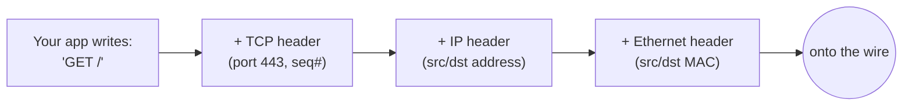
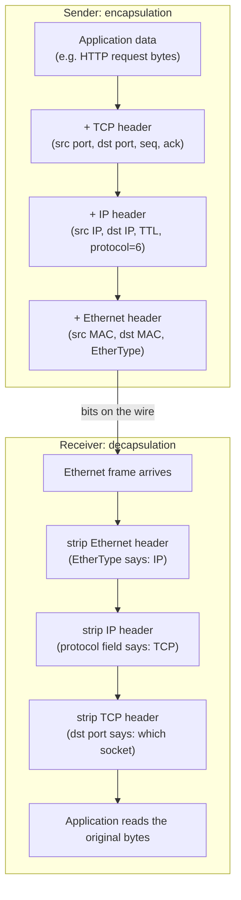
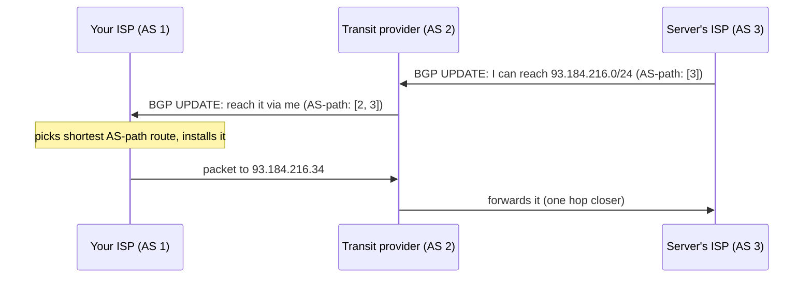
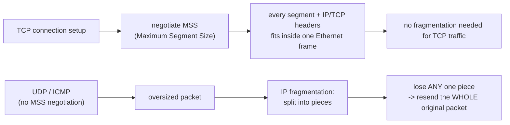
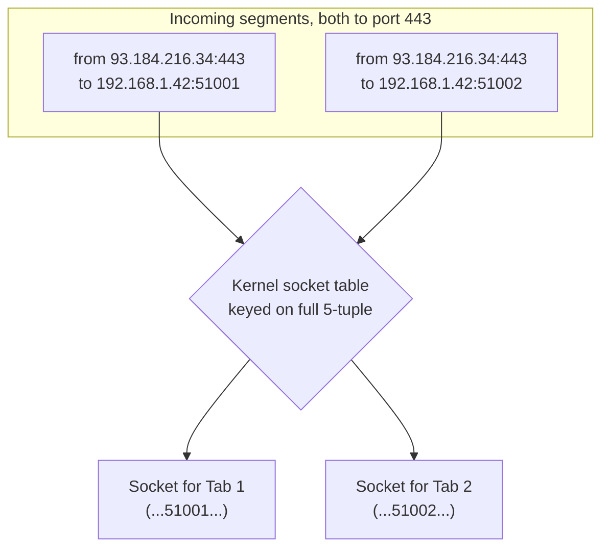

# How the Internet Works - IP, Ports, Packets, OSI vs TCP-IP

> [!summary] TL;DR
> The internet moves data by chopping it into small chunks called **packets**, stamping each with a source and destination address, and letting independent routers forward each packet one hop at a time toward its destination. No single device knows the whole path in advance; the network figures it out hop by hop.

> [!abstract] Core idea
> - Data gets wrapped in layers (encapsulation) on the way out and unwrapped in the same order on the way in — like nested envelopes.
> - An **IP address** gets a packet to the right *host*; a **port number** gets it to the right *program* on that host.
> - Routers only look at the IP layer and forward packet by packet; they don't track connections.
> - OSI's 7 layers are a teaching model for talking about networks; the internet itself runs on the 4-layer TCP/IP model.
> - A connection's identity on the wire is a **5-tuple**: protocol, source IP:port, destination IP:port.
> - This note goes deeper than a first pass at networking: it also covers BGP route propagation between organizations and MTU/fragmentation, which is why it is tagged intermediate rather than basic.

## 1. Why it exists

Imagine your laptop (`192.168.1.42`) wants to fetch a page from a server (`93.184.216.34`). There is no dedicated wire running between the two machines. Your laptop talks to a home router, which talks to your ISP, which talks to other ISPs, which eventually reach the network the server lives on. That path crosses machines owned by different companies, upgraded independently, some of them down for maintenance on any given day.

A phone call used to solve this by reserving a dedicated **circuit** for the whole call — a fixed slice of wire that only that call could use, sitting idle during every silent pause. The internet's designers rejected that idea. Instead:

1. Every message is cut into small **packets**, each at most roughly 1500 bytes.
2. Each packet is independently labelled with where it came from and where it is going.
3. Routers forward each packet using whatever path looks best *right now* — not a path agreed in advance.
4. If a link goes down mid-conversation, the next packet can simply take a different route.

> [!tip] Remember
> No device — not your laptop, not any single router — ever knows the complete end-to-end path. Each router only needs to know the *next* hop.

The price of this flexibility is that packets can arrive out of order, get duplicated, or get dropped outright. Those are exactly the problems that layers above IP — mainly TCP — exist to paper over. See [[TCP - Handshake, Reliability, Flow and Congestion Control]].

### Picture it: one request leaving your laptop



Each layer wraps the one above it in its own header. A router only ever opens the IP header; a switch only ever opens the Ethernet header. Neither one looks any deeper than it has to.

## 2. Mental model

**Analogy — nested envelopes.** Picture your data as a letter. Before it goes anywhere, three people each put it inside a bigger envelope and write their own "to/from" on the outside:

- The **Ethernet** envelope is addressed to the next physical device (a switch or router) by **MAC address**. It only has to survive one hop — the next device tears it open and throws it away.
- The **IP** envelope is addressed end-to-end, by **IP address**. It survives the *entire* trip, hop after hop, even though the Ethernet envelope around it gets replaced at every single hop.
- The **TCP** (or UDP) envelope, innermost, adds a **port number** so the destination machine knows which *program* should open the letter.

A router, in this picture, is a post office that reads only the IP envelope's address, decides which office to forward it to next, puts it inside a brand-new Ethernet envelope for that one hop, and sends it on. It never opens the inner envelopes.

Where the analogy breaks down: a real post office reads a letter once and is done; a router repeats this "read IP address, repackage, forward" cycle for millions of packets per second, and it discards and rebuilds the outer envelope at *every single hop* — nothing like paper mail.

## 3. How it works

### Encapsulation and decapsulation

**In plain words:** sending data down the stack means stacking a new header on top at each layer, like nesting dolls. Receiving it means popping dolls off one at a time, in the exact reverse order they were added.

**Picture it:**



**Example:** an HTTP GET request leaves your browser as plain bytes. TCP wraps it with a header naming port 443 and a sequence number. IP wraps that with a header naming your address and the server's address. Ethernet wraps that again with the MAC address of the very next device — your home router, not the server.

**Why it matters:** each header carries a field that names what comes next — the Ethernet frame's EtherType (IPv4 vs IPv6 vs ARP), the IP header's protocol field (TCP=6, UDP=17, ICMP=1), and the destination port. Without those fields, decapsulation would have no way to know which header to strip next, and the receiving machine could not hand the data to the right program.

> [!warning] Common mistake
> Thinking a router "reads the request" or "sees the URL." A router at the IP layer never opens the TCP header, so it never sees a port number, and it absolutely never sees the HTTP request text inside. Only the two endpoints (and anything terminating TLS) ever see that.

> [!tip] Remember
> Encapsulation adds headers going out; decapsulation strips them in exact reverse order coming in — like unstacking nesting dolls from the outside in.

### OSI's 7 layers vs the internet's 4

**In plain words:** you'll often hear networking explained with "the 7 layers of OSI." That model is a *teaching reference* from the 1980s — no mainstream network stack actually implements all seven as separate, distinct protocols. What ships inside every real operating system is the simpler **TCP/IP (Internet) model**, standardized by the IETF in RFC 1122, with 4 layers.

**Picture it:**

| OSI layer | Name | What it does | TCP/IP equivalent |
| --- | --- | --- | --- |
| 7 | Application | HTTP, DNS, SSH semantics | Application |
| 6 | Presentation | Encoding, TLS encryption (often folded into 7 in practice) | Application |
| 5 | Session | Session setup/teardown (rarely a distinct protocol today) | Application |
| 4 | Transport | Ports, reliability (TCP), or none (UDP) | Transport |
| 3 | Network | IP addressing and routing | Internet |
| 2 | Data Link | MAC addresses, Ethernet frames, switches | Link |
| 1 | Physical | Bits on copper, fiber, radio | Link |

**Example:** OSI's layers 5, 6 and 7 (session, presentation, application) all collapse into one "Application" layer on the wire for almost anything you will build. There is no separate "session layer protocol" running between your browser and a web server — that idea exists only in the teaching diagram.

**Why it matters:** when someone says "L4 load balancer" or "L7 firewall" (see [[Forward and Reverse Proxies - L4 vs L7]]), they are borrowing OSI's numbers as shorthand for "does it only see IP and port, or does it actually parse HTTP." Knowing which model is real and which is a teaching aid keeps you from drawing a fictitious "session layer" into a real system diagram.

> [!warning] Common mistake
> Describing a production system's layers using all 7 OSI numbers as if each were a distinct wire protocol. Use the 4-layer TCP/IP model for how things actually work, and OSI's numbers only as shorthand vocabulary.

> [!tip] Remember
> OSI is vocabulary; TCP/IP's 4 layers (Link, Internet, Transport, Application) is what actually runs.

### Routing and BGP, briefly

**In plain words:** a **router** is a machine holding a forwarding table: for a given destination IP, which outgoing interface (and next-hop router) should this packet go to. Inside one organization's network — one **Autonomous System (AS)**, such as one ISP — routers exchange routes with an **interior** protocol (OSPF, IS-IS) that finds shortest paths by link cost.

Between *different* organizations' networks, routers speak **BGP** (Border Gateway Protocol, RFC 4271). Think of BGP as a chain of word-of-mouth announcements: each AS tells its neighbors "I can reach this address block," and its neighbors repeat that announcement onward, each adding their own name to a running list called the **AS-path**.

**Step-by-step — how one route propagates:**

1. The server's own ISP (AS 3) announces to its neighbor: "I can reach `93.184.216.0/24`. AS-path: [3]."
2. A transit provider (AS 2) hears this, adds itself to the path, and re-announces: "reachable via me. AS-path: [2, 3]."
3. Your ISP (AS 1) hears the transit provider's announcement and picks it — among any other candidate routes — by shortest AS-path (plus other policy rules), then installs it in its own forwarding table.
4. From then on, your ISP forwards any packet addressed to that block toward the transit provider, one hop at a time, with no single router ever knowing the whole path.

**Picture it** (made-up AS numbers and prefix, illustrating the shape of a real exchange rather than a captured session — real AS-path announcements involve many more hops and policy rules):



**Why it matters:** this word-of-mouth design is exactly why losing one undersea cable or one ISP peering point reroutes traffic instead of cutting the internet in half — neighbors simply stop hearing a route and switch to the next-best one they know. It is also why a *bad* BGP announcement (a misconfigured AS claiming a prefix it has no business serving) can hijack and misdirect traffic: there is no central authority checking who is allowed to announce what.

> [!warning] Common mistake
> Assuming BGP verifies who is "allowed" to announce a prefix. It does not, by default — route-origin validation (RPKI) is a bolt-on fix layered on top of BGP, not something built into the original protocol.

> [!tip] Remember
> BGP is organizations announcing reachability to each other by word of mouth; the shortest AS-path (plus policy) wins, with no central authority checking who is telling the truth.

### MTU and fragmentation

**In plain words:** Ethernet frames carry at most **1500 bytes of payload** by default — this ceiling is called the **Maximum Transmission Unit (MTU)**. A packet larger than the MTU of any link it crosses must either be split up (fragmented) or, better, never be created oversized in the first place.

**Picture it — what TCP does instead of fragmenting:**



**Example:** TCP negotiates a Maximum Segment Size (MSS) at connection setup, sized so each segment plus its IP/TCP headers fits inside one 1500-byte Ethernet frame — avoiding fragmentation entirely for TCP traffic. UDP and ICMP traffic has no such negotiation, so it can still get fragmented; if any single fragment of that split packet is lost, the *entire* original packet must be resent, not just the missing piece.

**Why it matters:** **Path MTU Discovery** sends packets with the "don't fragment" bit set and shrinks its guess of the usable MTU whenever a router replies "too big." This is why MTU-related outages — commonly a VPN or tunnel header pushing an otherwise-fine packet over 1500 bytes — show up as "everything works except big responses," a confusing symptom that traces straight back to this one header field.

> [!tip] Remember
> TCP avoids fragmentation by negotiating segment size up front; UDP/ICMP can still be fragmented, and losing one fragment means resending the whole packet.

### Ports and sockets: the 5-tuple

**In plain words:** an IP address identifies a *host* (one machine). A **port** — a number from 0 to 65535 — identifies a *program* running on that host. It lives in the TCP or UDP header, not the IP header, which is exactly why a router forwarding on the IP header alone never sees it. Ports below 1024 are "well-known" by convention (80 = HTTP, 443 = HTTPS, 53 = DNS) and on Linux require root privileges to bind.

A **socket** is the operating system's handle for one end of a connection. The OS and the network together identify a single TCP connection by its **5-tuple**:

```text
(protocol, source IP, source port, destination IP, destination port)
```

**Example — why two browser tabs don't collide.** Open two tabs to `https://example.com`. Both get the *same* destination IP and the *same* destination port (443). What differs is the **source port**: the OS picks a different, free **ephemeral source port** (typically 32768–60999 on Linux) for each outgoing connection, so every 5-tuple is unique even though 4 of its 5 fields are identical between the two tabs.

**Picture it:**

| Field | Tab 1 | Tab 2 |
| --- | --- | --- |
| protocol | TCP | TCP |
| source IP | 192.168.1.42 | 192.168.1.42 |
| source port | 51001 | 51002 |
| destination IP | 93.184.216.34 | 93.184.216.34 |
| destination port | 443 | 443 |

Only the source port differs, but that one field is enough: the kernel keys its socket lookup table on the *full* 5-tuple, so it can tell the two connections' incoming traffic apart and hand each one to the correct program thread.



The destination port (443) alone could not tell the kernel which tab's data this is — only the full 5-tuple, including the differing source port, can.

> [!warning] Common mistake
> Thinking a server "listening on port 443" can only handle one connection at a time, or that the port alone identifies a connection. The listening port identifies where *new* connections arrive; each *established* connection is identified by the full 5-tuple, which is how one port serves thousands of simultaneous clients.

> [!tip] Remember
> IP address → which host; port → which program; the 5-tuple is a connection's true, unique identity on the wire.

## 4. Worked example

### Whiteboard version

The simplest possible socket program already makes the 5-tuple visible: one side listens, one side connects, and each end sees a different pairing of addresses and ports.

```go
ln, _ := net.Listen("tcp", "127.0.0.1:0") // OS picks a free port
conn, _ := net.Dial("tcp", ln.Addr().String())
fmt.Println(conn.LocalAddr(), "->", conn.RemoteAddr())
```

**Step-by-step trace of what happens:**

1. `net.Listen` asks the OS for any free port on `127.0.0.1` and starts listening on it — this is the "well-known address" a client needs to find the server.
2. `net.Dial` opens a new outbound connection to that address. The OS picks a free **ephemeral port** on the client side automatically — nothing in the code chose it.
3. `conn.LocalAddr()` on the client side is `127.0.0.1:<ephemeral port>`; `conn.RemoteAddr()` is the listener's address.
4. If you ran this program twice at once, both client connections would share the same destination IP and port, but each would get a *different* ephemeral source port — exactly the 5-tuple distinction from the mental model above.

Runnable Go version: [[How the Internet Works - IP, Ports, Packets, OSI vs TCP-IP - Go]]

## 5. Variants and comparison

| Model | Layers | Used for | Who actually implements it |
| --- | --- | --- | --- |
| OSI 7-layer | Physical, Data Link, Network, Transport, Session, Presentation, Application | Teaching, vocabulary ("L3 switch," "L7 proxy") | No mainstream stack as 7 separate protocols |
| TCP/IP 4-layer | Link, Internet, Transport, Application | What ships in every OS network stack | Linux, BSD/macOS, Windows networking stacks |
| TCP/IP 5-layer (common textbook split) | Physical, Data Link, Network, Transport, Application | A middle ground some courses teach | Same as above; Physical and Link just separated for clarity |

| Transport | Delivery guarantee | Ordering | Overhead | Use when |
| --- | --- | --- | --- | --- |
| TCP | Retransmits lost segments | In order | Handshake + ack overhead | Correctness matters more than latency (HTTP, SSH) |
| UDP | None — packets may be lost | Not guaranteed | Minimal (8-byte header) | Latency matters more than occasional loss (DNS, video, QUIC's basis) |

## 6. Trade-offs and when not to use

- Packet switching's flexibility (any path, hop by hop) costs ordering and reliability guarantees — something above IP (TCP, or the application) must restore them if the application needs them.
- Treating OSI as a literal implementation (rather than a teaching aid) leads to confused diagrams that invent a "session layer protocol" that doesn't exist on the wire; describe real systems with the 4-layer model and borrow OSI numbers only as shorthand.
- BGP trusts announcements by default: a correctly behaving network has almost no way to stop a neighbor from falsely announcing someone else's prefix, which is why route-origin validation (RPKI) exists as a bolt-on fix, not a built-in protection.

## 7. In production

- **Real systems:** every TCP/IP stack (Linux, macOS, Windows) implements the 4-layer model directly; BGP runs between every pair of ISPs and cloud providers on the internet; AWS/GCP/Azure VPC routing tables are, internally, a constrained BGP-like forwarding problem (see [[IP Addressing, Subnets, NAT and VPC Basics]]).
- **Failure modes → fixes:**
	- **MTU black hole**: large packets vanish silently (a middlebox drops them instead of sending back "too big") → lower the interface MTU or clamp MSS on the path.
	- **BGP route leak/hijack**: traffic for a prefix suddenly routes somewhere wrong → RPKI route-origin validation, and monitoring services that alert on unexpected AS-path changes for your own prefixes.
	- **Port exhaustion**: a host opening huge numbers of outbound connections to the same destination runs out of ephemeral source ports (the ~28,000 available on Linux by default) → connection pooling/reuse, or widen the ephemeral port range.
- **What to monitor:** interface MTU mismatches (via Path MTU Discovery failures), BGP session flaps and unexpected AS-path changes for your own prefixes, and ephemeral port usage on high-connection-count hosts.

## 8. Deep dive

- **Why packet switching over circuit switching:** a phone network reserves a fixed-capacity circuit for a call's whole duration, wasting it during silence. Packet switching statistically multiplexes many flows over the same link, trading guaranteed bandwidth for better average utilization — the core bet the early ARPANET made and the internet inherited.
- **TTL as a loop-breaker, not a timer:** the IP header's **TTL** (Time To Live) field is a hop count, decremented by one at every router; when it hits zero the packet is dropped and an ICMP "Time Exceeded" is sent back. This is what `traceroute` abuses: it sends packets with TTL=1, 2, 3, … and records which router replies "exceeded" at each hop, reconstructing the path one router at a time.
- **Why the 5-tuple, not just the port:** a server listening on port 443 can be reached by millions of distinct clients simultaneously. The OS demultiplexes incoming segments to the right in-memory socket using the full 5-tuple as the lookup key, not just the destination port — otherwise it couldn't tell two clients' traffic apart.
- **EtherType and the IP protocol field** are what make decapsulation deterministic: EtherType `0x0800` says "the next header is IPv4," and the IP header's protocol field (6=TCP, 17=UDP, 1=ICMP) says what follows it. Get either field wrong (common in hand-rolled raw-socket code) and the receiving stack silently drops the packet.
- **Anycast as an application of IP routing, not a special protocol**: the same IP address is announced via BGP from many physical locations, and normal shortest-AS-path routing sends each client to its topologically nearest instance. This is how DNS root servers and CDNs serve a single IP from dozens of data centers (see [[DNS - Resolution, Records and Caching]] and [[CDN and Edge]]).

## 9. Interview questions

> [!question]- What's the difference between an IP address and a port?
> An IP address identifies a *host* on the network; a port (0–65535, carried in the TCP/UDP header, not the IP header) identifies a *program* on that host. Routers route on IP addresses only; the destination host's kernel uses the port to hand the data to the right listening process.

> [!question]- Trap: "Explain the OSI model as how the internet actually works."
> It's a trap because OSI is a vendor-neutral teaching reference from the 1980s, not what ships in a real stack. The internet runs the IETF's 4-layer TCP/IP model (Link, Internet, Transport, Application); OSI's layers 5–7 all collapse into "Application" in practice. Say this explicitly rather than drawing all 7 as if each were a distinct wire protocol.

> [!question]- Why do two browser tabs to the same HTTPS site not interfere with each other?
> Each tab's connection gets a different ephemeral source port chosen by the OS, so the 5-tuple (protocol, source IP:port, destination IP:port) differs even though the destination IP and port (443) are identical. The kernel uses the full 5-tuple, not just the port, to demultiplex incoming data to the right socket.

> [!question]- What happens to a packet larger than a link's MTU?
> If the "don't fragment" bit isn't set, a router fragments it into smaller IP packets, which is expensive because losing any one fragment means resending the whole original packet. TCP avoids this by negotiating a Maximum Segment Size at connection setup so segments already fit the path's MTU; Path MTU Discovery finds that size by watching for "too big" replies.

> [!question]- How does a router decide where to send a packet it's never seen before?
> It looks up the destination IP in its forwarding table, built from routes learned via an interior routing protocol (within one network) and BGP (between networks/ASes). It picks the best matching prefix (longest prefix match) and forwards the packet out the corresponding interface to the next hop — it doesn't need to know the whole path, only the next step.

> [!question]- What does TTL actually do, and how does traceroute use it?
> TTL is a hop counter in the IP header, decremented by each router; it prevents packets from looping forever on a routing misconfiguration. Traceroute sends packets with TTL = 1, 2, 3, … and records the "Time Exceeded" ICMP reply from each router along the way, reconstructing the path hop by hop.

## 10. Cheat sheet

- Packets are independently routed; no end-to-end circuit is reserved.
- Encapsulation adds a header per layer going out; decapsulation strips them in reverse coming in.
- OSI's 7 layers are a teaching model; the internet runs TCP/IP's 4 layers (Link, Internet, Transport, Application).
- IP address → host; port → program on that host; a connection's true identity is the 5-tuple.
- MTU is usually 1500 bytes; TCP negotiates MSS to avoid fragmentation, UDP doesn't.
- Routers forward hop by hop using a forwarding table; BGP builds that table between organizations by announcing reachable prefixes.
- TTL is a hop counter that stops routing loops, and `traceroute` exploits it to map a path.

## Links

- **Before this:** —
- **Next:** [[IP Addressing, Subnets, NAT and VPC Basics]], [[TCP - Handshake, Reliability, Flow and Congestion Control]], [[DNS - Resolution, Records and Caching]]
- **Compare with:** [[Forward and Reverse Proxies - L4 vs L7]] (where L4 vs L7 actually matters), [[I-O Models - Blocking, epoll, io_uring and the Go Netpoller]] (how a program reads from a socket)
- **Runnable code:** [[How the Internet Works - IP, Ports, Packets, OSI vs TCP-IP - Go]]
