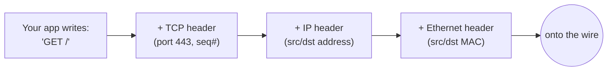
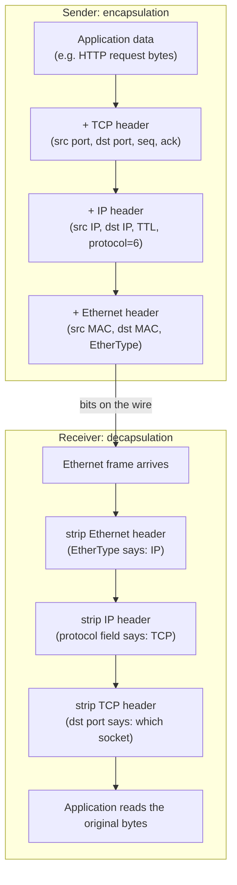
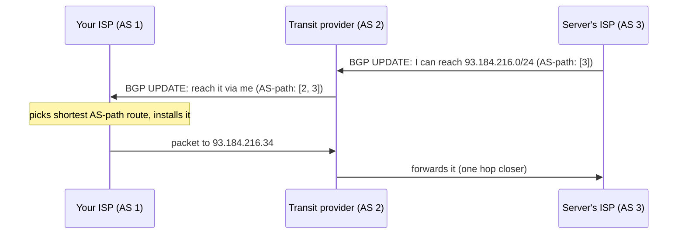

# How the Internet Works - IP, Ports, Packets, OSI vs TCP-IP

> [!summary] TL;DR
> The internet moves data by chopping it into small chunks called **packets**, stamping each with a source and destination address, and letting independent routers forward each packet one hop at a time toward its destination. No single device knows the whole path in advance; the network figures it out hop by hop.

> [!abstract] Core idea
> - Data gets wrapped in layers (encapsulation) on the way out and unwrapped in the same order on the way in — like nested envelopes.
> - An **IP address** gets a packet to the right *host*; a **port number** gets it to the right *program* on that host.
> - Routers only look at the IP layer and forward packet by packet; they don't track connections.
> - OSI's 7 layers are a teaching model for talking about networks; the internet itself runs on the 4-layer TCP/IP model.
> - A connection's identity on the wire is a **5-tuple**: protocol, source IP:port, destination IP:port.

## 1. Why it exists

Say your laptop (`192.168.1.42`) wants to fetch a page from a server (`93.184.216.34`). There's no dedicated wire between the two — your laptop talks to a home router, which talks to your ISP, which talks to other ISPs, which eventually reach the network the server lives on. That path crosses machines owned by different companies, upgraded independently, some of them down for maintenance on any given day.

The internet's answer is to **not** reserve an end-to-end circuit (the way a phone call once did). Instead, every message is cut into packets of at most ~1500 bytes, each one labelled with where it's from and where it's going, and routers forward each packet independently using whatever path looks best *right now*. If a link goes down, the next packet can take a different route; the sender never needed to know the path in the first place.

The cost of this design is that packets can arrive out of order, get duplicated, or get dropped — problems layers above IP (mainly TCP) exist to paper over. See [[TCP - Handshake, Reliability, Flow and Congestion Control]].

### Whiteboard version



Each layer wraps the one above it in its own header. A router only ever opens the IP header; a switch only ever opens the Ethernet header.

## 2. Mental model

Think of a packet as a **nested envelope**. The innermost envelope is your actual data (an HTTP request). Each layer below puts that envelope inside a bigger one with its own "to/from" label:

- The **Ethernet** envelope is addressed to the next physical device (a switch or router), by MAC address — it only has to get one hop.
- The **IP** envelope is addressed end-to-end, by IP address — it survives the whole trip, hop after hop, while the Ethernet envelope around it gets thrown away and replaced at every hop.
- The **TCP** (or UDP) envelope inside that adds a port number, so the destination machine knows which *program* should open it.

A router is a post office that reads only the IP envelope's address, decides the next office to forward it to, puts it in a new Ethernet envelope for that one hop, and sends it on. It never looks inside.

## 3. How it works

### Encapsulation and decapsulation

Sending data down the stack adds a header at each layer; receiving it strips a header at each layer, in the exact reverse order:



Each layer's header carries a field that names the layer above it — EtherType (IPv4 vs IPv6 vs ARP), the IP protocol field (TCP=6, UDP=17, ICMP=1), and the TCP/UDP port — so decapsulation always knows which header comes next.

### OSI's 7 layers vs the internet's 4

**OSI is a teaching model**: it was designed in the 1980s as a vendor-neutral reference, and no mainstream network stack implements all seven layers as separate, distinct protocols. The internet runs on the older, simpler **TCP/IP (Internet) model**, which the IETF actually standardized (RFC 1122). Most engineers describe real systems with a 4-or-5-layer view and borrow OSI's numbers only as shorthand ("L4 load balancer," "L7 firewall").

| OSI layer | Name | What it does | TCP/IP equivalent |
| --- | --- | --- | --- |
| 7 | Application | HTTP, DNS, SSH semantics | Application |
| 6 | Presentation | Encoding, TLS encryption (often folded into 7 in practice) | Application |
| 5 | Session | Session setup/teardown (rarely a distinct protocol today) | Application |
| 4 | Transport | Ports, reliability (TCP), or none (UDP) | Transport |
| 3 | Network | IP addressing and routing | Internet |
| 2 | Data Link | MAC addresses, Ethernet frames, switches | Link |
| 1 | Physical | Bits on copper, fiber, radio | Link |

The practical reason this distinction matters: when someone says "L4 vs L7 proxy" (see [[Forward and Reverse Proxies - L4 vs L7]]), they mean "does it only see IP+port, or does it parse HTTP." OSI's layers 5–7 collapse into one "application" layer on the wire for almost everything you'll build.

### Routing and BGP, briefly

A **router** holds a forwarding table: for a given destination IP, which outgoing interface (and next-hop router) to send it to. Inside one network (an Autonomous System, AS — e.g. one ISP), routers exchange routes with an **interior** protocol (OSPF, IS-IS) that finds shortest paths by link cost.

Between different organizations' networks, routers speak **BGP** (Border Gateway Protocol, RFC 4271): each AS announces which IP prefixes ("I can reach `93.184.216.0/24`") it can route to, and its neighbors propagate that announcement onward, each adding itself to an **AS-path**. A receiving router picks the route with the shortest AS-path (among other policy rules) and adds the prefix to its own table — with no central authority. This is why losing one undersea cable or one ISP peering point reroutes traffic rather than cutting the internet in half, and also why a bad BGP announcement (a misconfigured AS announcing routes it doesn't actually serve) can hijack and misdirect traffic for prefixes it has no business claiming.

An illustrative route-propagation sequence (made-up AS numbers and prefix, not a captured real BGP session — real AS-path announcements involve many more hops and policy rules):



### MTU and fragmentation

Ethernet frames carry at most **1500 bytes of payload** by default (the Maximum Transmission Unit, MTU). A packet larger than the MTU of a link it crosses must be split (fragmented) or, for TCP, never created oversized in the first place: TCP negotiates a Maximum Segment Size (MSS) at connection setup so each segment plus its IP/TCP headers fits in one Ethernet frame, avoiding fragmentation entirely. IP fragmentation still happens for UDP and ICMP traffic that doesn't do this negotiation, and it's expensive: if any one fragment is lost, the entire original packet must be resent. **Path MTU Discovery** sends packets with the "don't fragment" bit set and shrinks the guessed MTU whenever a router replies "too big"; this is why MTU-related outages (a VPN or tunnel header pushing you over 1500) show up as "everything works except big responses."

### Ports and sockets: the 5-tuple

An IP address identifies a *host*. A **port** (0–65535) identifies a *program* on that host — a 16-bit number carried in the TCP or UDP header, not the IP header. Ports below 1024 are "well-known" by convention (80 = HTTP, 443 = HTTPS, 53 = DNS) and on Linux require root to bind.

A **socket** is the OS handle for one end of a connection. The OS and the network identify a single TCP connection by its **5-tuple**:

```text
(protocol, source IP, source port, destination IP, destination port)
```

Two browser tabs open to the same `https://example.com` get *different* 5-tuples — the server's IP and port (443) are identical, but the OS picks a different **ephemeral source port** (typically 32768–60999 on Linux) for each outgoing connection, so the server (and the kernel on both ends) can tell them apart. This is exactly what the Go demo below proves.

## 4. Worked example

### Whiteboard version

The simplest possible socket program: one side listens, one side connects, and you can already see the 5-tuple appear.

```go
ln, _ := net.Listen("tcp", "127.0.0.1:0") // OS picks a free port
conn, _ := net.Dial("tcp", ln.Addr().String())
fmt.Println(conn.LocalAddr(), "->", conn.RemoteAddr())
```

The full version below starts an echo server, connects a client, and asserts on both ends' 5-tuples.

```go
// Package socket demonstrates the TCP 5-tuple (protocol, source IP, source
// port, destination IP, destination port) that a kernel uses to route every
// packet to the right socket.
package socket

import (
	"fmt"
	"io"
	"net"
)

// FiveTuple formats the connection identity the kernel keys its socket
// table on: protocol + both endpoints.
func FiveTuple(network string, conn net.Conn) string {
	return fmt.Sprintf("%s %s -> %s", network, conn.LocalAddr(), conn.RemoteAddr())
}

// EchoServer accepts one connection on addr, echoes whatever it reads back
// to the client, and reports the 5-tuple it saw over tuples before closing.
// It stops after the first connection, which is all the demo needs.
func EchoServer(ln net.Listener, tuples chan<- string) {
	conn, err := ln.Accept()
	if err != nil {
		close(tuples)
		return
	}
	defer conn.Close()
	tuples <- FiveTuple("tcp", conn)
	close(tuples)
	_, _ = io.Copy(conn, conn) // echo: write back everything read, until EOF; error ignored, demo only
}
```

The test opens two independent connections and confirms each gets its own ephemeral source port — the reason a server can serve thousands of clients on one listening port:

```go
func TestFiveTupleDiffersPerConnection(t *testing.T) {
	ln, err := net.Listen("tcp", "127.0.0.1:0")
	if err != nil {
		t.Fatalf("listen: %v", err)
	}
	defer ln.Close()

	tuples := make(chan string, 1)
	go EchoServer(ln, tuples)

	client, err := net.DialTimeout("tcp", ln.Addr().String(), 2*time.Second)
	if err != nil {
		t.Fatalf("dial: %v", err)
	}
	defer client.Close()

	serverSide := <-tuples
	clientSide := FiveTuple("tcp", client)

	if !strings.Contains(serverSide, ln.Addr().String()) {
		t.Fatalf("server tuple %q should end at the listener address %q", serverSide, ln.Addr())
	}
	clientLocalPort := client.LocalAddr().(*net.TCPAddr).Port
	if clientLocalPort == 0 {
		t.Fatalf("expected the OS to assign a nonzero ephemeral port, got %d", clientLocalPort)
	}

	if _, err := client.Write([]byte("ping")); err != nil {
		t.Fatalf("write: %v", err)
	}
	client.(*net.TCPConn).CloseWrite() // signal EOF so the server's io.Copy returns
	buf := make([]byte, 4)
	if _, err := io.ReadFull(client, buf); err != nil {
		t.Fatalf("read echo: %v", err)
	}
	if string(buf) != "ping" {
		t.Fatalf("echo = %q, want %q", buf, "ping")
	}
	t.Logf("server saw: %s", serverSide)
	t.Logf("client saw: %s", clientSide)
}
```

**Measured (Go 1.24.4, darwin/arm64, 2026-11-06):** `go test -race -v` output:

```text
=== RUN   TestFiveTupleDiffersPerConnection
    socket_test.go:57: server saw: tcp 127.0.0.1:54664 -> 127.0.0.1:54665
    socket_test.go:58: client saw: tcp 127.0.0.1:54665 -> 127.0.0.1:54664
--- PASS: TestFiveTupleDiffersPerConnection (0.00s)
PASS
ok  	net01	1.671s
```

The client's local port (`54665`) is exactly the server's remote port, and vice versa — the same socket pair described from each side, with the OS having picked `54665` as a free ephemeral port for the client without being asked.

## 5. Variants and comparison

| Model | Layers | Used for | Who actually implements it |
| --- | --- | --- | --- |
| OSI 7-layer | Physical, Data Link, Network, Transport, Session, Presentation, Application | Teaching, vocabulary ("L3 switch," "L7 proxy") | No mainstream stack as 7 separate protocols |
| TCP/IP 4-layer | Link, Internet, Transport, Application | What ships in every OS network stack | Linux, BSD/macOS, Windows networking stacks |
| TCP/IP 5-layer (common textbook split) | Physical, Data Link, Network, Transport, Application | A middle ground some courses teach | Same as above; Physical and Link just separated for clarity |

| Transport | Delivery guarantee | Ordering | Overhead | Use when |
| --- | --- | --- | --- | --- |
| TCP | Retransmits lost segments | In order | Handshake + ack overhead | Correctness matters more than latency (HTTP, SSH) |
| UDP | None — packets may be lost | Not guaranteed | Minimal (8-byte header) | Latency matters more than occasional loss (DNS, video, QUIC's basis) |

## 6. Trade-offs and when not to use

- Packet switching's flexibility (any path, hop by hop) costs ordering and reliability guarantees — something above IP (TCP, or the application) must restore them if the application needs them.
- Treating OSI as a literal implementation (rather than a teaching aid) leads to confused diagrams that invent a "session layer protocol" that doesn't exist on the wire; describe real systems with the 4-layer model and borrow OSI numbers only as shorthand.
- BGP trusts announcements by default: a correctly behaving network has almost no way to stop a neighbor from falsely announcing someone else's prefix, which is why route-origin validation (RPKI) exists as a bolt-on fix, not a built-in protection.

## 7. In production

- **Real systems:** every TCP/IP stack (Linux, macOS, Windows) implements the 4-layer model directly; BGP runs between every pair of ISPs and cloud providers on the internet; AWS/GCP/Azure VPC routing tables are, internally, a constrained BGP-like forwarding problem (see [[IP Addressing, Subnets, NAT and VPC Basics]]).
- **Failure modes → fixes:**
	- **MTU black hole**: large packets vanish silently (a middlebox drops them instead of sending back "too big") → lower the interface MTU or clamp MSS on the path.
	- **BGP route leak/hijack**: traffic for a prefix suddenly routes somewhere wrong → RPKI route-origin validation, and monitoring services that alert on unexpected AS-path changes for your own prefixes.
	- **Port exhaustion**: a host opening huge numbers of outbound connections to the same destination runs out of ephemeral source ports (the ~28,000 available on Linux by default) → connection pooling/reuse, or widen the ephemeral port range.
- **What to monitor:** interface MTU mismatches (via Path MTU Discovery failures), BGP session flaps and unexpected AS-path changes for your own prefixes, and ephemeral port usage on high-connection-count hosts.

## 8. Deep dive

- **Why packet switching over circuit switching:** a phone network reserves a fixed-capacity circuit for a call's whole duration, wasting it during silence. Packet switching statistically multiplexes many flows over the same link, trading guaranteed bandwidth for better average utilization — the core bet the early ARPANET made and the internet inherited.
- **TTL as a loop-breaker, not a timer:** the IP header's **TTL** (Time To Live) field is a hop count, decremented by one at every router; when it hits zero the packet is dropped and an ICMP "Time Exceeded" is sent back. This is what `traceroute` abuses: it sends packets with TTL=1, 2, 3, … and records which router replies "exceeded" at each hop, reconstructing the path one router at a time.
- **Why the 5-tuple, not just the port:** a server listening on port 443 can be reached by millions of distinct clients simultaneously. The OS demultiplexes incoming segments to the right in-memory socket using the full 5-tuple as the lookup key, not just the destination port — otherwise it couldn't tell two clients' traffic apart.
- **EtherType and the IP protocol field** are what make decapsulation deterministic: EtherType `0x0800` says "the next header is IPv4," and the IP header's protocol field (6=TCP, 17=UDP, 1=ICMP) says what follows it. Get either field wrong (common in hand-rolled raw-socket code) and the receiving stack silently drops the packet.
- **Anycast as an application of IP routing, not a special protocol**: the same IP address is announced via BGP from many physical locations, and normal shortest-AS-path routing sends each client to its topologically nearest instance. This is how DNS root servers and CDNs serve a single IP from dozens of data centers (see [[DNS - Resolution, Records and Caching]] and [[CDN and Edge]]).

## 9. Interview questions

> [!question]- What's the difference between an IP address and a port?
> An IP address identifies a *host* on the network; a port (0–65535, carried in the TCP/UDP header, not the IP header) identifies a *program* on that host. Routers route on IP addresses only; the destination host's kernel uses the port to hand the data to the right listening process.

> [!question]- Trap: "Explain the OSI model as how the internet actually works."
> It's a trap because OSI is a vendor-neutral teaching reference from the 1980s, not what ships in a real stack. The internet runs the IETF's 4-layer TCP/IP model (Link, Internet, Transport, Application); OSI's layers 5–7 all collapse into "Application" in practice. Say this explicitly rather than drawing all 7 as if each were a distinct wire protocol.

> [!question]- Why do two browser tabs to the same HTTPS site not interfere with each other?
> Each tab's connection gets a different ephemeral source port chosen by the OS, so the 5-tuple (protocol, source IP:port, destination IP:port) differs even though the destination IP and port (443) are identical. The kernel uses the full 5-tuple, not just the port, to demultiplex incoming data to the right socket.

> [!question]- What happens to a packet larger than a link's MTU?
> If the "don't fragment" bit isn't set, a router fragments it into smaller IP packets, which is expensive because losing any one fragment means resending the whole original packet. TCP avoids this by negotiating a Maximum Segment Size at connection setup so segments already fit the path's MTU; Path MTU Discovery finds that size by watching for "too big" replies.

> [!question]- How does a router decide where to send a packet it's never seen before?
> It looks up the destination IP in its forwarding table, built from routes learned via an interior routing protocol (within one network) and BGP (between networks/ASes). It picks the best matching prefix (longest prefix match) and forwards the packet out the corresponding interface to the next hop — it doesn't need to know the whole path, only the next step.

> [!question]- What does TTL actually do, and how does traceroute use it?
> TTL is a hop counter in the IP header, decremented by each router; it prevents packets from looping forever on a routing misconfiguration. Traceroute sends packets with TTL = 1, 2, 3, … and records the "Time Exceeded" ICMP reply from each router along the way, reconstructing the path hop by hop.

## 10. Cheat sheet

- Packets are independently routed; no end-to-end circuit is reserved.
- Encapsulation adds a header per layer going out; decapsulation strips them in reverse coming in.
- OSI's 7 layers are a teaching model; the internet runs TCP/IP's 4 layers (Link, Internet, Transport, Application).
- IP address → host; port → program on that host; a connection's true identity is the 5-tuple.
- MTU is usually 1500 bytes; TCP negotiates MSS to avoid fragmentation, UDP doesn't.
- Routers forward hop by hop using a forwarding table; BGP builds that table between organizations by announcing reachable prefixes.
- TTL is a hop counter that stops routing loops, and `traceroute` exploits it to map a path.

## Links

- **Before this:** —
- **Next:** [[IP Addressing, Subnets, NAT and VPC Basics]], [[TCP - Handshake, Reliability, Flow and Congestion Control]], [[DNS - Resolution, Records and Caching]]
- **Compare with:** [[Forward and Reverse Proxies - L4 vs L7]] (where L4 vs L7 actually matters), [[I-O Models - Blocking, epoll, io_uring and the Go Netpoller]] (how a program reads from a socket)
