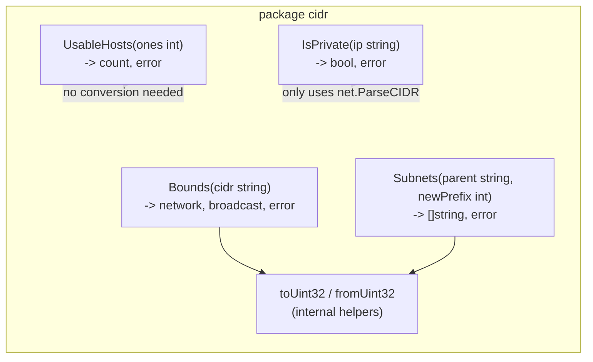

# IP Addressing, Subnets, NAT and VPC Basics - Go

> [!summary] TL;DR
> This code implements the subnet arithmetic from [[IP Addressing, Subnets, NAT and VPC Basics]]: counting usable hosts in a prefix, finding a block's network/broadcast bounds, splitting a parent block into equal child subnets (the VPC `/16 → /20` example), and checking RFC 1918 membership.

## Before the code 🟢

> [!info] How to read this note (pick your level)
> - 🟢 **New to this?** Read the "From zero" paragraph below, "Before the code" and "What this code shows", then just skim the code comments.
> - 🟡 **Know the basics?** Read each Code section's Concept + How it works, then the Tests.
> - 🔴 **Interview / SDE-3 prep?** Add Design decisions, Pitfalls and the Exercises. Headings are tagged 🟢🟡🔴.

> [!note] Before this note
> - [[How the Internet Works - IP, Ports, Packets, OSI vs TCP-IP]]: an IPv4 address is just a number that names one machine.
> - [[IP Addressing, Subnets, NAT and VPC Basics]] (theory twin): `/N` fixes the first N bits, and a `/16` splits into 16 `/20`s.

**From zero** 🟢 — This file is the runnable version of the IP addressing theory note. It is one small Go package that does subnet math: how many devices fit in a block, where a block starts and ends, how to split a big block into smaller ones (the AWS VPC example), and whether an address is private. Read the theory note first; here, read each "Concept" line, then the code, then "How it works".

- **`net` package:** `net.ParseCIDR` parses `"10.0.0.0/16"` into an address and a `*net.IPNet` (address + mask; the mask is the `/16` written as bits: 16 ones, then zeros).
- **`net.IP`:** a byte slice holding an address; `To4()` gives its 4-byte IPv4 form.
- **Bit shifts on `uint32`:** `toUint32`/`fromUint32` pack 4 bytes into one integer so address math is plain addition.
- **Errors as values:** functions return `(result, error)` instead of panicking (crashing the program) on bad input.
- **Table-driven tests:** tests loop over a `map` of input to expected output and report each mismatch with `t.Errorf`.
- **What to run:** `go vet ./... && go test -race ./...` in the module folder.

## What this code shows 🟢

| Code piece | Theory concept | Theory section |
| --- | --- | --- |
| `UsableHosts` | Usable-host arithmetic, including the `/31`/`/32` special cases | [[IP Addressing, Subnets, NAT and VPC Basics#CIDR notation and prefix math]] |
| `Bounds` | Finding a block's network and broadcast address from its CIDR string | [[IP Addressing, Subnets, NAT and VPC Basics#CIDR notation and prefix math]] |
| `Subnets` | Splitting a `/16` into `/20`s, the exact VPC worked example | [[IP Addressing, Subnets, NAT and VPC Basics#CIDR notation and prefix math]] |
| `IsPrivate` | Checking the three RFC 1918 private ranges | [[IP Addressing, Subnets, NAT and VPC Basics#Private IPv4 ranges RFC 1918]] |

**Picture it — how the four exported functions relate:**



`UsableHosts` and `IsPrivate` are self-contained; `Bounds` and `Subnets` both lean on the same pair of integer-conversion helpers, which is why those two are grouped together in the walkthrough below.

## Setup 🟢

- **Module layout:** a single package, `cidr`, with `cidr.go` and `cidr_test.go` in one directory.
- **Go version:** 1.24.
- **Dependencies:** none beyond the standard library (`net`, `fmt`).
- **How to run:**

```bash
go mod init cidr   # one-time
go vet ./...
go test -race -v ./...
```

## Code 🟡

> 🟢 → 🟡 **You now know** the four jobs: count usable hosts, find a block's first and last address, split a block, and spot private addresses. **Next we read the code** for each, plus two helpers that turn an address into one plain number so the math is simple addition.

### Counting usable hosts

**In plain words:** given a block size like `/24`, how many devices can actually get an address? (A couple of addresses are always reserved.)

**Concept.** The theory note's prefix-math table says a `/24` has 254 usable hosts, a `/31` has 2 (not 0), and a `/32` has exactly 1 — the RFC 3021 special cases.

`UsableHosts` encodes exactly that table as a function instead of a lookup, so it generalizes to any prefix length rather than only the handful of rows shown in the note.

An alternative design would hardcode a map for common prefixes only; computing it from the prefix length instead handles every value from `/0` to `/32` uniformly.

```go
// Package cidr does the subnet arithmetic every IPv4 addressing scheme needs:
// usable hosts, network/broadcast addresses, and splitting a block into
// smaller subnets (the same math AWS VPC uses for a public/private layout).
package cidr

import (
	"fmt"
	"net"
)

// UsableHosts returns the number of assignable IPv4 host addresses in a
// prefix of length ones (out of 32 bits). /31 and /32 are point-to-point and
// single-host special cases (RFC 3021) with no network/broadcast reserved.
func UsableHosts(ones int) (int, error) {
	if ones < 0 || ones > 32 {
		return 0, fmt.Errorf("prefix /%d out of range 0-32", ones)
	}
	switch ones {
	case 32:
		return 1, nil
	case 31:
		return 2, nil
	default:
		total := 1 << (32 - ones)
		return total - 2, nil // minus network address and broadcast address
	}
}
```

**How it works:**

1. `ones` is the prefix length — the "24" in `/24`. The function first rejects anything outside 0–32, since a prefix longer than 32 bits is meaningless for IPv4.
2. `/32` is a single host route (one address, itself) — there's no "network" or "broadcast" to carve out of a block of size 1.
3. `/31` is RFC 3021's point-to-point exception: a 2-address block where *both* addresses are usable, because there is no room to reserve either one.
4. Every other prefix computes the full block size (`1 << (32 - ones)`) and subtracts exactly 2, for the network and broadcast addresses — the standard rule from the theory note's table.

### Finding a block's network and broadcast address

**In plain words:** given any address in a block, find the block's first and last address, like finding where a street starts and ends from one house number.

**Concept.** Given any address inside a CIDR block, `Bounds` finds the block's first address (network) and last address (broadcast) — the same two addresses `UsableHosts` subtracts out, made concrete.

The alternative of doing this bit-by-bit on a raw byte slice (rather than going through `net.ParseCIDR`) was rejected because the standard library's `net.IPNet` already carries the parsed mask, and reusing it avoids re-implementing CIDR parsing from scratch.

```go
// Bounds returns the network address and the broadcast (last) address of
// the CIDR block that contains ip at /prefixLen.
func Bounds(cidr string) (network, broadcast net.IP, err error) {
	ip, ipNet, err := net.ParseCIDR(cidr)
	_ = ip
	if err != nil {
		return nil, nil, err
	}
	network = ipNet.IP.To4()
	if network == nil {
		return nil, nil, fmt.Errorf("only IPv4 is supported")
	}
	ones, bits := ipNet.Mask.Size()
	hostBits := bits - ones
	bcast := make(net.IP, len(network))
	copy(bcast, network)
	// Set every host bit to 1 to get the broadcast address.
	for i := 0; i < hostBits; i++ {
		byteIdx := 3 - i/8
		bitIdx := uint(i % 8)
		bcast[byteIdx] |= 1 << bitIdx
	}
	return network, bcast, nil
}
```

**How it works:**

1. `net.ParseCIDR` already normalizes the address down to the block's network address inside `ipNet.IP` — that's why `network` can be read straight off it rather than computed separately.
2. `ipNet.Mask.Size()` returns `(ones, bits)`: the prefix length and the total address width (32 for IPv4). `hostBits := bits - ones` is exactly the number of bits free to vary within the block.
3. The broadcast address starts as a copy of the network address, then flips every host bit to `1` — one bit at a time, from the least significant bit (the rightmost, smallest-value bit) upward — which is the bit-level version of "set the host portion to all ones."
4. `byteIdx := 3 - i/8` walks from the last byte backward as `i` grows, since IPv4 addresses are stored most-significant-byte-first but host bits are the *least* significant ones.

### Splitting a block into equal subnets

**In plain words:** cut one big address block into equal smaller blocks, the way you'd cut a cake into even slices.

**Concept.** This is the function behind the theory note's `/16 → /20` VPC worked example: given a parent CIDR block and a longer (more specific) prefix, it returns every equal-sized child subnet, in address order.

The alternative of returning an iterator (something that hands out one result at a time) instead of a fully materialized slice (all results built up front) was rejected because the counts involved in a VPC's typical subnet split (tens, not millions) are small enough that a slice is simpler to test and to consume.

```go
// Subnets splits a CIDR block into n equal subnets of the given new prefix
// length, the way a VPC's /16 is split into /20 or /24 subnets per AZ.
func Subnets(parentCIDR string, newPrefix int) ([]string, error) {
	_, ipNet, err := net.ParseCIDR(parentCIDR)
	if err != nil {
		return nil, err
	}
	ones, _ := ipNet.Mask.Size()
	if newPrefix < ones {
		return nil, fmt.Errorf("new prefix /%d must be longer than parent /%d", newPrefix, ones)
	}
	count := 1 << (newPrefix - ones)
	base := ipNet.IP.To4()
	if base == nil {
		return nil, fmt.Errorf("only IPv4 is supported")
	}
	step := uint32(1) << (32 - newPrefix)
	baseInt := toUint32(base)
	out := make([]string, 0, count)
	for i := 0; i < count; i++ {
		addr := fromUint32(baseInt + uint32(i)*step)
		out = append(out, fmt.Sprintf("%s/%d", addr, newPrefix))
	}
	return out, nil
}
```

**How it works:**

1. `count := 1 << (newPrefix - ones)` is exactly the "`2^4 = 16`" arithmetic from the theory note: the number of child subnets equals 2 raised to the bit-length difference between the two prefixes.
2. `step := uint32(1) << (32 - newPrefix)` is the address-count size of each child subnet — `4096` for a `/20`, matching the worked example's step size.
3. The loop produces each subnet's base address by adding `i * step` to the parent block's own base address (converted to and from a plain integer by the two helpers below), then formats it back as a CIDR string — this is the literal computation behind every row of the theory note's `/16 → /20` table.

**Concept — the integer conversion helpers.** `toUint32`/`fromUint32` convert between `net.IP`'s 4-byte representation and a single 32-bit integer.

This is what turns "add a fixed step to an address" from byte-by-byte carry arithmetic into a plain integer addition, which is both shorter to write and far less error-prone — manual carry logic across 4 bytes is exactly the kind of code that hides an off-by-one in one specific byte boundary.

```go
func toUint32(ip net.IP) uint32 {
	return uint32(ip[0])<<24 | uint32(ip[1])<<16 | uint32(ip[2])<<8 | uint32(ip[3])
}

func fromUint32(v uint32) net.IP {
	return net.IPv4(byte(v>>24), byte(v>>16), byte(v>>8), byte(v))
}
```

**How it works:**

1. `toUint32` packs the four address bytes into one `uint32`, most significant byte first — matching how an IPv4 address is conventionally read left to right.
2. `fromUint32` is the exact inverse: it shifts and masks the integer back into four individual bytes, handing them to `net.IPv4` in the same left-to-right order.
3. Because both directions use the same byte ordering, round-tripping an address through `toUint32` then `fromUint32` always returns the original address unchanged.

### Checking RFC 1918 membership

**In plain words:** answer one yes/no question: is this address one of the special "private, internal only" addresses?

**Concept.** `IsPrivate` answers the question the theory note's private-ranges table poses: does this address fall inside one of the three reserved RFC 1918 blocks?

It is deliberately a membership check against exactly three hardcoded CIDR blocks, rather than a general "is this address globally routable" classifier, because those are the only ranges the theory note's table claims to cover.

Scope creep here (handling loopback, link-local, multicast — one address that reaches a group of machines — and so on) would test claims the theory note does not make.

```go
// IsPrivate reports whether ip falls in an RFC 1918 private range.
func IsPrivate(ipStr string) (bool, error) {
	ip := net.ParseIP(ipStr)
	if ip == nil {
		return false, fmt.Errorf("invalid IP: %q", ipStr)
	}
	ip = ip.To4()
	if ip == nil {
		return false, fmt.Errorf("only IPv4 is supported")
	}
	for _, block := range []string{"10.0.0.0/8", "172.16.0.0/12", "192.168.0.0/16"} {
		_, n, _ := net.ParseCIDR(block)
		if n.Contains(ip) {
			return true, nil
		}
	}
	return false, nil
}
```

**How it works:**

1. `net.ParseIP` accepts both IPv4 and IPv6 text forms; `.To4()` immediately rejects anything that isn't a 4-byte IPv4 address, since RFC 1918 is an IPv4-only concept.
2. The three string literals are exactly the three rows of the theory note's private-ranges table — there is nothing dynamic here on purpose, since the whole point is checking against a fixed, well-known set.
3. `n.Contains(ip)` does the actual bitwise range check: it masks `ip` with the block's prefix and compares it to the block's network address.

## Tests 🟡

### TestUsableHosts

**What it proves:** the `/31`/`/32` special cases and the general "block size minus 2" rule both compute correctly, across a spread of common prefixes.

| Prefix | Expected usable hosts |
| --- | --- |
| /24 | 254 |
| /20 | 4094 |
| /16 | 65534 |
| /31 | 2 |
| /32 | 1 |
| /30 | 2 |

**What this code does, in plain words:** it loops over a few prefixes (`/24`, `/20`, `/16`, `/31`, `/32`, `/30`) and checks `UsableHosts` returns the expected count for each.

```go
func TestUsableHosts(t *testing.T) {
	cases := map[int]int{24: 254, 20: 4094, 16: 65534, 31: 2, 32: 1, 30: 2}
	for prefix, want := range cases {
		got, err := UsableHosts(prefix)
		if err != nil {
			t.Fatalf("/%d: %v", prefix, err)
		}
		if got != want {
			t.Errorf("/%d usable hosts = %d, want %d", prefix, got, want)
		}
	}
}
```

A failure here would mean the function miscounted a prefix's block size, which would directly contradict the theory note's prefix-math table — the two are meant to agree exactly.

### TestBounds

**What it proves:** `Bounds` correctly finds both the network and broadcast address of a `/24` block from a single address inside it.

| Input | Expected network | Expected broadcast |
| --- | --- | --- |
| `10.0.1.17/24` | `10.0.1.0` | `10.0.1.255` |

**What this code does, in plain words:** it asks for the bounds of `10.0.1.17/24` and checks the answer is `10.0.1.0` to `10.0.1.255`.

```go
func TestBounds(t *testing.T) {
	network, broadcast, err := Bounds("10.0.1.17/24")
	if err != nil {
		t.Fatal(err)
	}
	if network.String() != "10.0.1.0" {
		t.Errorf("network = %s, want 10.0.1.0", network)
	}
	if broadcast.String() != "10.0.1.255" {
		t.Errorf("broadcast = %s, want 10.0.1.255", broadcast)
	}
}
```

A failure here would mean the host-bit-flipping loop in `Bounds` has an off-by-one or byte-ordering bug — exactly the kind of bug the theory note's "picture it" bit diagram for `10.0.1.17/24` is meant to help you reason about by hand before trusting the code.

### TestSubnetsSplitsAVPCBlock

**What it proves:** splitting a `/16` into `/20`s produces exactly the 16 subnets, at the exact boundaries, that the theory note's worked example lists by hand.

| Input | Expected count | First subnet | Second subnet | Last subnet |
| --- | --- | --- | --- | --- |
| `10.0.0.0/16` split to `/20` | 16 | `10.0.0.0/20` | `10.0.16.0/20` | `10.0.240.0/20` |

**What this code does, in plain words:** it splits `10.0.0.0/16` into `/20`s and checks there are 16 pieces, starting at `10.0.0.0/20`, then `10.0.16.0/20`, ending at `10.0.240.0/20`.

```go
func TestSubnetsSplitsAVPCBlock(t *testing.T) {
	// A /16 VPC split into /20s, as in a worked AWS example: 16 subnets.
	subs, err := Subnets("10.0.0.0/16", 20)
	if err != nil {
		t.Fatal(err)
	}
	if len(subs) != 16 {
		t.Fatalf("got %d subnets, want 16", len(subs))
	}
	if subs[0] != "10.0.0.0/20" || subs[1] != "10.0.16.0/20" || subs[15] != "10.0.240.0/20" {
		t.Fatalf("unexpected subnet boundaries: first=%s second=%s last=%s", subs[0], subs[1], subs[15])
	}
}
```

A failure here would mean the step-size or base-address arithmetic in `Subnets` disagrees with the theory note's hand-worked `/16 → /20` table — the test exists specifically to keep the code and the note's numbers from drifting apart.

### TestIsPrivate

**What it proves:** addresses inside each of the three RFC 1918 ranges are correctly classified as private, and addresses just outside a range boundary are not.

| IP | Expected |
| --- | --- |
| `10.0.5.9` | private |
| `172.16.0.1` | private |
| `172.31.255.255` | private |
| `172.32.0.1` | **not** private (just past `172.16.0.0/12`) |
| `192.168.1.1` | private |
| `8.8.8.8` | not private |
| `1.1.1.1` | not private |

**What this code does, in plain words:** it checks a list of addresses, including `172.32.0.1` just past a private range, and makes sure each is marked private or not as expected.

```go
func TestIsPrivate(t *testing.T) {
	cases := map[string]bool{
		"10.0.5.9":       true,
		"172.16.0.1":     true,
		"172.31.255.255": true,
		"172.32.0.1":     false, // just past the 172.16.0.0/12 range
		"192.168.1.1":    true,
		"8.8.8.8":        false,
		"1.1.1.1":        false,
	}
	for ip, want := range cases {
		got, err := IsPrivate(ip)
		if err != nil {
			t.Fatal(err)
		}
		if got != want {
			t.Errorf("IsPrivate(%s) = %v, want %v", ip, got, want)
		}
	}
}
```

The `172.32.0.1` case is the most important one here: a failure on it specifically would mean the `172.16.0.0/12` boundary check is off by one bit, letting an address just outside the real range be misclassified as private — a mistake that in production could mean traffic is wrongly treated as internal-only.

**Measured (Go 1.24.4, darwin/arm64, 2026-11-06):** `go test -race -v` output:

```text
=== RUN   TestUsableHosts
--- PASS: TestUsableHosts (0.00s)
=== RUN   TestBounds
--- PASS: TestBounds (0.00s)
=== RUN   TestSubnetsSplitsAVPCBlock
--- PASS: TestSubnetsSplitsAVPCBlock (0.00s)
=== RUN   TestIsPrivate
--- PASS: TestIsPrivate (0.00s)
PASS
ok  	net02	1.530s
```

## Design decisions 🔴

> 🟡 → 🔴 **You now know** how each function works and what the tests check. **Next, the advanced part**: why each design was picked, the byte-order and special-case traps, and exercises such as building `Supernet`.

| Decision | Alternative considered | Trade-off |
| --- | --- | --- |
| Compute `UsableHosts` from the prefix length | Hardcode a lookup table for common prefixes | Generalizes to any `/0`–`/32`; a table would need an entry per prefix used |
| Build `Bounds`/`Subnets` on `net.ParseCIDR` | Parse CIDR strings by hand | Reuses tested standard-library parsing instead of re-implementing it |
| Convert addresses to `uint32` for subnet math | Do byte-by-byte carry arithmetic on `net.IP` | A single integer addition is simpler and less error-prone than manual carries |
| `IsPrivate` checks exactly 3 hardcoded RFC 1918 blocks | A general "is this globally routable" classifier | Matches exactly what the theory note's table claims; avoids testing claims not made in the note |
| Return a materialized `[]string` from `Subnets` | Return an iterator/channel | VPC-scale subnet counts are small; a slice is simpler to test and consume |

## Running it 🟢

```bash
$ go test -race -v ./...
=== RUN   TestUsableHosts
--- PASS: TestUsableHosts (0.00s)
=== RUN   TestBounds
--- PASS: TestBounds (0.00s)
=== RUN   TestSubnetsSplitsAVPCBlock
--- PASS: TestSubnetsSplitsAVPCBlock (0.00s)
=== RUN   TestIsPrivate
--- PASS: TestIsPrivate (0.00s)
PASS
ok  	net02	1.530s
```

Reading it: each `RUN`/`PASS` pair is one top-level test function; the overall `PASS` and `ok` line confirm every assertion across all four tests held, and the race detector (`-race`) found nothing to report — expected, since this package does no concurrent work at all; it is pure arithmetic on values passed by argument.

## Pitfalls in the code 🔴

- **`Bounds` and `Subnets` both call `.To4()` and treat a `nil` result as an error** — forgetting this check anywhere that accepts a `net.IP` would silently panic or misbehave on an IPv6 address, since none of the bit arithmetic here is written to handle 16-byte addresses.
- **`UsableHosts` must special-case `/31` and `/32` *before* the general formula**, not after: the general formula's `total - 2` would return `-1` for a `/32` (block size 1) if the special cases were missing, which is a classic reserved-address off-by-one.
- **`toUint32`/`fromUint32` assume a 4-byte big-endian (most important byte first) `net.IP`** — passing a `net.IP` that hasn't been normalized with `.To4()` first (which can be either 4 or 16 bytes depending on how it was constructed) would read the wrong bytes.

## Exercises 🔴

1. Add an `IsPrivate` case for `127.0.0.1` (loopback). Predict whether the current three-block check classifies it as private, and explain why RFC 1918 and loopback are different reservations even though both are "never publicly routable."
2. Change `Subnets("10.0.0.0/16", 20)` to request `newPrefix: 15` (shorter than the parent's `/16`) instead. Predict what the function returns, and check it against the explicit error the code already raises for this case.
3. Add a function `Supernet(childCIDR string) (string, error)` that computes the `/N-1` block a given child subnet belongs to — the inverse operation of `Subnets`. Predict which existing helper function (`toUint32`, `fromUint32`, or neither) you'll reuse, before writing it.

## Self-check 🟢🟡

> [!question]- 🟢 What does `UsableHosts(24)` return?
> 254: 256 addresses minus the network and broadcast addresses.

> [!question]- 🟢 What are the bounds of `10.0.1.17/24`?
> Network `10.0.1.0`, broadcast `10.0.1.255`.

> [!question]- 🟢 Is `172.32.0.1` private?
> No. The private range `172.16.0.0/12` ends at `172.31.255.255`.

> [!question]- 🟡 Why convert addresses to `uint32` before splitting?
> Adding a step to one integer is simpler and safer than carrying between 4 separate bytes.

> [!question]- 🟡 Why must `/31` and `/32` be handled before the "minus 2" rule?
> For `/32` the rule would give 1 − 2 = −1; these two sizes reserve nothing.

> [!question]- 🟡 What `step` does `Subnets` use when splitting into `/20`s?
> `1 << (32 − 20)` = 4,096 addresses per subnet.

## Links 🟢

- **Theory:** [[IP Addressing, Subnets, NAT and VPC Basics]]
- **Related code:** [[How the Internet Works - IP, Ports, Packets, OSI vs TCP-IP - Go]] (the 5-tuple demo this note's addresses eventually get carried inside)
