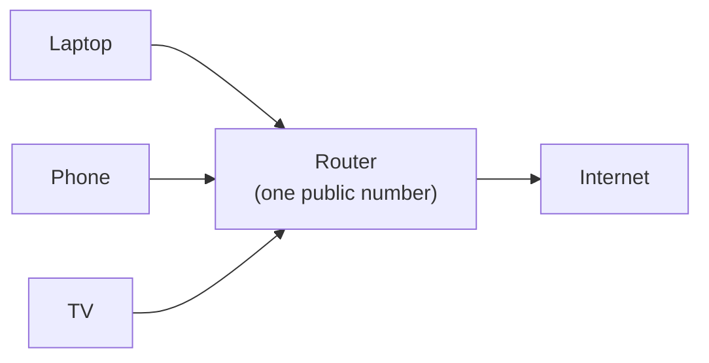
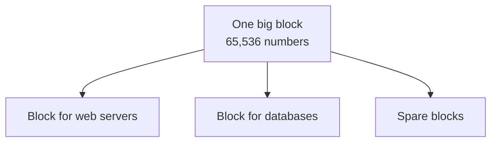
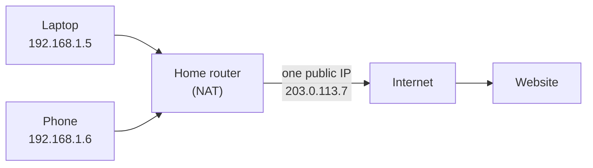
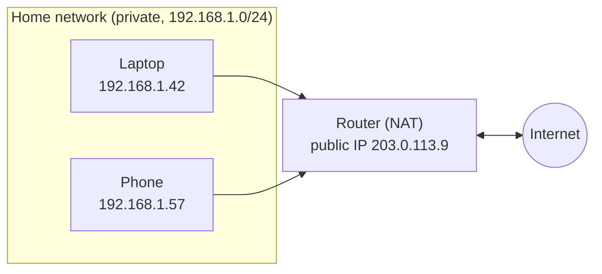
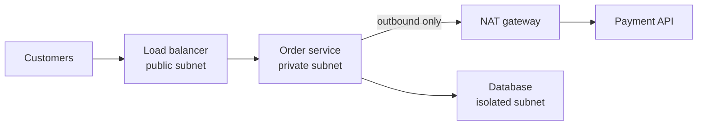
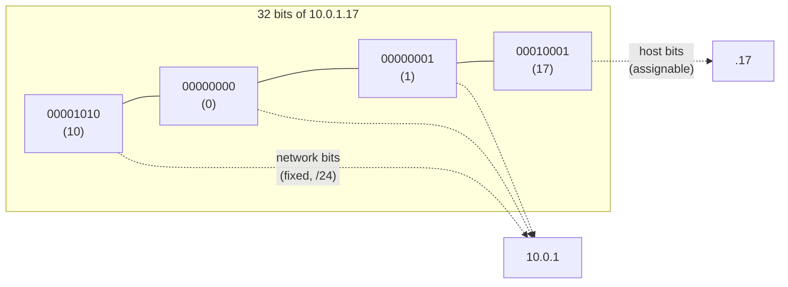
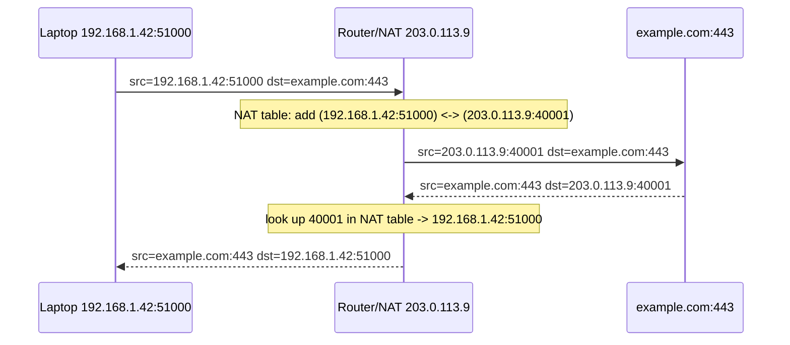
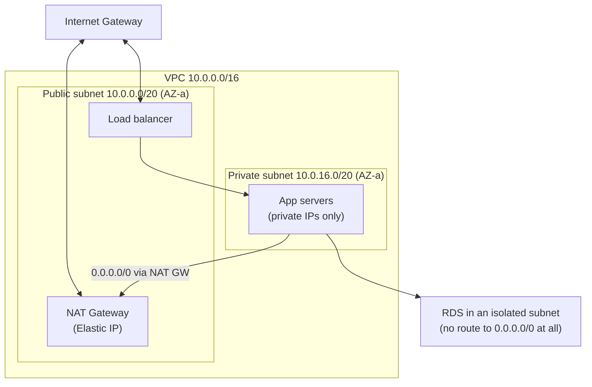
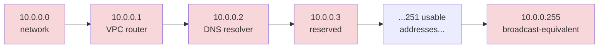

# IP Addressing, Subnets, NAT and VPC Basics

> [!summary] TL;DR
> An IPv4 address is a 32-bit number, usually written as four dotted bytes (`10.0.1.17`). A **CIDR prefix** (`/24`) says how many of those bits are the fixed "network" part versus the "host" part you can assign. **Subnetting** splits one big address block into smaller ones; **NAT** lets many private addresses share one public one; and an **AWS VPC** is just subnetting and routing rules applied to a customer's slice of AWS's network.

> [!abstract] Core idea
> - `/N` means the first `N` bits are the network; the remaining `32-N` bits number the hosts inside it.
> - Smaller `/N` number = bigger block; `/24` = 256 addresses, `/16` = 65,536 addresses.
> - RFC 1918 reserves `10.0.0.0/8`, `172.16.0.0/12` and `192.168.0.0/16` for private networks that never route on the public internet.
> - NAT/PAT lets a whole private network share one public IP by rewriting (and tracking) the port numbers of outbound connections.
> - A VPC "public subnet" is just a subnet whose route table sends `0.0.0.0/0` to an internet gateway; a "private subnet" sends it to a NAT gateway instead, or nowhere.
> - This note builds directly on [[How the Internet Works - IP, Ports, Packets, OSI vs TCP-IP]] and goes into AWS-specific subnet reservation details, which is why it is tagged intermediate rather than basic.

## Start here: the basics 🟢

> [!info] How to read this note (pick your level)
> - 🟢 **New to this?** Read "From zero" below, then sections 1, 2 and the cheat sheet (10). Stop there, that is a full first pass.
> - 🟡 **Know the basics?** Add section 3 (how it works), 4 (worked example) and 5-6.
> - 🔴 **Interview / SDE-3 prep?** Add 7, 8 and 9. Headings are tagged 🟢🟡🔴 so you always know where you are.

> [!note] Before this note
> - [[How the Internet Works - IP, Ports, Packets, OSI vs TCP-IP]]: every packet carries a source and destination IP address, and a port picks the program; routers forward packets hop by hop.

**From zero, in 60 seconds** 🟢

Every device on a network needs its own number so messages can find it. That number is its **IP address**, like `192.168.1.5`.

Your home has many devices, but your internet company gives you only **one** public number. Your Wi-Fi router shares that one number with everyone in the house. That sharing trick is called **NAT**.



Big companies have the opposite problem: they get a huge block of numbers and must split it into smaller blocks for different teams. That splitting is called **subnetting**.



The rest of this note is just these 3 questions:
1. How are addresses numbered and split into blocks?
2. How does NAT let many devices share one public address?
3. How does AWS use all of this inside a VPC?


**The problem in one story.**
Your home has a laptop, two phones and a TV, but your internet provider gives you just one public address.
Each device still needs its own address so replies come back to the right one.
At work, a cloud team must carve one big address range into pieces for web servers and databases.
This note explains how addresses are numbered, split up, and shared.

**Words you need first**

| Word | Plain meaning | Tiny example |
| --- | --- | --- |
| IP address | A number that names one device on a network | `10.0.1.17` |
| Bit | One binary digit, 0 or 1; an IPv4 address is 32 of them | `/24` = first 24 bits fixed |
| Network vs host part | The shared "street" part and the per-device "house" part of an address | `10.0.1` + `.17` |
| Port | A number naming one program/connection on a device | `443` for HTTPS |
| Router | A box that forwards packets toward their destination | Your home Wi-Fi router |
| Public vs private address | Reachable from the internet vs only inside your network | `8.8.8.8` vs `192.168.1.5` |
| Route table | A list of "traffic for this range goes there" rules | `0.0.0.0/0 -> internet gateway` |
| CIDR block | A range of addresses written as start + `/N` | `10.0.0.0/16` = 65,536 addresses |
| Subnet | A smaller block carved out of a bigger one | `10.0.1.0/24` inside `10.0.0.0/16` |
| NAT | Rewriting private addresses to a public one at the network's edge | Home router turning `192.168.1.5` into `203.0.113.7` |
| VPC | Your own private network inside a cloud like AWS | A VPC using `10.0.0.0/16` |
| Availability Zone (AZ) | One separate data center group inside a cloud region | `ap-south-1a` in Mumbai |

**Picture it**



**Analogy.** An address block is like a street: everyone shares the street name (network part) and each house has its own number (host part). NAT is the building front desk that forwards mail to the right flat.
Where it breaks: a real street cannot be resized, but a CIDR block can be split into smaller blocks just by changing the prefix number.

**How the rest of this note builds up**

- First, why addressing and NAT exist (section 1) and a mental model (section 2).
- Then CIDR math, IPv4 vs IPv6, private ranges, NAT/PAT and AWS VPC subnets (section 3).
- Then a worked subnetting example and comparisons (sections 4-5).
- Finally the SDE-3 deep dive on PAT port limits, longest prefix match and dual-stack (sections 6-8).

> [!tip] Remember
> `/N` fixes the first N bits; NAT lets many private devices share one public IP.

## 1. Why it exists 🟢

**In plain words, the problem first.** IPv4 addresses are 32-bit numbers, so there can only ever be 2³² ≈ 4.3 billion of them. By the 1990s it was clear the internet would run out if every device got a globally unique one — there are more phones than that on the planet today.

Two separate fixes shipped:

1. **CIDR** replaced the old rigid class A/B/C address system with flexible prefix lengths, so allocators could hand out exactly the block size an organization needed instead of wasting huge chunks.
2. **Private addressing + NAT** let every home and company reuse the same few private ranges internally, with only one NAT box's public IP visible to the outside world.

**Example with numbers:** your home network, your office network, and a thousand other unrelated networks can all use `192.168.1.0/24` internally without any conflict, because none of those addresses ever appear on the public internet. Your ISP gives your router exactly one public IP, and NAT is what makes every device behind it reachable to the outside anyway (for outbound connections).

### Picture it: one public IP, many private devices



**Why it matters:** both devices share one public IP; the router's NAT table is what lets replies find their way back to the right one. Without that table, the internet would see only one address and have no way to route a reply to "the laptop" versus "the phone."

> [!tip] Remember
> CIDR solved address *allocation waste*; NAT solved address *scarcity* by letting many devices share one public address.

### Real-life example: a food app on AWS 🟢

Picture a food delivery app like Zomato running on AWS.
Its VPC might use `10.0.0.0/16`. The load balancer that faces customers sits in a public subnet.
The order service runs in private subnets with addresses like `10.0.16.25`; nobody on the internet can connect to it directly.
When the order service calls a payment company's API, the request leaves through a NAT gateway, which swaps in one public IP.
The database sits in an isolated subnet with no route to the internet at all.



## 2. Mental model 🟢

**Analogy — a street address split into neighborhood and house number.** An IPv4 address plus a prefix length (`10.0.1.17/24`) works like a postal address split in two parts:

- The prefix (`/24` = first 24 bits = `10.0.1`) is the "neighborhood" — everything inside it shares that prefix.
- The remaining bits (the last 8, here) number the "houses" (hosts) inside the neighborhood: 256 possible numbers, two of which are reserved (the neighborhood's own address, and its "broadcast to everyone" address), leaving 254 usable houses.

Where the analogy helps: just like a neighborhood has a fixed boundary everyone inside it shares, a `/24` block has a fixed 24-bit prefix every host inside it shares.

Only the last 8 bits vary per device.

**Analogy — NAT as an office building's front desk.** NAT is like an office building with one public street address but many internal apartment numbers.

Mail addressed to the building's front desk (the public IP) gets routed to the right apartment (an internal private IP) because the building keeps a log of who's expecting a delivery — the NAT translation table, keyed by port.

Where this analogy breaks down: a front desk forwards *existing* expected mail; NAT also handles brand-new *outbound* mail from any apartment, assigning it a tracking number (a port) on the fly so the reply knows where to come back to — more like a building that also hands out its own temporary return-address stickers for outgoing letters.

## Common beginner mistakes 🟢

- **Thinking `/24` is bigger than `/16`** → a bigger prefix number leaves fewer host bits, so `/24` is 256 addresses and `/16` is 65,536 → smaller number, bigger block.
- **Treating NAT as a firewall** → NAT only blocks inbound traffic as a side effect → use security groups or a firewall for real rules.
- **Sizing an AWS subnet for exactly your server count** → AWS keeps 5 addresses in every subnet → leave room for growth plus those 5.
- **Using the same `10.0.0.0/16` in every VPC** → you can't connect (peer) two VPCs whose ranges overlap → plan different ranges per VPC from day one.
- **Calling a subnet "public" because the servers are meant to be public** → only the route table to an internet gateway makes it public → check the route table.

## 3. How it works 🟡

> 🟢 → 🟡 **You now know** that an address has a shared network part and a per-device part, and that NAT lets many devices share one public address. **Next we open the box**: the `/N` arithmetic, IPv6, the private ranges, how NAT really tracks connections, and how AWS turns all of this into public, private and isolated subnets. Each subsection starts with a plain step-by-step walk; the full detail follows it.

### CIDR notation and prefix math

**In plain words:** `10.0.1.17/24` means the first 24 bits (`10.0.1`) are fixed, and the last 8 bits (`.17`) identify one host inside that `/24` block.

**Step by step:**
1. An IPv4 address is 32 bits. `/24` means the first 24 bits are fixed.
2. That leaves 32 − 24 = 8 bits for hosts, so 2⁸ = 256 addresses in the block.
3. Take away the first (network) and last (broadcast) address: 254 usable.
4. `/20` leaves 12 bits: 2¹² = 4,096 addresses.
5. Splitting a `/16` into `/20`s gives 2⁴ = 16 pieces, because the prefix grew by 4 bits.

**Picture it — how prefix length maps to block size:**

| Prefix | Block size (addresses) | Usable hosts (excl. network + broadcast) | Typical use |
| --- | --- | --- | --- |
| /8 | 16,777,216 | 16,777,214 | A legacy Class A allocation (e.g. all of `10.0.0.0/8`) |
| /16 | 65,536 | 65,534 | A whole AWS VPC |
| /20 | 4,096 | 4,094 | One VPC subnet per AZ (availability zone: a separate data center group in the region) |
| /24 | 256 | 254 | A typical LAN (local network, like one office floor) or small subnet |
| /30 | 4 | 2 | A router-to-router link |
| /31 | 2 | 2 (RFC 3021: no network/broadcast reserved) | A point-to-point link, saving addresses |
| /32 | 1 | 1 | A single host route |

**Example with numbers — splitting a block.** You're handed `10.0.0.0/16` (65,536 addresses) for a VPC and need subnets sized `/20` (4,096 addresses each) for each of 4 availability zones, public and private:

```text
10.0.0.0/16 split into /20s:
  10.0.0.0/20    (10.0.0.0   – 10.0.15.255)   -> AZ-a public
  10.0.16.0/20   (10.0.16.0  – 10.0.31.255)   -> AZ-a private
  10.0.32.0/20   (10.0.32.0  – 10.0.47.255)   -> AZ-b public
  10.0.48.0/20   (10.0.48.0  – 10.0.63.255)   -> AZ-b private
  ... 16 /20 blocks total fit inside one /16 (2^(20-16) = 16)
```

**Why it matters:** each step up a prefix bit halves the block; each step down doubles it. `/16 → /20` is 4 bits of difference, so `2^4 = 16` equal `/20`s fit inside the `/16` — that is the arithmetic behind every VPC subnet layout you will ever see.

**Picture it — which bits are fixed vs assignable, for `10.0.1.17/24`:**



The first 24 bits (three full bytes: `10`, `0`, `1`) are the fixed network prefix; only the last 8 bits (`17`) are free to assign to a specific host.

> [!warning] Common mistake
> Confusing "a bigger prefix number" with "a bigger block." It is the opposite: `/24` (a bigger number) is a *smaller* block than `/16` (a smaller number), because a longer prefix leaves fewer bits for host numbering.

> [!tip] Remember
> Smaller `/N` number = bigger block. Each extra bit of prefix halves the available addresses.

### IPv4 vs IPv6

**In plain words:** IPv4's address exhaustion is exactly why **IPv6** exists: a 128-bit address space, enough for roughly 340 undecillion (340 followed by 36 zeros) addresses, written as eight colon-separated groups of hex digits (e.g. `2001:0db8:85a3:0000:0000:8a2e:0370:7334`), commonly shortened by dropping leading zeros and collapsing one run of zero groups with `::` (`2001:db8:85a3::8a2e:370:7334`).

**Step by step:**
1. IPv4: 32 bits, about 4.3 billion addresses. Not enough for every phone, so we share with NAT.
2. IPv6: 128 bits, so many addresses that every device can have its own public one.
3. It is written in hex (digits 0-9 and a-f) in 8 groups: `2001:db8:85a3:0:0:8a2e:370:7334`.
4. Zeros can be squeezed: one run of zero groups becomes `::`, giving `2001:db8:85a3::8a2e:370:7334`.
5. Most devices today hold both kinds of address (dual-stack) and try IPv6 first.

**Picture it:**

| Property | IPv4 | IPv6 |
| --- | --- | --- |
| Address size | 32 bits | 128 bits |
| Total addresses | ~4.3 billion | ~340 undecillion |
| Needs NAT to share addresses | Yes, in practice | No — every device can get a globally routable address |
| Private-range equivalent | RFC 1918 (`10.0.0.0/8`, etc.) | Unique local addresses (`fc00::/7`), same motivation |
| Written as | Four dotted decimal bytes | Eight colon-separated hex groups |

**Why it matters:** dual-stack hosts (common today) hold both an IPv4 and an IPv6 address and prefer IPv6 when both the client and server support it (`AAAA` records; see [[DNS - Resolution, Records and Caching]]).

IPv6's abundance removes the *scarcity* that made NAT a practical necessity for IPv4 — but private ranges still exist in IPv6 for the same organizational reasons RFC 1918 exists in IPv4.

### Private IPv4 ranges (RFC 1918)

**In plain words:** three specific address blocks are reserved by standard (RFC 1918) to never appear on the public internet, so anyone can reuse them internally without ever causing a real conflict.

**Step by step:**
1. Your home router hands out `192.168.1.x` addresses. So does your neighbour's. No clash, because neither is ever used on the public internet.
2. AWS VPCs usually use `10.x.x.x`.
3. Docker containers on your laptop often get `172.17.x.x`, from the `172.16.0.0/12` range.
4. See one of these three ranges in a log? It is an internal machine.

| Range | Prefix | Size | Common use |
| --- | --- | --- | --- |
| `10.0.0.0` – `10.255.255.255` | `/8` | ~16.7M | Large corporate networks, most AWS VPCs |
| `172.16.0.0` – `172.31.255.255` | `/12` | ~1.05M | Docker's default bridge network range |
| `192.168.0.0` – `192.168.255.255` | `/16` | 65,536 | Home routers |

**Why it matters:** anything outside these three blocks (and a few other reserved ranges like `127.0.0.0/8` for loopback, meaning the machine itself, and `169.254.0.0/16` for link-local, addresses a device gives itself when nobody hands one out) is potentially a real, routable public address — seeing one of these three ranges in a log or a config is an instant signal "this is internal, never route it externally."

> [!tip] Remember
> `10.0.0.0/8`, `172.16.0.0/12`, `192.168.0.0/16` — the three RFC 1918 ranges. If you see one of these outside a private network, something is misconfigured.

### NAT and PAT

**In plain words:** **NAT** (Network Address Translation) rewrites the source IP of outbound packets from a private address to a public one, and reverses that rewrite on the way back. Plain one-to-one NAT does not save any addresses by itself — it just maps one private address to one public address.

What actually lets a whole household share *one* public IP is **PAT** (Port Address Translation, sometimes called "NAT overload"). PAT additionally rewrites the *source port*, using the combination of (public IP, public port) as the lookup key to route each reply back to the correct internal (private IP, private port).

**Step-by-step trace, numbers included:**

1. A laptop at `192.168.1.42:51000` opens a connection to `example.com:443`.
2. The router's NAT table adds an entry: `(192.168.1.42:51000) <-> (203.0.113.9:40001)`.
3. The router rewrites the outbound packet's source to `203.0.113.9:40001` and sends it on.
4. The server replies to `203.0.113.9:40001`.
5. The router looks up `40001` in its NAT table, finds `192.168.1.42:51000`, rewrites the destination back, and delivers it to the laptop.



**Why it matters:** because it keys on port, a single public IP can multiplex up to roughly 64,000 simultaneous outbound connections (bounded by the 16-bit port space, minus whatever the router reserves) — the same port-exhaustion limit discussed in [[How the Internet Works - IP, Ports, Packets, OSI vs TCP-IP]].

> [!warning] Common mistake
> Thinking NAT and a firewall are the same thing. NAT incidentally blocks unsolicited inbound connections (there is no existing translation-table entry for them to match), but its actual job is address and port translation, not security policy.

> [!tip] Remember
> NAT translates *addresses*; PAT also translates *ports*, and it's the port translation that lets one public IP serve a whole network at once.

### AWS VPC: subnets, route tables, NAT gateway

**In plain words:** a **VPC** (Virtual Private Cloud) is a customer's own private IPv4/IPv6 address space inside AWS, sliced into **subnets**, each pinned to one Availability Zone.

Each subnet has a **route table** that decides where traffic for each destination prefix goes. The public/private distinction is entirely about that route table — there is no separate "public subnet" resource type in AWS.

**Step by step:**
1. You create a VPC with `10.0.0.0/16`.
2. You carve a public subnet `10.0.0.0/20` and a private subnet `10.0.16.0/20` in zone a.
3. Public subnet's route table: "everything else (`0.0.0.0/0`) → internet gateway". The load balancer lives here.
4. Private subnet's route table: "everything else → NAT gateway". App servers live here; they can call out, but nobody can call in.
5. A third, isolated subnet has no "everything else" route at all. The database lives here.

- A **public subnet**'s route table sends `0.0.0.0/0` (everything not matched more specifically) to an **internet gateway (IGW)** — and its instances need a public or Elastic IP (a fixed public address you rent from AWS) to actually be reachable.
- A **private subnet**'s route table sends `0.0.0.0/0` to a **NAT gateway** sitting in a public subnet — instances here have only private IPs, can still reach the internet outbound (to pull packages, call external APIs), but nothing from the internet can initiate a connection to them.

**Picture it:**



The NAT gateway itself holds one Elastic IP and does PAT exactly like a home router, just managed and scaled by AWS. A common third tier, "isolated" subnets (for databases), has no `0.0.0.0/0` route at all — not even outbound — so a compromised database host can't exfiltrate (secretly send out) data to the internet even if NAT were otherwise available.

### The 5 addresses AWS reserves in every subnet

**In plain words:** a plain `/24` has 2 reserved addresses (network and broadcast), leaving 254 usable. AWS reserves **5**, not 2, out of every subnet it hands you — because AWS's own networking needs a few extra fixed addresses to function. Given a subnet `10.0.0.0/24`, AWS specifically reserves:

**Step by step:**
1. Take subnet `10.0.0.0/24`: 256 addresses.
2. `.0` is the network address and `.255` the broadcast address, as on any network.
3. AWS also keeps `.1` for its router, `.2` for its DNS resolver, and `.3` for later use.
4. 256 − 5 = 251 addresses left for your servers.

| Address | Reserved for |
| --- | --- |
| `10.0.0.0` | The network address (standard, not AWS-specific) |
| `10.0.0.1` | The VPC router |
| `10.0.0.2` | Reserved for the AWS-provided DNS resolver (`.2` of every VPC's CIDR range) |
| `10.0.0.3` | Reserved for future use |
| `10.0.0.255` | The network broadcast address (AWS does not support broadcast, but the address is still reserved) |

**Example with numbers:** a `/24` subnet normally has 254 usable host addresses (256 minus network and broadcast). In an AWS VPC that same `/24` only has **251** usable addresses, because AWS additionally takes `.1`, `.2` and `.3`.

**Picture it — the layout of a `10.0.0.0/24` AWS subnet:**



The five highlighted addresses are reserved before any instance can use one; everything in between is what you actually get to assign.

**Why it matters:** sizing a subnet for "exactly the number of instances I need" without accounting for these 5 reserved addresses is a common off-by-a-few error — always size for a small buffer above the raw host count.

> [!tip] Remember
> A plain `/24` reserves 2 addresses; an AWS VPC subnet reserves 5: network, router (`.1`), DNS (`.2`), AWS-reserved (`.3`), and broadcast-equivalent (last address).

## 4. Worked example 🟡

### Whiteboard version

**In plain words:** to split a block into subnets, treat the address as one big number, keep adding the subnet size to it, and each sum is where the next subnet starts.

The core of all CIDR math is converting an address to a 32-bit integer, adding a step size, and converting back:

```go
func nextSubnet(base net.IP, prefix int) net.IP {
    step := uint32(1) << (32 - prefix)
    return fromUint32(toUint32(base) + step)
}
```

**Step-by-step trace with real numbers**, splitting `10.0.0.0/16` into `/20`s:

1. `step = 1 << (32 - 20) = 1 << 12 = 4096` — each `/20` subnet spans 4096 addresses.
2. Subnet 0 starts at `10.0.0.0` (the base, unchanged).
3. Subnet 1 starts at `10.0.0.0 + 4096 = 10.0.16.0` — `4096` addresses later lands exactly on the next `/20` boundary because 4096 is itself a power of two.
4. Subnet 2 starts at `10.0.32.0`, and so on, until 16 subnets have been produced (`2^(20-16) = 16`), matching the table-based example in the "How it works" section above.

Runnable Go version, including the full subnet-splitting function, the AWS reserved-address check, and all of the tests: [[IP Addressing, Subnets, NAT and VPC Basics - Go]]

## 5. Variants and comparison 🟡

**In plain words:** there is more than one way to hand out and share addresses. This table compares them: when each one fits, and what it costs you.

| Approach | How it works | Use when | Cost |
| --- | --- | --- | --- |
| Static VLSM (variable-length subnet masks) subnetting | Hand-pick prefix lengths per subnet's expected size | Stable, well-known capacity needs | Manual planning; resizing later is disruptive |
| DHCP within a subnet | A server (DHCP: the service that hands a device its IP when it joins a network) leases addresses from the subnet's host range | Any network where hosts come and go | Needs a DHCP server; doesn't change the subnet's size |
| NAT/PAT (IPv4) | Rewrite source IP (+ port) at the network edge | IPv4 private networks, any VPC private subnet | Breaks true end-to-end addressing; needs connection tracking state |
| IPv6, no NAT | Every host gets a globally unique address | Greenfield (brand-new) networks, mobile carriers, growing IoT (smart devices like sensors and cameras) fleets | Needs dual-stack support during a long IPv4 transition |
| VPC peering / Transit Gateway | Route between VPCs without NAT | Multiple VPCs that must talk privately | CIDR ranges must not overlap between peered VPCs |

### NAT vs the things people mix it up with 🟡

| Thing | Job | Blocks inbound? | Note |
| --- | --- | --- | --- |
| NAT / PAT | Rewrite private address (and port) to a public one | Only as a side effect | Saves public IPv4 addresses |
| Firewall / security group | Allow or deny traffic by rule | Yes, on purpose | Real security control |
| Reverse proxy / load balancer | Accept requests and forward them to servers | Not its main job | Works on connections or HTTP, not address sharing |
| Internet gateway (AWS) | Connects a VPC to the internet | No | Needed for public subnets |

## 6. Trade-offs and when not to use 🟡

- NAT breaks the "every host has one address" assumption some protocols need (incoming connections, certain VoIP/P2P setups), requiring workarounds like STUN/TURN (helper servers that let two devices behind NAT find or relay to each other) or hairpin NAT.
- Over-sized subnets waste address space (a `/16` subnet for 10 hosts wastes 65,000+ addresses); over-small subnets force a painful re-IP when you outgrow them — plan subnet sizes for projected growth, not current headcount, and remember AWS's 5 reserved addresses per subnet when sizing the smallest ones.
- A private subnet with a NAT gateway still costs money per hour and per GB processed in AWS; for truly air-gapped (fully cut off from the internet) workloads, an isolated subnet with no route to `0.0.0.0/0` is cheaper and more secure.
- Overlapping CIDR ranges between VPCs you'll eventually need to peer or merge (e.g., after an acquisition) are expensive to fix later — pick non-overlapping private ranges company-wide up front.

## 7. In production 🔴

> 🟡 → 🔴 **You now know** CIDR math, private ranges, NAT/PAT and how AWS builds public, private and isolated subnets. **Next comes the advanced part**: the outages these cause (overlapping ranges, NAT bottlenecks, IP exhaustion), what to monitor, and deeper points like PAT's port limit and longest prefix match.

- **Real systems:** every AWS/GCP/Azure VPC or VNet; home and office routers running PAT; mobile carrier networks using Carrier-Grade NAT (CGNAT) to share IPv4 addresses across subscribers.
- **Failure modes → fixes:**
	- **CIDR overlap when peering two VPCs** → renumber one side before peering, or use Transit Gateway with careful route tables; there's no way to route between identical overlapping ranges.
	- **NAT gateway as a single point of failure/bottleneck** → one NAT gateway per Availability Zone (AWS recommendation), not one shared across AZs, both for resilience and to avoid cross-AZ data transfer charges.
	- **Running out of IPs in a subnet** that's sized too small for autoscaling → size subnets for peak scale-out, not average load, and budget for AWS's 5 reserved addresses per subnet (network, router, DNS, AWS-reserved, and broadcast-equivalent).
	- **Private subnet with no NAT gateway route**: instances can't pull container images or call external APIs → confirm the route table actually points `0.0.0.0/0` at a NAT gateway, not left blank.
- **What to monitor:** NAT gateway bandwidth and connection count (it has throughput limits per gateway), subnet IP exhaustion (free addresses remaining per subnet), and unexpected cross-AZ or cross-region data transfer costs from misrouted traffic.

## 8. Deep dive 🔴

- **Why PAT's limit is ~64K, not unlimited:** the NAT table's key on the public side is (public IP, public port), and TCP/UDP ports are 16 bits, so one public IP can track at most 65,536 simultaneous outbound connections to *distinct* destinations before it must reuse a port.

  In practice routers reserve some ports and track per-destination, so real limits are often tighter. Large-scale CGNAT deployments solve this by giving each subscriber a *range* of ports on a shared public IP rather than the whole 64K.
- **CIDR vs classful addressing:** before 1993 (RFC 1519), IPv4 only had fixed-size Class A (`/8`), B (`/16`) and C (`/24`) allocations — if your company needed 300 addresses, you got a wasteful `/16` (65,536) because nothing in between existed.

  CIDR let allocators hand out exactly `/23` (510 usable) instead, which is also why routing tables shrank: CIDR enabled **route aggregation**, where an ISP advertises one summarized prefix for many customer blocks instead of one route per customer.
- **VPC route table precedence:** AWS route tables use **longest prefix match**, same as internet routers — a route for `10.0.1.0/24` wins over a route for `10.0.0.0/16` for a destination inside the smaller block, regardless of the order the routes were added.

  In plain words: the most specific rule wins, like a letter addressed to a full flat number beating one addressed just to the street.

  ```mermaid
  flowchart LR
      PKT["Packet to 10.0.1.5"] --> RT{"Route table"}
      RT -- "10.0.1.0/24 (more specific) wins" --> PEER["Peering connection"]
      RT -. "0.0.0.0/0 (catch-all) loses" .-> NAT["NAT gateway"]
  ```

  This is how a VPC can route most traffic to a NAT gateway (`0.0.0.0/0`) while sending traffic to a specific peered VPC's CIDR (`10.1.0.0/16`) directly across the peering connection instead.
- **Dual-stack and 6to4 transition realities:** most cloud providers now default new VPCs to dual-stack (IPv4 + IPv6) capable, but a huge share of enterprise internal tooling still assumes IPv4-only, so NAT and RFC 1918 planning remain a day-one decision even in 2026, not a legacy relic.
- **The "isolated subnet" tier most tutorials skip:** databases and internal caches often sit in a subnet with *no* default route at all (not even to a NAT gateway), reachable only from the app-tier security group (AWS's per-server firewall rules) — an extra layer beyond "public vs private" that materially reduces blast radius (how much damage spreads from one broken piece) if an app server is compromised.

## 9. Interview questions 🔴

> [!question]- What does `/24` mean, and how many usable hosts does it have?
> It means the first 24 of the 32 bits are the fixed network prefix, leaving 8 bits (256 addresses) for hosts. Two of those are reserved (the network address and the broadcast address), leaving 254 usable host addresses in a plain `/24` — though an AWS VPC subnet reserves 5 instead of 2, leaving 251.

> [!question]- Trap: "NAT and a firewall are the same thing."
> They're not, even though NAT incidentally blocks unsolicited inbound connections (there's no existing translation-table entry for them to match). NAT's job is address translation and connection tracking so many private hosts can share a public IP; a firewall's job is to allow or deny traffic by policy. A NAT gateway with no firewall rules still blocks unrequested inbound traffic as a side effect, which is often mistaken for "NAT provides security."

> [!question]- How does PAT let many devices share one public IP?
> It rewrites both the source IP and the source port of outbound packets, and keeps a table mapping (public IP, public port) back to the originating (private IP, private port). Because the lookup key includes the port, one public IP can multiplex tens of thousands of simultaneous connections, not just one.

> [!question]- In an AWS VPC, what actually makes a subnet "public" versus "private"?
> Only its route table. A subnet is "public" if its route table sends `0.0.0.0/0` to an internet gateway (and its instances have public/Elastic IPs); it's "private" if that default route instead points to a NAT gateway (outbound-only) or is absent entirely (fully isolated). There's no separate AWS resource type for "public subnet."

> [!question]- Why can't you just give every private subnet the range `10.0.0.0/24`?
> You can within one VPC in isolation, but if you ever peer that VPC with another one (or with on-prem via VPN/Direct Connect) that also used `10.0.0.0/24`, the overlapping ranges make routing between them ambiguous — there's no way to tell which network a packet addressed to `10.0.0.5` belongs to. Plan non-overlapping CIDR ranges across your whole organization up front.

> [!question]- Why does IPv6 not need NAT the way IPv4 does?
> IPv6's 128-bit address space (versus IPv4's 32-bit) is large enough to give every device a globally unique, routable address, removing the scarcity that made IPv4 NAT necessary. Private "unique local" IPv6 ranges still exist for internal-only addressing, but NAT is an option there, not a structural requirement.

> [!question]- Exactly which 5 addresses does AWS reserve in a VPC subnet, and why 5 instead of the usual 2?
> Given `10.0.0.0/24`: `10.0.0.0` (network address), `10.0.0.1` (VPC router), `10.0.0.2` (AWS DNS resolver), `10.0.0.3` (reserved for future AWS use), and `10.0.0.255` (broadcast-equivalent, even though AWS doesn't support broadcast). A plain `/24` only reserves the first and last of these; AWS adds the middle three because its own virtual networking layer needs fixed addresses for the router and DNS resolver in every subnet it creates.

## 10. Cheat sheet 🟢

🟢 **Plain version:** `/N` fixes the first N bits; the rest number the devices, so a smaller N means a bigger block. Three ranges (`10.x`, `172.16-31.x`, `192.168.x`) are private and reused everywhere. NAT lets many private devices share one public address by tracking ports. In AWS, a subnet is public or private only because of where its route table sends internet traffic. The dense list follows.

- `/N` → first N bits fixed; `2^(32-N)` addresses in the block; usable hosts = that minus 2 (except /31, /32).
- RFC 1918 private ranges: `10.0.0.0/8`, `172.16.0.0/12`, `192.168.0.0/16`.
- NAT translates addresses; PAT (NAT overload) also translates ports, which is what lets one public IP serve a whole network.
- AWS VPC "public" vs "private" is just the subnet's route table target: internet gateway vs NAT gateway vs nothing.
- Route tables use longest-prefix match, same as internet routing.
- AWS reserves 5 addresses per subnet, not the usual 2: network, router (`.1`), DNS (`.2`), AWS-reserved (`.3`), and broadcast-equivalent (last address).
- Pick non-overlapping CIDR ranges across your whole org before you ever need to peer VPCs.
- IPv6's 128-bit space removes the scarcity that made NAT necessary, but private "unique local" ranges still exist.

## Self-check 🟢🟡

> [!question]- 🟢 How many addresses are in a `/24`?
> 256 (254 usable on a normal network, 251 in an AWS subnet).

> [!question]- 🟢 Name the three private IPv4 ranges.
> `10.0.0.0/8`, `172.16.0.0/12` and `192.168.0.0/16`.

> [!question]- 🟢 What lets every device in your home share one public IP?
> NAT (really PAT) on your home router.

> [!question]- 🟡 How many `/20` subnets fit in a `/16`?
> 16, because the prefix grows by 4 bits and 2⁴ = 16.

> [!question]- 🟡 What makes an AWS subnet "private"?
> Its route table sends `0.0.0.0/0` to a NAT gateway (or nowhere), not to an internet gateway.

> [!question]- 🟡 A route table has `10.0.1.0/24 → peering` and `0.0.0.0/0 → NAT`. Where does a packet to `10.0.1.5` go?
> To the peering connection; the most specific match wins (longest prefix match).

## Links 🟢

- **Before this:** [[How the Internet Works - IP, Ports, Packets, OSI vs TCP-IP]]
- **Next:** [[DNS - Resolution, Records and Caching]], [[TCP - Handshake, Reliability, Flow and Congestion Control]]
- **Compare with:** [[Load Balancing]] (what sits in front of instances across these subnets), [[Forward and Reverse Proxies - L4 vs L7]]
- **Runnable code:** [[IP Addressing, Subnets, NAT and VPC Basics - Go]]

### Watch on YouTube

- [Subnetting Made Easy: CIDR and VLSM Explained for Beginners!](https://www.youtube.com/watch?v=VTp_Jb8baag) · CodeLucky · beginner-friendly CIDR/subnetting math walkthrough
- [AWS VPC Explained: How to Design Secure Cloud Networks in 2026](https://www.youtube.com/watch?v=zHarvgAdHe0) · LearnITGuide Tutorials · covers VPC subnets, routing and NAT gateway design end-to-end
- [AWS VPC NAT Gateway In-depth intuition](https://www.youtube.com/watch?v=2OrZd4p6EfI) · Knowledge Amplifier · deep dive specifically on how NAT/PAT works for a private subnet
