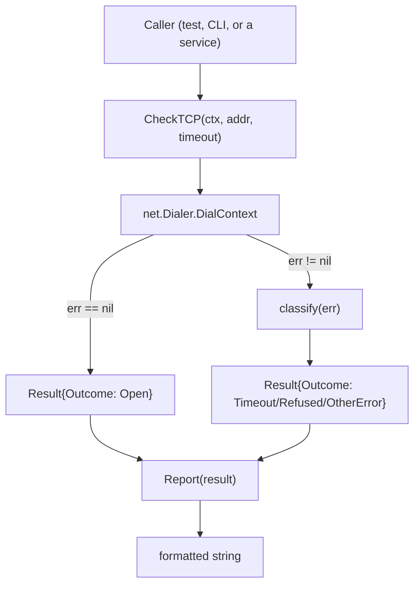

# Network Debugging Toolkit - dig, curl, ss, tcpdump - Go

> [!summary] TL;DR
> This code is a tiny, programmatic version of `nc -zv host port`: it dials a TCP address, classifies the result into the same open/refused/timeout buckets a human reads off `ss` or `tcpdump`, and reports how long the attempt took. It backs [[Network Debugging Toolkit - dig, curl, ss, tcpdump]]'s "Writing the same check as a Go health probe" section.

## Before the code 🟢

> [!info] How to read this note (pick your level)
> - 🟢 **New to this?** Read the "From zero" paragraph below, "Before the code" and "What this code shows", then just skim the code comments.
> - 🟡 **Know the basics?** Read each Code section's Concept + How it works, then the Tests.
> - 🔴 **Interview / SDE-3 prep?** Add Design decisions, the race-safety note, Pitfalls and the Exercises. Headings are tagged 🟢🟡🔴.

**From zero** 🟢 — This file is the runnable version of the debugging toolkit note. It is one tiny Go package that does what the `nc -zv host port` command does by hand: try to open a connection and say which of three things happened — it worked, it was refused, or it timed out. Read the theory note first; here, read each "Concept" line, then the code, then "How it works".

- **`net.Dialer.DialContext`**: opens a TCP connection and gives up when the context ends.
- **`context.WithTimeout`**: a context that cancels itself after a set time; always pair it with `defer cancel()`.
- **Custom `int` type with constants (`Outcome`)**: Go's simple enum, so callers switch on a type instead of a string.
- **`errors.As` / `errors.Is` with `net.Error` and `syscall.ECONNREFUSED`**: dig inside a wrapped error to find a timeout or a refusal.
- **Goroutine + `net.Listen` in tests**: a real local server on `127.0.0.1:0` (any free port) so the test needs no network.
- **What to run**: `go vet ./...` then `go test -race -v ./...`.

## What this code shows 🟢

| Code piece | Theory concept | Theory section |
| --- | --- | --- |
| `CheckTCP` | Turning a manual `nc -zv` check into a reusable, programmatic health probe | [[Network Debugging Toolkit - dig, curl, ss, tcpdump#Writing the same check as a Go health probe]] |
| `classify` | The open/refused/timeout distinction the note's playbook uses to route a symptom to its layer | [[Network Debugging Toolkit - dig, curl, ss, tcpdump#The debugging playbook]] |
| `Report` | Formatting a result the way a playbook entry or a log line would show it | [[Network Debugging Toolkit - dig, curl, ss, tcpdump#Variants and comparison]] |

**Picture it — how the four pieces of this package call each other:**



`classify` and `Report` are both pure functions of their single argument — no shared state, no package-level variables — which is exactly why each can be unit-tested in complete isolation from `CheckTCP` and from any real network socket.

**Picture it — the same three outcomes read off `nc -zv` by eye, versus what this package returns:**

| What you'd see from `nc -zv host port` | `Outcome` value | What actually happened underneath |
| --- | --- | --- |
| `Connection to host port succeeded!` | `Open` | SYN sent, SYN-ACK received, ACK sent — handshake completed |
| `operation timed out` (after the `-w` wait) | `Timeout` | SYN sent, no reply at all within the deadline — usually a firewall drop or dead route |
| `Connection refused` | `Refused` | SYN sent, an RST came back immediately — the kernel on the far side answered, but nothing is listening |
| Any other failure (DNS, routing error) | `OtherError` | Something failed before or outside the dial itself |

Why a small package instead of one `main` function: a package with exported, independently testable functions (`CheckTCP`, `classify`, `Report`) can be imported by a real health-check service or a CLI tool alike, while a single `main` would force every caller to shell out to a binary instead of calling Go code directly.

## Setup 🟢

- **Module layout:** a single package, `netdebug`, with `netdebug.go` and `netdebug_test.go` in one directory.
- **Go version:** 1.24.
- **Dependencies:** none beyond the standard library (`context`, `errors`, `net`, `syscall`, `time`).
- **How to run:**

```bash
go mod init netdebug   # one-time
go vet ./...
go test -race -v ./...
```

## Code 🟡

The package is deliberately small: one file holding a closed set of outcomes, a single dialing function, a classifier, and a formatter.

Each piece below maps to one playbook distinction from the theory note, so reading this section alongside [[Network Debugging Toolkit - dig, curl, ss, tcpdump#The debugging playbook]] should feel like watching that flowchart's decisions get written down as code instead of read off a terminal by eye.

### The Outcome type

**In plain words:** give each of the three possible results a proper name in code, so a program can say "refused" instead of guessing from an error message.

**Concept.** The theory note's playbook distinguishes exactly three ways a TCP connect attempt can end, because each one points at a different thing to check next:

1. a clean connection;
2. a dropped packet with no reply (timeout — usually a firewall or dead route);
3. an explicit refusal (something answered, but nothing is listening).

`Outcome` makes those three distinctions a type instead of a loose string, so a caller can switch on it exhaustively.

The alternative — returning a plain `error` and having every caller re-parse it — was rejected because it would force each caller to repeat the same classification logic this package already centralizes.

```go
// Package netdebug implements the same connectivity check `nc -zv host port`
// performs: open a TCP connection, classify the outcome, and report how long
// it took. It backs the Go example in "Network Debugging Toolkit".
package netdebug

import (
	"context"
	"errors"
	"fmt"
	"net"
	"syscall"
	"time"
)

// Outcome classifies why a TCP connect attempt succeeded or failed, mirroring
// the distinctions that matter when reading `nc -zv` or a failed `curl`:
// a timeout (nothing answered, usually a firewall drop), a refusal (something
// answered with RST, usually no listener on that port), or any other error.
type Outcome int

const (
	Open Outcome = iota
	Timeout
	Refused
	OtherError
)
```

**How it works:**

1. The package comment and imports set up exactly what this file needs: `context` for the timeout, `net`/`syscall` for the dial and its error codes, `errors` to unwrap them, and `time`/`fmt` for measuring and formatting.
2. `Outcome` is an `int`-backed type with four named constants (`iota` auto-numbers them 0–3) — a standard Go pattern for a small, closed set of states, chosen over a bare `string` so the compiler catches a typo'd value at compile time instead of a test silently comparing against the wrong string.

**Concept.** A named integer type alone would still print as a bare number in a failing test or a log line. Giving it a `String()` method turns it into something `fmt` and `t.Errorf` render as `"refused"` instead of `2`, with no change needed anywhere `Outcome` is already used.

```go
func (o Outcome) String() string {
	switch o {
	case Open:
		return "open"
	case Timeout:
		return "timeout"
	case Refused:
		return "refused"
	default:
		return "error"
	}
}
```

**How it works:**

1. Implementing `fmt.Stringer` (any type with a `String() string` method) is idiomatic whenever a Go value needs to show up readably in logs or test failures — `fmt.Sprintf("%v", outcome)` and `%s` both call this method automatically.
2. The `default` case covers `OtherError` and also protects against an out-of-range value, which can't happen here but is a cheap safety net for a `switch` over an integer-backed type.

### Result and CheckTCP

**In plain words:** this is the actual knock on the door — try to connect, time how long it took, and hand back one tidy result.

**Concept.** `Result` bundles everything one health check produced — target, outcome, how long it took, and the raw error if any — so a caller gets one value back instead of three separate return values to keep in sync.

`CheckTCP` is the dial itself: it wraps `net.Dialer.DialContext` with a timeout and immediately classifies whatever comes back.

A bare `net.Dial` (no context) was rejected because it offers no way to bound how long a hung connection attempt is allowed to block.

```go
// Result is one connectivity check.
type Result struct {
	Target  string
	Outcome Outcome
	Elapsed time.Duration
	Err     error
}

// CheckTCP dials addr (host:port) with the given timeout and classifies the
// result the way a reverse-proxy health check or `nc -zv` would.
func CheckTCP(ctx context.Context, addr string, timeout time.Duration) Result {
	ctx, cancel := context.WithTimeout(ctx, timeout)
	defer cancel()

	start := time.Now()
	var d net.Dialer
	conn, err := d.DialContext(ctx, "tcp", addr)
	elapsed := time.Since(start)

	if err == nil {
		conn.Close()
		return Result{Target: addr, Outcome: Open, Elapsed: elapsed}
	}

	return Result{Target: addr, Outcome: classify(err), Elapsed: elapsed, Err: err}
}
```

**How it works:**

1. `context.WithTimeout` derives a child context that cancels itself after `timeout` — this is what actually bounds `DialContext`'s blocking time, not a parameter on the dial call itself.
2. `defer cancel()` releases the timer resources behind the context as soon as `CheckTCP` returns, whether it returned early or ran the full timeout — a habit any context-based Go API needs, or the timer leaks until the parent context itself is done.
3. `time.Since(start)` measures wall-clock elapsed time around the dial, independent of whether it succeeded — this is the number that later shows up in `Report`'s output and is directly comparable to what a human would time with `nc -zv` by hand.
4. On success, `conn.Close()` happens immediately: this function only proves reachability, it never keeps the connection around to use.

### classify and Report

**In plain words:** `classify` reads a raw error and decides which of the three buckets it belongs to; `Report` just prints the result as one neat line.

**Concept.** `classify` is the single place that turns a raw Go `error` into one of the three meaningful buckets.

This is deliberately factored out of `CheckTCP` so it can be unit-tested directly, without needing a real socket or a real timeout to exercise each branch.

`Report` is a thin formatting layer; keeping it separate from `Result` means a caller who wants to log or display results differently (structured JSON, a Prometheus metric) can skip `Report` entirely and read `Result`'s fields instead.

```go
// classify turns a dial error into the same open/refused/timeout buckets a
// human reads off `ss -tan` or a tcpdump capture of the three-way handshake:
// a RST while SYNing is ECONNREFUSED, a dropped SYN with no reply at all
// surfaces as a context deadline, everything else is bucketed as OtherError.
func classify(err error) Outcome {
	var netErr net.Error
	if errors.As(err, &netErr) && netErr.Timeout() {
		return Timeout
	}
	if errors.Is(err, syscall.ECONNREFUSED) {
		return Refused
	}
	return OtherError
}

// Report formats a Result the way a debugging playbook entry would show it.
func Report(r Result) string {
	if r.Err != nil {
		return fmt.Sprintf("%-22s %-8s %6s  (%v)", r.Target, r.Outcome, r.Elapsed.Round(time.Millisecond), r.Err)
	}
	return fmt.Sprintf("%-22s %-8s %6s", r.Target, r.Outcome, r.Elapsed.Round(time.Millisecond))
}
```

**How it works:**

1. `errors.As(err, &netErr)` unwraps any error chain looking for something implementing `net.Error`, then `.Timeout()` asks that specific interface whether it represents a deadline expiring — this is the Go-idiomatic way to check "was this a timeout" without string-matching an error message.
2. `errors.Is(err, syscall.ECONNREFUSED)` checks the error chain for the OS-level `ECONNREFUSED` errno, which is exactly what the kernel returns when a SYN gets an RST back — this is the programmatic equivalent of `nc` printing "Connection refused" immediately.
3. Order matters here: a timeout check runs before the refused check because a `net.OpError` wrapping a timeout also satisfies some generic error interfaces, so checking the more specific condition (`Timeout()`) first avoids misclassifying it.
4. `Report`'s two format strings differ only in whether the error is appended — this keeps the common case (`Open`, no error) uncluttered while still surfacing the error detail when something went wrong.

## Tests 🟡

Four test functions cover the package end to end:

- two exercise `CheckTCP` against a real socket (one success, one refusal);
- one exercises `classify` directly against synthetic errors so the timeout branch doesn't need a real network failure to trigger it;
- one is a minimal smoke test on `Report`'s formatting.

Together they touch every exported function and every branch of `classify`.

### TestCheckTCPOpen

**What it proves:** dialing a listener this test process itself controls returns `Open` with no error — the baseline "everything is fine" case every other outcome is defined against.

| Input | Expected `Outcome` | Expected `Err` |
| --- | --- | --- |
| Dial a listener this test just opened and is actively accepting on | `Open` | `nil` |

First, the test opens a real listener on an OS-assigned port and keeps a background goroutine accepting (and immediately closing) every connection, so `CheckTCP`'s dial always has something to succeed against:

```go
package netdebug

import (
	"context"
	"errors"
	"fmt"
	"net"
	"syscall"
	"testing"
	"time"
)

// TestCheckTCPOpen dials a listener we control and expects Open.
func TestCheckTCPOpen(t *testing.T) {
	ln, err := net.Listen("tcp", "127.0.0.1:0")
	if err != nil {
		t.Fatalf("listen: %v", err)
	}
	defer ln.Close()
	go func() {
		for {
			c, err := ln.Accept()
			if err != nil {
				return
			}
			c.Close()
		}
	}()
```

Then it calls `CheckTCP` against that listener and asserts both the outcome and that no error was recorded:

```go
	r := CheckTCP(context.Background(), ln.Addr().String(), time.Second)
	if r.Outcome != Open {
		t.Fatalf("Outcome = %v, want Open (err=%v)", r.Outcome, r.Err)
	}
	if r.Err != nil {
		t.Errorf("Err = %v, want nil on success", r.Err)
	}
}
```

A failure here would mean either `net.Listen` itself is broken on the test machine (practically never) or `CheckTCP`/`classify` is misreading a perfectly normal successful dial as something else — the first thing to check would be whether `conn.Close()` in `CheckTCP`'s success branch is somehow running before the `Outcome: Open` value is set.

### TestCheckTCPRefused

**What it proves:** dialing a port that was just freed and has nothing listening on it returns `Refused` — this is the loopback case where the kernel itself answers a SYN with an RST, exactly the scenario `nc -zv` reports as "Connection refused."

| Input | Expected `Outcome` |
| --- | --- |
| Dial a port this test just closed (nothing listening) | `Refused` |

```go
// TestCheckTCPRefused dials a port nothing is listening on. On loopback this
// returns ECONNREFUSED immediately (the kernel answers the SYN with an RST),
// which is exactly the "connection refused" a human sees from `nc -zv`.
func TestCheckTCPRefused(t *testing.T) {
	ln, err := net.Listen("tcp", "127.0.0.1:0")
	if err != nil {
		t.Fatalf("listen: %v", err)
	}
	addr := ln.Addr().String()
	ln.Close() // free the port immediately; nothing will be listening on it

	r := CheckTCP(context.Background(), addr, time.Second)
	if r.Outcome != Refused {
		t.Fatalf("Outcome = %v, want Refused (err=%v)", r.Outcome, r.Err)
	}
}
```

A failure here would mean `classify` is not correctly matching `syscall.ECONNREFUSED` through the error chain `net.Dialer` wraps it in — worth checking first if the Go standard library's error-wrapping for dial errors ever changes shape across versions.

### TestClassify

**What it proves:** `classify` alone — without a real socket — correctly buckets a timeout error, a refused error, and an unrelated error into the three distinct outcomes. This is what lets the timeout branch be tested without depending on a real network black hole, which sandboxes and CI runners don't reliably provide.

| `err` | Expected `Outcome` |
| --- | --- |
| A `net.Error` with `Timeout() == true` | `Timeout` |
| Wraps `syscall.ECONNREFUSED` | `Refused` |
| Any other error | `OtherError` |

```go
// fakeTimeoutErr implements net.Error with Timeout() == true, used to drive
// classify's timeout branch without depending on a real black-hole network
// address, which sandboxes and CI runners don't reliably provide.
type fakeTimeoutErr struct{}

func (fakeTimeoutErr) Error() string   { return "i/o timeout" }
func (fakeTimeoutErr) Timeout() bool   { return true }
func (fakeTimeoutErr) Temporary() bool { return true }

func TestClassify(t *testing.T) {
	cases := []struct {
		name string
		err  error
		want Outcome
	}{
		{"timeout", fakeTimeoutErr{}, Timeout},
		{"refused", fmt.Errorf("dial: %w", syscall.ECONNREFUSED), Refused},
		{"other", errors.New("some other failure"), OtherError},
	}
	for _, c := range cases {
		t.Run(c.name, func(t *testing.T) {
			if got := classify(c.err); got != c.want {
				t.Errorf("classify(%v) = %v, want %v", c.err, got, c.want)
			}
		})
	}
}
```

A failure on the `"timeout"` case specifically would mean `classify`'s `errors.As` check against `net.Error` is no longer matching a fake type that only implements the interface's three methods — worth checking that `net.Error` hasn't gained a new required method in a newer Go version.

### TestReportFormatting

**What it proves:** `Report` never returns an empty string, regardless of whether the result carries an error — a minimal smoke test that the two format-string branches both actually produce output.

| Input `Result` | Expected |
| --- | --- |
| `{Target: "127.0.0.1:9999", Outcome: Refused, Elapsed: 2ms}` | A non-empty formatted string |

```go
func TestReportFormatting(t *testing.T) {
	r := Result{Target: "127.0.0.1:9999", Outcome: Refused, Elapsed: 2 * time.Millisecond}
	out := Report(r)
	if out == "" {
		t.Fatal("Report returned empty string")
	}
}
```

A failure here would mean one of `Report`'s two `fmt.Sprintf` format strings is broken (for example, a verb mismatch panicking before producing output) — in practice the most likely cause would be an edit to the format string that isn't exercised by this one case.

**Measured (Go 1.24.4, darwin/arm64, 2026-11-06):** `go test -race -v` output:

```text
--- PASS: TestCheckTCPOpen (0.00s)
--- PASS: TestCheckTCPRefused (0.00s)
--- PASS: TestClassify (0.00s)
    --- PASS: TestClassify/timeout (0.00s)
    --- PASS: TestClassify/refused (0.00s)
    --- PASS: TestClassify/other (0.00s)
--- PASS: TestReportFormatting (0.00s)
PASS
```

## Why the tests avoid a real black-hole address 🔴

A natural fourth test would dial an address that is known to silently drop packets, to exercise the real `Timeout` path end to end rather than only through `fakeTimeoutErr`.

That test was deliberately left out: a real timeout depends on an external network condition (a firewall or route that drops packets without replying) that is not something this package, or any CI environment running it, can reliably guarantee exists.

Worse, picking a real "unreachable" address risks it becoming reachable later (or already answering from inside a sandboxed network), which would make the test flaky for reasons entirely unrelated to a bug in this code.

Driving `classify`'s timeout branch directly with a fake `net.Error` sidesteps that problem entirely: the test asserts the one thing this package actually controls — "does `classify` return `Timeout` when handed something whose `Timeout()` method returns true" — without needing a real network condition to reproduce it.

## Design decisions 🔴

| Decision | Alternative considered | Trade-off |
| --- | --- | --- |
| A closed `Outcome` enum (`Open`/`Timeout`/`Refused`/`OtherError`) | Return a plain `error` and let callers re-classify it | Centralizes the classification logic in one tested place instead of repeating it at every call site |
| Factor `classify` out as its own function | Inline the branching directly inside `CheckTCP` | Lets the timeout/refused/other branches be unit-tested without a real socket or a real timeout |
| `context.WithTimeout` wrapping `DialContext` | A bare `net.DialTimeout` call | Lets a caller pass in its own parent context (e.g. to cancel early from a larger request), not just a fixed duration |
| Close the connection immediately on success | Return the open `net.Conn` to the caller | This package only proves reachability; a caller that wants to reuse the connection should dial again itself, keeping this function's contract simple |
| Separate `Report` function instead of a `String()` method on `Result` | Implement `fmt.Stringer` on `Result` directly | Keeps the data type (`Result`) free of a specific display format, so a caller preferring JSON or a metric isn't stuck with this one text layout |

## A note on what "race-safe" means here 🔴

Running these tests with `-race` matters specifically because `TestCheckTCPOpen` spins up a background goroutine (the `Accept` loop) that runs concurrently with the test's own goroutine.

The race detector instruments every memory access made by both goroutines during the test and watches for two of them touching the same memory location without a happens-before relationship between the accesses — for example, one goroutine writing a value while another reads it with no lock, channel or other synchronization in between.

In this package, the only values the background goroutine and the test goroutine could in principle both touch are the `net.Listener` itself (`ln`) and each `net.Conn` it produces.

Both are safe here: `net.Listener.Accept` and `net.Conn`'s methods are themselves safe for concurrent use by multiple goroutines, which is a guarantee the standard library documents explicitly for these two types — unlike a plain Go map or slice, which are never safe for concurrent read/write without external synchronization.

That is exactly why `-race` reports nothing to flag: there is genuine concurrency in this test, but no unsynchronized shared mutable state underneath it.

## Running it 🟢

```bash
$ go test -race -v ./...
--- PASS: TestCheckTCPOpen (0.00s)
--- PASS: TestCheckTCPRefused (0.00s)
--- PASS: TestClassify (0.00s)
    --- PASS: TestClassify/timeout (0.00s)
    --- PASS: TestClassify/refused (0.00s)
    --- PASS: TestClassify/other (0.00s)
--- PASS: TestReportFormatting (0.00s)
PASS
ok  	netdebug	1.2s
```

Reading it: each top-level `--- PASS` line is one test function; `TestClassify`'s three indented sub-lines are its table-driven subtests (`t.Run`), run and reported individually.

The overall `PASS` and `ok` line confirm every assertion across all four test functions held, and the race detector (`-race`) found nothing to report — expected, since `TestCheckTCPOpen` is the only test with any concurrency (its background `Accept` loop goroutine), and it only ever touches its own listener, never shared state with the test goroutine.

## Why this matters beyond a demo 🟡

A health-check function that only returns "up" or "down" throws away exactly the information an on-call engineer needs first when a service looks unreachable.

By returning a typed `Outcome` instead of a boolean, a monitoring system built on `CheckTCP` can already pre-sort incidents the way this note's own playbook does by hand:

- a spike in `Refused` results points at a crashed or misconfigured backend process;
- a spike in `Timeout` results points at the network path itself — a firewall rule, a dead route, or a security-group change.

That distinction is the single most useful thing a first responder can know before they ever open a terminal and start running `dig`, `curl` or `tcpdump` themselves.

This is also why `classify` is tested on its own, with a fake error, rather than only indirectly through `CheckTCP`: a classification bug would otherwise only surface under specific, hard-to-reproduce network conditions (a real firewall drop, a real refused port) instead of in a fast, deterministic unit test that runs the same way on every machine and in CI.

## Pitfalls in the code 🔴

- **Checking `Timeout()` before `ECONNREFUSED`, not after.** Some error wrappers could in principle satisfy both checks loosely; testing the more specific "was this actually a timeout" condition first keeps the classification unambiguous.
- **Forgetting `defer cancel()` after `context.WithTimeout`** would leak the context's internal timer until the *parent* context is itself done — invisible in a short-lived CLI tool, but a real leak in a long-running service calling `CheckTCP` repeatedly.
- **`conn.Close()` on the success path is not deferred** — it runs immediately inline, which is correct here because the function's whole job ends right there; a reader expecting every `Close()` in Go code to be a `defer` might assume this is a bug when it is deliberate.

## How this reads next to the manual playbook 🟢

Each exported function in this package answers exactly one row of the theory note's symptom table.

- `CheckTCP` is the automated version of running `nc -zv` and watching whether it hangs or replies instantly.
- `classify` is the automated version of a human reading `ss -tan`'s state column, or noticing that `curl` failed before a single `>` line was printed.
- `Report` is the automated version of writing down what you saw in a postmortem or an incident channel — a consistent, greppable line instead of a free-form sentence.

None of the three functions tries to replace `dig`, `openssl s_client` or `tcpdump`; DNS, TLS and raw-packet inspection all need their own tools, because a TCP-level `Open`/`Refused`/`Timeout` result genuinely cannot tell you whether the name resolved correctly or whether the certificate validated — only that a byte stream could, or could not, be opened to the target.

## Exercises 🔴

Each exercise below asks you to change one small thing and predict the result before running it.

The point is to build an accurate mental model of exactly where each piece of this package's behavior comes from (the dial itself, the error classification, or the formatting), not just to produce working code.

Work through them in order; the first two only touch `netdebug.go`, and the third touches both the type and its tests.

1. Add a `DNSFailure` outcome and a `CheckHTTP` function that first resolves the host with `net.LookupHost` before dialing. Predict which existing `Outcome` value a plain DNS failure would currently fall into if you didn't add the new case.
2. Change `CheckTCP`'s timeout to `1 * time.Nanosecond` and rerun `TestCheckTCPOpen`. Predict whether the test still passes, and why an unrealistically short timeout changes the *outcome* this test observes.
3. Add a `JSON() string` method to `Result` that marshals it with `encoding/json`, and a test asserting the `Outcome` field serializes as its string name (`"refused"`), not its underlying integer. Predict what you need to add to `Outcome` for `encoding/json` to pick a string over the default integer.

## Links 🟢

- **Theory:** [[Network Debugging Toolkit - dig, curl, ss, tcpdump]]
- **Related code:** [[How the Internet Works - IP, Ports, Packets, OSI vs TCP-IP - Go]] (the 5-tuple demo this package's `CheckTCP` dials against)

Read together, these two Go notes cover both ends of one TCP connection: the "How the Internet Works" code demonstrates what a connection looks like once it exists, while this package demonstrates how to find out, programmatically, whether a connection can be opened at all in the first place.
