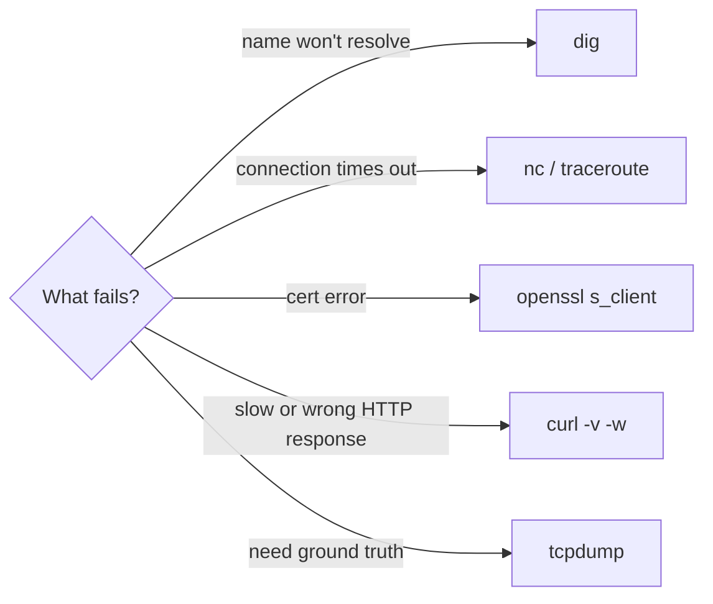
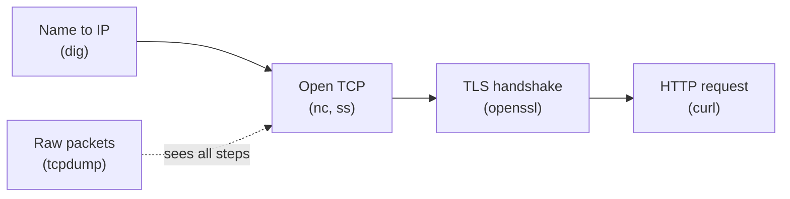
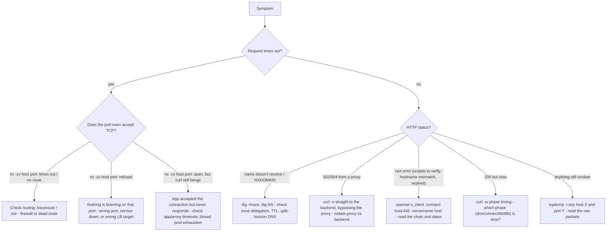
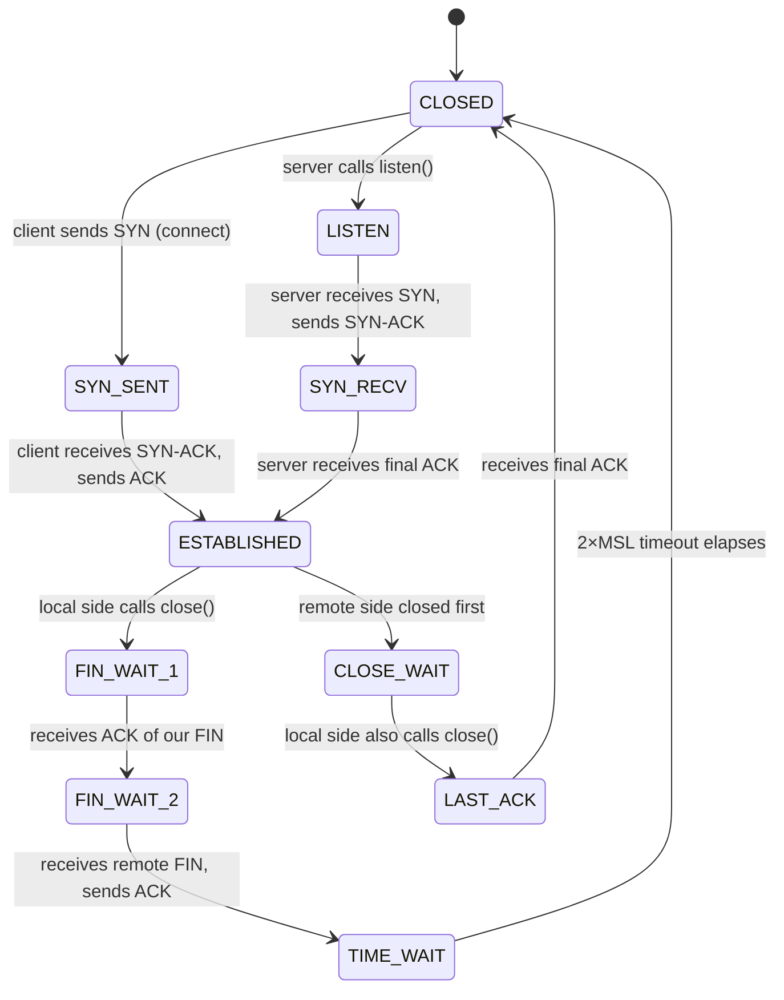
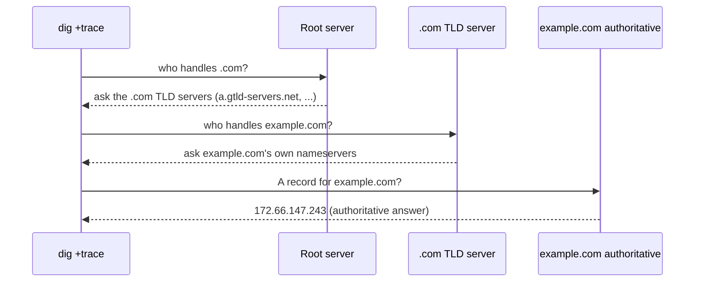
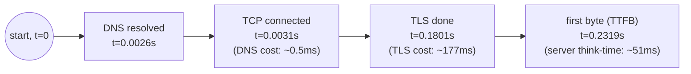
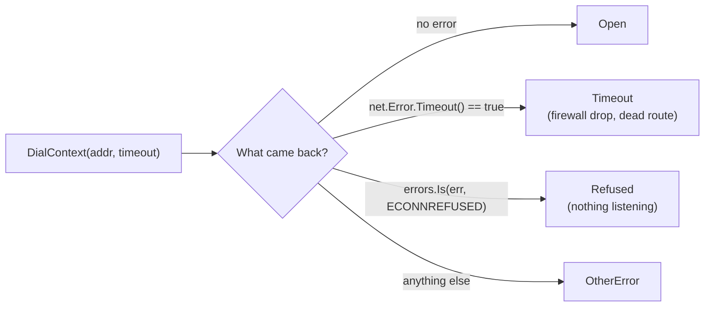

# Network Debugging Toolkit - dig, curl, ss, tcpdump

> [!summary] TL;DR
> A small set of command-line tools — `dig`/`nslookup` for DNS, `curl -v`/`openssl s_client` for HTTP and TLS, `ss`/`netstat` for socket state, `tcpdump` for raw packets, `traceroute`/`mtr`/`nc` for reachability — lets you answer "which layer is broken" for any network failure without guessing, by checking each layer in [[What Happens When You Type a URL]]'s chain in order.

> [!abstract] Core idea
> - Every tool here inspects one layer of the request chain: DNS, TCP reachability, TLS, or HTTP — match the symptom to the layer before picking a tool.
> - `curl -v` and `-w` alone resolve most "is it DNS, TCP, TLS, or the app" questions in one command.
> - `tcpdump` is the ground truth when a higher-level tool disagrees with what's "really" on the wire — everything else is built on what it shows raw.
> - A fixed playbook (symptom → layer → command) beats guessing: timeouts point at TCP/routing, "502" points at the app behind a proxy, cert errors point at TLS, NXDOMAIN points at DNS.

### Whiteboard version

One failing request, one tool per layer, in the order you'd actually run them:



Everything below expands each branch with the exact flags and how to read the output.

## Start here: the basics

**The problem in one story.**
You open an app and it says "something went wrong".
The cause could be the phone book lookup, the road to the server, the security handshake, or the server itself.
Guessing wastes hours.
This note gives you one small tool per step so you can check each step and find the broken one in minutes.

**Words you need first**

| Word | Plain meaning | Tiny example |
| --- | --- | --- |
| DNS | The internet's phone book: name to IP address | `example.com` → `93.184.216.34` |
| IP address | The number that identifies a machine on a network | `10.0.1.5` |
| Port | A numbered door on a machine for one service | HTTPS listens on port 443 |
| TCP connection | A reliable two-way pipe opened with a handshake | Browser connects to server on 443 |
| TLS | Encryption plus certificate check on top of TCP | The padlock in the browser |
| Socket | The OS object a program uses for one connection | One row in `ss` output |
| Packet | One small chunk of data sent over the network | A SYN packet starting a connection |
| CLI flag | An option you pass to a command | `curl -v` turns on verbose output |

**Picture it**



**Analogy.** A parcel did not arrive. You check, in order: was the address right, did the truck leave, did the gate guard let it in, did the receiver sign. Each check has its own logbook.
Where it breaks: real network layers can fail partly (1% of requests), and one tool (tcpdump) can watch every step at once, which no single logbook does.

**How the rest of this note builds up**

- First, why layer-by-layer tools exist (section 1) and the symptom-to-layer mental model (section 2).
- Then each tool with exact flags and real output: dig, curl, openssl, ss, tcpdump, traceroute/mtr/nc (sections 3-4).
- Then variants, trade-offs and the production playbook (sections 5-7).
- Finally the SDE-3 deep dive: BPF filters, ICMP noise in `mtr`, and `CLOSE_WAIT` leaks traced back to Go code (section 8).

> [!tip] Remember
> Match the symptom to one layer, then run the one tool that inspects that layer.

## 1. Why it exists

A request can fail at any of the layers in [[What Happens When You Type a URL]]: the name might not resolve, the port might not accept connections, the TLS certificate might not validate, or the HTTP response might be wrong or slow.

Reading an error message like `curl: (7) Failed to connect` or `curl: (35) SSL connect error` tells you roughly which layer broke, but not *why*.

The "why" needs a tool that inspects that specific layer in isolation, instead of re-running the full request and guessing from the symptom alone.

**Concrete scenario.** A deploy goes out and a service starts returning `502 Bad Gateway` for 1% of requests.

The error alone doesn't say whether DNS is flapping, a backend pod is unreachable, TLS to the backend is failing, or the backend is just slow.

The playbook in this note turns "502 sometimes" into a 5-minute, layer-by-layer check instead of an open-ended investigation.

## 2. Mental model

Treat the chain from [[What Happens When You Type a URL]] as a stack of layers, and keep one tool "fixed" to each layer:

| Layer | Question it answers | Tool |
| --- | --- | --- |
| DNS | Does the name resolve, to what, and is it cached correctly? | `dig`, `nslookup` |
| TCP reachability | Can I even open a connection to this host:port? | `nc`, `ss`/`netstat`, `traceroute`/`mtr` |
| TLS | Does the handshake complete, and is the certificate what I expect? | `openssl s_client` |
| HTTP | What status, headers, and timing came back? | `curl -v`, `curl -w` |
| The wire itself | What did we actually send and receive, byte for byte? | `tcpdump` |

When a symptom doesn't point clearly at one layer, work top-down through this table: DNS first (cheapest to check), then TCP, then TLS, then HTTP, and drop to `tcpdump` only when a tool's own report doesn't explain the behavior.

## 3. How it works

### The debugging playbook



### TCP connection states, as `ss`/`netstat` show them

`ss`/`netstat` report a socket's state from this exact state machine (RFC 9293); reading the state tells you which side is stuck:



A socket stuck in `SYN_SENT` means the SYN or SYN-ACK never arrived (routing/firewall). A pile-up of connections in `CLOSE_WAIT` means the application accepted a close from the peer but never called `close()` itself — a resource leak. A large number in `TIME_WAIT` after a load test is normal cleanup, not a bug, unless it exhausts the ephemeral port range.

## 4. Worked example

### DNS: `dig` and `nslookup`

**Measured** (`dig` 9.10.6, 2026-11-06, live query):

```bash
$ dig example.com A

; <<>> DiG 9.10.6 <<>> example.com A
;; Got answer:
;; ->>HEADER<<- opcode: QUERY, status: NOERROR, id: 57866
;; flags: qr rd ra ad; QUERY: 1, ANSWER: 2, AUTHORITY: 0, ADDITIONAL: 1

;; QUESTION SECTION:
;example.com.			IN	A

;; ANSWER SECTION:
example.com.		196	IN	A	172.66.147.243
example.com.		196	IN	A	104.20.23.154

;; Query time: 30 msec
;; SERVER: 100.64.0.1#53(100.64.0.1)
;; WHEN: Fri Nov 06 23:52:54 IST 2026
;; MSG SIZE  rcvd: 72
```

Read it: `status: NOERROR` plus an `ANSWER SECTION` means the name resolved; `196` is the record's remaining TTL in seconds (how much longer this answer is cached before a client must ask again); `Query time: 30 msec` is this resolver's round trip, not the authoritative server's.

**Measured** (NXDOMAIN, same resolver):

```bash
$ dig nonexistent-domain-xyz123abc.com A

;nonexistent-domain-xyz123abc.com. IN	A

;; AUTHORITY SECTION:
com.			900	IN	SOA	a.gtld-servers.net. nstld.verisign-grs.com. 1793989611 1800 900 604800 900

;; Query time: 82 msec
```

No `ANSWER SECTION` and an `AUTHORITY SECTION` carrying the zone's `SOA` record is the signature of NXDOMAIN — "this exact name does not exist" (not the same as a timeout, which means the resolver never got an answer at all).

**Measured** (a CNAME, which is how most sites point a subdomain at a CDN or load balancer):

```bash
$ dig www.github.com CNAME +short
github.com.
```

**Representative output** (`nslookup`, equivalent information, friendlier for a quick manual check; `dig` is preferred for scripting and for seeing TTLs and flags):

```text
$ nslookup example.com
Server:		100.64.0.1
Address:	100.64.0.1#53

Non-authoritative answer:
Name:	example.com
Address: 104.20.23.154
Name:	example.com
Address: 172.66.147.243
```

`dig +trace example.com` walks the delegation chain itself — root → `.com` TLD servers → the zone's authoritative nameservers — which is the tool for "DNS resolves wrong in this environment but not in another," since it bypasses your resolver's cache and shows exactly which server answered each step.

**Picture it — what `+trace` actually asks, one server at a time:**



Each hop is a separate query your own machine sends — your normal resolver never gets a chance to serve a cached answer, which is exactly why `+trace` catches a stale cache or a bad delegation that an ordinary `dig example.com` would hide.

### HTTP and timing: `curl -v` and `curl -w`

**Measured** (`curl 8.x`, 2026-11-06, live request, TLS certificate details redacted since they depend on the network's TLS configuration — see [[TLS and HTTPS]] for what each handshake message means):

```bash
$ curl -v -s -o /dev/null https://example.com
* Host example.com:443 was resolved.
* IPv4: 172.66.147.243, 104.20.23.154
*   Trying 172.66.147.243:443...
* Connected to example.com (172.66.147.243) port 443
* ALPN: curl offers h2,http/1.1
* (TLS handshake messages omitted)
* SSL connection using TLSv1.3 / AEAD-AES256-GCM-SHA384
* ALPN: server accepted h2
* using HTTP/2
> GET / HTTP/2
> Host: example.com
> user-agent: curl/8.7.1
> accept: */*
>
< HTTP/2 200
< content-type: text/html; charset=utf-8
< server: cloudflare
```

Read `curl -v` output in three blocks: lines starting with `*` are curl's own narration (DNS, connect, TLS, protocol negotiation), `>` lines are what curl sent, `<` lines are what it received. A connection failure never reaches the `>` lines at all — that alone tells you the problem is below HTTP.

**Measured** (`curl -w`, phase timing, the same mechanism as [[What Happens When You Type a URL]]'s httptrace example):

```bash
$ curl -s -o /dev/null -w \
  "dns:%{time_namelookup}s connect:%{time_connect}s tls:%{time_appconnect}s ttfb:%{time_starttransfer}s total:%{time_total}s\n" \
  https://example.com
dns:0.002563s connect:0.003054s tls:0.180100s ttfb:0.231865s total:0.232011s
```

These numbers are cumulative from the start of the request, not per-phase: subtract consecutive fields to get each phase's cost (TLS alone here: `0.180100 - 0.003054 ≈ 177 ms`).

**Picture it — the same four numbers as a timeline, cumulative versus per-phase:**



**Why it matters:** reading the raw `curl -w` output as four isolated numbers hides where the time actually went; turning it into a timeline like this makes the dominant cost (TLS, here) visually obvious instead of requiring mental subtraction.

**Measured** (`curl --resolve`, forcing a specific IP without touching system DNS — the standard way to test "does the new server work" before changing a DNS record, or to test one node behind a load balancer directly):

```bash
$ curl -s -o /dev/null -w "total:%{time_total}s code:%{http_code}\n" \
  --resolve example.com:443:172.66.147.243 https://example.com
total:0.211868s code:200
```

### TLS: `openssl s_client`

```bash
$ echo | openssl s_client -connect example.com:443 -servername example.com
CONNECTED(00000006)
---
Certificate chain
 0 s:/CN=example.com
   i:/C=US/O=Example CA/CN=Example CA Intermediate
 1 s:/C=US/O=Example CA/CN=Example CA Intermediate
   i:/C=US/O=Example CA/CN=Example Root CA
---
Server certificate
-----BEGIN CERTIFICATE-----
... (PEM data) ...
-----END CERTIFICATE-----
subject=/CN=example.com
issuer=/C=US/O=Example CA/CN=Example CA Intermediate
---
SSL handshake has read 3821 bytes and written 350 bytes
---
New, TLSv1.3, Cipher is TLS_AES_256_GCM_SHA384
Verify return code: 0 (ok)
```

**Representative output (openssl 3.x against a public TLS 1.3 site)** — the cert content above is illustrative; what matters for debugging is always the same three facts:

1. `-servername` must match what the server's certificate covers (an `s:` with the wrong CN, or `subjectAltName` not containing your host, means a hostname mismatch).
2. `Verify return code: 0 (ok)` means the chain validated against the client's trust store (a non-zero code, such as `20` for "unable to get local issuer certificate," means the chain is incomplete or the CA isn't trusted).
3. The certificate's validity window (`openssl x509 -noout -dates`) catches an expired cert immediately.

### Sockets: `ss` / `netstat`

**Representative output** (`ss -tan`, Linux; macOS lacks `ss` and uses `netstat -an` instead, shown with equivalent columns):

```text
$ ss -tan
State       Recv-Q  Send-Q   Local Address:Port    Peer Address:Port
LISTEN      0       128      0.0.0.0:443           0.0.0.0:*
ESTAB       0       0        10.0.1.5:51322         10.0.2.9:443
CLOSE-WAIT  0       0        10.0.1.5:51400         10.0.2.9:443
TIME-WAIT   0       0        10.0.1.5:51410         10.0.2.9:443
```

A `LISTEN` row with `Recv-Q` climbing toward its `Send-Q` backlog limit means connections are queuing faster than `accept()` is being called.

Once `Recv-Q` reaches that limit, the kernel drops or refuses further incoming SYNs until the application catches up — the application is falling behind.

Many `CLOSE-WAIT` rows for the same remote peer is the state diagram's leak: this process never called `close()` after the peer disconnected.

### The wire itself: `tcpdump`

**Representative output** (`tcpdump` 4.x, capturing a TCP handshake and HTTPS request; requires elevated privileges to open a raw socket):

```text
$ sudo tcpdump -i en0 -n 'host 172.66.147.243 and port 443' -c 6
12:00:01.001  IP 10.0.1.5.51322 > 172.66.147.243.443: Flags [S], seq 1001, win 65535, length 0
12:00:01.015  IP 172.66.147.243.443 > 10.0.1.5.51322: Flags [S.], seq 5001, ack 1002, win 65535, length 0
12:00:01.016  IP 10.0.1.5.51322 > 172.66.147.243.443: Flags [.], ack 5002, win 65535, length 0
12:00:01.017  IP 10.0.1.5.51322 > 172.66.147.243.443: Flags [P.], seq 1002:1518, ack 5002, length 516
12:00:01.198  IP 172.66.147.243.443 > 10.0.1.5.51322: Flags [P.], seq 5002:5518, ack 1518, length 516
12:00:01.199  IP 10.0.1.5.51322 > 172.66.147.243.443: Flags [.], ack 5518, win 65535, length 0
```

Read the `Flags`: `[S]` is a SYN, `[S.]` is SYN-ACK, `[.]` is a bare ACK, `[P.]` is a push with data.

The three-way handshake is the first three lines; line 4 is the TLS ClientHello leaving the client, and the 181 ms gap before line 5 is the time the TLS handshake + first byte actually took on the wire — the same number `curl -w`'s `time_appconnect` would report, but captured independently of curl's own instrumentation.

The filter expression (`host ... and port 443`) is Berkeley Packet Filter (BPF) syntax; narrowing it is essential on a busy interface.

### Reachability: `traceroute`, `mtr`, `nc`

**Measured** (`traceroute`, 2026-11-06, live, 5 hops):

```text
$ traceroute -m 5 -w 1 -q 1 example.com
traceroute to example.com (172.66.147.243), 5 hops max, 40 byte packets
 1  *
 2  205.220.19.25 (205.220.19.25)  14.608 ms
 3  205.220.18.3 (205.220.18.3)  16.232 ms
 4  dsl-ncr-dynamic-085.60.23.125.airtelbroadband.in (125.23.60.85)  56.442 ms
 5  182.79.205.103 (182.79.205.103)  87.549 ms
```

Each row is one more hop's TTL expiring and sending back an ICMP "time exceeded".

A `*` means that hop didn't reply (often a router that drops ICMP, not necessarily a failure — only a trend of timeouts at the *same* hop across repeated runs indicates a real problem there).

`mtr` runs the same idea continuously and adds a live loss percentage and jitter per hop, which is what separates "one slow hop" from "this hop drops 20% of packets."

**Measured** (`nc`, port reachability — the fastest way to answer "is TCP even possible" before touching HTTP or TLS at all):

```text
$ nc -vz -w3 example.com 443
Connection to example.com port 443 [tcp/https] succeeded!

$ nc -vz -w2 127.0.0.1 1
nc: connectx to 127.0.0.1 port 1 (tcp) failed: Connection refused
```

### Writing the same check as a Go health probe

**In plain words:** `nc -zv` is a manual, one-shot version of the TCP health check a load balancer or orchestrator runs continuously. A small Go program turns the three outcomes `nc` shows informally — open, refused, timed out — into typed values a program can branch on, log, or alert on.

**Picture it — one dial, classified into the outcomes a human reads off `nc`/`ss`/`tcpdump`:**



**Why it matters:** the same three buckets this diagram shows are exactly the ones `ss -tan` and a `tcpdump` capture surface too:

- `Refused` is the kernel answering a SYN with an RST.
- `Timeout` is a SYN that got no reply at all.

Having a program classify a health check into these same buckets (rather than a bare boolean "up/down") is what lets an on-call dashboard already say "this looks like a firewall problem" before a human runs `nc` by hand.

Runnable Go version, including the full `classify`/`CheckTCP`/`Report` implementation and all four tests: [[Network Debugging Toolkit - dig, curl, ss, tcpdump - Go]]

## 5. Variants and comparison

| Symptom | Likely layer | Command | What to read in the output |
| --- | --- | --- | --- |
| Name doesn't resolve / NXDOMAIN | DNS | `dig name A`, `dig +trace name` | `status:` field, presence of an `ANSWER SECTION`, TTL |
| Connect hangs with no error for a long time | TCP/routing, often a firewall silently dropping SYNs | `nc -zv`, `traceroute`/`mtr` | `nc` reports `timeout`; traceroute shows where replies stop |
| "Connection refused" immediately | TCP, nothing listening on that port | `nc -zv`, `ss -tan \| grep LISTEN` | Immediate `Connection refused`; `ss` shows no `LISTEN` row for that port |
| Cert errors (expired, wrong host, untrusted CA) | TLS | `openssl s_client -connect host:443 -servername host` | `Verify return code`, certificate `subject`/`issuer`, validity dates |
| 502/504 through a reverse proxy | App unreachable or too slow behind the proxy | `curl -v` direct to the backend, bypassing the proxy | Whether the direct request succeeds and how fast |
| 200 OK but slow | Any layer; isolate with timing | `curl -w` phase timing | Which of dns/connect/tls/ttfb grew |
| Everything above looks fine but behavior is still wrong | Needs ground truth | `tcpdump` | Actual bytes/flags on the wire, retransmissions, resets |

## 6. Trade-offs and when not to use

- `dig`/`curl`/`openssl` are read-only and safe to run against production; `tcpdump` requires elevated privileges (`CAP_NET_RAW` or root) and can capture sensitive payloads — never run it without a tight filter and awareness of what it will capture (see [[CSRF, XSS and Security Headers]] for why capturing plaintext credentials is a real risk on an unencrypted hop).
- `traceroute` and `mtr` measure the *path*, not the application; a clean traceroute does not rule out an application-level problem, and a path with packet loss doesn't always explain an application timeout (TCP retransmits and often recovers invisibly).
- `curl --resolve` and DNS overrides are for testing; relying on them as a permanent fix instead of correcting the actual DNS record just hides the problem from everyone else who hits the real record.
- Reading `tcpdump` output live is slow for complex problems; capture to a file (`-w capture.pcap`) and inspect it with a GUI tool (Wireshark) when the question is more than "did the SYN arrive."

## 7. In production

- **Real systems:** this exact toolkit is what an on-call engineer runs during an incident, in roughly the order DNS → TCP → TLS → HTTP → packet capture; load balancer and Kubernetes health checks are the automated version of the `nc`/`CheckTCP` step, run continuously instead of once.
- **Failure modes → fixes:**
  - Resolver returns stale IPs after a DNS change → check the record's TTL with `dig`; a long TTL means clients and intermediate resolvers keep the old answer until it expires, not until you change the record.
  - Intermittent `502` from a proxy → isolate with `curl -v` straight to each backend instance; a backend that's slow or crash-looping under load will show up as a hang or a connection reset on the direct check even when the proxy's own health check still passes it.
  - TLS works in a browser but fails from a script or a different machine → check the trust store (`openssl s_client -CAfile` against the specific bundle the script uses) and whether SNI (`-servername`) is being sent at all; a missing `-servername` is a very common script bug.
  - A host "sometimes" doesn't respond → capture with `tcpdump` during a failure window and look for retransmissions or resets, which point at network loss rather than application logic.
- **What to monitor:** DNS query latency and NXDOMAIN rate, TCP connect failure rate (refused vs timeout, since they mean different things operationally), TLS handshake failure rate and days-to-certificate-expiry, and HTTP error rate broken down by phase timing (so a dashboard can already say "this is a TLS problem" before anyone opens a terminal).

## 8. Deep dive

- **`dig`'s flags section decodes the resolution itself.** `qr` means this is a response (not a query), `rd` means recursion was requested, `ra` means the server supports recursion, `ad` means the answer was validated with DNSSEC. Missing `ad` on a zone that should be signed is itself a finding.
- **BPF filter syntax is a small language, not a free-text search.** `tcpdump 'tcp and port 443 and (tcp[tcpflags] & tcp-syn != 0)'` captures only SYN packets — useful for counting connection *attempts* separately from established traffic.

  `host a and host b` restricts to one conversation on a busy link.
- **`curl -v`'s `*` lines come from curl's own logic, not the wire** — for ground truth on exactly what bytes were exchanged (useful when curl's TLS library and the server disagree about something), drop to `openssl s_client` or `tcpdump`.
- **`mtr`'s per-hop loss percentage is noisy for intermediate hops.**

  Many routers deprioritize or rate-limit the ICMP replies `traceroute`/`mtr` depend on, so a hop showing 30% loss while the hops after it show 0% almost always means that router deprioritizes ICMP, not that it's dropping real traffic.

  Only loss at the *last* hop (the actual destination) or a consistent trend is actionable.
- **A `CLOSE_WAIT` leak visible in `ss` output traces back to code, not network.**

  It means the local process received a FIN from the peer (the peer closed its side) but the local process's code path never called `Close()` on its end.

  In Go, it is almost always a missing `defer conn.Close()` or a response body that's read but never closed (`resp.Body.Close()`).

## 9. Interview questions

> [!question]- A request times out with no error message at all. What's your first command, and why?
> `nc -zv host port` (or `curl -v` with a connect timeout). It answers the single cheapest question first: does TCP even connect? If it hangs the same way, the problem is routing or a firewall silently dropping packets — check with `traceroute`/`mtr`. If `nc` succeeds instantly, the problem is above TCP (TLS or the application), and the timeout is really the app not responding.

> [!question]- `curl` reports `curl: (35) SSL connect error`. What do you run next and what are you looking for?
> `openssl s_client -connect host:443 -servername host`. Read the `Verify return code` (0 means the chain validated), the certificate's `subject`/`subjectAltName` against the hostname you're connecting to, and the validity dates. The three usual causes are an expired certificate, a hostname that isn't in the certificate's SAN list, or an incomplete chain the client's trust store can't validate.

> [!question]- Trap: `traceroute` to a host shows `* * *` at hop 6 but the destination still responds fine at hop 10. Is there a problem at hop 6?
> Not necessarily. Many routers deprioritize or drop the ICMP "time exceeded" replies `traceroute` depends on without affecting the actual traffic passing through them. A single silent hop with normal connectivity on either side is usually that router's ICMP policy, not a real path problem — only consistent loss at the *final* hop, or loss that correlates with an actual application symptom, is actionable.

> [!question]- `ss -tan` shows hundreds of sockets in `CLOSE_WAIT` for one process. What does that mean and where's the bug?
> The remote peer closed its side of each connection (sent a FIN), but this process never called `close()` in response, so the socket is stuck waiting for the local side to finish. That's an application bug, not a network problem — in Go, typically a missing `resp.Body.Close()` or a connection handed off without a corresponding close on an error path.

> [!question]- When would you reach for `tcpdump` instead of trusting `curl -v`'s own narration?
> When a tool's explanation doesn't match the observed behavior — for example `curl` reports a clean connection but the request still stalls, or two tools (a load balancer's health check and your manual `curl`) disagree about reachability. `tcpdump` shows the literal bytes and flags on the wire, independent of any single tool's interpretation of them.

> [!question]- Your DNS record's TTL is 3600 seconds and you just changed the IP it points to. A `dig` from your laptop shows the new IP immediately, but users still report the old one an hour later. Why, and what would you check?
> Different resolvers cache independently; your laptop may be hitting a resolver that hadn't cached the old answer yet, while affected users' resolvers (ISP-level or corporate) cached the old record and won't ask again until that record's TTL in their cache expires. Check with `dig` against the same resolver the affected users use, and expect the old record to keep showing up for up to the TTL from whenever each resolver last cached it.

> [!question]- What's the practical difference between "connection refused" and "connection timed out," and why does it matter for debugging?
> Refused means a SYN reached the host and something (the OS) answered with an RST because nothing is listening on that port — the network path works, but the service/port is wrong. Timed out means no reply came back at all within the deadline — usually a firewall dropping the packet or a dead route. The first points you at "is the right process listening on the right port," the second points you at routing and firewalls.

## 10. Cheat sheet

- Order of attack: DNS (`dig`) → TCP reachability (`nc`, `ss`) → TLS (`openssl s_client`) → HTTP (`curl -v`/`-w`) → raw packets (`tcpdump`) only if the above don't explain it.
- `dig name TYPE`: no `ANSWER SECTION` + an `AUTHORITY SECTION` SOA means NXDOMAIN; a timeout with neither means the resolver itself is unreachable.
- `curl -w` timing fields are cumulative — subtract consecutive fields to get each phase's own cost.
- `openssl s_client -servername host`: always pass `-servername` or SNI-based routing and certificate selection won't match what a browser would see.
- `nc -zv host port`: refused means nothing is listening; a timeout means the packet never got a reply at all (firewall or dead route).
- `ss`/`netstat`: `LISTEN` backlog growing means the app isn't accepting fast enough; many `CLOSE_WAIT` rows means the app leaks unclosed connections.
- `tcpdump` needs a tight BPF filter (`host`, `port`, `tcp[tcpflags]`) and root; capture to a file for anything beyond a one-line check.
- `traceroute`/`mtr` measure the path, not the app — loss at one middle hop with clean hops around it is usually that router's ICMP policy, not a real problem.

## Links

- **Before this:** [[What Happens When You Type a URL]], [[DNS - Resolution, Records and Caching]], [[TCP - Handshake, Reliability, Flow and Congestion Control]], [[TLS and HTTPS]]
- **Next:** [[Forward and Reverse Proxies - L4 vs L7]]
- **Compare with:** [[I-O Models - Blocking, epoll, io_uring and the Go Netpoller]] (what a Go server's socket handling looks like from the kernel's side), [[HTTP Fundamentals - Methods, Status Codes, Headers, Cookies]]
- **Runnable code:** [[Network Debugging Toolkit - dig, curl, ss, tcpdump - Go]]

### Watch on YouTube

- [Wiresharking CURL - How a single GET request translates to 10 TCP Packets](https://www.youtube.com/watch?v=gOEiBliwMUA) · Hussein Nasser · shows curl + packet capture together, ties the tools to what's really on the wire
- [ss command - use Socket statistics to investigate your Linux network. Alternative to Netstat](https://www.youtube.com/watch?v=92-RCkdoKDw) · dolastack devops · focused walkthrough of ss for inspecting socket/connection state
- [Learn Tcpdump - Tutorial with Examples](https://www.youtube.com/watch?v=xyFLY1saDh0) · Hack eXPlorer · hands-on tcpdump filtering and packet capture examples
