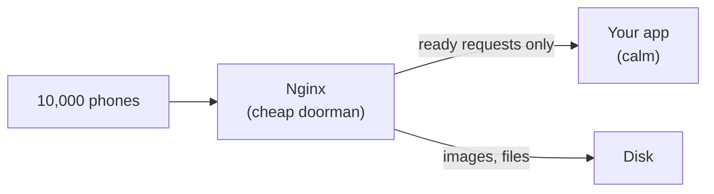
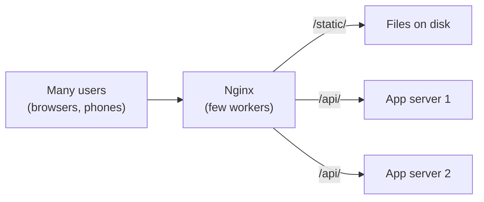
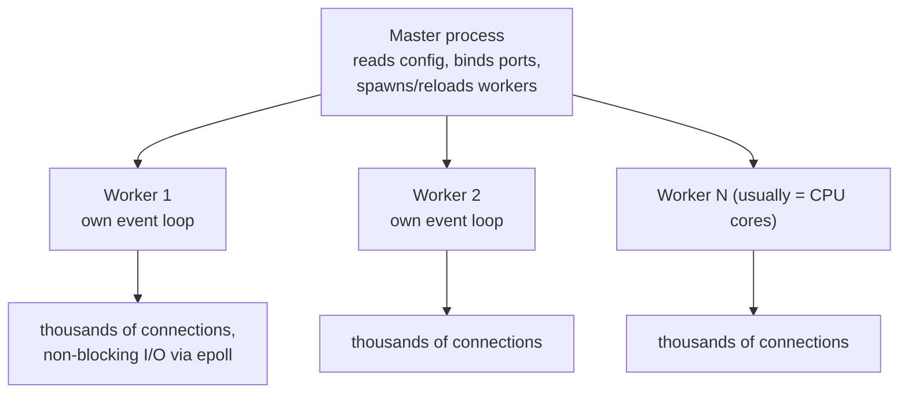
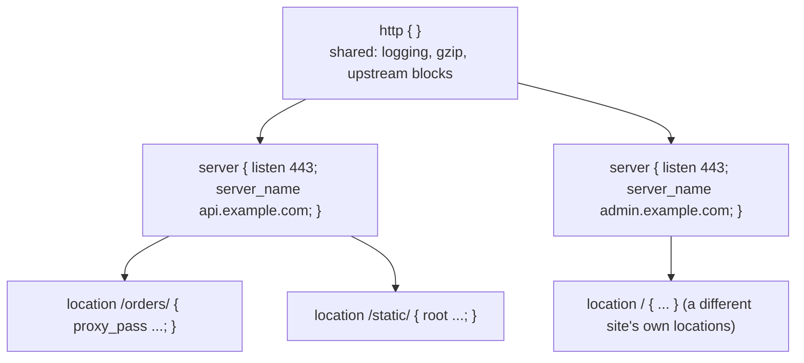
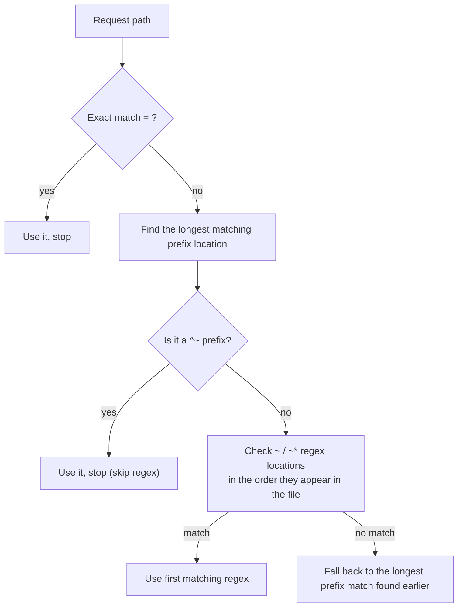
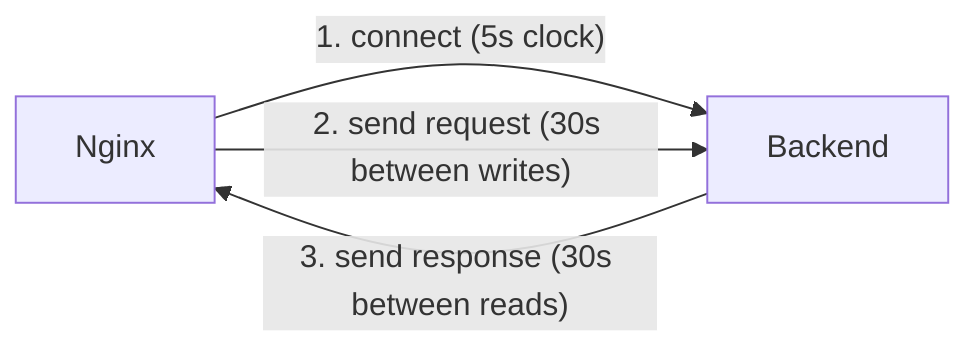
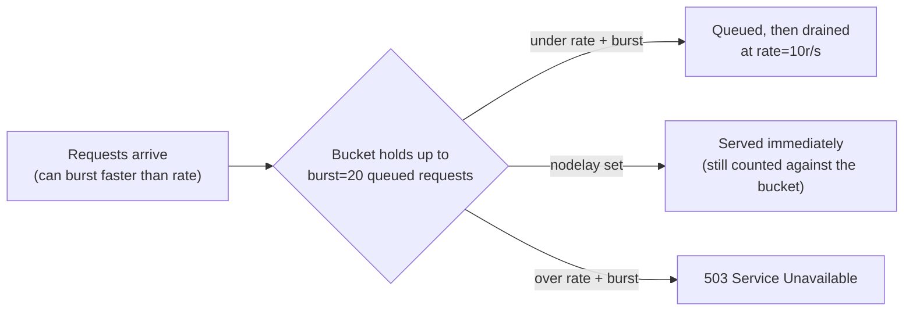
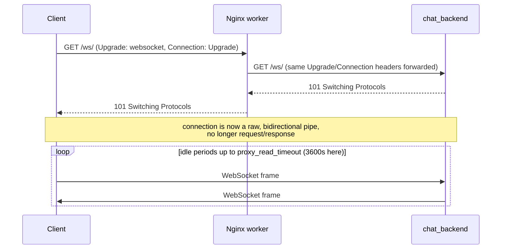
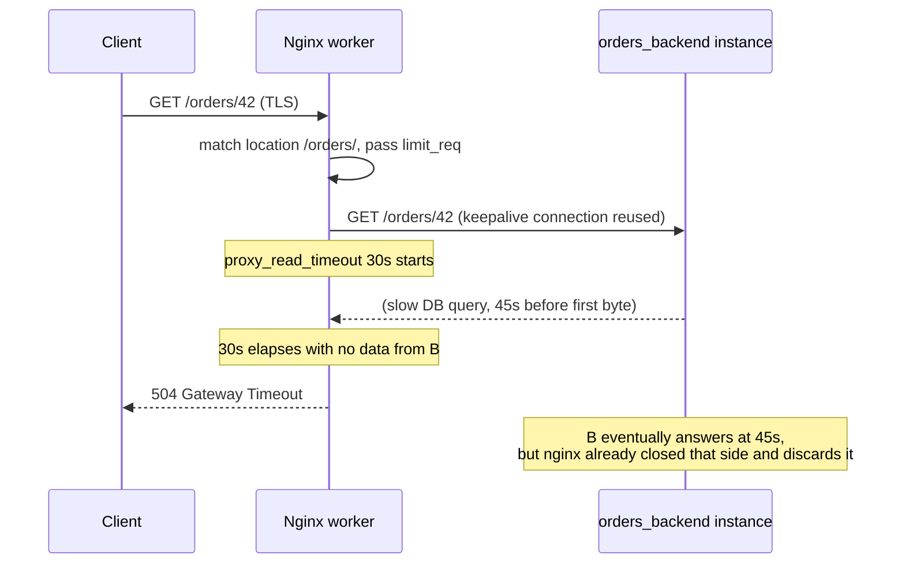

# Nginx

> [!summary] TL;DR
> Nginx is a single binary that most commonly runs as a [[Forward and Reverse Proxies - L4 vs L7|reverse proxy]], load balancer, and static file server, built around a small number of **worker processes** that each handle thousands of connections using a non-blocking, event-driven loop instead of one thread per connection.

> [!abstract] Core idea
> - One **master process** manages a small, fixed number of **worker processes**; each worker runs its own single-threaded event loop (built on `epoll` on Linux) and handles many connections concurrently without blocking.
> - Config is a tree: `http` → `server` (one per site/port) → `location` (one per URL pattern), and **location matching has a precedence order that isn't "first match wins."**
> - A `location /api/` block with `proxy_pass` forwards to an `upstream` pool of backend servers, with its own balancing method, health checks, and timeouts.
> - Classic mistake: assuming `proxy_read_timeout`'s 60-second default is "the request timeout." It's specifically the time between two reads from the backend — a single slow endpoint needs its own override, not a global one.

## Start here: the basics 🟢

> [!info] How to read this note (pick your level)
> - 🟢 **New to this?** Read "From zero" below, then sections 1, 2 and the cheat sheet (10). Stop there, that is a full first pass.
> - 🟡 **Know the basics?** Add section 3 (how it works) and 4 (worked example), plus 5 and 6 for comparisons.
> - 🔴 **Interview / SDE-3 prep?** Add 7, 8 and 9. Headings are tagged 🟢🟡🔴 so you always know where you are.

**From zero, in 60 seconds** 🟢

You build a website. It runs as a program on one computer (your **app server**).

Now 10,000 people open the site at once. Many are on slow phones. If your app talks to each slow phone directly, it spends all its time waiting.


So you put a doorman program in front. That doorman is **Nginx**. It is very good at one thing: holding thousands of open conversations cheaply. It hands your app only finished, ready requests, and it can also answer easy things itself (like sending back an image file).



That is the whole idea. The rest of this note is just these 4 questions:
1. How does one small program hold so many connections at once?
2. How do you tell it which requests go where (the config)?
3. How does it spread requests across several app servers?
4. What goes wrong in real life (timeouts, limits) and how do you set them?

**The problem in one story.**
Your web app runs on one server, and 10,000 people open it at once.
Many of them are on slow phones, so each request trickles in slowly.
If the server parks one worker per visitor, it runs out of memory waiting on slow phones.
Nginx sits in front, juggles all those slow visitors cheaply, and hands finished requests to your app.

**Words you need first**

| Word | Plain meaning | Tiny example |
| --- | --- | --- |
| Web server | A program that answers HTTP requests | Nginx returning `index.html` |
| Reverse proxy | A server that receives requests and forwards them to your real app | Nginx passing `/api/` to a Go service on port 8080 |
| Upstream / backend | The servers nginx forwards requests to | Three Go app instances |
| Process / thread | A running program / one line of execution inside it | One nginx worker = one process with one thread |
| Connection | An open network link between a client and a server | One browser tab talking to nginx |
| Event loop | A loop that handles whichever connection is ready next, never waiting on one | Worker serving 5,000 sockets in turn |
| Timeout | How long to wait before giving up | `proxy_read_timeout 60s` |
| Load balancer | Spreads requests across several backends | Round-robin across 3 servers |

**Picture it**



**Analogy.** Nginx is a hotel receptionist who greets every guest, answers easy questions (static files) directly, and sends the rest to the right department (backends).
Where it breaks: one receptionist talks to one guest at a time, while one nginx worker keeps thousands of conversations open and switches between them in microseconds.

**How the rest of this note builds up**

- First, why nginx exists (the C10K problem, section 1) and the master/worker mental model (section 2).
- Then how it works: workers and `epoll`, the `http` → `server` → `location` config tree, location matching, upstreams, timeouts and rate limiting (section 3).
- Then a worked config (section 4), comparisons and trade-offs (sections 5-6).
- Finally the SDE-3 material: production pitfalls, the `epoll` and micro-caching deep dive, and interview questions (sections 7-9).

> [!tip] Remember
> Nginx is a cheap front door: a few workers juggle many connections and route each request to files or backends.

## 1. Why it exists 🟢

A traditional thread-per-connection web server needs one OS thread (with its own stack, typically megabytes) for every open connection.

At 10,000 concurrent slow clients — the classic "C10K problem" — that's gigabytes of thread stacks and brutal context-switching overhead, most of it spent on connections that are simply idle, waiting on a slow network.

Nginx was built specifically to answer the C10K problem: a fixed small number of worker processes (often one per CPU core), each managing tens of thousands of connections through a non-blocking event loop, so idle connections cost memory for a small connection-state struct, not an entire OS thread.

**Measured**, `curl -sI` against `nginx.org` itself, 2026-11-06:

```http
HTTP/1.1 200 OK
Server: nginx/1.31.3
strict-transport-security: max-age=31536000
accept-ranges: bytes
```

## 2. Mental model 🟢

Picture a restaurant with one head chef (the **master process**) who doesn't cook, and a handful of line cooks (**worker processes**).

Each line cook doesn't wait idle for one order to fully finish before starting the next — they check on many dishes at once, moving to whichever one is ready for the next step (an event loop), instead of one cook per customer standing around while a dish simmers.

**Where the analogy breaks down:** a real line cook can only physically stand at one station at a time, so the "many dishes at once" part is really "switching between dishes very fast, one at a time."

An nginx worker does exactly that too — one OS thread, switching between ready sockets — so the analogy is accurate on that point.

Where it breaks down is staffing: a restaurant can't usually hire a fractional cook, but `worker_processes auto` picks a whole number of workers equal to the CPU core count with no such constraint, and nginx can run with just one worker handling every connection if asked to.

> [!tip] Remember
> One **master** that never touches traffic, N **workers** that do all the work, each one juggling many connections by switching between whichever is ready next — never one worker per connection.

## 3. How it works 🟡

### Master and worker processes

**In plain words: one boss who never serves customers, and a few tireless waiters who each juggle thousands of tables at once.**



- The **master** process never handles a request. It reads and validates config, opens the listening sockets, and spawns, monitors, and reloads workers.
- Each **worker** runs a single OS thread with its own event loop built on `epoll` (Linux) — see [[I-O Models - Blocking, epoll, io_uring and the Go Netpoller]] for how `epoll` itself works.
  The worker registers interest in many sockets at once and the kernel tells it which ones are ready, so one worker thread services many connections without ever blocking on a single slow one.
- `worker_connections` caps how many simultaneous connections one worker will hold open; `worker_processes` (commonly `auto`, meaning one per detected CPU core) sets how many workers run. The product of the two is nginx's practical connection ceiling on one machine.
- `nginx -s reload` sends the master a signal to re-read config and spawn **new** workers with the new config while **old** workers finish their current connections and then exit — a graceful, zero-downtime config change with no dropped connections.

### Config structure: http → server → location

```nginx
http {
    # settings here apply to every server block unless overridden

    server {
        listen 443 ssl;
        server_name api.example.com;

        location /orders/ {
            proxy_pass http://orders_backend;
        }

        location /static/ {
            root /var/www;
        }
    }

    server {
        listen 443 ssl;
        server_name admin.example.com;
        # a different site, same nginx instance
    }
}
```

- `http` is the top-level context for anything HTTP-related: logging format, gzip, the `upstream` blocks, and every `server`.
- `server` is one virtual host: it listens on a port and matches a `server_name` (or several), much like one tenant of the whole nginx instance.
- `location` matches a request's URL path within a `server` and decides how to handle it: proxy it, serve a static file, redirect it, or something else.

**In plain words:** think of the config as a filing system with three drawers nested inside each other.

- The outer drawer (`http`) holds settings every site in this nginx instance shares.
- Inside it, one folder per website (`server`) holds that site's own settings.
- Inside each folder, one index card per URL pattern (`location`) says exactly what to do when a request for that pattern arrives.



**Example, with numbers:** a request for `https://api.example.com/orders/42` picks exactly one path down this tree: nginx first finds the `server` block whose `server_name` matches `api.example.com` on port 443 (not `admin.example.com`'s block, even though both listen on the same port), and only then looks inside *that* `server` block's `location` blocks for one matching `/orders/42`.

> [!tip] Remember
> Settings flow one way only: outer to inner. A `location` can override something set in its `http` block, but an `http`-level setting silently applies to every `server` and `location` under it unless overridden.

### Location matching precedence (not "first match wins")

**In plain words: nginx does not read your URL rules top to bottom like a checklist; it has a fixed pecking order, and an exact match always wins.**

Nginx does **not** scan `location` blocks top to bottom and stop at the first match. It applies a fixed precedence order regardless of where each block appears in the file:

| Order | Syntax | Meaning |
| --- | --- | --- |
| 1 (highest) | `location = /exact` | Exact match; stops searching immediately once matched |
| 2 | `location ^~ /prefix` | Longest matching prefix, but skips regex checks entirely if this wins |
| 3 | `location ~ /regex` (case-sensitive) or `location ~* /regex` (case-insensitive) | First matching regex **in file order** |
| 4 (lowest) | `location /prefix` | Longest matching plain prefix, used only if nothing above matched |



A common bug: a `location ~* \.(jpg|png)$` regex block "wins" over a plain `location /images/` prefix block even though the prefix block appears first in the file and looks more specific — because any regex match outranks any plain prefix match once the plain-prefix search has completed, except when the plain-prefix match used `^~`.

> [!warning] Common mistake
> Assuming nginx reads `location` blocks top to bottom like an `if`/`else if` chain and stops at the first match. It doesn't. It always runs the fixed precedence order above regardless of file order — the only place file order matters at all is breaking a tie between two regex blocks, where the first one written wins.

> [!tip] Remember
> Exact match beats everything. After that, a `^~` prefix skips regex entirely. Otherwise, any matching regex beats any plain prefix, no matter how specific the prefix looks.

### Reverse proxy and upstream

**In plain words: `upstream` is your list of app servers, and `proxy_pass` says "forward matching requests to that list" — like a receptionist with a roster of departments.**

```nginx
upstream orders_backend {
    server 10.0.1.11:8080 max_fails=3 fail_timeout=10s;
    server 10.0.1.12:8080 max_fails=3 fail_timeout=10s;
    server 10.0.1.13:8080 backup;  # only used if the two above are down
    keepalive 32;                 # idle connections kept open per worker, reused across requests
}

server {
    listen 443 ssl;
    server_name api.example.com;

    location /orders/ {
        proxy_pass http://orders_backend;
        proxy_http_version 1.1;              # required to use keepalive to the upstream
        proxy_set_header Connection "";       # clear the hop-by-hop header so keepalive isn't defeated
        proxy_set_header Host $host;
        proxy_set_header X-Real-IP $remote_addr;
        proxy_set_header X-Forwarded-For $proxy_add_x_forwarded_for;
        proxy_set_header X-Forwarded-Proto $scheme;
    }
}
```

`$proxy_add_x_forwarded_for` appends the immediate client's IP to any inbound `X-Forwarded-For` rather than overwriting it — the same append-only rule covered for any reverse proxy in [[Forward and Reverse Proxies - L4 vs L7]]; a backend reading this header still needs to trust only as many hops as it actually controls, nginx included.

**Upstream load-balancing methods**, chosen per `upstream` block:

| Method | Directive | Behavior |
| --- | --- | --- |
| Round robin | (default, no directive needed) | Requests cycle through servers in order |
| Weighted round robin | `server … weight=3` | Some servers get proportionally more requests |
| Least connections | `least_conn` | Send to whichever server currently has the fewest open connections |
| IP hash | `ip_hash` | Same client IP always maps to the same server (session stickiness, at the cost of uneven load if client IPs aren't evenly distributed) |
| Generic consistent hash | `hash $request_uri consistent` | A custom key (e.g. the URI) maps consistently to a server, minimizing remapping when a server is added or removed — see [[Consistent Hashing]] |

**Health checks**: open-source nginx only does **passive** checks.

- `max_fails` failed attempts within `fail_timeout` marks a server temporarily down, and traffic stops going to it until `fail_timeout` elapses and it's tried again.
- **Active** health checks (proactively probing a `/health` endpoint on a timer, independent of real traffic) are an NGINX Plus (commercial) feature.
- Open-source deployments typically pair nginx with an external health-checking sidecar or rely on the orchestrator (Kubernetes readiness probes) instead.

### Timeouts and buffering

**In plain words: three separate stopwatches — one for dialing the backend, one for talking to it, one for waiting on its answer — and each resets on activity, so a slow trickle never trips them.**

```nginx
proxy_connect_timeout 5s;   # time to establish the TCP connection to the upstream
proxy_send_timeout    30s;  # time between successive writes to the upstream
proxy_read_timeout    30s;  # time between successive reads from the upstream (default 60s)

proxy_buffering on;                  # buffer the upstream's response before sending to the client
proxy_buffer_size 8k;                # buffer for the response headers
proxy_buffers 8 8k;                  # buffers for the response body
proxy_busy_buffers_size 16k;
```

`proxy_read_timeout` is not one deadline for the whole request — it resets on every chunk of data nginx receives from the upstream.

A backend that streams a few bytes every 20 seconds for 5 minutes never trips a 30-second `proxy_read_timeout`, because each new chunk restarts the clock; a backend that goes fully silent for 31 seconds does.



This is exactly why a single misconfigured timeout produces the two different failures described in [[Forward and Reverse Proxies - L4 vs L7]]: nginx returns **502** if the upstream connection is refused or reset, and **504** if the connection succeeded but a read or connect timeout fires waiting on it.

`proxy_buffering` lets nginx read the upstream's entire response (up to the buffer limits) before forwarding it to a slow client, freeing the upstream connection quickly; turning it off (`proxy_buffering off`) is needed for real-time streaming responses (e.g. server-sent events) where the client must see each chunk as it arrives, not after nginx has buffered the whole thing.

### TLS, HTTP/2, HSTS

**In plain words: this block turns on the padlock (HTTPS), the faster HTTP/2 protocol, and a header that tells browsers to always use HTTPS from now on.**

```nginx
server {
    listen 443 ssl;
    http2 on;                               # nginx 1.25.1+: enable HTTP/2 on this listener
    ssl_certificate     /etc/nginx/cert.pem;
    ssl_certificate_key /etc/nginx/key.pem;
    ssl_protocols TLSv1.3 TLSv1.2;           # TLS 1.3 preferred, see TLS and HTTPS
    add_header Strict-Transport-Security "max-age=31536000; includeSubDomains" always;
}
```

### Static files, compression, and micro-caching

**In plain words: serve files straight from disk, pre-squeezed, and keep a few-second copy of hot API answers so a thousand identical requests become one.**

```nginx
location /static/ {
    root /var/www;
    gzip_static on;        # serve a pre-compressed .gz sibling file if present
    expires 30d;           # Cache-Control: max-age=2592000, see HTTP Caching
}

location /orders/ {
    proxy_pass http://orders_backend;
    proxy_cache orders_cache;
    proxy_cache_valid 200 5s;   # micro-cache: cache a hot, identical response for a few seconds
    proxy_cache_use_stale updating error timeout;
}
```

A 5-second micro-cache in front of a popular, rapidly-repeated endpoint can turn thousands of identical requests per second into a handful of upstream requests per second — the same request-collapsing idea covered for a CDN's origin shield in [[CDN and Edge]], applied at a single reverse proxy instead of globally.

### Rate limiting

```nginx
http {
    limit_req_zone $binary_remote_addr zone=per_ip:10m rate=10r/s;
    limit_conn_zone $binary_remote_addr zone=per_ip_conn:10m;
}

server {
    location /api/ {
        limit_req zone=per_ip burst=20 nodelay;
        limit_conn per_ip_conn 5;
    }
}
```

**In plain words:** imagine a bucket with a small hole in the bottom that lets water (requests) drain out at a fixed rate, no matter how fast water is poured in. Pour in faster than it drains, and the bucket fills; pour in faster still, and it overflows — those overflow requests are the ones nginx rejects.

- `limit_req` implements this **leaky bucket**: requests drain at `rate` (here 10 per second per client IP).
  - `burst` allows a short spike above that rate to queue instead of being rejected immediately.
  - `nodelay` serves burst requests immediately instead of artificially spacing them out to the steady rate (trading smoothness for lower latency on the burst).
  - Without `nodelay`, queued burst requests are delayed to fit the steady rate rather than rejected.
  - Once both the steady rate and the burst allowance are exceeded, nginx returns `503` by default.
- `limit_conn` caps simultaneous **open connections** per key, independent of request rate — useful against a client opening many slow, long-lived connections rather than sending many fast requests.
- The underlying algorithms, and how to make a rate limiter work correctly across many nginx instances rather than per-instance, are covered in [[Rate Limiting - Algorithms and Distributed Design]]; this note only covers nginx's own directives.



**Example, with numbers:** `rate=10r/s, burst=20, nodelay`. A client that suddenly sends 25 requests in the same instant:

- The first 20 are served immediately (the burst allowance, released without delay because of `nodelay`).
- The remaining 5 are rejected with `503`.
- None of the 20 are throttled to the 10/s steady rate, because `nodelay` is set.
- Without `nodelay`, those same 20 would be let through but spaced out to arrive no faster than 10 per second.

> [!tip] Remember
> `limit_req` paces *request rate* per key; `limit_conn` caps *simultaneous connections* per key. A client sending one request per minute over 50 open connections trips `limit_conn`, not `limit_req` — they defend against different attack shapes.

### WebSocket proxying

**In plain words: a WebSocket starts as a normal request but turns into an open phone line; nginx must be told to hold the line instead of hanging up after one answer.**

```nginx
location /ws/ {
    proxy_pass http://chat_backend;
    proxy_http_version 1.1;
    proxy_set_header Upgrade $http_upgrade;
    proxy_set_header Connection "upgrade";
    proxy_read_timeout 3600s;   # WebSockets are long-lived; the default 60s would kill idle connections
}
```

Forwarding `Upgrade` and `Connection: upgrade` is what tells nginx to stop treating this as a normal request/response exchange and instead hold the connection open as a raw, bidirectional pipe to the backend — the same requirement as any reverse proxy, described generally in [[Forward and Reverse Proxies - L4 vs L7]].



## 4. Worked example 🟡

### Whiteboard version

A request for `GET /orders/42` arrives on port 443. Nginx terminates TLS, matches the `/orders/` location (a plain prefix match, since no exact or regex block matches first), checks `limit_req`'s bucket for this client IP, picks a healthy backend from `orders_backend` using least connections, forwards the request with `X-Forwarded-For` appended, and streams the backend's response back once it's fully buffered.

### A complete, commented reverse-proxy config

**In plain words: everything from section 3 in one real config file — balancing, rate limit, TLS, headers and timeouts for a single API site.**

```nginx
# /etc/nginx/nginx.conf (http block only, condensed)
http {
    upstream orders_backend {
        least_conn;                                   # spread by current connection count
        server 10.0.1.11:8080 max_fails=3 fail_timeout=10s;
        server 10.0.1.12:8080 max_fails=3 fail_timeout=10s;
        keepalive 32;                                  # reuse TCP connections to the backend
    }

    limit_req_zone $binary_remote_addr zone=orders_rl:10m rate=20r/s;

    server {
        listen 443 ssl;
        http2 on;
        server_name api.example.com;

        ssl_certificate     /etc/nginx/cert.pem;
        ssl_certificate_key /etc/nginx/key.pem;
        ssl_protocols TLSv1.3 TLSv1.2;

        add_header Strict-Transport-Security "max-age=31536000" always;

        location /orders/ {
            limit_req zone=orders_rl burst=40 nodelay;    # absorb a short burst, reject past that

            proxy_pass http://orders_backend;
            proxy_http_version 1.1;
            proxy_set_header Connection "";               # don't forward the client's own Connection header
            proxy_set_header Host $host;
            proxy_set_header X-Real-IP $remote_addr;
            proxy_set_header X-Forwarded-For $proxy_add_x_forwarded_for;
            proxy_set_header X-Forwarded-Proto $scheme;

            proxy_connect_timeout 5s;
            proxy_read_timeout 30s;                       # this endpoint responds in well under 1s normally
        }

        location /static/ {
            root /var/www;
            expires 30d;
        }
    }
}
```

### Sequence: a timeout mismatch becomes a 504, not a 502



## 5. Variants and comparison 🟡

| Proxy | Concurrency model | Strength | Typical use |
| --- | --- | --- | --- |
| Nginx | Event loop per worker (epoll) | Mature, huge deployment base, simple static+proxy config | General-purpose reverse proxy, static serving, Kubernetes Ingress (legacy) |
| HAProxy | Event loop, very low overhead | Best-in-class L4/L7 load balancing performance and observability (stats page) | High-throughput load balancing, often paired with nginx for static serving |
| Envoy | Event loop, built for dynamic config via xDS APIs | Deep L7 observability, designed as a service-mesh data plane | Sidecar proxy, API gateway, modern Kubernetes Ingress/Gateway API |
| Caddy | Event loop (Go's own netpoller) | Automatic HTTPS via ACME out of the box | Small deployments wanting zero-config TLS |
| Traefik | Event loop (Go), native service-discovery integration | Auto-discovers routes from Docker/Kubernetes labels | Container-native reverse proxying |

> [!warning] ingress-nginx is retired
> Kubernetes' `ingress-nginx` project — a Kubernetes-specific controller built around nginx, distinct from running nginx directly — was announced for retirement in November 2025 and stopped receiving releases, bug fixes, and security updates in March 2026, per the Kubernetes Steering and Security Response Committees. The Kubernetes project recommends the Gateway API (implemented by Envoy-based and other controllers) as the long-term-supported replacement. Existing `ingress-nginx` deployments keep running but get no further security fixes.

## 6. Trade-offs and when not to use 🟡

- Open-source nginx's load balancing is simpler than a dedicated L4 load balancer or a service mesh's data plane: no active health checks, no fine-grained per-request retry budgets or circuit breaking out of the box.
- A single event-loop-per-worker model is extremely efficient for I/O-bound proxying but doesn't parallelize a single CPU-bound request across cores — that's not its job, and isn't what it's for.
- For deep L7 observability, dynamic configuration pushed from a control plane, or a service-mesh data plane, Envoy is usually the better-suited modern choice; nginx's config is static and requires a reload (graceful, but still a config file change) to update routing.
- For Kubernetes ingress specifically, `ingress-nginx` is no longer a sound long-term choice given its retirement — new deployments should evaluate a Gateway API implementation instead.

## 7. In production 🔴

- **Real systems:** nginx as the reverse proxy and static file server in front of countless web applications; as a TLS-terminating edge in content platforms; paired with HAProxy or an L4 load balancer in larger deployments; historically as the default Kubernetes `ingress-nginx` controller, now retired in favor of Gateway API implementations.
- **Failure modes → fixes:**
  - 502s after a backend deploy → passive health checks (`max_fails`/`fail_timeout`) need time to detect the bad instance; pair with a readiness gate upstream of nginx (e.g. removing the instance from DNS/service discovery) rather than relying on passive checks alone.
  - 504s on one specific slow endpoint while others are fine → that route needs its own `proxy_read_timeout` override, not a global increase that masks genuinely hung requests on every other route.
  - WebSocket connections dropping after exactly 60 seconds idle → the default `proxy_read_timeout` applies to WebSocket proxying too; raise it specifically on that location.
  - Keepalive to upstream not actually reused → `keepalive` in the `upstream` block requires `proxy_http_version 1.1` and clearing the inbound `Connection` header; missing either silently falls back to one connection per request.
  - `limit_req` rejecting legitimate traffic behind a corporate NAT → many users sharing one public IP all count against the same `$binary_remote_addr` bucket; key on an authenticated user ID or API key instead where available.
- **What to monitor:** nginx's own 4xx/5xx split by upstream (`$upstream_status` in logs, distinct from nginx's own response code), `$upstream_response_time` vs total request time, active/reading/writing connection counts (`stub_status`), rate-limit rejection count, and worker connection saturation relative to `worker_connections`.

## 8. Deep dive 🔴

- **Why `epoll` beats a thread-per-connection or naive `select`/`poll` model at scale.** `select`/`poll` require the kernel to rescan the *entire* set of watched file descriptors on every call, an O(n) cost per check regardless of how many are actually ready.

  `epoll` keeps the watched set registered in the kernel and only returns the subset that's actually ready, making each check proportional to the number of ready events, not the number of watched connections — the mechanism itself lives in [[I-O Models - Blocking, epoll, io_uring and the Go Netpoller]].
- **Why `worker_processes auto` is usually right, but not always.** One worker per core avoids both under-utilization (fewer workers than cores) and unnecessary context-switching between workers contending for the same core. On a machine also running other CPU-heavy processes, pinning worker count below the core count (and using `worker_cpu_affinity`) can reduce contention and tail latency.
- **Why `keepalive` in the `upstream` block needs `proxy_http_version 1.1` specifically.** HTTP/1.0 has no persistent-connection concept by default; without bumping the proxy-to-upstream protocol version to 1.1, nginx cannot keep that backend connection open for reuse regardless of the `keepalive` directive's value — the directive sets the pool size, but the protocol version is what makes pooling possible at all.
- **Micro-caching's narrow safety window.** A `proxy_cache_valid 200 5s` micro-cache is safe for public, non-personalized responses.

  But caching anything that varies per user (even for 5 seconds) at the reverse-proxy layer risks exactly the private-data-leak failure mode covered for CDNs in [[CDN and Edge]] — the cache key must include every dimension the response actually varies on, same rule, smaller blast radius.

## 9. Interview questions 🔴

> [!question]- Why can one nginx worker handle thousands of connections with a single thread?
> It uses a non-blocking, event-driven loop built on `epoll`: instead of blocking a thread per connection waiting for data, the worker registers interest in many sockets and the kernel tells it exactly which ones are ready to be read or written, so a single thread services whichever connections currently have work to do.

> [!question]- Trap: you have `location /images/` and `location ~* \.(jpg|png)$` in the same server block, in that order. Which one serves a request for `/images/logo.png`, and why?
> The regex block wins, even though the prefix block appears first and looks more specific to a path-based reading. Nginx's precedence is: exact match, then `^~` prefix (which would skip regex), then the first matching regex in file order, and only then a plain prefix match. A plain prefix location never outranks a matching regex location.

> [!question]- A proxied endpoint intermittently returns 504 under load, while the same backend's health-check endpoint always responds fine. What would you check first?
> Whether `proxy_read_timeout` is tuned for this endpoint's actual p99 latency, not a blanket default. A health check typically does trivial, fast work, while the real endpoint might run a slow query under load; the fix is a per-location timeout override (or fixing the backend's slow path), not raising the global timeout and hiding genuinely hung requests elsewhere.

> [!question]- What's the difference between nginx's passive and active health checks, and why does it matter for open-source nginx specifically?
> Passive checks mark a server down only after real traffic to it fails `max_fails` times within `fail_timeout` — so the first few real requests during an outage still get routed to the bad server. Active checks proactively probe a health endpoint on a timer, independent of real traffic, catching failures before users hit them — but that's an NGINX Plus (commercial) feature; open-source nginx needs an external prober or orchestrator-level readiness checks to get the same effect.

> [!question]- Why does WebSocket proxying need explicit configuration beyond a normal `proxy_pass`?
> A WebSocket connection starts as an HTTP request but then upgrades to a raw, long-lived, bidirectional connection. Nginx needs the `Upgrade` and `Connection: upgrade` headers forwarded to know to hold the connection open as a pipe instead of treating it as a single request/response cycle, and typically needs a much longer `proxy_read_timeout` than the 60-second default, since idle time between messages is normal for a WebSocket, not a sign of a hung request.

> [!question]- What does `limit_req ... burst=20 nodelay` actually do, step by step?
> `limit_req_zone`'s `rate` sets the steady leak rate of the bucket (say 10 requests/second per client IP). `burst=20` lets up to 20 requests queue above that steady rate instead of being rejected outright. `nodelay` serves queued burst requests immediately rather than metering them out at the steady rate — so a legitimate short burst gets low latency, at the cost of allowing a brief spike above the nominal rate; requests beyond both the rate and the burst allowance get rejected (503 by default).

## 10. Cheat sheet 🟢

- One master (config + socket binding + worker lifecycle), N workers, each a single-threaded event loop on `epoll`; `worker_processes × worker_connections` is the practical connection ceiling.
- Config nests `http` → `server` → `location`; location precedence is exact → `^~` prefix → first-matching regex (file order) → longest plain prefix — never "first block in the file."
- `upstream` + `proxy_pass` is the reverse-proxy-to-backend-pool pattern; `least_conn`, `ip_hash`, and consistent hashing are the common balancing methods; active health checks are NGINX Plus only.
- `proxy_connect/send/read_timeout` are three different clocks; a silent upstream trips `proxy_read_timeout` → 504, a refused/reset connection → 502.
- `keepalive` in `upstream` needs `proxy_http_version 1.1` and a cleared `Connection` header to actually pool connections.
- `limit_req` (leaky bucket, `rate`/`burst`/`nodelay`) limits request rate; `limit_conn` limits simultaneous connections — different attack shapes.
- WebSocket and long-streaming routes need `Upgrade`/`Connection: upgrade` forwarding and their own longer `proxy_read_timeout`.
- `nginx -s reload` is zero-downtime: new workers start with new config while old workers drain and exit.
- `ingress-nginx` (the Kubernetes controller) is retired as of March 2026; new Kubernetes ingress should target the Gateway API instead.

## Links

- **Before this:** [[Forward and Reverse Proxies - L4 vs L7]], [[HTTP Fundamentals - Methods, Status Codes, Headers, Cookies]]
- **Next:** [[TLS and HTTPS]], [[What Happens When You Type a URL]]
- **Compare with:** [[Load Balancing]] (the balancing algorithms in general, beyond nginx's own directives), [[Rate Limiting - Algorithms and Distributed Design]] (the algorithms behind `limit_req`, and making them work across many nginx instances), [[CDN and Edge]] (the same micro-caching and request-collapsing ideas, applied globally)

### Watch on YouTube

- [Nginx as a reverse proxy  - A closer look at Nginx worker processes and worker connections](https://www.youtube.com/watch?v=ODxw1QWpdEM) · Alternative Degree · goes into the worker-process/event-loop internals the note covers, not just setup steps
