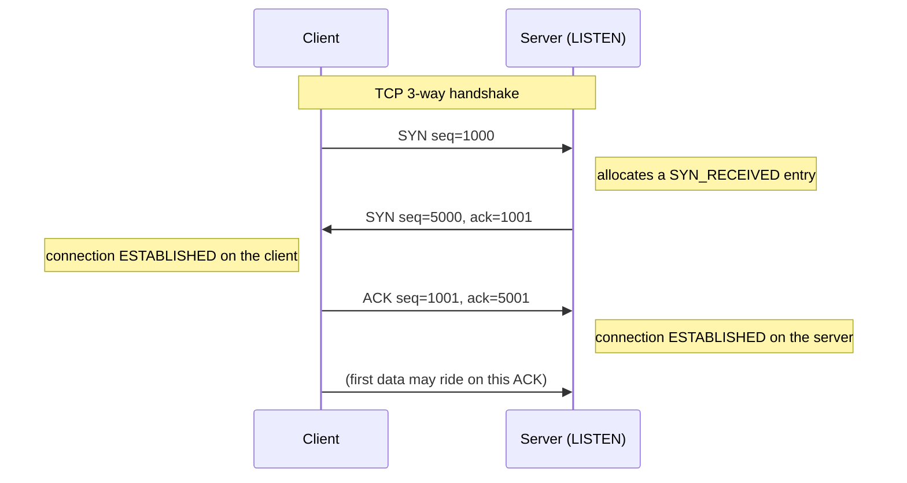
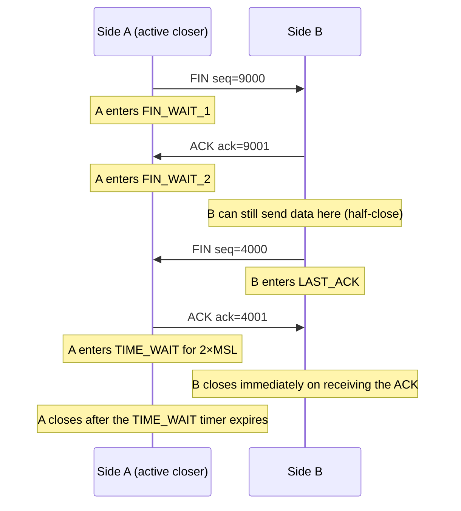
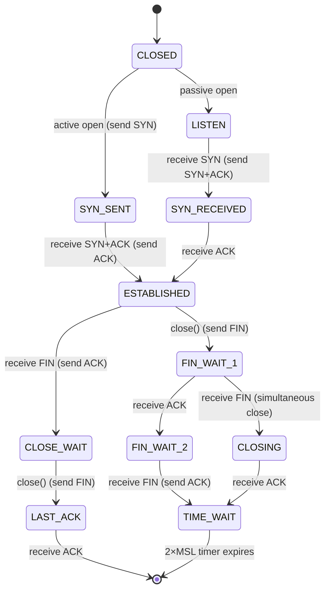
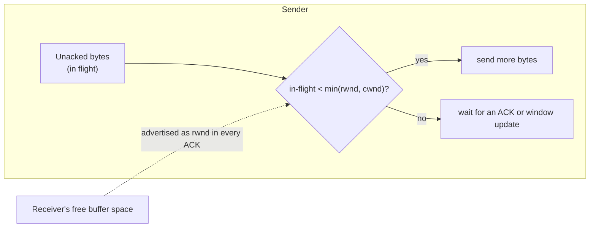

# TCP - Handshake, Reliability, Flow and Congestion Control

> [!summary] TL;DR
> TCP turns an unreliable packet network into a reliable, ordered byte stream between two processes. It does this with a handshake that sets up shared sequence numbers, acknowledgments and retransmission that recover lost packets, and two separate windows — one for flow control, one for congestion control — that decide how much data may be in flight at once.

> [!abstract] Core idea
> - Every byte TCP sends gets a sequence number; the receiver ACKs how much it has received, and the sender retransmits whatever isn't ACKed in time.
> - The 3-way handshake exchanges starting sequence numbers before any data flows; the 4-way close lets each side finish independently.
> - Flow control (the receiver's window) stops a fast sender from overrunning a slow receiver; congestion control (the sender's `cwnd`) stops the sender from overrunning the network itself.
> - Classic mistake: treating TCP as if it sends "messages". It sends a byte stream — one `write()` can arrive as several reads, or several writes can arrive as one read.

## 1. Why it exists

IP alone promises nothing: a packet (an IP datagram) can be dropped, duplicated, or delivered out of order, and IP has no idea what "a connection" even is. An application that wants to send a file reliably over that would have to invent its own sequence numbers, timeouts, and retransmission from scratch.

TCP (RFC 793, updated by RFC 9293) is the standard library for that problem. It sits between IP and the application and gives every byte stream three guarantees IP doesn't: **reliable delivery** (lost segments are retransmitted), **ordering** (bytes are delivered in the order they were sent, even if packets arrive out of order), and **flow control** (a fast sender can't flood a slow receiver's buffer). A fourth mechanism, **congestion control**, isn't a guarantee to the application at all — it protects the network from the senders using it.

Concretely: a client opens a connection to port 443, the OS allocates a socket, and from then on `conn.Write([]byte("GET / HTTP/1.1..."))` either arrives at the other end byte-for-byte and in order, or the connection is torn down with an error. Everything below makes that promise hold over a network that reorders, drops, and duplicates packets.

## 2. Mental model

Think of TCP as a conversation with a running tally, not a stack of labeled parcels. Each side keeps a mental counter: "the other side has told me they've sent and received up through byte N." A segment doesn't say "this is parcel 7"; it says "this segment starts at byte 1,460,001, and by the way, I've received everything up to byte 980,000 from you."

Two windows ride alongside that tally:

- The **receive window** is the listener at a party shouting "I can still hear 50 more words before I need you to pause" — it's about the *listener's* capacity.
- The **congestion window** is the speaker reminding themselves "the room only tends to carry so many words per second before people start missing things" — it's about the *shared room's* capacity, discovered by trial and error.

The sender may only have `min(receive window, congestion window)` bytes unacknowledged in flight at any time.

## 3. How it works

### Connection setup: the 3-way handshake

Both sides pick a random **initial sequence number (ISN)** so sequence numbers aren't predictable across connections (an old security requirement, not just bookkeeping).



`ack=1001` means "I've received everything through byte 1000; send byte 1001 next." Each side's ISN only becomes `1001`-style numbers after the first SYN consumes one sequence number itself (SYNs and FINs each count as one byte for accounting purposes).

### Closing: the 4-way close and TIME_WAIT

Either side can close independently, because TCP is full-duplex: closing lets a side say "I'm done sending" while it can still receive.



The side that sends the **last ACK** (the active closer) parks in `TIME_WAIT` for twice the maximum segment lifetime (2×MSL, commonly 60s on Linux), not out of caution but for two concrete reasons: a duplicate, delayed FIN from the peer must still find a socket there to re-ACK, and a late-arriving duplicate segment from this connection must expire before the same 4-tuple (source IP, source port, dest IP, dest port) can be reused. A busy server making many outbound connections (or closing many client connections) can exhaust ephemeral ports or the OS's bookkeeping table if TIME_WAIT sockets pile up — the standard fix is `SO_REUSEADDR` plus not treating a closed load balancer connection as free to instantly reopen, or using connection pooling so sockets stay ESTABLISHED instead of churning.



### Reliability: sequence numbers, ACKs and retransmission

Every byte sent has a sequence number; every ACK carries the next byte the receiver expects (a **cumulative** ACK — "I have everything up to here," not "I have this specific segment"). Modern stacks also use **SACK** (selective acknowledgment, RFC 2018) so a receiver can report non-contiguous ranges it has ("I have 1000–1999 and 3000–3999, still missing 2000–2999"), letting the sender retransmit only the actual gap instead of everything after it.

A segment is retransmitted when either:
- The **retransmission timer (RTO)** fires before its ACK arrives. RTO is computed from the measured round-trip time and its variance (RFC 6298: `RTO = SRTT + 4×RTTVAR`, with a minimum floor), not a fixed number — a cross-region connection with 150ms RTT needs a much longer RTO than one on a LAN.
- **Three duplicate ACKs** arrive for the same byte (the receiver is saying "I keep getting new data but still only have up to byte X") — this triggers **fast retransmit** without waiting for the slower RTO timer.

### Flow control: the sliding window

The receiver advertises a **window size** in every ACK: how many more bytes past the ACKed point it can currently buffer. The sender may have at most that many unacknowledged bytes in flight. As the receiver's application reads data out of its buffer, the window grows back (a "window update"); if the receiver's buffer fills (a slow consumer), the window shrinks toward zero, and at zero the sender must stop and periodically probe with a 1-byte **zero-window probe** until room reopens.



### Congestion control: cwnd, slow start, CUBIC and BBR

Flow control alone would let a sender on a fast LAN flood a congested link to a receiver with plenty of buffer space. Congestion control adds a second limit, the **congestion window (`cwnd`)**, that the sender estimates for itself from the network's behavior — nobody tells it directly.

**Classic loss-based control (Reno/CUBIC), per RFC 5681:**
1. **Slow start:** `cwnd` starts at a few segments and roughly **doubles every RTT** (each ACK grows it) until it crosses `ssthresh` (the slow-start threshold) or a loss occurs.
2. **Congestion avoidance:** once past `ssthresh`, growth becomes linear — roughly **+1 segment per RTT** (additive increase).
3. **On loss** (a timeout or 3 duplicate ACKs): `ssthresh` is set to half the current `cwnd`, and `cwnd` drops — to 1 on a timeout, or to `ssthresh` on fast retransmit (multiplicative decrease).

**CUBIC** (Linux's default since 2.6.19) replaces the linear congestion-avoidance growth with a cubic function of time since the last loss: it grows fast right after a loss, flattens near the previous loss point (where congestion is expected), then grows faster again if no new loss happens — better suited to high-bandwidth, high-latency ("long fat") networks than plain Reno's slow linear climb.

**BBR** (Google, used inside Linux and GCP/YouTube paths) rejects "wait for a packet loss" entirely. Loss-based control treats every dropped packet as a congestion signal, which is a poor fit for networks where buffers are large (**bufferbloat**: packets queue for hundreds of milliseconds before anything drops) or where loss is just noise (lossy Wi-Fi, satellite links). BBR instead continuously models two numbers — the bottleneck's delivery rate and the path's minimum RTT — and paces `cwnd` and sending rate from that model, probing periodically for more bandwidth and for a lower RTT, rather than only backing off after loss.

### Nagle's algorithm and `TCP_NODELAY`

Nagle's algorithm (RFC 896) batches small writes: if there's unacknowledged data already in flight, a new small write is held and coalesced with the next one instead of sent as its own tiny segment, trading a little latency for fewer, bigger packets. Combined with **delayed ACKs** (an ACK is held up to ~40–500ms hoping to piggyback on a reply) the two can stack to add real latency to small request/response exchanges — a known anti-pattern for latency-sensitive protocols. `conn.SetNoDelay(true)` (Go) or `setsockopt(TCP_NODELAY)` disables Nagle so small writes go out immediately; interactive and RPC-style protocols (HTTP, Redis, gRPC) typically want this.

### Keepalive

Without a keepalive, a TCP connection sitting idle looks identical whether the peer is fine, crashed, or on a NAT'd network path that silently dropped the mapping — nobody sends anything, so nobody notices. `SO_KEEPALIVE` makes the OS send periodic empty probes after an idle period (the standard Go default effectively disables tuning this per-connection before 1.23's `net.Dialer.KeepAliveConfig`, which exposes idle time, interval and retry count directly); no reply after the configured retries closes the connection. This is a transport-level heartbeat — it says nothing about whether the application is still healthy, only whether the peer still ACKs.

### Head-of-line blocking at the TCP layer

TCP's ordering guarantee is also its cost: the receiving application cannot read byte 10,000 until byte 9,999 has arrived, even if 10,000 showed up first. One lost segment stalls *every* stream multiplexed on top of that one connection — this is exactly why HTTP/2, which multiplexes many requests over a single TCP connection, can have one slow request stall every other request behind a single lost packet (see [[UDP and QUIC]] for the fix QUIC applies by moving streams below TCP's single ordered byte stream).

## 4. Worked example

### Whiteboard version

The bare mechanism — flow control's sliding window, with nothing else:

```go
package wb

// Window models flow control only: how many unacknowledged bytes a
// sender may have in flight, bounded by the receiver's advertised window.
type Window struct {
	NextSeq   int // next byte the sender will send
	UnackedAt int // oldest byte not yet ACKed
	RecvWin   int // bytes the receiver says it can still buffer
}

// CanSend reports how many more bytes may be sent right now.
func (w *Window) CanSend() int {
	inFlight := w.NextSeq - w.UnackedAt
	room := w.RecvWin - inFlight
	if room < 0 {
		return 0
	}
	return room
}

func (w *Window) Send(n int) { w.NextSeq += n }

// OnAck slides the window forward and applies the receiver's latest
// advertised window size.
func (w *Window) OnAck(ackSeq, newRecvWin int) {
	w.UnackedAt = ackSeq
	w.RecvWin = newRecvWin
}
```

The full version below adds the congestion-control state machine (slow start, congestion avoidance, loss response) and a real TCP connection over loopback showing where `SetNoDelay` and keepalive attach. It compiles and passes `go vet` and `go test -race` on Go 1.24.

```go
package main

// Sender models the congestion-control state machine of a TCP sender:
// slow start, congestion avoidance, and multiplicative-decrease on loss.
// Units are MSS-sized segments (MSS = Maximum Segment Size, the largest
// chunk of data one segment carries), matching RFC 5681's convention.
type Sender struct {
	Cwnd        float64 // congestion window, in segments
	Ssthresh    float64 // slow-start threshold, in segments
	InSlowStart bool
}

func NewSender() *Sender {
	return &Sender{Cwnd: 1, Ssthresh: 64, InSlowStart: true}
}

// OnACK runs once per RTT's worth of ACKs (one simulated round trip).
func (s *Sender) OnACK() {
	if s.Cwnd < s.Ssthresh {
		s.InSlowStart = true
		s.Cwnd *= 2 // slow start: cwnd doubles each RTT
	} else {
		s.InSlowStart = false
		s.Cwnd += 1 // congestion avoidance: +1 segment per RTT
	}
}

// OnLoss reacts to a retransmission timeout or three duplicate ACKs.
func (s *Sender) OnLoss() {
	s.Ssthresh = s.Cwnd / 2
	if s.Ssthresh < 2 {
		s.Ssthresh = 2
	}
	s.Cwnd = 1 // Reno-style multiplicative decrease back to slow start
	s.InSlowStart = true
}
```

```go
package main

import (
	"io"
	"net"
	"time"
)

// Serve accepts exactly one connection, tunes it, and echoes back everything
// it reads until the client closes its write side.
func Serve(ln net.Listener) error {
	conn, err := ln.Accept()
	if err != nil {
		return err
	}
	defer conn.Close()

	if tc, ok := conn.(*net.TCPConn); ok {
		tc.SetNoDelay(true)                     // disable Nagle: send small writes immediately
		tc.SetKeepAlive(true)                   // ask the OS to probe a silent peer
		tc.SetKeepAlivePeriod(30 * time.Second) // first probe after 30s idle
	}
	_, err = io.Copy(conn, conn) // echo
	return err
}

// DialAndRoundtrip opens a TCP connection (the 3-way handshake happens
// inside Dial), writes msg, and returns the echoed bytes plus how long the
// round trip took.
func DialAndRoundtrip(addr string, msg []byte) ([]byte, time.Duration, error) {
	start := time.Now()
	conn, err := net.Dial("tcp", addr)
	if err != nil {
		return nil, 0, err
	}
	defer conn.Close()

	if _, err := conn.Write(msg); err != nil {
		return nil, 0, err
	}
	buf := make([]byte, len(msg))
	if _, err := io.ReadFull(conn, buf); err != nil {
		return nil, 0, err
	}
	return buf, time.Since(start), nil
}
```

Tests covering all three mechanisms:

```go
func TestSlowStartThenCongestionAvoidance(t *testing.T) {
	s := NewSender()
	var cwnds []float64
	for i := 0; i < 8; i++ {
		cwnds = append(cwnds, s.Cwnd)
		s.OnACK()
	}
	// Slow start doubles: 1, 2, 4, 8, 16, 32 (next would cross Ssthresh=64,
	// so OnACK at i=5 flips into congestion avoidance: +1 from then on).
	want := []float64{1, 2, 4, 8, 16, 32, 64, 65}
	for i, w := range want {
		if cwnds[i] != w {
			t.Fatalf("cwnd[%d] = %v, want %v (trace: %v)", i, cwnds[i], w, cwnds)
		}
	}
}

func TestLossHalvesSsthreshAndResetsCwnd(t *testing.T) {
	s := NewSender()
	for i := 0; i < 6; i++ {
		s.OnACK()
	}
	before := s.Cwnd // 64 (six RTTs of doubling from 1: 1,2,4,8,16,32,64)
	s.OnLoss()
	if s.Ssthresh != before/2 {
		t.Fatalf("ssthresh = %v, want %v", s.Ssthresh, before/2)
	}
	if s.Cwnd != 1 {
		t.Fatalf("cwnd after loss = %v, want 1", s.Cwnd)
	}
}

func TestTCPHandshakeAndEcho(t *testing.T) {
	ln, _ := net.Listen("tcp", "127.0.0.1:0")
	defer ln.Close()
	done := make(chan error, 1)
	go func() { done <- Serve(ln) }()

	msg := []byte("seq=1 ack=1 SYN,ACK")
	got, rtt, err := DialAndRoundtrip(ln.Addr().String(), msg)
	if err != nil {
		t.Fatalf("DialAndRoundtrip: %v", err)
	}
	if string(got) != string(msg) {
		t.Fatalf("echo = %q, want %q", got, msg)
	}
	t.Logf("loopback handshake + echo round trip: %v", rtt)
}
```

**Measured** on this machine (Go 1.24.4, darwin/arm64, loopback, `go test -race`, 2026-11-06): a full connect + write + echo + read round trip over `127.0.0.1` took **329µs**. That single number already contains one full 3-way handshake (hidden inside `net.Dial`) plus one data round trip — on a real cross-region link the handshake alone would cost one RTT (tens of milliseconds) before any data moves at all.

**Representative output (Linux, `ss` from iproute2)** — inspecting an established connection's congestion-control state (illustrative values, not from a live capture):

```console
$ ss -tin dst 10.0.4.12
State  Recv-Q Send-Q  Local Address:Port   Peer Address:Port
ESTAB  0      0       10.0.4.7:51342       10.0.4.12:443
	 cubic wscale:7,7 rto:204 rtt:3.4/1.1 mss:1448 cwnd:40 ssthresh:28
	 bytes_sent:184320 bytes_retrans:1448 bytes_acked:182872
	 segs_out:132 segs_in:131 send 136Mbps lastsnd:4 lastrcv:8
```

Reading it: `cubic` is the active congestion-control algorithm, `cwnd:40` segments (about 58KB at this `mss`) is currently allowed in flight, `ssthresh:28` shows a previous loss already happened (an ssthresh below the Reno default of ~2³¹ means a loss event set it), `rtt:3.4/1.1` is the smoothed RTT and its mean deviation in milliseconds, and `bytes_retrans:1448` shows exactly one segment was retransmitted so far.

## 5. Variants and comparison

| Algorithm | How it decides to speed up / slow down | Use when | Cost |
| --- | --- | --- | --- |
| Reno (classic) | Additive increase, multiplicative decrease on any loss | Legacy baseline; rarely the default anymore | Slow recovery on high-bandwidth links; treats all loss as congestion |
| CUBIC (Linux default) | Cubic function of time since last loss; fast growth after loss, flattens near the last loss point | General-purpose default, especially long-distance/high-bandwidth paths | Still loss-triggered; can be unfair to Reno flows sharing a link |
| BBR | Models bottleneck bandwidth + min RTT directly; paced sending | Lossy or bufferbloated links (Wi-Fi, satellite, cross-region, video) where loss is a poor congestion signal | More complex; can be aggressive toward loss-based flows sharing a bottleneck |
| Vegas | Infers congestion from RTT growth before any loss happens | Research/niche; rarely deployed at scale | Loses bandwidth races against more aggressive algorithms on shared links |

> [!warning] Interview trap
> Flow control and congestion control are two different windows solving two different problems. Flow control protects the **receiver's buffer**; congestion control protects the **network path**. The sender's effective send window is `min(cwnd, rwnd)` — a fast network with a slow receiving application is still throttled by `rwnd`, not `cwnd`.

## 6. Trade-offs and when not to use

- TCP's ordering guarantee is also a liability: one lost packet stalls everything behind it on that connection (head-of-line blocking), which matters a lot for latency-sensitive, parallel work — see [[UDP and QUIC]].
- The handshake and slow start both cost time before a connection reaches full throughput: for a one-shot, latency-critical, loss-tolerant payload (a game position update, a live video frame), TCP's guarantees are pure overhead. UDP, or QUIC's 0-RTT resumption, fit that case better.
- Congestion control is fair by design — it won't let one flow dominate a shared link — which is exactly wrong for a single operator's own private backbone where the goal is to use 100% of known-available capacity from day one (some CDNs and private WAN backbones run tuned or custom congestion control for this reason).

## 7. In production

- **Real systems:** Linux defaults to CUBIC; Google uses BBR broadly (search, YouTube, and offers it as a GCP option); most consumer OSes and server kernels ship a loss-based algorithm with BBR as an increasingly common opt-in.
- **Failure modes → fixes:**
	- **Bufferbloat** (deep router/middlebox buffers delay loss signals for seconds) → BBR's RTT-based model, or active queue management (CoDel/FQ-CoDel) on the bottleneck device.
	- **Incast** (many servers' responses arrive at once, overflowing a switch buffer and causing synchronized loss and retransmission timeouts) → smaller RTOs tuned for the datacenter, or application-level request pacing/jittering.
	- **TIME_WAIT exhaustion** on a host making many short-lived outbound connections → connection pooling/keep-alive reuse instead of connect-per-request, and `SO_REUSEADDR` where appropriate.
	- **Silent peer death behind a stateful NAT or firewall** → tuned keepalive (`net.Dialer.KeepAliveConfig` since Go 1.23) so a dead connection is detected and closed instead of hanging forever.
- **What to monitor:** retransmission rate (`bytes_retrans`/`bytes_sent` from `ss -ti`), RTT and its variance, current `cwnd` and whether it's loss-limited, count of connections stuck in `TIME_WAIT`/`CLOSE_WAIT`, and SYN backlog drops on a listening socket under load.

## 8. Deep dive

- **Why `ack` is cumulative, not selective, by default.** A single number ("everything up to here") is cheap to generate and process, but it means one lost segment in the middle of a burst makes every later segment look "out of order" until the gap is filled, even if they all arrived fine. SACK (RFC 2018) is the patch: it rides alongside the cumulative ACK as extra TCP options and tells the sender exactly which non-contiguous ranges already arrived, so retransmission targets only the real gap.
- **Why slow start is exponential, not linear, at the start.** An unused connection has zero information about the path's capacity; doubling `cwnd` every RTT finds the right order of magnitude in `O(log(capacity))` round trips instead of `O(capacity)` — a few RTTs instead of potentially thousands. The cost is that slow start can itself cause the first loss, which is exactly why `ssthresh` exists: it remembers roughly where the last loss happened, so a connection that disconnects and reconnects (or recovers from a single loss) doesn't have to re-discover capacity from scratch.
- **Why BBR doesn't wait for loss.** Over a path with deep buffers, by the time a packet actually drops, the sender has already been overshooting the real bottleneck rate for a while — the buffer was simply absorbing the overshoot, adding queuing delay the whole time. BBR's bandwidth-delay-product model targets "as much data in flight as the pipe can hold," not "as much as the deepest buffer on the path can hold," which keeps queueing delay low even though it never needs a packet to actually drop.
- **Nagle × delayed ACK interaction.** If both sides use their defaults, a small request can stall waiting for Nagle to release it (held because data is still "in flight"), while the reply's ACK is simultaneously held by delayed-ACK on the other side waiting to piggyback — the two timers can compound into tens to hundreds of milliseconds of pure protocol latency on an otherwise idle, fast link. This is specifically a request/response latency problem, not a throughput one; bulk transfers are barely affected since Nagle only holds data when there's already unacknowledged data in flight.
- **MSS and PMTU.** The maximum segment size is negotiated at handshake time from each side's MTU, but a smaller MTU somewhere mid-path (a VPN, a tunnel) isn't visible at handshake time; Path MTU Discovery (sending with the "don't fragment" bit and backing off on an ICMP "too big" reply) exists to catch that after the fact, and its absence from a network path is a classic silent cause of connections that hang on anything but tiny payloads.

## 9. Interview questions

> [!question]- Why three segments for the handshake and four for the close?
> The handshake only needs three because the second segment (SYN+ACK) combines "I acknowledge your SYN" with "here is my own SYN" into one segment. Closing can't combine the same way because TCP is full-duplex and either side may still have data to send after announcing it's done sending — so each direction's FIN/ACK is independent, giving up to four segments (though they can collapse to three if a FIN piggybacks on an ACK).

> [!question]- What is `TIME_WAIT` actually protecting against, and why does it matter operationally?
> It gives time for a duplicate, delayed FIN from the peer to still find the socket and be re-ACKed, and lets old duplicate segments from this connection expire before the same 4-tuple is reused. It matters because a host that closes many short connections fast can pile up `TIME_WAIT` sockets faster than the 2×MSL timer clears them, exhausting ephemeral ports or kernel socket-table entries — the standard fix is connection reuse (pooling, keep-alive), not just lowering the timer.

> [!question]- What's the difference between flow control and congestion control?
> Flow control protects the receiver: it's the receiver's advertised window, based on its own buffer space. Congestion control protects the network: it's the sender's self-estimated `cwnd`, based on inferred path capacity. The sender is bound by whichever is smaller.

> [!question]- A connection has a large `cwnd` but throughput is still low. What's the first thing to check?
> Whether the receive window (`rwnd`), not `cwnd`, is the real limit — a slow-reading application or a small configured socket buffer caps `rwnd` regardless of how much room the network itself has. `ss -ti` shows both; if `rwnd` is small and stable while `cwnd` is large, the bottleneck is the receiver's buffer or application, not the network.

> [!question]- Trap: does TCP guarantee that one `Write()` call becomes exactly one `Read()` call on the other end?
> No. TCP delivers an ordered byte stream, not a sequence of framed messages — one large write can arrive split across several reads, and several small writes (especially with Nagle coalescing them) can arrive as a single read. Any protocol built on TCP that needs message boundaries (HTTP, gRPC, a custom protocol) must define its own framing, such as a length prefix or a delimiter.

> [!question]- Why would an operator choose BBR over CUBIC, and what's the risk?
> BBR holds queueing delay low and recovers bandwidth faster on lossy or bufferbloated paths because it doesn't treat every loss as a definitive congestion signal. The risk is fairness on a shared bottleneck: BBR can take a larger share of a link's capacity from a competing CUBIC flow, since CUBIC backs off on loss that BBR mostly ignores.

> [!question]- What does Nagle's algorithm trade off, and when should you disable it?
> It trades a small added latency for fewer, larger packets by holding a new small write while earlier data is still unacknowledged. Disable it (`TCP_NODELAY`) for latency-sensitive request/response protocols sending small messages (RPC calls, interactive protocols) where you'd rather pay more packets than more latency; leave it on for bulk transfers where it rarely matters.

## 10. Cheat sheet

- 3-way handshake: SYN → SYN+ACK → ACK, exchanging initial sequence numbers.
- 4-way close: FIN → ACK → FIN → ACK; the active closer waits in `TIME_WAIT` for 2×MSL.
- ACKs are cumulative ("everything up to here"); SACK adds precise gap reporting.
- Retransmission fires on RTO timeout (from measured RTT + variance) or 3 duplicate ACKs (fast retransmit).
- Flow control = receiver's `rwnd` (protects the receiver); congestion control = sender's `cwnd` (protects the network). Effective window is `min(rwnd, cwnd)`.
- Slow start doubles `cwnd` per RTT until `ssthresh`; congestion avoidance then adds ~1 segment per RTT; loss halves `ssthresh` and resets `cwnd`.
- CUBIC is Linux's loss-based default; BBR models bandwidth and RTT directly instead of waiting for loss.
- Nagle batches small writes; `TCP_NODELAY` disables it for latency-sensitive protocols. Keepalive detects a silently dead peer, not an unhealthy application.
- TCP's single ordered byte stream means one lost segment head-of-line-blocks everything behind it on that connection.

## Links

- **Before this:** [[How the Internet Works - IP, Ports, Packets, OSI vs TCP-IP]]
- **Next:** [[UDP and QUIC]], [[TLS and HTTPS]], [[HTTP Fundamentals - Methods, Status Codes, Headers, Cookies]]
- **Compare with:** [[Forward and Reverse Proxies - L4 vs L7]] (an L4 proxy operates at exactly this layer), [[Network Debugging Toolkit - dig, curl, ss, tcpdump]] (reading `ss`/`tcpdump` output for a real connection)
