# TCP - Handshake, Reliability, Flow and Congestion Control

> [!summary] TL;DR
> TCP turns an unreliable packet network into a reliable, ordered byte stream between two processes. It does this with a handshake that sets up shared sequence numbers, acknowledgments and retransmission that recover lost packets, and two separate windows — one for flow control, one for congestion control — that decide how much data may be in flight at once.

> [!abstract] Core idea
> - Every byte TCP sends gets a sequence number; the receiver ACKs how much it has received, and the sender retransmits whatever isn't ACKed in time.
> - The 3-way handshake exchanges starting sequence numbers before any data flows; the 4-way close lets each side finish independently.
> - Flow control (the receiver's window) stops a fast sender from overrunning a slow receiver; congestion control (the sender's `cwnd`) stops the sender from overrunning the network itself.
> - Classic mistake: treating TCP as if it sends "messages". It sends a byte stream — one `write()` can arrive as several reads, or several writes can arrive as one read.

## Start here: the basics 🟢

> [!info] How to read this note (pick your level)
> - 🟢 **New to this?** Read "From zero" below, then sections 1, 2 and the cheat sheet (10). Stop there, that is a full first pass.
> - 🟡 **Know the basics?** Add section 3 (how it works), 4 (worked example) and 5 (variants).
> - 🔴 **Interview / SDE-3 prep?** Add 6, 7, 8 and 9. Headings are tagged 🟢🟡🔴 so you always know where you are.

> [!note] Before this note
> - [[How the Internet Works - IP, Ports, Packets, OSI vs TCP-IP]]: data travels as packets labelled with IP addresses and ports, and the network may drop, repeat or reorder them.

**From zero, in 60 seconds** 🟢

The internet moves data in small chunks called **packets**. The network makes no promises: a packet can get lost, arrive twice, or arrive out of order.

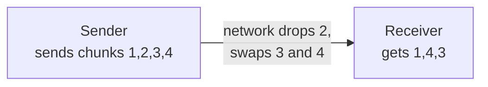

That is useless for things like files and web pages, where every byte matters.

**TCP** is the fix. It numbers every chunk, the receiver keeps saying "got everything up to here" (an **ACK**), and the sender resends anything not confirmed in time. The receiver puts the chunks back in order before your app sees them.

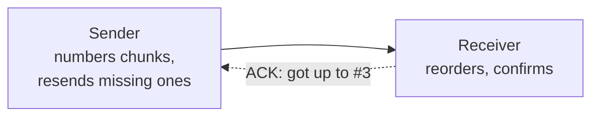

TCP also paces itself so it never floods the receiver or the network in between.

The rest of this note is just these 4 questions:
1. How do two machines agree to start and stop talking (handshake, close)?
2. How does lost data get noticed and resent?
3. How does the sender know how fast it may send (the two windows)?
4. What does this cost, and when is TCP the wrong tool?

**The problem in one story.**
You send a friend a 50-page document, but the post office only takes postcards.
You cut it into 500 postcards and mail them.
Some get lost, some arrive twice, and they show up in random order.
TCP is the system of numbering postcards, asking "which ones did you get?", and resending the missing ones, so your friend reads the pages in the right order.

**Words you need first**

| Word | Plain meaning | Tiny example |
| --- | --- | --- |
| Packet / segment | One small chunk of data sent over the network | ~1,460 bytes of a web page |
| IP | The layer that moves packets between machines, with no promises | A packet may get dropped |
| Port | A number naming one program on a machine | HTTPS server listens on 443 |
| Socket | The OS object a program uses to send and receive on a connection | `net.Conn` in Go |
| ACK | A message saying "I got data up to here" | "ACK 5001" = bytes 1-5000 arrived |
| RTT | Round-trip time: send something and get the reply | 40ms Mumbai to Singapore |
| Buffer | Memory where received bytes wait to be read | Kernel receive buffer of 128 KB |
| Window | How many bytes may be sent before waiting for an ACK | 64 KB in flight |
| SYN / FIN | Control flags: "let's start" / "I'm done sending" | `SYN seq=1000` opens a connection |
| Sequence number | The position of a byte in the stream, so it can be put back in order | Byte 1001 comes right after byte 1000 |
| Retransmit | Sending the same data again because no ACK came | Resend bytes 2000-2999 |
| rwnd | Receive window: free space the receiver says it has | "I can take 64 KB more" |
| cwnd | Congestion window: how much the sender thinks the network can carry | 40 segments in flight |

**Picture it**

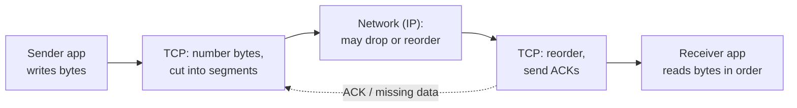

**Analogy.** A phone call where the listener keeps saying "got it up to page 12" and "slow down, my notebook is full", and the speaker repeats anything not confirmed.
Where it breaks: a real speaker repeats a sentence once you ask; TCP never hears "I missed it", it only notices the confirmation is late or repeated, and resends.

**How the rest of this note builds up**

- First, why TCP exists on top of IP (section 1) and the running-tally mental model (section 2).
- Then how it works: the 3-way handshake, the close and `TIME_WAIT`, ACKs and retransmission, flow control, and congestion control (section 3).
- Then a measured Go example and variants like CUBIC, BBR, Nagle and keepalives (sections 4-5).
- Finally the SDE-3 material: trade-offs, production debugging with `ss`, and the deep dive on SACK, slow start, BBR and PMTU (sections 6-8).

> [!tip] Remember
> TCP numbers every byte, waits for ACKs, resends what is missing, and limits how much is in flight so neither the receiver nor the network gets flooded.

## 1. Why it exists 🟢

IP alone promises nothing: a packet (an IP datagram, one self-contained IP packet) can be dropped, duplicated, or delivered out of order, and IP has no idea what "a connection" even is. An application that wants to send a file reliably over that would have to invent its own sequence numbers, timeouts, and retransmission from scratch.

TCP (RFC 793, updated by RFC 9293) is the standard library for that problem.

It sits between IP and the application and gives every byte stream three guarantees IP doesn't: **reliable delivery** (lost segments are retransmitted), **ordering** (bytes are delivered in the order they were sent, even if packets arrive out of order), and **flow control** (a fast sender can't flood a slow receiver's buffer).

A fourth mechanism, **congestion control**, isn't a guarantee to the application at all — it protects the network from the senders using it.

Concretely: a client opens a connection to port 443, the OS allocates a socket, and from then on `conn.Write([]byte("GET / HTTP/1.1..."))` either arrives at the other end byte-for-byte and in order, or the connection is torn down with an error. Everything below makes that promise hold over a network that reorders, drops, and duplicates packets.

### Real-life example: downloading a movie on Netflix 🟢

You download an episode on Netflix for a flight. The file is hundreds of MB, and every byte must be right or the video glitches.
TCP numbers every byte. When your phone's Wi-Fi drops a few packets, the missing pieces are resent and slotted back in place, so the file is perfect.
At the start the download is slow, then speeds up as TCP learns how much your connection can carry (slow start).
If your phone's storage writes slowly, the phone tells the server "slow down, my buffer is full" (flow control), and the server waits.

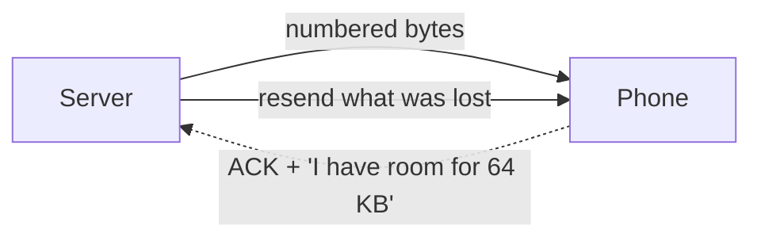

## 2. Mental model 🟢

Think of TCP as a conversation with a running tally, not a stack of labeled parcels.

Each side keeps a mental counter: "the other side has told me they've sent and received up through byte N." A segment doesn't say "this is parcel 7"; it says "this segment starts at byte 1,460,001, and by the way, I've received everything up to byte 980,000 from you."

Two windows ride alongside that tally:

- The **receive window** is the listener at a party shouting "I can still hear 50 more words before I need you to pause" — it's about the *listener's* capacity.
- The **congestion window** is the speaker reminding themselves "the room only tends to carry so many words per second before people start missing things" — it's about the *shared room's* capacity, discovered by trial and error.

The sender may only have `min(receive window, congestion window)` bytes unacknowledged in flight at any time.

> [!tip] Remember
> Two separate limits gate every byte TCP sends: the **receive window** protects the listener's ears, the **congestion window** protects the shared room. The smaller of the two always wins.

## Common beginner mistakes 🟢

- **Treating TCP as messages** → one `Write()` can arrive as several reads, or several writes as one → add your own framing, like a length prefix.
- **Mixing up flow control and congestion control** → one protects the receiver, the other protects the network → the sender is limited by the smaller of `rwnd` and `cwnd`.
- **Thinking the receiver says "I missed packet 7"** → TCP has no "missing" message; the sender notices a late or repeated ACK → that is why timers and duplicate ACKs matter.
- **Opening a new connection per request at high volume** → handshakes and `TIME_WAIT` sockets pile up → reuse connections with a pool or keep-alive.
- **Expecting keepalive to tell you the app is healthy** → it only proves the peer's OS still answers → use an application health check too.

## 3. How it works 🟡

> 🟢 → 🟡 **You now know** TCP numbers bytes, waits for ACKs, resends what is missing and paces itself. **Next we open the box**: the exact hello and goodbye messages, how loss is detected, the two windows that limit speed, and a few switches (Nagle, keepalive) you will meet in real code. Each subsection starts with a plain step-by-step walk; the full detail follows it.

### Connection setup: the 3-way handshake

**In plain words: before any data moves, both sides say hello and agree where their counting starts — like two accountants syncing their ledgers before trading.**

**Step by step:**
1. The client picks a random starting number, say 1000, and sends `SYN seq=1000`.
2. The server picks its own, say 5000, and replies `SYN seq=5000, ack=1001`: "here is my start, and I got your SYN".
3. The client replies `ACK ack=5001`: "got yours too".
4. Both sides now know where each other's counting starts. Data can flow; the first data can even ride on that last ACK.
5. Cost: one round trip before any data moves.

Both sides pick a random **initial sequence number (ISN)** so sequence numbers aren't predictable across connections (an old security requirement, not just bookkeeping).

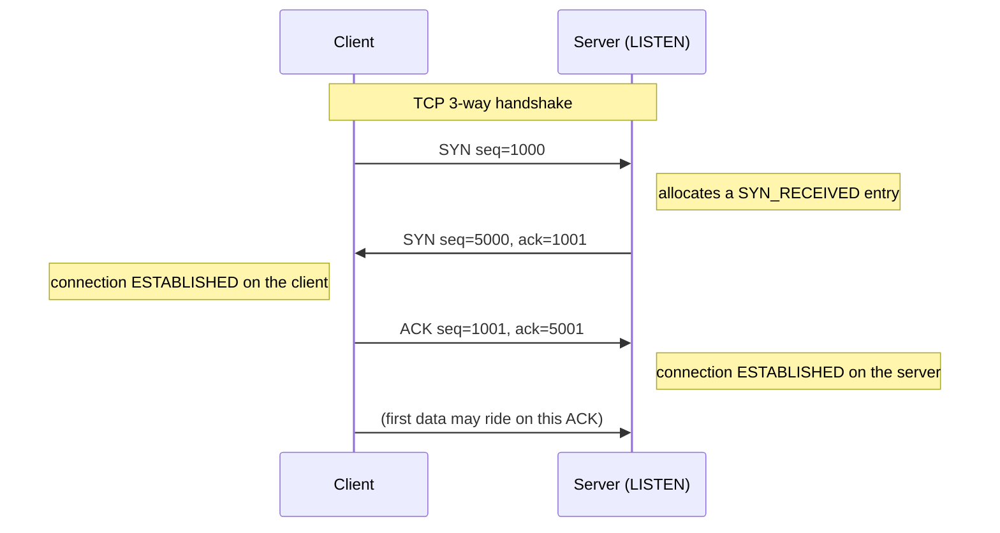

`ack=1001` means "I've received everything through byte 1000; send byte 1001 next." Each side's ISN only becomes `1001`-style numbers after the first SYN consumes one sequence number itself (SYNs and FINs each count as one byte for accounting purposes).

### Closing: the 4-way close and TIME_WAIT

**In plain words: hanging up takes two separate goodbyes, one per direction, because each side may still have something left to say.**

**Step by step:**
1. Side A finishes sending and sends `FIN`: "I'm done sending".
2. B replies `ACK`. B can still send its remaining data to A.
3. When B is also done, it sends its own `FIN`.
4. A replies `ACK` and then waits in `TIME_WAIT` for about 60 s on Linux, in case that last ACK got lost and B's FIN comes again.
5. Only after that wait is the same address-and-port combination free for a new connection.

Either side can close independently, because TCP is full-duplex (both directions carry data at the same time, independently): closing lets a side say "I'm done sending" while it can still receive.

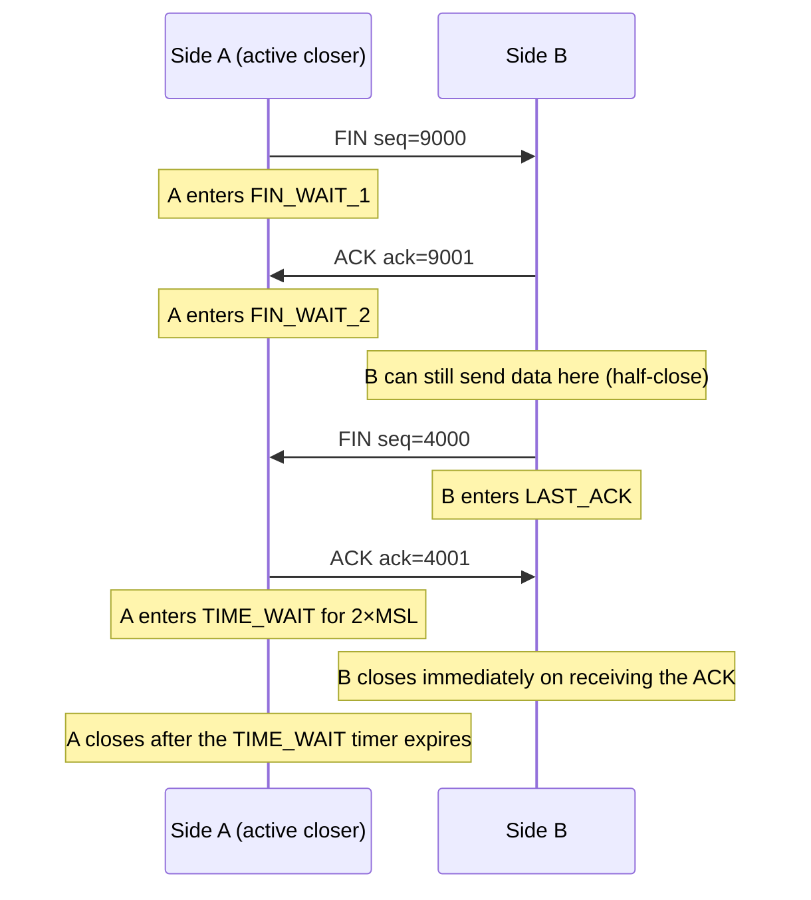

The side that sends the **last ACK** (the active closer) parks in `TIME_WAIT` for twice the maximum segment lifetime (MSL: the longest time a packet may wander the network; 2×MSL is commonly 60s on Linux), not out of caution but for two concrete reasons: a duplicate, delayed FIN from the peer must still find a socket there to re-ACK, and a late-arriving duplicate segment from this connection must expire before the same 4-tuple (source IP, source port, dest IP, dest port) can be reused.

A busy server making many outbound connections (or closing many client connections) can exhaust ephemeral ports (the temporary source ports the OS hands out for outgoing connections) or the OS's bookkeeping table if TIME_WAIT sockets pile up — the standard fix is `SO_REUSEADDR` (a socket option that lets a program reuse an address still held by old `TIME_WAIT` sockets) plus not treating a closed load balancer connection as free to instantly reopen, or using connection pooling so sockets stay ESTABLISHED instead of churning.

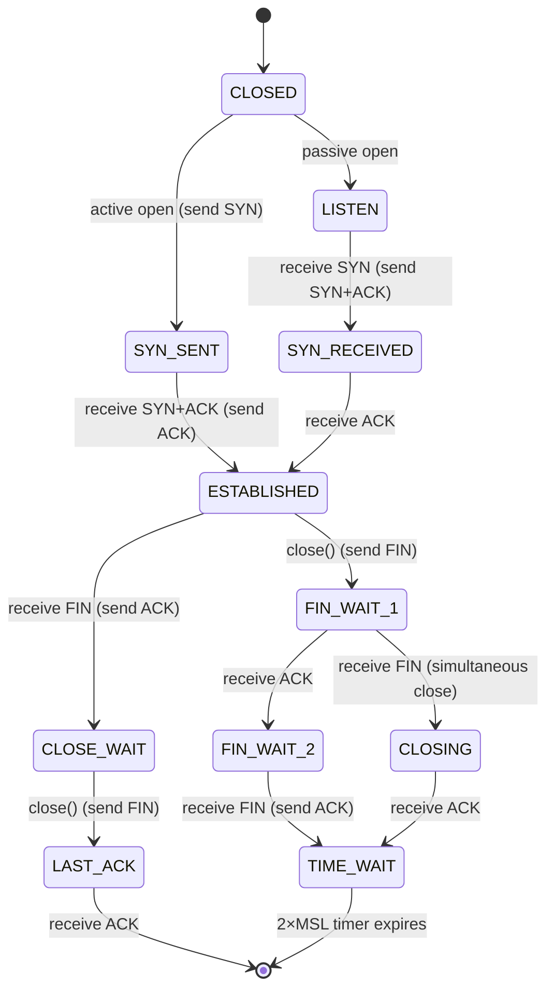

### Reliability: sequence numbers, ACKs and retransmission

**In plain words: the receiver never says "I missed something"; the sender notices the silence (or the same confirmation repeating) and resends on its own.**

**Step by step:**
1. The sender sends 4 segments: bytes 1000-1999, 2000-2999, 3000-3999, 4000-4999.
2. Segment 2 (2000-2999) is lost. The receiver gets 1, 3, 4.
3. For each of 3 and 4 it keeps saying `ACK 2000` ("I still only have up to 1999"). These are duplicate ACKs.
4. After 3 duplicate ACKs, the sender resends 2000-2999 straight away (fast retransmit).
5. If ACKs had stopped completely, the sender would wait for its timer (RTO, about 80 ms in the example below) and then resend.

Every byte sent has a sequence number; every ACK carries the next byte the receiver expects (a **cumulative** ACK — "I have everything up to here," not "I have this specific segment").

Modern stacks also use **SACK** (selective acknowledgment, RFC 2018) so a receiver can report non-contiguous ranges it has ("I have 1000–1999 and 3000–3999, still missing 2000–2999"), letting the sender retransmit only the actual gap instead of everything after it.

A segment is retransmitted when either:
- The **retransmission timer (RTO)** fires before its ACK arrives. RTO is computed from the measured round-trip time and its variance (RFC 6298: `RTO = SRTT + 4×RTTVAR`, with a minimum floor), not a fixed number — a cross-region connection with 150ms RTT needs a much longer RTO than one on a LAN.
- **Three duplicate ACKs** arrive for the same byte (the receiver is saying "I keep getting new data but still only have up to byte X") — this triggers **fast retransmit** without waiting for the slower RTO timer.

**Example, with numbers:** say the measured `SRTT` (smoothed round-trip time) is 40ms and `RTTVAR` (its mean deviation) is 10ms. RFC 6298's formula gives `RTO = 40 + 4×10 = 80ms`.

If an ACK for a sent segment hasn't arrived within 80ms, the sender assumes it was lost and retransmits — without ever seeing a negative acknowledgment, because TCP has none; absence of an ACK within the deadline *is* the loss signal.

> [!warning] Common mistake
> Assuming TCP's ACK means "I received segment N specifically." A plain ACK is **cumulative** — "I have everything up through this byte" — so it says nothing about which specific segment just arrived. Only SACK (selective acknowledgment) reports specific non-contiguous ranges; without it, a sender re-learns the exact gap by watching duplicate ACKs pile up, not by being told directly.

> [!tip] Remember
> No ACK within the RTO window, or three duplicate ACKs for the same byte — both mean "retransmit," but fast retransmit (the second case) is faster because it doesn't wait for a timer.

### Flow control: the sliding window

**In plain words: the receiver keeps telling the sender how much free space is left in its inbox, and the sender never sends more than that.**

**Step by step:**
1. The receiver has a 64 KB buffer and says "window = 64 KB" in its ACK.
2. The sender sends up to 64 KB without waiting.
3. The receiving app is slow and reads only 16 KB. The next ACK says "window = 16 KB".
4. The sender sends only 16 KB more.
5. If the window hits 0, the sender stops and sends a tiny 1-byte probe now and then until space opens.

The receiver advertises a **window size** in every ACK: how many more bytes past the ACKed point it can currently buffer. The sender may have at most that many unacknowledged bytes in flight.

As the receiver's application reads data out of its buffer, the window grows back (a "window update"); if the receiver's buffer fills (a slow consumer), the window shrinks toward zero, and at zero the sender must stop and periodically probe with a 1-byte **zero-window probe** until room reopens.

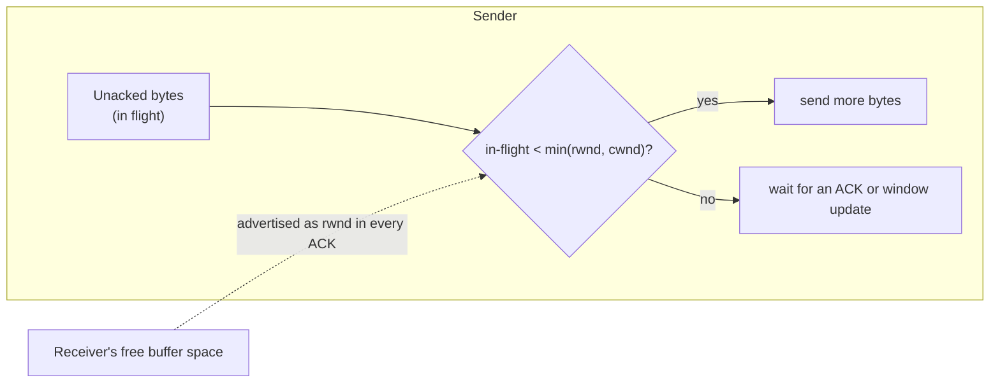

### Congestion control: cwnd, slow start, CUBIC and BBR

**In plain words: the network itself can also choke, so the sender guesses how much the road can carry — start careful, speed up while it works, slam the brakes when packets go missing.**

**Step by step:**
1. A new connection starts with a small `cwnd`, say 1 segment.
2. Each round trip without loss doubles it: 1, 2, 4, 8 ... (slow start).
3. Past a limit called `ssthresh`, it grows by just 1 segment per round trip.
4. A loss means the network is full: `ssthresh` becomes half the current `cwnd`, and `cwnd` drops.
5. BBR, a newer method, instead measures the path's speed and delay and sends at that rate, without waiting for losses.

Flow control alone would let a sender on a fast LAN flood a congested link to a receiver with plenty of buffer space. Congestion control adds a second limit, the **congestion window (`cwnd`)**, that the sender estimates for itself from the network's behavior — nobody tells it directly.

**Classic loss-based control (Reno/CUBIC), per RFC 5681:**
1. **Slow start:** `cwnd` starts at a few segments and roughly **doubles every RTT** (each ACK grows it) until it crosses `ssthresh` (the slow-start threshold) or a loss occurs.
2. **Congestion avoidance:** once past `ssthresh`, growth becomes linear — roughly **+1 segment per RTT** (additive increase).
3. **On loss** (a timeout or 3 duplicate ACKs): `ssthresh` is set to half the current `cwnd`, and `cwnd` drops — to 1 on a timeout, or to `ssthresh` on fast retransmit (multiplicative decrease).

**CUBIC** (Linux's default since 2.6.19) replaces the linear congestion-avoidance growth with a cubic function of time since the last loss: it grows fast right after a loss, flattens near the previous loss point (where congestion is expected), then grows faster again if no new loss happens — better suited to high-bandwidth, high-latency ("long fat", meaning fast but far away, like India to the US) networks than plain Reno's slow linear climb.

**BBR** (Google, used inside Linux and GCP/YouTube paths) rejects "wait for a packet loss" entirely.

Loss-based control treats every dropped packet as a congestion signal, which is a poor fit for networks where buffers are large (**bufferbloat**: packets queue for hundreds of milliseconds before anything drops) or where loss is just noise (lossy Wi-Fi, satellite links).

BBR instead continuously models two numbers — the bottleneck's delivery rate and the path's minimum RTT — and paces `cwnd` and sending rate from that model, probing periodically for more bandwidth and for a lower RTT, rather than only backing off after loss.

**Example, with numbers:** a Reno-style sender starts at `cwnd = 1` segment with `ssthresh = 64`. Each RTT in slow start doubles `cwnd`: 1 → 2 → 4 → 8 → 16 → 32 → 64.

At `cwnd = 64` it has reached `ssthresh`, so the next RTT switches to congestion avoidance and only adds 1: `cwnd = 65`, then 66, then 67 — one additional segment's worth of data per round trip from then on, until a loss resets the cycle.

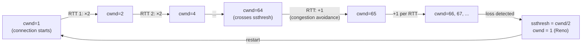

> [!tip] Remember
> Slow start grows exponentially because an unused connection knows nothing about the path yet; congestion avoidance grows linearly because the sender is now probing cautiously near a ceiling it half-remembers from last time (`ssthresh`).

### Nagle's algorithm and `TCP_NODELAY`

**In plain words: instead of mailing every tiny note separately, wait and put several in one envelope — great for postage, bad when the note is urgent.**

**Step by step:**
1. Your app writes 10 bytes. Nothing else is in flight, so TCP sends it at once.
2. Your app writes another 10 bytes before the first is ACKed. Nagle holds it, hoping to add more.
3. The other side delays its ACK too (up to tens of ms), hoping to attach it to a reply.
4. Both wait on each other, so a tiny request takes noticeably longer.
5. `SetNoDelay(true)` turns Nagle off so small writes go out at once. Go turns it off by default for TCP connections.

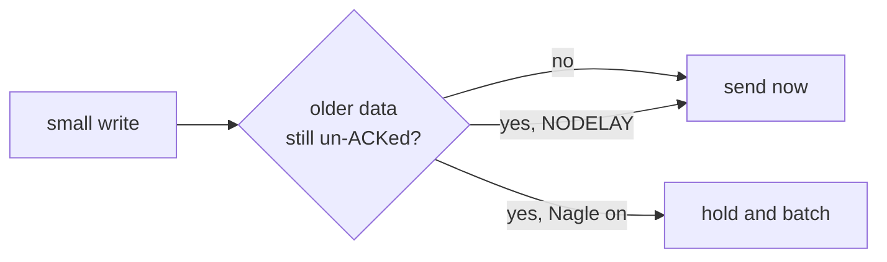

Nagle's algorithm (RFC 896) batches small writes: if there's unacknowledged data already in flight, a new small write is held and coalesced (merged) with the next one instead of sent as its own tiny segment, trading a little latency for fewer, bigger packets.

Combined with **delayed ACKs** (an ACK is held up to ~40–500ms hoping to piggyback on a reply, meaning ride along inside it) the two can stack to add real latency to small request/response exchanges — a known anti-pattern for latency-sensitive protocols.

`conn.SetNoDelay(true)` (Go) or `setsockopt(TCP_NODELAY)` disables Nagle so small writes go out immediately; interactive and RPC-style (one service calling a function on another over the network) protocols (HTTP, Redis, gRPC) typically want this.

### Keepalive

**Step by step:**
1. A connection to the database sits idle for 2 hours.
2. With keepalive on, after a set idle time the OS sends an empty probe.
3. The other side's OS answers with an ACK: the connection is still alive.
4. No answer after several probes: the OS closes the connection, and your next write gets an error instead of hanging.

Without a keepalive, a TCP connection sitting idle looks identical whether the peer is fine, crashed, or on a NAT'd network path (one where a router rewrites addresses and keeps a table of connections) that silently dropped the mapping — nobody sends anything, so nobody notices.

`SO_KEEPALIVE` makes the OS send periodic empty probes after an idle period (the standard Go default effectively disables tuning this per-connection before 1.23's `net.Dialer.KeepAliveConfig`, which exposes idle time, interval and retry count directly); no reply after the configured retries closes the connection.

This is a transport-level heartbeat — it says nothing about whether the application is still healthy, only whether the peer still ACKs.

### Head-of-line blocking at the TCP layer

**Step by step:**
1. Bytes 1-9,999 have arrived, and bytes 10,000-20,000 have also arrived.
2. But segment 9,999 itself was lost on the way.
3. TCP will not hand anything after it to the app until 9,999 is resent and arrives.
4. If several HTTP/2 requests share this connection, all of them wait, even ones whose data is complete.

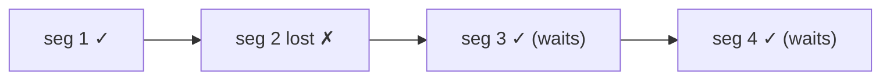

TCP's ordering guarantee is also its cost: the receiving application cannot read byte 10,000 until byte 9,999 has arrived, even if 10,000 showed up first.

One lost segment stalls *every* stream multiplexed on top of that one connection — this is exactly why HTTP/2, which multiplexes many requests over a single TCP connection, can have one slow request stall every other request behind a single lost packet (see [[UDP and QUIC]] for the fix QUIC applies by moving streams below TCP's single ordered byte stream).

## 4. Worked example 🟡

### Whiteboard version

The bare mechanism — flow control's sliding window, with nothing else: a `Window` that tracks `NextSeq` (next byte to send) and `UnackedAt` (oldest unACKed byte), and only allows sending up to `RecvWin - (NextSeq - UnackedAt)` more bytes. Every ACK moves `UnackedAt` forward and updates `RecvWin` to whatever the receiver just advertised.

```go
func (w *Window) CanSend() int // room = RecvWin - bytes-in-flight, clamped at 0
```

### Tracing a connection step by step

**In plain words: one connection's whole life with real numbers — hello, speed up, lose a packet, recover.**

Follow one connection from handshake through a lost segment and recovery, with concrete numbers:

1. **Handshake.** Client sends `SYN seq=1000`. Server replies `SYN seq=5000, ack=1001`. Client sends `ACK ack=5001`. Both sides now agree: client's next byte is 1001, server's is 5001.
2. **Slow start begins.** `cwnd = 1` segment (about 1,460 bytes at a 1,460-byte MSS, the maximum segment size: the most data one segment carries). The client sends one segment and waits.
3. **Growth.** Each ACK that arrives doubles `cwnd`: after 6 round trips, `cwnd = 64` segments (~93KB) — crossing `ssthresh`, which was initialized to 64.
4. **Congestion avoidance.** From here, each RTT adds only 1 segment: `cwnd = 65, 66, 67…` — a much slower climb than slow start's doubling.
5. **A segment is lost** at `cwnd = 70`. Three duplicate ACKs arrive (the receiver keeps re-ACKing the last good byte). Fast retransmit fires immediately, without waiting for the RTO timer.
6. **Multiplicative decrease.** `ssthresh` is set to `70 / 2 = 35`; `cwnd` drops to 1 and slow start begins again, but this time it stops doubling at `ssthresh = 35` instead of 64 — the connection remembers roughly where the last loss happened.

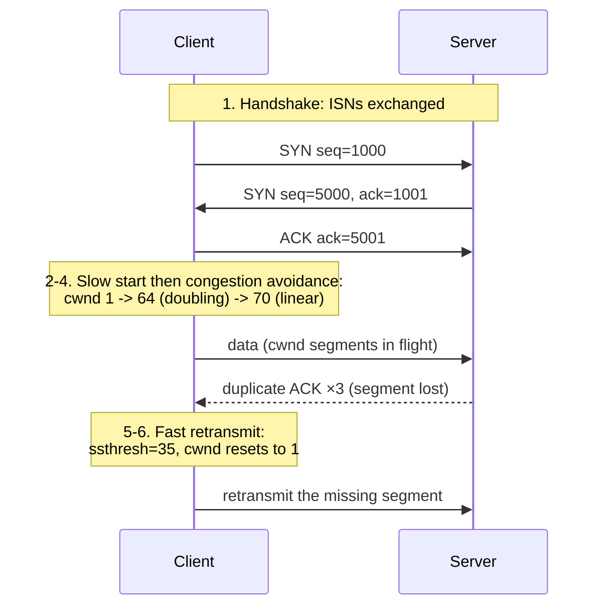

Runnable Go version: [[TCP - Handshake, Reliability, Flow and Congestion Control - Go]].

**Measured** on this machine (Go 1.24.4, darwin/arm64, loopback, `go test -race`, 2026-11-09): a full connect + write + echo + read round trip over `127.0.0.1` took **331µs**.

That single number already contains one full 3-way handshake (hidden inside `net.Dial`) plus one data round trip — on a real cross-region link the handshake alone would cost one RTT (tens of milliseconds) before any data moves at all.

**Representative output (Linux, `ss` from iproute2)** — inspecting an established connection's congestion-control state (illustrative values, not from a live capture):

```console
$ ss -tin dst 10.0.4.12
State  Recv-Q Send-Q  Local Address:Port   Peer Address:Port
ESTAB  0      0       10.0.4.7:51342       10.0.4.12:443
	 cubic wscale:7,7 rto:204 rtt:3.4/1.1 mss:1448 cwnd:40 ssthresh:28
	 bytes_sent:184320 bytes_retrans:1448 bytes_acked:182872
	 segs_out:132 segs_in:131 send 136Mbps lastsnd:4 lastrcv:8
```

Reading it: `cubic` is the active congestion-control algorithm (`wscale` is the window scaling factor that lets windows exceed 64 KB), `cwnd:40` segments (about 58KB at this `mss`) is currently allowed in flight, `ssthresh:28` shows a previous loss already happened (an ssthresh below the Reno default of ~2³¹ means a loss event set it), `rtt:3.4/1.1` is the smoothed RTT and its mean deviation in milliseconds, and `bytes_retrans:1448` shows exactly one segment was retransmitted so far.

## 5. Variants and comparison 🟡

| Algorithm | How it decides to speed up / slow down | Use when | Cost |
| --- | --- | --- | --- |
| Reno (classic) | Additive increase, multiplicative decrease on any loss | Legacy baseline; rarely the default anymore | Slow recovery on high-bandwidth links; treats all loss as congestion |
| CUBIC (Linux default) | Cubic function of time since last loss; fast growth after loss, flattens near the last loss point | General-purpose default, especially long-distance/high-bandwidth paths | Still loss-triggered; can be unfair to Reno flows sharing a link |
| BBR | Models bottleneck bandwidth + min RTT directly; paced sending | Lossy or bufferbloated links (Wi-Fi, satellite, cross-region, video) where loss is a poor congestion signal | More complex; can be aggressive toward loss-based flows sharing a bottleneck |
| Vegas | Infers congestion from RTT growth before any loss happens | Research/niche; rarely deployed at scale | Loses bandwidth races against more aggressive algorithms on shared links |

> [!warning] Interview trap
> Flow control and congestion control are two different windows solving two different problems. Flow control protects the **receiver's buffer**; congestion control protects the **network path**. The sender's effective send window is `min(cwnd, rwnd)` — a fast network with a slow receiving application is still throttled by `rwnd`, not `cwnd`.

### TCP vs the things people mix it up with 🟡

| Transport | Reliable? | In order? | Setup cost | Typical use |
| --- | --- | --- | --- | --- |
| TCP | Yes, resends | Yes, one stream | 1 round trip handshake | Web pages, APIs, databases |
| UDP | No | No | None | DNS, games, live calls |
| QUIC | Yes, per stream | Yes, per stream | 1 round trip, including encryption | HTTP/3 |

## 6. Trade-offs and when not to use 🔴

> 🟡 → 🔴 **You now know** the handshake, close, retransmission, both windows, and the knobs like Nagle and keepalive. **Next comes the advanced part**: where TCP's guarantees cost you, real production failures, what to monitor, and the deeper "why" behind cumulative ACKs, slow start, BBR and PMTU.

- TCP's ordering guarantee is also a liability: one lost packet stalls everything behind it on that connection (head-of-line blocking), which matters a lot for latency-sensitive, parallel work — see [[UDP and QUIC]].
- The handshake and slow start both cost time before a connection reaches full throughput: for a one-shot, latency-critical, loss-tolerant payload (a game position update, a live video frame), TCP's guarantees are pure overhead. UDP, or QUIC's 0-RTT resumption, fit that case better.
- Congestion control is fair by design — it won't let one flow dominate a shared link — which is exactly wrong for a single operator's own private backbone where the goal is to use 100% of known-available capacity from day one (some CDNs and private WAN, wide-area network, backbones run tuned or custom congestion control for this reason).

## 7. In production 🔴

- **Real systems:** Linux defaults to CUBIC; Google uses BBR broadly (search, YouTube, and offers it as a GCP option); most consumer OSes and server kernels ship a loss-based algorithm with BBR as an increasingly common opt-in.
- **Failure modes → fixes:**
	- **Bufferbloat** (deep router/middlebox buffers delay loss signals for seconds) → BBR's RTT-based model, or active queue management (CoDel/FQ-CoDel: router logic that drops packets early before queues grow long) on the bottleneck device.
	- **Incast** (many servers' responses arrive at once, overflowing a switch buffer and causing synchronized loss and retransmission timeouts) → smaller RTOs tuned for the datacenter, or application-level request pacing/jittering (adding small random delays so requests don't all land at once).
	- **TIME_WAIT exhaustion** on a host making many short-lived outbound connections → connection pooling/keep-alive reuse instead of connect-per-request, and `SO_REUSEADDR` where appropriate.
	- **Silent peer death behind a stateful NAT or firewall** → tuned keepalive (`net.Dialer.KeepAliveConfig` since Go 1.23) so a dead connection is detected and closed instead of hanging forever.
- **What to monitor:** retransmission rate (`bytes_retrans`/`bytes_sent` from `ss -ti`), RTT and its variance, current `cwnd` and whether it's loss-limited, count of connections stuck in `TIME_WAIT`/`CLOSE_WAIT`, and SYN backlog drops on a listening socket under load.

## 8. Deep dive 🔴

- **Why `ack` is cumulative, not selective, by default.** A single number ("everything up to here") is cheap to generate and process, but it means one lost segment in the middle of a burst makes every later segment look "out of order" until the gap is filled, even if they all arrived fine.

  SACK (RFC 2018) is the patch: it rides alongside the cumulative ACK as extra TCP options and tells the sender exactly which non-contiguous ranges already arrived, so retransmission targets only the real gap.
- **Why slow start is exponential, not linear, at the start.** An unused connection has zero information about the path's capacity; doubling `cwnd` every RTT finds the right order of magnitude in `O(log(capacity))` round trips instead of `O(capacity)` — a few RTTs instead of potentially thousands.

  The cost is that slow start can itself cause the first loss, which is exactly why `ssthresh` exists: it remembers roughly where the last loss happened, so a connection that disconnects and reconnects (or recovers from a single loss) doesn't have to re-discover capacity from scratch.
- **Why BBR doesn't wait for loss.** Over a path with deep buffers, by the time a packet actually drops, the sender has already been overshooting the real bottleneck rate for a while — the buffer was simply absorbing the overshoot, adding queuing delay the whole time.

  BBR's bandwidth-delay-product (speed × round-trip time: how much data fits "in the pipe" at once) model targets "as much data in flight as the pipe can hold," not "as much as the deepest buffer on the path can hold," which keeps queueing delay low even though it never needs a packet to actually drop.
- **Nagle × delayed ACK interaction.** If both sides use their defaults, a small request can stall waiting for Nagle to release it (held because data is still "in flight"), while the reply's ACK is simultaneously held by delayed-ACK on the other side waiting to piggyback — the two timers can compound into tens to hundreds of milliseconds of pure protocol latency on an otherwise idle, fast link.

  This is specifically a request/response latency problem, not a throughput one; bulk transfers are barely affected since Nagle only holds data when there's already unacknowledged data in flight.
- **MSS and PMTU.** The maximum segment size is negotiated at handshake time from each side's MTU, but a smaller MTU somewhere mid-path (a VPN, a tunnel) isn't visible at handshake time; Path MTU Discovery (sending with the "don't fragment" bit and backing off on an ICMP "too big" reply) exists to catch that after the fact, and its absence from a network path is a classic silent cause of connections that hang on anything but tiny payloads.

## 9. Interview questions 🔴

> [!question]- Why three segments for the handshake and four for the close?
> The handshake only needs three because the second segment (SYN+ACK) combines "I acknowledge your SYN" with "here is my own SYN" into one segment. Closing can't combine the same way because TCP is full-duplex and either side may still have data to send after announcing it's done sending — so each direction's FIN/ACK is independent, giving up to four segments (though they can collapse to three if a FIN piggybacks on an ACK).

> [!question]- What is `TIME_WAIT` actually protecting against, and why does it matter operationally?
> It gives time for a duplicate, delayed FIN from the peer to still find the socket and be re-ACKed, and lets old duplicate segments from this connection expire before the same 4-tuple is reused. It matters because a host that closes many short connections fast can pile up `TIME_WAIT` sockets faster than the 2×MSL timer clears them, exhausting ephemeral ports or kernel socket-table entries — the standard fix is connection reuse (pooling, keep-alive), not just lowering the timer.

> [!question]- What's the difference between flow control and congestion control?
> Flow control protects the receiver: it's the receiver's advertised window, based on its own buffer space. Congestion control protects the network: it's the sender's self-estimated `cwnd`, based on inferred path capacity. The sender is bound by whichever is smaller.

> [!question]- A connection has a large `cwnd` but throughput is still low. What's the first thing to check?
> Whether the receive window (`rwnd`), not `cwnd`, is the real limit — a slow-reading application or a small configured socket buffer caps `rwnd` regardless of how much room the network itself has. `ss -ti` shows both; if `rwnd` is small and stable while `cwnd` is large, the bottleneck is the receiver's buffer or application, not the network.

> [!question]- Trap: does TCP guarantee that one `Write()` call becomes exactly one `Read()` call on the other end?
> No. TCP delivers an ordered byte stream, not a sequence of framed messages — one large write can arrive split across several reads, and several small writes (especially with Nagle coalescing them) can arrive as a single read. Any protocol built on TCP that needs message boundaries (HTTP, gRPC, a custom protocol) must define its own framing, such as a length prefix or a delimiter.

> [!question]- Why would an operator choose BBR over CUBIC, and what's the risk?
> BBR holds queueing delay low and recovers bandwidth faster on lossy or bufferbloated paths because it doesn't treat every loss as a definitive congestion signal. The risk is fairness on a shared bottleneck: BBR can take a larger share of a link's capacity from a competing CUBIC flow, since CUBIC backs off on loss that BBR mostly ignores.

> [!question]- What does Nagle's algorithm trade off, and when should you disable it?
> It trades a small added latency for fewer, larger packets by holding a new small write while earlier data is still unacknowledged. Disable it (`TCP_NODELAY`) for latency-sensitive request/response protocols sending small messages (RPC calls, interactive protocols) where you'd rather pay more packets than more latency; leave it on for bulk transfers where it rarely matters.

## 10. Cheat sheet 🟢

🟢 **Plain version:** TCP opens with a 3-message hello, closes with a goodbye from each side, numbers every byte, and resends anything not ACKed in time. The receiver says how much room it has (flow control), and the sender guesses how much the network can take (congestion control); it sends no more than the smaller of the two. One lost packet makes everything behind it wait. The dense list follows.

- 3-way handshake: SYN → SYN+ACK → ACK, exchanging initial sequence numbers.
- 4-way close: FIN → ACK → FIN → ACK; the active closer waits in `TIME_WAIT` for 2×MSL.
- ACKs are cumulative ("everything up to here"); SACK adds precise gap reporting.
- Retransmission fires on RTO timeout (from measured RTT + variance) or 3 duplicate ACKs (fast retransmit).
- Flow control = receiver's `rwnd` (protects the receiver); congestion control = sender's `cwnd` (protects the network). Effective window is `min(rwnd, cwnd)`.
- Slow start doubles `cwnd` per RTT until `ssthresh`; congestion avoidance then adds ~1 segment per RTT; loss halves `ssthresh` and resets `cwnd`.
- CUBIC is Linux's loss-based default; BBR models bandwidth and RTT directly instead of waiting for loss.
- Nagle batches small writes; `TCP_NODELAY` disables it for latency-sensitive protocols. Keepalive detects a silently dead peer, not an unhealthy application.
- TCP's single ordered byte stream means one lost segment head-of-line-blocks everything behind it on that connection.

## Self-check 🟢🟡

> [!question]- 🟢 What are the three messages of the TCP handshake?
> SYN, SYN-ACK, ACK.

> [!question]- 🟢 What does "ACK 5001" mean?
> "I have every byte up to 5000; send 5001 next."

> [!question]- 🟢 What does TCP do when a segment is lost?
> The sender notices no ACK (or 3 duplicate ACKs) and sends it again.

> [!question]- 🟡 `rwnd` is 16 KB and `cwnd` is 60 KB. How much may be in flight?
> 16 KB, the smaller of the two.

> [!question]- 🟡 Why does slow start double instead of growing by 1?
> A new connection knows nothing about the path; doubling finds the right speed in a few round trips.

> [!question]- 🟡 Which side ends up in `TIME_WAIT`, and why?
> The side that closes first (sends the last ACK); it waits so a repeated FIN can still be answered and old packets die out.

## Links

- **Before this:** [[How the Internet Works - IP, Ports, Packets, OSI vs TCP-IP]]
- **Next:** [[UDP and QUIC]], [[TLS and HTTPS]], [[HTTP Fundamentals - Methods, Status Codes, Headers, Cookies]]
- **Compare with:** [[Forward and Reverse Proxies - L4 vs L7]] (an L4 proxy operates at exactly this layer), [[Network Debugging Toolkit - dig, curl, ss, tcpdump]] (reading `ss`/`tcpdump` output for a real connection)
- **Code:** [[TCP - Handshake, Reliability, Flow and Congestion Control - Go]]

### Watch on YouTube

- [TCP 3-Way Handshake Explained / SYN, SYN-ACK, ACK + Practical Wireshark Lab](https://www.youtube.com/watch?v=V9wj1NiErUY) · Singh IT Concepts · visual + packet-capture walkthrough of the 3-way handshake and 4-way close
- [TCP Flow Control & Connection Mgmt - Transport Layer / Computer Networks Ep. 3.5.5 / Kurose & Ross](https://www.youtube.com/watch?v=iPXaMBu_OLk) · Epic Networks Lab · explains the receiver-window flow control piece in depth
- [TCP Congestion Control](https://www.youtube.com/watch?v=kRS4J-m5n04) · Anand Seetharam · dedicated deep dive on cwnd/congestion control distinct from flow control
