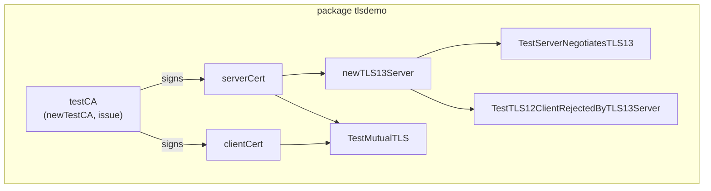

# TLS and HTTPS - Go

> [!summary] TL;DR
> This code proves three real handshakes with Go's `crypto/tls`: a server negotiating TLS 1.3, a TLS-1.2-only client being rejected by a TLS-1.3-only server, and mutual TLS (mTLS) using a throwaway test certificate authority. See the theory in [[TLS and HTTPS]].

## Before the code

- **`crypto/tls`**: Go's built-in TLS; a `tls.Config` sets versions (`MinVersion`, `MaxVersion`), certificates and client-cert rules.
- **`crypto/x509` + `crypto/ecdsa`**: build and sign certificates in memory, so the tests need no certificate files.
- **`net/http/httptest`**: starts a real HTTPS server on a random local port for one test, then `Close()` shuts it down.
- **`*testing.T` and `t.Helper()`**: test functions; `t.Helper()` makes failures point at the caller's line.
- **Handler goroutines**: the server runs each request on its own goroutine, which is why the tests run with `-race`.
- **Run it**: `go vet ./...` then `go test -race -v ./...` inside a module named `tlsdemo` (see Setup).

## What this code shows

All three tests below exercise a real TLS handshake over a real `net.Listener` (via `httptest`), never a mocked connection — the point of this note is to make the theory note's handshake diagrams literally observable in test output, not just plausible on paper.

Each test is scoped to prove exactly one claim from the theory note, so a failure always points at one specific mechanism rather than "something about TLS broke."

This matters because TLS bugs are notoriously easy to hide behind a green checkmark.

A test that happens to connect successfully proves almost nothing on its own, since a misconfigured client or server can still "work" while silently skipping the one check that was supposed to matter (a missing hostname check, a disabled certificate validation, a downgraded cipher).

Every test here is instead built to fail loudly in exactly the scenario it exists to catch, which is why `TestTLS12ClientRejectedByTLS13Server` and the no-client-certificate half of `TestMutualTLS` both assert on an *error*, not a success — the interesting behavior in both cases is the handshake refusing to proceed.

| Code | Theory concept | Theory section |
| --- | --- | --- |
| `newTLS13Server` + `TestServerNegotiatesTLS13` | TLS 1.3's one-round-trip handshake actually completing | [[TLS and HTTPS#TLS 1.3 one round trip, plus a 0-RTT option]] |
| `TestTLS12ClientRejectedByTLS13Server` | A protocol-version mismatch failing the handshake closed, not open | [[TLS and HTTPS#Variants and comparison]] |
| `testCA`, `issue` | Building a chain of trust (CA signs a leaf certificate) instead of skipping verification | [[TLS and HTTPS#Certificates chain, SANs, validation levels]] |
| `TestMutualTLS` | mTLS: the server requiring and verifying a client certificate | [[TLS and HTTPS#Termination patterns]] |



One throwaway certificate authority (`testCA`) feeds every test that needs a real certificate chain: `newTLS13Server` builds the plain TLS-1.3 server the first two tests share, while `TestMutualTLS` additionally issues a client certificate from the same CA and configures the server to require it.

Keeping one CA type shared across all three tests, rather than three separate ad-hoc certificate setups, is what lets `TestMutualTLS` reuse `testCA.issue` unchanged.

## Setup

- **Module layout:** a single package, `tlsdemo`, with the test-CA helper in its own file and the three handshake tests in another.
- **Go version:** 1.24.
- **Dependencies:** standard library only (`crypto/tls`, `crypto/x509`, `net/http/httptest`).
- **Why standard library only.** Nothing here needs a third-party TLS library: `crypto/tls` and `crypto/x509` already expose every knob this note demonstrates (minimum/maximum version, client-certificate requirement, custom root pools).

  `httptest` already wraps the socket plumbing a hand-rolled `net.Listen` + `tls.NewListener` setup would otherwise require.

  Reaching for a third-party library here would add a dependency without removing any code this note actually needs to show.
- **Run it:**

```text
go mod init tlsdemo
go vet ./...
go test -race ./...
```

## Code

### Pinning a server to TLS 1.3 for testing

```go
package tlsdemo

import (
	"crypto/tls"
	"net/http"
	"net/http/httptest"
)

// newTLS13Server builds an httptest TLS server whose tls.Config pins the
// negotiated protocol to TLS 1.3, the way a production listener does when it
// wants to drop TLS 1.2 clients entirely.
func newTLS13Server(handler http.Handler) *httptest.Server {
	srv := httptest.NewUnstartedServer(handler)
	srv.TLS = &tls.Config{MinVersion: tls.VersionTLS13}
	srv.StartTLS()
	return srv
}
```

**Concept.** This is the Go-side knob for the theory note's "TLS 1.3: one round trip" section: `MinVersion` is what a real server sets to refuse to negotiate anything weaker.

`httptest.NewUnstartedServer` plus a manually assigned `srv.TLS` (instead of the simpler `httptest.NewTLSServer`) was chosen specifically so this config could be set *before* starting the listener — `httptest`'s default helper generates its own cert and starts immediately, leaving no window to override `MinVersion` first.

**How it works.**
1. `NewUnstartedServer` creates the listener and generates a self-signed certificate, but does not yet start accepting connections.
2. Setting `srv.TLS` after creation but before `StartTLS()` is the only way to inject a custom `tls.Config` into `httptest`'s otherwise-automatic certificate setup.
3. `StartTLS()` finally binds the socket and begins serving — any client connecting from this point negotiates against the `MinVersion: tls.VersionTLS13` constraint.

### Proving TLS 1.3 actually negotiated

```go
func TestServerNegotiatesTLS13(t *testing.T) {
	srv := newTLS13Server(http.HandlerFunc(func(w http.ResponseWriter, r *http.Request) {
		cs := r.TLS
		fmt.Fprintf(w, "version=%x cipher=%x", cs.Version, cs.CipherSuite)
	}))
	defer srv.Close()

	client := srv.Client() // trusts the test server's generated CA

	resp, err := client.Get(srv.URL)
	if err != nil {
		t.Fatalf("get: %v", err)
	}
	defer resp.Body.Close()

	if resp.TLS.Version != tls.VersionTLS13 {
		t.Fatalf("negotiated version = %x, want TLS 1.3 (%x)", resp.TLS.Version, tls.VersionTLS13)
	}
```

**Concept.** `r.TLS` on the server side and `resp.TLS` on the client side are Go's two independent views of the same negotiated handshake — checking both (one inside the handler, one after the response) is how this test proves the version match isn't a coincidence of one side's config alone, but something both peers actually agreed on.

```go
	body, _ := io.ReadAll(resp.Body)
	t.Logf("handler saw: %s", body)
	t.Logf("client negotiated TLS version %x, cipher suite %s", resp.TLS.Version, tls.CipherSuiteName(resp.TLS.CipherSuite))
}
```

**How it works.**
1. `srv.Client()` returns an `*http.Client` pre-configured to trust the test server's own generated CA — the alternative, `InsecureSkipVerify`, was rejected because it would stop this test from exercising certificate verification at all.
2. `resp.TLS.CipherSuiteName` turns the negotiated numeric suite ID into a readable name, matching how the theory note's "Measured" `openssl`/`curl` output reads a cipher suite.

### A version mismatch failing closed

```go
func TestTLS12ClientRejectedByTLS13Server(t *testing.T) {
	srv := newTLS13Server(http.HandlerFunc(func(w http.ResponseWriter, r *http.Request) {
		w.WriteHeader(http.StatusOK)
	}))
	defer srv.Close()

	client := srv.Client()
	transport := client.Transport.(*http.Transport).Clone()
	transport.TLSClientConfig.MaxVersion = tls.VersionTLS12
	client.Transport = transport

	_, err := client.Get(srv.URL)
	if err == nil {
		t.Fatal("expected handshake failure when client is capped at TLS 1.2 against a TLS-1.3-only server")
	}
	t.Logf("handshake failed as expected: %v", err)
}
```

**Concept.** This is the direct, working proof behind the theory note's interview question about protocol-version mismatches: a client whose `MaxVersion` excludes a server's `MinVersion` must fail the handshake, not silently downgrade.

Cloning the transport (`.Clone()`) rather than mutating the client's shared default transport was chosen so this test can't leak a changed `MaxVersion` into any other test that happens to reuse the same `http.DefaultTransport`.

**How it works.**
1. `client.Transport.(*http.Transport).Clone()` makes an independent copy of the transport so this test's TLS constraint is fully isolated.
2. Setting `MaxVersion: tls.VersionTLS12` caps the client at TLS 1.2, which cannot satisfy the server's `MinVersion: tls.VersionTLS13` — the two ranges don't overlap at all.
3. The error returned by `client.Get` here is a handshake failure, not an HTTP-level error (no status code exists yet, because no HTTP exchange happened — the connection never got past the TLS layer).

### Building a real chain of trust for mTLS

```go
package tlsdemo

import (
	"crypto/ecdsa"
	"crypto/elliptic"
	"crypto/rand"
	"crypto/tls"
	"crypto/x509"
	"crypto/x509/pkix"
	"math/big"
	"net"
	"testing"
	"time"
)

// testCA is a throwaway certificate authority for tests only: it signs a
// server certificate and a client certificate so TestMutualTLS can exercise
// a real chain-of-trust check instead of InsecureSkipVerify.
type testCA struct {
	cert *x509.Certificate
	key  *ecdsa.PrivateKey
}
```

**Concept.** This is the theory note's chain-of-trust diagram (root → intermediate → leaf) collapsed to two levels for a test: `testCA` plays the root, and `issue` signs leaf certificates directly under it.

The alternative — calling `tls.Config{InsecureSkipVerify: true}` and skipping certificate verification entirely — was rejected because it would prove nothing about the actual mechanism this note exists to demonstrate: a client or server that only trusts a certificate because a real signature chains back to a root it holds.

```go
func newTestCA(t *testing.T) *testCA {
	t.Helper()
	key, err := ecdsa.GenerateKey(elliptic.P256(), rand.Reader)
	if err != nil {
		t.Fatalf("generate CA key: %v", err)
	}
	tmpl := &x509.Certificate{
		SerialNumber:          big.NewInt(1),
		Subject:               pkix.Name{CommonName: "test-ca"},
		NotBefore:             time.Now().Add(-time.Hour),
		NotAfter:              time.Now().Add(time.Hour),
		KeyUsage:              x509.KeyUsageCertSign | x509.KeyUsageDigitalSignature,
		BasicConstraintsValid: true,
		IsCA:                  true,
	}
	der, err := x509.CreateCertificate(rand.Reader, tmpl, tmpl, &key.PublicKey, key)
	if err != nil {
		t.Fatalf("create CA cert: %v", err)
	}
	cert, err := x509.ParseCertificate(der)
	if err != nil {
		t.Fatalf("parse CA cert: %v", err)
	}
	return &testCA{cert: cert, key: key}
}
```

**How it works.**
1. `x509.CreateCertificate(rand.Reader, tmpl, tmpl, ...)` passing `tmpl` as both the certificate-to-create and its own signer is what makes this a **self-signed** root — exactly how a real root CA's own certificate is built, the one the theory note says every browser or OS ships pre-trusted.
2. `IsCA: true` plus `KeyUsageCertSign` are the two fields that tell any verifier walking the chain "this certificate is allowed to sign other certificates," not just to present itself as a leaf.
3. A 1-hour validity window is deliberately short — this is a throwaway authority that exists only for the duration of one test run, unlike a real root CA's typically multi-decade validity.

### Issuing leaf certificates for the server and the client

```go
func (ca *testCA) issue(t *testing.T, name string, client bool) tls.Certificate {
	t.Helper()
	key, err := ecdsa.GenerateKey(elliptic.P256(), rand.Reader)
	if err != nil {
		t.Fatalf("generate leaf key: %v", err)
	}
	tmpl := &x509.Certificate{
		SerialNumber: big.NewInt(time.Now().UnixNano()),
		Subject:      pkix.Name{CommonName: name},
		NotBefore:    time.Now().Add(-time.Hour),
		NotAfter:     time.Now().Add(time.Hour),
		KeyUsage:     x509.KeyUsageDigitalSignature,
	}
	if client {
		tmpl.ExtKeyUsage = []x509.ExtKeyUsage{x509.ExtKeyUsageClientAuth}
	} else {
		tmpl.ExtKeyUsage = []x509.ExtKeyUsage{x509.ExtKeyUsageServerAuth}
		tmpl.IPAddresses = []net.IP{net.ParseIP("127.0.0.1")}
		tmpl.DNSNames = []string{"localhost"}
	}
	der, err := x509.CreateCertificate(rand.Reader, tmpl, ca.cert, &key.PublicKey, ca.key)
	if err != nil {
		t.Fatalf("create leaf cert: %v", err)
	}
	return tls.Certificate{Certificate: [][]byte{der}, PrivateKey: key}
}
```

**Concept.** One function issues both the server certificate and the client certificate the theory note's mTLS section needs, distinguished only by the `client bool` flag and the resulting `ExtKeyUsage`.

The alternative of two separate functions was rejected as unnecessary duplication — the only real difference between a server cert and a client cert here is which `ExtKeyUsage` and which identity fields (IP/DNS SANs vs. none) get set.

**How it works.**
1. `x509.CreateCertificate(rand.Reader, tmpl, ca.cert, &key.PublicKey, ca.key)` signs with `ca.key` (the CA's private key) while the certificate's own public key is the leaf's — this asymmetry (signed by one key, identifying another) is the entire mechanism of a certificate chain.
2. `ExtKeyUsageServerAuth` vs `ExtKeyUsageClientAuth` tells any verifier what this certificate is allowed to be presented *as* — a server cert cannot stand in for a client cert even if both chain to the same trusted root.
3. `tmpl.DNSNames = []string{"localhost"}` plus the loopback `IPAddresses` entry are the SANs the theory note says are the only thing modern clients actually check, not the legacy `CommonName` field (though `CommonName` is still set here for human readability in log lines).

### Requiring and verifying a client certificate (mTLS)

```go
func TestMutualTLS(t *testing.T) {
	ca := newTestCA(t)
	serverCert := ca.issue(t, "127.0.0.1", false)
	clientCert := ca.issue(t, "test-client", true)

	pool := x509.NewCertPool()
	pool.AddCert(ca.cert)

	srv := httptest.NewUnstartedServer(http.HandlerFunc(func(w http.ResponseWriter, r *http.Request) {
		cn := r.TLS.PeerCertificates[0].Subject.CommonName
		fmt.Fprintf(w, "client-cn=%s", cn)
	}))
	srv.TLS = &tls.Config{
		MinVersion:   tls.VersionTLS13,
		Certificates: []tls.Certificate{serverCert},
		ClientAuth:   tls.RequireAndVerifyClientCert,
		ClientCAs:    pool,
	}
	srv.StartTLS()
	defer srv.Close()
```

**Concept.** `tls.RequireAndVerifyClientCert` plus `ClientCAs` is exactly the passthrough-with-mTLS pattern from [[TLS and HTTPS#Termination patterns]]: the server now demands a client certificate and will only accept one signed by a CA in `ClientCAs` — this test's `pool` holding only the one throwaway CA.

```go
	rootPool := x509.NewCertPool()
	rootPool.AddCert(ca.cert)

	// No client certificate: the handshake itself must fail.
	noCertClient := &http.Client{Transport: &http.Transport{
		TLSClientConfig: &tls.Config{RootCAs: rootPool},
	}}
	if _, err := noCertClient.Get(srv.URL); err == nil {
		t.Fatal("expected handshake failure with no client certificate")
	}
```

**How it works.**
1. `noCertClient` trusts the server's CA (`RootCAs: rootPool`, so it isn't rejecting the *server's* certificate) but supplies no client certificate of its own, so this specifically isolates the mTLS requirement's failure from an unrelated trust failure.
2. The expected failure happens at the handshake layer, before any HTTP request/response exists — matching the theory note's point that a certificate requirement fails the connection closed, with no partial response ever reaching the application.

```go
	// Correct client certificate: the handshake succeeds and the server
	// reads the client's identity out of the verified chain.
	withCertClient := &http.Client{Transport: &http.Transport{
		TLSClientConfig: &tls.Config{
			RootCAs:      rootPool,
			Certificates: []tls.Certificate{clientCert},
		},
	}}
	resp, err := withCertClient.Get(srv.URL)
	if err != nil {
		t.Fatalf("get with client cert: %v", err)
	}
	defer resp.Body.Close()
	body, _ := io.ReadAll(resp.Body)
	if string(body) != "client-cn=test-client" {
		t.Fatalf("got %q, want client-cn=test-client", body)
	}
}
```

**How it works.**
1. `withCertClient` presents the signed `clientCert`, so the handshake now succeeds, and the server reads the verified identity straight from `r.TLS.PeerCertificates[0]` — no separate authentication step beyond the TLS handshake itself.
2. The response body (`client-cn=test-client`) is read directly out of the certificate the server verified, which is the concrete version of the theory note's claim that mTLS lets "every hop independently prove its peer's identity."

## Design decisions

Every choice in this section is one a reader could reasonably make differently; the table exists so the trade-off is explicit rather than left for a future maintainer to rediscover by trial and error.

The two tests after `TestServerNegotiatesTLS13` each isolate exactly one failure mode — a version mismatch, and a missing client certificate — rather than combining them into one large scenario, because a single test that failed for either reason would leave a reader unsure which guarantee actually broke.

Three design pressures shaped this file as a whole.

1. First, every handshake had to be **real**: no step anywhere calls `InsecureSkipVerify` or hand-constructs a fake `tls.ConnectionState`, because a test that skips verification can pass even when the actual mechanism being taught (chain-of-trust validation) is completely broken.
2. Second, each test had to fail for exactly one reason, which is why the CA and certificate-issuing code is shared infrastructure (`testCA`) rather than duplicated per test — a bug in certificate issuance would then show up as every test failing, which is itself a useful signal, not noise.
3. Third, the file stays in a single package deliberately: splitting the CA helper into its own package would mirror production code structure more closely, but it would also hide, behind an import, exactly the two-level signing relationship (`newTestCA` signs itself, `issue` signs a leaf under it) that this note exists to make visible in one place.

| Choice | Alternative | Trade-off |
| --- | --- | --- |
| A throwaway in-process CA (`testCA`) | `InsecureSkipVerify: true` | Exercises the real chain-of-trust check the theory note's handshake relies on; `InsecureSkipVerify` would make the mTLS test pass even with a broken certificate chain |
| ECDSA P-256 keys for the test CA and leaves | RSA keys | Faster key generation in a test suite run repeatedly; production certificate choice is a separate, unrelated decision this demo doesn't need to make |
| One `issue` function with a `client bool` flag | Two separate `issueServerCert`/`issueClientCert` functions | The only real difference is `ExtKeyUsage` and SAN fields; one function with a flag avoids duplicating the certificate-template boilerplate |
| `httptest.NewUnstartedServer` + manual `srv.TLS` | `httptest.NewTLSServer` | Needed to set a custom `tls.Config` (`MinVersion`, `ClientAuth`) before the listener starts accepting connections |

## Tests

Each test below asserts exactly one property of the handshake, matching the table in "Design decisions": a reader who wants to confirm the version negotiation works can read only the first test, and a reader who only cares about mTLS can skip straight to the third, without needing the others to make sense of it.

### TestServerNegotiatesTLS13

**Property proved:** a server and client that both support TLS 1.3 actually negotiate it — not just that the connection succeeds, but that the specific version both sides claim afterward matches.

| Input | Expected output |
| --- | --- |
| Server with `MinVersion: TLS 1.3`, default client | `resp.TLS.Version == tls.VersionTLS13` |

A failure here would mean either the server silently negotiated a lower version it shouldn't have offered, or Go's `crypto/tls` itself regressed — either way, a claim this note makes about "TLS 1.3 completed" would be unverified.

### TestTLS12ClientRejectedByTLS13Server

**Property proved:** a client capped below the server's minimum version fails the handshake instead of being silently downgraded or allowed through.

| Input | Expected output |
| --- | --- |
| Server with `MinVersion: TLS 1.3`, client with `MaxVersion: TLS 1.2` | `client.Get` returns a non-nil error |

A failure here (no error) would mean Go's TLS stack allowed an incompatible version pair to connect anyway — exactly the silent-downgrade failure mode the theory note warns is the reason version floors exist at all.

### TestMutualTLS

**Property proved:** a server configured for mTLS rejects a connection with no client certificate, and accepts one with a correctly signed client certificate, reading the verified identity back out of it.

| Input | Expected output |
| --- | --- |
| No client certificate presented | Handshake fails (`client.Get` returns an error) |
| Client certificate signed by the trusted CA presented | `resp` body is `"client-cn=test-client"` |

A failure in the first case would mean the server isn't actually enforcing `RequireAndVerifyClientCert`; a failure in the second would mean either the chain-of-trust verification or the server's reading of `r.TLS.PeerCertificates` is broken — both are the exact mechanism this test exists to prove works end to end.

## Running it

The commands below are the same two steps every Go module in this vault's implementation notes runs.

`go vet` first, because a vet failure usually points at a mistake worth fixing before even running the tests. `go test -race` runs second, so a pass also rules out a whole class of concurrency bugs that a plain `go test` run would miss.

```text
$ go vet ./...
$ go test -race -v ./...
=== RUN   TestServerNegotiatesTLS13
    tls_test.go:43: handler saw: version=304 cipher=1301
    tls_test.go:44: client negotiated TLS version 304, cipher suite TLS_AES_128_GCM_SHA256
--- PASS: TestServerNegotiatesTLS13 (0.01s)
=== RUN   TestTLS12ClientRejectedByTLS13Server
    tls_test.go:64: handshake failed as expected: remote error: tls: protocol version not supported
--- PASS: TestTLS12ClientRejectedByTLS13Server (0.00s)
=== RUN   TestMutualTLS
--- PASS: TestMutualTLS (0.01s)
PASS
ok  	tlsdemo	1.923s
```

Reading it: `go vet` printed nothing (no suspicious constructs found).

`version=304` is TLS 1.3's wire-format version number in hex, and `cipher=1301` is `TLS_AES_128_GCM_SHA256`'s suite ID — both confirm the negotiation claimed in the test assertions actually happened at the protocol level, not just that Go's high-level API returned success.

All three tests ran under `-race`; a pass here specifically rules out any data race in the `httptest` server's concurrent handling of the handshake and the handler goroutine.

The second log line, `handshake failed as expected: remote error: tls: protocol version not supported`, is the server's own alert message traveling back to the client — the exact wire-level signal the theory note's "protocol-version mismatch" interview question describes, captured here instead of only described in prose.

Seeing the real alert text, rather than a generic "connection refused," is the detail that makes a production TLS error log readable the first time it shows up for real: the alert name usually names the mismatched parameter directly.

## Pitfalls in the code

- **Using `InsecureSkipVerify` to make a TLS test "just work"** is the single most common shortcut that quietly defeats the entire point of a certificate-chain test — a server with an expired, wrong-hostname, or entirely self-signed-without-a-trusted-root certificate would still pass.
- **Forgetting `BasicConstraintsValid: true` and `IsCA: true` on the CA template** would produce a certificate that some strict verifiers reject as a CA even though `KeyUsageCertSign` is set — both fields together are what x509 actually checks.
- **Reusing one `http.Client`/`http.Transport` across the version-mismatch test and other tests** without cloning it first would leak the artificially lowered `MaxVersion` into unrelated tests that happen to run afterward and share the same default transport.
- **Checking only `err == nil` after a handshake failure**, without logging the actual error (as `t.Logf` does here), makes a future regression in *why* the handshake failed much harder to diagnose from CI output alone.
- **Giving the test CA and its leaf certificates a long `NotAfter`** would be a subtler mistake than it looks: a one-hour validity window is a deliberate signal to anyone reading the test later that these certificates are disposable test fixtures, never something to copy into a real deployment where certificate lifetimes matter for revocation and rotation.
- **Sharing one `*testCA` instance across unrelated test functions running in parallel** (via `t.Parallel()`, not used here) would need the CA's key generation to be safe for concurrent reads, which `newTestCA` does not currently guarantee — each test here calls `newTestCA` fresh instead of sharing one, specifically to sidestep that question entirely.

## Exercises

Each exercise below is a "change this, predict the result" task rather than a "write this from scratch" task: the goal is to build the same intuition needed to debug a real handshake failure in production, where the error message is often the only clue available.

1. Change `TestMutualTLS` to issue the client certificate from a *different*, unrelated CA (create a second `testCA` and sign the client cert with it instead). Predict whether the handshake still succeeds, then run it and read the resulting error.
2. Add a fourth test that presents an **expired** client certificate (set `NotAfter` to one hour in the past in `issue`). Predict whether Go's `crypto/tls` rejects it at the handshake layer or lets the connection through for the application to check manually, then verify.
3. Change `newTLS13Server` to also set `MaxVersion: tls.VersionTLS13` explicitly (instead of relying on it being the implicit ceiling), and add a test asserting the server's advertised supported-version range is exactly one version wide. Predict what `tls.Config` field would tell you this without parsing packets.

Working through all three exercises in order touches every certificate field this note relies on — issuer, validity window, and protocol-version bounds — so by the third one, the full shape of what Go's handshake actually checks (and in what order) should be easy to state from memory rather than by re-reading the code.

## Links

Nothing in this note is specific to `httptest` in a way that would stop the same `tls.Config` fields from being used against a real `net.Listener` and a production TLS certificate; `httptest` was chosen purely so every test runs self-contained, with no external certificate files or network access required.

- **Theory:** [[TLS and HTTPS]]
- **Related:** [[Forward and Reverse Proxies - L4 vs L7]], [[Service-to-Service Auth - API Keys, HMAC, mTLS]], [[TLS, HTTPS and HTTP2 in Go Servers]]

Read this note alongside the theory note's Deep Dive section on forward secrecy and post-quantum readiness: none of that is re-implemented here, since Go's `crypto/tls` negotiates the hybrid key exchange automatically with no application-level code to write or test — the absence of any code for that feature in this note is itself the point, not an omission.

That same absence is itself a small lesson: the best proof that a security feature "just works" transparently is often that no test anywhere needs to reference it by name.
