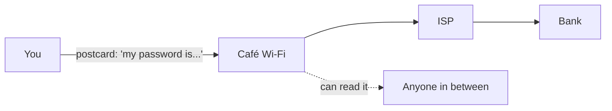
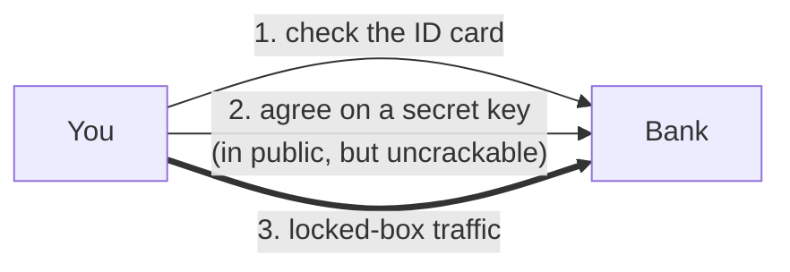
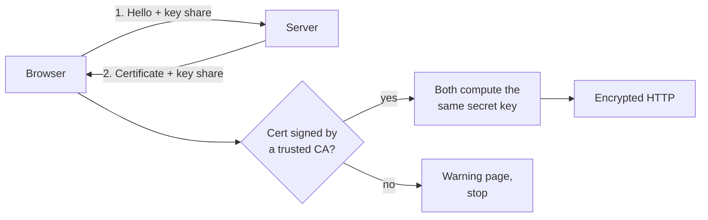
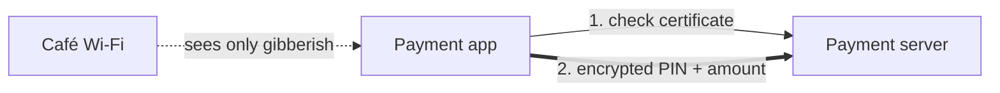
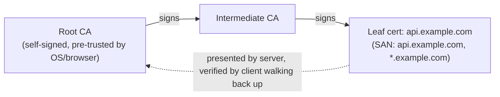
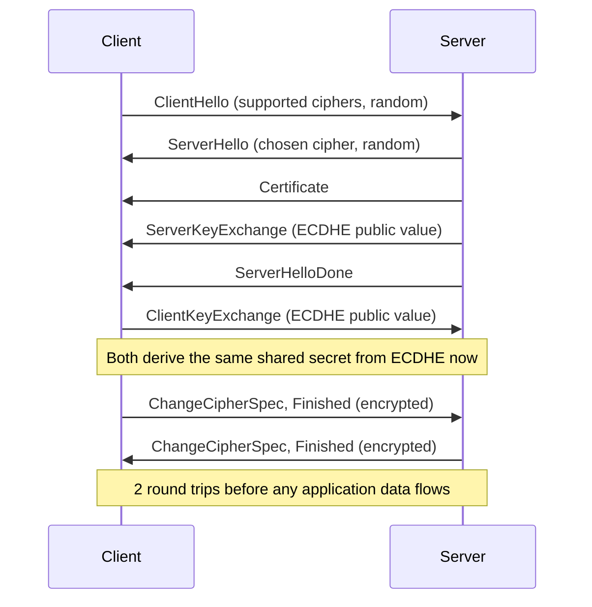
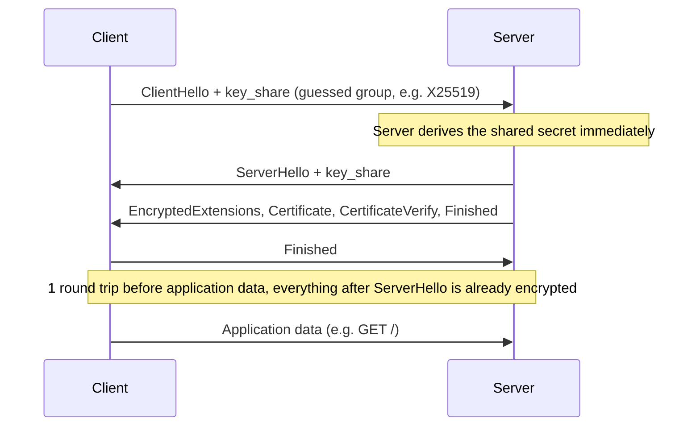
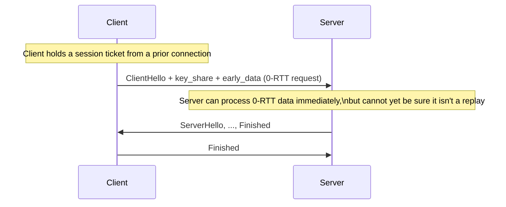
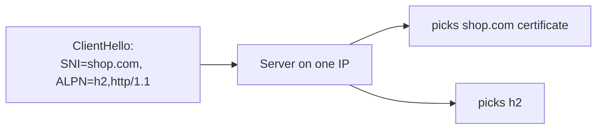

# TLS and HTTPS

> [!summary] TL;DR
> HTTPS is HTTP sent over a TLS connection instead of a plain TCP connection. TLS proves who you're talking to (a certificate chain back to a trusted root) and encrypts everything after that, using a handshake that negotiates a shared key without ever sending the key itself over the wire.

> [!abstract] Core idea
> - The handshake has two separate jobs: agree on a shared secret (key exchange) and prove the server's identity (certificate chain).
> - TLS 1.3 does both in **1 round trip** instead of TLS 1.2's 2, by guessing the key-exchange group up front; a resumed connection can do **0-RTT**, at the cost of replay risk.
> - A certificate is only trustworthy because a chain of signatures leads back to a root certificate the client already trusts — not because "the padlock is green".
> - Classic mistake: thinking a valid certificate means the *server* is trustworthy. It only means "this is really the domain named in the certificate" — nothing about what that domain does with your data.

### Whiteboard version

A client visiting `https://api.example.com`:

1. TCP handshake completes (see [[TCP - Handshake, Reliability, Flow and Congestion Control]]).
2. Client sends `ClientHello`: TLS versions it supports, a random key-share guess, and the hostname in plaintext (**SNI**) so a server hosting many sites knows which certificate to present, plus the list of application protocols it can speak (**ALPN**: `h2`, `http/1.1`).
3. Server replies with its certificate (signed by a CA the client already trusts), finishes the key exchange, and picks an ALPN protocol.
4. Both sides now share a symmetric key (one key used both to lock and unlock) with **nobody else having seen it**, derived from a Diffie-Hellman exchange (ECDHE: each side mixes its own secret number with the other's public value and both arrive at the same result), not sent over the wire.
5. All HTTP traffic from here on is encrypted with that key.

That's the whole deal: identity (certificate) plus a secret only the two endpoints can derive (ECDHE) equals HTTPS.

## Start here: the basics 🟢

> [!info] How to read this note (pick your level)
> - 🟢 **New to this?** Read "From zero" below, then sections 1, 2 and the cheat sheet (10). Stop there, that is a full first pass.
> - 🟡 **Know the basics?** Add section 3 (how it works), 4 (worked example) and 5 (variants).
> - 🔴 **Interview / SDE-3 prep?** Add 6, 7, 8 and 9. Headings are tagged 🟢🟡🔴 so you always know where you are.

> [!note] Before this note
> - [[TCP - Handshake, Reliability, Flow and Congestion Control]]: a connection first opens with SYN, SYN-ACK, ACK; TLS starts its own handshake only after that.
> - [[HTTP-1.1 vs HTTP-2 vs HTTP-3]]: each handshake round trip costs time, and HTTP/2 vs HTTP/1.1 is chosen during the TLS hello (ALPN).

**From zero, in 60 seconds** 🟢

Plain web traffic (**HTTP**) is like a postcard. Everyone who carries it — the café Wi-Fi, the ISP — can read it and even change it.



**HTTPS** puts the postcard in a locked box. Only you and the website have the key. Before locking, the website also shows an ID card (a **certificate**) signed by an authority your browser already trusts, so you know it really is your bank and not a fake.



The clever part: the two sides agree on the secret key by talking in public, yet an eavesdropper who hears everything still cannot work the key out.

The rest of this note is just these 4 questions:
1. How do two strangers agree on a secret in public (key exchange)?
2. How do you know the other side is really who it claims (certificates)?
3. What exactly happens in the first few messages (the handshake)?
4. Where does the encryption start and stop in a real setup (termination)?

**The problem in one story.**
You log in to your bank on café Wi-Fi.
Your password travels through the café router, the ISP and many other machines.
Without protection, any of them could read it or change the page you get back.
HTTPS wraps the conversation so only you and the real bank can read it, and you can check it really is the bank.

**Words you need first**

| Word | Plain meaning | Tiny example |
| --- | --- | --- |
| Encryption | Scrambling data so only key holders can read it | `hello` becomes `x9#Qp...` |
| Key | The secret number used to scramble and unscramble | A 256-bit random value |
| Public / private key | A pair: anyone can use the public one, only the owner has the private one | Server publishes a public key, keeps the private one |
| Signature | Proof made with a private key that anyone can check with the public key | A CA signing a certificate |
| Certificate | A signed card saying "this public key belongs to this domain" | Cert for `api.example.com` |
| CA (Certificate Authority) | A trusted organisation that signs certificates | Let's Encrypt |
| Handshake | The first few messages where both sides agree how to talk | `ClientHello`, `ServerHello` |
| Round trip (RTT) | One message there and its reply back | ~50 ms across a country |
| ECDHE | The key-agreement math: both sides build the same secret without ever sending it | Uses the X25519 curve |
| Forward secrecy | Old recorded traffic stays safe even if the server's key leaks later | Fresh keys per connection |
| SNI | The site name the browser sends, unencrypted, in its first TLS message | `api.example.com` |
| ALPN | The list of protocols offered in the hello, so both pick one | `h2` or `http/1.1` |
| TLS termination | The point where the encryption is removed and traffic becomes readable | At the load balancer |

**Picture it**



**Analogy.** Two people agree on a secret code word by each mixing paint colours in public, and one of them shows a government ID before they start talking.
Where it breaks: the ID only proves the name is real; it says nothing about whether that person is honest.

**How the rest of this note builds up**

- First, why plain HTTP is unsafe (section 1) and the two jobs: key exchange and certificates (section 2).
- Then the TLS 1.2 and 1.3 handshakes, 0-RTT, SNI/ALPN, certificate details and termination patterns (section 3).
- Then a Go worked example, variants and trade-offs (sections 4-6).
- Finally the SDE-3 deep dive: production failure modes, forward secrecy, HSTS and post-quantum key exchange (sections 7-8).

> [!tip] Remember
> A certificate proves *who* you are talking to; the key exchange makes sure *nobody else* can read it.

## 1. Why it exists 🟢

Plain HTTP sends everything, including passwords, cookies and page content, as readable bytes on the wire.

Anyone on the network path (a shared Wi-Fi hotspot, a compromised router, an ISP) can read it. Anyone who can inject packets can modify it in transit or impersonate the server entirely (serve fake content, steal a login form's submitted password).

TLS exists to remove both of those: confidentiality (nobody else can read it) and authentication (you know which server you're actually talking to) plus integrity (nobody can tamper with it undetected).

The practical trigger for "HTTPS everywhere" was the free, automated Let's Encrypt CA (2015) and browsers marking plain HTTP as "Not Secure" starting around 2018 — before that, a certificate cost money and required a manual yearly renewal, so a large fraction of the web stayed on HTTP by default.

### Real-life example: paying on a UPI app 🟢

You pay ₹500 on PhonePe or Google Pay over café Wi-Fi.
Before anything is sent, the app opens a TLS connection to the payment server and checks its certificate. A fake server on the Wi-Fi cannot show a valid certificate for that name, so the app refuses to talk to it.
Your PIN and payment details then travel inside the encrypted connection, so the café router sees only scrambled bytes and the server's name.
Some apps go further and accept only their own known server certificate (certificate pinning), which blocks even a forged certificate from a trusted CA.



## 2. Mental model 🟢

🟢 **Plain version:** TLS does two separate jobs. First, the two sides make a shared secret key using a math trick where each side keeps one number private and sends only a public "mix"; an eavesdropper who sees both mixes still can't get the key. Second, the server shows a certificate: an ID card signed by an authority your device already trusts. The details below name the math (ECDHE) and the chain of signatures.

Two parts, and it helps to keep them separate:

- **Key exchange (ECDHE):** both sides contribute a random number and a well-known elliptic curve (a specific math shape used to make this one-way math fast and safe), and each can compute the same shared secret from their own number and the other side's public value — but an eavesdropper who only sees the public values cannot compute the secret.

  This is **forward secrecy**: even if the server's long-term private key leaks later, past sessions can't be decrypted, because the session key was never derived from that long-term key alone.
- **Certificates (identity):** a certificate says "the holder of this private key is `api.example.com`", signed by a Certificate Authority (CA).

  The client doesn't trust the certificate because it says so — it trusts it because the CA's own certificate is signed by another CA, and so on, up to a **root CA** the client's operating system or browser ships with a built-in, hard-coded trust in. That sequence is the **chain of trust**.



> [!tip] Remember
> Key exchange and certificates solve two different problems. Key exchange (ECDHE) answers "can two strangers agree on a secret nobody else can compute?" Certificates answer "is the party on the other end who they claim to be?" HTTPS needs both; neither alone is enough.

## Common beginner mistakes 🟢

- **"The padlock means the site is safe"** → it only proves you are talking to the domain in the certificate → a phishing site can have a valid certificate too.
- **Turning off certificate checks to "fix" an error** (`InsecureSkipVerify: true`) → anyone in the middle can now read your traffic → fix the chain, name or clock instead.
- **Serving only the leaf certificate** → some clients can't build the chain to a root → always serve the leaf plus intermediates.
- **Renewing certificates by hand** → sooner or later one expires and causes an outage → automate with ACME and alert well before expiry.
- **Allowing 0-RTT on a payment endpoint** → an attacker can replay the request → only allow it for safe, repeatable reads.

## 3. How it works 🟡

> 🟢 → 🟡 **You now know** TLS's two jobs: agree on a secret key, and prove the server's identity with a certificate. **Next we open the box**: the exact messages of the old and new handshakes, what rides in the first hello, what a certificate really contains, and where the encryption ends in a real setup. Each subsection starts with a plain step-by-step walk; the full detail follows it.

### TLS 1.2: two round trips

**In plain words: the older handshake is a slower back-and-forth — hello, your turn, my turn — costing two full round trips before any real data moves.**

**Step by step:**
1. Client: "hello, here are the cipher suites I support" (a cipher suite is a named bundle of encryption methods).
2. Server: "let's use this one; here is my certificate and my half of the key exchange."
3. Client: checks the certificate and sends its half of the key exchange. Both now compute the same secret.
4. Both send `Finished`, already encrypted, to prove nothing was tampered with.
5. That took 2 round trips before the first HTTP request.



### TLS 1.3: one round trip, plus a 0-RTT option

**In plain words: the newer handshake saves a trip by guessing — the client sends its half of the key in the very first message, like showing up with the paperwork already filled in.**

**Step by step:**
1. Client: "hello" plus its half of the key exchange right away, guessing the server will use X25519.
2. Server: the guess is right, so it computes the secret at once and replies with its half, its certificate and `Finished`, all encrypted except the first part.
3. Client checks the certificate, sends `Finished`, and can send `GET /` straight away.
4. Total: 1 round trip.
5. Returning visitor with a saved ticket: the request can ride in the very first message (0-RTT), but an attacker could replay it.

TLS 1.3's key idea: the client guesses which key-exchange group the server supports and sends its key share **in the first message**, instead of waiting for the server to pick a cipher suite first.

If the guess is right (it almost always is, since there are very few groups in practice), the server can derive the shared secret and reply with its certificate and `Finished` in one message.



**0-RTT on a resumed connection:** if the client has previously connected and holds a resumption ticket (a PSK, pre-shared key: a secret saved from the last connection), it can send encrypted application data in its very first flight, before the handshake even finishes:



> [!warning] 0-RTT replay risk
> A network attacker who captures a 0-RTT `ClientHello` can **replay it verbatim**, and the server has no way to tell the replay from the original request at the handshake layer — there's no round trip yet to carry a fresh nonce (a one-time random value) the server can check. Only accept 0-RTT data for requests that are safe to execute more than once (idempotent GETs); never for anything that transfers money, sends an email, or otherwise changes state. Go's `crypto/tls` does not implement 0-RTT at all as of Go 1.24 specifically to avoid applications accidentally exposing this; it must be built at the application layer if used.

### SNI and ALPN happen in the same first message

**In plain words: the first hello also says "I want to talk to this site" (SNI) and "here are the languages I speak" (ALPN) — and that site name goes out unencrypted.**

**Step by step:**
1. One server at `203.0.113.5` hosts `shop.com` and `blog.com`, each with its own certificate.
2. Your browser's hello says SNI = `shop.com`, so the server picks the `shop.com` certificate.
3. The same hello says ALPN = `h2, http/1.1`. The server answers `h2`, so you talk HTTP/2.
4. Because this happens before encryption starts, anyone watching sees `shop.com`, but not the page path or content.



Both ride inside the `ClientHello`, in plaintext (until TLS 1.3's Encrypted Client Hello extension, an add-on that encrypts the first hello, not yet widely deployed, hides SNI too):

- **SNI (Server Name Indication, RFC 6066):** the hostname the client is trying to reach. Without it, a server hosting many HTTPS sites on one IP (near-universal today) wouldn't know which certificate to present before the handshake is far enough along to know — it would have to use one certificate for every site on that IP.
- **ALPN (Application-Layer Protocol Negotiation, RFC 7301):** the client lists protocols it can speak (`h2`, `http/1.1`); the server picks one and returns it in `ServerHello`. This is how a Go server decides to speak HTTP/2 instead of HTTP/1.1 — see [[HTTP-1.1 vs HTTP-2 vs HTTP-3]].

### Certificates: chain, SANs, validation levels

**In plain words: a certificate is an ID card for a domain; what matters is the list of names on it (SAN) and the chain of signatures leading back to someone your browser already trusts.**

**Step by step:**
1. The server sends its leaf certificate for `api.example.com` and the intermediate CA's certificate that signed it.
2. Your browser checks the name you typed is in the certificate's SAN list.
3. It checks the dates: not expired, not "not yet valid".
4. It follows the signatures: leaf signed by intermediate, intermediate signed by a root CA built into your device.
5. All good → padlock. Any step fails → warning page.

- **Subject Alternative Name (SAN):** the actual list of hostnames (or `*.example.com` wildcard, meaning any one-level subdomain) a certificate is valid for. Browsers ignore the older `CN` (Common Name) field entirely; only SAN matters today.

> [!warning] Common mistake
> Assuming a certificate's `CN` (Common Name) field is what a browser checks for hostname matching. It isn't, hasn't been for years, and a certificate with a correct `CN` but a missing or mismatched SAN entry is rejected regardless. Always issue certificates with the right SAN list; never rely on `CN` for anything beyond a human-readable label in logs and tooling.
- **Validation level:** DV (Domain Validation — proves control of the domain only, what ACME/Let's Encrypt issues), OV (Organization Validation — also checks the legal business), EV (Extended Validation — the old "green bar", largely abandoned because users never noticed the difference in practice).
- **ACME (RFC 8555)** automates DV issuance and renewal: the CA gives the server a challenge (serve a specific file at a well-known URL, or publish a specific DNS TXT record), the server proves it, and the CA issues a short-lived certificate (90 days for Let's Encrypt) that an ACME client renews automatically well before expiry.
- **OCSP stapling:** instead of the client separately querying the CA ("is this certificate revoked?", i.e. cancelled early, for example after a key leak), the server fetches that proof ahead of time and attaches ("staples") it to the handshake — faster, and doesn't leak to the CA which sites a given client is visiting.
- **Certificate Transparency (RFC 6962):** CAs publish every certificate they issue to public, append-only (entries can be added but never changed or removed) logs; anyone (including the legitimate domain owner) can monitor those logs and catch a mis-issued certificate for their domain, which is how several real CA mis-issuance incidents were caught.

### Termination patterns

**In plain words: "termination" is where the locked box gets opened — at the front-door load balancer, or only at the app server itself. Everything after that point travels unlocked unless you re-lock it.**

**Step by step:**
1. Edge-terminated: your request is encrypted up to the load balancer, which unlocks it and sends plain HTTP to the app inside the private network.
2. Re-encrypt: the load balancer unlocks it, reads it, then locks it again with a new TLS connection to the app.
3. Passthrough: the proxy never unlocks it; it routes by SNI only, and the app server does the TLS itself.
4. With mTLS, the app server also asks the client for a certificate, so both sides prove who they are.

Where the TLS connection actually ends matters for what's encrypted and who can inspect traffic:

```mermaid
flowchart TB
    subgraph edge["Edge-terminated (most common)"]
        c1[Client] -- "TLS" --> lb1[Load balancer / CDN]
        lb1 -- "plaintext, trusted network" --> app1[App server]
    end
    subgraph reenc["Re-encrypt (zero-trust internal network)"]
        c2[Client] -- "TLS" --> lb2[Load balancer]
        lb2 -- "new TLS session" --> app2[App server]
    end
    subgraph pass["Passthrough + mTLS"]
        c3[Client] -- "TLS, untouched" --> lb3["L4 proxy (SNI routing only)"]
        lb3 -- "same TLS session, client cert required" --> app3[App server]
    end
```



- **Edge-terminated:** the load balancer or CDN holds the certificate and decrypts; the hop to the app server is plaintext, acceptable only inside a network you trust (a VPC, not the public internet).
- **Re-encrypt:** the proxy terminates the client's TLS, then opens a *second*, independent TLS connection to the app server — used when internal traffic must also be encrypted (zero-trust networks, where no internal machine is trusted by default; compliance requirements).
- **Passthrough with mTLS:** the proxy routes on SNI alone without ever decrypting (so it needs no certificate itself), and the app server terminates TLS directly from the client, optionally requiring a client certificate (**mTLS**: `tls.RequireAndVerifyClientCert` in Go).

  This is the mechanism identity systems like SPIFFE (a standard for naming services inside certificates)/service meshes build on; see [[Service-to-Service Auth - API Keys, HMAC, mTLS]] for how that identity is actually used for authorization, which is out of scope here.

## 4. Worked example 🟡

### Whiteboard version

The smallest useful change to an `http.Server`: set a minimum TLS version and let Go's standard library ALPN machinery pick HTTP/2 automatically.

```go
srv := &http.Server{
    Addr:    ":8443",
    Handler: mux,
    TLSConfig: &tls.Config{MinVersion: tls.VersionTLS12},
}
err := srv.ListenAndServeTLS("server.crt", "server.key")
```

The full version below proves three things with real handshakes: TLS 1.3 negotiation, a TLS-1.2-only client being rejected by a TLS-1.3-only server, and mTLS (`crypto/tls` server tested via `httptest`).

**What this code does, in plain words:** three tests. The first starts a test HTTPS server that only accepts TLS 1.3, connects to it, and checks TLS 1.3 was used. The second caps a client at TLS 1.2 and checks the connection is refused. The third makes a tiny private CA, gives the server and one client a certificate from it, and checks a client without a certificate is turned away while the one with it gets in.

```go
package tlsdemo

import (
	"crypto/tls"
	"crypto/x509"
	"fmt"
	"io"
	"net/http"
	"net/http/httptest"
	"testing"
)

// newTLS13Server builds an httptest TLS server whose tls.Config pins the
// negotiated protocol to TLS 1.3, the way a production listener does when it
// wants to drop TLS 1.2 clients entirely.
func newTLS13Server(handler http.Handler) *httptest.Server {
	srv := httptest.NewUnstartedServer(handler)
	srv.TLS = &tls.Config{MinVersion: tls.VersionTLS13}
	srv.StartTLS()
	return srv
}

func TestServerNegotiatesTLS13(t *testing.T) {
	srv := newTLS13Server(http.HandlerFunc(func(w http.ResponseWriter, r *http.Request) {
		cs := r.TLS
		fmt.Fprintf(w, "version=%x cipher=%x", cs.Version, cs.CipherSuite)
	}))
	defer srv.Close()

	client := srv.Client() // trusts the test server's generated CA

	resp, err := client.Get(srv.URL)
	if err != nil {
		t.Fatalf("get: %v", err)
	}
	defer resp.Body.Close()

	if resp.TLS.Version != tls.VersionTLS13 {
		t.Fatalf("negotiated version = %x, want TLS 1.3 (%x)", resp.TLS.Version, tls.VersionTLS13)
	}

	body, _ := io.ReadAll(resp.Body)
	t.Logf("handler saw: %s", body)
	t.Logf("client negotiated TLS version %x, cipher suite %s", resp.TLS.Version, tls.CipherSuiteName(resp.TLS.CipherSuite))
}

// TestTLS12ClientRejectedByTLS13Server shows the handshake failing closed:
// a client capped at TLS 1.2 cannot reach a server that requires 1.3.
func TestTLS12ClientRejectedByTLS13Server(t *testing.T) {
	srv := newTLS13Server(http.HandlerFunc(func(w http.ResponseWriter, r *http.Request) {
		w.WriteHeader(http.StatusOK)
	}))
	defer srv.Close()

	client := srv.Client()
	transport := client.Transport.(*http.Transport).Clone()
	transport.TLSClientConfig.MaxVersion = tls.VersionTLS12
	client.Transport = transport

	_, err := client.Get(srv.URL)
	if err == nil {
		t.Fatal("expected handshake failure when client is capped at TLS 1.2 against a TLS-1.3-only server")
	}
	t.Logf("handshake failed as expected: %v", err)
}

// TestMutualTLS builds its own tiny CA, a server cert and a client cert
// signed by it, then shows the server requiring and verifying the client
// certificate (mTLS): a request with no client cert is rejected at the
// handshake, and one with the right cert succeeds.
func TestMutualTLS(t *testing.T) {
	ca := newTestCA(t)
	serverCert := ca.issue(t, "127.0.0.1", false)
	clientCert := ca.issue(t, "test-client", true)

	pool := x509.NewCertPool()
	pool.AddCert(ca.cert)

	srv := httptest.NewUnstartedServer(http.HandlerFunc(func(w http.ResponseWriter, r *http.Request) {
		// In production this identity would feed 12 Security & Auth's
		// service-to-service auth, not be re-explained here.
		cn := r.TLS.PeerCertificates[0].Subject.CommonName
		fmt.Fprintf(w, "client-cn=%s", cn)
	}))
	srv.TLS = &tls.Config{
		MinVersion:   tls.VersionTLS13,
		Certificates: []tls.Certificate{serverCert},
		ClientAuth:   tls.RequireAndVerifyClientCert,
		ClientCAs:    pool,
	}
	srv.StartTLS()
	defer srv.Close()

	rootPool := x509.NewCertPool()
	rootPool.AddCert(ca.cert)

	// No client certificate: the handshake itself must fail.
	noCertClient := &http.Client{Transport: &http.Transport{
		TLSClientConfig: &tls.Config{RootCAs: rootPool},
	}}
	if _, err := noCertClient.Get(srv.URL); err == nil {
		t.Fatal("expected handshake failure with no client certificate")
	}

	// Correct client certificate: the handshake succeeds and the server
	// reads the client's identity out of the verified chain.
	withCertClient := &http.Client{Transport: &http.Transport{
		TLSClientConfig: &tls.Config{
			RootCAs:      rootPool,
			Certificates: []tls.Certificate{clientCert},
		},
	}}
	resp, err := withCertClient.Get(srv.URL)
	if err != nil {
		t.Fatalf("get with client cert: %v", err)
	}
	defer resp.Body.Close()
	body, _ := io.ReadAll(resp.Body)
	if string(body) != "client-cn=test-client" {
		t.Fatalf("got %q, want client-cn=test-client", body)
	}
}
```

The `testCA` helper (a throwaway CA so the test exercises a real chain-of-trust check instead of `InsecureSkipVerify`):

```go
package tlsdemo

import (
	"crypto/ecdsa"
	"crypto/elliptic"
	"crypto/rand"
	"crypto/tls"
	"crypto/x509"
	"crypto/x509/pkix"
	"math/big"
	"net"
	"testing"
	"time"
)

// testCA is a throwaway certificate authority for tests only: it signs a
// server certificate and a client certificate so TestMutualTLS can exercise
// a real chain-of-trust check instead of InsecureSkipVerify.
type testCA struct {
	cert *x509.Certificate
	key  *ecdsa.PrivateKey
}

func newTestCA(t *testing.T) *testCA {
	t.Helper()
	key, err := ecdsa.GenerateKey(elliptic.P256(), rand.Reader)
	if err != nil {
		t.Fatalf("generate CA key: %v", err)
	}
	tmpl := &x509.Certificate{
		SerialNumber:          big.NewInt(1),
		Subject:               pkix.Name{CommonName: "test-ca"},
		NotBefore:             time.Now().Add(-time.Hour),
		NotAfter:              time.Now().Add(time.Hour),
		KeyUsage:              x509.KeyUsageCertSign | x509.KeyUsageDigitalSignature,
		BasicConstraintsValid: true,
		IsCA:                  true,
	}
	der, err := x509.CreateCertificate(rand.Reader, tmpl, tmpl, &key.PublicKey, key)
	if err != nil {
		t.Fatalf("create CA cert: %v", err)
	}
	cert, err := x509.ParseCertificate(der)
	if err != nil {
		t.Fatalf("parse CA cert: %v", err)
	}
	return &testCA{cert: cert, key: key}
}

// issue signs a leaf certificate for name. If client is true it is an mTLS
// client certificate (ExtKeyUsageClientAuth); otherwise a server certificate
// for localhost testing (ExtKeyUsageServerAuth + the SAN httptest needs).
func (ca *testCA) issue(t *testing.T, name string, client bool) tls.Certificate {
	t.Helper()
	key, err := ecdsa.GenerateKey(elliptic.P256(), rand.Reader)
	if err != nil {
		t.Fatalf("generate leaf key: %v", err)
	}
	tmpl := &x509.Certificate{
		SerialNumber: big.NewInt(time.Now().UnixNano()),
		Subject:      pkix.Name{CommonName: name},
		NotBefore:    time.Now().Add(-time.Hour),
		NotAfter:     time.Now().Add(time.Hour),
		KeyUsage:     x509.KeyUsageDigitalSignature,
	}
	if client {
		tmpl.ExtKeyUsage = []x509.ExtKeyUsage{x509.ExtKeyUsageClientAuth}
	} else {
		tmpl.ExtKeyUsage = []x509.ExtKeyUsage{x509.ExtKeyUsageServerAuth}
		tmpl.IPAddresses = []net.IP{net.ParseIP("127.0.0.1")}
		tmpl.DNSNames = []string{"localhost"}
	}
	der, err := x509.CreateCertificate(rand.Reader, tmpl, ca.cert, &key.PublicKey, ca.key)
	if err != nil {
		t.Fatalf("create leaf cert: %v", err)
	}
	return tls.Certificate{Certificate: [][]byte{der}, PrivateKey: key}
}
```

**Measured (Go 1.24.4, darwin/arm64, this machine, 2026-11-06):** `go vet` clean; `go test -race -v` → all three tests pass. The negotiated cipher suite logged was `TLS_AES_128_GCM_SHA256`, confirming TLS 1.3 was used end to end, not a downgrade.

### Representative output: inspecting a real handshake

**In plain words: two one-line commands that let you watch a real handshake and read off the version, cipher and certificate a live site actually uses.**

```text
$ openssl s_client -connect example.com:443 -tls1_3 -servername example.com </dev/null 2>&1 | grep -E "Protocol|Cipher|subject|issuer"
Protocol  : TLSv1.3
Cipher    : TLS_AES_256_GCM_SHA384
subject=CN=example.com
issuer=C=US, O=Let's Encrypt, CN=E6
```
*(representative output (OpenSSL 3.x against a typical Let's Encrypt-issued site); cipher and CA names vary by server.)*

```text
$ curl -v https://example.com/ 2>&1 | grep -E "SSL connection|ALPN|subject"
* SSL connection using TLSv1.3 / TLS_AES_128_GCM_SHA256
* ALPN: server accepted h2
*  subject: CN=example.com
```
*(representative output (curl 8.x); exact cipher and ALPN result depend on server configuration.)*

## 5. Variants and comparison 🟡

| Aspect | TLS 1.2 | TLS 1.3 |
| --- | --- | --- |
| Handshake round trips | 2 (full handshake) | 1 (full), 0 on resumption (0-RTT) |
| Cipher suite negotiation | Client proposes many; server may pick a weak one if misconfigured | Fixed, small list of AEAD ciphers (methods that encrypt and tamper-check in one step) only; no export ciphers, no RC4, no CBC-mode issues (old, broken options) |
| Key exchange | RSA key exchange or ECDHE (RSA breaks forward secrecy) | ECDHE only — forward secrecy is mandatory |
| Renegotiation | Supported (source of past CVEs) | Removed entirely |
| 0-RTT | Not available | Available, with replay risk for non-idempotent requests |

| Termination pattern | How it works | Use when | Cost |
| --- | --- | --- | --- |
| Edge-terminated | LB/CDN holds the cert, decrypts, forwards plaintext | Internal network is trusted (VPC) | Simplest cert management |
| Re-encrypt | LB decrypts, then opens a new TLS session to the backend | Internal traffic must also be encrypted | Two handshakes, two certs to manage |
| Passthrough + mTLS | Proxy routes on SNI only; backend terminates TLS and verifies the client cert | Zero-trust service meshes, strict compliance | No request inspection at the proxy layer |

### TLS vs the names people mix it up with 🟡

| Name | What it is | Relation |
| --- | --- | --- |
| SSL | The old name and old versions of the protocol, now broken | "SSL certificate" usually means a TLS certificate |
| TLS | The current encryption protocol (1.2, 1.3) | What actually runs today |
| HTTPS | HTTP sent inside TLS | Same HTTP, encrypted |
| mTLS | TLS where the client also shows a certificate | Used between services |

## 6. Trade-offs and when not to use 🔴

> 🟡 → 🔴 **You now know** both handshakes, SNI and ALPN, certificates, and where TLS ends. **Next comes the advanced part**: the cost of TLS and mTLS, real outage causes (expired certs, missing intermediates, clock skew), what to monitor, and deeper points like forward secrecy, HSTS and post-quantum key exchange.

- TLS costs a real handshake (even at 1-RTT) and ongoing per-connection CPU for encryption — negligible for most web traffic on modern hardware, but it matters at very high connection-churn rates (e.g. a server accepting millions of short-lived connections per second), where session resumption and connection reuse matter more than usual.
- mTLS adds operational weight: every client needs a certificate, and certificate rotation/revocation must be automated or it becomes an outage waiting to happen. Use it where the trust model needs it (service-to-service inside a mesh), not for public-facing APIs where simpler bearer tokens suffice.
- 0-RTT trades a round trip for a real replay window; only take that trade for genuinely idempotent, low-value requests.
- Skipping TLS entirely is only acceptable for traffic that never leaves a single trusted process or a loopback interface you fully control — anything crossing a network boundary should be encrypted by default today.

## 7. In production 🔴

- **Real systems:** nearly all public HTTPS traffic today is TLS 1.3 (TLS 1.2 kept around for legacy client compatibility).
  - Let's Encrypt/ACM/ZeroSSL automate DV certificate issuance at scale.
  - CDNs typically terminate TLS at the edge and re-encrypt or pass through to origin depending on the provider's architecture.
  - Go's `crypto/tls` since Go 1.22 sets the server's default minimum to TLS 1.2, and since Go 1.24 can negotiate a hybrid post-quantum key exchange (`X25519MLKEM768`) by default alongside classical ECDHE.
- **Failure modes → fixes:**
  - **Expired certificate** → the single most common HTTPS outage; automate renewal (ACME) well before the expiry window, and alert on days-to-expiry, not just failure.
  - **Missing intermediate certificate** → some clients (especially older ones, or ones with a stale trust store) can't build the chain even though the leaf cert is valid; always serve the full chain, not just the leaf.
  - **Clock skew** (a machine's clock being wrong) → a server or client with a badly wrong clock rejects otherwise-valid certificates as not-yet-valid or expired; keep NTP (the service that syncs clocks over the network) running.
  - **Mixed content** (an HTTPS page pulling in some plain-HTTP files) → an HTTPS page loading an HTTP resource gets it blocked or flagged by the browser; rewrite to HTTPS or protocol-relative URLs everywhere.
  - **TLS terminated at the wrong layer** → if a proxy strips TLS and forwards plaintext over an untrusted network segment, encryption guarantees silently stop at that hop; know exactly which hops are encrypted.
- **What to monitor:** days until certificate expiry (alert well before 30 days out), handshake failure rate and the TLS version/cipher mix actually negotiated by real clients (to know when it's safe to drop TLS 1.2), OCSP responder latency if stapling, and HSTS header presence on every HTTPS response.

## 8. Deep dive 🔴

- **Why ECDHE gives forward secrecy and RSA key exchange doesn't.** In RSA key exchange, the client encrypts the secret directly with the server's long-term public key; if that private key is ever compromised, every past session recorded by an eavesdropper can be decrypted retroactively.

  In ECDHE, both sides generate a fresh, ephemeral key pair per handshake; the shared secret depends on both ephemeral values, so a later leak of the server's long-term (signing) private key doesn't expose past sessions, because that key was only used to *sign*, never to derive the secret.
- **TLS 1.3 removed renegotiation, static RSA key exchange, compression, and most legacy cipher suites outright** rather than making them optional, specifically because each had caused real CVEs (renegotiation enabled MITM, man-in-the-middle, injection attacks; compression enabled CRIME, an attack that guessed secrets from compressed sizes). A smaller, mandatory-strong set of options is easier to audit than a large negotiable one.
- **HSTS (`Strict-Transport-Security` header)** tells the browser to never attempt plain HTTP for this origin again for the given duration, closing the window where a first visit over HTTP could be intercepted and silently kept on HTTP by an attacker (SSL-stripping: quietly downgrading your connection to plain HTTP).

  The `preload` directive lets a site ship this guarantee baked into the browser itself, before the user ever visits.

  HSTS only protects *repeat* visits, because the browser has to see the header at least once first; a server still needs a `301`/`308` redirect from `http://` to `https://` on every plain-HTTP request to cover the very first visit, and HSTS is what prevents that first redirect's response from being the thing an attacker tampers with on every subsequent visit.
- **Post-quantum readiness:** Go 1.24's `crypto/tls` enables a hybrid key exchange (`X25519MLKEM768`, combining the classical X25519 ECDH with a post-quantum lattice-based KEM, a key-sharing method designed to resist future quantum computers) by default on both client and server. It's hybrid specifically so that today's connections stay secure even if the post-quantum half turns out to have an undiscovered weakness — the classical half alone still protects it.
- **DNS cutover mechanics** (A/AAAA/CNAME changes, lowering TTL before a migration) are a DNS concern, not a TLS one; see [[DNS - Resolution, Records and Caching]] for that half of what the old "Domain, DNS, HTTPS, SSL/TLS" material covered together.

## 9. Interview questions 🔴

> [!question]- Why is TLS 1.3's handshake one round trip instead of two?
> The client guesses the key-exchange group and sends its key share in the very first message (`ClientHello`), instead of waiting to learn the server's choice first. If the guess matches (it almost always does), the server can derive the shared secret and reply with its certificate and `Finished` in a single flight, so application data can start after just one round trip.

> [!question]- What exactly does a certificate prove, and what does it not prove?
> It proves that whoever holds the matching private key controls the domain name(s) in its SAN list, vouched for by a CA whose own certificate chains back to a root the client already trusts. It proves nothing about the server's security practices, how it handles your data, or whether the organization running it is trustworthy — domain validation is the floor, not a guarantee.

> [!question]- Trap: does 0-RTT make every request faster for free?
> No. 0-RTT data can be replayed verbatim by a network attacker who captured it, and the server cannot distinguish a replay from the original at the handshake layer. It's only safe for requests that are idempotent and side-effect-free (a cacheable GET); anything that mutates state must wait for the full handshake or explicitly guard against replay at the application layer.

> [!question]- Why does TLS 1.3 removing RSA key exchange matter in practice?
> RSA key exchange lets the client encrypt the shared secret with the server's long-term public key, so if that private key ever leaks, every past recorded session becomes decryptable. TLS 1.3 only allows ECDHE (ephemeral, forward-secret) key exchange, so a future key compromise can't retroactively break past traffic — this is why TLS 1.3 made forward secrecy mandatory rather than optional.

> [!question]- What's the difference between TLS terminated at the load balancer and mTLS passthrough, and when would you pick each?
> Edge termination puts the certificate and decryption work at the load balancer and forwards plaintext to app servers, which is simplest and fine inside a trusted network. Passthrough with mTLS lets the proxy route purely on SNI without ever holding a certificate, and the app server terminates TLS itself while also requiring and verifying a client certificate — used in zero-trust service meshes where every hop must independently prove its peer's identity, not just the client's.

> [!question]- A client can't reach your server and the error is a protocol-version mismatch. What's happening?
> The server's `tls.Config.MinVersion` (or equivalent) excludes a version the client is capped at — for example, a server requiring TLS 1.3 rejecting a client whose `MaxVersion` is TLS 1.2, which fails the handshake before any application data is sent. The fix is either to lower the server's minimum (if those legacy clients must be supported) or to upgrade the client.

> [!question]- Why does SNI leak the hostname even over an encrypted connection?
> SNI is sent inside the `ClientHello`, before the TLS session key exists, specifically so the server knows which certificate to present for that hostname when one IP hosts many HTTPS sites. That means anyone watching the network (without decrypting anything) can see which hostname you're connecting to, even though the request path and body that follow are encrypted. TLS 1.3's Encrypted Client Hello extension addresses this but is not yet universally deployed.

## 10. Cheat sheet 🟢

🟢 **Plain version:** HTTPS is HTTP inside TLS. TLS makes a shared key nobody else can compute, and checks the server's certificate against authorities your device trusts. TLS 1.3 needs one round trip; 1.2 needs two. The site name (SNI) and protocol choice (ALPN) go in the first, unencrypted hello. Encryption ends wherever TLS is terminated. The dense list follows.

- HTTPS = HTTP over TLS: TLS gives you confidentiality (encryption), authentication (certificate chain) and integrity (tamper detection).
- TLS 1.3: 1-RTT full handshake, 0-RTT on resumption (replay risk, idempotent requests only), ECDHE-only key exchange (mandatory forward secrecy).
- TLS 1.2: 2-RTT, may allow RSA key exchange (no forward secrecy) and legacy ciphers if misconfigured.
- SNI tells the server which certificate to present; ALPN tells it which application protocol (`h2`, `http/1.1`) to speak — both ride in the first `ClientHello`.
- A certificate's trust comes from a signature chain to a pre-trusted root CA; SAN, not CN, is what browsers actually check.
- ACME automates DV issuance and renewal (Let's Encrypt); OCSP stapling and Certificate Transparency harden revocation checking and catch mis-issuance.
- Termination patterns: edge-terminated (simplest), re-encrypt (encrypted internally too), passthrough + mTLS (zero trust, no request inspection at the proxy).
- Go's `crypto/tls`: server minimum is TLS 1.2 since Go 1.22; Go 1.24 negotiates a hybrid post-quantum key exchange by default; 0-RTT is not implemented, by design.

## Self-check 🟢🟡

> [!question]- 🟢 What two jobs does TLS do?
> It agrees on a secret key for encryption, and it proves the server's identity with a certificate.

> [!question]- 🟢 Who signs a certificate?
> A Certificate Authority (CA) that your browser or OS already trusts, often via an intermediate CA.

> [!question]- 🟢 How many round trips does a full TLS 1.3 handshake take?
> One (TLS 1.2 needs two).

> [!question]- 🟡 Which certificate field do browsers check against the hostname?
> The SAN list, not the CN.

> [!question]- 🟡 Why is 0-RTT data unsafe for a payment request?
> An attacker can replay the captured first message, and the server can't tell it from the real one.

> [!question]- 🟡 With edge termination, is the hop from load balancer to app encrypted?
> No, it is plain HTTP; acceptable only inside a trusted private network, otherwise re-encrypt.

## Links

- **Before this:** [[TCP - Handshake, Reliability, Flow and Congestion Control]], [[HTTP-1.1 vs HTTP-2 vs HTTP-3]]
- **Next:** [[HTTP Caching - Cache-Control, ETag, Conditional Requests]], [[Forward and Reverse Proxies - L4 vs L7]]
- **Compare with:** [[DNS - Resolution, Records and Caching]] (the DNS half of what domain setup involves), [[Service-to-Service Auth - API Keys, HMAC, mTLS]] (using a client certificate's identity for authorization, not the handshake mechanics covered here), [[TLS, HTTPS and HTTP2 in Go Servers]] (the fuller Go server configuration: autocert, hot cert reload, h2c)
- **Code:** [[TLS and HTTPS - Go]]

### Watch on YouTube

- [TLS 1.3 Handshake Explained In Details (with Math)](https://www.youtube.com/watch?v=IE0QLCcOr0I) · Hussein Nasser · deep dive on the key-exchange math and 1-RTT handshake the note describes
