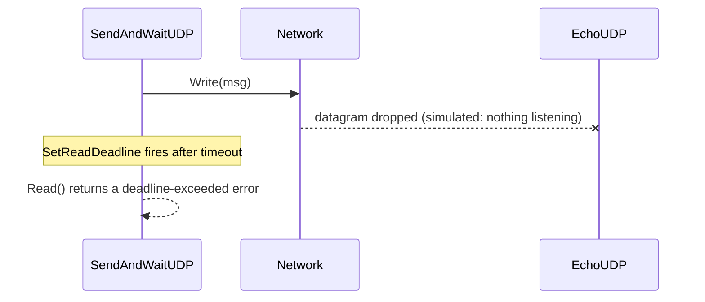
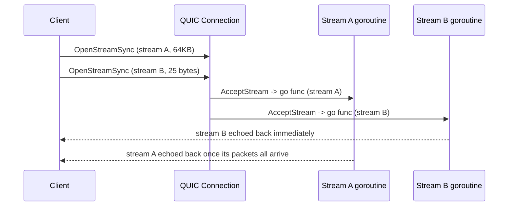

# UDP and QUIC - Go

> [!summary] TL;DR
> This code demonstrates the two transports side by side: a plain UDP echo exchange that times out silently on loss, and a QUIC connection carrying two independent streams over loopback, proving that a large, slow stream never blocks a small, fast one. See the theory in [[UDP and QUIC]].

> [!info] How to read this note (pick your level)
> - 🟢 **New to this?** Read the "From zero" paragraph below, then "Before the code", "What this code shows" and Setup. Stop there.
> - 🟡 **Know the basics?** Read the Code and Tests sections top to bottom; each block has a plain-words opener first.
> - 🔴 **Interview / SDE-3 prep?** Add Design decisions, Pitfalls and the Exercises. Headings are tagged 🟢🟡🔴 so you always know where you are.

**From zero** 🟢 — This file is the hands-on twin of [[UDP and QUIC]]. It shows, in runnable Go, the two ideas from the theory note: first a plain UDP client that sends a packet and only learns about failure by waiting and giving up (no error ever comes back), then a QUIC server where two downloads share one connection but a big slow one never delays a tiny fast one. Read each "In plain words" line before its code block, and you can follow along without knowing Go deeply.

## Before the code 🟢

- **`net.UDPConn`**: the standard library's UDP socket; `ReadFromUDP` / `WriteToUDP` send and receive single datagrams.
- **Deadlines (`SetReadDeadline`)**: make a blocking read give up after a time limit; the only way a UDP client learns a reply is missing.
- **Goroutines**: lightweight threads; the QUIC server runs one per stream so streams never wait on each other.
- **`context.Context`**: carries a timeout so `Accept`, `Dial` and stream calls stop instead of hanging.
- **`sync.WaitGroup`**: lets the test wait until all goroutines finish.
- **Run it:** the commands in Setup below (`go vet ./...` and `go test -race ./...`); needs the `quic-go` module.

## What this code shows 🟢

| Code | Theory concept | Theory section |
| --- | --- | --- |
| `EchoUDP`, `SendAndWaitUDP` | A datagram with no connection, no delivery guarantee, only a client-side timeout | [[UDP and QUIC#UDP a datagram nothing more]] |
| `TestUDPNoReplyTimesOut` | UDP gives no "connection refused" the way TCP's RST does — silence is the only signal | [[UDP and QUIC#UDP a datagram nothing more]] |
| `selfSignedTLSConfig`, `Dial` | QUIC has no cleartext mode: TLS 1.3 is structural, not optional | [[UDP and QUIC#QUICs handshake TLS 13 isnt bolted on its structural]] |
| `RunQUICEchoServer`, `OpenStreamAndEcho` | Independent streams on one connection, each served in its own goroutine | [[UDP and QUIC#QUIC reliable streams multiplexed over UDP]] |
| `TestQUICStreamsAreIndependent` | A 64 KB stream never blocks a 25-byte stream on the same connection | [[UDP and QUIC#QUIC reliable streams multiplexed over UDP]] |

## Setup 🟢

- **Module layout:** a single package, `udpquic`, with `udp.go`, `quic.go` and `udpquic_test.go` in one directory.
- **Go version:** 1.24.
- **Dependencies:** `github.com/quic-go/quic-go` v0.48.2 for the QUIC half; the UDP half is standard library only (`net`).
- **Run it:**

```text
go mod init udpquic
go get github.com/quic-go/quic-go@v0.48.2
go vet ./...
go test -race ./...
```

## Code 🟡

### UDP: echo and a timing-out client

**In plain words:** two tiny functions — a server that bounces back whatever one packet it gets, and a client that sends one packet and waits. If no reply comes, the client's only clue is its own stopwatch running out.

```go
package udpquic

import (
	"net"
	"time"
)

// EchoUDP reads one datagram and sends the same bytes back to whoever sent
// it. Unlike TCP there is no Accept: every packet carries its sender's
// address, and the server never learns a reply didn't arrive — only a
// client-side timeout reveals that.
func EchoUDP(conn *net.UDPConn) error {
	buf := make([]byte, 1500) // a conservative Ethernet-safe datagram size
	n, addr, err := conn.ReadFromUDP(buf)
	if err != nil {
		return err
	}
	_, err = conn.WriteToUDP(buf[:n], addr)
	return err
}
```

**Concept.** This is the UDP side of [[UDP and QUIC#UDP a datagram nothing more]]: a server that never calls `Accept`, because UDP has no concept of an accepted connection.

The alternative design — a connected `UDPConn` per client, the way TCP servers work — doesn't exist for UDP at the protocol level; `ReadFromUDP` returning the sender's address on every call *is* the mechanism UDP servers use instead.

**How it works.**
1. `buf` is sized to 1500 bytes, a conservative bound that fits inside a standard Ethernet frame's MTU without IP fragmentation — a UDP datagram bigger than the path MTU risks being silently fragmented or dropped.
2. `ReadFromUDP` blocks until a datagram arrives, and hands back both the payload and the sender's address in one call — there is no prior "connection" that already knows who's talking.
3. `WriteToUDP` replies directly to that address. If this call fails, the caller only learns about it as a local error; the original sender gets no signal at all if the reply is lost in the network.

```go
// SendAndWaitUDP sends msg to addr and waits up to timeout for a reply.
func SendAndWaitUDP(addr string, msg []byte, timeout time.Duration) ([]byte, error) {
	raddr, err := net.ResolveUDPAddr("udp", addr)
	if err != nil {
		return nil, err
	}
	conn, err := net.DialUDP("udp", nil, raddr)
	if err != nil {
		return nil, err
	}
	defer conn.Close()

	if _, err := conn.Write(msg); err != nil {
		return nil, err
	}
	conn.SetReadDeadline(time.Now().Add(timeout))
	buf := make([]byte, 1500)
	n, err := conn.Read(buf)
	if err != nil {
		return nil, err
	}
	return buf[:n], nil
}
```

**Concept.** This implements the client side of [[UDP and QUIC#UDP a datagram nothing more]]'s central claim: there is no way to distinguish "the server is down" from "my reply got lost in transit" except by timing out.

An alternative design using `net.ListenUDP` directly (instead of `DialUDP`) was rejected because `DialUDP` filters incoming datagrams to only those from `raddr`, which is the correct behavior for a client expecting one specific peer's reply and avoids accidentally processing an unrelated datagram from a different source on the same local port.

**How it works.**
1. `net.DialUDP` with a non-nil remote address does not send anything on the wire — it only remembers `raddr` locally so later `Read`/`Write` calls don't need to repeat it. This is the detail the theory note's "common mistake" callout warns about.
2. `SetReadDeadline` is what actually produces the timeout behavior: without it, `Read` would block forever if the reply never arrives, since UDP gives no asynchronous notification of loss.
3. The error returned by `Read` after the deadline passes is the *only* signal this function ever gets that something went wrong — it is indistinguishable from "the server doesn't exist" at this layer.



### QUIC: a self-signed TLS config and an echo server with independent streams

**In plain words:** QUIC refuses to run without encryption, so the demo first makes a throwaway certificate in memory. Then the server gives every incoming stream its own worker, so no stream ever queues behind another — that is the whole head-of-line-blocking fix, in code.

```go
package udpquic

import (
	"context"
	"crypto/rand"
	"crypto/rsa"
	"crypto/tls"
	"crypto/x509"
	"encoding/pem"
	"io"
	"math/big"
	"time"

	"github.com/quic-go/quic-go"
)
```

The rest of this file's functions all live in this same `quic.go` file and share this one import block.

```go
// selfSignedTLSConfig builds an in-memory TLS 1.3 certificate so the demo
// needs no files on disk. QUIC always carries TLS 1.3 inside it; there is
// no cleartext QUIC, unlike plain TCP.
func selfSignedTLSConfig() (*tls.Config, error) {
	key, err := rsa.GenerateKey(rand.Reader, 2048)
	if err != nil {
		return nil, err
	}
	tmpl := &x509.Certificate{SerialNumber: big.NewInt(1)}
	der, err := x509.CreateCertificate(rand.Reader, tmpl, tmpl, &key.PublicKey, key)
	if err != nil {
		return nil, err
	}
	certPEM := pem.EncodeToMemory(&pem.Block{Type: "CERTIFICATE", Bytes: der})
	keyPEM := pem.EncodeToMemory(&pem.Block{Type: "RSA PRIVATE KEY", Bytes: x509.MarshalPKCS1PrivateKey(key)})
	cert, err := tls.X509KeyPair(certPEM, keyPEM)
	if err != nil {
		return nil, err
	}
	return &tls.Config{Certificates: []tls.Certificate{cert}, NextProtos: []string{"demo-echo"}}, nil
}
```

**Concept.** This builds the certificate [[UDP and QUIC#QUICs handshake TLS 13 isnt bolted on its structural]] refers to: QUIC's spec has no cleartext mode, so even a loopback demo needs a real (if self-signed) TLS 1.3 certificate to exist before a connection can be dialed.

The alternative — writing cert/key files to disk — was rejected for a test module, since generating them in memory keeps the test hermetic and avoids leaving artifacts around.

**How it works.**
1. A fresh 2048-bit RSA key and a minimal self-signed certificate template are generated purely in memory; no certificate authority is involved, which is why the client side below must explicitly opt out of chain verification.
2. `NextProtos: []string{"demo-echo"}` sets the ALPN protocol identifier QUIC negotiates during its TLS handshake — this is the same mechanism that lets a real QUIC connection negotiate `h3` for HTTP/3.

```go
// RunQUICEchoServer accepts one connection and, independently on every
// stream the client opens, echoes back whatever it reads on that stream.
// Each stream is served in its own goroutine, so one slow or lost stream
// never blocks the others: this is QUIC's fix for TCP head-of-line blocking.
func RunQUICEchoServer(ctx context.Context, ln *quic.Listener) error {
	conn, err := ln.Accept(ctx)
	if err != nil {
		return err
	}
	for {
		stream, err := conn.AcceptStream(ctx)
		if err != nil {
			return nil // connection closed: normal end of the demo
		}
		go func(s quic.Stream) {
			defer s.Close()
			io.Copy(s, s)
		}(stream)
	}
}
```

**Concept.** This is the direct implementation of [[UDP and QUIC#QUIC reliable streams multiplexed over UDP]]: one goroutine per stream means a slow stream's blocking `io.Copy` never stalls any other stream's goroutine.

An alternative design — one shared loop reading all streams round-robin — was rejected because it would reintroduce exactly the head-of-line blocking QUIC is meant to avoid, just moved into application code instead of the transport.

**How it works.**
1. `ln.Accept(ctx)` completes the QUIC handshake and returns a single logical connection; everything after this point operates on streams within that one connection, not new connections.
2. `conn.AcceptStream(ctx)` blocks until the client opens a new stream; returning an error here (rather than panicking) is how the loop detects a closed connection and exits cleanly.
3. Each stream is handed to its own goroutine immediately, so `AcceptStream` can return to wait for the *next* stream without being blocked by the current one's `io.Copy`.

```go
// OpenStreamAndEcho opens a new independent stream on conn, writes msg,
// half-closes the write side so the server sees EOF, and reads the echo.
func OpenStreamAndEcho(ctx context.Context, conn quic.Connection, msg []byte) ([]byte, error) {
	stream, err := conn.OpenStreamSync(ctx)
	if err != nil {
		return nil, err
	}
	if _, err := stream.Write(msg); err != nil {
		return nil, err
	}
	stream.Close() // half-close: "I'm done sending on this stream"

	buf := make([]byte, len(msg))
	if _, err := io.ReadFull(stream, buf); err != nil {
		return nil, err
	}
	return buf, nil
}
```

**Concept.** This is the client-side half of the same exchange: opening a stream is independent per call, so two goroutines calling `OpenStreamAndEcho` concurrently on the same `conn` get two genuinely separate streams, never sharing sequence state.

**How it works.**

`stream.Close()` half-closes only the write direction — "I'm done sending" — which is what lets `io.Copy` on the server see EOF and finish, without needing to close the whole connection.

`io.ReadFull` then blocks until exactly `len(msg)` bytes have come back, which is safe here because the server always echoes exactly what it received.



### Wiring the listener and dialer

**In plain words:** the glue — one function opens a door on a random local port, the other knocks on it. The "skip verify" flag only exists because our certificate is homemade; real code never uses it.

```go
// Listen starts a QUIC listener on a loopback UDP port with the demo's
// self-signed TLS config.
func Listen() (*quic.Listener, error) {
	tlsConf, err := selfSignedTLSConfig()
	if err != nil {
		return nil, err
	}
	return quic.ListenAddr("127.0.0.1:0", tlsConf, &quic.Config{MaxIdleTimeout: 10 * time.Second})
}

// Dial opens a QUIC connection to addr. InsecureSkipVerify is used only
// because the demo's certificate is self-signed and unknown to any CA;
// real clients must verify the chain (see the TLS and HTTPS note).
func Dial(ctx context.Context, addr string) (quic.Connection, error) {
	tlsConf := &tls.Config{InsecureSkipVerify: true, NextProtos: []string{"demo-echo"}}
	return quic.DialAddr(ctx, addr, tlsConf, nil)
}
```

**Concept.** `InsecureSkipVerify` exists only because this demo's certificate has no CA behind it; see [[TLS and HTTPS]] for why a real client must never do this in production. `127.0.0.1:0` asks the OS to pick a free loopback port, keeping the test independent of any fixed port being available.

**How it works.**
1. `quic.ListenAddr` performs the UDP bind and returns a listener that will complete the QUIC + TLS 1.3 handshake on `Accept`.
2. `MaxIdleTimeout` bounds how long the listener waits on an idle connection before giving up — a safety net so a test can never hang forever if a client disappears mid-test.
3. `quic.DialAddr` on the client side performs the 1-RTT handshake described in the theory note before returning a usable `quic.Connection`.

> [!example]- Full file
> ```go
> package udpquic
>
> import (
> 	"net"
> 	"time"
> )
>
> // EchoUDP reads one datagram and sends the same bytes back to whoever sent
> // it. Unlike TCP there is no Accept: every packet carries its sender's
> // address, and the server never learns a reply didn't arrive — only a
> // client-side timeout reveals that.
> func EchoUDP(conn *net.UDPConn) error {
> 	buf := make([]byte, 1500) // a conservative Ethernet-safe datagram size
> 	n, addr, err := conn.ReadFromUDP(buf)
> 	if err != nil {
> 		return err
> 	}
> 	_, err = conn.WriteToUDP(buf[:n], addr)
> 	return err
> }
>
> // SendAndWaitUDP sends msg to addr and waits up to timeout for a reply.
> func SendAndWaitUDP(addr string, msg []byte, timeout time.Duration) ([]byte, error) {
> 	raddr, err := net.ResolveUDPAddr("udp", addr)
> 	if err != nil {
> 		return nil, err
> 	}
> 	conn, err := net.DialUDP("udp", nil, raddr)
> 	if err != nil {
> 		return nil, err
> 	}
> 	defer conn.Close()
>
> 	if _, err := conn.Write(msg); err != nil {
> 		return nil, err
> 	}
> 	conn.SetReadDeadline(time.Now().Add(timeout))
> 	buf := make([]byte, 1500)
> 	n, err := conn.Read(buf)
> 	if err != nil {
> 		return nil, err
> 	}
> 	return buf[:n], nil
> }
> ```
>
> ```go
> package udpquic
>
> import (
> 	"context"
> 	"crypto/rand"
> 	"crypto/rsa"
> 	"crypto/tls"
> 	"crypto/x509"
> 	"encoding/pem"
> 	"io"
> 	"math/big"
> 	"time"
>
> 	"github.com/quic-go/quic-go"
> )
>
> func selfSignedTLSConfig() (*tls.Config, error) {
> 	key, err := rsa.GenerateKey(rand.Reader, 2048)
> 	if err != nil {
> 		return nil, err
> 	}
> 	tmpl := &x509.Certificate{SerialNumber: big.NewInt(1)}
> 	der, err := x509.CreateCertificate(rand.Reader, tmpl, tmpl, &key.PublicKey, key)
> 	if err != nil {
> 		return nil, err
> 	}
> 	certPEM := pem.EncodeToMemory(&pem.Block{Type: "CERTIFICATE", Bytes: der})
> 	keyPEM := pem.EncodeToMemory(&pem.Block{Type: "RSA PRIVATE KEY", Bytes: x509.MarshalPKCS1PrivateKey(key)})
> 	cert, err := tls.X509KeyPair(certPEM, keyPEM)
> 	if err != nil {
> 		return nil, err
> 	}
> 	return &tls.Config{Certificates: []tls.Certificate{cert}, NextProtos: []string{"demo-echo"}}, nil
> }
>
> func RunQUICEchoServer(ctx context.Context, ln *quic.Listener) error {
> 	conn, err := ln.Accept(ctx)
> 	if err != nil {
> 		return err
> 	}
> 	for {
> 		stream, err := conn.AcceptStream(ctx)
> 		if err != nil {
> 			return nil // connection closed: normal end of the demo
> 		}
> 		go func(s quic.Stream) {
> 			defer s.Close()
> 			io.Copy(s, s)
> 		}(stream)
> 	}
> }
>
> func OpenStreamAndEcho(ctx context.Context, conn quic.Connection, msg []byte) ([]byte, error) {
> 	stream, err := conn.OpenStreamSync(ctx)
> 	if err != nil {
> 		return nil, err
> 	}
> 	if _, err := stream.Write(msg); err != nil {
> 		return nil, err
> 	}
> 	stream.Close() // half-close: "I'm done sending on this stream"
>
> 	buf := make([]byte, len(msg))
> 	if _, err := io.ReadFull(stream, buf); err != nil {
> 		return nil, err
> 	}
> 	return buf, nil
> }
>
> func Listen() (*quic.Listener, error) {
> 	tlsConf, err := selfSignedTLSConfig()
> 	if err != nil {
> 		return nil, err
> 	}
> 	return quic.ListenAddr("127.0.0.1:0", tlsConf, &quic.Config{MaxIdleTimeout: 10 * time.Second})
> }
>
> func Dial(ctx context.Context, addr string) (quic.Connection, error) {
> 	tlsConf := &tls.Config{InsecureSkipVerify: true, NextProtos: []string{"demo-echo"}}
> 	return quic.DialAddr(ctx, addr, tlsConf, nil)
> }
> ```

## Design decisions 🔴

| Choice | Alternative | Trade-off |
| --- | --- | --- |
| One goroutine per accepted stream | A single loop reading streams round-robin | Round-robin would reintroduce head-of-line blocking in application code, defeating the point of the demo |
| In-memory self-signed certificate | Certificate files on disk | Keeps the test module hermetic and leaves nothing behind; a production server would use a real CA-issued certificate instead |
| `DialUDP` (connected) for the UDP client | `ListenUDP` and filter manually | `DialUDP` filters incoming datagrams by source address for free, avoiding a stray datagram from an unrelated source being misread as the reply |
| `SetReadDeadline` for the UDP timeout | No deadline, rely on an external context cancellation | A deadline on the socket itself is simpler and doesn't need a second goroutine racing the read |

## Tests 🟡

### TestUDPNoReplyTimesOut

**Property proved:** when nothing is listening on a UDP port, the client gets no immediate error (no "connection refused" the way a TCP `SYN` to a closed port would produce) — only a timeout, eventually, reveals the problem.

| Input | Expected output |
| --- | --- |
| `SendAndWaitUDP` to a freshly closed port, 300 ms timeout | an error, specifically a deadline-exceeded read error |

A failure here (no error returned) would mean the test's assumption is wrong somewhere — for instance if something else were still listening on that address — and would silently undermine the theory note's central claim that UDP gives no synchronous failure signal.

```go
func TestUDPNoReplyTimesOut(t *testing.T) {
	// Nothing is listening on this port: UDP gives no connection-refused
	// signal the way a client expects a TCP RST; the request just never
	// gets a reply, and the caller must time out on its own.
	laddr, _ := net.ResolveUDPAddr("udp", "127.0.0.1:0")
	probe, _ := net.ListenUDP("udp", laddr)
	addr := probe.LocalAddr().String()
	probe.Close() // free the port; nothing will answer on it now

	_, err := SendAndWaitUDP(addr, []byte("ping"), 300*time.Millisecond)
	if err == nil {
		t.Fatalf("expected a timeout, got a reply")
	}
}
```

### TestQUICStreamsAreIndependent

**Property proved:** a 64 KB stream and a 25-byte stream on the same QUIC connection both complete correctly, and the large one's extra packets never block the small one's delivery — the direct proof of the theory note's head-of-line-blocking fix.

| Input | Expected output |
| --- | --- |
| Stream A: 64 KB payload; Stream B: `"small, independent stream"` (25 bytes), opened concurrently on one connection | Stream A echoes back exactly 65536 bytes; Stream B echoes back the exact original string |

A failure here (wrong byte count, or a hang) would mean either the server's per-stream goroutines aren't actually independent, or the half-close/EOF signaling between client and server is broken — either way, the core claim "one stream's size never affects another's delivery" would be false.

```go
func TestQUICStreamsAreIndependent(t *testing.T) {
	ln, err := Listen()
	if err != nil {
		t.Fatalf("Listen: %v", err)
	}
	defer ln.Close()
	ctx, cancel := context.WithTimeout(context.Background(), 5*time.Second)
	defer cancel()

	var wg sync.WaitGroup
	wg.Add(1)
	go func() { defer wg.Done(); RunQUICEchoServer(ctx, ln) }()

	conn, err := Dial(ctx, ln.Addr().String())
	if err != nil {
		t.Fatalf("Dial: %v", err)
	}
	defer conn.CloseWithError(0, "done")
```

Once both streams are open, the test waits for both echoes and checks each one independently:

```go
	// Two streams on the same connection; one carries a much larger
	// payload. Both complete: a "slow" stream never blocks the other.
	var slowReply, fastReply []byte
	var inner sync.WaitGroup
	inner.Add(2)
	go func() {
		defer inner.Done()
		slowReply, _ = OpenStreamAndEcho(ctx, conn, make([]byte, 64*1024))
	}()
	go func() {
		defer inner.Done()
		fastReply, _ = OpenStreamAndEcho(ctx, conn, []byte("small, independent stream"))
	}()
	inner.Wait()

	if len(slowReply) != 64*1024 {
		t.Fatalf("slow stream echoed %d bytes, want 65536", len(slowReply))
	}
	if string(fastReply) != "small, independent stream" {
		t.Fatalf("fast stream = %q", fastReply)
	}

	conn.CloseWithError(0, "test done")
	wg.Wait()
}
```

**Measured** on this machine (Go 1.24.4, darwin/arm64, `github.com/quic-go/quic-go` v0.48.2, loopback, `go test -race`, 2026-11-06):

```text
=== RUN   TestUDPNoReplyTimesOut
--- PASS: TestUDPNoReplyTimesOut (0.30s)
=== RUN   TestQUICStreamsAreIndependent
--- PASS: TestQUICStreamsAreIndependent (0.46s)
PASS
ok  	udpquic	1.950s
```

## Pitfalls in the code 🔴

- **Forgetting `SetReadDeadline` on the UDP client** would make `Read` block forever on a lost reply, since UDP never delivers an asynchronous "this failed" notification the way TCP's RST does.
- **Reusing a 1500-byte buffer across concurrent calls without per-call allocation** would be a data race if the same `EchoUDP` connection were ever read from two goroutines at once; this code sidesteps it by allocating a fresh buffer per call.
- **Closing the whole QUIC connection instead of one stream** when only one logical exchange is done would tear down every other in-flight stream too — `stream.Close()` (half-close on one stream) versus `conn.CloseWithError` (the whole connection) are not interchangeable.
- **Skipping certificate verification (`InsecureSkipVerify: true`) outside a test** is a pitfall specific to this demo: it exists solely because the certificate is self-signed, and must never be copied into production code — see [[TLS and HTTPS]].

## Exercises 🔴

1. Modify `TestQUICStreamsAreIndependent` to introduce an artificial delay in the server's handling of stream A only (for example, `time.Sleep` before the `io.Copy` for the first stream accepted). Predict whether stream B's goroutine still completes quickly, then run it and confirm.
2. Change `EchoUDP` so it returns an error when `conn.ReadFromUDP` succeeds but the datagram is empty (`n == 0`), and write a test that sends a zero-length UDP datagram to prove the new error path is reached. Predict first whether a zero-length UDP datagram is even distinguishable from "no datagram at all" at this layer.
3. Lower `quic.Config{MaxIdleTimeout}` to 500ms and add a test that opens a connection, waits 1 second without sending anything, and then tries `OpenStreamSync` again. Predict what error you'll get, and connect it back to [[UDP and QUIC#Connection migration surviving a change of address mid-connection]]'s discussion of path validation failing — are these the same failure mode or different ones?

## Links

- **Theory:** [[UDP and QUIC]]
- **Related:** [[HTTP-1.1 vs HTTP-2 vs HTTP-3]], [[TLS and HTTPS]]
