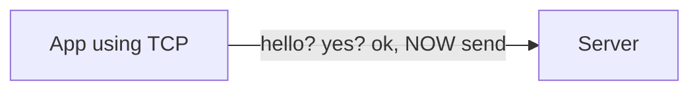
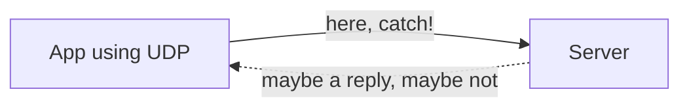
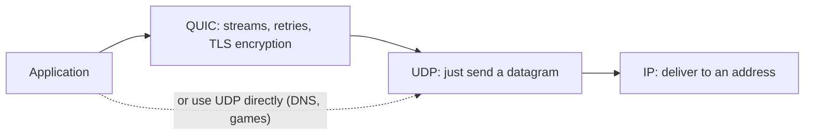
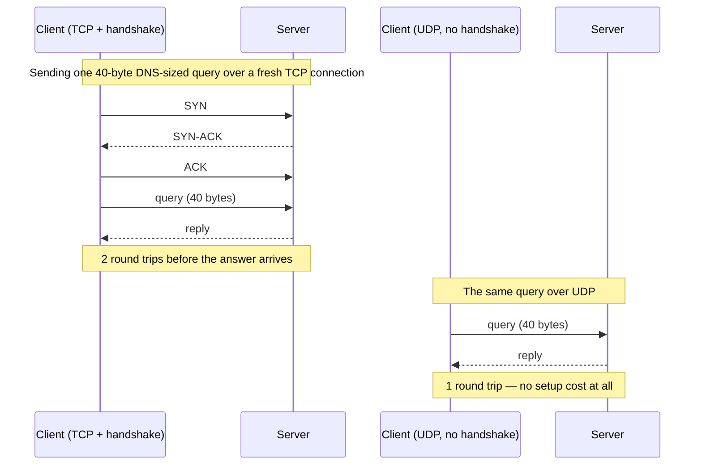
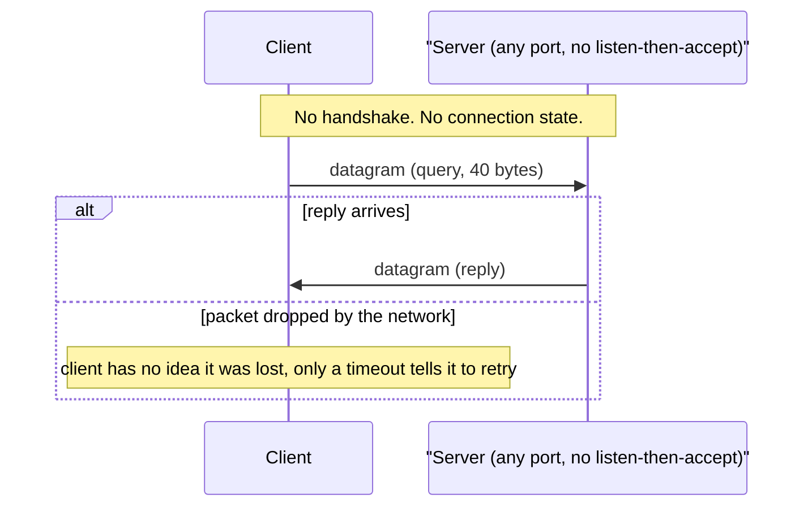
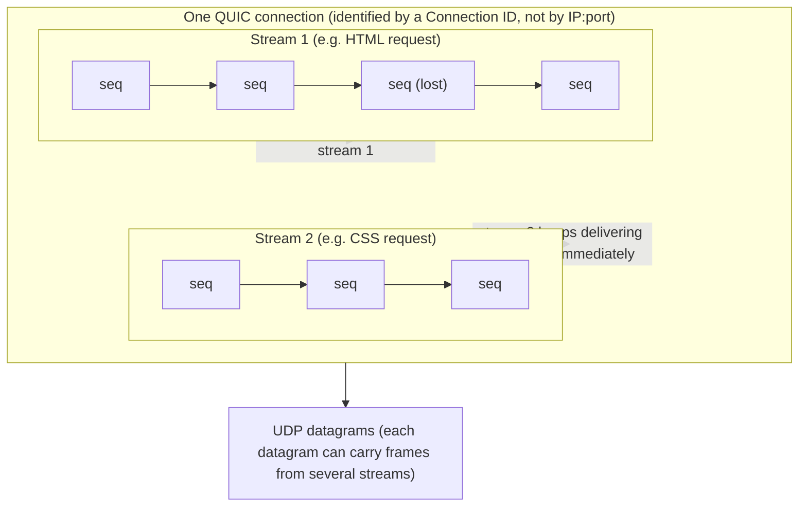
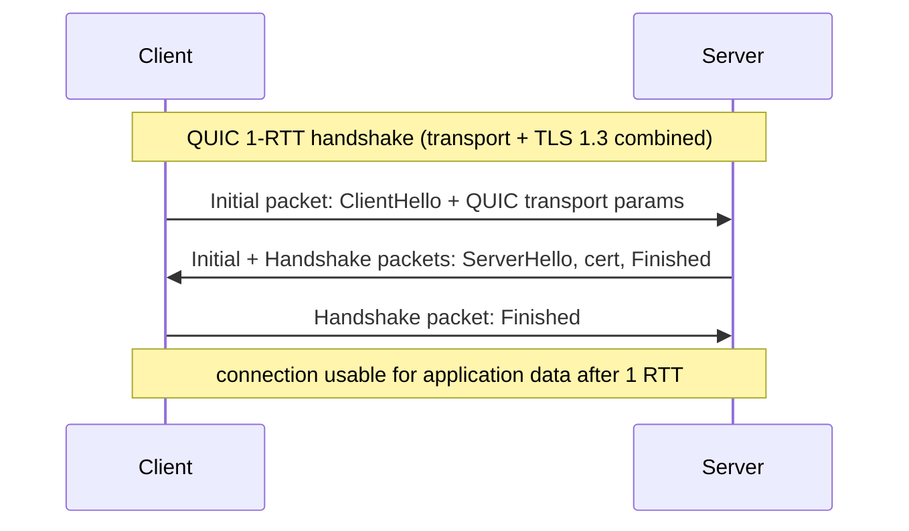
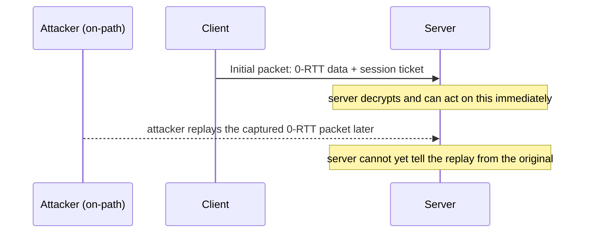
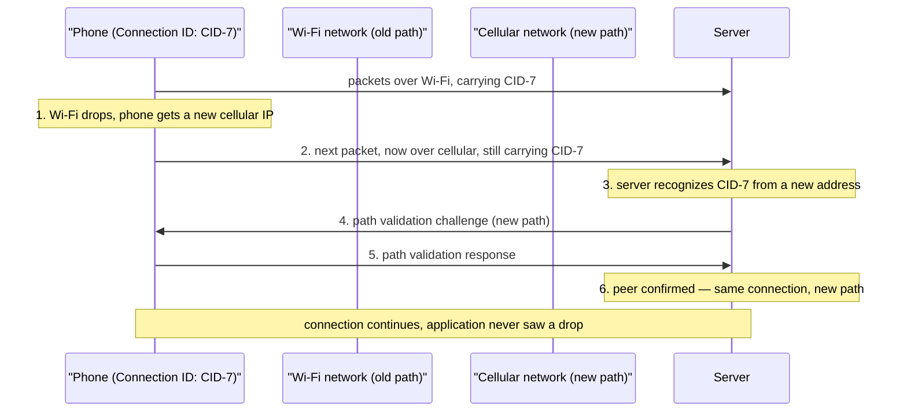
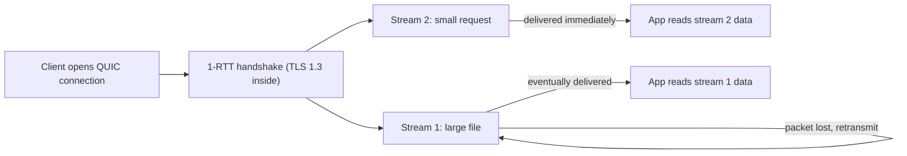

# UDP and QUIC

> [!summary] TL;DR
> UDP sends a single datagram with no connection, no ordering, and no delivery guarantee — the application gets whatever showed up, or nothing. QUIC builds a modern, reliable, encrypted, multi-stream transport on top of UDP, giving most of what TCP gives except head-of-line blocking across streams, while adding things TCP can't do, like surviving a client's IP address changing mid-connection.

> [!abstract] Core idea
> - UDP is TCP with everything taken out: no handshake, no ordering, no retransmission, no congestion control. The application gets datagrams as they arrive, or not at all.
> - QUIC reimplements TCP's reliability and congestion control, but does it per-stream and in userspace, over UDP, with TLS 1.3 baked in from the first packet.
> - Because QUIC's streams are independent, one dropped packet only stalls the one stream it belonged to — not the whole connection, unlike HTTP/2 over TCP.
> - Classic mistake: assuming QUIC is "unreliable like UDP." QUIC is reliable and ordered per stream; only the *transport it rides on* (UDP) is unreliable.

## Start here: the basics 🟢

> [!info] How to read this note (pick your level)
> - 🟢 **New to this?** Read "From zero" below, then sections 1, 2 and the cheat sheet (10). Stop there, that is a full first pass.
> - 🟡 **Know the basics?** Add section 3 (how QUIC works), 4 (worked example) and 5-6.
> - 🔴 **Interview / SDE-3 prep?** Add 7, 8 and 9. Headings are tagged 🟢🟡🔴 so you always know where you are.

**From zero, in 60 seconds** 🟢

Apps on the internet send data in small chunks called **packets**.
Most apps use TCP, which sets up a careful two-way conversation first and resends anything that gets lost.
That care costs time.



**UDP** skips all of that. It just throws one packet at the address and hopes. No setup, no resend, no promises. Great for tiny or time-critical things like a DNS lookup or a game move.



**QUIC** is the modern middle path: it is built on top of UDP but adds back the safety (resends, order, encryption), and does it smarter than TCP — each download inside the connection is its own lane, so one lost packet only stalls its own lane.

That is it. The rest of this note is just these 3 questions:
1. When is "send and hope" (UDP) actually the right choice?
2. How does QUIC add reliability back without TCP's slowdowns?
3. What new tricks does QUIC get that TCP cannot do (like surviving a Wi-Fi-to-cellular switch)?


**The problem in one story.** You ask a friend a one-word question across a noisy room.
Shaking hands first, then asking, then waiting for "got it" would be silly; you just shout.
If they don't hear, you shout again. That is UDP.
But if you are sending a whole book, you want page numbers and "resend page 7", without stopping the other chapters. That is QUIC.

**Words you need first**

| Word | Plain meaning | Tiny example |
| --- | --- | --- |
| Packet / datagram | One small chunk of data sent on the network by itself | A 40-byte DNS question |
| Port | A number that picks which program on a machine gets the data | DNS uses port 53 |
| Handshake | Setup messages exchanged before real data moves | TCP's SYN, SYN-ACK, ACK |
| Round trip (RTT) | Time for a message to go there and a reply to come back | 50 ms on a phone network |
| Retransmission | Sending a lost piece of data again | Resending page 7 of the book |
| Head-of-line blocking | One missing piece makes everything behind it wait | One lost packet stalls all HTTP/2 streams on TCP |
| Stream | One ordered, reliable flow of bytes inside a connection | The HTML download in a page load |
| TLS | The encryption layer that makes HTTPS secure | The lock icon in a browser |

**Picture it**



**Analogy.** UDP is a postcard: cheap, fast, no proof it arrived. QUIC is several tracked parcels sharing one courier van, each tracked on its own.
Where it breaks: a real courier can't keep your parcel's identity when you move house mid-delivery; QUIC's Connection ID can.

**How the rest of this note builds up**

- First, why UDP and QUIC exist (section 1) and a mental model (section 2).
- Then how UDP works, and how QUIC adds streams, a 1-RTT handshake, 0-RTT and connection migration (section 3).
- Then a traced example and a comparison table (sections 4-5).
- Finally trade-offs, production failure modes and the SDE-3 deep dive on packet numbers and loss recovery (sections 6-8).

> [!tip] Remember
> UDP = send and hope. QUIC = reliable, encrypted, independent streams built on top of UDP.

## 1. Why it exists 🟢

Every guarantee TCP gives costs a round trip or a byte of bookkeeping somewhere.

- A 3-way handshake has to finish before any data moves.
- In-order delivery means one lost packet stalls everything behind it, even data the application could otherwise use right away.
- Congestion control is tuned for a general-purpose byte stream, not for a single small message.

Some applications don't want to pay any of that. Picture two very different jobs:

- A **DNS query** sends one small request and gets one small reply. Paying for a handshake to move 40 bytes would double the cost of every single lookup, for a protocol that runs millions of times a second across the internet.
- A **live video frame or a game position update** is time-sensitive and loss-tolerant. A frame that arrives late is worse than a frame that never arrives at all — retransmitting a stale packet is actively the wrong behavior, because by the time it lands, a newer frame has already made it obsolete.

Both jobs want to skip TCP's guarantees entirely, or build only the exact piece they need. That's what **UDP** (User Datagram Protocol, RFC 768 — one of the oldest RFCs still in daily use) is for: it is what's left of IP once you add only port numbers and an optional checksum. One datagram, fire and forget, no connection state anywhere.

An application that wants reliability on top can build exactly the amount it needs, which is what QUIC does — and what DNS mostly doesn't, since DNS just lives with occasional loss and retries at the resolver level, falling back to TCP only for large or sensitive responses.

**QUIC** (Quick UDP Internet Connections, RFC 9000, standardized 2021, carries HTTP/3 per RFC 9114) exists for a different reason: HTTP/2 exposed a sharp limit of building multiplexing *inside* TCP.

With many logical HTTP streams sharing one TCP connection, a single lost IP packet stalls literally all of them until it's retransmitted, because TCP's one ordered byte stream can't deliver stream 2's bytes to the application while it's still waiting on stream 1's missing segment.

QUIC moves stream multiplexing below the reliability layer instead of above it, over UDP, so one stream's loss no longer blocks the others.



> [!tip] Remember
> UDP isn't "broken TCP" — it's TCP with every optional guarantee removed, so an application that doesn't need those guarantees doesn't pay for them.

## 2. Mental model 🟢

UDP is a postcard: you write an address and a message, drop it in the mailbox, and have no idea if it arrived, arrived twice, or arrived before a postcard you sent earlier. There's no "UDP connection" to speak of — `net.DialUDP` in Go just remembers a destination address locally; it sends nothing to set that up.

QUIC is what happens if you decide postcards aren't enough, but instead of switching to TCP's single registered-mail envelope, you put several independent registered-mail threads inside one envelope, each with its own sequence numbers and its own retransmission — so a lost page in thread 2 only reprints thread 2, not the whole letter.

**Where the analogy breaks down:** real registered mail can't change delivery address mid-transit and still be recognized as the same letter.

QUIC can: a phone switching from Wi-Fi to cellular keeps the same "envelope identity" (its Connection ID) even though the return address (its IP) changed underneath it. No postal analogy captures that part cleanly — it's closer to a courier recognizing your voice on a new phone number than to anything physical mail can do.

## 3. How it works 🟡

### UDP: a datagram, nothing more

**In plain words:** a UDP sender just puts an address and a payload on the wire. There's no setup conversation first, and the receiver has no built-in way to tell the sender "got it" or "I'm ready." Every guarantee the application wants — knowing a reply didn't arrive, retrying, deduplicating a packet that showed up twice, reordering if order matters — is the application's own job.

**Picture it:**



There is no `Accept()` on the server side the way TCP has one — every incoming datagram just carries the sender's address with it, and the server can reply to any address at any time.

**Example — who actually uses it, and what each one trades away:**

| Use case | What it trades away | Why that's the right trade |
| --- | --- | --- |
| DNS | Guaranteed delivery | A lost query just times out and retries; a response over 512 bytes (without EDNS0) falls back to TCP. Latency matters more than guaranteed delivery for a single lookup. |
| Video/voice calls (RTP/WebRTC) | Retransmission | A dropped or late frame is discarded, not retransmitted — a stale frame arriving late is worse than one skipped. Congestion response is handled by the application (adaptive bitrate), not the transport. |
| Online games | Ordering of old data | The latest position update matters, not every historical one; an old retransmitted position is actively wrong information by the time it would arrive. |
| mDNS/SSDP discovery | A connection at all | Broadcast/multicast only works without a connection to begin with. |

**Why it matters:** choosing UDP is a deliberate bet that your application can tolerate loss, or that it will build only the exact reliability it needs — never an accident of "we didn't bother with TCP."

> [!warning] Common mistake
> Assuming a UDP "connection" (`net.DialUDP` in Go, or a socket that looks connected) means the other side is reachable. `DialUDP` only remembers a destination address locally; it sends nothing on the wire. The first real signal that something is wrong is a timeout, not a connection error.

> [!tip] Remember
> UDP guarantees exactly one thing: here is a datagram with a checksum, addressed to a port. Everything else — ordering, retries, dedup — is the application's problem to solve or not solve.

### QUIC: reliable streams, multiplexed, over UDP

**In plain words:** QUIC opens one connection over UDP, then lets the application open many independent **streams** inside it — think of a stream as its own mini ordered-and-reliable pipe. Each stream has its own sequence numbers and its own retransmission, so losing a packet on stream 1 never blocks stream 2 from being delivered to the application the moment it arrives.

**Picture it:**



**Example:** a browser loading a page opens one stream for the HTML, another for the main stylesheet, another for a script. If the packet carrying part of the stylesheet's stream is lost, the script's stream keeps delivering bytes to the browser the instant they arrive — it never waits on the stylesheet's retransmit, the direct fix for TCP+HTTP/2's head-of-line blocking.

**Why it matters:** this is the entire reason HTTP/3 exists. HTTP/2 already multiplexed logical streams, but on top of TCP's single ordered byte stream, so the fix had to move below TCP entirely — onto UDP.

### QUIC's handshake: TLS 1.3 isn't bolted on, it's structural

**In plain words:** instead of doing a transport handshake first and a security handshake second (what TCP + TLS does), QUIC carries the TLS 1.3 handshake messages inside its own first packets. The cryptographic handshake and the transport handshake happen in the very same round trip.

**Picture it:**



**Example:** a fresh QUIC connection reaches a usable, encrypted state in **1 round trip**. TCP + TLS 1.3 needs **2 separate round trips** — one to establish the TCP connection, a second for the TLS handshake — before the first encrypted application byte can move.

There is no such thing as unencrypted QUIC in practice; the spec has no cleartext mode for application data.

**Why it matters:** halving the handshake cost matters most on high-latency links (mobile networks), where one round trip can be 50–150 ms — a cost paid on every cold connection.

> [!tip] Remember
> QUIC's handshake is fast specifically because the transport and TLS handshakes were designed together, not because QUIC skips a security step TCP+TLS performs.

### 0-RTT resumption, and the replay risk it carries

**In plain words:** if the client has a session ticket left over from a previous connection to the same server, it can send actual application data in its very first flight — before any round trip with the server completes at all. The analogy is a regular customer who already has a loyalty card: they hand it over and start talking business immediately, instead of re-introducing themselves first.

**Picture it:**



**Example:** a client resuming a session sends a GET request for a product page as 0-RTT data.

An on-path attacker who captured that first flight can resend the exact same encrypted packet later, and the server has no way yet to distinguish the resend from the original — so **0-RTT data must be limited to operations that are safe to receive more than once**, like an idempotent GET, never something like a payment submission.

**Why it matters:** the speed gain is real, but it comes with a specific, documented security trade-off that the application layer — not QUIC itself — has to respect.

> [!warning] Common mistake
> Treating 0-RTT as "just a faster handshake with no downside." It removes a round trip, but the data it carries is replayable by anyone who captured the first flight. Attaching it to a non-idempotent action (like "charge this card") is a real vulnerability, not a theoretical one.

### Connection migration: surviving a change of address mid-connection

**In plain words:** TCP identifies a connection by its 4-tuple (source IP, source port, destination IP, destination port). Change the IP — say, a phone switching from Wi-Fi to cellular — and the 4-tuple no longer matches any open socket, so the connection dies silently from the OS's point of view.

QUIC instead identifies a connection by a **Connection ID** the endpoints chose themselves, completely independent of IP and port.

**Picture it:**



**Step by step:**
1. The phone's IP address changes when it switches networks; nothing about the QUIC connection's identity (its Connection ID) changes with it.
2. The very next packet the phone sends carries the same Connection ID, just from a new source address.
3. The server recognizes that Connection ID arriving from an address it hasn't seen before.
4. Before trusting the new path, the server runs a **path validation** handshake — a small challenge-response — to confirm the same peer (not an attacker spoofing the address) really owns that connection.
5. The phone responds correctly to the challenge.
6. The server resumes sending on the new path, and the application on the phone never saw the connection drop.

**Why it matters:** this is a genuine capability TCP structurally cannot offer, because TCP's connection identity *is* the 4-tuple — there is no equivalent "same connection, new address" concept to fall back on.

> [!question]- What happens if the path validation fails?
> The server treats it as it would any unrecognized packet — the migration attempt is rejected, and from the application's point of view the connection behaves as if it had to start over, the same outcome TCP would have had with no migration support at all.

## 4. Worked example 🟡

### Whiteboard version

**In plain words:** before the detail, here is the whole idea as one tiny picture — two downloads share one connection, one hits a pothole, the other keeps moving.

One client, one connection, two streams, drawn as the fewest boxes that still show the point:



Stream 1's loss and retransmit never stop stream 2's bytes from reaching the application right away — that's the whole mechanism in one picture.

### Tracing a QUIC exchange step by step

**In plain words:** this is a play-by-play of one real test run — think of it as watching the courier van make its deliveries, step by step.

A UDP echo exchange, and a QUIC connection carrying two independent streams over loopback, trace like this:

1. The client sends a UDP datagram carrying a small query; there is no setup step before this.
2. For the QUIC side, the client first completes the 1-RTT handshake described above — transport and TLS together.
3. The client opens **stream A** and writes a large payload (64 KB in the measured run below).
4. The client opens **stream B**, independently, and writes a small payload ("small, independent stream", 25 bytes).
5. The server echoes each stream back on its own sequence space; a loss or delay on stream A's packets never holds up stream B's echo.
6. Both replies arrive and are verified independently: stream A's reply is 64 KB, stream B's is the original 25-byte message, unchanged.

**Measured** on this machine (Go 1.24.4, darwin/arm64, `github.com/quic-go/quic-go` v0.48.2, loopback, `go test -race`, 2026-11-06): both the 64 KB stream and the 25-byte stream completed correctly inside a 5-second context, confirming that the large stream's extra packets never blocked the small stream's delivery — they're independent sequence spaces on the same connection.

Runnable Go version: [[UDP and QUIC - Go]].

## 5. Variants and comparison 🟡

| Option | How it works | Use when | Cost |
| --- | --- | --- | --- |
| Raw UDP | One send, one maybe-receive, no state | You'll build exactly the reliability you need, or need none (DNS, game state, media) | Every guarantee (ordering, retry, congestion response) is your own code |
| TCP | One ordered, reliable byte stream, OS-managed | General-purpose reliable transport; simplicity matters more than per-stream independence | Head-of-line blocking across anything multiplexed on top |
| QUIC | Many reliable, ordered streams multiplexed over UDP, TLS 1.3 built in | Modern web transport (HTTP/3), anything wanting independent streams plus connection migration | Userspace implementation costs more CPU per byte than kernel TCP; some middleboxes still rate-limit or block UDP |
| RTP/WebRTC over UDP | Application-managed loss tolerance, jitter buffers, adaptive bitrate | Real-time audio/video where late data is worse than lost data | No delivery guarantee at all; entirely the application's problem |

## 6. Trade-offs and when not to use 🟡

- QUIC moves TCP's work from the kernel (one implementation, shared, hardware-offload-friendly) into every application's userspace process, which costs more CPU per byte transferred — a real operational cost at very high throughput.
- Some corporate and ISP middleboxes still rate-limit, deprioritize, or outright block UDP traffic (historically abused for amplification DDoS attacks), which can make QUIC fall back to HTTP/2 over TCP in practice; a client must always be prepared for that fallback.
- 0-RTT's replay exposure means it's only safe for operations that are fine being executed twice — never attach it to a non-idempotent action.
- Plain UDP with no reliability layer at all is the wrong choice the moment "is this delivered, in order, at least once" starts to matter even a little — at that point you're reimplementing a worse version of QUIC or TCP from scratch.

> [!tip] Remember
> Every trade-off here is the same shape: QUIC trades kernel-shared CPU efficiency and universal middlebox support for flexibility, speed, and per-stream independence.

## 7. In production 🔴

- **Real systems:** HTTP/3 (QUIC) is served by Google, Cloudflare, Facebook/Meta, and most major CDNs as the default negotiated protocol for supporting browsers (see [[HTTP-1.1 vs HTTP-2 vs HTTP-3]]); DNS runs over UDP/53 by default with TCP fallback for large or truncated responses; WebRTC (video calls) and most multiplayer game networking run their own protocols over UDP.
- **Failure modes → fixes:**
	- UDP blocked or heavily rate-limited by a network → clients must detect the failure and fall back to TCP (HTTP/3 clients retry over HTTP/2 automatically; this is why "QUIC is the default" still needs a working TCP fallback path).
	- 0-RTT replay of a non-idempotent request → restrict 0-RTT to explicitly idempotent request types at the application layer, not just at the transport.
	- A QUIC connection's migration path validation fails (a NAT or firewall doesn't let the new path's probe through) → the connection falls back to treating it as a new connection, same as TCP would have.
- **What to monitor:** UDP packet loss and retransmit rate per stream, 0-RTT accept/reject counts, connection migration events and their success rate, and the fallback rate from HTTP/3 to HTTP/2 (a rising fallback rate usually means a network path is newly blocking UDP).

## 8. Deep dive 🔴

- **Why QUIC can't just be "TCP but faster."** TCP's state machine, congestion control and retransmission all live in kernel code that changes on OS-release timescales. QUIC deliberately lives in userspace specifically so it can evolve as fast as application code ships — a new congestion controller or a bug fix deploys with the next binary release, not the next OS kernel update across billions of devices.
- **Packet numbers vs TCP sequence numbers.** TCP sequence numbers describe bytes in the stream, so a retransmission reuses the *same* sequence number as the original — which creates the "retransmission ambiguity problem": an ACK for that sequence number can't tell the sender whether it acknowledges the original or the retransmit, which matters for RTT estimation.

  QUIC gives every packet, including every retransmission, a strictly increasing packet number, so an ACK for packet number N is unambiguous about exactly which transmission attempt it covers — cleaner RTT samples, among other benefits.

  ```mermaid
  flowchart LR
      subgraph tcp["TCP: same sequence number reused on retransmit"]
          direction LR
          t1["seq=1000 (original, lost)"] -.->|"timeout, retransmit"| t2["seq=1000 (retransmit)"]
          t2 --> t3["ACK for seq=1000 — original or retransmit? ambiguous"]
      end
      subgraph quic["QUIC: every attempt gets a new packet number"]
          direction LR
          q1["pkt #42 (original, lost)"] -.->|"timeout, retransmit"| q2["pkt #58 (retransmit, same data)"]
          q2 --> q3["ACK for pkt #58 — unambiguously the retransmit"]
      end
  ```

  **Why it matters:** this ambiguity is the reason TCP's RTT estimation has historically needed extra heuristics (Karn's algorithm) to avoid being fooled by a retransmitted segment's ACK; QUIC's design removes the ambiguity at the packet-numbering level instead of patching around it.
- **Loss recovery and congestion control** are reimplemented inside QUIC itself (not reused from the OS's TCP stack) using these packet-number-based ACKs and a pluggable congestion controller — most implementations ship a CUBIC- or BBR-like algorithm, same ideas as [[TCP - Handshake, Reliability, Flow and Congestion Control]], just running in userspace per connection instead of in the kernel per socket.
- **Multipath potential.** Because a QUIC connection is identified by a Connection ID rather than a 4-tuple, and path validation is already part of the spec for migration, QUIC is a more natural base than TCP for using multiple network paths (Wi-Fi and cellular at once) simultaneously, not just migrating between them — an active area of extension work, not yet universal.
- **Why DNS mostly stays on UDP instead of moving to QUIC.** DNS-over-QUIC (DoQ, RFC 9250) exists and gives DNS privacy plus QUIC's fast resumption, but plain UDP DNS remains dominant because a typical query/response round trip is already one datagram each way — there's very little head-of-line blocking to fix when there's only one "stream" per query to begin with.

  QUIC earns its keep most clearly when many logical exchanges share one connection, which is HTTP's situation, not a single DNS lookup's.

## 9. Interview questions 🔴

> [!question]- What exactly does UDP guarantee, and what does it not?
> It guarantees almost nothing beyond "here is a datagram with a checksum, addressed to this port." No connection setup, no ordering between datagrams, no retransmission of a lost one, and no notification to the sender that it was lost. Any of that must be built by the application.

> [!question]- How does QUIC fix TCP's head-of-line blocking without giving up reliability?
> By multiplexing streams *below* the reliability layer instead of above it: each stream has its own sequence space and its own retransmission, so a lost packet only stalls the one stream whose data it carried. TCP can't do this because it has exactly one ordered byte stream for the whole connection — HTTP/2's streams are a logical layer on top of that single stream, so they all wait on the same gap.

> [!question]- Why is QUIC's handshake 1-RTT when TCP+TLS 1.3 needs 2?
> Because QUIC's transport handshake and its TLS 1.3 handshake are the same handshake — TLS messages ride inside QUIC's own Initial and Handshake packet types from the first flight, instead of TLS waiting for a separate TCP handshake to finish first. TCP+TLS pays one RTT to establish the TCP connection and a second RTT for the TLS handshake on top of it.

> [!question]- Trap: is QUIC "unreliable" because it runs over UDP?
> No. QUIC rebuilds reliability, ordering (per stream) and congestion control entirely on top of UDP; the datagram transport underneath is unreliable, but the QUIC layer the application actually talks to is not. Conflating "runs over UDP" with "behaves like UDP" is the trap.

> [!question]- What is 0-RTT data, and what's its documented risk?
> With a session ticket from a previous connection, a client can send application data in its very first flight, before any round trip with the server completes. The risk is replay: an attacker who captures that first flight can resend it, and the server can't yet distinguish the resend from the original, so 0-RTT must be restricted to operations that are safe to execute more than once.

> [!question]- How does QUIC survive a client's IP address changing mid-connection?
> The connection is identified by a Connection ID the endpoints chose at setup, not by the IP+port 4-tuple. When packets arrive from a new address carrying a known Connection ID, the server runs a path validation handshake to confirm the same peer owns it, then continues the connection on the new path — TCP has no equivalent because its connection identity *is* the 4-tuple.

> [!question]- Why does QUIC give every packet, even a retransmission, a unique packet number instead of reusing TCP's sequence-number style?
> Because reusing the same identifier for a retransmission (as TCP does with sequence numbers) makes an ACK for that identifier ambiguous — it could be acknowledging the original packet or the retransmit, which corrupts RTT measurement. A strictly increasing packet number per attempt makes every ACK unambiguous about which specific transmission it covers.

## 10. Cheat sheet 🟢

- UDP: one datagram, no connection, no ordering, no retransmission, no congestion control — the application builds whatever it needs.
- QUIC: reliable, ordered, congestion-controlled streams multiplexed over UDP, with TLS 1.3 structurally part of the handshake.
- QUIC fixes head-of-line blocking by keeping streams independent below the reliability layer, unlike HTTP/2's streams sitting on one TCP byte stream.
- 1-RTT handshake (vs TCP+TLS 1.3's 2-RTT); 0-RTT resumption is possible but replayable, so restrict it to idempotent requests.
- Connection migration: identified by Connection ID, not IP:port, so a network change doesn't kill the connection; a path validation handshake confirms the peer before trusting the new path.
- Packet numbers are always unique, even on retransmission — no TCP-style ACK ambiguity.
- UDP use cases share one theme: loss tolerance or extreme latency sensitivity (DNS, live video/voice, games).
- Some networks still rate-limit or block UDP; a QUIC client needs a working TCP fallback.

## Links

- **Before this:** [[TCP - Handshake, Reliability, Flow and Congestion Control]]
- **Next:** [[HTTP-1.1 vs HTTP-2 vs HTTP-3]], [[HTTP Fundamentals - Methods, Status Codes, Headers, Cookies]]
- **Compare with:** [[TLS and HTTPS]] (the handshake QUIC embeds), [[DNS - Resolution, Records and Caching]] (the best-known UDP-first protocol)
- **Code:** [[UDP and QUIC - Go]]

### Watch on YouTube

- [Learn in 5 Minutes: HTTP/3 (QUIC)](https://www.youtube.com/watch?v=aJZeI8w5kAs) · SoftwareEngenius · short visual intro to QUIC/HTTP-3 basics
- [HOW QUIC WORKS - Intro to the QUIC Transport Protocol](https://www.youtube.com/watch?v=HnDsMehSSY4) · Chris Greer · deeper look at QUIC's per-stream reliability and independence from TCP's head-of-line blocking
